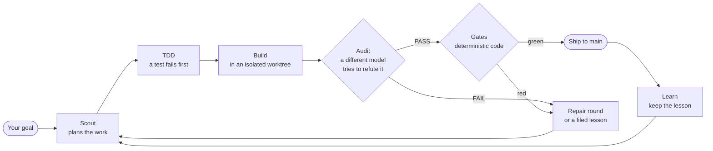

<p align="center">
  
</p>

<h1 align="center">Evolve Loop</h1>

<p align="center"><strong>Your AI wrote the code. Who decides that it is safe to merge?</strong></p>

<p align="center">
  An open-source pipeline that plans, builds and audits AI-written changes.<br>
  A different model challenges the work, and code that no model can argue with decides if it ships.
</p>

<p align="center">
  <a href="https://github.com/mickeyyaya/evolve-loop/releases/latest"></a>
  <a href="https://github.com/mickeyyaya/evolve-loop/actions/workflows/required.yml"></a>
  <a href="LICENSE"></a>
  <a href="https://github.com/mickeyyaya/evolve-loop/stargazers"></a>
</p>

<p align="center">
  <a href="https://mickeyyaya.github.io/evolve-loop/">Website</a> ·
  <a href="#quick-start">Quick start</a> ·
  <a href="#how-it-works">How it works</a> ·
  <a href="#how-you-can-help">How you can help</a> ·
  <a href="docs/guides/readme-reference.md">Full reference</a>
</p>

---

## The problem

Any agent can write a feature overnight. The code is not the bottleneck now. **Trust is.**

Most autonomous coding tools let one model write the code and then judge its own work. That is one judgment and one blind spot. An agent under pressure can also weaken a test, skip a check or report a success that did not occur.

**Evolve Loop is CI/CD for AI-written code.** You give it a goal, and it runs the work through a pipeline that the agent cannot talk its way past.

```bash
/evo:loop "add dark mode"
```

## What makes it different

- **A second mind, by default.** A reviewer from a different model family tries to break each change before it ships.
- **Code holds the verdict.** A floor compiled into the binary evaluates each cycle: `ship ⇒ build ∧ audit ∧ (tdd ∨ trivial)`. A document change also waives the tdd part. A setting cannot remove the floor, and a model cannot argue with it.
- **Tests fail first.** A code change ships only after a test failed first, unless the change is trivial.
- **Failures become rules.** The loop classifies each failure, keeps the work for salvage and files the follow-up in its own backlog.
- **No lock-in.** One routing table sends each phase to a CLI and a model: Antigravity (`agy`), Claude Code, Codex or local models through Ollama.
- **Isolated workers.** No LLM in the pipeline starts or directs another. Go code carries the flow, and each agent runs in its own sandboxed cell.
- **Runs in parallel.** Each loop has its own git worktree and branch, and only green work reaches `main`.

## It builds itself

The strongest proof that we can give is that this repository runs on its own pipeline.

| | |
|---|---|
| Autonomous cycles run on this repository | **2,200+** |
| Tagged versions | **280+** |
| Architecture decisions on record, with their reasons | **160+** |
| Coverage that `evolve cover changed` requires of a changed function | **100%** |

The pipeline also catches itself. An experiment with a new model once put seven bugs into one run, and each bug became a structural fix. The case studies are in [docs/incidents/](docs/incidents/).

**We publish the bad days too.** A cycle can fail, and many do. [One recent wave](docs/architecture/loop-goal.md) shipped 7 of 13 cycles, and the next ones did worse while we fixed a host fault and a landing mistake. The release notes state these facts. The point is not that cycles never fail. The point is that a failed cycle does not reach `main`, and it leaves a lesson.

## Quick start

You need one supported CLI and a repository to improve. The supported platforms are macOS and Linux, and Windows through WSL2.

```bash
curl -fsSL https://mickeyyaya.github.io/evolve-loop/install.sh | sh
evolve doctor
```

The installer verifies a checksum, and it installs one static binary. It needs no account and sends no telemetry. You can [read the script first](install.sh). If you use Claude Code, you can also run `/plugin marketplace add mickeyyaya/evolve-loop`.

Then, in your AI CLI:

```bash
/evo:loop "add dark mode"                        # a goal is enough
/evo:loop --cycles 3 harden "tighten validation" # a strategy and a hard bound
/evo:loop --resume                               # continue from the last checkpoint
```

Queue more work while the loop runs:

```bash
evolve inbox add --file fix-flaky-auth-test.json
```

## How it works



The phase order and the gates are code. The model decides what to build and how to build it, and it decides what looks wrong. **Intelligence proposes. A dependable process decides.**

A written [constitution](docs/architecture/constitution.md) ranks every rule of the project under one goal, so that an agent serves the result and not a local metric. It gives no agent the power to cross a gate.

## When to use it

| | A single-agent loop | Evolve Loop |
|---|---|---|
| Quality gate | The agent says "looks good" | An independent review and deterministic gates |
| Control of the flow | The agent | Go code |
| When something breaks | Start again | It classifies, repairs and learns |
| Memory | Forgets between runs | Lessons feed the next run |
| Models | One vendor | One routing table for each phase |
| Best for | Quick throwaway edits | Work that you must merge |

**Use something simpler if speed is your first need.** A full cycle takes time and costs more than one agent. The pipeline also has more concepts to learn. Agents such as Aider, OpenHands and Devin optimize how well an agent solves a task. Evolve Loop is the trust layer around that work.

## Known limits

- It depends on the quota of your LLM CLI subscriptions. A long run can hit a limit.
- Some parts run in shadow, so they record a decision and do not act on it yet. These include the code-review phase, the convergence policy and the self-healing orchestrator.
- A sandboxed Claude Code seat can end your stored login. A logout now reads as a login wall and not as quota. A seat token fix is on main, and it stays off until `evolve auth seat-token set`. Do not turn it on yet: the transcript readers that it needs are not built.
- The runtime needs tmux and a Unix shell.
- **Linux is less complete than macOS.** The bubblewrap sandbox refuses the launches that require a linked-worktree profile, so some phases cannot run under a mandatory sandbox on Linux.

The current guarantees are in the [runtime contract](docs/architecture/current-runtime-contract.md).

## How you can help

Evolve Loop is a small project with a big surface. It needs people who run it on code that the author has never seen.

- ⭐ **Star the repository.** It helps other people find the project.
- 🧪 **Try it on a real repository.** Then [open an issue](https://github.com/mickeyyaya/evolve-loop/issues/new/choose) that tells us what it caught and what it missed.
- 🕵️ **Find a way to game it.** A pattern that fools the pipeline is the most valuable report that we can get. Give the cycle number, the reports and what you expected.
- 🔌 **Add a CLI family.** A new LLM CLI starts as a manifest in [`go/internal/bridge/manifests/`](go/internal/bridge/manifests/).
- 🐧 **Close the Linux gap.** The bubblewrap sandbox cannot yet express the narrow Git metadata writes of a linked worktree. This is a real design problem, and we want help with it.
- 🐛 **Fix a flaky test.** The [open issues](https://github.com/mickeyyaya/evolve-loop/issues) and the [good first issues](https://github.com/mickeyyaya/evolve-loop/labels/good%20first%20issue) are the place to start.

Read [CONTRIBUTING.md](CONTRIBUTING.md) to start. A normal pull request is all that you need. We follow the [Code of Conduct](CODE_OF_CONDUCT.md), and security reports go through [SECURITY.md](SECURITY.md).

## Learn more

- [Website](https://mickeyyaya.github.io/evolve-loop/): the same story, in a visual form
- [Feature explainers](https://mickeyyaya.github.io/evolve-loop/explain/index.html): how each subsystem works and how the loop built it
- [Full reference](docs/guides/readme-reference.md): each command, the trust layers and the comparison in detail
- [Concepts](docs/concepts/overview.md) and [architecture decisions](docs/architecture/adr/)
- [Changelog](CHANGELOG.md)

## Version

**Current (v23.2)** — the full release history is in [CHANGELOG.md](CHANGELOG.md). To cut a release, use `evolve release X.Y.Z`.

| Version | Date | Notes |
|---|---|---|
| v23.2 | Nov 7 | See the [23.2.0] section of CHANGELOG.md. |
| v23.1 | Nov 7 | See the [23.1.0] section of CHANGELOG.md. |
| v23.0 | Nov 2 | See the [23.0.0] section of CHANGELOG.md. |

## License

[Apache-2.0](LICENSE). Third-party notices are in [NOTICE](NOTICE).

The design uses ideas from reflective self-improvement (Reflexion, Shinn and others, 2023), double-loop learning (Argyris and Schön, 1978) and the research on reward hacking. The [bibliography](docs/architecture/phase-architecture-citations.md) has the full list.
