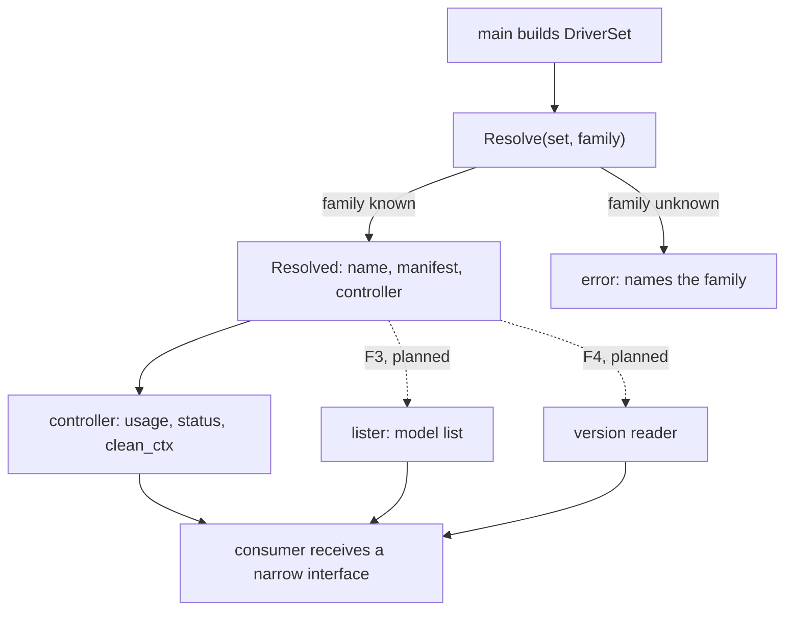
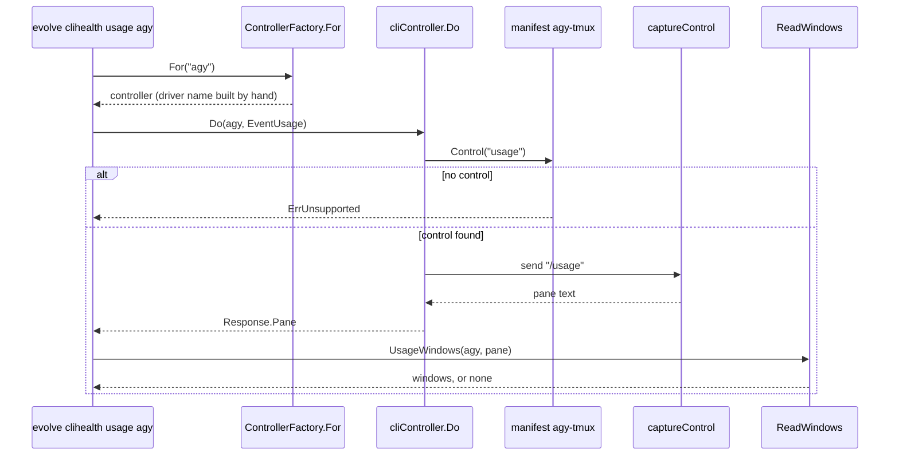

# Agent bridge factory: one function resolves every LLM CLI, and the manifest holds its facts

> Decision: [ADR-0137](adr/0137-one-bridge-factory-resolves-every-llm-cli-and-the-manifest-holds-its-facts.md). Plan: [bridge-factory-2026-10](../plans/bridge-factory-2026-10.md). Research: [bridge-factory-2026-10](../research/bridge-factory-2026-10.md).
>
> Status: accepted (2026-10-17). Component F1 is built (2026-10-17): `bridge.Resolve` and `bridge.DriverSet` exist.
>
> This file is the spec of record for how every caller reaches an LLM CLI. The dispatch rules stay in [agent-bridge-dispatch-contract](agent-bridge-dispatch-contract.md).

The operator said on 2026-10-17: "every query and action should go through agent bridge abstract layer for maximizing common layer as the factory model described in design pattern."

Each claim in this file cites a research id (B1 to B12, P6.1 to P6.5) from the research file. Otherwise it cites a `file:line` that the author read at commit `f25e7a205`. A name marked **planned** does not exist in the code yet. Plan components F1 to F6 build the planned names.

**Terms used throughout:**

- **Bridge:** the package `go/internal/bridge`. It starts an LLM CLI, talks to it and stops it.
- **Family:** the short name of a CLI route, for example `claude`, `agy`, `agy-claude`, `codex` or `ollama`.
- **Driver:** the Go object that launches one CLI in one pane. Its name is `<family>-tmux` today.
- **Manifest:** the JSON file of one driver in `go/internal/bridge/manifests/`. It holds the facts of the CLI as data.
- **Control:** a manifest entry under `controls` that names one command to send to the CLI, for example `/usage`.
- **Pane:** the text that the bridge captures from the terminal of the CLI.
- **Window:** one usage limit that a reader takes from a pane, for example "weekly, 98.62% left".
- **Simple Factory:** one function that takes a name and returns a ready object.
- **Abstract Factory:** one interface that creates a family of related objects ([Refactoring Guru](https://refactoring.guru/design-patterns/abstract-factory)).
- **Service Locator:** a global lookup that any code can call. It hides a dependency (P6.2).
- **Capability:** an optional interface that a driver can implement. A caller tests for it with a type assertion.
- **Consumer-defined interface:** an interface that the package which calls it declares, not the package which implements it (P6.3).
- **Bypass:** a call site that talks to an LLM CLI without the bridge, or that builds a driver name by hand.

## Table of contents

- [1. Goals](#1-goals)
- [2. The factory](#2-the-factory)
- [3. The DriverSet](#3-the-driverset)
- [4. Capabilities](#4-capabilities)
- [5. The manifest controls schema](#5-the-manifest-controls-schema)
- [6. Interfaces that the consumer owns](#6-interfaces-that-the-consumer-owns)
- [7. A worked example: evolve clihealth usage agy](#7-a-worked-example-evolve-clihealth-usage-agy)
- [8. Guards](#8-guards)
- [9. Limits](#9-limits)
- [Related documents](#related-documents)

## 1. Goals

| Goal | Measure | Target |
|---|---|---|
| G1: one factory resolves every family | `grep -E '\+ ?"-tmux"'` over non-test Go files outside the bridge | 0 sites (13 today outside the bridge, 19 in all, B8) |
| G2: only the bridge runs an LLM binary | an AST guard for `exec` of `claude`, `agy`, `codex` or `ollama` outside the bridge | 0 sites |
| G3: the facts of a CLI are manifest data | per-CLI `switch` branches outside the bridge on the query flow (B11) | 0 branches |
| G4: each rule has a guard test | each guard fails on a fixture with the banned shape | red on the fixture, green on the tree |

The order of the goals is the order of the work. G1 comes first, because every later step uses the factory.

## 2. The factory

### Issue

The bridge has a controller factory, but no factory resolves a driver name and its manifest (B7). `ControllerFactory.For` builds the name by hand: `CLI: family + "-tmux"` (`go/internal/bridge/controllerfactory.go:25`). 19 production sites do the same: 10 in `cmd/evolve`, 6 in `internal/bridge`, 2 in `internal/llmroute` and 1 in `internal/looppreflight` (B8).

The map from a family to a driver exists twice: `bareDriverMap` (`go/internal/bridge/driver.go:48-53`) and `cliBinaryFor` in `llmroute` (B9). The first map has no `agy-claude` and no `ollama`. So `DriverFor("ollama")` returns `ollama`, not `ollama-tmux` (B9).

### Gap

Three copies of one fact give three chances to differ, and one copy already differs (B9). The bridge also keeps a package global, `drivers` (`driver.go:20-23`). Each driver file fills it in `init()`: for example `go/internal/bridge/driver_agytmux.go:48-51`. The `Driver` interface has `Name` and `Launch` only (`driver.go:10-14`).

This registry is a Service Locator (B7, P6.2). Any code can call it, it hides a dependency, and a test cannot replace it. Current Go guidance keeps `init()` simple and passes dependencies through constructors (P6.4). P6.4 allows the `database/sql` registry because it serves libraries. That registry does not wire the services of an application. The bridge registry wires an application, so the guidance applies.

### Solution

Add one function, `bridge.Resolve(set DriverSet, family string) (Resolved, error)` (D1, built by F1 in `go/internal/bridge/resolve.go`). `Resolved` holds the driver name and the manifest. `Resolve` reads only the manifest set. It replaced the 19 hand-built names (R1).

F1 made three choices that the plan did not fix:

| Choice | Reason |
|---|---|
| `Resolved` has no controller field. `ControllerFactory.For` takes the driver name from the set, and `cliController.Do` calls `Resolve`. | A controller needs a workspace and an agent name. A family does not give them. |
| `llmroute` keeps its own family table (`interactiveDriverFor`). A bridge test keeps it equal to `Resolve`. | `bridge` imports `llmroute`, so `llmroute` cannot call `Resolve`. The tier plan also bans a `bridge` import in `cliroute`, which calls `llmroute.DefaultDriverForFamily`. |
| `bareDriverMap` and `DriverFor` stay. | `DriverFor("ollama")` returns `ollama` today (B9). A change of that result changes dispatch, which is a non-goal of F1. |

An unknown family gives `*UnknownFamilyError`, never a guessed name. Each moved site keeps its old reaction to a missing manifest: it skips the family, returns an error or returns no value.

The factory starts as a Simple Factory with three products. It grows into an Abstract Factory when it also returns the model lister (F3) and the version reader (F4) of the family (P6.1). A wider factory interface costs a change for each new product (P6.5). So the factory grows one product at a time.

A caller never calls `Resolve` and then uses the whole `Resolved`. `main` resolves the family and passes a narrow interface to the consumer. The consumer sees a `Lister`, not a manifest (D1).

**Why the `init()` registry goes in steps.** The plan scored three designs: the factory in steps (43 of 50), guards only (38) and one big change (28). The registry does not go at once. It feeds only the default `DriverSet` in `main` until a later step removes it (plan §10).

## 3. The DriverSet

### Issue

The manifest set is global state. The manifests are embedded files (`go/internal/bridge/manifest.go:34-35`), and `LoadManifest` reads them through the package variable `manifestFS` (`manifest.go:42`). A caller cannot give a test its own set of manifests without a write to that variable.

### Gap

`Resolve` needs the list of known drivers and their manifests. If `Resolve` reads the global registry, it inherits the Service Locator problem (plan §10). The research names no type for the set, so F1 defined it.

### Solution

`NewDriverSet(names, load)` keys each name that ends in `-tmux` by its family. `load` reads the manifest at each `Resolve`, so an override file still applies. `DefaultDriverSet()` uses `ManifestNames()` and `LoadManifest`. The set does not read the `init()` registry.

`cmd/evolve` builds the default set once, in `driver_set.go`. A bridge function without a set parameter, such as `UsageWindows`, uses `DefaultDriverSet()`. A test builds a small `DriverSet` with a fake loader and passes it in.

F1 wrote the red test first: every manifest resolves, `agy-claude` and `ollama` included (`TestResolve_EveryInteractiveManifestResolvesFromItsFamily`). A family name gives the right driver for every family. `DriverFor` keeps its old result (B9), as the table in §2 says.

## 4. Capabilities

### Issue

A caller needs more than a launch from a driver. The deep probe builds its own argv in `bridge doctor --deep`: `claude -p … --model haiku`, `codex exec`, and `agy -p "Reply only: PROBE_OK"` with no `--model` (B5, `go/internal/bridge/doctor.go:137-160`). The `--version` call runs in two places (B6).

### Gap

The `Driver` interface has `Name` and `Launch` only (`driver.go:10-14`). A new method on `Driver` will force every driver to implement it. That is the cost of a wide interface (P6.5).

### Solution

Add each new duty as an optional interface. The bridge already does this once. `CLIPreflight` is a second interface (`driver.go:16-18`). `launch.go:171` tests for it with a type assertion: `driver.(CLIPreflight)`. Only `codexTmuxDriver` implements it today (`go/internal/bridge/driver_codextmux.go:12`).

| Capability | Duty | Plan component | State |
|---|---|---|---|
| `CLIPreflight` | Prepare the CLI before a launch, best effort. | none | built |
| `Probe` | Run the deep probe with the manifest's model and argv (D4, R2). | F2 | planned |
| `ModelLister` | Return the model list of the family (D3). | F3 | planned |
| `Version` | Return the version of the binary, for every caller (D5, R4). | F4 | planned |

The names `Probe`, `ModelLister` and `Version` are **planned**. The research fixes the duty of each name, not its signature. 

The research does not say how a caller treats a driver without a capability. The pattern of `launch.go:171` is a type assertion. If the assertion fails, the caller skips the duty. This file proposes the same rule for the planned capabilities. F2 to F4 confirm it. The sentinel `ErrUnsupported` (`go/internal/bridge/clicontrol/clicontrol.go:19`) already marks an event that a family does not support.

## 5. The manifest controls schema

### Issue

Several branches outside the bridge switch on a CLI name (B11). There are three examples:

- a lister for each of `ollama`, `agy` and `agy-claude` (`go/internal/modelquery/exec.go:37-41`);
- a picker parser for each of `codex`, `agy` and `claude` (`modelquery/picker.go:10-75`);
- an effort lister for `claude` and `agy` (`modelquery/effort.go:98-103`).

The agy prompt marker `"? for shortcuts"` exists as a Go literal and as manifest data (B10).

### Gap

A new CLI needs new Go branches in many packages. A screen change, such as the agy 1.4.0 `/usage` screen, needs a code change where the facts are in Go.

### Solution

Put each fact in the manifest `controls` map, as the `/usage` path already does (B1). `ControlSpec` has these fields today (`go/internal/bridge/manifest.go:92-98`):

| Field | Meaning |
|---|---|
| `send` | The command to type into the CLI, for example `/usage`. |
| `await` | The condition that ends the capture: `prompt_marker` (the default) or `windows` (a stable window readout). |
| `exhausted_regex` | A pattern that marks an exhausted quota in the pane. |
| `drift_probe_regex` | A pattern for a pane that looks like a limit message. |
| `windows` | The parse spec for usage windows. |

The `windows` field is a `quotastate.WindowSpec` (`go/internal/quotastate/windows.go:24-33`). This table shows each key with its value in `agy-tmux.json`, in the worked model:

| Key | Role | Value in `agy-tmux.json` |
|---|---|---|
| `section_regex` | Finds the title of a quota group. The named group `scope` takes the title. | A title that ends in `MODELS` |
| `models_regex` | Finds the line that lists the models of a group. | `Models within this group:` |
| `labels` | Maps a line to a window kind (`week` or `5h`). | `Weekly Limit Remaining`, `Five Hour Limit Remaining` |
| `value_regex` | Takes the percent from the value line. | `\d{1,3}(\.\d+)?%` |
| `value_direction` | Says if the percent counts what remains or what is used. | `remaining` |
| `reset_regex` | Takes the reset time. | `refreshes in …` |
| `exhausted_at_used_pct` | The used percent that counts as exhausted. | 99.5 |
| `scopes` | Maps a group title to a family. `per_model` makes a window name its model (`ScopeTarget`, `windows.go:41-44`). | `GEMINI MODELS` to `agy`; `CLAUDE AND GPT MODELS` to `agy-claude` |

The manifest loader validates this spec when it loads the manifest. `validatePaneVocabulary` calls `validateUsageWindows` (`go/internal/bridge/manifest_pane_vocabulary.go:27`, `usage_window_reader.go:29-38`). A bad regex fails at load, not at the first read.

The model keys below are **planned**. The research names them and does not define their fields (D3, R3):

| Planned key | Replaces | Component |
|---|---|---|
| `controls.models` | The `agy models` and `ollama list` runs (B3). | F3 |
| `controls.effort` | The `<cli> --help` run and its Go parse (B4). | F5 |
| `controls.model.parse` | The picker parser keyed on a CLI name (B2, B11). | F5 |

The manifest already has `controls.model` with `"send": "/model"` (`agy-tmux.json`). `parse` adds the spec that reads the picker. Each move keeps the Go parser until a fixture of the real screen passes with the manifest spec (plan §10).

## 6. Interfaces that the consumer owns

### Issue

`modelquery` runs `agy models`, `ollama list` and `<cli> --help` through its own exec path, `defaultRunner` (B3, B4, `go/internal/modelquery/exec.go:18-28`). That path skips the sandbox and the pane hygiene of the bridge.

### Gap

If the bridge defines the lister interface, `modelquery` must import `bridge`. If `modelquery` keeps its own interface, the bridge can implement it, and no reverse import exists.

### Solution

The package that uses an interface defines it (P6.3). Four interfaces follow this rule:

| Interface | Owner | State | The bridge or an adapter implements it |
|---|---|---|---|
| `modelquery.Lister` with `List(ctx, cli) ([]string, error)` | `modelquery` (`go/internal/modelquery/query.go:15-17`) | built | A bridge adapter over `controls.models` (F3) |
| `cliroute.HeadroomSource` | `cliroute` | planned (tier plan Q3) | An adapter over the stored usage observations |
| `modelcapacity.CatalogReader` | `modelcapacity` | planned (tier plan Q5) | An adapter over the model catalog |
| `modelcapacity.UsageReader` | `modelcapacity` | planned (tier plan Q5) | An adapter over the usage windows |

`modelquery` keeps `Lister` and does not import `bridge` (F3, R3). `cliroute` imports no bridge and runs no probe. The `modelcapacity` package has no `exec`, no tmux and no CLI-name literal ([tier plan](../plans/model-tier-policy-2026-10.md), Q5; [bridge plan](../plans/bridge-factory-2026-10.md) §8). A repo-contract test pins this.

Two injected interfaces already work this way. `usageprobe.Prober` takes function fields for the probe, the classifier and the window reader (`go/internal/usageprobe/usageprobe.go:20-28`). `modelquery.RefreshDeps` takes a `Lister` and a `Classifier` (`modelquery/query.go:23-31`). A test replaces the CLI in both (B12).

## 7. A worked example: evolve clihealth usage agy

This case follows one command from the shell to the window values. The path is the model that the other paths copy (B1).

1. `evolve clihealth usage agy` calls `clihealthUsage` (`go/cmd/evolve/cmd_clihealth_usage.go:43`). The family list is `[agy]`. Without an argument, the list is `bridge.InteractiveFamilies()`.
2. `productionUsagePanes` makes a temporary workspace and calls `bridge.NewControllerFactory(projectRoot, ws, "clihealth-usage", bridge.Deps{})` (`cmd_clihealth_usage.go:34-41`).
3. `bridgeUsageProbe` wraps `usageevidence.UsagePane(factory)` (`go/cmd/evolve/cli_usage_probe.go:60-62`). That function calls `factory.For(family).Do(ctx, family, clicontrol.EventUsage)` (`go/internal/usageevidence/production.go:56-61`).
4. `ControllerFactory.For` builds a `Config` with the driver name of the family from `DefaultDriverSet()` and returns `NewController` (`clicontrol_adapter.go:17`). Before F1, this step built the name by hand.
5. `cliController.Do` calls `Resolve`, which loads the manifest `agy-tmux`. `Do` then reads `Control("usage")` (`clicontrol_adapter.go:38-47`). If the manifest has no such control, `Do` returns `ErrUnsupported`, and the command prints "its manifest maps no usage command" (`cmd_clihealth_usage.go:72-73`).
6. `Do` calls `captureSpec` with the control spec. The spec of agy has `await: prompt_marker`, so `captureSpec` calls `captureControl` with `/usage`. `captureControl` starts a session, sends the command and reads the pane up to 8 times. It stops early when the pane contains the prompt marker. It then kills the session (`go/internal/bridge/recipe_adapter.go`). For claude, `await: windows` makes the capture wait for stable usage rows ([2026-10-26 incident](../incidents/2026-10-26-claude-usage-capture-stopped-before-the-rows.md)).
7. `readUsage` passes the pane to `bridge.UsageWindows(family, pane, now)` (`cmd_clihealth_usage.go:77`). That function loads the manifest, takes `controls.usage.windows` and calls `quotastate.ReadWindows` (`usage_window_reader.go:10-20`).
8. `ReadWindows` reads the pane line by line. A group title sets the scope. A label opens a window. A value and a reset line fill it (`quotastate/windows.go:176-190`).
9. If no window comes out, and the manifest declares `controls.usage.windows`, the command prints the error "no usage window read" and exits 1. A manifest without that spec gets a note.

On 2026-10-17 this command reported "no usage window read" for agy. Nobody knows the cause yet. The screen has three groups, and the reader was made for the agy 1.3.0 screen (tier plan §6a). Tier-plan component Q1 finds it.

**The same path for the planned model list.** `evolve models list` reaches `agy` today through `modelquery/agy.go:21`, which runs `agy models` outside the bridge (B3). After F3, the steps are:

1. `main` resolves the family: `Resolve(set, "agy")` (planned).
2. A bridge adapter implements `modelquery.Lister`. Its `List` reads `controls.models` of the manifest (planned).
3. The adapter sends the command through the bridge, so the sandbox and the pane hygiene apply.
4. The adapter parses the pane with the manifest spec and returns the model names.
5. `modelquery.Refresh` receives the adapter as its `Lister` and does not know the bridge.

The red test of F3 uses a fixture of the real `agy models` output. The guard bans a `sysexec` of an LLM binary outside the bridge (plan §7).

## 8. Guards

Each step that removes a bypass adds a guard test that bans the shape it removes (D6, R6). The guard tests are **planned**, and the research states the rule of each guard but names no test.

| Rule | Guard test | State |
|---|---|---|
| No `+"-tmux"` outside `Resolve` | `TestDriverNames_AreBuiltOnlyByResolve`, with the fixture test `TestTmuxNameBuilds_FindsEachBannedShape` (F1) | built |
| Every manifest resolves, `agy-claude` and `ollama` included | `TestResolve_EveryInteractiveManifestResolvesFromItsFamily` (F1) | built |
| The family table of `llmroute` equals `Resolve` | `TestResolve_AgreesWithTheRoutingTableForEveryFamily` (F1) | built |
| No LLM argv literal in `bridge/doctor.go` | A scan of `doctor.go` (F2) | planned |
| The agy probe argv carries the manifest's `fast` model | A test of the probe argv (F2) | planned |
| No `sysexec` of an LLM binary outside the bridge | An AST scan with an allow rule for the `bridge` package and its tmux layer (F3) | planned |
| One `--version` call site | A scan for `--version` runs (F4) | planned |
| No `pickerParsers` map keyed on a CLI name | A scan of `modelquery` (F5) | planned |
| No function over 50 lines in `bridge/launch.go` | A length check on `launch.go` (F6) | planned |
| `modelcapacity` has no `exec`, no tmux and no CLI-name literal | A repo-contract test ([tier plan](../plans/model-tier-policy-2026-10.md), Q5) | planned |
| `cliroute` imports no bridge | An import check ([tier plan](../plans/model-tier-policy-2026-10.md), Q3) | planned |
| A `controls.usage.windows` spec compiles at manifest load | `validateUsageWindows` through `validatePaneVocabulary` | built |
| A control with `await: windows` declares a `windows` spec | `validateControlAwaits` through `validatePaneVocabulary` | built |
| A guard fails on a fixture with the banned shape | Each guard has a fixture test (G4) | planned |

## 9. Limits

- The design does not add a driver. It does not change what a dispatch does (plan §4).
- It does not unify the launch driver and the recipe driver into one interface. Plan design B reaches that end state after the facts are in the manifest (plan §5).
- A parse spec in the manifest reads a screen, and a screen can change. Each spec needs a fixture of the real screen, and a fixture cannot prove that a new CLI release keeps the format (ADR-0137, Consequences).
- If a CLI needs logic that data cannot express, its driver keeps that logic in Go inside the bridge. The rule still holds, because the code stays in the bridge (ADR-0137).
- A guard test finds the shapes that it names. It does not find a new way to run a CLI.
- The research does not define the fields of `Probe`, `ModelLister`, `Version`, `controls.models`, `controls.effort` or `controls.model.parse`. Plan components F2 to F5 define them.
- The F1 guard finds the three shapes that it names. A name built from a constant, such as `x + tmuxSuffix`, passes it.
- The Go 1.27 migration of the drivers and a new tmux layer are out of scope (plan §4).

## Related documents

- [ADR-0137](adr/0137-one-bridge-factory-resolves-every-llm-cli-and-the-manifest-holds-its-facts.md): the decision and its rejected options.
- [bridge-factory plan](../plans/bridge-factory-2026-10.md): the candidate designs, the decisions D1 to D7 and the components F1 to F6.
- [bridge-factory research](../research/bridge-factory-2026-10.md): the audit B1 to B12 and the outside practice P6.1 to P6.5.
- [agent-bridge-dispatch-contract](agent-bridge-dispatch-contract.md): the dispatch invariants.
- [model-routing](../reference/model-routing.md), section "The tier policy": the tier components that query a CLI follow this design.
- [ADR-0119](adr/0119-one-routing-table-one-resolver.md): the routing table that decides which CLI runs.
