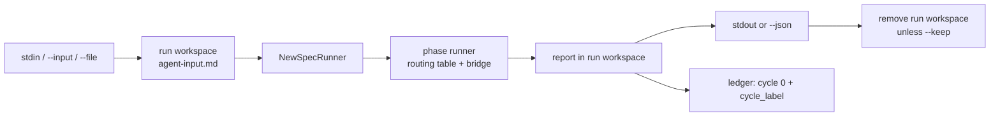

# Agent run: one phase agent, one input, one answer, no cycle

> [ADR-0152](adr/0152-one-phase-agent-runs-from-the-command-line-with-no-cycle-through-the-phase-runner.md) · plan: [agent-run-standalone-2026-10](../plans/agent-run-standalone-2026-10.md) · research: [agent-run-standalone-2026-10](../research/agent-run-standalone-2026-10.md).
> This file is the spec of record for `evolve agent run` and `evolve agent list`. The package note [internal-cli-agentcmd](packages/internal-cli-agentcmd.md) holds the package detail.
>
> **Terms used throughout:**
> - **Profile**: a spec phase from the merged phase catalog, with its persona and its `.evolve/profiles/<name>.json`.
> - **Standalone run**: one dispatch of one profile with cycle 0, outside every cycle.
> - **Run label**: `agent-<profile>-<UTC time>-<4 hex>`, the name of one standalone run.
> - **Run workspace**: `.evolve/ephemeral/agent-runs/<run label>`, the only directory that the run writes.
> - **Report**: the primary artifact of the profile, for example `adversarial-review-report.md`.

## Table of contents

1. [Goals](#1-goals)
2. [A worked example](#2-a-worked-example)
3. [Input contract](#3-input-contract)
4. [Output contract](#4-output-contract)
5. [No cycle](#5-no-cycle)
6. [Profiles](#6-profiles)
7. [Guards](#guards)
8. [Limits](#limits)

## 1. Goals

| Goal | Measure | Target |
|---|---|---|
| G1 The report on stdout | `git diff \| evolve agent run adversarial-review` prints the report text | the exact artifact bytes |
| G2 A machine envelope | `--json` prints one object | report, verdict, model, cost, tokens |
| G3 No cycle footprint | files that change in the project | only the ledger files |
| G4 One dispatch path | the code that launches the agent | `phasecmd.NewSpecRunner`, the phase runner and the bridge factory |

The goals have this order: G3 and G4 are safety, so they win over G1 and G2 when they conflict.

## 2. A worked example

```sh
git diff origin/main...HEAD | evolve agent run adversarial-review > review.md
echo $?   # 0 for PASS or WARN, 1 for FAIL
git diff origin/main...HEAD | evolve agent run adversarial-review --json | jq '.verdict, .cost_usd'
```

The command reads the diff, writes it to `<run workspace>/agent-input.md`, and runs the `adversarial-review` spec phase with cycle 0. The routing table picks the CLI chain of the profile (Claude Code for this claude-family-floor profile). The agent writes `adversarial-review-report.md` in the run workspace. The command prints that file, appends one ledger line, and removes the run workspace.

## 3. Input contract

### Issue

`evolve phase` takes a `core.PhaseRequest` JSON, and a spec prompt renders only the keys in its `prompt_context` (research F1.1, F1.4). A person with a diff has no request and no key.

### Gap

An evaluate phase gets `goal` by default, but a plan phase gets no key. The personas also expect cycle artifacts such as `build-report.md` (F1.5).

### Solution

- The input is text. It comes from stdin, or from `--input FILE`. The value `-` means stdin.
- Each `--file PATH` adds one section: a `### <path>` heading and the file in a fenced block. The flag can repeat.
- The fence of a section is one backtick longer than the longest backtick run in the file, and at least three. A fence in the file thus cannot close its section.
- Each source has a limit of 8 MiB (`maxInputBytes`). A larger source, or a device such as `/dev/zero`, is exit 11.
- An empty input after composition is exit 11. A terminal on stdin with no `--input` and no `--file` is a usage error (exit 10), so the command never waits for typed input.
- The command writes the composed input to `<run workspace>/agent-input.md`.
- The request puts the input under the context key `specrunner.AgentInputKey` (`agent_input`). The spec runner renders it in every spec prompt as the section `## Agent Input`. A note in that section tells the agent that the input replaces the cycle artifacts that its instructions name.

## 4. Output contract

### Issue

`evolve phase` prints only the envelope. The report stays in a file (F1.1).

### Solution

- stdout carries the report text, unchanged. Nothing else goes to stdout.
- `--json` replaces the report text with one JSON object:

| Field | Value |
|---|---|
| `profile` | the profile name |
| `run_label` | the run label |
| `verdict` | `PASS`, `WARN`, `FAIL` or `SKIPPED` from the phase runner |
| `report` | the report text |
| `model`, `model_source` | `PhaseResponse.ResolvedModel` and `ModelSource` |
| `cost_usd`, `tokens`, `duration_ms` | from the phase response |
| `diagnostics` | the diagnostics of the phase response |
| `workspace` | the run workspace, only with `--keep` |
| `error` | the dispatch error or the ledger error, when there is one |

- stderr carries the runner logs and each refusal.

| Exit | Meaning |
|---|---|
| 0 | The verdict is PASS, WARN or SKIPPED. |
| 1 | The verdict is FAIL. The report, if any, is still printed. |
| 2 | Refused: a source-write profile, a built-in phase, a call from inside a phase, or a refused root router. |
| 3 | A dispatch error, or a failed ledger append. |
| 10 | Usage: a missing or unknown profile, a bad flag, a terminal on stdin. |
| 11 | Input: an unreadable or empty input. |

## 5. No cycle

### Issue

`--cycle N` needs a real cycle, and an invented cycle number is forbidden (F1.2).

### Solution

- The request has `Cycle: 0`, `RunID` = the run label, and no worktree (F1.7). With no worktree the request has no fence, and the bridge grants no Git writes.
- The workspace is the run workspace, outside `.evolve/runs`. The profile grant `.evolve/runs/cycle-*` maps to it (F1.6), so the sandboxed agent can write its report.
- The command never reads cycle state and never takes or reads a lease. A live loop sees the run only as one ledger line.
- The run workspace is removed when the command ends. `--keep` keeps it and puts its path in the envelope.
- SIGINT and SIGTERM cancel the context of the dispatch. The runner then returns, and the command still appends the ledger entry and removes the workspace.
- One ledger entry records the run: `cycle: 0`, `cycle_label` = the run label, `role` = the profile and `kind: agent_run`. The entry also holds the model, the exit code, the duration, the SHA-256 of the report and `source: evolve agent run`.



## 6. Profiles

- `evolve agent list` prints each runnable profile: one line with the name, the archetype and the description. `--json` prints an array of objects with the same fields.
- A runnable profile is a spec phase that `phasecmd.SpecRunnable` accepts: kind `llm`, not a control archetype, not a built-in. `core.PhaseWritesSource` must also mark it as read-only.
- A built-in phase is refused (exit 2) with a pointer to `evolve phase --cycle N`, because each built-in phase reads or writes cycle state.
- A source-write spec phase (`bug-reproduction`, `test-amplification`) is refused (exit 2) in v1.

## Guards

| Rule | Guard | State |
|---|---|---|
| No cycle state, lease or run dir changes | `TestAgentRun_AdversarialReviewDiffOnStdinPrintsTheReportAndLeavesNoCycleFootprint` | enforced |
| No call from inside a phase | `subagent.ReadDispatchDepth` above 0 is exit 2 | enforced |
| No source-write profile | `core.PhaseWritesSource` is exit 2 | enforced |
| One dispatch path | the run builds its runner only through `phasecmd.NewSpecRunner` | enforced by review |

## Limits

- v1 runs no source-write profile and no built-in phase.
- v1 has no event stream. The JSON is one object at the end.
- `evolve gc` does not sweep `.evolve/ephemeral/agent-runs`. Only `--keep` and a killed process leave a run workspace.
- The test proves the footprint with a fake bridge. It does not prove what a real CLI writes outside its sandbox grants.
