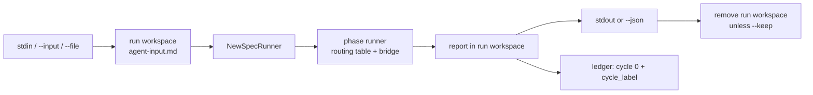
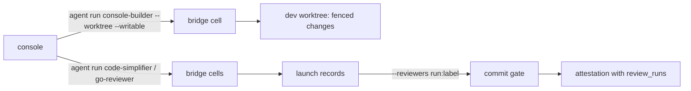

# Agent run: one phase agent, one input, one answer, no cycle

> [ADR-0152](adr/0152-one-phase-agent-runs-from-the-command-line-with-no-cycle-through-the-phase-runner.md) · plan: [agent-run-standalone-2026-10](../plans/agent-run-standalone-2026-10.md) · research: [agent-run-standalone-2026-10](../research/agent-run-standalone-2026-10.md).
> This file is the spec of record for `evolve agent run` and `evolve agent list`. The package note [internal-cli-agentcmd](packages/internal-cli-agentcmd.md) holds the package detail.
>
> **Terms used throughout:**
> - **Profile**: a spec phase from the merged phase catalog, with its persona and its `.evolve/profiles/<name>.json`.
> - **Standalone run**: one dispatch of one profile with cycle 0, outside every cycle.
> - **Run label**: `agent-<profile>-<UTC time>-<4 hex>`, the name of one standalone run.
> - **Run workspace**: `.evolve/ephemeral/agent-runs/<run label>`, the only directory that the run writes.
> - **Report**: the primary artifact of the profile, for example `adversarial-review-report.md`.
> - **Launch record**: `.evolve/agent-runs/<run label>.json`, the record of the driver, the family, the model and the tree that one run saw (§7).
> - **Build seat**: the profile `console-builder`, one of two profiles that write source in a standalone run, with `cloud-builder` (§8).

## Table of contents

1. [Goals](#1-goals)
2. [A worked example](#2-a-worked-example)
3. [Input contract](#3-input-contract)
4. [Output contract](#4-output-contract)
5. [No cycle](#5-no-cycle)
6. [Profiles](#6-profiles)
7. [The launch record and the signals](#7-the-launch-record-and-the-signals)
8. [The console seats](#8-the-console-seats)
9. [Guards](#guards)
10. [Limits](#limits)

## 1. Goals

| Goal | Measure | Target |
|---|---|---|
| G1 The report on stdout | `git diff \| evolve agent run adversarial-review` prints the report text | the exact artifact bytes |
| G2 A machine envelope | `--json` prints one object | report, verdict, model, cost, tokens |
| G3 No cycle footprint | files that change in the project | only the ledger files and the launch record |
| G4 One dispatch path | the code that launches the agent | `phasecmd.NewSpecRunner`, the phase runner and the bridge factory |

The goals have this order: G3 and G4 are safety, so they win over G1 and G2 when they conflict.

## 2. A worked example

```sh
git diff origin/main...HEAD | evolve agent run adversarial-review > review.md
echo $?   # 0 for PASS or WARN, 1 for FAIL
git diff origin/main...HEAD | evolve agent run adversarial-review --json | jq '.data.verdict, .data.cost_usd'
```

The command reads the diff, writes it to `<run workspace>/agent-input.md`, and runs the `adversarial-review` spec phase with cycle 0. The routing table picks the CLI chain of the profile (Claude Code for this claude-family-floor profile). The agent writes `adversarial-review-report.md` in the run workspace. The command prints that file, appends one ledger line, and removes the run workspace.

## 3. Input contract

### Issue

`evolve phase` takes a `core.PhaseRequest` JSON, and a spec prompt renders only the keys in its `prompt_context` (research F1.1, F1.4). A person with a diff has no request and no key.

### Gap

An evaluate phase gets `goal` by default, but a plan phase gets no key. The personas also expect cycle artifacts such as `build-report.md` (F1.5).

### Solution

- The input is text. It comes from stdin, or from `--input FILE`. The value `-` means stdin.
- Each `--file PATH` adds one section: a `### <path>` heading and the file in a fenced block. The flag can repeat.
- The fence of a section is one backtick longer than the longest backtick run in the file, and at least three. A fence in the file thus cannot close its section.
- Each source has a limit of 8 MiB (`maxInputBytes`), and all sources together have the same limit. A larger input, or a device such as `/dev/zero`, is exit 11.
- An empty input after composition is exit 11. A terminal on stdin with no `--input` and no `--file` is a usage error (exit 10), so the command never waits for typed input.
- The command writes the composed input to `<run workspace>/agent-input.md`.
- The request puts the input under the context key `specrunner.AgentInputKey` (`agent_input`). The spec runner renders it in every spec prompt as the section `## Agent Input`. A note in that section tells the agent that the input replaces the cycle artifacts that its instructions name.

## 4. Output contract

### Issue

`evolve phase` prints only the envelope. The report stays in a file (F1.1).

### Solution

- stdout carries the report text, unchanged. Nothing else goes to stdout.
- `--json` replaces the report text with one envelope of [cli-contract.md](cli-contract.md) §2 (`evolve.agent.run/1`, since X17b). Its `data` is this object:

| Field | Value |
|---|---|
| `profile` | the profile name |
| `run_label` | the run label |
| `verdict` | `PASS`, `WARN`, `FAIL` or `SKIPPED`: the verdict of the phase runner, checked against the report body (§4.1) |
| `findings` | the counts of the report body by severity: `critical`, `high`, `medium`, `low` (§4.1) |
| `report` | the report text |
| `model`, `model_source` | `PhaseResponse.ResolvedModel` and `ModelSource` |
| `cost_usd`, `tokens`, `duration_ms` | from the phase response |
| `diagnostics` | the diagnostics of the phase response |
| `cli`, `family` | the driver of the last launch, and its CLI family (`llmroute.Family`) |
| `launch_record` | the path of the launch record |
| `worktree` | the `--worktree` directory, when the run has one |
| `workspace` | the run workspace, only with `--keep` |
| `error` | the dispatch error, the ledger error or the launch record error, when there is one |

- stderr carries the runner logs and each refusal.

| Exit | Meaning |
|---|---|
| 0 | The verdict is PASS, WARN or SKIPPED. |
| 1 | The verdict is FAIL. The report, if any, is still printed. |
| 3 | Refused: a writer that is not a build seat, or a `--worktree` that is not a linked worktree. Also a built-in phase, a call from inside a phase, or a refused root router. It was 2 before X17b. |
| 10 | Usage: a missing or unknown profile, a bad flag, a terminal on stdin. |
| 11 | Input: an unreadable or empty input. |
| 21 | A dispatch error, a failed ledger append, or a failed write of the launch record. It was 3 before X17b. |

### 4.1 The verdict comes from the report body

**F4.1** The verdict field of a review run said PASS while the report body said FAIL. This occurred twice on 2026-10-27, for example in run `agent-docs-review-20261027T060904Z-90c9` (body FAIL, 1 HIGH).
*Implication:* the phase runner sets the field from the required sections only. A reader or a gate that trusts the field passes a failed review.

- A profile that requires a `Verdict` section declares a review report. For such a profile, the run reads the report body after the dispatch (`reportVerdict` in `go/internal/cli/agentcmd/verdict.go`).
- The body gives two values:
  - the stated verdict: the `evolve-verdict` sentinel, else the `Verdict` line outside the fences (`reportdoc.Verdict`). A verdict line inside a fence states no verdict;
  - the counts by severity (`reportdoc.CountSeverities`). A finding line starts with `[CRITICAL]`, `[HIGH]`, `[MEDIUM]` or `[LOW]`. `[MAJOR]` counts as HIGH, and `[MINOR]` counts as LOW. A count table row also counts. A counts line also counts: it starts with an optional bullet and up to two one-word labels, and it has two or more counts (§4.2). For each severity, the larger of the listed and the declared count is the count.
- When the field is PASS or WARN, these rules apply in this order:

| The report body | The run verdict | Signal |
|---|---|---|
| one or more CRITICAL or HIGH findings | FAIL | `REVIEW_AGENT_RUN_VERDICT_MISMATCH` |
| the stated verdict is FAIL | FAIL | `REVIEW_AGENT_RUN_VERDICT_MISMATCH` |
| no stated verdict | FAIL | `REVIEW_AGENT_RUN_VERDICT_MISMATCH`, and `REVIEW_AGENT_RUN_VERDICT_PARSE_DEFECT` when the body lists 0 CRITICAL and 0 HIGH |
| the stated verdict is WARN | WARN | none |
| the stated verdict is PASS or SKIPPED | the field | none |

- **F4.2** On 2026-11-03, three code-reviewer reports put the verdict in a trailing fence, and each clean review became FAIL. The cause was a fenced verdict template in the diff reviewer personas. The fix removes that template.
  *Implication:* the run does not read a fenced verdict. A second fence grammar duplicates `reportdoc` and `phasecontract`. Also, `reportdoc.CountSeverities` counts no fenced finding, so a fenced PASS can hide a fenced HIGH.
- The persona guard is the test `TestDiffReviewerPersonas_NeverShowTheVerdictLineInsideACodeFence` in `go/internal/prompts/persona_verdict_unfenced_test.go`. A fenced verdict line in a persona makes clean reviews fail with a parse defect.
- No stated verdict with 0 CRITICAL and 0 HIGH is a parse defect. The run also emits `REVIEW_AGENT_RUN_VERDICT_PARSE_DEFECT` and adds one more error diagnostic. The signal shows a clean review that the report format or the parser failed. The run verdict stays FAIL, and the mismatch signal fires too.
- A field of FAIL or SKIPPED stays as it is. A profile with no `Verdict` section keeps the field, for example `code-simplifier` and the orchestrator seat of the self-healing loop.
- The signal is WARN in the module `review`. Its `run_id` is the run label, and its reason names the run label too. Its fields give the field verdict, the stated verdict and the CRITICAL and HIGH counts. The envelope gets one error diagnostic with the same reason.
- The run verdict goes to the envelope, the exit code, the ledger entry and the launch record. Thus `evolve commit-gate run --reviewers run:<run label>` refuses the run, because its record verdict is FAIL (§7).
- A body WARN with a field PASS gives WARN, not FAIL. The rule takes the stricter verdict of the two. A WARN review that names only MEDIUM findings does not block a commit.
- A `Verdict` entry with a heading marker (`## Verdict`) also declares a review report.
- Limit: a cycle phase does not apply this rule yet, because the rule runs after the phase runner. Item `specrunner-classify-owns-the-review-body-verdict` moves it into the classify stage of `specrunner`. Then one function decides the verdict of a report in a cycle and in a standalone run.

### 4.2 Design of 2026-11-21: a counts line must start the line

- **Status:** built, 2026-11-21, after design review rounds 1 to 3. Item: `review-verdict-counts-a-fixed-finding-as-open`. Design review is required before any build.
- **Protection:** this item is protected, because `go/internal/reportdoc/` is `AuditVerdictGuarantee` (FX6). Route it to the console. The review fleet is the full seats, the adversarial seat and the security seat. The console can change the diff-reviewer personas (FX6).
- **Source of the problem:** the operator memory and the item of 2026-11-17. This section replaces two section-scoped designs (worktree `dev/cl-sevcount`, unshipped) and the line-local token design of round 2. Both earlier designs rested on an invented reconstruction of the report. This design rests on the recovered text (FX3).

**Terms used here.**

- **Counts line:** a line with two or more `N SEVERITY` pairs. Example: `docs-review: 0 HIGH, 0 MEDIUM, 2 LOW`.
- **Recap sentence:** a prose sentence that repeats the counts of an earlier round. Example: `Round 1 asked for 1 HIGH, 7 MEDIUM and 3 LOW fixes.`
- **Declared count:** the count that a counts line or a table row gives. The run takes the larger of the listed and the declared count.

#### 4.2.1 Request

The item says: "A review report that lists a fixed finding as '- HIGH ...: fixed' turns a PASS into a run verdict FAIL". The run was `agent-docs-review-20261117T104723Z-0962`. The report said "No HIGH finding" and "Verdict: PASS". The run verdict was FAIL.

#### 4.2.2 Facts

**FX1** `CountSeverities` takes a line as a counts line when `countPair` finds `minCountsLinePairs` (2) or more pairs in it. Each pair raises the declared count with `max`. The line can be any prose (`go/internal/reportdoc/severity_counts.go:25`, `:27`, `:46-47`, `:52-56`, `:58`).
*Implication:* a recap sentence with two or more pairs raises the count of the present round.

**FX2** `reportVerdict` turns PASS or WARN into FAIL when `Blocking()` is above 0 (`go/internal/cli/agentcmd/verdict.go:74-75`, `:101-102`).
*Implication:* one false count blocks the commit gate. The gate fails closed, and this property must stay.

**FX3** The original report of run 0962 exists. Its provenance:

- Source: the `Write` at line 103 of the seat transcript `~/.evolve-seat/projects/-Users-danleemh-ai-claude-evolve-loop-dev-cl-editlayout/2c402584-9e45-4063-a857-1812af24adef.jsonl`.
- File: `diff-docs-review-report.md` in `.evolve/ephemeral/agent-runs/agent-docs-review-20261117T104723Z-0962/` (`runsSubpath`, `go/internal/cli/agentcmd/run.go:42`).
- Size and hash: 2529 bytes, sha256 `355ded5c1cac865de7e3aa2ea1e835ddb23f90a098b1cd98befba8c08ee9d7ab`.
- Console copy: `/private/tmp/claude-501/-Users-danleemh-ai-claude-evolve-loop/f0748469-0221-4c12-b329-91782f1f5e57/scratchpad/report-0962.md`.

The report has no `[HIGH]` tag. Line 3 is the recap sentence `Round 1 asked for 1 HIGH, 7 MEDIUM and 3 LOW fixes.` Line 11 is `- HIGH K5 vs C6: fixed.` with no brackets, so no rule counts it. The round-2 review ran the real parser on this text. It gives `High 1, Medium 7, Low 3`. Line 3 alone gives the same result. Line 11 alone gives 0.

*Implication:* the root cause is the recap sentence of line 3, not the word "fixed". Line 3 has three pairs, so it is a counts line (FX1). Every round-2 review that recaps round 1 can hit this fault.

**FX4** The personas write these counts forms:

- The docs-review skill ends with a labelled counts line (`skills/docs-review/SKILL.md:96`). It gives findings as `[HIGH|MEDIUM|LOW] <path:line> — <defect>` (`:87`).
- The code reviewer and the Go reviewer give `[CRITICAL|MAJOR|MINOR]` (`agents/evolve-diff-code-reviewer.md:60`, `agents/evolve-diff-go-reviewer.md:51`).
- The architecture reviewer gives a Severity Summary table, which `summaryRow` reads (`severity_counts.go:23`, `:49-51`).

*Implication:* the counts line starts with a label and then the pairs. No documented form puts the pairs inside a sentence. Existing tests use only the labelled form (`go/internal/reportdoc/severity_counts_test.go:20-22`).

**FX5** The run keeps the newest 20 report bodies only (`run.go:45` `keptDeliverables=20`, `run.go:227` `launchrecord.KeepDeliverable`). The mismatch signal has the counts only (`verdict.go:83-95`, text at `:26`). It does not say which line set a count.
*Implication:* after the pruning, no one can see why a run was FAIL. Three review rounds chased the wrong line.

**FX6** The manifest `go/internal/guards/integrity_surface.go` lists:

- `/go/internal/reportdoc/` as `AuditVerdictGuarantee` (`:88`).
- `/go/internal/launchrecord/` as `GateGuarantee` (`:60`).
- `/agents/evolve-code-reviewer.md` as `AuditVerdictGuarantee` (`:195`). That persona is the `code-review` phase, which uses the codereview grammar, not this parser.

The manifest does not list `agents/evolve-diff-*.md`.
*Implication:* the parser change is protected. The four diff-reviewer personas are not protected. This design does not touch `evolve-code-reviewer.md`.

**FX7** 44 phase specs declare a `Verdict` section. Five personas reach `CountSeverities` through the commit gate: the four diff reviewers (`agents/evolve-diff-docs-review.md`, `evolve-diff-code-reviewer.md`, `evolve-diff-go-reviewer.md`, `evolve-diff-architecture-reviewer.md`) and `agents/evolve-adversarial-review.md`. The glob `agents/evolve-diff-*.md` also matches `evolve-diff-code-simplifier.md`, whose phase declares no `Verdict`.
*Implication:* the persona set is these five files. A rule that selects personas by `require_sections` reaches 44 phases and protected files. The five files are not in the manifest of FX6.

#### 4.2.3 Acceptance criteria

- **A1:** the recovered report of run 0962, copied verbatim, counts 0 HIGH. The test is red today at `High 1`. This is criterion 1 of the item, unchanged. The item needs no edit.
- **A2:** the same text through `runWithSignals` with field PASS gives `env.Verdict` PASS, exit 0 and no mismatch signal.
- **A3:** the open forms still count (guard tests, 4.2.6): a labelled counts line `docs-review: 1 HIGH, 0 LOW` counts 1 HIGH. A recap with one open `[HIGH]` line counts 1 HIGH. A table row `| HIGH | 1 |` counts 1 HIGH.
- **A4:** a mismatch signal names the line that set the largest declared CRITICAL or HIGH count (D4).

#### 4.2.4 Candidate designs

| Id | Design | A1 | Fail-closed | Protected surface | Verdict |
|---|---|---|---|---|---|
| A | Section-scoped skip of "Fixed" headings | pass | fails: a nested or setext heading hides an open finding (round 2, HIGH, run 2531) | parser | rejected twice |
| B | Persona contract only: no recap pairs | fail: the recovered text counts `High 1` until the persona obeys | pass | none | not enough alone: the item needs the parser to stop reading the recovered text as a declaration |
| C | Line-local token `[HIGH][fixed]` | fail: the recovered text has no token, and line 3 still gives `High 1` | pass | parser, new field, new signal, personas | rejected: it does not fix the cause (FX3) |
| D | A counts line must start the line: an optional bullet, an optional one-word label and then the pairs. The persona contract adds one line. | pass | pass, with the limit in 4.2.7 | parser, four personas | **chosen** |

**Why D wins.** The cause is the rule that any line with two pairs is a counts line (FX1). D narrows the rule to the documented form (FX4). Design C leaves the faulty rule in place, so it still FAILS the recovered report. Design B depends on the model obeying a rule, and the parser then still fails the recovered text.

D keeps each other form as it is: the tagged lines, the headings, the table rows and the labelled counts line.

#### 4.2.5 Decisions

| Id | Decision | Because | Rejected options and why |
|---|---|---|---|
| D1 | In `severity_counts.go`, `countsLine` is a new expression: `^\s*(?:[-*+]\s*)?(?:[A-Za-z][\w-]{0,30}:\s*)?\**\d{1,6}\s+(SEVERITY)\b`. A line gives declared counts only when it matches `countsLine` and has two or more pairs. All pairs of that line count, as today. | FX1, FX3, FX4 | A word list of recap phrases: it is fail-open for each new phrase. A label list: it adds a second home for the labels. |
| D2 | The label is one token: letters, digits, `_` and `-`, up to 31 characters, then a colon. A label with a space does not match. | `Round 1 fixes: 1 HIGH, 2 MEDIUM` is a recap with a label, and it must not count. FX4: the documented label `docs-review` has no space. | A label with spaces: a recap with a label counts. |
| D3 | The persona contract: each persona of FX7 gets one line. It says to write the counts of an earlier round in words, never as `N SEVERITY` pairs. The docs-review persona takes the line from `skills/docs-review/SKILL.md` step 4, which is its one source of the report form. No persona gets a new counts form. The guard test lists the carrier files in `recapRuleCarriers` (`go/internal/prompts`) and checks that each holds the line. | FX7. The parser (D1) is the control. The persona line lowers the chance of a false FAIL from a label recap. | A persona set from `require_sections`: 44 phases. The code-review persona: it does not use this grammar (FX6). A counts line for the three code personas: it adds a second home for the form. |
| D4 | Evidence in the mismatch signal. A new function `reportdoc.TraceBlocking(markdown) BlockingSource` returns `CriticalDeclared`, `HighListed`, `HighDeclared` and `DeclaredLine`. `DeclaredLine` is the first line that set the largest declared CRITICAL count, else the largest declared HIGH count. It has no control characters and at most `MaxSourceLineRunes` (200) runes. `CountSeverities` and `TraceBlocking` share one unexported scan, so the rule has one home. `mismatchEvent` adds the fields `critical_declared`, `high_listed`, `high_declared` and `declared_line`. | FX5 | Save the report body: it grows the launch record, which is `GateGuarantee` (FX6). |
| D5 | The parser enforces from the first day. The new rule only reads fewer lines as counts lines, and it never reads a finding line differently. | FX1 | A shadow mode: it needs a verb that recomputes the verdict. The design adds none. |

**Worked example.** Take the recovered report (FX3).

- Line 3 does not match `countsLine`: after `Change:` the next character is a backtick, not a digit.
- Line 25 matches, with the label `docs-review:` and three pairs. It declares `0 HIGH, 0 MEDIUM, 2 LOW`. The two tagged `[LOW]` lines list 2 LOW. The result is `Low 2` and 0 HIGH. The run verdict stays PASS.
- Change line 3 to `Round 1 fixes: 1 HIGH, 7 MEDIUM.` The label has a space, so the line does not match (D2).
- Change line 3 to `Counts: 1 HIGH, 7 MEDIUM.` The line matches. The verdict is FAIL, and `declared_line` holds that line.

#### 4.2.6 Files to change and tests

| File | Change |
|---|---|
| `go/internal/reportdoc/severity_counts.go` | D1, D2, D4: `countsLine`, the shared scan and `TraceBlocking`. Protected (FX6). One bullet prefix serves `countsLine` and `taggedFinding`. A label may be bold, and two labels may repeat (`Counts: docs-review:`). |
| `go/internal/reportdoc/severity_counts_test.go` | the tests below |
| `go/internal/reportdoc/testdata/review-run-0962.md` (new) | a byte copy of the recovered report (FX3). The test checks the sha256 of FX3. |
| `go/internal/cli/agentcmd/verdict.go` | D4: the four fields in `mismatchEvent`. Update the registered code text to list them. |
| `go/internal/cli/agentcmd/agent_verdict_test.go` | the end-to-end tests |
| `go/internal/prompts/persona_recap_rule_test.go` (new guard test) | D3 |
| the five personas of FX7, and `skills/docs-review/SKILL.md` | D3: one line each. The docs-review persona has no line of its own. |
| `.claude/agents/code-reviewer.md`, `architecture-reviewer.md`, `go-reviewer.md` | rendered by `evolve skills generate` from the personas. `evolve skills check` fails when a copy differs. |
| `docs/architecture/signal-codes.md` | regenerate with `evolve signals codes generate`. The generator owns the file (`go/internal/derived/derived.go:50-51`). |
| `docs/architecture/agent-run.md` §4.1 | the counts line rule. The signal fields are in the package note. |
| `docs/architecture/packages/internal-reportdoc.md` | line 17: the counts line rule |
| `docs/architecture/packages/internal-cli-agentcmd.md` | line 50: the new signal fields |

The build is a protected change. A console build runs it, with the full seats, the adversarial seat and the security seat. The change needs no CI workflow edit. The changed files have no build tag, so Linux and Go 1.23 run the same tests.

**Red tests.** Each fails on the current tree. The build report must show the red run.

| Test | Package | Proves | Criterion |
|---|---|---|---|
| `TestSeverityCounts_RecoveredRun0962CountsNoHigh` | `reportdoc` | The fixture gives `High 0, Medium 0, Low 2`, and its sha256 is the one of FX3. | A1 |
| `TestAgentRun_RecoveredRun0962StaysPass` | `agentcmd`, file `agent_verdict_test.go`, harness `runWithSignals` | The harness runs `adversarial-review`, which requires `## Threat Model`. The test puts `threatModel` before the fixture, which changes no counted line. Field PASS gives `env.Verdict` PASS, exit 0 and no mismatch signal. | A2 |
| `TestAgentRun_MismatchSignalNamesTheDeclaringLine` | `agentcmd` | A report with `Counts: 1 HIGH, 2 MEDIUM.` gives FAIL, and the signal fields hold `high_declared=1`, `high_listed=0`, `critical_declared=0` and the line, cut to 200 runes. | A4 |
| `TestSeverityCounts_ARecapSentenceDeclaresNothing` | `reportdoc` | `Round 1 asked for 1 HIGH, 7 MEDIUM and 3 LOW fixes.` and `Round 1 fixes: 1 HIGH, 2 MEDIUM` give 0. | A1 |
| `TestSeverityCounts_ALabelledLineWithOnePairIsNotACountsLine` | `reportdoc` | `Counts: 1 HIGH.` gives 0: one pair is not a counts line. This passes on the old tree, so it is a guard of the old rule. | A1 |

**Guard tests.** These pass on the tree before the change. Each must kill a named mutant. The build report must show the mutation run.

| Test | Proves | Mutant that it kills |
|---|---|---|
| `TestSeverityCounts_LabelledCountsLineStillCounts` | `docs-review: 1 HIGH, 0 LOW` gives `High 1`. A bullet, a numbered bullet, a bold label, a double label and no label give `High 1` too. | A `countsLine` that needs no label, or that drops a bullet form. |
| `TestSeverityCounts_RecapWithOneOpenFindingStillCounts` | The recap sentence plus one `- [HIGH] a.go:1 — x` gives `High 1`. This test is red on the old tree too, because the recap adds 7 MEDIUM. | A rule that drops the tagged line when a recap exists. |
| `TestSeverityCounts_TableRowStillCounts` | `\| HIGH \| 1 \|` gives `High 1`. | A change of `summaryRow`. |
| `TestSeverityCounts_RealArchitectureReportKeepsItsCounts` | A real report with bold tagged lines and a Severity Summary table keeps its counts. | A change of `taggedFinding` or `summaryRow`. |
| `TestDiffReviewerPersonas_HoldTheRecapRule` | Each file of `recapRuleCarriers` holds the line of D3. | A persona that loses the line. |

The fixture of the architecture test is the report `agent-architecture-reviewer-20261119T124409Z-2531.deliverable.md`. The build copies it from `dev/cl-sevcount/.evolve/agent-runs/` into `testdata`, and records its sha256 in the test. The three explanation-review reports in `testdata` hold no tagged line, so they prove no compatibility.

#### 4.2.7 Risks and limits

| Risk | Control |
|---|---|
| A report declares a count only in prose, for example `I found 1 HIGH and 2 MEDIUM.` The run then counts 0 from that line. It counted 1 HIGH before. | Limit, accepted. A HIGH finding still counts through its tagged line, its heading, or a table row. The persona contract requires a tagged line for each finding. A report with a hidden HIGH and a stated PASS contradicts itself, and the stated FAIL still blocks (FX2). |
| A line starts with any other prefix than an optional bullet and up to two one-word labels that end in a colon (bold allowed). Examples: a multi-word label, a heading, a blockquote, a dash in place of the colon, a symbol prefix. The line declares nothing. | Limit, accepted, for the same reason as the prose row. A listed finding still counts through its tagged line or a table row. The rule is the class, so a new prefix needs no new row. |
| A reviewer writes a recap with a one-word label, for example `Round1: 1 HIGH, 2 LOW`. The line counts. | The result is a false FAIL, so it is fail-closed. D3 asks the personas to write earlier counts in words. D4 shows the line in the signal. |
| A reviewer or a gate relies on the old reading of a recap line. | Round 3 replayed the old rule and D1 over 914 real review reports. 90 lines had two or more pairs, and D1 drops 10 of them. Four dropped lines carried a blocking count. Two were recaps that cause a false blocker today: run 0962 line 3, and a `Scope:` line with `round-1 CRITICAL`. Two were `See "## Findings" above:` lines, whose reports kept their counts. The build did not repeat the replay. |
| A persona drops the line of D3. | The guard test (D3). The failure is a false FAIL only if the model writes a labelled recap. |
| Other readers of `CountSeverities` see a change. | The build must trace each reader with `evolve code callers`. The known reader is `reportVerdict` (`verdict.go:69`). The audit-fix rung reads the counts from the envelope (`go/cmd/evolve/audit_fix_wiring.go:47-50`). |

**Limits.** The design does not read the word "fixed". A fixed finding that keeps its severity tag still counts as open. This is intended and fail-closed: a reviewer can write the fixed finding without a tag. The persona contract of D3 can say this in one more line if the build shows the need. A test cannot prove that a model obeys a persona line.

#### 4.2.8 Follow-up items (not in this build)

- **Token for fixed findings.** File a separate item only when a real report needs a form such as `- [HIGH][fixed] ...`. It must cite that report. It must also say how `go/internal/core/defectledger/severity.go:14` (`leadingSeverityTag`) reads the token.
- **Open form for adversarial-review.** `agents/evolve-adversarial-review.md:35` says only "list each weakness with a **severity**". The audit-fix seat result for that profile (`audit_fix_wiring.go:47-50`) depends on the format that the model picks. File one item to give it the `[SEVERITY] file:line —` form, with its own guard.
- **Persona protection.** A decision on the question: do the four personas join the manifest as `AuditVerdictGuarantee`. The precedent is `agents/evolve-code-reviewer.md` (FX6).

**Open questions.** None. Outside sources: none used. The design is synthesis from FX1 and FX3.

## 5. No cycle

### Issue

`--cycle N` needs a real cycle, and an invented cycle number is forbidden (F1.2).

### Solution

- The request has `Cycle: 0` and `RunID` = the run label (F1.7). With no `--worktree`, the request has no worktree and no fence, and the bridge grants no Git writes. §8 gives the request with a worktree.
- The workspace is the run workspace, outside `.evolve/runs`. The profile grant `.evolve/runs/cycle-*` maps to it (F1.6), so the sandboxed agent can write its report.
- The command never reads cycle state and never takes or reads a lease. A live loop sees the run only as one ledger line.
- The run workspace is removed when the command ends. `--keep` keeps it and puts its path in the envelope.
- SIGINT and SIGTERM cancel the context of the dispatch. The runner then returns, and the command still appends the ledger entry and removes the workspace.
- One ledger entry records the run: `cycle: 0`, `cycle_label` = the run label, `role` = the profile and `kind: agent_run`. The entry also holds the model, the exit code, the duration, the SHA-256 of the report and `source: evolve agent run`.



## 6. Profiles

- `evolve agent list` prints each runnable profile: one line with the name, the archetype and the description. `--json` prints an array of objects with the same fields.
- A runnable profile is a spec phase that `phasecmd.SpecRunnable` accepts: kind `llm`, not a control archetype, not a built-in.
- The profile must also be read-only by two checks, and both fail closed:
  - `core.PhaseWritesSource` marks the spec as read-only;
  - the agent profile has a sandbox that is enabled and `read_only_repo`, and each write grant is under `.evolve/runs/cycle-*`, the run workspace.
- A missing profile, a profile with no sandbox, or a grant such as `{worktree_path}` is a refusal (exit 3). The second check exists because a spec can omit `writes_source` and still name a profile that writes source.
- A built-in phase is refused (exit 3) with a pointer to `evolve phase --cycle N`, because each built-in phase reads or writes cycle state.
- A source-write spec phase (`bug-reproduction`, `test-amplification`) is refused (exit 3). The one exception is a profile that §8 admits as a build seat.
- The JSON list marks a build seat with `writes_source: true`.
- Each runnable profile grants the `Write` tool on its report in the run workspace. The grant is data in the profile:
  - `allowed_tools` has the rule `Write(.evolve/ephemeral/agent-runs/*/<report>)`, and `*` is the run label;
  - no rule in `disallowed_tools` covers that path, and `Edit` stays in `disallowed_tools` of each review seat;
  - the sandbox stays `read_only_repo`, and the launch record still binds the review to an unchanged tree (§7).
- Before this grant, the five review seats denied `Write`. Then a run passed only when the model wrote its report through `Bash`. One run stopped at the denial and ended with exit 81 after 900 s (2026-10-27, `agent-code-simplifier-20261027T112246Z-7922`).
- `TestEveryAgentRunProfileGrantsWriteOnItsDeliverable` (`go/internal/cli/agentcmd`) checks each profile that `evolve agent list` names. The test fails when no rule grants `Write` on the report path, or when a rule denies it.

## 7. The launch record and the signals

### Issue

Before X11, a console review ran as an in-process Claude Code subagent. It left no record of the family that reviewed, and the commit gate took the reviewer names on trust ([llm-isolation.md](llm-isolation.md) §13). `evolve agent run` built its bridge with no Signal Center, so a cell violation of a standalone run reached no event channel.

### Solution

- Each run writes one launch record, also after a dispatch error. The package `internal/launchrecord` owns its type and its file.

| Field | Value |
|---|---|
| `run_id` | the run label |
| `profile` | the profile name |
| `cli`, `family` | the driver of the last bridge launch, and its CLI family |
| `model` | the resolved model, else the model of the launch request |
| `verdict` | the run verdict of §4.1, empty after a dispatch error |
| `writes_source` | true for a writer run (§8) |
| `tree_state_sha_before`, `tree_state_sha_after` | the tree-state SHA (`treestate.SHA`) of the worktree, else of the project root, before and after the dispatch |
| `artifact_sha256` | the SHA-256 of the report, when there is one |
| `worktree` | the `--worktree` directory |
| `ts` | the UTC write time |
| `cloud` | the launched cloud session of a run on a cloud seat: id, URL, title, repository, branch, profile, driver and time ([llm-isolation.md](llm-isolation.md) §5.2). A run on any other seat has no `cloud` key. |

- `launchrecord.Write` creates the file and refuses to replace a record. The run refuses a run label whose record exists, before the dispatch (exit 21).
- A wrapper of the bridge (`launchSpy`) reads the driver and the model from each launch request. A fallback walk launches more than once, so the record names the last launch.
- `evolve commit-gate run --reviewers run:<run label>` attests a review from its record ([internal-commitgate](packages/internal-commitgate.md)). The gate accepts the record only when all of these are true:
  - it has a driver, and it is not a writer run;
  - its verdict is `PASS` or `WARN`, and it has a report hash;
  - both tree states equal the staged tree.
- If the tree state fails (not a git checkout), stderr names the error, and the record has an empty tree. The gate then refuses the record.
- The process root (`agentRunSignals` in `cmd/evolve/cmd_cycle.go`) builds one Signal Center with the role `agent`. It is `newRoleSignalCenter`, so the center publishes to the event channels and prints each warning on stderr. The bridge and the verdict engine emit to it, so an `ISOLATION_I*_VIOLATION` of a standalone run reaches the `isolation.violation` channel, as in a cycle cell.

## 8. The console seats

### Issue

The console ran its builds and its reviews in-process, outside the bridge. Thus only Claude held the console seat. The routing, the cell and the usage accounting of the bridge did not apply (X11, ADR-0154 G10).

### Solution

- **A review seat** is each read-only review profile: `code-simplifier`, `code-reviewer`, `go-reviewer`, `architecture-reviewer` (X10) and `docs-review` (X11). `cli_routing` routes each one like any seat.
- **The audit of a diff** is `adversarial-review`. No profile is named `auditor`: the built-in `audit` phase reads cycle state.
- **The build seat** is `console-builder`, or `cloud-builder` for a cloud session that delivers a pull request. The routing data of `console-builder` puts Claude first (`cli_routing.agents.console-builder`), and another family holds the seat when the operator changes that chain.
- `--worktree DIR` runs the agent in DIR. DIR must be absolute and a linked git worktree (`plane.Classify`), so a seat never runs in the main checkout.
- A profile is a writer when `core.PhaseWritesSource` marks it, or when its sandbox can write outside the run workspace. A writer runs only when all of these are true:
  - its sandbox is enabled and `read_only_repo`, and each write grant is under `{worktree_path}` or `.evolve/runs/cycle-*`;
  - its sandbox denies `.evolve/agent-runs` and `.commit-gate`, so the cell cannot forge a launch record or an attestation;
  - the run has `--worktree` and one `--writable PATH` for each file that it can change. Each path is clean and inside the worktree.
- The request of a run with a worktree has a fence. A reader gets an empty fence, so the runner restores each change of the worktree. The build seat gets the `--writable` paths, so the runner keeps only those changes.
- The runner restores the index of each path that differs from its state at dispatch, except the writable paths. A seat can stage a file outside the writable list and then delete it or write it back. Then `git status` shows no AD, MM or D status, and the envelope names each such path. The reverted patch holds the change of a stage on disk. A stage that the seat undid on disk gives no reverted patch. A retracted phase gets the same restore.
- The console then reviews the diff with the review seats. It runs the commit gate with the `run:` tokens of the review runs, and commits as before.



## Guards

| Rule | Guard | State |
|---|---|---|
| No cycle state, lease or run dir changes | `TestAgentRun_AdversarialReviewDiffOnStdinPrintsTheReportAndLeavesNoCycleFootprint` | enforced |
| No call from inside a phase | `subagent.ReadDispatchDepth` above 0 is exit 3 | enforced |
| No source-write profile outside the build seat | `TestAgentRun_TheBuildSeatRefusals`, `TestAgentRun_AWriterWhoseSandboxCanWriteTheReviewRecordsIsRefused`, `TestConfinedToWorktree` | enforced |
| Each run leaves a launch record | `TestAgentRun_EachRunWritesABridgeLaunchRecordThatNamesTheDriverFamilyModelAndTree` | enforced |
| A cell signal reaches the event channels | `TestAgentRun_AnIsolationSignalOfTheBridgeReachesTheIsolationChannel`, `TestAgentRunRoot_PublishesUnderTheAgentRoleAndWiresTheBridge` | enforced |
| A non-Claude family holds each console seat | `TestConsoleReviewChain_ANonClaudeSeatReviewsAndTheGateAttestsTheBridgeRecords`, `TestConsoleBuildSeat_RoutingDataMovesTheSeatToAnotherFamily` | enforced |
| One dispatch path | the run builds its runner only through `phasecmd.NewSpecRunner` | enforced by review |

## Limits

- A standalone run runs no built-in phase, and no writer other than a build seat of §8.
- v1 has no event stream. The JSON is one object at the end.
- `evolve gc` does not sweep `.evolve/ephemeral/agent-runs`. Only `--keep` and a killed process leave a run workspace.
- The test proves the footprint with a fake bridge. It does not prove what a real CLI writes outside its sandbox grants.
- The record binds a review to the tree, not to its input. A review with another input at the same tree also attests the commit.
- The record has no signature. A process outside a cell can write one, as it can pass a plain reviewer name. The record adds the provenance of the bridge, not a proof.
- The `--writable` paths are exact files. A `--writable` that names a directory is a usage error (exit 10), and the run starts no seat. A new file of the build needs its own `--writable` path.
- The bridge grants the Git metadata writes of a linked worktree to a writer, so a build cell can commit in its worktree. The profile denies `git commit` as a tool, and the commit gate refuses a review record of another tree.
- A Linux host refuses the Git metadata grants of a linked worktree (`sandboxGitWritePaths`), so the build seat runs only on macOS today.
