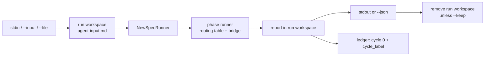
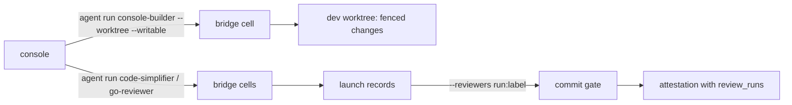

# Agent run: one phase agent, one input, one answer, no cycle

> [ADR-0152](adr/0152-one-phase-agent-runs-from-the-command-line-with-no-cycle-through-the-phase-runner.md) · plan: [agent-run-standalone-2026-10](../plans/agent-run-standalone-2026-10.md) · research: [agent-run-standalone-2026-10](../research/agent-run-standalone-2026-10.md).
> This file is the spec of record for `evolve agent run` and `evolve agent list`. The package note [internal-cli-agentcmd](packages/internal-cli-agentcmd.md) holds the package detail.
>
> **Terms used throughout:**
> - **Profile**: a spec phase from the merged phase catalog, with its persona and its `.evolve/profiles/<name>.json`.
> - **Standalone run**: one dispatch of one profile with cycle 0, outside every cycle.
> - **Run label**: `agent-<profile>-<UTC time>-<4 hex>`, the name of one standalone run.
> - **Run workspace**: `.evolve/ephemeral/agent-runs/<run label>`, the only directory that the run writes.
> - **Report**: the primary artifact of the profile, for example `adversarial-review-report.md`.
> - **Launch record**: `.evolve/agent-runs/<run label>.json`, the record of the driver, the family, the model and the tree that one run saw (§7).
> - **Build seat**: the profile `console-builder`, the one profile that writes source in a standalone run (§8).

## Table of contents

1. [Goals](#1-goals)
2. [A worked example](#2-a-worked-example)
3. [Input contract](#3-input-contract)
4. [Output contract](#4-output-contract)
5. [No cycle](#5-no-cycle)
6. [Profiles](#6-profiles)
7. [The launch record and the signals](#7-the-launch-record-and-the-signals)
8. [The console seats](#8-the-console-seats)
9. [Guards](#guards)
10. [Limits](#limits)

## 1. Goals

| Goal | Measure | Target |
|---|---|---|
| G1 The report on stdout | `git diff \| evolve agent run adversarial-review` prints the report text | the exact artifact bytes |
| G2 A machine envelope | `--json` prints one object | report, verdict, model, cost, tokens |
| G3 No cycle footprint | files that change in the project | only the ledger files and the launch record |
| G4 One dispatch path | the code that launches the agent | `phasecmd.NewSpecRunner`, the phase runner and the bridge factory |

The goals have this order: G3 and G4 are safety, so they win over G1 and G2 when they conflict.

## 2. A worked example

```sh
git diff origin/main...HEAD | evolve agent run adversarial-review > review.md
echo $?   # 0 for PASS or WARN, 1 for FAIL
git diff origin/main...HEAD | evolve agent run adversarial-review --json | jq '.data.verdict, .data.cost_usd'
```

The command reads the diff, writes it to `<run workspace>/agent-input.md`, and runs the `adversarial-review` spec phase with cycle 0. The routing table picks the CLI chain of the profile (Claude Code for this claude-family-floor profile). The agent writes `adversarial-review-report.md` in the run workspace. The command prints that file, appends one ledger line, and removes the run workspace.

## 3. Input contract

### Issue

`evolve phase` takes a `core.PhaseRequest` JSON, and a spec prompt renders only the keys in its `prompt_context` (research F1.1, F1.4). A person with a diff has no request and no key.

### Gap

An evaluate phase gets `goal` by default, but a plan phase gets no key. The personas also expect cycle artifacts such as `build-report.md` (F1.5).

### Solution

- The input is text. It comes from stdin, or from `--input FILE`. The value `-` means stdin.
- Each `--file PATH` adds one section: a `### <path>` heading and the file in a fenced block. The flag can repeat.
- The fence of a section is one backtick longer than the longest backtick run in the file, and at least three. A fence in the file thus cannot close its section.
- Each source has a limit of 8 MiB (`maxInputBytes`), and all sources together have the same limit. A larger input, or a device such as `/dev/zero`, is exit 11.
- An empty input after composition is exit 11. A terminal on stdin with no `--input` and no `--file` is a usage error (exit 10), so the command never waits for typed input.
- The command writes the composed input to `<run workspace>/agent-input.md`.
- The request puts the input under the context key `specrunner.AgentInputKey` (`agent_input`). The spec runner renders it in every spec prompt as the section `## Agent Input`. A note in that section tells the agent that the input replaces the cycle artifacts that its instructions name.

## 4. Output contract

### Issue

`evolve phase` prints only the envelope. The report stays in a file (F1.1).

### Solution

- stdout carries the report text, unchanged. Nothing else goes to stdout.
- `--json` replaces the report text with one envelope of [cli-contract.md](cli-contract.md) §2 (`evolve.agent.run/1`, since X17b). Its `data` is this object:

| Field | Value |
|---|---|
| `profile` | the profile name |
| `run_label` | the run label |
| `verdict` | `PASS`, `WARN`, `FAIL` or `SKIPPED` from the phase runner |
| `report` | the report text |
| `model`, `model_source` | `PhaseResponse.ResolvedModel` and `ModelSource` |
| `cost_usd`, `tokens`, `duration_ms` | from the phase response |
| `diagnostics` | the diagnostics of the phase response |
| `cli`, `family` | the driver of the last launch, and its CLI family (`llmroute.Family`) |
| `launch_record` | the path of the launch record |
| `worktree` | the `--worktree` directory, when the run has one |
| `workspace` | the run workspace, only with `--keep` |
| `error` | the dispatch error, the ledger error or the launch record error, when there is one |

- stderr carries the runner logs and each refusal.

| Exit | Meaning |
|---|---|
| 0 | The verdict is PASS, WARN or SKIPPED. |
| 1 | The verdict is FAIL. The report, if any, is still printed. |
| 3 | Refused: a writer that is not a build seat, or a `--worktree` that is not a linked worktree. Also a built-in phase, a call from inside a phase, or a refused root router. It was 2 before X17b. |
| 10 | Usage: a missing or unknown profile, a bad flag, a terminal on stdin. |
| 11 | Input: an unreadable or empty input. |
| 21 | A dispatch error, a failed ledger append, or a failed write of the launch record. It was 3 before X17b. |

## 5. No cycle

### Issue

`--cycle N` needs a real cycle, and an invented cycle number is forbidden (F1.2).

### Solution

- The request has `Cycle: 0` and `RunID` = the run label (F1.7). With no `--worktree`, the request has no worktree and no fence, and the bridge grants no Git writes. §8 gives the request with a worktree.
- The workspace is the run workspace, outside `.evolve/runs`. The profile grant `.evolve/runs/cycle-*` maps to it (F1.6), so the sandboxed agent can write its report.
- The command never reads cycle state and never takes or reads a lease. A live loop sees the run only as one ledger line.
- The run workspace is removed when the command ends. `--keep` keeps it and puts its path in the envelope.
- SIGINT and SIGTERM cancel the context of the dispatch. The runner then returns, and the command still appends the ledger entry and removes the workspace.
- One ledger entry records the run: `cycle: 0`, `cycle_label` = the run label, `role` = the profile and `kind: agent_run`. The entry also holds the model, the exit code, the duration, the SHA-256 of the report and `source: evolve agent run`.



## 6. Profiles

- `evolve agent list` prints each runnable profile: one line with the name, the archetype and the description. `--json` prints an array of objects with the same fields.
- A runnable profile is a spec phase that `phasecmd.SpecRunnable` accepts: kind `llm`, not a control archetype, not a built-in.
- The profile must also be read-only by two checks, and both fail closed:
  - `core.PhaseWritesSource` marks the spec as read-only;
  - the agent profile has a sandbox that is enabled and `read_only_repo`, and each write grant is under `.evolve/runs/cycle-*`, the run workspace.
- A missing profile, a profile with no sandbox, or a grant such as `{worktree_path}` is a refusal (exit 3). The second check exists because a spec can omit `writes_source` and still name a profile that writes source.
- A built-in phase is refused (exit 3) with a pointer to `evolve phase --cycle N`, because each built-in phase reads or writes cycle state.
- A source-write spec phase (`bug-reproduction`, `test-amplification`) is refused (exit 3). The one exception is a profile that §8 admits as a build seat.
- The JSON list marks a build seat with `writes_source: true`.

## 7. The launch record and the signals

### Issue

Before X11, a console review ran as an in-process Claude Code subagent. It left no record of the family that reviewed, and the commit gate took the reviewer names on trust ([llm-isolation.md](llm-isolation.md) §13). `evolve agent run` built its bridge with no Signal Center, so a cell violation of a standalone run reached no event channel.

### Solution

- Each run writes one launch record, also after a dispatch error. The package `internal/launchrecord` owns its type and its file.

| Field | Value |
|---|---|
| `run_id` | the run label |
| `profile` | the profile name |
| `cli`, `family` | the driver of the last bridge launch, and its CLI family |
| `model` | the resolved model, else the model of the launch request |
| `verdict` | the verdict of the phase runner, empty after a dispatch error |
| `writes_source` | true for a writer run (§8) |
| `tree_state_sha_before`, `tree_state_sha_after` | the tree-state SHA (`treestate.SHA`) of the worktree, else of the project root, before and after the dispatch |
| `artifact_sha256` | the SHA-256 of the report, when there is one |
| `worktree` | the `--worktree` directory |
| `ts` | the UTC write time |

- `launchrecord.Write` creates the file and refuses to replace a record. The run refuses a run label whose record exists, before the dispatch (exit 21).
- A wrapper of the bridge (`launchSpy`) reads the driver and the model from each launch request. A fallback walk launches more than once, so the record names the last launch.
- `evolve commit-gate run --reviewers run:<run label>` attests a review from its record ([internal-commitgate](packages/internal-commitgate.md)). The gate accepts the record only when all of these are true:
  - it has a driver, and it is not a writer run;
  - its verdict is `PASS` or `WARN`, and it has a report hash;
  - both tree states equal the staged tree.
- If the tree state fails (not a git checkout), stderr names the error, and the record has an empty tree. The gate then refuses the record.
- The process root (`agentRunSignals` in `cmd/evolve/cmd_cycle.go`) builds one Signal Center with the role `agent`. It is `newRoleSignalCenter`, so the center publishes to the event channels and prints each warning on stderr. The bridge and the verdict engine emit to it, so an `ISOLATION_I*_VIOLATION` of a standalone run reaches the `isolation.violation` channel, as in a cycle cell.

## 8. The console seats

### Issue

The console ran its builds and its reviews in-process, outside the bridge. Thus only Claude held the console seat. The routing, the cell and the usage accounting of the bridge did not apply (X11, ADR-0154 G10).

### Solution

- **A review seat** is each read-only review profile: `code-simplifier`, `code-reviewer`, `go-reviewer`, `architecture-reviewer` (X10) and `docs-review` (X11). `cli_routing` routes each one like any seat.
- **The audit of a diff** is `adversarial-review`. No profile is named `auditor`: the built-in `audit` phase reads cycle state.
- **The build seat** is `console-builder`. Its routing data puts Claude first (`cli_routing.agents.console-builder`), and another family holds the seat when the operator changes that chain.
- `--worktree DIR` runs the agent in DIR. DIR must be absolute and a linked git worktree (`plane.Classify`), so a seat never runs in the main checkout.
- A profile is a writer when `core.PhaseWritesSource` marks it, or when its sandbox can write outside the run workspace. A writer runs only when all of these are true:
  - its sandbox is enabled and `read_only_repo`, and each write grant is under `{worktree_path}` or `.evolve/runs/cycle-*`;
  - its sandbox denies `.evolve/agent-runs` and `.commit-gate`, so the cell cannot forge a launch record or an attestation;
  - the run has `--worktree` and one `--writable PATH` for each file that it can change. Each path is clean and inside the worktree.
- The request of a run with a worktree has a fence. A reader gets an empty fence, so the runner restores each change of the worktree. The build seat gets the `--writable` paths, so the runner keeps only those changes.
- The console then reviews the diff with the review seats. It runs the commit gate with the `run:` tokens of the review runs, and commits as before.



## Guards

| Rule | Guard | State |
|---|---|---|
| No cycle state, lease or run dir changes | `TestAgentRun_AdversarialReviewDiffOnStdinPrintsTheReportAndLeavesNoCycleFootprint` | enforced |
| No call from inside a phase | `subagent.ReadDispatchDepth` above 0 is exit 3 | enforced |
| No source-write profile outside the build seat | `TestAgentRun_TheBuildSeatRefusals`, `TestAgentRun_AWriterWhoseSandboxCanWriteTheReviewRecordsIsRefused`, `TestConfinedToWorktree` | enforced |
| Each run leaves a launch record | `TestAgentRun_EachRunWritesABridgeLaunchRecordThatNamesTheDriverFamilyModelAndTree` | enforced |
| A cell signal reaches the event channels | `TestAgentRun_AnIsolationSignalOfTheBridgeReachesTheIsolationChannel`, `TestAgentRunRoot_PublishesUnderTheAgentRoleAndWiresTheBridge` | enforced |
| A non-Claude family holds each console seat | `TestConsoleReviewChain_ANonClaudeSeatReviewsAndTheGateAttestsTheBridgeRecords`, `TestConsoleBuildSeat_RoutingDataMovesTheSeatToAnotherFamily` | enforced |
| One dispatch path | the run builds its runner only through `phasecmd.NewSpecRunner` | enforced by review |

## Limits

- A standalone run runs no built-in phase, and no writer other than a build seat of §8.
- v1 has no event stream. The JSON is one object at the end.
- `evolve gc` does not sweep `.evolve/ephemeral/agent-runs`. Only `--keep` and a killed process leave a run workspace.
- The test proves the footprint with a fake bridge. It does not prove what a real CLI writes outside its sandbox grants.
- The record binds a review to the tree, not to its input. A review with another input at the same tree also attests the commit.
- The record has no signature. A process outside a cell can write one, as it can pass a plain reviewer name. The record adds the provenance of the bridge, not a proof.
- The `--writable` paths are exact files. A new file of the build needs its own `--writable` path.
- The bridge grants the Git metadata writes of a linked worktree to a writer, so a build cell can commit in its worktree. The profile denies `git commit` as a tool, and the commit gate refuses a review record of another tree.
- A Linux host refuses the Git metadata grants of a linked worktree (`sandboxGitWritePaths`), so the build seat runs only on macOS today.
