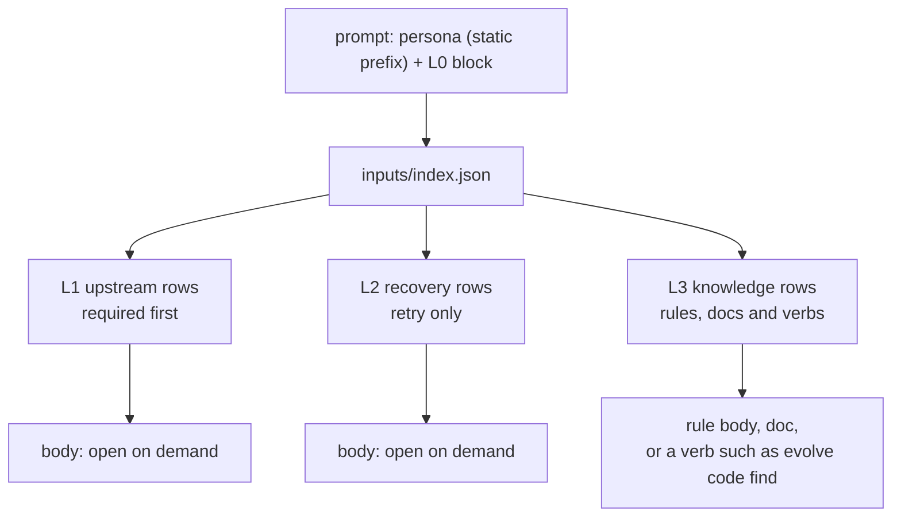

# Cell context index: each phase cell gets a small assignment and a layered index that it opens on demand

> [ADR-0154](adr/0154-the-pipeline-is-the-only-controller-and-each-agent-is-an-isolated-replaceable-worker.md) I-4, I-5 and I-17 · [ADR-0155](adr/0155-the-loop-heals-itself-inside-its-boundaries-an-agent-proposes-and-the-pipeline-disposes.md) I-12 · [ADR-0156](adr/0156-the-cli-is-the-service-interface-and-the-pipeline-reads-no-ambient-control-flags.md) I-15, I-16 · plan: [cell-context-index-2026-10](../plans/cell-context-index-2026-10.md) · research: [cell-context-index-2026-10](../research/cell-context-index-2026-10.md).
> This file is the spec of record for the cell index: its layers, entry fields, budgets, read verbs and access log. [llm-isolation.md](llm-isolation.md) §8 owns the index file, the lineage rule and the read grants that X5 built. [guidance-layers.md](guidance-layers.md) §10 owns the rule registry index, and its §10.6 names this file and the `rule_layer` mapping of §3 of this file. [cli-contract.md](cli-contract.md) §4.1 owns the agent classes.
>
> **Terms used throughout:**
>
> - **cell index**: the file `<ws>/inputs/index.json` of one phase dispatch. X5 calls it the artifact index.
> - **context layer**: one of L0 to L3 of this file. A rule layer of ADR-0145 is a different thing, and this file always says "rule layer" for it.
> - **entry**: one row of the cell index. It names one body that the cell can open.
> - **body**: the file or the verb output that an entry names.
> - **required**: an entry that the agent must open before it writes its deliverable. It is not preloaded.
> - **access record**: one line of the access log. It says that a cell opened an entry.
> - **token estimate**: `ceil(bytes / 3)`. It is an estimate, not a count (research P2.9).

## Table of contents

- [1. Goals](#1-goals)
- [2. A worked example](#2-a-worked-example)
- [3. The layers](#3-the-layers)
- [4. The entry](#4-the-entry)
- [5. The L0 assignment](#5-the-l0-assignment)
- [6. Required entries and budgets](#6-required-entries-and-budgets)
- [7. The read path](#7-the-read-path)
- [8. The access log](#8-the-access-log)
- [9. Prune and promote](#9-prune-and-promote)
- [10. Read grants](#10-read-grants)
- [11. CLI neutrality](#11-cli-neutrality)
- [12. Stage and rollout](#12-stage-and-rollout)
- [13. As built (CX1 to CX3)](#13-as-built-cx1-to-cx3)
- [Guards](#guards)
- [Limits](#limits)

## 1. Goals

The operator said on 2026-10-26: "I feel for the data that can be accessed by phase agent; it also needs to be indexed and layered, not necessary to import everything at the beginning, but loaded as needed."

| Goal | Measure | Target |
|---|---|---|
| G1 The prompt carries only the assignment | the bytes of the prompt tail after `## Cycle Context` | at `enforce`, at most the L0 budget (2,000 tokens) |
| G2 Each entry tells the agent what it is, what it costs and why it is listed | the fields `summary`, `bytes`, `tokens` and `why` | present on each entry |
| G3 The pipeline knows which entries each cell opened | the access log | one record for each opened entry on macOS |
| G4 Use changes the index, but no LLM changes a grant | the tune action of §9 | each change goes through a Go check and a boundary |
| G5 Each family reads the index the same way | the file and the `A` verbs of §7 | no CLI-specific text above the driver |

The goals are in the order of the build. G2 comes first, because G3 and G4 need its fields. G1 needs the measure of G3.

## 2. A worked example

Cycle 2028 builds the item `cli-ship-manual-paths-lane`. Its build prompt has 51,171 bytes, and the tail holds the recalled lessons as one JSON line of 2,411 bytes. The example index below uses the medians of research F1.4 and F1.6 for the sizes. Only the triage report has the size of its file in cycle 2028.

With this design, the pipeline writes this index before the build dispatch:

```json
{
  "schema": "evolve.inputs.index/2",
  "cycle": 2028,
  "phase": "build",
  "item_ids": ["cli-ship-manual-paths-lane"],
  "attempt": 1,
  "lineage": [],
  "stage": "shadow",
  "estimate": "ceil(bytes/3)",
  "required": ["d1", "d4"],
  "budgets": {
    "L1": {"limit_tokens": 8000, "required_tokens": 1180},
    "L2": {"limit_tokens": 6000, "required_tokens": 0},
    "L3": {"limit_entries": 40, "entries": 1, "rule_rows": 1}
  },
  "entries": [
    {"id": "d1", "layer": "L1", "class": "deliverable", "kind": "scout-report", "path": ".evolve/runs/cycle-2028/scout-report.md",
     "cycle": 2028, "phase": "scout", "attempt": 1, "summary": "Scout: ship --class manual paths for one lane",
     "bytes": 2420, "tokens": 807, "sha256": "…", "required": true, "why": "upstream deliverable of scout; required by the build inputs"},
    {"id": "d2", "layer": "L1", "class": "deliverable", "kind": "test-report", "path": ".evolve/runs/cycle-2028/test-report.md",
     "cycle": 2028, "phase": "tdd", "attempt": 1, "summary": "TDD: 3 RED tests",
     "bytes": 8001, "tokens": 2667, "sha256": "…", "required": false, "why": "upstream deliverable of tdd"},
    {"id": "d3", "layer": "L1", "class": "deliverable", "kind": "triage-decision", "path": ".evolve/runs/cycle-2028/triage-decision.json",
     "cycle": 2028, "phase": "triage", "attempt": 1, "summary": "",
     "bytes": 402, "tokens": 134, "sha256": "…", "required": false, "why": "upstream deliverable of triage"},
    {"id": "d4", "layer": "L1", "class": "deliverable", "kind": "triage-report", "path": ".evolve/runs/cycle-2028/triage-report.md",
     "cycle": 2028, "phase": "triage", "attempt": 1, "summary": "Triage Decision — Cycle 2028",
     "bytes": 1117, "tokens": 373, "sha256": "…", "required": true, "why": "upstream deliverable of triage; required by the build inputs"},
    {"id": "k4", "layer": "L3", "class": "knowledge", "kind": "rule", "rule_layer": "L1", "audience": ["phase"],
     "path": "guidance/rules/kill-guard-never-mutated.md", "summary": "Never mutate or run a live kill guard",
     "bytes": 1210, "tokens": 404, "sha256": "…", "required": false, "why": "rule of the registry (ADR-0145) for audience phase, phase build"},
    {"id": "k5", "layer": "L3", "class": "knowledge", "kind": "code-index", "verb": "evolve code find <symbol>",
     "summary": "the symbol index of the repository", "required": false, "why": "code index verb, agent class A"}
  ],
  "notes": []
}
```

The prompt tail at `enforce` is the L0 block of §5. It names the item, the acceptance, the output `build-report.md` and one pointer line: "Your inputs are in `inputs/index.json`. Open `d1` and `d4` first." The agent runs `evolve context open d1`, and the sandbox reports the read of the path of `d1`. The pipeline maps the path to `d1` and writes one access record.

The agent does not open `d2`. After 40 build cells, the open rate of `test-report` in the build is 0.9, so the orchestrator proposes to make it required. A Go check accepts the proposal, and the policy changes at the next boundary (§9).

## 3. The layers

### Issue

The X5 index is a flat list of two classes (research F1.1). The prompt tail of each phase preloads the recalled lessons. The build tail also preloads the task contract and, on a retry, the repair findings (F1.5). The `message` class and the `context` class of llm-isolation.md §8.1 have no entries (F1.2).

### Gap

A flat list does not tell the agent what to read first, what is only for a retry, and what is reference. A preload costs tokens on each cell, and the agent cannot skip it (research P2.1, P2.7).

### Solution

Each entry has one context layer. The class of the entry sets the layer, so the layer is never a free choice.

| Layer | Name | Holds | Classes | When present | In the prompt |
|---|---|---|---|---|---|
| L0 | assignment | the task, the acceptance, the output contract, the pointer to the index | none: the header and the prompt block of §5 | always | yes, and small |
| L1 | upstream | the deliverables of this cycle for this phase, the handoff asks, the mailbox frames, the inbox item file | `deliverable`, `message`, `context` | each phase after the phase that wrote the body | no; a row each |
| L2 | recovery | the lineage retrospectives, digests, carryovers, earlier audit reports, recovery documents, lineage lessons and the repair findings of an earlier round | `lineage` | a retry, a recovery or a repair round only | no; a row each |
| L3 | knowledge | the filtered rule rows of `guidance/index.json` (PR #1137), the recalled lessons, the docs index, the `evolve code` verbs | `knowledge` | each phase | no; reference only |



The rules are the knowledge layer of the same index ([guidance-layers.md](guidance-layers.md) §10.6). The builder reads `guidance/index.json` and keeps the rows for the audience `phase`, the phase name and the family of the seat. Each kept row becomes an L3 entry with the shared fields `id`, `layer`, `kind`, `summary`, `bytes`, `path` and `audience`. In `guidance/index.json`, `layer` is the rule layer. The cell index moves it to `rule_layer` and sets `layer` to `L3`.

The `context` class lists the inbox item file of each item id. The `message` class lists the ADR-0129 mailbox frames that the broker holds for this dispatch. Both are new sources of component CX4.

## 4. The entry

The entry of X5 (llm-isolation.md §8.3) keeps each field. The schema becomes `evolve.inputs.index/2`, and these fields are new:

| Field | Type | Source | Rule |
|---|---|---|---|
| `layer` | `L1`, `L2` or `L3` | the class (§3) | never empty |
| `tokens` | integer | `ceil(bytes / 3)` | 0 for a verb entry |
| `required` | boolean | §6 | `false` for each L3 entry |
| `why` | string, 25 words or fewer | a fixed template of the builder | no LLM writes it |
| `verb` | string, L3 only | a fixed list of `A` verbs | an entry has `path` or `verb`, never both |
| `rule_layer`, `audience` | string, list; kind `rule` only | the row of `guidance/index.json` | copied, never changed |

The `why` templates:

| Class | Template | Example |
|---|---|---|
| `deliverable` | `upstream deliverable of <phase>` | `upstream deliverable of scout` |
| `deliverable`, kind `handoff-asks` | `asks of <from> for <to>` | `asks of tdd for build` |
| `lineage` | `lineage cycle <N> of item <id>, attempt <a>` | `lineage cycle 6 of item item-a, attempt 1` |
| `lineage`, kind `lesson` | `lesson that names <item id or cycle-N>` | `lesson that names cycle-6` |
| `knowledge` | `<source> for <audience>, phase <phase>` | `rule of the registry (ADR-0145) for audience phase, phase build` |
| any, when required | the template, then `; required by the <phase> inputs` | as §2 |
| any, over budget | the template, then `; not required: over the <layer> budget` | §6 |

The header gets `stage`, `estimate`, `required` (the ids, in the order of §6) and `budgets`. A reader of `/1` stays valid for one release: `inputindex.Read` accepts `/1` and `/2`, and refuses each other schema.

## 5. The L0 assignment

The L0 block is the only part of the cell data that the prompt carries at `enforce`. It replaces the preloaded bodies of research F1.5.

| Line | Content | Source |
|---|---|---|
| task | the item ids and the title of each item | the fleet scope and the inbox item |
| acceptance | the acceptance list of each item | the inbox item |
| output contract | the artifact name and its required sections | `phasecontract` |
| pointer | `Your inputs are in inputs/index.json. Open <required ids> first. Run evolve context index --json to list them.` | the cell index |

The bodies that move out of the prompt at `enforce` become entries that the pipeline writes under `<ws>/inputs/`:

| Body today | Entry at `enforce` | Layer | Required |
|---|---|---|---|
| `recalled_lessons_untrusted_json` (each phase, `runner.BaseCycleContext`) | `inputs/recalled-lessons.json`, class `knowledge`, kind `recalled-lessons` | L3 | no |
| `## Task Contract` over the L0 budget (build) | `inputs/task-contract.md`, class `context`, kind `task-contract` | L1 | yes |
| `## Prior Attempt Findings`, `## Audit Repair`, `## Standing Audit Findings` (build) | `inputs/repair-findings.md`, class `lineage`, kind `repair-findings` | L2 | yes |

Each moved body has a class, so its layer follows §3. The cell cannot write `<ws>/inputs/` (llm-isolation.md §9), so the moved bodies keep their trust level. The text stays quoted as data, as it is in the prompt today.

## 6. Required entries and budgets

### Required

A phase marks a few kinds as required. The agent must open them before it writes its deliverable. The builder takes the list from the first source that has one:

1. the policy key `isolation.context.required.<phase>`, a list of kinds. Only the tune action of §9 and the operator write it;
2. the `inputs.files` list of the phase specification in the merged phase catalog. A core phase has its specification in `docs/architecture/phase-registry.json`, and an optional phase in `.evolve/phases/<phase>/phase.json`. 65 of 73 `phase.json` files have a list that is not empty (research F1.8). Each item is a path template, and its kind is the base name without the extension;
3. the upstream edges of `phaseio` (research F1.7): each upstream deliverable, and each `handoff-asks` entry for this phase.

A required kind with no file in the workspace has no row, so it adds nothing to the index.

On a retry, the retrospective and the failure digest of the newest lineage cycle are required, and the older lineage rows are not. An L3 entry is never required.

### Budgets

The budgets are in strict policy:

```json
{
  "isolation": {
    "context": {
      "stage": "shadow",
      "budget": {"l0_tokens": 2000, "l1_tokens": 8000, "l2_tokens": 6000, "l3_entries": 40},
      "required": {},
      "exclude": {},
      "tune": {"min_cells": 20, "promote_at": 0.8, "demote_at": 0.2, "exclude_at": 0.05, "per_phase_per_day": 1}
    }
  }
}
```

The compiled defaults are the values above, with `required` and `exclude` empty. `policy.Parse` refuses an unknown key, a negative number and a rate outside 0 to 1.

Each key lands with the component that reads it, so no key is dead:

| Keys | Component |
|---|---|
| `stage`, `budget.l1_tokens`, `budget.l2_tokens`, `required` | CX1 |
| `budget.l0_tokens` | CX5 |
| `budget.l3_entries` | CX7b |
| `exclude`, `tune` | CX6 |

Until its component lands, a key is an unknown key, and `policy.Parse` refuses it.

| Budget | What it bounds | On an overflow |
|---|---|---|
| `l0_tokens` | the estimate of the L0 block | the task contract moves to an L1 entry (§5) |
| `l1_tokens` | the sum of `tokens` of the required L1 entries | the builder keeps the required flag in entry order until the sum passes the limit. Each later entry gets `required: false` and the over-budget `why`. |
| `l2_tokens` | the same, for L2 | the same |
| `l3_entries` | the count of L3 entries that are not rule rows. Each filtered rule row is listed, as the item `guidance-cell-index-input` requires. | the builder keeps the entries in the fixed source order: the verbs, the docs, then the recalled lessons. The note names the rows that it drops. |

An overflow never removes an L1 or an L2 entry, so it never removes a grant. An L3 row has no grant of its own (§10), so its drop changes no scope. It adds a note and emits `ISOLATION_CONTEXT_BUDGET_OVER` (WARN) with the layer, the limit and the sum. The metadata of a row is about 300 bytes, 1 to 10 percent of its body (research F1.6), so the budget counts bodies, not rows.

## 7. The read path

The index is a plain file, so a family that can read a file can use it. Two verbs add a checked read. Both are agent class `A` and availability `always` ([cli-contract.md](cli-contract.md) §4.1).

| Verb | Prints | Exit codes |
|---|---|---|
| `evolve context index [--layer L] [--required] [--json]` | the rows of the cell index, filtered | 0 ok; 2 the index cannot be read; 10 usage; 11 the index does not decode |
| `evolve context open <id> [--json]` | the body of the entry; for a verb entry, the verb text | 0 ok; 1 the sha256 of the body differs from the index; 10 usage; 11 an unknown id or a path outside the project root |

- The verbs find the cell from `--workspace <ws>`. The prompt names the workspace in its `workspace` line, so an agent can always pass it. With no flag, the verbs use the marker `EVOLVE_PROJECT_ROOT` (llm-isolation.md §27, class (a)) and the cycle of the dispatch tag `EVOLVE_DISPATCH_ID`, when both are set. The bridge sets the tag for each dispatch, and `codeindex/usagelog` parses it the same way. The marker list of X18b must keep both names. The verbs read no other environment value.
- With `--json`, each verb prints the envelope of cli-contract.md §2 on each exit. The schemas are `evolve.context.index/1` and `evolve.context.open/1`. The `data` of `open` holds the entry and the body.
- `open` reads only a path that the index lists. It refuses a path outside the project root, as `inputindex.ReadablePaths` does.
- `open` writes nothing. The access record comes from the sandbox (§8), so the verb has no log of its own.
- `evolve agent capabilities --json` lists both verbs (cli-contract.md §4.2). Component CX2 adds both verbs to the class table of cli-contract.md §4.1. Rule 1 there makes a new verb `D` until that file names it.

The operator brief named the class `R` for these verbs. Class `R` refuses in the cell and needs a request (cli-contract.md §4.1), so an agent cannot open an entry with it. This file uses `A`, because both verbs change no shared state (rule 2).

## 8. The access log

### Issue

The usage reading of llm-isolation.md §8.4 is not built. The grants of X5 carry no report (research F1.10).

### Gap

A log that the verb or the agent writes in the workspace is data that the measured agent can write. ADR-0153 rule 7 forbids it as the source of a reading (research F1.11). An agent can also read a path directly and skip the verb.

### Solution

Each literal grant of an indexed path gets a report and a message. An L3 path in the repo has no literal grant, so it gets a rule that only reports. The repo grant already allows the read, so the rule adds no scope:

```text
(allow file-read* file-read-data (literal "<path>") (with report) (with message "evolve-cell=<dispatch id> rule=grant.index"))
```

The message has no `inv=` field, so the violation parser of X5 (`readReportLine`) never matches it. After the cell exits, a separate parser reads the `rule=grant.index` reports of the dispatch. It maps each reported path to its entry through the index. The pipeline writes one access record for each distinct entry to `.evolve/context-access/cycle-<N>.jsonl`:

```json
{"cycle": 2028, "phase": "build", "dispatch": "r01M5E1V7-build-1", "entry": "d1", "kind": "scout-report", "layer": "L1", "required": true, "source": "sandbox"}
```

It also writes one summary record for each cell. The record holds the listed ids, the opened ids, the unopened required ids and `source`. No write grant of a cell can cover `.evolve/context-access/`. The sandbox paths refuse such a grant, as `refuseRunDirsReach` refuses a reach into other run directories (`go/internal/bridge/sandbox_paths.go:185`).

- On Linux, `bwrap` has no report. The summary has `source: none`, and no reading counts the cell.
- The kernel can merge repeated reports, so a record means "opened at least once", never a count.
- A verb entry has no path, so it gets no record. The `evolve code` usage log is in the workspace, which the cell can write, so it is not a source.
- A required entry that the cell did not open emits `ISOLATION_CONTEXT_REQUIRED_UNOPENED` (INFO) with the ids. It never fails the phase, because the report reader is best effort.
- `evolve context stats [--phase P] [--window N] --json` prints, for each phase and kind, the cells that listed the kind and the cells that opened it. It is agent class `D`: a cell has no task that needs other cycles, and I-5 denies the reads.

## 9. Prune and promote

The orchestrator proposes, and the pipeline disposes (ADR-0155 I-12). The action catalog of llm-isolation.md §19 gets one row:

| Action | Extends | Preconditions | Tier limit | Budget | Executor |
|---|---|---|---|---|---|
| `context-tune` | none | The phase and the kind exist in the sources of §6. The window has `tune.min_cells` or more cells with `source: sandbox`. The rate meets the threshold of the change. | T1, T2 | `tune.per_phase_per_day` changes for each phase | the policy writer at the boundary |

The tier is T1 or T2, not T0. The lists `required` and `exclude` are advice data: they are not a floor, a stage key, a gate or a grant. The keys `stage`, `budget` and `tune` are T0, so only the operator changes them. Component CX6 adds the row to llm-isolation.md §19.

| Change | Threshold | Effect |
|---|---|---|
| `promote` | open rate at or above `promote_at` | the kind joins `isolation.context.required.<phase>` |
| `demote` | open rate of a required kind at or below `demote_at` | the kind leaves the required list |
| `exclude` | open rate at or below `exclude_at`; the kind is L3, is not `rule` and has a path | the kind joins `isolation.context.exclude.<phase>`, and the builder lists it no more |
| `include` | the kind is in the exclude list | the kind leaves the exclude list, and the builder lists its fixed source again |

- The Go check computes the rate from the access log. It does not trust a rate in the proposal.
- A cell that opened each listed row is a scan, for example a `grep -r` of the granted paths. The rate leaves such a cell out, so a scan cannot drive a `promote`.
- An L1 kind cannot be excluded, because ADR-0154 rule 11 lets a phase read each declared upstream deliverable. An L1 kind can only be demoted.
- An L2 kind cannot be excluded. A wrong exclude can hide a lesson that a retry needs (ADR-0154, Consequences).
- The kind `rule` cannot be excluded. One exclude of it removes each standing rule of the phase.
- An L3 row in the repo has no grant of its own, so `exclude` and `include` change no scope. No change grants a path outside the fixed sources of §3, which are a Go list.
- A refused proposal emits `HEALING_PROPOSAL_REFUSED` with the failed precondition (llm-isolation.md §19).

## 10. Read grants

The grants stay exactly the indexed paths (llm-isolation.md §8.5). This design adds no grant rule:

- An L1 or an L2 entry is a path under `.evolve/runs/`, and X5 grants it.
- A moved body of §5 is a file under `<ws>/inputs/`, inside the own workspace grant.
- An L3 entry is a repo path, which the repo grant covers, or a verb.
- An entry with `required: false` keeps its grant. The flag changes the advice, not the scope.
- An excluded kind is an L3 kind, so its drop removes no grant.

## 11. CLI neutrality

The assignment stays CLI-neutral (ADR-0154 I-17, llm-isolation.md §28). The field "input index" of the neutral `TaskAssignment` points at `inputs/index.json`. The persona text names the file and the `evolve context` verbs only. A driver can add a hint for its own family, for example the name of its file tool, in the driver layer. No persona and no Go code above the bridge names such a tool.

The shared persona text, for `agents/agent-templates.md` §"The input index":

> Your assignment is in the prompt. Your inputs are listed in `inputs/index.json`. Each row has a summary, a size, a token estimate and the reason for the row.
>
> Open each required row before you write your deliverable. Open another row only when your task needs it. Run `evolve context open <id>` or read the path of the row.
>
> L2 rows are present only on a retry. They hold the lessons of the earlier tries. L3 rows are reference: the rules, the docs and the code index.

## 12. Stage and rollout

The stage key is `isolation.context.stage`. The compiled default is `shadow`. The checked-in policy does not set it.

| Stage | The builder | The prompt | Signals |
|---|---|---|---|
| `shadow` | writes `/2` with the layers, the budgets and the required flags; the grants report; the moved bodies of §5 are not listed | unchanged: the tail keeps its bodies | `ISOLATION_CONTEXT_BUDGET_OVER` and `ISOLATION_CONTEXT_REQUIRED_UNOPENED` (kind `isolation.context`) |
| `enforce` | the same, plus the moved bodies of §5 | the persona and the L0 block only | the same, and `ISOLATION_CONTEXT_PRELOAD_BYTES` with the bytes that the move saves (CX5) |

The flip to `enforce` is an operator decision. It needs one clean wave at `shadow`, and the rows N15 to N17 of the guards green. The persona text of §11 is true at both stages, so it lands with CX2. The open rates of a `shadow` wave cover the listed kinds only. `enforce` lands with component CX5. Until then, `policy.Parse` refuses `enforce` and names the inbox item of CX5, `context-index-l0-prompt-enforce`.

## 13. As built (CX1 to CX3)

CX1 to CX3 landed in one change at `shadow`. This table names each part and its home.

| Part | As built |
|---|---|
| Fields and layers | `inputindex.annotate` sets `layer`, `tokens`, `required` and `why`, and the header fields `stage`, `estimate`, `required` and `budgets` ([internal-inputindex](packages/internal-inputindex.md)). |
| Required list | `ContextPolicy.Required`, then `ContextPolicy.Inputs`, then `phaseio.EdgeUpstreams`. `cycleRun.dispatch` passes the `inputs.files` of the phase from the merged catalog. |
| Policy | `isolation.context.stage`, `budget.l1_tokens`, `budget.l2_tokens` and `required` (`policy.IsolationContext`). `policy.Parse` refuses each stage other than `shadow` and a negative budget. It also refuses a required kind that is not shaped like an artifact kind (lowercase words with hyphens). Its message for `enforce` names the inbox item `context-index-l0-prompt-enforce`. |
| Verbs | `evolve context index`, `open` and `stats` ([internal-cli-contextcmd](packages/internal-cli-contextcmd.md)). |
| Grant reports | each indexed grant, and each indexed path in the repo (`ReportOnly`), is an `allow` with a report and the message `rule=grant.index` ([internal-adapters-sandbox](packages/internal-adapters-sandbox.md)). |
| Access log | after the cell, `Deps.reportReadViolations` reads the reports once. It emits the violations and calls `recordContextAccess`, which maps each reported path to its entry and calls `inputindex.RecordAccess`. A cell with no report source writes a cell record with `source: none`. A dispatch whose agent is not the phase of the index writes no record. |
| Write refusal | `refuseRunDirsReach` also refuses a write grant that covers `.evolve/context-access/`. |
| Signals | `ISOLATION_CONTEXT_REQUIRED_UNOPENED` (INFO) and `ISOLATION_CONTEXT_BUDGET_OVER` (WARN), kind `isolation.context` ([internal-isolation](packages/internal-isolation.md)). |
| Persona | `agents/agent-templates.md` §"The input index". |

Differences from the design:

- The X5 report reader never ran for a real cell. `cellTag` refused the `/` of each minted dispatch id, so `readReportsApply` was false. CX3 allows `/` in the tag (`TestCellTag_AcceptsAMintedDispatchIDAndRefusesAQuote`). So the X5 violation signals also start to flow at `shadow`.
- The pipeline does not set `EVOLVE_PROJECT_ROOT` in a cell today (row N15 shows exit 10 without `--workspace`). So the persona tells the agent to pass the `workspace` line of the prompt.
- The package notes of `internal/bridge`, `internal/core` and `internal/policy` do not name the change yet. Each has many old ASD-STE100 findings, and the house rule says that a touched file must lint clean. This section and the notes above hold the detail until those notes are rewritten.

## Guards

| Rule | Guard | Component | State |
|---|---|---|---|
| Each entry has a layer that its class sets | `TestBuild_EachEntryHasTheLayerOfItsClass` | CX1 | built |
| `tokens` is `ceil(bytes / 3)` and `why` uses a template | `TestBuild_EachEntryCarriesItsTokenEstimateAndItsReason` | CX1 | built |
| The required list comes from the policy, then the spec, then the edges | `TestRequired_PolicyThenSpecThenEdges` | CX1 | built |
| An overflow clears `required` in entry order and keeps each row | `TestBudget_AnOverflowClearsRequiredAndKeepsTheRow` | CX1 | built |
| `open` refuses an unknown id, a path outside the root and a changed body | `TestContextOpen_RefusesAnUnknownIDAForeignPathAndAChangedBody` | CX2 | built |
| Both verbs are class `A` | the table of cli-contract.md §4.1; `TestAgentClasses_MatchTheContract` when X17e lands | CX2 | built (the table) |
| N15 (matrix): a cell lists its index and opens a required entry through the verb | the matrix, M1 run | CX2 | green |
| N16 (sandbox contract, darwin): an open of an indexed path writes one access record, which names the entry that the index maps the path to | `TestAgentSandboxContract_AnOpenOfAnIndexedPathWritesOneAccessRecord` | CX3 | green |
| N17 (sandbox contract, darwin): a write of `.evolve/context-access/` from a cell is denied, and a write grant that covers it is refused | `TestAgentSandboxContract`, `TestResolveSandboxWriteGrants` | CX3 | green |
| `context-tune` grants no path outside the fixed sources | `TestContextTune_NoChangeGrantsAPathOutsideTheFixedSources` | CX6 | proposed |

## Limits

- The token estimate can be wrong by 30 percent or more for one family (research P2.9). It sets a budget, not a bill.
- The access log exists on macOS only. A Linux cell gives no reading.
- A record proves that the cell read the body. It does not prove that the agent used it.
- A broad read, for example `grep -r` of the granted paths, logs each row it touches. The rate leaves out a cell that opened each row (§9), but a scan of most rows still counts.
- The kernel can merge reports, and `log show` can miss a late report. A missed record makes an open rate low, so `exclude` has the strictest threshold.
- The persona stays in the prompt. A smaller persona is the work of the rule layers (ADR-0145) and of X19b, not of this design.
- The `message` and `context` classes need component CX4. Until then, L1 holds only deliverables and handoff asks.
