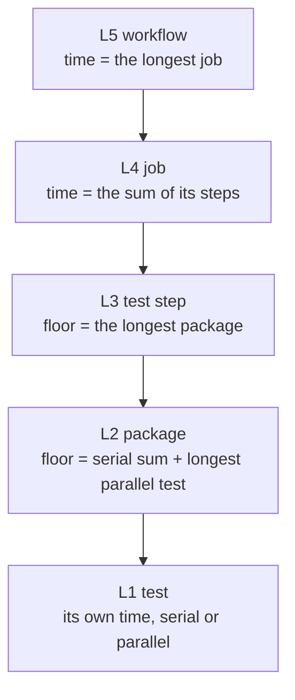

# CI telemetry and the critical path: how each run measures itself and names its bottleneck

> [ADR-0135](adr/0135-ci-measures-itself-before-it-changes-its-shape.md) · plan: [ci-wall-time-2026-10](../plans/ci-wall-time-2026-10.md) · research: [ci-wall-time-2026-10](../research/ci-wall-time-2026-10.md).
> This file is the spec of record for the CI telemetry. It says what each run records, how the records join, and how the report names the critical path. The research holds the evidence. The plan holds the candidate designs and the order of work. The ADR holds the decision.
>
> **Terms used throughout:**
> - **Unit:** a thing that takes time: a test, a package, a step, a job or the workflow.
> - **Level:** one of the five sizes of unit, L1 (test) to L5 (workflow).
> - **Critical path:** the chain of units, one per level, that sets the total time of a run.
> - **Floor:** the shortest time that a unit can take with its current tests, whatever the CPU count.
> - **Long pole:** the unit that sets the floor of the level above it.
> - **Index:** one named number that the telemetry records, for example `pkg.cpu.system`.
> - **rusage:** the resource accounting that the operating system keeps for each process (`getrusage`).
> - **Sampler:** a small process that reads the load of the whole runner once each second.

## Table of contents

- [1. Goals](#1-goals)
- [2. Why time alone is not enough](#2-why-time-alone-is-not-enough)
- [3. The measurement model: five levels](#3-the-measurement-model-five-levels)
- [4. Level 1 and level 2: the test stream](#4-level-1-and-level-2-the-test-stream)
- [5. Level 2: the resource wrapper](#5-level-2-the-resource-wrapper)
- [6. Level 4: the runner sampler](#6-level-4-the-runner-sampler)
- [7. Level 4 and level 5: the GitHub record](#7-level-4-and-level-5-the-github-record)
- [8. The join and the critical-path report](#8-the-join-and-the-critical-path-report)
- [9. How to read the report: a worked example](#9-how-to-read-the-report-a-worked-example)
- [10. Guards](#10-guards)
- [11. Limits](#11-limits)

## 1. Goals

The goals come from the plan (G1 to G4). This spec serves G2 directly, and it gives the measure for G1 and G4.

| Goal | Measure | Target |
|---|---|---|
| G2: every run keeps its telemetry | the artifacts of each Go job | the test stream, the rusage records and the sampler records, for every job, green or red |
| G2: the report names the critical path | the job summary of each run | one line per level, from the workflow down to one test, with the resource that limits it |
| G1: the wall time falls | `cicd.pipeline.run.duration` over ten runs | about 9 min after the plan's designs A and C |
| G4: the cost falls | `job.cost` summed per run | macOS minutes cut by about 55% |

The order of the goals is the order of the work. A change to the CI has no judge if the CI cannot measure itself. So the telemetry comes first.

## 2. Why time alone is not enough

### Issue

On 2026-10-17 the CI took 21–25 minutes, and no record explained why (research F3.1, F3.11). The CI wrote a `go test -json` stream, which holds the time of each test. It then deleted the stream, because the artifact step kept only the coverage files.

Time alone is not enough even when the CI keeps it. Two packages can take the same 90 seconds for different reasons:

- One package runs its own code on the CPU. A faster CPU makes it faster.
- One package starts thousands of `git` processes. A faster CPU helps it a little, but fewer processes help it a lot.

A time-only record shows the same number for both. The fix for each one is different.

### Gap

The current CI has no record of CPU, memory, I/O or load. `go test -json` records only the time and the result of each test. The GitHub job record holds only the start and end time of each step. Neither one can show why a unit is slow.

### Solution

The telemetry records three kinds of number for each unit:

1. **Time:** how long the unit takes, and which part of it is serial.
2. **Resources:** how much CPU, memory and I/O the unit uses, and how much of the CPU is in the kernel.
3. **Load:** how busy the whole runner is while the unit runs.

The research proved the value of the second kind (F3.13). For `phases/ship`, the wall time is 87 s (local run, 14 CPUs). The user CPU is 88 s, but the system CPU is 293 s. So the package spends most of its CPU in the kernel, on process creation and file operations. The fix is fewer subprocesses, not a faster runner. Time alone cannot show this.

## 3. The measurement model: five levels

### Issue

A CI run is a tree of units. Each level adds its time in a different way, so one rule cannot find the bottleneck of all levels.

### Gap

A flat list of the slowest tests does not show the critical path. A test of 100 s is not a bottleneck if it runs beside other work and ends before the job does. A test of 5 s is a bottleneck if 800 tests like it run one after another.

### Solution

The model has five levels. Each level has its own rule for how the time of its parts adds up. The rule tells you which part sets the time of the level.

| Level | Unit | Rule | Why the rule is true |
|---|---|---|---|
| L5 | workflow | the time is the longest job | GitHub runs the jobs at the same time. The run ends when the last job ends. |
| L4 | job | the time is the sum of the steps | The steps of one job run one after another on one runner. |
| L3 | test step | the floor is the longest package | `go test` runs up to `-p` packages at the same time. No package can end before its own tests end. |
| L2 | package | the floor is the serial sum plus the longest parallel test | Go runs the serial tests one after another. It then releases the parallel tests, which run together. |
| L1 | test | its own time | A test is the smallest unit that the stream records. |

To find the critical path, start at L5 and go down. At each level, take the unit that sets the time of the level above. Section 9 shows this with real numbers.

## 4. Level 1 and level 2: the test stream

### Issue

The CI ran `go test -json` and wrote `test-integration.json`, but it did not keep the file (F3.11). The e2e step did not write a stream at all.

### Gap

Without the stream, no one can find the serial tests, compare two runs, or balance shards from history.

### Solution

Component C0 makes three changes:

1. The e2e step writes `test-e2e.json`. The Makefile variable `E2E_JSON` turns this on. When the variable is empty, `make test-e2e` runs the original command, so `release.yml` does not change.
2. The artifact step uploads both streams with `if: always()`. A red run keeps its stream too, and a red run is the one you most need to read.
3. `cmd/testlatency` splits the time of each package into a serial part and a parallel part.

**How the split works.** Go writes a `pause` event when a test calls `t.Parallel()`. A top-level test that never writes `pause` is serial. The split uses these rules:

- `serial sum` = the sum of the times of the serial top-level tests.
- `parallel longest` = the time of the longest parallel top-level test.
- `floor` = `serial sum` + `parallel longest`.
- `dominant` = "serial" if the serial sum is larger, else "parallel". A tie reports "serial". The report names the dominant part as the target of the fix.

Subtests (names with `/`) do not count, because their parent test already holds their time. A test that pauses but never ends adds no time, and its package goes to the list of packages that did not finish.

**Why the floor uses the longest parallel test, not the sum.** The parallel tests run together. So the parallel phase ends when the longest one ends, if enough CPUs are free. This makes the floor a lower bound. The real time is higher when the CPUs are busy, and section 6 measures that.

## 5. Level 2: the resource wrapper

### Issue

The stream records time only. It cannot show if a package spends its time in its own code, in the kernel, in memory or on the disk (section 2).

### Gap

Go has no flag that records the resources of each test binary. The Go runtime can report its own heap, but it cannot see the `git` and `go` subprocesses that most slow packages start.

### Solution

`go test -exec <program>` makes `go test` start each test binary through `<program>`. Component C0b adds a small wrapper, `cmd/testrusage`, for this flag. For each test binary, the wrapper does these steps:

1. It starts the test binary, with the same stdin, stdout and stderr.
2. It waits for the test binary to end.
3. It reads the rusage of its children from the operating system.
4. It appends one JSON record to the file that `TESTRUSAGE_OUT` names.
5. It exits with the exit code of the test binary.

**Why the record is per package.** `go test` starts one wrapper process for each test binary, and each package has one test binary. The rusage of the children of one wrapper is therefore the rusage of one package.

**Why the record includes subprocesses.** The operating system adds the rusage of a child to its parent when the parent waits for the child. A test waits for each `git` process that it starts. So the record of the test binary includes the `git` and `go` processes below it (research P4.7).

**The record.** Each line of the file is one JSON object:

| Field | Meaning | Unit |
|---|---|---|
| `package` | the import path, from the working directory of the test binary, relative to the module root. `go test` sets the directory to the package directory | text |
| `wall_s` | the time from start to end | seconds |
| `user_s` | the CPU time in the code of the processes | seconds |
| `system_s` | the CPU time in the kernel, for the processes | seconds |
| `peak_rss_mb` | the largest resident memory of one process | MB |
| `block_in`, `block_out` | the blocks that the processes read and wrote | blocks (Linux only) |
| `ctx_voluntary` | the times that a process gave up the CPU to wait | count |
| `ctx_involuntary` | the times that the scheduler took the CPU away | count |
| `exit_code` | the exit code of the test binary | number |

**Two differences between the operating systems** (F3.14):
- Linux gives the peak memory in kilobytes, and macOS gives it in bytes. The wrapper converts both to MB.
- macOS gives 0 for block reads and writes. Trust the block numbers only on the ubuntu jobs.

**The derived index.** `pkg.cpu.efficiency` = (`user_s` + `system_s`) / `wall_s`. A value near 0 means that the package waits: on a timer, on the network or on another process. A value above 1 means that the package uses more than one CPU at the same time. The ceiling is the CPU count of the runner, 3 or 4 on CI.

## 6. Level 4: the runner sampler

### Issue

The record of one package cannot show the other packages beside it. On a runner with 4 CPUs, a package can wait because three others use all of the CPUs.

### Gap

rusage counts the resources that a process used. It does not count the time that a process waited for a free CPU. So rusage cannot show contention between packages (F3.15).

### Solution

Component C0b also adds a runner sampler. It starts at the start of the test step and stops at the end of the job. Once each second, it appends one record:

| Field | Meaning | Source on Linux | Source on macOS |
|---|---|---|---|
| `cpu_busy_pct` | the share of CPU time not idle | `/proc/stat` | `host_statistics` (a Mach call, `HOST_CPU_LOAD_INFO`) |
| `runqueue` | the processes that are ready to run and wait for a free CPU | `procs_running` in `/proc/stat` | not available: `vm.loadavg` is a 1-minute average, so it cannot show one second |
| `mem_used_mb`, `swap_used_mb` | the memory and swap in use | `/proc/meminfo` | `vm_stat`, `sysctl vm.swapusage` |
| `disk_busy_pct` | the share of time that the disk is busy | `/proc/diskstats` | not available: macOS has no disk busy counter that is cheap to read |

This is the USE view of the runner: utilization and saturation. The sampler records no errors.
- **Saturation:** on Linux, a run queue that stays above the CPU count means that the CPU is saturated. More parallel packages then make the run slower, not faster.
- **Memory:** swap above 0 means that memory is too small for the runner.

**Why once each second.** The test step takes 10 to 18 minutes, so one second gives about 600 to 1,000 points per job. That is enough to see each phase. The sampler reads kernel counters only, so its cost is small on a runner with 3 CPUs.

## 7. Level 4 and level 5: the GitHub record

### Issue

The time of a job and of each step is in GitHub, not on the runner. The research read it by hand with `gh run view --json jobs` (F3.1, F3.2).

### Gap

A record on the runner cannot see the time before the job started (queue time) or the jobs that ran on other runners.

### Solution

`evolve ci telemetry` (component C1) reads the GitHub record of a run through the API:

- **Each job:** created, started and completed times; the queue time is start minus create; the result; the runner type.
- **Each step:** the name, the start and end times, and the result.
- **The run:** its created and completed times, and its result.

The names of the workflow indexes follow the OpenTelemetry CI/CD conventions (research P4.6). For example, `cicd.pipeline.run.duration` is the run time in seconds, by result. The names that OpenTelemetry does not define start with `ci.`, for example `ci.critical_path`. (P-numbers such as P4.6 are the outside sources in the research.) No collector is necessary now. The names make a later export simple.

## 8. The join and the critical-path report

### Issue

The four sources are separate files and an API. A person must not join them by hand for each run.

### Gap

No current command reads the GitHub record, the streams, the rusage records and the sampler records together.

### Solution

`evolve ci telemetry <run>` does these steps:

1. It reads the jobs and steps of the run from the GitHub API.
2. It downloads the artifacts of each Go job: the two test streams, the rusage file and the sampler file.
3. It computes the indexes of the catalog in the plan (§4a) for each level.
4. It walks the levels from L5 to L1. At each level it takes the unit that sets the time of the level above.
5. It writes the critical path and its limiting resource to the job summary, and as JSON to its output.

With `--history N`, it reads the last N runs. It then adds the median (P50) and the 95th percentile (P95) of the run, step and package times. It also adds the list of flaky tests: a test that fails and passes on the same tree in different runs.

**Why P95 and not the mean.** A CI time has a long tail: some runs wait for a runner, and some retry a slow network call. The mean hides that tail. P95 shows the time that a developer waits on a bad day.

**How the report decides the limiting resource.** At the package of the critical path, the report applies these rules in order:

1. If swap is in use while the package runs, the limit is memory. On ubuntu the test is `swap_used_mb` > 0. On macOS it is `swap_used_mb` > 1,024, because macOS swaps and compresses memory under normal load.
2. If `cpu_busy_pct` stays above 90% while the package runs, the limit is CPU saturation. On Linux, `runqueue` must also stay above the CPU count.
3. If `system_s` > `user_s`, the limit is subprocesses and system calls. A ratio above 1 means that the kernel does more work than the code. A plain compute load never does this. The measured packages have ratios of 2.5 to 3.3 (F3.13).
4. If `pkg.cpu.efficiency` < 0.5, the limit is wait: timers, the network or other processes. Below 0.5, the package uses less than half of one CPU. Its wall time then comes mainly from waits.
5. Else, the limit is the CPU work of the package code. This rule is the default, not a measured cause.

The order goes from the cause that hides the others to the most direct cause. Saturation and memory pressure make a package wait, so they can lower its efficiency in rule 4. The report checks them first.

## 9. How to read the report: a worked example

This example uses real numbers from two sources. L5 to L3 come from the CI runs of 2026-10-16 (research F3.1, F3.4). L2 and L1 come from the local profile on 14 CPUs of 2026-10-17 (F3.5, F3.7). The local run is faster than CI, so its numbers show the shape of the package, not its CI time.

| Level | Unit on the critical path | Why it is on the path | Number |
|---|---|---|---|
| L5 | the macOS 1.23 job | it is the longest job | 24 min, against 12.5 min for ubuntu 1.23 |
| L4 | the test step | it is the largest step of the job | 17.5 of 24 min |
| L3 | `cmd/evolve` | it is the longest package on macOS | 348 s |
| L2 | the serial tests of `cmd/evolve` | the serial sum is larger than the longest parallel test | 228 s against 24 s |
| L1 | `TestWorktreeDevCleanup_EveryGitFaultFailsTheTreeAndKeepsIt` | it is the longest serial test | 8.5 s |

**What the example teaches.** The run is slow because of the macOS job. That job is slow because of one package, and that package is slow because 841 of its tests run one after another. More CPUs cannot help, because a serial chain uses one CPU. Two fixes can help: run fewer packages on macOS (plan design A), or make the serial tests parallel (plan design C).

A second example shows the resource view. In a local run on 14 CPUs, `phases/ship` takes 87 s of wall time. Its rusage shows 293 s of system CPU against 88 s of user CPU, so rule 3 of section 8 applies. The limit is subprocesses and system calls. The fix is fewer `git` processes in its tests.

## 10. Guards

| Rule | Guard | State |
|---|---|---|
| The telemetry never changes a test result. | The wrapper passes the exit code, stdin, stdout and stderr through. A test proves the pass-through. | planned, C0b |
| A red run keeps its telemetry. | The artifact step has `if: always()`. | built, C0 |
| The split of serial and parallel time is correct. | A table test with a fixed stream: serial 7 s, parallel 10 s, floor 17 s, dominant "parallel". | built, C0 |
| A rename in `cmd/testlatency` keeps its mutation test valid. | `acs/cycle1745` pins source anchors in `cmd/testlatency`, and C0 updates them. | in progress, C0 |
| The sampler stops with the job. | A test: a 2 s run writes at least one record each second, and the file closes. | planned, C0b |
| The memory number has the same unit on both systems. | The wrapper converts kilobytes (Linux) and bytes (macOS) to MB, and a test checks each case. | planned, C0b |

## 11. Limits

- **The telemetry measures; it does not fix.** Each fix is a separate component of the plan (C2 to C5).
- **The floor is a lower bound.** It assumes free CPUs. The sampler shows how far the real time is above it.
- **rusage is per process tree, not per test.** The wrapper cannot say which test in a package used the memory. To find that, run one test at a time with `-run`.
- **Block I/O is Linux only.** macOS reports 0.
- **A package whose result is cached has no record.** The CI uses `-count=1`, so the CI never caches a test result.
- **A process that a test does not wait for is not counted.** For example, a daemon that a test starts and does not stop has no rusage in the record (research P4.7).
- **The flaky list needs history.** One run cannot mark a test as flaky. The list needs `--history` and the same tree hash in two runs.
- **No dashboard.** The report writes to the job summary and to JSON. A dashboard or an OpenTelemetry export is outside the scope of this spec.
