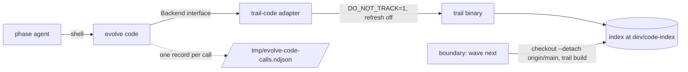

# Code index CLI: `evolve code` gives every phase agent a read-only code graph

> Research: [code-index-cli-2026-10](../research/code-index-cli-2026-10.md). Plan: [code-index-cli-2026-10](../plans/code-index-cli-2026-10.md). Decision: [ADR-0138](adr/0138-phase-agents-query-the-code-index-through-an-evolve-cli-not-mcp.md).
> Status: proposed (2026-10-17). No code exists yet. Every name in this file that has no code is marked "planned".
>
> This file is the spec of record for the `evolve code` verb. The research holds the evidence, the plan holds the scored designs and the order of work, and the ADR holds the decision.

On 2026-10-17 the operator asked that the loop agents use trail-code, "separated from the evo loop without interfere with evo loop's function. It should only boost the LLM performance." This spec shows how the design meets that request.

**Terms used throughout:**

| Term | Meaning |
|---|---|
| code index | A graph of the symbols and the calls of this repository. trail-code builds it with tree-sitter (C1, C7). |
| trail-code | The outside tool that builds and queries the index. Its binary is `dev/.tools/trail/node_modules/.bin/trail` (C6). |
| index worktree | A git worktree at `dev/code-index` (planned). It holds the checkout that the index describes. |
| `Backend` | The Go interface (planned) that the `evolve code` commands call. It has one method for each command. |
| adapter | The one package (planned) that runs the trail-code binary. It implements `Backend`. |
| boundary | The step between two waves where the loop merges and refreshes. `evolve wave next` runs it (`go/cmd/evolve/cmd_wave_next.go:102`). |
| phase agent | The LLM CLI process of one phase: scout, builder, debugger and others. Each has a shell tool (C5). |
| usage log | The file `/tmp/evolve-code-calls.ndjson` (planned). Each call appends one line. |

## Goals

| Id | Goal | Measure | Target |
|---|---|---|---|
| G1 | Every phase agent of every CLI can query the index, with no change to how the loop starts a CLI. | the usage log, by CLI | calls from agy and Claude Code phases |
| G2 | The agents use the index. | calls per phase of scout, build and debug | more than 0, against 0 in 20 phases (C3) |
| G3 | The gain is measured. | build tokens and audit pass rate, 3 waves before and after the prompt change | tokens fall, pass rate does not fall |
| G4 | The index never changes a cycle's tree, never writes in a sandbox, and never tells an agent what to say. | `git status` of a cycle worktree after a call | clean |
| G5 | A type-checked backend can replace trail-code with no change for the agents. | a fake backend passes the same command tests as trail-code | green |

## Table of contents

- [1. The command surface](#1-the-command-surface)
- [2. The Backend interface](#2-the-backend-interface)
- [3. The trail-code adapter](#3-the-trail-code-adapter)
- [4. The index lifecycle](#4-the-index-lifecycle)
- [5. The sandbox](#5-the-sandbox)
- [6. The usage log](#6-the-usage-log)
- [7. The prompt text](#7-the-prompt-text)
- [8. The flow and a worked example](#8-the-flow-and-a-worked-example)
- [Separation from the loop](#separation-from-the-loop)
- [Guards](#guards)
- [Limits](#limits)

## 1. The command surface

### Issue

An agent that wants to know "who calls this function" today runs `grep` and reads many files. The MCP trial gave the agents a graph, and they made 0 calls in 20 phases (C3). The MCP server also cannot reach a Claude Code phase, because `--strict-mcp-config` hides it by design (C4).

### Gap

An MCP tool lives in the tool list of one CLI. A shell command is the one surface that all CLIs share (C5). Current practice agrees: a CLI costs fewer tokens than MCP, and models use the shell more readily (P3.1, P3.2). The agents need a command with a short name and a plain output.

### Solution

`evolve code` (planned) has four commands. Each command is read-only (D1).

| Command | Question it answers | Backend call (trail-code) |
|---|---|---|
| `evolve code callers <symbol> [--direction in\|out]` | Who calls this symbol (`in`, the default)? Which symbols does it call (`out`)? | `trail callers` |
| `evolve code api <file>` | What are the exported signatures of this file, without the bodies? | `trail skeleton` |
| `evolve code find <query>` | Which symbols match a question in plain words? | `trail ask` |
| `evolve code map [dir]` | What is the structure of this directory? | `trail map` |

The output is plain text. Each fact is on its own line. Each line that names a hit ends with the `file:line` of the hit, so the agent can open the file at that line.

| Exit code | Meaning | Output |
|---|---|---|
| 0 | The query found at least one hit. | the hit lines on stdout |
| 1 | The query ran and found nothing. | one line on stderr that names the query |
| 2 | The index or the backend is absent. | one line on stderr that says what is absent and how to build it |

The exit code 2 is the case of a host with no Node or no index worktree. The command stops with a clear message and does not guess (plan section 9). No command writes to the repository, to the index or to the cycle worktree.

## 2. The Backend interface

### Issue

trail-code parses with tree-sitter and does not type-check. It misses a call through an injected function: `trail callers killGroup --direction out` gave no callees (C7). If the command code calls trail-code directly, a better engine needs a rewrite of the command.

### Gap

`gopls` has a call hierarchy (P3.5), and the Go analysis libraries can build a type-checked graph (plan design D). Neither can replace trail-code unless the commands depend on a stable seam. The plan scores C and D below B today, but keeps them open (plan section 4).

### Solution

The commands call a `Backend` interface (planned, D2). This is the Strategy pattern: the commands do not know which engine answers. The method names below are planned.

| Planned method | Serves | Returns |
|---|---|---|
| `Callers(ctx, symbol, direction)` | `evolve code callers` | a list of hits (symbol, `file`, `line`) |
| `API(ctx, file)` | `evolve code api` | a list of signature lines |
| `Find(ctx, query)` | `evolve code find` | a list of hits |
| `Map(ctx, dir)` | `evolve code map` | a list of lines |

Each method returns `(hits, error)`. The typed error `ErrNotFound` (planned) means exit 1, and the typed error `ErrAbsent` (planned) means exit 2. The command code maps the two errors to the exit codes of section 1.

| Backend | State | Reason |
|---|---|---|
| trail-code adapter | first, planned (K1) | C1, C6: fast, and it has a CLI |
| fake backend | planned (K1), for tests | G5: the same command tests run on any backend |
| `gopls` | later | P3.5: type-checked, but its CLI is experimental and its start-up cost is not measured (C8) |
| native Go index | later | the most work, and it adds a library to `go.mod` |

### Adapt the layer to any search algorithm

On 2026-10-17 the operator asked: "build the cli layer as abstract layer which can be adapted to different indexing fast code search algorithm for llm". So a new algorithm must plug in as data and one new package, with no change to the commands. Four rules make that true:

1. **One result type.** Every backend returns the same `Hit`: `file`, `line`, `symbol` and a short `text`. A command prints hits in one format, whatever the backend.
2. **Declared capabilities.** Each backend says which of the four queries it serves (`Capabilities()`, planned). A call graph serves `callers`. A text or embedding search serves `find` only. A command that no backend serves exits 3 with the message "no backend serves `<command>`".
3. **A backend set, chosen by config.** `main` builds a `Backends` set from the policy key `code_index.backends` (planned), an ordered list such as `["trail"]`. For each query, the first backend in the list that serves it answers. This is the Chain of Responsibility pattern over the Strategy interface. There is no `init()` registry: the set is built and injected, as ADR-0137 asks for the bridge.
4. **One conformance suite.** A shared test suite (planned) runs the same cases on every backend. A new backend is done when it passes the suite.

   The cases are a known caller, a known file API, a query with no answer (`ErrNotFound`) and an absent index (`ErrAbsent`).

| Example backend | Algorithm | Serves | Cost to add |
|---|---|---|---|
| `trail` | tree-sitter graph, pre-built | `callers`, `api`, `find`, `map` | K1 |
| `gopls` | type-checked call hierarchy | `callers`, `api`, `find` | one adapter package |
| `native` | Go analysis call graph, built at the boundary | `callers`, `api` | one package and one `go.mod` library |
| `grep` | text search over the index worktree | `find` | one small package, and a safe last entry in the list |

**Why a chain and not one backend.** No single algorithm is the best at every query. A type-checked graph is exact for `callers`, and a text or embedding search is better for `find` when the agent knows only some words. With a chain, the operator puts the best backend for each query first, and a cheap one last.

The decision to change the backend belongs to the usage log. If the agents call the commands but the answers fail for injected functions, a type-checked backend replaces trail-code (ADR-0138, "What changes this decision").

## 3. The trail-code adapter

### Issue

trail-code is a Node program. The repository gives each outside library one adapter package ([third-party-dependencies](../conventions/third-party-dependencies.md), C8). This design applies the same rule to the trail-code binary. D3 extends the rule of [third-party-dependencies](../conventions/third-party-dependencies.md) from `go.mod` libraries to outside binaries. The convention does not cover a binary today, so K1 adds a structure test for it, and the convention gets one row. The trail-code CLI also prints a line that tells the agent to report "tokens saved" to the user (C6).

### Gap

A phase agent must not receive an instruction from a tool. A line such as "tell the user ..." is a prompt that the operator did not write. The agent can act on it. A plain pass-through of the output fails G4.

### Solution

One package (planned, D3) runs the binary. No other package runs it. The adapter does four things:

1. It runs `dev/.tools/trail/node_modules/.bin/trail` (the path today) with `DO_NOT_TRACK=1` and with the refresh off. The refresh is off through the environment variable `GRAFT_NO_REFRESH=1`, not through a flag.
2. It points the binary at the index worktree `dev/code-index`, never at the cycle worktree. K1 names how `evolve code` finds `dev/code-index` from the hub root. The adapter passes that root to trail as the explicit `[dir]` argument. The reason: the default of trail is the nearest ancestor with a `graft/` index.
3. It maps each `Backend` method to one trail-code verb, as the table in section 1 shows.
4. It removes each output line that tells the agent what to do or say (D4). The "[trail] tokens saved ... tell the user" header is the known case (C6).

The strip is a filter in the adapter. A test (K1) feeds the fake binary output with a "tokens saved" line and expects the command output without it. If trail-code adds a new instruction line in a later version, the filter must learn it. The adapter keeps the match rules in one list so that a new rule is one row.

## 4. The index lifecycle

### Issue

The index must match the code that the agent works on. A rebuild of the full index takes 31 s (C1). A phase that rebuilds the index on each call wastes time. A phase that rebuilds it also writes files, which breaks G4.

### Gap

A cycle writes to its own worktree. If the index follows the cycle worktree, each change needs a rebuild, and the index tool writes inside the sandbox of the phase.

### Solution

The index worktree is separate from every cycle worktree. The boundary refreshes it (D5). A phase never does.

1. The boundary runs `git checkout --detach origin/main` in the index worktree.
2. The boundary runs an incremental `trail build`. It reads only the changed files and takes about 2 s (C1).
3. A phase reads the index. A query takes about 0.1 s (C1).

The refresh is a step of `evolve wave next` (planned, K2), beside the other boundary steps. `wave next --dry-run` lists it.

Why the index at `main` is right for a cycle: a cycle starts from `main`, so the index matches the base of the cycle. The index does not show the edits that the builder made in this cycle. The prompt tells the agent this (section 7). The agent reads a file before it changes it, and the file on disk is always current.

## 5. The sandbox

### Issue

Each phase runs under a sandbox that allows a small set of writes. A tool that writes outside this set fails or, worse, writes to the shared tree.

### Gap

The index tool must read a worktree that is not the phase worktree. The usage log must be written by a process that the sandbox confines.

### Solution

The command only reads. The index worktree is read through the file system. The one write is the usage log under `/tmp`. The macOS sandbox profile grants read and write on `/tmp`, `/private/tmp`, `/var/folders` and `/private/var/folders` (`go/internal/adapters/sandbox/sandbox.go:178-181`). The bridge also passes `/tmp` as a write path on its wrap (`go/internal/bridge/sandbox_wrap.go:158`). The command needs no new grant.

If the log write fails, the command prints the answer and goes on. A log failure must not block a query. The command does print one line on stderr when the write fails, so the failure is not silent. This rule is planned (K3).

The index worktree at `dev/code-index` is a path that the sandbox must allow for read. The read grant covers `dev/code-index` when `HomeDir` is set (`go/internal/adapters/sandbox/sandbox.go:175-176`; on Linux `go/internal/adapters/sandbox/sandbox.go:249-251`). K1 adds a test that runs `evolve code map` under the generated profile.

## 6. The usage log

### Issue

The 20 phases of C3 had 0 calls, and we know it only because a log existed for the MCP server (`/private/tmp/evolve-trail-calls.ndjson`). Without a log, we cannot say if the new prompt works.

### Gap

G2 and G3 need numbers by phase. The backend cannot give them, because the backend does not know which phase called.

### Solution

Each call appends one record (D6) to `/tmp/evolve-code-calls.ndjson` (planned, K3). One record is one JSON object on one line.

| Field | Value |
|---|---|
| `ts` | the time of the call, in UTC |
| `command` | `callers`, `api`, `find` or `map` |
| `phase` | the phase name, read from the environment of the process if present, else empty |
| `cwd` | the working directory of the call |

The name of the environment variable that carries the phase is not fixed. The loop passes many `EVOLVE_PHASE_*` variables, and K3 must find the variable that names the phase (open item, see Limits).

How the plan reads the log:

- **G2:** count the records by `phase`. A scout, builder or debugger phase with more than 0 records meets G2.
- **G3:** join the records to the per-phase token and pass-rate figures of 3 waves before and 3 waves after the prompt change.
- **G1:** group the records by `cwd` or by `phase` to see that agy and Claude Code phases both call.

## 7. The prompt text

### Issue

Tool use depends on the wording of the prompt. An edited tool description gave over ten times more use in one study (P3.4). A hint in the global instructions of agy did not change the 0 calls (C3).

### Gap

The agent does not know that `evolve code` exists, or when it helps. The scout and the builder already read their persona on each start (`agents/evolve-scout.md`, `agents/evolve-builder.md`, `agents/evolve-debugger.md`).

### Solution

Add these two paragraphs to the scout, builder and debugger personas (D7, K4a). Together they have eight sentences, in ASD-STE100.

> Use `evolve code` before you read many files to find code. When you must find who calls a symbol, run `evolve code callers <symbol>`. When you must know what a file offers, run `evolve code api <file>`. When you only know the words for a symbol, run `evolve code find <query>`. When you must learn a new directory, run `evolve code map <dir>`.

> The index shows `main`, not your edits. It can miss calls through injected functions. Read a file before you change it.

K4a tests each instruction line for 20 words or fewer. K4b runs the prompt-regression eval on each persona change. The tdd and auditor phases do not get the text in the first trial (plan Q2).

## Separation from the loop

The feature touches the loop in two places: the persona paragraph (K4a) and the refresh step of `wave next` (K2). It adds no flag and changes no phase order. If the index is absent, `evolve code` exits 2 and the agent uses grep. If the refresh fails, `wave next` prints a warning and goes on. One revert of K4a and K2 removes the feature. The prompt-regression eval and the G3 measure show that the loop does not lose quality.

## 8. The flow and a worked example

The solid arrows are the query path. The agent calls the command. The command calls the `Backend`. The adapter runs the binary against the index. The dotted arrow is the log. The boundary is the only writer of the index.

**Worked example.** A scout reads `runStagedCatalogRefresh` in the source and asks who calls it.

1. The agent runs `evolve code callers runStagedCatalogRefresh`.
2. The command calls `Backend.Callers` with the direction `in`.
3. The adapter runs `trail callers runStagedCatalogRefresh` and drops any line that tells the agent what to say.
4. The command prints one line for each caller. The real caller is `makeCatalogRefresher`, in `go/cmd/evolve/cmd_models_live.go:35-49`. That function returns a closure that calls `runStagedCatalogRefresh` at line 37 and passes it a `liveRefresh` function.
5. The command exits 0 and appends one record to the usage log.

The query uses the index of the 6,004 files, 51,347 symbols and 134,377 edges (C1). It takes about 0.1 s, against a `grep` that returns every text match and needs a read of each file. The exact output text is planned: K1 fixes it in a golden test.

## Guards

| Rule | Guard test | State |
|---|---|---|
| D3: one package runs the trail-code binary | a structure test fails if another package imports `os/exec` with the trail path, in the style of `go/test/structure/thirdparty_test.go`; the convention gets one row | planned (K1) |
| D4: the output has no instruction line | a fake backend returns a "tokens saved" line, and `evolve code callers` prints the answer without it | planned (K1) |
| D5: the command is read-only, so a cycle worktree stays clean | a test runs each command in a temporary git repository and expects an empty `git status` | planned (K1) |
| D6: one record for each call | a test runs one command and counts one new line, with the command and the phase | planned (K3) |
| G5: any backend passes the command tests | the command tests run on the fake backend and on trail-code | planned (K1) |

## Limits

- The first backend does not type-check. It misses calls through injected functions (C7). The prompt says so.
- The index shows `main`. It does not show the edits of the current cycle (section 4).
- The design needs Node and the index worktree on the host. A host without them gets exit 2 (section 1), and no test depends on Node.
- The speed of `gopls` for each call on 6,000 files is not measured (P3.5). The design does not depend on it.
- The name of the environment variable for the phase is open (section 6).
- The gain in tokens is not proven. Independent tests find that a graph helps most on structural questions, not on tokens (P3.3). G3 measures it for this repository.
- A path from the cycle worktree maps to the index worktree at main, so a file that the cycle edited shows its old API.
- The spec does not remove the MCP registrations. K5 does that after one wave with the CLI live (D8).
