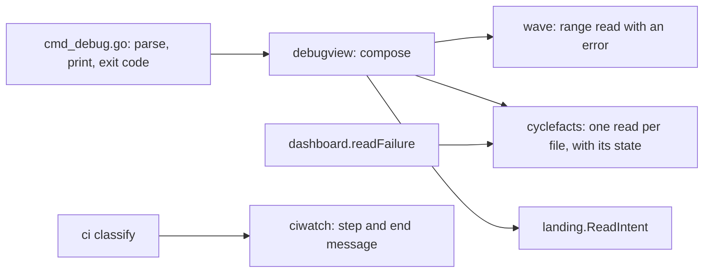

# Debug CLI: a read-only family that tells the console why a cycle stopped, and what to do next

**Status:** proposed, 2026-11-05. Each new name in this file is a proposal until its component lands: `debug cycles`, `debug cycle`, `internal/debugview`, `internal/cyclefacts` and the range read of `wave`. The build of C1 to C5 of the plan is in progress.

> [ADR-0162](adr/0162-the-console-reads-through-a-tested-read-only-debug-family-and-writes-no-scratch-scripts.md) · plan: [debug-cli-2026-11](../plans/debug-cli-2026-11.md) · research: [debug-cli-2026-11](../research/debug-cli-2026-11.md).
> This file is the spec of record for the debug family. It covers the verbs, the exit codes, the items, the source kinds, the states, the rule for `next` and the read-only proof. The [CLI contract](cli-contract.md) holds the envelope, the exit table and the agent classes.
>
> **Terms used throughout:**
> - **Console:** the operator's agent session, which runs the loop from outside.
> - **Cell:** the sandboxed process of one phase agent.
> - **Run directory:** `.evolve/runs/cycle-N`. A cell can write in it, except `inputs/`.
> - **Host record:** a file that the host writes outside the run directory.
> - **Item:** one fact of a brief, with an id, a value, a source and a state.
> - **Breadcrumb:** a next command that a result names. The field is `next`.
> - **Owner:** the package that today reads or writes a fact.

## Table of contents

- [1. Goals](#1-goals)
- [2. The verbs and the exit codes](#2-the-verbs-and-the-exit-codes)
- [3. The items and the source kinds](#3-the-items-and-the-source-kinds)
- [4. The states of a cycle](#4-the-states-of-a-cycle)
- [5. The rule for next](#5-the-rule-for-next)
- [6. The read-only proof](#6-the-read-only-proof)
- [Guards](#guards)
- [Limits](#limits)

## 1. Goals

The operator set the bar on 2026-11-05: "The signal needs to be accurate without any mistake, showing clear guidances for agent to debug".

| Goal | Measure | Target |
|---|---|---|
| G1. One call answers: why did the cycle stop, can work be saved, what is next | `debug cycle N` on cycle 2157 | The golden test shows all three |
| G2. A read never changes state | The contract harness with mutants | 0 changes, and 2 of 2 planted faults fail |
| G3. Each answer states its source | The label test against the sandbox profiles | 100% of items |
| G4. A failed read is visible | Tests of the owner reads | 0 silent drops, and exit 2 |
| G5. A next command works from any directory | Row C13 of the plan | 100% of entries |

The order of the goals is the order of the risk. A wrong answer with a confident label (G3, G4) costs more than a missing answer.

## 2. The verbs and the exit codes

### Issue

The console reads cycle facts with scratch scripts. 71 files in one session caused four faults (research F1.1). No verb gives a range of cycles, and no verb gives one failure brief. `wave status` reports one wave, and `dossier show` prints one line and a path (research F1.18).

### Gap

A verb in `wave` or `dossier` cannot take the range or the brief without a mix of reads and writes in one package (research F1.2). A family with its own readers repeats the owners (research F1.5).

### Solution

| Verb | Question |
|---|---|
| `evolve debug cycles [--from N] [--to N] [--project-root P] [--json]` | What did each cycle do? The range has no wave floor, so a resumed cycle is present. |
| `evolve debug cycle N [--project-root P] [--json]` | Why did this cycle stop, can work be saved, and what is next? |

`--project-root` is on each verb. Each result prints the project root, because a worktree has no `.evolve/runs/cycle-2157`.

| Exit | Meaning |
|---|---|
| 0 | The read succeeded. A failed cycle still exits 0, because the verb reports and does not judge. |
| 1 | The cycle is absent, as in `dossier show`. The text lists each place that the verb searched. |
| 2 | A read failed, or the root has no `.evolve/runs`. The text names `--project-root`. |
| 10 | A usage error. |

Exit 3 stays unused. It means `refused, retry later` (`docs/architecture/cli-contract.md` §3), and an agent that sees it for an absent cycle retries a cycle that never exists.

The meanings are distinct. Exit 0 is about the read. Exit 1 says the cycle does not exist. Exit 2 says the answer cannot be trusted.

Both verbs are class `A` in `agentclass/table.go` and `availAlways` in `coreVerbs`. Each has a row in §5 of the contract. In a cell at the `enforce` stage, a read of another cycle is denied, and the item shows as `unreadable`. It never shows as a blank.

`ci classify` gains the failed step name and the end message of a coverage gate. Its exit codes do not change. The end message goes in a new field, never in `Step`, because `failureKey` hashes `Step` into the inbox item id (`go/internal/ciwatch/classify.go:245`, `go/internal/ciwatch/basered.go:87`).



## 3. The items and the source kinds

### Issue

A cell can write most of the files that a brief reads (research F1.3). `wave.Cycle` merges its sources, and a workspace file alone gives `Shipped:true` (research F1.17). The digest of cycle 2157 holds a class that the disposition calls false (research F1.12).

### Gap

Two labels, `host` and `agent`, are too few. The digest record is written by the host, but it is computed from a file that a cell can plant (`go/internal/core/failure_digest.go:73,180`). A `host` label on it is false.

### Solution

Each item has four fields.

| Field | Meaning |
|---|---|
| `id` | A stable name, for example `failure.class`. |
| `value` | The value, verbatim from its source. |
| `source` | `host`, `derived` or `workspace`, and the file. |
| `state` | `present`, `absent-expected`, `absent-unexpected`, `corrupt` or `unreadable`. |

The source kind follows the real sandbox profiles. A test checks it (plan C6).

| Source | Rule | Example |
|---|---|---|
| `workspace` | A cell can write the path. | The retrospective, `cycle-state.json`, `.lease` |
| `host` | A cell cannot write the path, and no declared input is writable. | The landing intent |
| `derived` | A cell cannot write the path, and a declared input is writable. | The digest record |

The digest comes from the host record at `paths.FailureDigestRecordPath`, as `selfheal` reads it (`go/internal/selfheal/live.go:23`). The family never falls back to the workspace copy.

A row of `debug cycles` takes its columns from `wave.Cycle`. Each column has the fixed label `workspace`, and `shipped` is named `shipped_claim`. One more column, `landed`, comes from `landing.ReadIntent` with the label `host`. A missing intent shows as `absent`, not as false.

The state `absent-expected` marks a digest of a `live`, `landed` or `incomplete` cycle. The state `absent-unexpected` marks a digest of an `aborted` or `failed` cycle. Of the recorded cycles, 41 of 41 aborted cycles have a digest and 0 of 67 landed cycles have one (research F1.11).

The brief holds the item, the phase, the reason verbatim and the checks. It also holds the class, the route and layer, and the recurrence (the `class_recurrence` field of the digest record). It ends with the decision, the salvage pointer and the last WARN or higher signals. Each item states its source.

## 4. The states of a cycle

### Issue

`dashboard.assignState` has its own set of states, and `wave.Cycle` has `Termination`. A builder must then invent a third vocabulary, and a test can pin only that choice.

### Gap

No document lists the states of a cycle, the rule for each, and the `next` for each.

### Solution

| State | Rule | Source | `next` |
|---|---|---|---|
| `landed` | The landing intent is `complete`. | `host` | `evolve dossier show N` |
| `aborted` | `cycle-state.json` says `aborted`. | `workspace` | The salvage read, then `evolve dossier show N` |
| `failed` | A final verdict of FAIL, with no abort. | `workspace` | The salvage read, then `evolve dossier show N` |
| `live` | A run lease is live. | `workspace` | `evolve wave status` |
| `incomplete` | None of the rules above. | `workspace` | `evolve wave status`, then `evolve cycle resume --all --dry-run`, marked console only |

The rules run in this order. `landed` is the only host fact, so it runs first. A cell can plant a fresh `.lease`: `OwnerLive` returns true for a fresh lease with `owner_pid` 0 (`go/internal/runlease/runlease.go:104`). So `live` runs late and cannot hide a stronger state.

`cycle resume` is class `Denied` (`go/internal/agentclass/table.go:91`). The output marks that entry "console only". A cell must not run it.

## 5. The rule for next

### Issue

The console runs what `next` prints. The salvage pointer is prose that a cell wrote. The real pointer of cycle 2157 is `.evolve/worktrees/cycle-cd3ae73e-2157 (base f2fdca10f, uncommitted TDD tests, eval and serial-list entry; fix design in build-report.md)` (research F1.10). A command built from it puts cell text in a command.

### Gap

`dossier show` takes its root from the flag, the environment or the working directory (`go/cmd/evolve/cmd_loop_stop.go:146`). From a worktree, a command without the root exits 1 as absent. The text of `dossier show` is one line and a path, so it is not enough alone.

### Solution

`next` holds only the cycle number, the project root of the verb, and values that pass a check.

1. Each `evolve` entry carries `--project-root <root>`.
2. Each path is absolute, so a command works from a worktree.
3. The first token of the pointer must match `^\.evolve/worktrees/cycle-[0-9a-f]+-<N>$`.
4. The directory must exist.
5. Then the entry is `git --no-optional-locks -C <root>/<path> status`. A plain `status` can refresh an index in a tree that holds the work to save.
6. On any other pointer, the brief prints it as a labelled value and names no command.

Of 33 recorded pointers, 33 match the pattern (research F1.10).

**A worked example.** A test renders this text from the fixture of cycle 2157, and a golden file holds it. This file shows the shape only. The class in this example is a known false label (research F1.12). The label `derived` tells the reader that it is a computed guess.

```text
cycle 2157: aborted at build, item retry-ladder-resume-keeps-ladder-state  (root: <path>)
  [workspace] reason: resume review gate: phase "build" deliverable rejected after 2 correction(s) ...
  [derived]   class: infra-error, checks: composed-floor, route: console, class_recurrence: 2
  [workspace] salvage: .evolve/worktrees/cycle-cd3ae73e-2157 (base f2fdca10f, uncommitted TDD tests ...)
next:
  git --no-optional-locks -C <root>/.evolve/worktrees/cycle-cd3ae73e-2157 status   # read the work to save first
  evolve dossier show 2157 --project-root <root>                                  # the sealed record
```

## 6. The read-only proof

### Issue

The family promises that it changes nothing. Four earlier proofs failed on the code. An import list fails because `wave` reaches `inboxmover` (research F1.2). A tree at mode 0555 hides a write (research F1.13). A seam that records argv sees only callers that use it. A planted `gh` call fails to start, and the error is dropped (research F1.15).

### Gap

The existing harness `TestCLIContract_AlwaysVerbsWriteNothing` hashes the tree only for a success call, and `TMPDIR` changes on 30 of 30 calls (research F1.14). It cannot tell a planted write from the noise.

### Solution

The proof extends the harness. It adds no second harness.

1. Run on a writable tree, through `dispatchWith`.
2. The hash gains mode and mtime.
3. `HOME` and `TMPDIR` are temporary directories, and the hash covers them.
4. Open the store before the baseline, so that `t.TempDir()` is not a change.
5. Put logging shims for `git` and `gh` on `PATH`. Each shim logs its argv outside the tree and exits 1.
6. The log of a debug verb must be empty. Silence is a field of the contract call, not a global rule (see below).
7. For the debug verbs, hash each call, also on a failure exit.
8. Plant mutants through `go test -overlay`: a write to `$TMPDIR`, and a `gh` call in `dossier show`. Each must fail the test. The build report holds the failed output.
9. Keep 0555 as one small assertion: each verb still exits 0 with no write permission.

`status` calls `gh pr list`. `inbox lint` and `scan secrets` call `git`. These calls are on purpose, so the shims stay silent for the debug verbs and for `dossier show` only.

The order of the build is in the plan: the harness first (C1), because no later row has a proof until it can fail.

## Guards

| Rule | Guard | State |
|---|---|---|
| A debug verb changes no file, `HOME` or `TMPDIR` | Extended contract harness | Planned (C1, C11, C12). C1 in progress |
| A debug verb starts no `git` or `gh` process | Logging shims, empty log | Planned (C1, C11, C12) |
| A failed owner read returns its error | Tests of the range read and `ReadDirChecked` | Planned (C2, C3). In progress |
| Each read of `cyclefacts` returns each state | Tests of `cyclefacts` | Planned (C4). In progress |
| The end message of a gate does not change `Step` | Test of `ciwatch` | Planned (C5). In progress |
| A source label is true against the sandbox profiles | Test in package `profiles` | Planned (C6) |
| Each state is selected by its rule | Test of the state table | Planned (C9) |
| A pointer that fails its check gives no command | Test of the check of `next` | Planned (C10) |
| Each verb has an envelope, a schema and a class row | Contract tests | Planned (C11, C12) |
| Each `evolve` entry of `next` runs from another directory | Test over both verbs | Planned (C13) |

## Limits

- The family reports what the owners read. A wrong owner gives a wrong answer until the owner is fixed. The source label makes this visible.
- The family replaces the reads of the scratch scripts. It does not replace the review and commit chain. `debug gates` and `debug trees` need their own design.
- In a cell at the `enforce` stage, reads of other cycles are denied. They show as `unreadable`.
- The read-only test proves the paths that it runs, not each path that the code holds. Mutants show that it can fail.
- `landed` trusts the landing intent. A later item can add a `git` check if a real miss shows up.
- The state `live` is a claim of the workspace. A cell can plant a fresh lease, so `live` never overrides `landed`.
- The class and the checks of a digest are computed, and they can be wrong. The label `derived` says so.
- A `git status` on a tree that a cell wrote is safe only while the sandbox denies `.git` in the worktree. A profile without that denial reopens the path (review round 3).
- The default size of the range of `debug cycles` is not set. The builder of C7 sets it.
