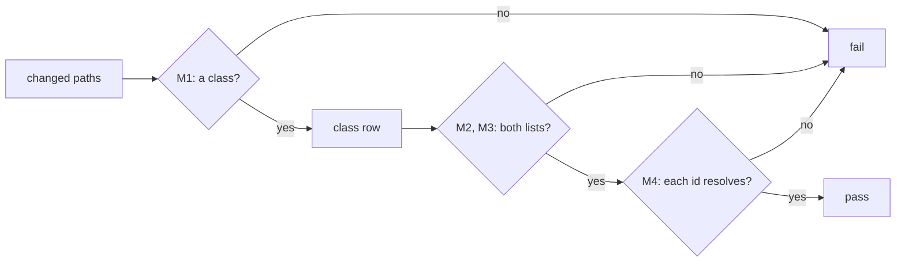

# Deliverable verification: a registry of static checks and authentic checks, and the gates that make each check real

> [ADR-0172](adr/0172-every-deliverable-has-a-registered-static-check-and-an-authentic-check.md) · plan: [deliverable-verification-2026-11](../plans/deliverable-verification-2026-11.md) · research: [deliverable-verification-2026-11](../research/deliverable-verification-2026-11.md).
> This file is the spec of record for how the loop proves that each deliverable is checked. It does not repeat the shadow stage contract ([shadow-stage-contract](shadow-stage-contract.md)) or the quality gate of ACS predicates ([acs-predicate-quality-gate](acs-predicate-quality-gate.md)).
>
> The operator asked on 2026-11-27: "I mean all deliverables are required to be properly tested and examed with a static and authentic method".
>
> **Status:** proposed. V1 is built, and a pending PR carries it. This design PR lands after the V1 PR, so the V1 test name that this file cites exists on main when this file lands. Each other name below (the registry file, the verbs, the stage keys) is a design name. The code does not hold it yet.
>
> **Terms used throughout:**
> - **Deliverable class:** a set of paths that one producer hands to the pipeline. Example: docs of record.
> - **Static check:** a deterministic check that code runs: a Go test, a lint, a gate verb or a CI step. A reviewer LLM's probe or a builder's claim is not static.
> - **Authentic check:** a check that truly exercises the deliverable. It is one of four kinds, listed in section 3.
> - **Registry:** the data file that maps each class to its checks.
> - **Meta-guard:** the test that keeps the registry true.
> - **FAIL_TO_PASS:** a test that fails on the base and passes on the change. **PASS_TO_PASS:** a test that passes on both.
> - **Base:** the merge base of the change with `origin/main`.

## Table of contents

1. [Goals](#1-goals)
2. [The classes](#2-the-classes)
3. [The registry and the meta-guard](#3-the-registry-and-the-meta-guard)
4. [V1: named tests exist](#4-v1-named-tests-exist)
5. [V2: FAIL_TO_PASS](#5-v2-fail_to_pass)
6. [V3: changed-line mutation](#6-v3-changed-line-mutation)
7. [V4: doc citations](#7-v4-doc-citations)
8. [V5: claims match a record](#8-v5-claims-match-a-record)
9. [V6: historical ACS packages](#9-v6-historical-acs-packages)
10. [Worked example](#10-worked-example)
11. [Guards](#11-guards)
12. [Limits](#12-limits)

## 1. Goals

| Goal | Measure | Target |
|---|---|---|
| G1 Each class has a registered static check and a registered authentic check. | Registry rows with an empty field | 0 |
| G2 A new test fails on the base. | Added tests that pass on the base, with no marker | 0 |
| G3 A changed function has a mutant that a test kills. | Changed functions with no killed mutant | 0 |
| G4 A doc of record cites only things that exist. | Cites that do not resolve, outside the baseline | 0 |
| G5 A claim of a count or of a red is true. | Claims with no host record | 0 |
| G6 Old ACS packages run on a schedule. | Packages with no run in 30 days | 0 |

The order of the goals follows the plan: G1 first, because each other goal needs the list of classes.

## 2. The classes

The registry holds one row for each class. The inventory has 15 classes (research section 1.1).

| Id | Class | Paths (examples) |
|---|---|---|
| D1 | Go production code | `go/internal/**`, `go/cmd/**`, `go/pkg/**` |
| D2 | Go tests | `go/**/*_test.go` |
| D3 | ACS predicate packages | `go/acs/**` |
| D4 | Docs of record | `docs/architecture/**`, `docs/incidents/**`, `docs/conventions/**`, `docs/operations/**` |
| D5 | Plans and research | `docs/plans/**`, `docs/research/**`, `docs/research-index/**` |
| D6 | Skills | `skills/**` |
| D7 | Agent personas | `agents/**`, `.claude/agents/**` |
| D8 | Data files and registries | JSON under `go/internal/**`, `guidance/**` |
| D9 | Generated files | `docs/research-index.md`, `CLAUDE.md`, `GEMINI.md`, `go/.darwin-set` |
| D10 | Inbox items | `.evolve/inbox/**` |
| D11 | Cycle artifacts | the reports, the verdict and the ledger of a cycle |
| D12 | Console PRs and commit messages | the commit body, the trailers, the attestation |
| D13 | Release artifacts | `CHANGELOG.md`, version markers |
| D14 | Ratchet files | `.test-latency.json`, `.cover-split`, `go/.apicover-enforce`, `go/.cover-strict`, `sizeratchet/offenders.json` |
| D15 | Eval definitions | `.evolve/evals/*.md` |

## 3. The registry and the meta-guard

### Issue

The checks of each class exist, and they sit in many files. The inventory found them with `git grep`. No test knows that a class lacks an authentic check. The commit gate starts language lanes only for go, py, ts, js and rs files (`go/internal/commitgate/commitgate.go:206`), so a docs-only change meets no code check.

### Gap

A patch to one gate cannot see a class that has no gate. A list that a person keeps by hand goes stale. The list must be data, and a test must read it.

### Solution

One data file holds the registry. The proposed home is `go/internal/verifyreg/registry.json`. A Go package of the same name loads it. Each class has the fields below.

| Field | Meaning |
|---|---|
| `id` | The class id, for example `D4`. |
| `paths` | The path globs of the class. |
| `static` | A list of checks. Each is a kind and an id. |
| `authentic` | A list of checks, as in `static`, and the authentic kind of each. |

A **check** has a `kind` and an `id`. The id names an existing guard. The meta-guard resolves each kind in its own way:

| Kind | Id is | The meta-guard resolves it by |
|---|---|---|
| `test` | A Go test name | V1 `testrefs.Defined` (a test declaration exists). |
| `verb` | A verb of the `evolve` CLI | The verb table of the CLI. |
| `ci_step` | A workflow file and a step id | A parse of the workflow YAML. |

An **authentic check** has one more field, `property`. It is one of four values:

- `fail_to_pass`: the test fails on the base and passes on the change;
- `mutation`: a mutant of the changed lines fails a test;
- `entry_point`: a proof drives the production entry point;
- `exists_and_matches`: a cited test, `path:line`, id, link or number exists and matches.

The meta-guard has five rules. Each rule fails the check with the name of the class or the path. The stage of the meta-guard is in the stage table below.

| Rule | Fails when |
|---|---|
| M1 | A changed path matches no class. |
| M2 | A class has an empty `static` list. |
| M3 | A class has an empty `authentic` list. |
| M4 | A registered `id` does not resolve by its kind. |
| M5 | A path matches two classes with no declared precedence. |

M1 uses the list of changed paths from `git diff --name-only <base>...HEAD`. The guard runs in the repo-contract pack, so the commit gate, the build floor and ship run it. The registry file and the guard are rows of `guards.ProtectedSurfaceManifest`, so a cycle cannot edit them.

### The class table

Each class has a static check and an authentic check. A name in the table is the check that exists today, or the component of this design that adds it. The V0 PR writes the real ids of the registry from this table, and M4 checks them.

| Class | Static check | Authentic check | Property |
|---|---|---|---|
| D1 Go production code | The go lane of the commit gate: `gofmt`, `go vet`, `go test` | V2 for the tests of the change, V3 for each changed function | `fail_to_pass`, `mutation` |
| D2 Go tests | The same go lane | V2: the test fails on the base | `fail_to_pass` |
| D3 ACS predicates | The predicate quality gate ([acs-predicate-quality-gate](acs-predicate-quality-gate.md)) | V2 for each predicate of a cycle, and V6 for the old packages | `fail_to_pass` |
| D4 Docs of record | V1 guard, STE lint | V1 and V4: each cited test, path, line, link and id exists | `exists_and_matches` |
| D5 Plans and research | STE lint | V4 | `exists_and_matches` |
| D6 Skills | The skills check of the CLI (`evolve skills check`) | V1 for the test names in the scope | `exists_and_matches` |
| D7 Agent personas | The same skills check | V1 for the test names in the scope | `exists_and_matches` |
| D8 Data files and registries | The loader test of the owning package | The gate that loads the file, run on the real tree | `entry_point` |
| D9 Generated files | `evolve docs index check` and the skills check | The generator runs again, and the output equals the file | `entry_point` |
| D10 Inbox items | The inbox dead-path check (a warning today, plan section 10) | V4 for the paths and ids of an item | `exists_and_matches` |
| D11 Cycle artifacts | The ledger chain verification | V5: each claim matches a host record | `exists_and_matches` |
| D12 Console PRs and commit messages | The commit gate | V5 for the "N/N PASS" line of the body | `exists_and_matches` |
| D13 Release artifacts | The release pipeline test and V4 for `CHANGELOG.md` | The release step runs the real version marker check | `entry_point` |
| D14 Ratchet files | `sizeratchet.CheckAgainstBase` (`go/internal/sizeratchet/against_base.go:48`) and the boundary ratchet tests | The same check reads the base and the disk of the real tree. A row that grows against the merge base fails. | `exists_and_matches` |
| D15 Eval definitions | The eval gate (`go/internal/evalgate/reviewer.go:56`) | The eval runs against the real entry point | `entry_point` |

D14 needs no new component. The ratchet files move one way against the merge base, and `sizeratchet.CheckAgainstBase` already holds that rule for its list. V0 registers it for D14, and M4 checks that it still exists. The "ratchet" in the scope that the operator chose means these files and the shrink-only baselines of V1 and V4.

The design adds deliverables. Each one has its static check and its authentic check, as the rule says. The red test first of each one is a FAIL_TO_PASS test that the V0 PR writes before the code.

| New deliverable | Class | Static check | Authentic check |
|---|---|---|---|
| The registry file `go/internal/verifyreg/registry.json` | D8 | The loader test of `verifyreg`. The meta-guard reads each row. | M2, M3 and M4 run on the real file. A test fails on a row with no authentic check. |
| The exemption file `f2p_exempt.json` | D8 | The loader test. A row with an empty `reason` or an unknown `kind` fails. | M4 checks that the named test exists. A test fails on a row that names a test that does not exist. |
| The meta-guard (V0) | D1, D2 | Its own test in the repo-contract pack | A fixture class with no authentic check fails it, and the real registry passes it. |
| The stage keys and the `gateregistry` seeds | D8 | The `gateregistry` tests that exist for each seed | The Signal Center reading of the stage on the real tree. |
| `evolve docs cite-check` (V4) | D1 | A table test of each citation kind | A fixture doc with a missing link fails, and the real tree passes against the baseline. |
| The claim check (V5) | D1 | A table test of each claim kind | A fixture report with a count that no record backs fails. |
| The `f2p_gate` and `mutation_gate` stages (V2, V3) | D1 | A table test of each verdict | A fixture test that is green on the base gets `green_on_base`. A fixture function with no killed mutant gets `lived`. |

### Stages

Each V-component starts at shadow with its own named stage key. A stage key has a named stage type and a `gateregistry` seed with its shadow signal (ADR-0167). In shadow a check records a finding and blocks nothing. Only a held proposal or the operator moves a stage to enforce (ADR-0167). Each move to enforce is an operator question in plan section 10.

| Component | Stage key | Start |
|---|---|---|
| V0 | `verifyreg_gate` | shadow |
| V1 | none: built as a test with a shrink-only baseline | blocks at landing, and the baseline holds the backlog |
| V2 | `f2p_gate` | shadow |
| V3 | `mutation_gate` | shadow |
| V4 | `cite_gate` | shadow |
| V5 | `claims_gate` | shadow |
| V6 | `acs_history_gate` | shadow (a scheduled job, not a PR check) |

The stage keys are design names. The V0 PR fixes the final names.

## 4. V1: named tests exist

**Stage: built, in a pending PR. The design PR lands after it.**

### Issue

36 package-note lines say a test pins a behavior, and the test does not exist (research F1.6).

### Gap

A reviewer sees the name of a test in a note, and no code checks that the test is there. A baseline that a branch can edit lets the branch hide a new miss.

### Solution

Package `go/internal/testrefs` reads each declared Go test (`Defined`). It reads each backticked test name in the docs of record (`Cites`). The guard `TestDocsOfRecord_EveryNamedTestExists` in `go/internal/repocontract` runs the scan on the checked-in tree. A name that no `_test.go` file declares fails the guard, unless the shrink-only `go/internal/testrefs/baseline.json` lists it. At the time of the V1 PR the baseline holds 381 names in 117 docs. The guard also fails when a baseline name now resolves, so the baseline can only shrink.

The merge base with `origin/main` is the authority for the baseline, as `sizeratchet.CheckAgainstBase` does for its list. A row that is present on disk and absent at the merge base fails. The baseline file is an authority input in `gateregistry`, so a cycle cannot widen it. The V1 PR carries this rule. The design PR lands after the V1 PR, so the guard and its test name exist on main when this file lands.

The scope is `docs/architecture`, `docs/incidents`, `docs/conventions`, `docs/operations`, `skills` and `agents`. Plans and research are out of scope, because they name tests that are still to write.

V0 reuses `Defined` to resolve each `test` kind id.

## 5. V2: FAIL_TO_PASS

**Stage: planned. Stage key `f2p_gate`, shadow first.**

### Issue

TDD passes when the report holds the heading `## RED Run Output` (`go/internal/phases/tdd/tdd.go:72`). The base-red floor excuses a red that the base already has (`go/internal/core/base_red_floor.go:77`). No gate demands that a new test fails on the base (research F1.2, F1.3).

### Gap

A test that is green on the base proves nothing about the change. UTBoost found 36 instances of tests that let 345 wrong patches pass (research P2.3).

### Solution

V2 runs in the host. For each test that the diff adds or changes, and for each predicate of a cycle:

1. Create a scratch worktree at the base. The existing gates already create one for the base-red re-run.
2. Overlay only the test file of the diff. The production files stay at the base.
3. Run `go test -json` for the test, with its build tags, N times.
4. Read the result of each test by name from the JSON events. A text parser can miss test cases (research P2.3).
5. Run the same test on the change.

The verdict of one test:

| Base run | Change run | Verdict |
|---|---|---|
| Fails in each of N runs | Passes | `f2p` (good) |
| Passes in each of N runs | Passes | `green_on_base` (a finding) |
| Fails in some runs and passes in others | any | `flaky` (dropped, counted) |
| any | Fails | `red` (the existing floors block already) |
| The test file does not compile on the base | Passes | `f2p` when the missing symbol is the one the change adds |

The last row is the usual red of a new function: the test cannot compile on the base. It counts as red for the right reason only when the compile error names a symbol that the diff adds. Any other compile error is `base_broken`, and the check reports it.

V2 also states the PASS_TO_PASS rule: the tests of the touched packages that exist on the base stay green on the change. The build floor and the commit gate already run them, so V2 adds no second run.

**The exemption marker.** A code comment cannot hold the marker, because code has no comments. The marker is a row in the data file `go/internal/verifyreg/f2p_exempt.json`. Each row has these rules:

- `test` names a test that the diff adds or changes. V0 checks that the test exists;
- `kind` is `refactor` or `characterization`. A refactor test pins the old behavior of code that the diff moves. A characterization test pins behavior that already exists;
- `reason` is one sentence that says why the test is green on the base;
- one row exempts one test in one diff. The ledger counts the rows of each diff;
- a row with an empty `reason`, or with another `kind`, fails the check.

**Stages.** V2 adds the stage key `f2p_gate` with a named stage type and a seed in `gateregistry`, with its shadow signal. In shadow, V2 records one verdict for each test and blocks nothing. It runs in the commit gate and in the build floor. The operator moves it to enforce, on the chained evidence of ADR-0167 (plan section 10). The shadow record also yields the flake rate, which sets N (plan question 1).

## 6. V3: changed-line mutation

**Stage: planned. Stage key `mutation_gate`, shadow first.**

### Issue

`MeasureMutation` (`go/internal/qualitypanel/mutation.go:78`) and `MeasureRevertSensitivity` (`go/internal/qualitypanel/revert_sensitivity.go:53`) have no production caller. The only mutation probe is an LLM reviewer (research F1.4).

### Gap

A test that runs the changed function and asserts nothing about it passes each gate. Only an LLM reviewer probes it.

### Solution

V3 reuses `MeasureMutation`. It takes the functions that the diff changes (not the whole repository, research A5). It runs in a scratch worktree, as the library requires: `checkScratch` refuses a scratch directory that sits inside the plane root or the main root. For each changed function, at least one mutant must fail a test.

| Mutant result | Verdict |
|---|---|
| `killed` | good |
| `lived` | finding: no test notices the change of the function |
| `not_covered` | finding: no test reaches the function |
| `not_viable`, `timed_out` | counted, no verdict |

V3 adds the stage key `mutation_gate`, with a named stage type and a seed in `gateregistry`. It starts in shadow, and the operator moves it to enforce (plan section 10). The cap on the functions of one diff is plan question 2. The existing readings `TQ1` and `TQ3` of the library are the shadow signal.

## 7. V4: doc citations

**Stage: planned. Stage key `cite_gate`, shadow first. A shrink-only baseline holds the backlog.**

### Issue

About one `path:line` cite in five does not resolve in specs, incidents and research. About one link in 300 is broken (research F1.7). Only the docs-review LLM checks them today.

### Gap

The STE lint job checks the style of a doc. It does not check that a cited file, line or link exists.

### Solution

V4 is a code check in the STE lint job (`.github/workflows/required.yml`). It checks existence for each kind of citation:

| Citation | Rule |
|---|---|
| `path:line` | The file exists, and the line is not beyond the end of the file. |
| Relative link `[text](path#anchor)` | The file exists, and the anchor matches a heading of the file. |
| A finding, refinement or decision id (`F1.1`, `R2`, `D4`) | The cited document defines the id. |
| A named number | The cited command or file still gives the number. This kind starts with numbers that a doc ties to a named file. |
| A test name | V1 covers it. |

V4 reads the same scope as V1, plus plans and research. A cite in the baseline passes. In shadow, a new cite that fails is a finding. At enforce it is an error. A baseline entry that now resolves fails the check, so the baseline can only shrink. V4 does not check the content of the cited line (plan non-goals).

## 8. V5: claims match a record

**Stage: planned. Stage key `claims_gate`, shadow first.**

### Issue

Ship checks only `tree_state_sha` of the commit-gate attestation (`go/internal/phases/ship/commitgate.go:85`). A build report and a commit body can say "12/12 PASS", and nothing compares the line with a run (research F1.10).

### Gap

A claim of a count or of a red is text. No code compares it with a run.

### Solution

The host records each test run: the command, the count of passed and failed tests, the tree sha and the time. V5 reads two kinds of claim.

| Claim | Where | Must match |
|---|---|---|
| `N/N PASS` | Build report, commit body | A record with the same tree and a count of N passed tests and no failed test. |
| Red evidence | The TDD report | A V2 record in which the named test failed on the base. |

In shadow, a claim with no record is a finding. At enforce it fails. A heading in the text is not a record. The commit gate checks the commit body of the staged tree. The build floor checks the report. V5 reads the records that V2 and the existing floors write, so it comes after V2.

## 9. V6: historical ACS packages

**Stage: planned. Stage key `acs_history_gate`, shadow first.**

### Issue

957 `go/acs/cycleNNNN` packages exist, and 956 of them are outside their own cycle. After its cycle, a package never runs again (research F1.8).

### Gap

The EGPS run and CI run only the current package and the regression packages. A package that rots is not seen.

### Solution

A scheduled job runs `go test -count=1 -tags acs ./acs/...`. It is not a PR check. Each package gets a result. A package that is red or does not compile is triaged:

- **Promote:** move the package to `go/acs/regression/`, where the CI job `acs-durable` runs it. Only the console moves a package, because the regression directory is protected.
- **Retire:** remove the package, and write a record that says why. The ledger keeps the record.

The job files an inbox item for each package without a verdict. The 26 packages that test text only are the first candidates to retire.

## 10. Worked example

An illustrative PR (the values are an example, the files are real):

- it changes the production code and the test of the prompts loader in `go/cmd/evolve/cmdutil`;
- it edits `docs/architecture/packages/cmd-evolve-cmdutil.md:19`, which says a test pins the override behavior. On origin/main that line cites a test name that no file declares.

| Step | Check | Result |
|---|---|---|
| 1 | **V0 M1.** The changed paths map to D1, D2 and D4. | Pass. A path such as `tools/x.sh` with no class fails. |
| 2 | **V0 M2 to M4.** D1, D2 and D4 each have a static and an authentic check, and each id resolves. | Pass. |
| 3 | **V1.** The note must name a test that a `_test.go` file declares. The name on origin/main is in the V1 baseline, so it passes while it stays there. If the PR changes the line and keeps the old name, the guard fails. | Pass after the PR names a test that exists. A name that no file declares fails. |
| 4 | **V4.** The `path:line` and the links of the note resolve. | Pass. |
| 5 | **V2.** The new test runs on the base with only the test file overlaid. It fails to compile on the base, and the missing symbol is the one the diff adds. N runs agree. | `f2p`. |
| 6 | **V3.** A mutant of the changed function (flip a condition) runs against the package tests. | `killed`. |
| 7 | **V5.** The commit body says "6/6 PASS". The host record of the tree shows 6 passed tests. | Pass. A body that says "7/7 PASS" fails. |
| 8 | **V6.** Not part of the PR. The scheduled job runs the ACS packages of the week. | Not applicable. |

Take step 5 with the verdict `green_on_base`. The shadow record holds a finding, and the commit gate prints it. After the move to enforce, the commit is blocked unless a row of `f2p_exempt.json` explains the test.

## 11. Guards

| Rule | Guard | State |
|---|---|---|
| Each changed path maps to a class (M1). | `verifyreg` meta-guard in the repo-contract pack | Planned, shadow (V0) |
| Each class has a static and an authentic check (M2, M3). | The same meta-guard | Planned (V0) |
| Each registered id exists (M4). | The same meta-guard, with V1 `Defined` for test ids | Planned (V0) |
| A named test in a doc of record exists. | `TestDocsOfRecord_EveryNamedTestExists` | Built, in a pending PR (V1) |
| The V1 baseline only shrinks. | The same test | Built, in a pending PR (V1) |
| The V1 baseline has no row that is new against the merge base. | The same test, with the merge-base authority | Built, in a pending PR (V1) |
| Doc citations resolve. | `evolve docs cite-check` in the STE lint job (design name) | Planned, shadow (V4) |
| A ratchet file moves one way against the merge base (D14). | `sizeratchet.CheckAgainstBase` and the boundary ratchet tests | Built |
| A new test fails on the base, or has a marker. | The `f2p_gate` stage, in the commit gate and the build floor | Planned, shadow (V2) |
| A changed function has a killed mutant. | The `mutation_gate` stage | Planned, shadow (V3) |
| A count or a red claim matches a host record. | The claim check in the commit gate and the build floor | Planned, shadow (V5) |
| Historical ACS packages run on a schedule. | The scheduled `-tags acs ./acs/...` job | Planned, shadow (V6) |
| The registry and the meta-guard are not edited by a cycle. | `guards.ProtectedSurfaceManifest` rows | Planned (V0) |

## 12. Limits

- The design does not check that the content of a cited line says what the text says.
- A killed mutant shows that a test notices one change. It does not show that the test set is complete.
- V2 needs a base that compiles. A base that does not compile is `base_broken`, and the check reports it.
- V2 cannot judge a test that depends on the clock or the network. Such a test is `flaky`, and it is dropped and counted.
- Shadow stages block nothing. Until the evidence moves a stage, the check only informs.
- The design flips no existing gate, and it flips none of its own stages. Each flip to enforce is an operator question. The list of gates that block only at `enforce`, or only warn, is in plan section 10.
- The design does not define the research-loop components C2, C3 and C4.
