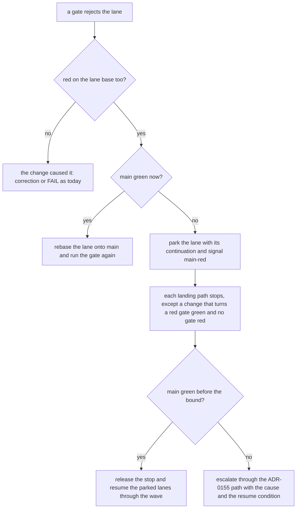

# The gate contract: one verdict for one tree, at the phase that can fix it

> [ADR-0165](adr/0165-every-gate-is-a-typed-unit-with-a-conformance-contract.md) · plan: [gate-contract-2026-11.md](../plans/gate-contract-2026-11.md) · research: [gate-contract-2026-11.md](../research/gate-contract-2026-11.md).
> This file is the spec of record for the gate contract. The plan holds the build order. The incident of [2026-11-09](../incidents/2026-11-09-duplicate-ratchet-misses-staged-predicates.md) holds the case that started it. [gate-input-inventory.md](gate-input-inventory.md) holds the trust class of each gate input, and this file does not copy it.
>
> **Terms used throughout:**
> - **Gate:** a Go function, in a non-test file, that returns a verdict which blocks a commit, a landing or a phase handoff.
> - **Gate input:** a value that a gate reads, with its trust class from the inventory.
> - **Owner phase:** the one phase that can still change an artifact.
> - **Lane base:** the commit that the lane worktree started from.
> - **Base-red:** a red that the lane base already has.
> - **Lane tree:** the index plus each untracked file that `.gitignore` does not ignore, which is the tree that ship commits.

## 1. The model

A gate is a function from `GateInput{Root, Base}` and its declared inputs to a verdict. It reads nothing else. A diff-scoped gate diffs the root against `Base`, never against `HEAD`, because `HEAD` moves when the change commits.

**Worked example.** The duplicate ratchet reads undeclared inputs: the git index, the commit dates, the file mtimes and, since #1382, a diff against `HEAD`. Before #1382 the same content gave `ok` when staged and "336 copies" when committed. #1382 closed that case and kept the gate non-hermetic. Under this contract its entry declares the tree and the baseline file. The parity harness runs it on both states of one fixture with one base, so the two verdicts must match before it can land.

## 2. The registry entry

The registry is one Go table on the protected surface. A `_test.go` file that judges the real tree calls the run function of an entry.

| Field | Meaning | Example (the duplicate ratchet) |
|---|---|---|
| `name` | one stable name | `testdup-ratchet` |
| `kind` | `scanner`, `phase-floor` or `ship-check` | `scanner` |
| `owners` | an owner phase for each artifact pattern | `go/acs/cycle*/` → `tdd`; each other file → `build` |
| `inputs` | each input with its trust class | tree (`subject`), `go/.test-dup-baseline` (`open-seam` until G6, then `authority`) |
| `stage` | `shadow` or `enforce`; only a held proposal or the operator moves it | `enforce` |
| `run` | `func(ctx, GateInput) Verdict` | `testdup` scan plus check |

## 3. The properties and their tests

| Property | Rule | Test |
|---|---|---|
| Hermetic | A gate reads only declared inputs. Git facts come from `repostate`. It reads the lane tree and `Base`, never `HEAD`, history, dates or mtimes. | A call-graph guard from each `run` refuses git calls, `.git` reads and mtime reads. |
| Parity | One verdict for the unstaged tree, the staged tree and its commit, with one base. | The parity harness runs each entry on the three states of a fixture. |
| Owner-placed | The gate runs at the handoff of the owner phase of each artifact. | The registry `owners` field selects the floor, and a test checks the floor list. |
| One floor list | The host enforces each phase floor. The self-check runs the same list. | An equality test of the host list and the self-check list, for each phase. |
| Composable | A baseline holds keys of a body hash and a site. A site outside the baseline fails. | Two fixture lanes that each remove one key merge clean. |
| Attributable | A gate that rejects a lane reruns its red tests on the lane base. | A fixture lane on a red base is not blamed. |
| Protected | The gate file, the registry and each `authority` input are on the manifest. A `verified` input keeps its base-against-tree check. | A test checks the manifest rows of each entry. |

## 4. The base-red flow

The flow runs wherever a gate rejects a lane: the build floor, the audit CI-parity gate and the ship gate.



The bound is a policy value in `.evolve/policy.json`. Its compiled default is 120 minutes. A fix-main item goes to the top of the inbox when the stop starts.

## 5. What the contract does not do

- It does not prove that two lanes compose. The train of ADR-0147 tests the merged tree.
- It does not judge the quality of a gate, only its determinism, placement and protection.
- The guard reaches the static call graph only. Review still checks a call through reflection.

## 6. Component G1: the registry

This section is the design of plan component G1. The measures are from `c742075aa` (2026-11-10).

### 6.1 What the tree holds today

| Shape of a gate today | Where | Count |
|---|---|---|
| A function on a root | `sizeratchet.Scan`, `rawgitratchet.Scan`, and `testdup.Scan` with a date from its baseline | 3 |
| A function on a `core.ReviewInput` | the checks of `core.BuildHandoffFloor`, and `tddPredicateFloor` | one for each check |
| A `go test` pattern of the scanner pack | `repocontract.Packages()` | 15 |
| A named test that reads the real tree | `repocontract.TreeReadingTests()` | 139 tests in 21 packages |

Only the first shape fits `GateInput{Root, Base}` now. A floor check needs the cycle number and the workspace, and a pack pattern is a test suite, not a function. So decision 1 of ADR-0165 cannot hold for each gate in one pull request. G1 builds the type and the table, registers the first shape, and records the rest as a debt set that can only get smaller.

### 6.2 The packages

| Package | Holds | Imports |
|---|---|---|
| `go/internal/gatecontract` | the types of section 6.3, the trust class list, and no gate | the standard library only |
| `go/internal/gateregistry` | the table `Entries()` and the debt set `Unregistered()` | `gatecontract` and each registered gate package |

- No pipeline package imports `gateregistry` in G1. Its tests and the later harness (G3) read it.
- A gate package never imports `gateregistry`, and `gateregistry` never imports `repocontract` outside a test file.
- A real-tree test that calls a run function is in an external test package, such as `package sizeratchet_test`. An in-package test starts an import cycle.
- Each real-tree test finds the Go module through its `go.mod` file, and `Root` is the parent of that directory. The pack test `TestPackages_HoldEveryTestThatReadsTheWholeTree` detects that walk, and it does not detect a `../../..` path.
- `gatecontract.TrustClasses()` is the one home of the class words. The inventory test of `go/internal/profiles` reads it, and its own copy goes.

### 6.3 The types

```go
package gatecontract

type Input struct {
	Root string
	Base string
}

type Verdict struct {
	Reds  []string
	Notes []string
}

type Owner struct {
	Pattern string
	Phase   string
}

type Declared struct {
	Path  string
	Class string
}

type Entry struct {
	Name   string
	Kind   string
	Files  []string
	Covers []string
	Owners []Owner
	Inputs []Declared
	Stage  string
	Run    func(context.Context, Input) (Verdict, error)
}
```

- `Root` is the repository root. Each run function joins `go` to it, because the three gates read paths of the Go module.
- `Kind` is `scanner`, `phase-floor` or `ship-check`.
- `Files` names each path that holds the logic of the gate. Each one is a manifest row (section 6.7).
- `Covers` names a pack pattern only when each tree judge of that pattern is the run function of the entry.
- `Phase` is a phase of the phase registry. `Class` is a word of `gatecontract.TrustClasses()`.
- `Stage` is `shadow` or `enforce`.
- `Notes` holds a line that is not a red, such as the fallback note of `rawgitratchet`.
- An error from `Run` means that the gate did not judge. It is not a red, and it is not a pass.

### 6.4 The seed entries

The three gates block a landing today, so they keep `enforce`. Decision 15 applies to a gate that is new to the pipeline.

| Name | Files | Read step (an error means "did not judge") | Judge step (an error is a red) |
|---|---|---|---|
| `testdup-ratchet` | `go/internal/testdup/` | read the baseline file, `testdup.ParseBaseline`, `testdup.Scan` | `testdup.Check` |
| `size-ratchet` | `go/internal/sizeratchet/` | `sizeratchet.Load` | `sizeratchet.Check` |
| `raw-git-ratchet` | `go/internal/rawgitratchet/` | `rawgitratchet.Load` | `rawgitratchet.Check` |

No seed run function calls a `Scan` that returns one error for both steps. The note of `BoundTestFiles` goes to `Notes`.

Each `Load` is the one read step of its package. The `Scan` of the package calls `Load` and then `Check`, so the command and the registry read the same inputs. The baseline of `testdup` has one path, `testdup.BaselineRelPath`. The trust class words are constants of `gatecontract`. `guards.ClassOf` gives the guarantee class of a path, and each test that checks a class calls it.

| Name | Owners | Inputs (class) |
|---|---|---|
| `testdup-ratchet` | `go/acs/cycle*/` → `tdd`; each other file → `build` | `go/` (`subject`), `go/.test-dup-baseline` (`open-seam`) |
| `size-ratchet` | each file → `build` | `go/` (`subject`), `go/internal/sizeratchet/offenders.json` (`authority`) |
| `raw-git-ratchet` | each file → `build` | `go/` (`subject`), `go/internal/rawgitratchet/baseline.json` (`authority`) |

- A `Declared.Path` is relative to the repository root. Its row in [gate-input-inventory.md](gate-input-inventory.md) is `{worktree_path}/` and then that path, because a lane writes the three inputs in its worktree.
- G1 adds four rows to the inventory. One row is `{worktree_path}/go` with the class `subject`, for the tree that the three gates judge. The other three rows are the baselines.
- `offenders.json` and `baseline.json` are in directories that section 6.7 puts on the protected surface. A lane cannot write them after G1, so their class is `authority`.
- `go/.test-dup-baseline` is outside the `testdup` directory. A lane can write it, and its gate reads it as fact, so its class is `open-seam`. G1 adds it to the pinned list of open seams, and G6 is its follow-up.
- The inventory test ignores the deny list for a worktree path today, so it calls each such path agent-writable. G1 changes that rule: a `{worktree_path}/` path that `guards.IsProtectedSurface` protects is not agent-writable. The two `authority` baselines pass with that rule, and G6 uses the same rule for the third.
- Each seed entry has an empty `Covers` in G1. `./internal/sizeratchet/...` holds a second tree judge, `TestEncode_ReproducesTheCheckedInListByteForByte`, and the `testdup` judge is one test of `./internal/repocontract/...`.

Three real-tree tests then call the run function of their entry, so each test and the registry have one judge:

- `TestTestDuplicates_TheCountOfCopiesEqualsTheBaseline`
- `TestRatchet_ModuleFunctionsFitTheirAllowances`
- `TestRatchet_NoNewRawGitFixtures`

### 6.5 The debt set

`Unregistered()` returns the pack patterns that no entry covers. It starts with the 15 patterns of the pack. A later component removes a key when each tree judge of that pattern is a registered run function:

- G2 removes `./internal/phasecoherence/...` and `./internal/fleet/...` when it moves their git reads.
- G3 removes the other 13. The parity harness can run only a registered judge, so the debt set is its work list.
- G4 registers the build floor checks and G5 registers the TDD floor. They are not pack patterns, so they add entries and remove no key.

The 139 tree-reading tests are outside the G1 debt set. G3 adds them, because the parity harness is the first reader that needs them.

G1 adds each `gateregistry` test that reads the real tree to `repocontract.TreeReadingTests()`. The ship gate then runs those tests on a diff with no Go file, such as a change of the inventory. The pack stays at 15 patterns, and `TestPackages_HoldEveryTestThatReadsTheWholeTree` passes.

### 6.6 The tests (each one is red without G1)

The tests are in the `_test.go` files of `gateregistry`, which are on the protected surface.

| # | Test | Red case |
|---|---|---|
| 1 | `repocontract.Packages()` equals the union of each `Covers` and `Unregistered()`, and the two do not overlap. | A pattern that leaves the pack with no entry. A new pattern with no home. |
| 2 | Each key of `Unregistered()` is in a literal list of the 15 first keys in the test. | A 16th pattern that goes to the pack and to the debt set. |
| 3 | Each entry has its own name, a known kind and a known stage. It has a file, an owner with a known phase, an input and a run function. | An entry with no run function. An owner with the phase `review`. |
| 4 | Each name in a literal list of enforced gates is an entry at `enforce`. The list starts with the three seed names. | A seed entry at `shadow`. |
| 5 | Each `Class` is a word of `gatecontract.TrustClasses()`, and each input is a row of the inventory with the same class. The row path is `{worktree_path}/` and then the input path. | An input with the class `trusted`. A baseline that the inventory does not list. |
| 6 | Each `Files` path, each `authority` input and the two registry packages are `GateGuarantee` rows of the manifest. | An entry whose gate package has no row. |
| 7 | For each seed entry, a fixture tree above its baseline gives a red and no error. | A run function that always passes. |
| 8 | For each seed entry, a fixture tree with no baseline file gives an error and no verdict. | A run function that reports a failed read as a red. |

The `testdup` fixture of tests 7 and 8 is a temporary git repository, because `testdup.Scan` reads git until G2.

### 6.7 How the gates are protected

G1 adds these `GateGuarantee` rows to the manifest of ADR-0157, as decision 16 requires:

- `go/internal/gatecontract/` and `go/internal/gateregistry/`;
- `go/internal/testdup/`, `go/internal/sizeratchet/` and `go/internal/rawgitratchet/`;
- `go/internal/repocontract/repocontract.go` and `go/internal/phases/ship/repocontract.go`, which select the tests that the ship gate runs.

A lane cannot write a row, so a lane cannot change a stage, a judge or the pack list. The console changes them only from a held proposal or an operator decision. A console diff is not held by the protected-path floor, so tests 2 and 4 hold it. Those tests refuse a larger debt set and an enforced gate at `shadow` from each writer.

G1 also changes `go/internal/profiles/gate_inputs_realtree_test.go`, which is a protected file. The change is the new rule for a protected worktree path, the new pinned open seam, and the class list from `gatecontract.TrustClasses()`.

`guards` imports `profiles` through `core`, so that in-package test file cannot import `guards`. The rule is thus the function `writableAuthority`, which takes the protected-surface check as a parameter. The authority test moves to `go/internal/profiles/gate_inputs_protected_realtree_test.go` in the external package `profiles_test`, and it passes `guards.IsProtectedSurface`. G1 adds a `GuardGuarantee` row for that file. The rule applies to the `authority` rows only, because no other row needs it.

This work is plan component G7, so G1 builds G7 and the G7 item retires.

### 6.8 Limits of G1

- G1 does not make a gate hermetic. `testdup-ratchet` keeps its git reads until G2.
- G1 passes `Base` and no seed gate reads it. G2 gives it the first reader.
- No pipeline package reads the registry in G1. The ship gate still runs the pack, so `Stage` selects nothing until G3.
- `go/.test-dup-baseline` stays lane-writable in G1. A lane can still change it, and review is the only check until G6.
- A lane cannot add an allowance to `offenders.json` or `baseline.json` after G1. A lane that needs one sends a held proposal, and the console lands it.
- After G1, the gate packages are protected. G2, G3 and G6 change them, so the console builds those parts or a held proposal carries them.
