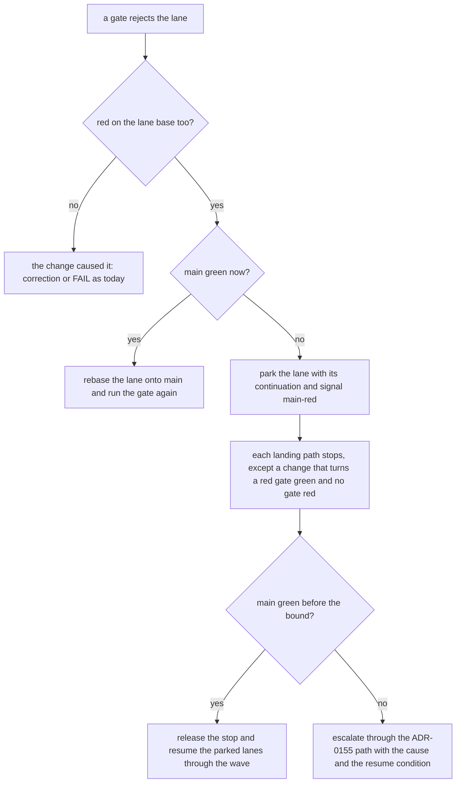

# The gate contract: one verdict for one tree, at the phase that can fix it

> [ADR-0165](adr/0165-every-gate-is-a-typed-unit-with-a-conformance-contract.md) · plan: [gate-contract-2026-11.md](../plans/gate-contract-2026-11.md) · research: [gate-contract-2026-11.md](../research/gate-contract-2026-11.md).
> This file is the spec of record for the gate contract. The plan holds the build order. The incident of [2026-11-09](../incidents/2026-11-09-duplicate-ratchet-misses-staged-predicates.md) holds the case that started it. [gate-input-inventory.md](gate-input-inventory.md) holds the trust class of each gate input, and this file does not copy it.
>
> **Terms used throughout:**
> - **Gate:** a Go function, in a non-test file, that returns a verdict which blocks a commit, a landing or a phase handoff.
> - **Gate input:** a value that a gate reads, with its trust class from the inventory.
> - **Owner phase:** the one phase that can still change an artifact.
> - **Lane base:** the commit that the lane worktree started from.
> - **Base-red:** a red that the lane base already has.
> - **Lane tree:** the index plus each untracked file that `.gitignore` does not ignore, which is the tree that ship commits.

## 1. The model

A gate is a function from `GateInput{Root, Base}` and its declared inputs to a verdict. It reads nothing else. A diff-scoped gate diffs the root against `Base`, never against `HEAD`, because `HEAD` moves when the change commits.

**Worked example.** The duplicate ratchet reads undeclared inputs: the git index, the commit dates, the file mtimes and, since #1382, a diff against `HEAD`. Before #1382 the same content gave `ok` when staged and "336 copies" when committed. #1382 closed that case and kept the gate non-hermetic. Under this contract its entry declares the tree and the baseline file. The parity harness runs it on both states of one fixture with one base, so the two verdicts must match before it can land.

## 2. The registry entry

The registry is one Go table on the protected surface. A `_test.go` file that judges the real tree calls the run function of an entry.

| Field | Meaning | Example (the duplicate ratchet) |
|---|---|---|
| `name` | one stable name | `testdup-ratchet` |
| `kind` | `scanner`, `phase-floor` or `ship-check` | `scanner` |
| `owners` | an owner phase for each artifact pattern | `go/acs/cycle*/` → `tdd`; each other file → `build` |
| `inputs` | each input with its trust class | tree (`subject`), `go/.test-dup-baseline` (`authority`) |
| `stage` | `shadow` or `enforce`; only a held proposal or the operator moves it | `enforce` |
| `run` | `func(ctx, GateInput) Verdict` | `testdup` scan plus check |

## 3. The properties and their tests

| Property | Rule | Test |
|---|---|---|
| Hermetic | A gate reads only declared inputs. Git facts come from `repostate`. It reads the lane tree and `Base`, never `HEAD`, history, dates or mtimes. | A call-graph guard from each `run` refuses git calls, `.git` reads and mtime reads. |
| Parity | One verdict for the unstaged tree, the staged tree and its commit, with one base. | The parity harness runs each entry on the three states of a fixture. |
| Owner-placed | The gate runs at the handoff of the owner phase of each artifact. | The registry `owners` field selects the floor, and a test checks the floor list. |
| One floor list | The host enforces each phase floor. The self-check runs the same list. | An equality test of the host list and the self-check list, for each phase. |
| Composable | A baseline holds keys of a body hash and a site. A site outside the baseline fails. | Two fixture lanes that each remove one key merge clean. |
| Attributable | A gate that rejects a lane reruns its red tests on the lane base. | A fixture lane on a red base is not blamed. |
| Protected | The gate file, the registry and each `authority` input are on the manifest. A `verified` input keeps its base-against-tree check. | A test checks the manifest rows of each entry. |

## 4. The base-red flow

The flow runs wherever a gate rejects a lane: the build floor, the audit CI-parity gate and the ship gate.

The bound is a policy value in `.evolve/policy.json`. Its compiled default is 120 minutes. A fix-main item goes to the top of the inbox when the stop starts.

## 5. What the contract does not do

- It does not prove that two lanes compose. The train of ADR-0147 tests the merged tree.
- It does not judge the quality of a gate, only its determinism, placement and protection.
- The guard reaches the static call graph only. Review still checks a call through reflection.
