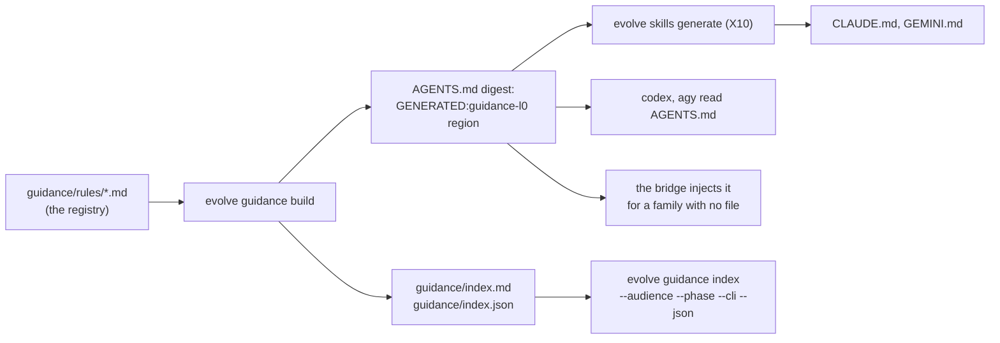

# Guidance layers

- **Status:** design of record, proposed 2026-10-20. §10 (the runtime index) added on 2026-10-26.
- **Decision:** [ADR-0145](adr/0145-each-rule-has-one-home-and-loads-by-audience-path-action-or-failure.md). **Plan:** [guidance-layers-2026-10](../plans/guidance-layers-2026-10.md). **Research:** [guidance-layers-2026-10](../research/guidance-layers-2026-10.md).

## Table of contents

- [1. The model](#1-the-model)
- [2. The five layers](#2-the-five-layers)
- [3. The four triggers](#3-the-four-triggers)
- [4. The rule registry](#4-the-rule-registry)
- [5. What each audience loads](#5-what-each-audience-loads)
- [6. The situation skills](#6-the-situation-skills)
- [7. The checks](#7-the-checks)
- [8. The life of a rule](#8-the-life-of-a-rule)
- [9. A worked example](#9-a-worked-example)
- [10. The runtime index](#10-the-runtime-index)

## 1. The model

A rule reaches an agent in one of two ways. Either the agent carries it all the time, or a trigger loads it when it applies. The always-on text has a small budget (research S8, S9), so most rules load by trigger. A rule that must hold loads through a forced path, not a skill that the model chooses (S3). Each rule has one home, in a registry, and a generator writes every layer. The reasons and the rejected designs are in the [plan](../plans/guidance-layers-2026-10.md).

## 2. The five layers

| Layer | What it holds | How it loads | Budget |
|---|---|---|---|
| L0 Invariants | the rules whose break is costly and that apply to every agent: safety, integrity, the channels, zero comments, shell safety | always on, at the top of `AGENTS.md` and `CLAUDE.md`, ordered by the cost of a break | 60 lines, 30 rules |
| L1 Role | how one audience works: the console operator, a phase, a reviewer, a brief to a subagent | by the audience: a hook for the console, the persona for a phase | 80 lines for each role |
| L2 Situation | the rules for one case: a path, an action, a task, a failure | by one of the four triggers of §3 | 300 lines for each skill, the most important rules first |
| L3 Reference | the detail: `runtime-reference.md`, the ADRs, the conventions | on demand, through a link | none |
| L4 Enforcement | the checks: hooks, gates, linters, tests | always; the rule text names its check | — |

A rule that a check enforces keeps one line in its layer: the rule, why, and `enforced by <path>`. The check's own error text states the fix and names the skill (S10).

Three limits of the budget:

- The map of the L2 skills is outside the 60 lines of L0. The map has at most 20 lines.
- An environment trap with no path or action trigger goes to the `agent-brief` skill or the `test-write` skill. A trap that destroys state, such as a broad `pkill` or a mutant of a kill guard, goes to a shell-safety rule in L0.
- The user-level files in `~/.claude` are outside the generator. They hold only the personal preferences of the operator.

## 3. The four triggers

| Trigger | Example | Loader for the console | Loader for a phase agent |
|---|---|---|---|
| Path | a Go test file, `docs/**`, `.github/**`, `.evolve/inbox/**`, the kill-guard code | `.claude/rules/<name>.md` with `paths:` | an overlay rule with a `Paths` selector, matched to the lane scope |
| Action | a commit, a merge, a wave boundary, an inbox route, a routing change, a brief to a subagent | a PreToolUse hook on the command adds the checklist as `additionalContext` | none: the phase persona holds its procedure, and the action hooks do not fire there |
| Task | write a document, run research, design, review, test, triage CI | a skill that the L0 map names, with a description that says when to load it | an overlay rule by kind and phase |
| Failure | a gate refusal, a red CI, a quota wall, a stall, a review FAIL | the error text of the check names the rule and the skill | the correction directive carries the same text |

The action trigger is new. Today the console must remember, for example, the merge order at a boundary. With the trigger, the hook adds the checklist when the command starts, and it costs no context at other times (S5, S6).

The action hook is new Go code. The present guards (`ship`, `phase`, `role`, `docdelete`) only allow or deny. None emits `hookSpecificOutput.additionalContext` on PreToolUse (F2.11). Open item: confirm that the installed Claude Code version passes that text to the model.

A phase agent runs the project hooks, because it starts with `--setting-sources project` (F2.12). So the bridge exports a marker in the pane shell of every phase agent, as it exports `EVOLVE_PROJECT_ROOT`: `EVOLVE_PHASE_AGENT=1` and `EVOLVE_PHASE=<phase name>` (plan D11, component G3a). The request environment of the adapter does not reach the pane shell. The console `SessionStart` hook and every action hook exit silently when the marker is set. A phase agent gets its procedure from its persona and its overlays.

## 4. The rule registry

Each rule is one file, `guidance/rules/<id>.md`:

```markdown
---
id: example-rule-id
statement: One sentence of 25 words or fewer that states the rule.
layer: L2
audience: [console, brief]
triggers:
  actions: [git-commit]
enforced_by: []
source: the file or memory note that the rule came from
status: active
added: 2026-10-19
evidence: the event that produced the rule, with its date
---
Why: the reason, in one or two sentences.
```

[§9](#9-a-worked-example) shows a real rule in this format.

- `statement` is one sentence of 25 words or fewer. It is the text that the layers show.
- `layer`, `audience` and `triggers` decide where the generator puts it.
- `enforced_by` names the check. A rule with a check shows one line and the pointer.
- `status` is `active`, `superseded` or `retired`. Only active rules reach a layer.
- `conflicts_with` names a rule that must never be active at the same time. The check refuses two such active rules.
- `phases` (optional) names the phases that need the rule. An empty list means each phase.
- `order` (optional) is a positive number that sets the place of the rule in its layer, lowest first. L0 uses it to put the costliest rule first.
- `families` (optional) names the model families that need the rule (`claude`, `gemini`, `gpt`, `local`, as the bridge manifests name them). An empty list means each family. The field selects; it never holds a fact of a family (§10.4).

`evolve guidance build` writes the layers:

| Output | Content |
|---|---|
| the L0 block of `AGENTS.md` and of `CLAUDE.md` (between markers) | the L0 rules, then a map of the L2 skills with one line each (at most 20 lines) |
| `.claude/rules/<name>.md` | the L2 path rules for the console, with `paths:` |
| `.evolve/guidance/actions/<action>.md` | the checklist that the action hook adds |
| the generated `Rules` block of each skill and its `COMPACT.md` | the L2 rules of that skill |
| the role files of §5 | the L1 rules of each audience |

No one edits a generated block by hand. A rule changes in its registry file, and the generator runs.

## 5. What each audience loads

| Audience | Always | By trigger |
|---|---|---|
| Console (Claude Code of the operator) | L0, then the console role through a `SessionStart` hook that exits silently when the phase marker is set | path rules, action hooks, task skills, the failure text |
| Phase agent | L0, then its persona and its profile rules (the L1 of that phase) | overlays by tier, kind, phase and lane paths, with at most 3 overlays in their `COMPACT.md` form |
| Reviewer | L0, then the reviewer role | the diff's paths |
| Subagent brief | L0 rules marked `brief`, which the brief must restate | the task skill named in the brief |
| Memory | personal facts and project status only | read on demand |

A phase agent no longer reads the console role. Today `runtime/CLAUDE.md` gives it the merge fleet and the status format (research F2.6). After the change, `CLAUDE.md` holds only L0 and the map, and the console role loads through the hook.

Caveat: the CLIs `codex` and `agy` read only `AGENTS.md`. Path rules, hooks and `SessionStart` reach Claude Code only (F2.12). On a non-claude CLI, a phase agent gets L1 and L2 only through its persona and its overlays.

## 6. The situation skills

The L2 skills follow the naming convention `<object>-<action>`. Each holds one procedure.

| Skill | Trigger | Main rules |
|---|---|---|
| `commit-ship` | action: `git commit`, `evolve ship` | the gate unpiped, `&&` only, attest only the reviewers that ran, explicit paths, no stash, no `--no-verify` |
| `boundary-run` | action: `gh pr merge`, `evolve wave next`, `sync-main` | merge only after the loop exits, the merge order, sync, rebuild, `reset-sha`, `gc`, the live count from the signals |
| `inbox-curate` | action: `evolve inbox *`; path: `.evolve/inbox/**` | the verbs only, the consumption rides the landing, never restore a claimed item |
| `agent-brief` | action: an Agent tool call | the rules a brief restates, at most 4 agents, one shell for parallel calls, a unique message file |
| `routing-change` | action: `evolve cli-routing *` | the one writer, the cross-family rule, the quota headroom |
| `ci-triage` | failure: a red CI; task: a CI failure | classify first, read the step that exits non-zero, the fixture lines are not failures |
| `test-write` | path: `*_test.go`; task: TDD | red first, cover a guard through a seam, never mutate a live kill guard, `-count=1`, package-scoped tests during a live wave |
| `research-run` | task: a research dossier or a design | live web research first and in parallel with the local data, a current-practice section |
| `docs-write` | task: a document; path: `docs/**` | the existing skill, unchanged in role |
| `review-converge` | task: a review | the review fleet, the convergence rule, the round limit |

## 7. The checks

`evolve guidance check` runs in CI and fails on any of these:

- a generated block that differs from the registry;
- a layer above its budget of §2;
- a rule statement found in two registry files;
- an `enforced_by` path that does not exist, or a check with no test that proves it blocks;
- a `paths:` glob that does not parse, because a broken glob makes a rule always on (S4);
- two active rules that name each other in `conflicts_with`;
- an action or path trigger with no loader;
- a task skill with no trigger eval (S11): 8 queries that must load it and 8 that must not;
- a generated block that fails `evolve docs ste-lint --strict`.

The order in CI is `evolve guidance build`, then `evolve guidance check`. The check runs after the build and fails if the build changed a tracked file.

## 8. The life of a rule

| Stage | Where it lives | How it moves on |
|---|---|---|
| A lesson | a memory file, with the date and the evidence | when the same mistake happens twice (S5) |
| A situation rule | L2, in the skill of its trigger | when the rule applies to every agent and a break is costly |
| An invariant | L0 | when a check can decide it |
| An enforced rule | L4, with one line left in its layer | — |
| Retired | `status: retired`, with the reason | when its code is gone or its replacement is active |

## 9. A worked example

On 2026-10-19 two subagents piped the commit gate through `tail`, so a FAIL exit code did not stop the commit.

- Today: the rule lives in one memory file. A subagent cannot see it, and the console must remember to restate it in each brief.
- With the layers:
  - the registry file `commit-gate-unpiped` holds the rule:

    ```markdown
    ---
    id: commit-gate-unpiped
    statement: Run the commit gate unpiped and chain it to the commit with && only.
    layer: L2
    audience: [console, brief]
    triggers:
      actions: [git-commit]
    enforced_by: []
    source: docs/operations/runtime-reference.md
    status: active
    added: 2026-10-19
    evidence: a piped gate hid a FAIL exit code twice on 2026-10-19
    ---
    Why: a pipe returns the exit code of its last command, so `gate | tail && commit` commits after a FAIL.
    ```

  This rule has `audience: [console, brief]` and `actions: [git-commit]`;
  - the action hook adds the `commit-ship` checklist to the console when `git commit` starts;
  - the generator puts the rule into the `agent-brief` skill, so each brief restates it;
  - a later check can refuse a piped gate in the commit hook. Then the rule shows one line and `enforced by` that hook.

## 10. The runtime index

The plan decisions are D12 to D19 ([plan §9](../plans/guidance-layers-2026-10.md#9-the-runtime-index-2026-10-26)). The facts are in research §5.

### 10.1 What an agent sees

An agent of any family starts with L0 and one pointer line. When its task needs more, it reads the index, finds the rows of its case, and opens only those bodies.



The order of the generators is fixed: `evolve guidance build`, then `evolve skills generate`, then `evolve guidance check` and `evolve skills check`. A change of L0 thus reaches `CLAUDE.md` and `GEMINI.md` in the same commit. The CI runs both checks, so a missed step fails.

| Carrier | Family | What it holds | Who writes it |
|---|---|---|---|
| `AGENTS.md`, the `GENERATED:guidance-l0` region inside the digest | codex, agy, and each CLI that reads `AGENTS.md` | the L0 statements and the pointer line | `evolve guidance build` |
| `CLAUDE.md`, `GEMINI.md` | Claude Code; Gemini CLI and legacy agy | a copy of the digest, so the same region | `evolve skills generate` (X10) |
| the `## Rules` prefix of the prompt | a family with no file, such as Ollama | the same region (G9) | the bridge |
| `guidance/index.md` | each family, on demand | one row for each active rule | `evolve guidance build` |
| `guidance/index.json` | each tool, and the context index of a cell (§10.6) | the same rows as data | `evolve guidance build` |
| `guidance/rules/<id>.md` | each family, on demand | the body: the why, the evidence | a person, through a reviewed PR |

The pointer line is: "The full rule set is in `guidance/index.md`; run `evolve guidance index --audience <you>` to list the rules of your case."

### 10.2 The index file

`guidance/index.md` is generated. No one edits it by hand. It has one section for each layer, in the order L0 to L4, and one table in each section:

| Column | Content |
|---|---|
| id | the rule id, a link to its body |
| summary | the statement of 25 words or fewer |
| audience | the audience list, or `all` |
| families | the family list, or `all` |
| triggers | the paths, actions, tasks and failures, or `—` |
| enforced by | the check paths, or `—` |

The rows of a layer are in the order of the registry. The order of an L0 rule is its field `order` (a number, lowest first), so the costliest rule comes first. A rule with no `order` comes after, by id.

`guidance/index.json` holds the same rows as entries. The first seven fields are the shared entry fields of the context index of a cell (§10.6). Thus one schema covers a rule and a data artifact:

| Field | Content |
|---|---|
| `id` | the rule id |
| `layer` | `L0` to `L4` |
| `kind` | `rule` for each entry of this file |
| `summary` | the `statement` field of the rule file, 25 words or fewer |
| `bytes` | the size of the body file, so a reader knows the cost before it opens the body |
| `path` | the body file, relative to the repository root |
| `audience` | the audience list (who the entry applies to) |
| `families`, `phases` | the selectors of §4; an empty list means each |
| `triggers`, `enforced_by` | the fields of §4 that only a rule has |

```json
{
  "schema": "evolve.guidance.index-file/1",
  "entries": [
    {
      "id": "kill-guard-never-mutated",
      "layer": "L0",
      "kind": "rule",
      "summary": "Never mutate or run a live kill guard ...",
      "bytes": 612,
      "path": "guidance/rules/kill-guard-never-mutated.md",
      "audience": ["all"],
      "families": [],
      "phases": [],
      "triggers": {"paths": [], "actions": [], "tasks": [], "failures": []},
      "enforced_by": []
    }
  ]
}
```

Both files are byte-stable: a second build changes nothing.

### 10.3 The verb

`evolve guidance index [--audience X] [--phase P] [--cli F] [--json] [--project-root R]` prints the active rules that match each given filter.

| Flag | A rule matches when |
|---|---|
| `--audience X` | its audience has `X` or `all`. `X` is one of `all`, `console`, `phase`, `reviewer`, `brief`. |
| `--phase P` | its `phases` list is empty or has `P` |
| `--cli F` | its `families` list is empty or has the model family of the CLI `F`, from the bridge manifest of `F` |

- The verb is of class `always` and agent class `A` ([cli-contract.md](cli-contract.md) §4, §4.1). It reads only, and it works while a wave runs. `evolve guidance check` has the same classes.
- `evolve guidance build` writes tracked files, so it is not an `always` verb. It is a tool of the operator outside the core verbs, as `evolve skills generate` is, and its agent class is `D`. A cell gets the rules from the index, never from a build.
- With `--json`, the verb prints the envelope on each exit, also on a usage error.
- Without `--json` it prints the rows as a Markdown table, grouped by layer.
- With `--json` it prints one envelope with the schema `evolve.guidance.index/1`. Its `data` has the field `filter` (the flag values and the resolved family) and the field `entries` (the entries of §10.2).

| Exit | Name | When |
|---|---|---|
| 0 | `ok` | the rows printed; a filter that matches no rule prints an empty list |
| 2 | `io` | the registry directory cannot be read |
| 10 | `usage` | an unknown flag, a stray word, an unknown audience, or a CLI with no bridge manifest |
| 11 | `input` | a registry file does not decode strictly; the verb names the file and the field |

`evolve guidance build` exits 0 after a write or when each output is current. It exits 2 on an I/O error and 11 on a bad registry file. `evolve guidance check` exits 0 when it finds no problem and 2 on an I/O error. It exits 1 when it finds a problem, and it prints one line on stderr for each problem. A registry file that does not decode is a problem of the check.

### 10.4 Family facts stay in the driver layer

A registry rule is neutral. It names no tool of one CLI, no instruction file and no flag of a CLI. These facts live in the driver layer:

- the hand-written CLI overlay of `CLAUDE.md` and `GEMINI.md` (outside the X10 region);
- the bridge manifest of each CLI (`go/internal/bridge/manifests/`), which names its instruction file or `inject` (G9);
- the routing data of `cli_routing`, for the model of each seat.

The field `families` selects a rule for some families. It does not hold the fact of a family. An L0 rule has an empty `families` list, because L0 applies to every agent.

### 10.5 The checks of the index

The check of §7 also fails on these:

- `guidance/index.md`, `guidance/index.json` or the L0 region of `AGENTS.md` differs from a fresh build;
- an L0 rule with a non-empty `families` list;
- a `families` value that no bridge manifest names;
- an unknown field in a registry file, or a required field that is absent.

### 10.6 The consumer: the context index of a cell

The rule index is the knowledge layer of the context index of each cell. A separate design extends the `inputs/index.json` of X5 (#1133) into a layered context index for the data that a phase agent reads. That index reads `guidance/index.json` as its knowledge layer. That design owns the wiring into the cell. This design only keeps the entry fields of §10.2 stable.

The spec of that design is `docs/architecture/cell-context-index.md` (PR #1139). It uses two kinds of layer, and the words differ:

- The `layer` of an entry of `guidance/index.json` is the rule layer of §2 (L0 to L4).
- The cell index puts each kept rule row into its context layer `L3` (knowledge, reference only). It moves the rule layer to the field `rule_layer`, and it sets `layer` to `L3`.
- The cell index copies `rule_layer` and `audience` from the row and never changes them. It keeps the rows for the audience `phase`, the phase name and the family of the seat.
