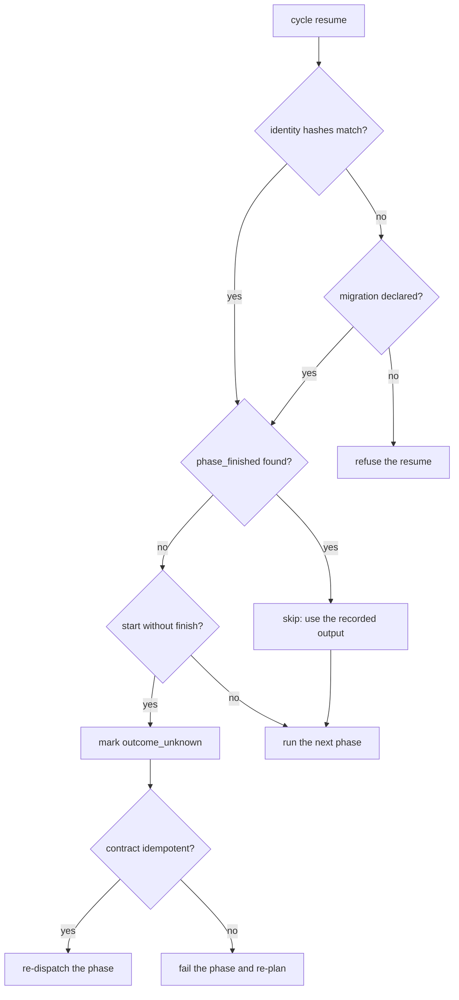

# Harness edge contracts: typed host events, durable phase units, scoped leases and a safe self-edit path

> [ADR-0170](adr/0170-the-loop-keeps-the-llm-at-the-leaves-and-hardens-its-host-resume-fleet-and-self-edit-edges.md) · plan: [oss-harness-architectures-2026-11](../plans/oss-harness-architectures-2026-11.md) · research: [oss-harness-architectures-2026-11](../research/oss-harness-architectures-2026-11.md).
> This file is the spec of record for the edges of the loop after the plan. It does not repeat the bridge factory ([agent-bridge-factory](agent-bridge-factory.md)), the isolation design ([llm-isolation](llm-isolation.md)), the merge train ([integration-driver](integration-driver.md), [integration-driver-enforce](integration-driver-enforce.md)), the observer ([phase-observer](phase-observer.md)) or the self-improvement design ([harness-self-improvement](harness-self-improvement.md)). It adds the contracts between them and the outside world.
>
> The operator asked on 2026-11-27: "Run another deep dive research to collect the popular open source harness design to learn more about their logics and architecture, record and summarize all the findings using the research skill (build one if it doesn't exist) with research report, adr, design, execution and plan following the policy defined under docs."
>
> **Status:** proposed. Each name below (event, field, record kind) is a design name. The code does not hold it yet.
>
> **Terms used throughout:**
> - **Typed host event:** one record of a fixed vocabulary that a transport emits for a phase.
> - **Durable phase unit:** one phase whose input, output and verdict the ledger records.
> - **Identity hash:** the hash of the phase graph, the phase contracts or the policy at the start of a cycle.
> - **Scoped lease:** a lease that names the resource that it holds and its mode.
> - **Generation:** a number that grows with each claim of a resource. A write with an old generation fails.
> - **Pinned build:** the build of the pipeline that one run keeps for its whole life.
> - **Host profile:** the data that describes how one CLI loads the knowledge layer.

## Table of contents

1. [Goals](#1-goals)
2. [Host events and the transport contract](#2-host-events-and-the-transport-contract)
3. [The durable phase unit and the resume identity](#3-the-durable-phase-unit-and-the-resume-identity)
4. [Scoped leases, claims and liveness](#4-scoped-leases-claims-and-liveness)
5. [Self-edit rules](#5-self-edit-rules)
6. [Host profiles for the knowledge layer](#6-host-profiles-for-the-knowledge-layer)
7. [A worked example](#7-a-worked-example)
8. [Guards](#8-guards)
9. [Limits](#9-limits)

## 1. Goals

| Goal | Measure | Target |
|---|---|---|
| Phase failures come from typed events | Share of phase failures classified from a typed event | The target follows the shadow baseline. No number is set before it exists. |
| A resume checks identity | Resume refusals on a changed graph hash in the test set | 100% |
| A finished phase never re-runs | Finished phases that start a CLI on resume | 0 |
| A stall needs two signals | Stalls declared from one signal | 0 |
| A builder cannot reach the evaluator | Builder writes to gate code | 0 |
| A guard that fails closes the action | Guard entries with `onFailure: block` | 4 of 4 (today 0 of 4, F1.7) |

The order of the goals follows the order of the plan: the host edge first, then the resume, the fleet and the self-edit path.

## 2. Host events and the transport contract

### Issue

The production chain starts on a tmux driver (`go/cmd/evolve/testdata/cli_routing_shipped_routes.golden.json:2405-2412`). The pane drivers infer state from regexes such as `busy_line_regex` and `token_line_regex` (`go/internal/bridge/manifests/agy-tmux.json:183-184`).

### Gap

A pane gives no session id, no failure class and no approval request. A headless manifest exists for each family (`claude-p.json:17`, `agy.json:16`, `codex.json:14`), and the Claude stream-json driver exists (`go/internal/bridge/driver_claudep.go:22-23`). No production chain uses them first.

### Solution

Each transport emits the same typed events. The failure adapter reads only these events.

| Event | Fields | Source on `claude-p` (design) | Source on a tmux driver |
|---|---|---|---|
| `session_started` | `session_id` | the init record of the stream | launch flag or pane note |
| `turn_started` | `turn` | the first record of a turn | pane busy line |
| `turn_completed` | `turn`, `tokens` | the result record | pane idle line |
| `turn_failed` | `turn`, `class` | the result record with an error | typed pane failure |
| `approval_required` | `tool` | a permission request | pane prompt line |
| `permission_rejected` | `tool` | a denied permission | pane message |
| `limit_reached` | `kind` | an exit code or a limit record | usage-limit regex |
| `unclassified` | `raw` | any record outside the table | any pane line outside the table |

Failure classes: `process` (retry is allowed), `logic` (re-plan), `limit` (pause), `approval` (park as `blocked`) and `input_error` (fail the phase). Gemini gives the template: exit code 42 is an input error and 53 is a turn limit ([headless.md](https://github.com/google-gemini/gemini-cli/blob/60f8082b14ffa7f10b608270232f3f57b5abbec8/docs/cli/headless.md)). Codex `turn.failed` gives the second ([exec_events.rs](https://github.com/openai/codex/blob/bee5dc55ac118d9136171fed55ffd89af26f8d21/codex-rs/exec/src/exec_events.rs#L11-L232)).

Each manifest declares four more fields: `events` (`typed` or `pane`), `approval_mode`, `sandbox_mode` and `session_flag`. A manifest without them fails the schema test. A `permission_rejected` event is a signal for the observer. It is never a silent success.

The tmux fallback raises two distinct failures: `input_box_occupied` and `message_not_accepted`. Both have class `process`. The delivery follows omnigent: one bracketed paste, then Enter, then a check within 20 seconds that the draft left the input box ([bridge.py](https://github.com/omnigent-ai/omnigent/blob/2227bc630dabbc3663180b9074f180e128a0c639/omnigent/harnesses/claude_native/bridge.py#L389-L435)).

## 3. The durable phase unit and the resume identity

### Issue

A search of `go/internal` finds no graph hash, contract hash or policy snapshot hash (research F1.9). Only audit verdicts have a content-addressed store (`go/internal/verdictcache/verdictcache.go:1`).

### Gap

A pipeline self-edit can change the phase graph between the start of a cycle and its resume. The resume then continues on a graph that the cycle did not start with. MAF refuses this case with `graph_signature_hash` (P3.2).

### Solution

The first ledger record of a cycle is `cycle_identity`. It holds `graph_hash`, `contract_hash`, `policy_hash` and the `build_id` of the pinned build. Each phase writes `phase_started` and `phase_finished`. `phase_finished` holds the output hash, the verdict and the `session_id`.

The rules:

1. A resume never re-runs a finished CLI phase. A CLI side effect is not idempotent (P3.2).
2. A phase start with no finish becomes `outcome_unknown` on restart.
3. The driver re-dispatches an `outcome_unknown` phase only when its contract marks it idempotent in its worktree. Otherwise the phase fails and the cycle re-plans.
4. The reconcile of `outcome_unknown` phases finishes before the driver admits a new lane.
5. Each transition writes one ledger record with its cause.
6. An audit-fail retry is a child record from the pre-build barrier. The failed run stays readable.

The identity hash and the barrier record cost little. OpenHands measured 0.20 ms per event persist and 7.4 ms (median) for a crash recovery (P3.3).

## 4. Scoped leases, claims and liveness

### Issue

The run lease holds `run_id`, `owner_pid` and `heartbeat_at` with a 10-minute TTL (`go/internal/runlease/runlease.go:36-41`). `wave next` refuses while any run is live (`go/cmd/evolve/cmd_wave_next.go:222-226`).

### Gap

One lease serves as a load ceiling, a correctness lock and an upgrade gate. It names no resource and no generation. The observer reads one signal, the pane (F1.8).

### Solution

**Scoped lease.** A lease record holds `resource`, `mode` (`shared` or `exclusive`), `owner`, `generation` and `heartbeat_at`. The resources are `worktree`, `pipeline_binary`, `cli`, `main` and `inbox/<id>`. A shared lease does not block a shared lease. An exclusive lease blocks all others on the resource. The run lease stays as the load ceiling.

**Claim.** A claim sets the owner and the status only if the item is still claimable. Otherwise it returns `ErrAlreadyClaimed`. The claim bumps the generation. A close and a reclaim must cite the same prior ledger hash, which is the hash-chain form of the beads `row_lock` (P4.2).

**Write fence.** A write to the inbox, the ledger or `main` carries the generation that the writer holds. A stale generation fails. The final fast-forward of a merge carries the expected head SHA, and a moved head refuses the merge (P4.5).

**Liveness.** A lane is stalled only when two of three signals agree. The signals are: no typed event for the stall window, no lease heartbeat for the TTL, and a failed process probe. If at least 5 lanes are present and at least 50% look stalled in one cycle, the driver records a host fault. It then stops all terminations (P4.4). A launch id fences a stale probe.

**Lane states.** A lane that waits for the operator is `blocked`. The driver does not retry it. It routes the wait to the console.

**Breaker and admission.** The dispatch counter sits in a scheduling record apart from the item. The third failure quarantines the item and routes it to the console as a redesign task. A base that is more than 20 commits behind keeps the item `ready` and does not charge the counter. The value 20 is the orca value, and the baseline must tune it. Lane starts are paced to one for each tick.

## 5. Self-edit rules

### Issue

A cycle that edits the pipeline runs on the current build. That build can include an earlier self-edit that no gate verified (synthesis, from the single ship SHA). DGM node 114 shows what an optimizer does with a detector that it can see (P5.4).

### Gap

The protected-surface manifest names the files that a builder must not change. The seat sandbox does not mount gate code and evaluator data read-only (synthesis; the enforcement point was not checked).

### Solution

1. **Pinned last-good build.** A cycle whose footprint touches pipeline code runs its gates and seats on the newest verified-good build. Each build has a content-addressed path, and each run pins its build.
2. **Read-only evaluator mounts.** Gate code, baselines and evaluator data mount read-only in each builder sandbox. An instruction alone failed in DGM.
3. **The promotion bar.** One axis changes. At least two matched pairs exist. The report gives an interval. A single green cycle is `insufficient_evidence`, never a promotion. [ADR-0167](adr/0167-shadow-stages-prove-themselves-on-chained-evidence.md) governs the stage keys.
4. **Smoke test and rollback.** A new build passes a smoke test before its pointer becomes Current. A failed smoke test keeps the old pointer.
5. **Verdict binding.** An audit verdict binds to the eval revision that it judged, as `verdictcache` binds it to a tree SHA. One amendment of a refuted criterion is allowed. It records the original text, the reason, bounded evidence and the authority.
6. **Tie-break.** When two verdicts are equal, the smaller diff ranks first.

## 6. Host profiles for the knowledge layer

### Issue

`evolve skills generate` renders CLAUDE.md and GEMINI.md from one neutral source. The agy catalog says that agy reads project `.agents/skills/` (`go/internal/bridge/capabilities/catalogs/agy-tmux.json:31-33`). The four guards declare no `onFailure` key (`.claude/settings.json:10,19,28,37`).

### Gap

The per-host rules are code, not data. A vendor frontmatter key that works in Claude Code can break another target. A source that grows past a loader cap loses rules on that host without a signal (P6.1).

### Solution

A host profile holds the data below, one file for each host.

| Field | Meaning |
|---|---|
| `skill_root` | the directory that the CLI reads, for example `.agents/skills` |
| `frontmatter_allowlist` | the keys that the render keeps |
| `description_limit` | the hard limit, as an error |
| `instruction_budget_bytes` | the cap of the loader for the instruction chain |
| `path_rewrites` | the instruction file names for the host |
| `safety_hooks` | `enforced` or `advisory` |

The render is byte-stable. `skills check` renders every host and reports `STALE` on drift, and reports an error over the byte budget. For agy, `safety_hooks` is `advisory`. The ship gate and the sandbox hold the guarantee.

The guard failure rule: each of the four `PreToolUse` entries gets `"onFailure": "block"` ([hooks reference](https://code.claude.com/docs/en/hooks)). **Correct reading of today's fallback:** each command falls back from `go/bin/evolve` to the tracked `go/evolve`. A guard fails open only when both binaries are missing, or when the guard exits with a code other than 0 and 2. The key closes both cases. The operator owns this change, because it is gate config.

## 7. A worked example

Wave 191 runs with one lane of five (width 0.20, `evolve wave status`, 2026-11-27). Its lane builds `train-production-promoter` in cycle 2658. The cycle runs on `claude-tmux`, the first link of the production chain (`cli_routing_shipped_routes.golden.json:2405-2412`).

**Today.** The driver pastes the prompt into a pane. The observer reads the pane through regexes. The ledger holds no session id and no identity hash. If the driver restarts, the resume finds the cycle by its number and its pane.

**After the plan, on `claude-tmux`.** The first record of cycle 2658 is `cycle_identity` with the three hashes and the `build_id`. Each phase writes `phase_started` and `phase_finished`. A pane note gives the `session_id`. A usage-limit line gives `limit_reached`.

**After the plan, on `claude-p` as a shadow.** The phase runs with `--output-format stream-json --include-partial-messages --verbose` (`driver_claudep.go:23`). The stream gives the events of the table in section 2. These are `session_started` with the session id, `turn_started`, `turn_completed` with the token count, and `turn_failed` with a class. The shadow record puts the typed outcome beside the tmux outcome for the same cycle. The bar of section 5 decides the promotion: one changed axis (the transport), at least two matched pairs and an interval.

**A restart in the middle of a phase.** The ledger holds `phase_started` and no `phase_finished`. The reconcile marks the phase `outcome_unknown` and runs before the driver admits another lane. If the contract is idempotent, the driver re-dispatches the phase with `--resume <session_id>`. If not, the phase fails and the cycle re-plans.

**A claim.** The lane claims `inbox/<id>` at generation 7. A stale reclaim at generation 6 fails. The merge carries the expected head SHA. If main moved, the merge refuses and the item re-enters admission.

## 8. Guards

| Rule | Guard test | Stage |
|---|---|---|
| Each manifest declares `events`, `approval_mode`, `sandbox_mode` and `session_flag` | A manifest without a field fails the schema test | W1.2, enforce at the first merge |
| An unknown stream record maps to `unclassified` | A recorded fixture with an unknown line gives `unclassified` | W1.1, shadow |
| The failure adapter reads typed events | A `turn_failed` event with class `process` matches the pane verdict on a recorded pair | W1.3, shadow |
| A `permission_rejected` event is never a success | A phase with the event must not give a pass verdict | W1.3, shadow |
| A resume refuses on a changed identity hash | `cycle resume` on a changed `graph_hash` refuses | W2.2, shadow then enforce |
| A finished phase never re-runs | A resume after `phase_finished` starts no CLI | W2.1, shadow then enforce |
| A start with no finish is `outcome_unknown` | A ledger with an open start gives the state on restart | W2.3, shadow then enforce |
| The reconcile comes before admission | The first admission after a restart follows the reconcile record | W3.C8, shadow then enforce |
| A claim of a claimed item fails | `ErrAlreadyClaimed` on the second claim | W3.C1, shadow then enforce |
| A write with a stale generation fails | A write at generation 6 after a claim at 7 fails | W3.C2, shadow then enforce |
| A merge with a moved head refuses | A merge with an old expected head SHA refuses | W3.C2, shadow then enforce |
| A stall needs two signals | One silent signal gives no stall | W3.C5, shadow then enforce |
| Half of the lanes silent is a host fault | Five lanes, three silent: no termination | W3.C5, shadow then enforce |
| A `blocked` lane is not retried | A lane that waits for the operator gets no retry | W3.C6, shadow then enforce |
| The third dispatch failure quarantines | The third failure routes the item to the console | W3.C4, shadow then enforce |
| A run keeps its pinned build | A newer build does not change a live run | W3.C3, shadow then enforce |
| A builder cannot write gate code | A write to a gate path in the sandbox fails | W4.3, shadow then enforce |
| One green cycle is not a promotion | One cycle gives `insufficient_evidence` | W4.4, shadow then enforce |
| A failed smoke test keeps the old build | The pointer does not move on a red smoke test | W4.5, shadow then enforce |
| A host render is byte-stable and within budget | Two renders are equal. A source over the budget fails | W5.1 to W5.3 |
| A guard that fails closes the action | A guard that exits with code 1 blocks | W5.4, operator: gate config |

## 9. Limits

- The design adds no second loop driver, no LLM supervisor and no feature flag.
- The design does not drive Codex through its app-server. The operator has no Codex subscription.
- The design does not replace the ledger with an event store (A14).
- The design does not prove that a structured channel is more reliable than a pane. No source benchmarks them against each other (research section 10). The shadow of `claude-p` measures it.
- The design does not know if agy offers ACP or a JSON stream. W1.7 closes that gap.
- A hook on agy stays advisory. The gates and the sandbox hold the guarantee.
- A test cannot prove that a typed event vocabulary covers every state of every CLI. The `unclassified` event reports the gap.
