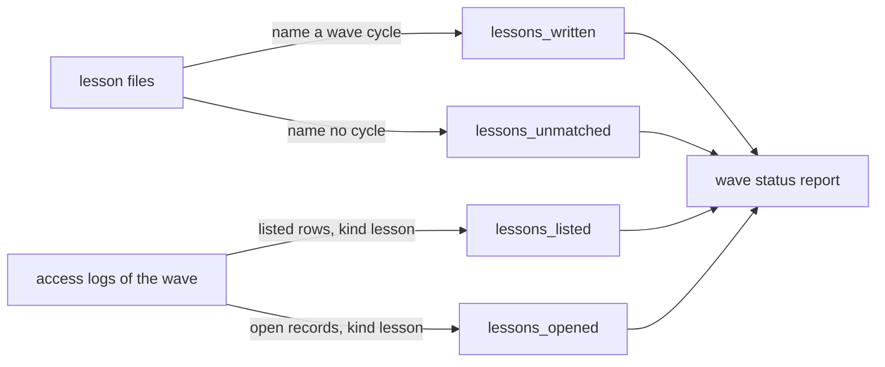
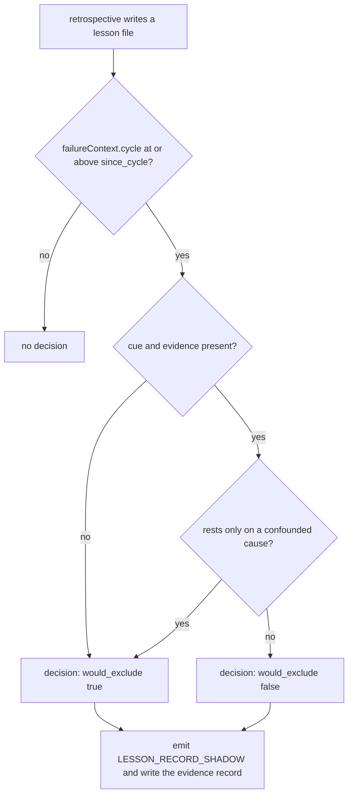
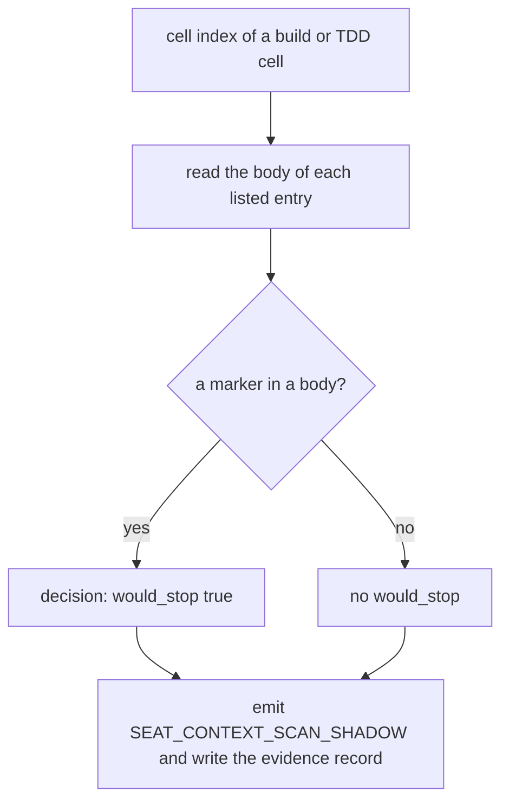

# Harness self-improvement: measure the lesson read path, then add three refinements in shadow

> [ADR-0169](adr/0169-lesson-yield-is-measured-before-a-lesson-store-is-built.md) · plan: [harness-self-improvement-2026-11.md](../plans/harness-self-improvement-2026-11.md) · research: [harness2-self-evolution-2026-11.md](../research/harness2-self-evolution-2026-11.md).
> This file is the spec of record for the lesson yield count, the lesson record fields and the seat context scan. The research holds the outside evidence, the plan holds the decisions D1 to D12 and their order, and the ADR holds the short decision record.
>
> **Terms used throughout:**
>
> - **lesson:** one YAML file in `.evolve/instincts/lessons/` that the retrospective writes.
> - **cell index:** the list of entries that a phase seat can open ([cell-context-index.md](cell-context-index.md)).
> - **access log:** the file `.evolve/context-access/cycle-<N>.jsonl` that records the listed and opened entries of each cell.
> - **lesson yield:** for one wave, the lessons written, the lessons listed to a seat and the lessons that a seat opened.
> - **cue:** the situation in which a lesson applies, written as one sentence.
> - **confounded:** a marker that the cause of a failure is not separate from other changes of the same cycle.
> - **stage key:** a policy key with the values `off`, `shadow` and `enforce` ([shadow-stage-contract.md](shadow-stage-contract.md)).
> - **MDE:** the smallest change that a sample can detect ([llm-quality-indexes.md](llm-quality-indexes.md) section 4.6).
> - **hidden-oracle text:** text in a seat context that names the checks or the thresholds that grade the seat.

## Table of contents

1. [Goals](#1-goals)
2. [C1 Lesson yield](#2-c1-lesson-yield)
3. [C2 and C3 The lesson record](#3-c2-and-c3-the-lesson-record)
4. [C4 Seat context scan](#4-c4-seat-context-scan)
5. [C5 The design set](#5-c5-the-design-set)
6. [Guards](#6-guards)
7. [Limits](#7-limits)

## 1. Goals

The goals are in the order of the plan (G1 to G4). Goal 1 comes first, because the other goals need its baseline.

| Goal | Measure | Target |
|---|---|---|
| G1: report the lessons written and read for each wave | `wave status --json` holds lessons written, listed and opened, and the unmatched count | the count exists for each wave; no numeric target, because no baseline exists |
| G2: a new lesson carries a cue, evidence and a confounded marker | the share of new lessons that pass the `lesson_record` decision | no target before two waves of data; baseline today: 0 of 877 with a cue, 11 of 877 with `evidence` |
| G3: detect hidden-oracle text in build and TDD context | `would_stop` count of the `seat_context_scan` signal for each wave | the count exists; baseline today: no scan |
| G4: each new behavior starts at `shadow` and moves on a `ready` verdict | `evolve stage verify <key>` returns `ready` before a flip | 2 of 2 new keys start at `shadow`; no gate changes strictness |

Cost guard: LLM minutes per shipped cycle was 55.5 for wave 189 (plan I7). The sample cannot see a change under 38 points (I9), so this number guards cost and is not a goal.

## 2. C1 Lesson yield

### Issue

The loop has 877 lesson files of about 1,098,202 tokens (plan I1). The L1 budget of one cell is 8,000 tokens (`docs/architecture/cell-context-index.md:66`). The cell index lists a lesson only when its text names the item or a lineage cycle (`go/internal/inputindex/lineage.go:87-109`). The 569 access logs for cycles 2029 to 2649 list 1,350 lesson entries and record 20 opens: 1.5% (I5).

The cells with `source: none` hold 103 of the 1,350 listings. They are 291 of 4,188 cell records. In the cells that report a source, 20 of 1,247 listings were opened (1.6%). So the open rate is at least 1.5% of the listings in those cells.

No report says how many lessons a wave wrote. Two lesson files name a cycle of wave 189, and both name cycle 2646 (I6).

### Gap

The access log holds the opens (`go/internal/inputindex/access.go:53-84`), and `evolve context stats` reads them by phase and kind (`go/internal/inputindex/access.go:120`). The wave report has no lesson fields. `wavemeasure.Measures` has no lesson field (`go/internal/wavemeasure/wavemeasure.go:44-55`), and `waveStatusReport` carries the measures without any (`go/cmd/evolve/cmd_wave_status.go:43`). So a wave with zero lessons looks like a wave with many.

A cell on Linux with `bwrap` has `source: none` in its access record, and no reading counts the cell (`docs/architecture/cell-context-index.md` section 8). The opened count of C1 can be below the true count for such cells.

### Solution

C1 adds a lesson yield reading to `go/internal/wavemeasure` and prints it in `wave status`. It is read only. It has no stage key and no signal, because it changes no decision. `wavemeasure` is not on the protected manifest, so a lane builds C1.

| Field | Source | Rule |
|---|---|---|
| `lessons_written` | `.evolve/instincts/lessons/*.yaml` | count each file whose text names a cycle of the wave, with the match of `lessonSources` |
| `lessons_unmatched` | the same files | count each file that names no cycle; it is reported beside the matched count |
| `lessons_listed` | `.evolve/context-access/cycle-<N>.jsonl` | count each listed row with `kind` `lesson` for a cycle of the wave |
| `lessons_opened` | the same logs | count each `open` record with `kind` `lesson` for a cycle of the wave |

**Worked example.** A fixture plane has 2 lessons that name a wave cycle, 3 listed lesson entries and 1 open. C1 must report 2, 3 and 1. This is the red test first of the plan.

**Data written:** none. C1 only reads. **Readers:** the operator, through `wave status`, and the reading of step 5 of the plan order, which decides the condition for the lesson index (plan D5).

## 3. C2 and C3 The lesson record

### Issue

A lesson has the fields `id`, `pattern`, `description`, `confidence`, `source`, `type`, `category`, `failureContext`, `preventiveAction`, `relatedInstincts` and `contradicts` (`skills/loop/lesson-template.yaml:5-21`). 871 of 877 files carry `confidence`, and it is an author rating: 0.5 in 193 files, 0.9 in 181 and 0.85 in 122. No file carries `cue` or `confounded`. 11 carry `evidence` (I2).

The retrospective persona writes the lesson files (`agents/evolve-retrospective.md:232-234`). The Go phase only checks that one lesson file for the cycle exists on disk (`go/internal/phases/retro/retro.go:256-259`). No code checks the content of a lesson.

### Gap

A seat cannot find a lesson by its situation, because no field names it. A seat cannot judge how far to trust a lesson. `confidence` is a rating, and no field says if the cause is separate from other changes. Harness² stores a lesson only with a cue, a lesson, evidence and a confidence. It refuses a lesson that rests only on a confounded cause (P2.16, P2.19).

### Solution

C2 adds three fields to the lesson template and a validator. C3 registers the stage.

| Item | Rule |
|---|---|
| Fields | `cue`, `evidence` and `confounded` in a new lesson (plan D3) |
| `confidence` | keeps its name and meaning (plan D4) |
| Old files | no change; the validator gives no decision for a lesson whose `failureContext.cycle` is below `lesson_record.since_cycle` |
| New lesson | `failureContext.cycle` is at or above `lesson_record.since_cycle`, a `policy.json` value set when `lesson_record.stage` turns to `shadow`; file time is not used (plan D2) |
| Exclusion | C2 records `would_exclude` for a new lesson that is marked `confounded`; no component excludes a lesson from any reading in this plan (plan D4) |
| Validator home | `go/internal/phases/retro`, beside the lesson existence check at `retro.go:256`; the retro phase is on the protected surface (plan I15), so the console owns C2 |
| Stage key | `lesson_record.stage`, at `shadow`, by the pattern of `docs_floor.stage` (`go/internal/policy/stage_keys.go:184`) |
| Signal | `LESSON_RECORD_SHADOW`, with the `would_exclude` field |
| Registry entry | `Decide`, `Enforce`, `Score` and `Promotion` in `go/internal/gateregistry`, with a wiring test of the `enforce` branch (S3 of ADR-0167) |

**Worked example.** The lesson `inst-L2646b-lane-item-omits-protected-inboxmover-surface-and-tdd-skips-manifest-check.yaml` has `confidence: 0.90`, a `source` with paths and a `preventiveAction`. It has no `cue` and no `evidence` field (I2, I3). Under this design a lesson of the new form must carry both. The stage records `would_exclude` for a new lesson with no cue. The stage does not touch `inst-L2646b`, because the rule applies to new files only.

The stage key joins the typed list through the reader table (`go/internal/policy/stage_keys.go:163`). The seed table of the registry names its signal, emit site and fields (`go/internal/gateregistry/seed_stages.go:14-23`). The registry files and the retrospective persona are on the protected manifest (`go/internal/guards/integrity_surface.go:172,192,269-270`), so the console builds C2 and C3.

**Data written:** one evidence record for each decision, in the hash chain of ADR-0167, and one signal. **Readers:** `evolve stage verify lesson_record` and `evolve stage report`, which read the chain; the Signal Center, which reads the signal. A reviewer reads 10 new lessons before a flip (plan section 9).

**Open point:** the plan leaves open how the retrospective seat judges that a cause is `confounded` (plan Q1). The persona needs a short definition before C2 is built.

## 4. C4 Seat context scan

### Issue

Our research found that an agent that can edit or read its grader acts on it. A file lock stops the attack, and an instruction does not (F1.10). Harness² scans each context for grader verdict strings before a session (P2.22). No scan of this kind exists in our code (I12).

### Gap

The cell index lists grader outputs to the build seat by design. Build cells list `audit-report` 523 times in 1,026 cells and open it 53 times. A retry reads the audit report on purpose, and the audit seat gets the verdict facts on purpose (I12). So a scan for the name `audit-report` stops a legal read. The scan looks for hidden-oracle text, not for the audit report. Examples are the names of the quality panels and the paths of the predicate files.

### Solution

C4 scans the entries of the context of build and TDD cells for the markers of a policy list. It runs at `shadow`.

| Item | Rule |
|---|---|
| Stage key | `seat_context_scan.stage`, at `shadow`, by the pattern of `docs_floor.stage` |
| Signal | `SEAT_CONTEXT_SCAN_SHADOW`, with the `would_stop` field |
| Marker list | policy data on the protected surface; the first list comes from the quality panel names and the predicate file paths. The console decides it (plan Q3). No persona links to it |
| Scope | the entries that the cell index lists for build and TDD cells (`go/internal/inputindex/build.go:54`) |

**Worked example.** A build cell whose entry body holds a marker must give `would_stop`. A clean cell must give none. This is the red test first of the plan.

The index code is on the protected surface (`go/internal/guards/integrity_surface.go:166`), so the console builds C4. C4 does not depend on C2 and can run at the same time as step 3 of the plan order.

**Data written:** one evidence record for each scanned cell, in the hash chain, and one signal. **Readers:** `evolve stage verify seat_context_scan`, the Signal Center, and the wave report, which shows `would_stop` for each wave.

## 5. C5 The design set

### Issue

The names, the fields and the stage keys must be fixed before the code, or each builder invents them.

### Gap

The plan decides, and the code gets built from a short record. No file in `docs/architecture/` states the lesson record or the read path measure.

### Solution

C5 writes four linked files: the research, the plan, ADR-0169 and this spec. Each file links to the other three in its header. The research index lists all four files. The check is `evolve docs ste-lint --strict --changed refs/remotes/origin/main --added`, which must report 0 findings. C5 is first in the order of the plan.

## 6. Guards

State "proposed" means that the guard is not built. The first four rows are the red tests first of the plan. The rest come from ADR-0167 and apply to each new stage.

| Rule | Guard test or check | State |
|---|---|---|
| C1 counts lessons written, listed and opened | a fixture plane with 2 written, 3 listed and 1 opened must report 2, 3 and 1 | proposed |
| A new lesson with no cue gives `would_exclude: true` | a `lesson_record` decision test with a lesson with no cue | proposed |
| A lesson with only a confounded cause gives `would_exclude: true` | the same test with a confounded cause | proposed |
| An old lesson gives no decision | the same test with a lesson whose `failureContext.cycle` is below `lesson_record.since_cycle` | proposed |
| The `lesson_record` entry has a scorer | `TestLessonRecordEntryHasScorer`, added by C3, must fail when the entry has no scorer | proposed |
| A stage key has a registry entry | `TestEveryStageKeyHasRegistryEntry` | built (`docs/architecture/shadow-stage-contract.md:311`) |
| A signal code has a non-test emitter | `TestEverySignalCodeHasNonTestEmitter` | built (`docs/architecture/shadow-stage-contract.md:313`) |
| The enforce branch acts at `enforce` | `TestEnforceBranchActsAtEnforce` for each new key | built for the contract; proposed for the new keys |
| A new key refuses `enforce` without an actor | `TestStageGateRefusesEnforceWithoutActor` (`docs/architecture/shadow-stage-contract.md:538`) | built for the contract; proposed for the new keys |
| A build cell with a marker gives `would_stop` | a `seat_context_scan` decision test; a clean cell gives none | proposed |
| A move to `enforce` follows a `ready` verdict | `evolve stage verify <key>` before a flip; `Promotion` data from the MDE rule | built for the verify verb; the `flip` verb does not exist (plan I10) |
| The design set passes the text check | `evolve docs ste-lint --strict` reports 0 findings | built |

## 7. Limits

The design does not do the following:

- It does not prove that a lesson helps a later seat. It measures the read path and the record, not the effect on the ship rate (plan section 8). At 20 cycles for each arm the MDE is 0.383 (I9).
- It does not build a lesson store or a lesson index. The condition for an index is in the deferred items below.
- It does not change an old lesson file, and it does not rename `confidence`.
- It does not change the strictness of any gate and adds no feature flag.
- It does not set a numeric target for a lesson share, because no baseline exists. The two waves of plan step 5 give the baseline.
- It does not count lessons for waves 187 and 188, because `wave status` has no per-cycle list for them (I6).
- It does not count a lesson read by `Grep`. No record of such a read was found (plan Q4).

**Deferred items and the condition to reopen each one:**

| Item | State | Reopen when |
|---|---|---|
| R2: a per-domain lesson index | deferred (plan D5) | two waves of C1 data exist, and 10 new lessons carry a cue |
| R4: a removal test of harness parts | deferred (plan D6) | a removal reading is needed and the persona diet readings do not give it; the test must state its MDE |
| R7: a seat-count identity | deferred (plan D9) | one cycle ships with a planned seat missing |

**Rejected as new work:** R5 and R8. ADR-0167 holds the bar for R5. The no-work exit of R8 exists and costs 0.8% of the wave minutes (plan D7, D10).

**What changes our mind.** The loop revisits the lesson index if the opened share of listed lessons rises above 20% with the cue fields present (plan section 5).
