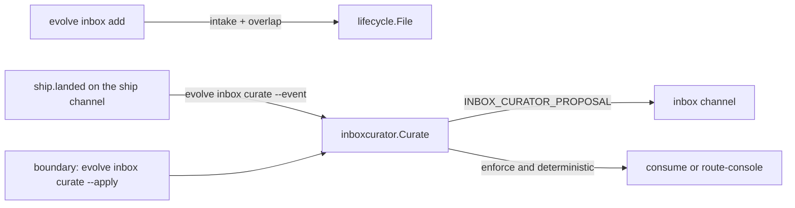

# The inbox curator: deterministic intake and event-driven review of the inbox

> **Status:** spec of record, 2026-10-27. **Request (operator, 2026-10-27):** "Let's build this directly now, as it's critical to the pipeline."
>
> **Design set:** the research is [inbox-curator-2026-10.md](../research/inbox-curator-2026-10.md). The plan is P3 of [the inbox prioritization plan](../plans/inbox-prioritization-2026-10.md). The decision record is [ADR-0121](adr/0121-inbox-priority-is-a-computed-rank.md). The packages are `internal/inboxcurator` (its note lands with the intake PR) and [internal-inboxmover-lifecycle.md](packages/internal-inboxmover-lifecycle.md). Every Go name, flag, field, signal code and policy key in this spec lands in the intake PR or the curator PR. The event channels are [event-channels.md](event-channels.md).

## The problem

The inbox had no review. The operator recorded these facts on 2026-10-27:

- 256 of 258 open items were console-owned.
- `evolve inbox batches` made 1 batch.
- 4 items whose work merged days ago ranked in the top 12 of `evolve inbox rank`: `rolling-pool-backfills-lanes`, `wave-orchestrator-oversees-every-lane`, `wave-runs-four-parallel-lanes` and `wire-partitiongraph-for-package-level-conflicts`.
- "Duplicates and wrong routes enter at add time unchecked."

The operator's design is event-driven: the review runs on events and never polls.

## Terms used throughout

| Term | Meaning |
|---|---|
| Open item | A pending item at the inbox root, or an item that a lane claimed in `processing/cycle-<N>/`. |
| Fix surface | The repository paths that the `files` list of an item declares (`inboxbatch.Item.DeclaredPaths`). |
| Similarity | The Jaccard index of the token sets of the title and the acceptance of two items. |
| Named test | A `Test…`, `Benchmark…` or `Fuzz…` name in an acceptance criterion. |
| Proposal | A typed change to one open item: `consume`, `reroute` or `merge`, with its evidence. |
| Deterministic proposal | A proposal whose check is a fact that Go can verify. Only such a proposal can be applied. |
| Stage | `inbox.curator.stage`: `shadow` publishes the proposals, `enforce` also applies the deterministic ones. |

## Findings

**F1** (live inbox copy of 2026-10-27, 258 items) The 258 items hold 2,710 pairs with a shared fix surface. The highest similarity of a pair is 0.52, and 13 pairs are between 0.3 and 0.5. *Implication:* a refuse threshold of 0.5 refuses only near copies. A warn threshold of 0.3 names a small set.

**F2** (live inbox copy) Each of the 4 stale items names tests in its acceptance, for example `TestAdmit_ATodoInABusyCellWaits`. Those tests exist on `origin/main` (`go/internal/admission/admission_test.go`). One named test of `rolling-pool-backfills-lanes` does not exist. *Implication:* the presence of the named tests finds stale items without a model. A missing test or a criterion with no test keeps the decision with the operator.

**F3** (`go/internal/phases/ship/landing_intent.go:240-247`, `emitShipLanded`) `ship.landed` carries the fields `cycle`, `commit` and `branch`. [event-channels.md §14](event-channels.md#14-kinds-modules-and-codes) says that the event is at most once. *Implication:* the landing trigger needs a backstop at the wave boundary.

**F4** (`go/cmd/evolve/inbox_writers_contract_test.go`) Nine autofilers write items directly, and four more callers file through `lifecycle.File`. None stamped an origin. *Implication:* the origin must be enforced in the one filing funnel, and each direct writer must stamp it.

**F5** (outside practice) Issue trackers compare duplicates with a token Jaccard of the title and the description. The threshold is fixed or learned ([beads find-duplicates](https://beads.gascity.com/cli-reference/find-duplicates.md); [arXiv 2511.10323](https://arxiv.org/pdf/2511.10323)). A merged pull request closes the issues that its text names ([GitHub closing keywords](https://help.github.com/articles/closing-issues-using-keywords)). Backlog groomers flag open issues whose linked change merged, and the better ones flag but never close ([withone backlog groomer](https://www.withone.ai/use-cases/backlog-groomer)). *Implication:* a deterministic measure and a "propose, do not close" default are current practice.

## Decisions

| Id | Decision | Because | Rejected options and why |
|---|---|---|---|
| D1 | The overlap measure is a shared fix surface plus a token Jaccard of the title and the acceptance, with the thresholds in strict policy. | F1, F5 | An LLM overlap judge (the plan of 2026-10-06): the operator requires that no LLM edits the inbox. Embeddings: they need a model, and nobody can check a score by hand. |
| D2 | `evolve inbox add` refuses an overlap at or above `overlap_refuse` with exit 3 and the ids, unless `--allow-overlap --reason`. Between `overlap_warn` and `overlap_refuse` it warns. Exit 3 is the code that the plan's P3 gave an overlap, and it is the `refused` class of [cli-contract.md](cli-contract.md): a rule stopped the verb. | F1 | A pending intake that waits for the operator: the operator files with the verb, so the refusal is the question. |
| D3 | `lifecycle.File` enforces the origin. Every writer stamps one. | F4 | A check in the verb only: four other callers bypass the verb. |
| D4 | The override is an operator stamp, `intake_override`, that only the filer writes. | — | An author field: an author can forge it. |
| D5 | The landing trigger proposes `consume` when the change touched the fix surface and at least `consume_min_share` of the named tests exist. The proposal is deterministic when every criterion names a test and every named test exists. A test file of the change must also define one of them, and the change must not be older than the filing of the item. | F2 | Consume on any surface change: a partial change closes open work. |
| D6 | A policy or protected-manifest change runs the route check. A `route: lane` item with a protected surface gets a deterministic reroute to the console. A console route that no fact explains gets a reroute proposal to a lane for the operator. | — | Apply the lane reroute: an operator chose the console route, and only the operator can undo that choice. |
| D7 | The boundary step runs every check over every open item, as a backstop. | F3 | A poll timer: the operator forbids it. |
| D8 | A `merge`, a sweep `consume` and a lane `reroute` are judgment proposals. They are published for the operator and the orchestrator (item X13). The curator never applies them. | — | Apply them: they need judgment, and no LLM edits the inbox. |

## The design



### 1. On add (P3 intake)

`evolve inbox add [--file F] [--origin O] [--allow-overlap --reason R]` runs `inboxcurator.Admit` before it files:

1. The origin is one of `operator`, `console`, `cycle` and `retro`. `--origin` gives it when the item names none. The default is `console`.
2. The `kind` is in `inbox.curator.kinds`.
3. The `files` list declares at least one repository path. No entry is absolute or leaves the repository.
4. A console route needs a fact: a protected fix surface or a `pipeline-*` kind. Without one, the verb refuses unless `--reason` gives the reason.
5. The overlap check compares the item with each open item (D1, D2). An item that the new item names in `deps` or `connects_to` is not an overlap.

The filer stamps the origin and the `intake_override` record (D3, D4). After the filing, the verb prints the rank of the item from `evolve inbox rank`.

Exit codes: `0` filed, `1` refused, `2` an I/O error, `3` an overlap, `10` usage.

### 2. On landing

`evolve inbox curate --follow` is the subscriber of the `ship` channel. The console starts it once, for example under its Monitor:

```
evolve inbox curate --follow --project-root <plane>
```

- It reads the `ship` channel through `internal/events/reader`. The kernel wake makes it wait, so it never polls.
- For each `ship.landed` record it reads the commit with `git log` and runs the landing match (D5).
- It publishes each proposal and applies none, because a lane is live during a wave.
- `evolve inbox curate --event` takes one wire record on stdin. It is the entry point for the exec subscriptions of [event-channels.md §10](event-channels.md#10-delivery), which have no `evolve events` verb yet.
- The loop does not supervise the follower. When no follower runs, the boundary backstop (section 4) sees the landing.

### 3. On a policy or protected-manifest change

A change that touches `.evolve/policy.json`, `.evolve/profiles/` or `go/internal/guards/integrity_surface.go` adds the route check over every open item (D6). This trigger has no subscription of its own. Two sources see such a change:

- the file list of the commit of a `ship.landed` event (section 2);
- the commit range of the boundary step (section 4). The range also holds the console's own commits and merges, which emit no `ship.landed`.

### 4. At the boundary

`evolve boundary run` and `evolve wave next` run `evolve inbox curate --apply` after `sync-main`. The step reads the commits from the cursor `.evolve/inbox-curator.json` to `HEAD`. Then it runs the landing match, the route check, the sweep of named tests and the duplicate check over every open item (D7). In the `enforce` stage it applies each deterministic proposal: `consume` moves the item to `consumed/`, and a console reroute calls `route-console`. Then it moves the cursor to `HEAD`.

The cursor has these cases:

- **No cursor** (the first run): the step reads no range. It runs the other checks, then writes the cursor.
- **A lost cursor** (a torn file, or a commit that the repository does not hold): the step warns and restarts the cursor at `HEAD`.
- **A git fault on the range, or a failed apply**: the step warns and keeps the cursor, so the next boundary reads the range again. An item that the step consumed is no longer open, so the repeat changes nothing.

**The landing of an apply.** The step commits the files that it moved or rewrote, with the message `chore(inbox): the inbox curator's applied proposals`. Thus the next `sync-main` finds no dirt beyond the inbox stamps.

**A declined proposal.** A judgment proposal repeats at each boundary until the operator acts. The operator declines a lane reroute with `evolve inbox route-console <id> <reason> 0`. The stamped `routed_reason` explains the route, so the curator stops the proposal. The operator declines a sweep `consume` with an edit of the acceptance, or ends it with `evolve inbox consume`.

### The verb

`evolve inbox curate [--json] [--apply | --event | --follow [--since S]] [--project-root P]`

The verb takes one mode at most. `--since` takes `new` (the default), `all`, `last` or an RFC 3339 time.

| Mode | Reads | Writes |
|---|---|---|
| no flag | the open items, the tests, the commits since the cursor | nothing |
| `--event` | one wire record and its commit | the proposals to the inbox channel |
| `--follow` | each `ship.landed` record of the `ship` channel and its commit | the proposals to the inbox channel |
| `--apply` | as the plain mode | the proposals; in `enforce`, the deterministic changes; the cursor |

- `--apply` refuses with exit 1 while a run lease is live, as the other inbox curation verbs do today. A lane thus cannot apply a proposal.
- The agent class is `R`: a phase agent requests the verb ([cli-contract.md](cli-contract.md)).
- Each proposal is one `INBOX_CURATOR_PROPOSAL` signal of the module `inbox`. Its fields are `kind`, `id`, `target`, `trigger`, `deterministic`, `stage`, `applied` and `evidence`.

### Policy

The block is `inbox.curator` (its `policy-config.md` section lands with the intake PR). The operator named the key `inbox.curator.stage`, so the block is nested under `inbox`, beside the older top-level `inbox_priority`. The keys: `stage` (default `shadow`), `overlap_refuse` (0.5), `overlap_warn` (0.3), `consume_min_share` (0.5) and `kinds`.

## Limits

- The check and the filing are two steps, so two concurrent adds can both pass. The boundary duplicate check finds such a pair.
- The measure reads the title and the acceptance only. Two items with different words for one change score low.
- A named test that existed before the item was filed makes a false sweep proposal. The sweep never applies, so the operator judges it.
- The origin is what the author or the filer says. It gives no extra authority.
- The 4 stale items that started this work do not get a deterministic `consume`. Each has a criterion with no test, and they merged before the first cursor. The sweep proposes them, and the operator closes them.
- "Console-owned" in the problem statement means the console list of `evolve inbox rank`. That list holds the 133 items with a console route and also the items whose surface is protected or undeclared.

## Verification

| Trigger | Test |
|---|---|
| A duplicate is refused or warned | `TestCmd_InboxAdd_ADuplicateIsRefusedNamingTheOverlappingID`, `TestCmd_InboxAdd_ANearOverlapIsWarnedAndFiled` |
| A gate-file item cannot be route lane | `TestReroutes_AGateFileItemOnTheLaneRouteIsADeterministicRerouteToTheConsole` |
| An item whose acceptance merged is proposed for consume in the same boundary | `TestCmd_InboxCurate_TheBoundaryConsumesAnItemWhoseAcceptanceMergedInEnforce` |
| A lane cannot apply a proposal | `TestCmd_InboxCurate_ApplyIsRefusedWhileALaneIsLive` |
| A `ship.landed` event is curated with no poll | `TestCuratorRun_FollowCuratesEachLandingAndSkipsOtherRecords`, `TestLandingReader_ReadsTheShipChannelOfTheRoot` |
| The next `sync-main` is not refused after an apply | `TestCmd_InboxCurate_TheBoundaryCommitsWhatItApplied` |
