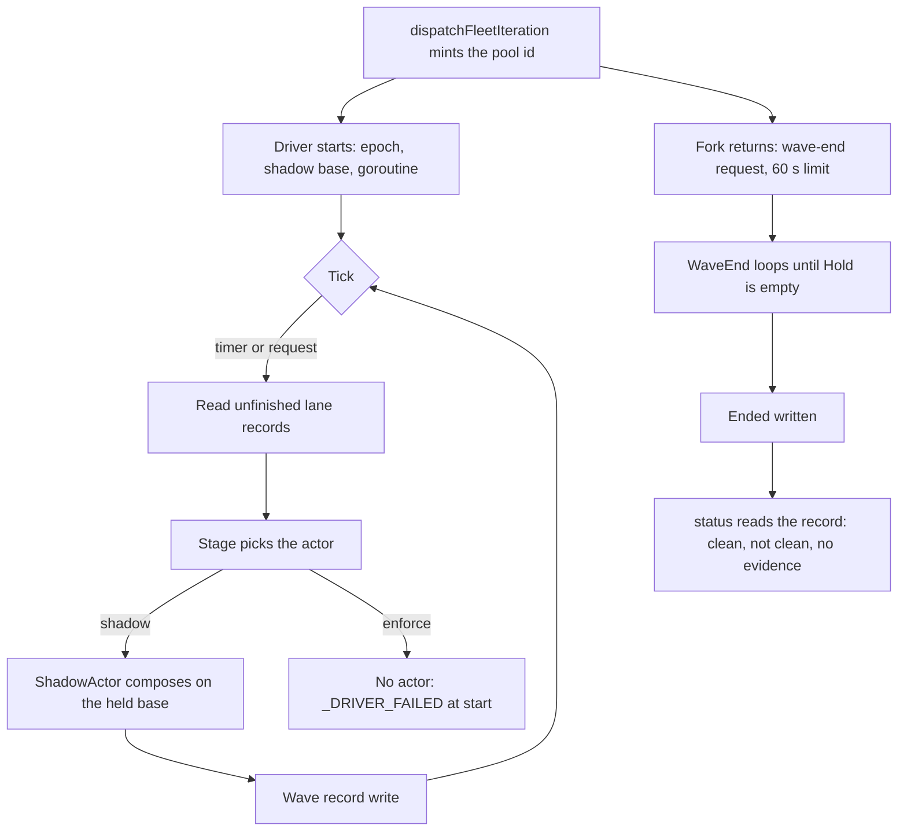

# Integration driver: the lane side of the train

> [ADR-0147](adr/0147-the-wave-orchestrator-owns-integration-and-decides-when-the-wave-reaches-main.md) · plan: [wave-integration-2026-10 §11](../plans/wave-integration-2026-10.md#11-amendment-of-2026-11-05-the-lane-side-gets-a-driver-i14) · research: [wave-integration-2026-10](../research/wave-integration-2026-10.md).
> **Status:** Proposed (2026-11-05), a console proposal. The operator has not ruled on it.
>
> PR (b), the shadow scope, landed as #1321 (`6ae4972c3`).
> The redesign card of PR (a) changed the entries below, and the text states each change.
> This file is the spec for the component I14, the integration driver, in its shadow scope. The package note [internal-integration](packages/internal-integration.md) holds the engine that the driver calls. Enforce is a later scope with its own card (§9).
>
> **Terms used throughout:**
> - **Driver:** `integration.Driver`. It composes the deliverables of one pool and writes the wave record.
> - **Actor:** the strategy that does the work of one stage. `ShadowActor` exists. `EnforceActor` is PR (c) and is not built.
> - **Pool:** the set of lanes that one `dispatchFleetIteration` starts. Its id is the pool id.
> - **Wave record:** the JSON file that holds the batches, the members, the decisions and the failures of one pool.
> - **Member:** a cycle plus its patch ids.
> - **Epoch:** an integer that names the holder of the driver. A new holder has a higher number.
> - **Shadow base:** the SHA of `main` that the driver reads at pool start and holds for the whole pool.

The goal of the operator, on 2026-11-04: "finish the merging component tasks with the latest update to solve every PR has to be queued on main which continuing generating merge conflicts". The operator decided that enforce needs two clean shadow waves, and that I9 is the operator's flip.

This document states the design in its final form. The console proposes the new component and the choices of §11. The operator has not yet approved them.

## Table of contents

- [1. Goals](#1-goals)
- [2. The cause](#2-the-cause)
- [3. The driver and its actors](#3-the-driver-and-its-actors)
- [4. The wave record, the member and the epoch](#4-the-wave-record-the-member-and-the-epoch)
- [5. What shadow measures](#5-what-shadow-measures)
- [6. Entries](#6-entries)
- [7. The clean-wave verdict and the signals](#7-the-clean-wave-verdict-and-the-signals)
- [8. Rows](#8-rows)
- [9. Enforce: the open inputs](#9-enforce-the-open-inputs)
- [10. Limits and the split](#10-limits-and-the-split)
- [11. Choices that are the console's proposals](#11-choices-that-are-the-consoles-proposals)

## 1. Goals

| Goal | Measure | Target |
|---|---|---|
| Shadow composes each delivered lane | Each shipped cycle of a pool has a member in the wave record | 100% of shipped cycles |
| The verdict is checkable | `evolve integration status` names the failed condition of a `not clean` wave | Each failure route has one test |
| Shadow changes nothing | `refs/remotes/origin/main`, the window and zero-ship stay as before | No difference in the preservation rows |
| Enforce refuses to start without an enforce actor | `_DRIVER_FAILED` at start | One test |

## 2. The cause

### Issue

Before PR (b) (#1321): only the console train (`evolve integration batch`) called the engine. No production code called `DecideFlush`, `PrefixCheck` or `WriteIntegrationRecord`. No production code emitted `SHIP_INTEGRATION_COMPOSED`, `_FLUSHED`, `_MERGED`, `_REVERTED` or `_EJECTED`. `orchestrator.Oversight` had no production constructor, so `Window.CleanLanding` and `Window.Conflict` had no live caller. At HEAD, `go/internal/integration/driver.go` calls `DecideFlush`.

*Implication:* at `enforce`, a lane ship writes its record and stops before `main`. Nothing lands it. At `shadow`, nothing composed, so "two clean shadow waves" has no evidence.

### Gap

No plan component owns this. The facts below show why the staged work does not close it.

- `Merger.land` composes again when `main` moves (`go/internal/integration/batchpr.go:69`, `:167`). So the `Recomposer` of I7 is a second mechanism with no caller, and it does not land. The staged work is shelved at `backups/session-2026-11-04/i7-recompose-shelved-2026-11-05.patch`.
- `CheckLanded` cannot identify a lane commit that landed by itself. Real lane commits read `evolve-cycle: goal=<hash>` and have no trailer. In the first review, 0 of 11 real records read as landed.
- Across all 21 real records, 16 are ancestors of `origin/main`. The other five have no equal patch on `main`, so an ancestry check is right on all 21.

### Solution

A driver at the level of `dispatchPool` that holds ports only. It runs a stage actor for each tick, writes a wave record, and measures at shadow what the train does at enforce. The next sections give the parts.



## 3. The driver and its actors

**Home.** `integration.Driver` in `go/internal/integration/driver.go`, with ports only. It starts in `dispatchFleetIteration`, so it runs under each fleet route. Only lane leases exist (`wave-orchestrator.md` §8), and no lease covers the whole loop. So the epoch of §4 names the holder (plan D37).

```go
type Actor interface {
    Resume(ctx context.Context, rec WaveRecord) (WaveRecord, error)
    Flush(ctx context.Context, b PendingBatch) (BatchResult, error)
    WaveEnd(ctx context.Context, rec WaveRecord) (WaveRecord, error)
}
type Driver struct {
    Pool    int
    Stage   func() (string, error)
    Actors  map[string]Actor
    Epoch   EpochReader
    Store   WaveStore
    Flush   FlushPolicy
    Now     func() time.Time
    Publish Publisher
}
func (d *Driver) Tick(ctx context.Context, waveEnded bool) error
```

- `Driver` holds no enforce port. `Merger`, `Plane`, `Landing`, `Requeue` and the gate adapters live on `EnforceActor`.
- `ShadowActor` holds `Composer`, the private base ref and `Ancestry`.
- `Stage` is read at each tick. A flip in the middle of a pool changes the actor at the next tick.

**Stage table.**

| Step | ShadowActor | EnforceActor (PR (c)) |
|---|---|---|
| Base | The held shadow base | The live head, read from the private ref |
| Compose | Local `integration/p<pool>-b<n>` through `Composer` at shadow | `Merger.Land` with a lane batcher as `Compose` and `Heads` nil |
| Prefix check and batch test | Not run | The gate is `BatchTest`, with three new adapters. `PrefixCheck` goes away, because `composeAll` is the one loop |
| PR, CI and fast-forward | Not run. `_FLUSHED` with `pr=0` and `shadow=true` | `Merger` through `GhCI.Open`, which pushes |
| `main` moves during a watch | Not applicable | `Merger.land` composes again. `Watch` returns early with a new verdict `Moved` |
| `MaxMoves` used up | Not applicable | `_DRIVER_FAILED`. Members stay `pending` |
| After merge | Nothing | See §9 |
| Conflict | `conflicted` and `_EJECTED` with `shadow=true`. No brief | `ejected`, `Ejection.WriteBrief`, `Landing.Conflict()` and `Requeue` |
| Refs | Deleted at `WaveEnd` and at `Resume` | Remote and local refs deleted after merge |
| Resume | No network. It deletes stale local `integration/p<pool>-*` refs and continues the index from the record | `Adopter.Adopt`. The state "fence pushed, record old" takes the discard path |

## 4. The wave record, the member and the epoch

**Wave record.** `WaveRecord{Schema, Pool, Epoch, ShadowBase, Batches []IntegrationBatch, Members map[int]MemberState, Decisions []FlushRecord, Failures []DriverFailure, Ended bool, LastCycle int}`. The decisions are the flush decisions of `DecideFlush`.

- `IntegrationBatch` is today's `Index, Base, Branch, Tip, PR, Members`.
- `Validate` checks the branch at the batch level and the epoch at the wave level.
- No production code wrote the old shape, so no migration is needed. The old schema records live in `integration-current`, which entry 1 of §6 excludes. They raise no failure.
- `MemberState` is `pending`, `composed`, `conflicted`, `conflicted_base_ahead`, `merged`, `ejected` or `failed`. A separate `Landed bool` is independent of it.

This answers the question that the package note left open: one record file for each pool, with the batches inside it. The package note changes in the same PR as the code.

**Member identity.** A member is a cycle plus its patch ids.

- The same patches keep their first owner, so a past verdict does not change.
- Different patches are a new member of the current pool while the member is pending.
- Limit: a member that composed, conflicted or ended keeps its first patches. A redelivery under new patches later in the same pool is not composed. The driver records it as a failure, so the verdict reads not clean.
- `Tick` and the verdict read members across all `integration-*.json`. The first record that holds a member owns it.
- A resumed lane takes the current pool id. A lookup goes by commit, so that is safe. `landedByIdentity` uses `RecordForCommit`, which finds the record by commit and checks the cycle. `integration.ListRecords` is the one home of the records. It lists them and returns each read failure. `FindRecordByCommit`, `RecordForCommit` and the owner rule of `Tick` (`RecordSet.Owned`) are its projections.

**Pool id.** The loop mints it with `core.AllocateCycleNumber` before launch, so it is unique and each lane sorts above it. One pool costs one cycle number. It reaches `execCycleLaunch` as a closure parameter, and then the cycle run as a CLI parameter. `CycleSpec` does not change.

A resumed lane takes the current pool id. Pool directories sort numerically.

**Two names.** The record and the branch name `integration/p<pool>-b<n>` use the pool id. The console train keeps `batchBranch` and its `integration/w<wave>-b<n>` name. The pool branch name is a new function. `status` keeps the operator's wave number (§7).

**Epoch.** The file `.evolve/integration-epoch` holds one integer.

- The loop process increments it once at start, through a lock file, and holds its value. A boundary re-exec is a new holder.
- `Tick` compares the file with its own value first. `EnforceActor` compares again before `Main.FastForward`.
- A mismatch ends the driver with `SHIP_INTEGRATION_DRIVER_FAILED`.

## 5. What shadow measures

Shadow answers four questions: the order, the overlap, the conflict count and the landed fact. It uses a held base, so a lane that lands during the pool does not hide a conflict.

- **The held base.** At pool start, `git fetch --refmap= origin +refs/heads/main:refs/evolve/integration-main` writes a private ref. The SHA is the `ShadowBase` for the whole pool.
  - The empty `--refmap=` is required. Without it, git also updates `refs/remotes/origin/main` as a side effect of the fetch.
  - No write ever touches `refs/remotes/origin/main`. A lane that lands does not move this base.
- **The compose.** Each flush composes each new member onto the batch chain from `ShadowBase`, in `OrderDeliverables` order. So order, overlap and conflict are real, and a member that landed since is still composed.
- **The landed fact.** `Landed` is separate. `Repo.IsAncestor(ctx, sha, privateRef)` answers it for each commit, with a refreshed private ref. `CheckLanded` stays for composed enforce commits only.
- **The trap in ship.** The trap in `landedByIdentity` (`go/internal/phases/ship/postship.go:210`) is a separate item, because ship does not change here.
- **Wave end.** `DecideFlush` at wave end can return `risky_alone` with a hold. So wave end loops until `Hold` is empty.
- **An empty tree change.** A compose with an empty tree change is `already-on-base`. The count is apart from clean composes.
- **A lane forked later.** If the `BaseSHA` of a member is not an ancestor of the chain base, the conflict counts as `conflicted_base_ahead`, apart from `conflicted`. `overlap.Input.BaseNotAncestor` names the same fact. The conflict counts are thus an upper bound on real conflicts. The excess is unmeasured.
- **The order fields.** The order is by delivery time. `CycleSpec` has no rank, and all 21 real records read `inbox_rank=0`. `Risk` and `Deps` stay empty, and `UnblocksQueuedWork` is false. `status` prints "order: by delivery time; rank, risk and deps not supplied". So D3 stays unmeasured.
- **The overlap facts.** Shadow ignores the tier (`go/internal/integration/compose.go:186`). The facts come from their real source in PR (c). `Scope` holds inbox ids and is not a source.

## 6. Entries

1. **Input.** `Tick` lists every lane record with no terminal state across the wave directories. It reads them through `integration.ListRecords` (`go/internal/integration/recordset.go`). It skips `integration-console` and `integration-current`. A record that cannot be read comes back as a read failure, and the driver writes it once into `Failures`.
2. **A held member.** A held member crosses pools. A record with the old schema or a bad file is `failed` once and blocks no other member.
3. **One owner.** One goroutine owns every `Tick`. It serves a timer and a request channel. It recovers a panic into `_DRIVER_FAILED`. A failure never stops a lane at shadow.
4. **Seam.** The loop mints the pool id only under `ShouldRunPool || ShouldRunWave`, after `resolveWaveBinary`.
   - `runFork` starts the driver before the routes run. It holds the handle as a local, and no route receives it.
   - The pool, wave and repair routes all run inside `runFork`.
   - Pool 0 builds no run: it starts no goroutine, and its `finish` does nothing.
   - The fetch of the held base ends before the lanes start, with a limit of 30 s. A failed fetch is recorded in `Failures` and is not fatal.
   - After a failed fetch, the driver reads the last private ref, and then `refs/remotes/origin/main`, as a read-only base.
5. **No id.** A lane with no pool id writes no record at shadow, and warns. At enforce, it fails at startup through the `RoutingErr` path. A sequential config mints no number and starts no driver. `shipIntegrationWave` goes away.
6. **Wave end.** `evolve wave next` runs `--max-cycles 1`, so no boundary follows the wave. A pool ends when its fork returns.
   - `runFork` runs the routes and returns a `forkOutcome` (route, results, repaired, wave config, pace). It holds `defer run.finish()`, so each return of the fork reaches the wave end.
   - `settleFork` then runs `fleetHaltDecision`, `observeWorkSupply`, `applyEscalationBoundary` and the pace.
   - So `Ended` is on disk before the final JSON of a halt.
7. **The request.** `finish()` takes no argument. It sends the request before `fleetHaltDecision`.
   - The goroutine holds one owner context, made with `context.WithoutCancel` of the loop context.
   - `finish` cancels the owner context at the limit of 60 s, and then it always waits for the goroutine. So no goroutine and no git child outlives `finish`.
   - Each tick derives from the owner context. A timer tick also follows the loop context through `context.AfterFunc`. The request tick does not.
   - On a cancelled loop, `finish` prints one line first, because a second interrupt is ignored for up to about 65 s.
8. **After the limit.** Past the limit, the record lacks its wave-end decision, so the wave is `not clean`. The repair route writes `Ended`. `LastCycle` is written at wave end. It is the highest cycle number that the allocator holds at that time (`State.HighestCycleNumber`).
9. **Zero-ship.** At shadow, zero-ship uses `CountShips`, as today. Zero-ship at the next `prepareIteration` reads the record. At enforce, `core.CountWaveShips(stage, cycles, rec)` counts `merged` plus in-flight members, so an open batch is not zero.

**The window port.** `integration.LandingFeed` is a small interface that `integration` declares. `*orchestrator.Window` satisfies it. A pool gets its feed, and the rolling pool gets a null feed, because it has no window. D21 says that the feed comes from `SHIP_INTEGRATION_EJECTED`. The fact is the same, and the driver knows it first, so the feed comes from the driver.

**Single homes.** `integration.CodeMerged`, `CodeComposed` and `CodeFlushed` join `CodeEjected`. `phases/ship/deliverable.go` keeps the registry and uses them. The staged I11 with its private copies is dropped before PR (a). Its conflict is at `core/parallel_default_test.go`.

**Plane sync.** `core.FastForwardPlaneMain` does not land. PR (c) extracts `syncToOrigin` (§9).

## 7. The clean-wave verdict and the signals

`evolve integration status [--pool N] [--wave N] [--json]` is class A and read-only. It sits in `integrationVerbs`. This is I8. It prints the batches, the members and their states, the order, the decisions, the failures, the counts and the verdict.

- `--pool N` selects a pool. `--wave N` keeps the operator's wave number, resolved through `wave.Store` and the cycle range. A wave with several pools prints each one. `status` prints both numbers.
- `wave.Record` has no ceiling, so the wave range comes from the next record.
- `status` reads `wave.ReadRunRange` over `(pool, LastCycle]`. It counts the cycles with `Cycle.Shipped`. A range that cannot be read is a failed condition. A record with no `LastCycle` cannot be counted, so it is a failed condition too.
- A sequential fallback cycle has no record by design, and it is not counted. `Integration` is nil only for a non-fleet lane.

**The verdict.** Only `status` computes it.

| Verdict | Condition |
|---|---|
| `clean` | The record has `Ended` and a wave-end decision. Each shipped cycle in the range has a member. Composed plus conflicted is above 0. `Failures` is empty. |
| `no evidence` | Zero composes |
| `not clean` | Anything else. The output names the failed condition |

- A shadow conflict does not stop `clean`. The count is printed for the operator.
- A shipped cycle with no record shows as `missing record`. This is the denominator check, because a failed `writeDeliverable` at shadow only warns.
- A failed record write goes to the in-memory `Failures`, and the next write carries it. A failed last write already fails the `Ended` condition.

**The signals.** Each signal has the six parts of ADR-0161. `SHIP_INTEGRATION_DRIVER_FAILED` names the step and the error. The driver also writes the failure to the record, so a lost signal cannot hide it.

**Gate order.** Until PR (c) lands, the driver refuses to start at `fleet.integration.stage=enforce`. It emits `_DRIVER_FAILED`, because `Actors` has no enforce entry. `status` prints `enforce: not ready (no enforce actor)`. This is wiring data, not a flag. I9 stays the operator's decision.

## 8. Rows

Each row is a red test first.

1. **Red proof.** At enforce today, a delivered record never reaches `main`.
2. **Journey, shadow.** A fixture repo with real git and lane-shaped commits. Two members: one conflicts, and one lands by itself during the pool. The record holds the order, one conflict and one landed. `status` reads `clean`. Nothing is pushed.
3. **Base ahead.** A clean lane built on a mid-pool console commit reads `conflicted_base_ahead` and not `conflicted`.
4. **Crash states.** One test each:
   - after the ref, after the record, and resume after wave end;
   - fence pushed with an old record, and a stale epoch;
   - a risky member held, and a member that crosses pools.
5. **Preservation.** At shadow, `refs/remotes/origin/main` stays where it was. No ref is pushed on a resume. No PR opens. No lane is briefed. The window, zero-ship and the console train are unchanged.
6. **Seam.** A sequential config mints no number and starts no driver. The repair route writes `Ended`. A loop with `--max-cycles 1` ends with `Ended`. The gap of one cycle number for each pool is checked for the readers of cycle numbers.
7. **Identity.** The same cycle in two pools with different commits gives two members. The same patches keep the first owner.
8. **Wiring.** One test for each entry, through the composition root. `status` reads `not clean` for each route to a false `clean`, each in its own test. One test for each false denominator route.
9. **Record writes.** A failed write followed by a good one keeps the failure in `Failures`.
10. **Mutation.** Swap the actor, the feed and the order. Swap `IsAncestor` for `CheckLanded`. Remove each `clean` condition.
11. **Signal.** Equality of each whole text.

## 9. Enforce: the open inputs

The driver refuses `enforce` until PR (c) lands. PR (c) gets its own card and its own review before its code. These inputs bind that card.

| Id | Input |
|---|---|
| F2 | A `delivered` inbox state. Post-ship today sees `isLanded` false and releases the item at a delivered ship, so a second lane starts on the same work. A delivered ship must hold the item off the menu, and the stale-claim sweep must not release it. On `merged`, promote the ids in `rec.Scope`. On ejection, release them with the brief |
| F3 | The brief reaches the next lane. `inboxbatch.Item` needs a brief path field, and `inboxBatchesSection` renders it. A brief-only continuation is unlikely to work, because readers skip an empty `SnapshotSHA`. PR (c) probably needs its own field. Each ejection adds to the failure count, so the convergence count of ADR-0126 bounds the retries |
| F11 | A mid-wave sync is a plain `merge --ff-only`. `syncToOrigin(ctx, g, rel, warn) (SyncOutcome, error)` takes the stamp step as a strategy. The stamp path stays at the boundary. A blocked mid-wave sync waits for the boundary |
| F12 | A plane with a local bookkeeping commit after a merge is `Diverged`. The merge step rebases local-only commits onto the new origin and flushes them before `Plane.Sync`. Any other `Diverged` is `_DRIVER_FAILED` |
| Finding 3 | Promotion. At `merged`, run the landed branch of post-ship from one extracted function, or record its result at delivery. `rec.Scope` is not the promotion set. A deferred id stays open, and a marker id is promoted |
| Finding 4 | A rebase on a dirty plane. A refused step waits for the boundary with `_MERGED` kept. No `--autostash` |
| Finding 5 | `evolve loop --resume` of a lane checkpoint reads as a non-lane and lands on `main` at enforce. PR (c) derives the lane identity from the checkpoint. It refuses at enforce or gives the lane the current pool id |

PR (c) also settles these facts.

- **Verdict `Moved`.** `Verdict` has only green and red, and `test` reruns on any non-green result. An early `Watch` return needs a third verdict, `Moved`, that `test` returns at once. The tests of the console train stay unchanged.
- **Sync outcomes.** `SyncOutcome` is `Current`, `Ahead`, `Diverged`, `Blocked` or `Moved`. Mid-wave, `Moved` and `Current` proceed. The other outcomes follow F11 and F12. None retracts `_MERGED`, because `main` did merge.
- **Ejection receiver.** The lane has ended and `Oversight` stays asleep. `Requeue` returns the inbox item to the queue with the brief path through `inboxmover`. `Train.Brief` is for a PR author and is not used. A wake of `Oversight` is a separate inbox item.
- **Bookkeeping.** `bookkeeping.go` holds two pure predicates and no flush. PR (c) builds the flush that D12 names. The plane sync refuses "ahead" only after that flush ran.
- **Journey.** The enforce journey uses a fake CI and a bare origin:
  - One member lands by fast-forward. One conflicts and is requeued with its brief.
  - A console merge during the watch recomposes and lands.
  - Plane `main` equals `origin/main`, with a local bookkeeping commit present. Zero-ship reads 1.
  - A batch open at the boundary continues in the next wave. No second lane starts on a delivered item.

## 10. Limits and the split

**Limits.**

- Enforce paths get their first live run at I9. PR (c) adds a fixture soak. The author of the first card did not read `cmd_fleet_soak_pool.go`, and it can hold the shape.
- The cost of `BatchTest` at enforce is not measured.
- Shadow proves the driver, the record, the order and the conflict count on a held base. It does not prove CI, the merge or the ejection handling.
- `Risk`, `Deps` and the unblock fields stay unsupplied. So `risky_alone` and `unblocks_queued_work` cannot fire until a later item supplies them.
- The conflict counts are an upper bound (`conflicted_base_ahead`).
- Lane post-landing work that enforce skips (`landing_intent.go:38` onward) is not traced here. PR (c) lists it.
- A leaked `integration/*` ref after a failed delete is retried at the next tick and at resume.
- The package note [internal-integration](packages/internal-integration.md) lists the limits of the engine that the driver calls.

**Split.**

| PR | Content |
|---|---|
| (a) | Names, the pool id through to the lane, the move of `landedByIdentity` to `RecordForCommit`, `IsAncestor` and the wave record type |
| (b) | Records home, epoch on `loopConfig`, private ref, `Driver`, `ShadowActor`, goroutine, `runFork` and `settleFork`, I8 with the verdict. Enforce refuses to start |
| (c) | `EnforceActor`, lane batcher, gate adapters, early `Watch` and cancel, `Requeue`, bookkeeping flush, `syncToOrigin`, window feed, zero-ship, soak and the removal of `PrefixCheck` |

The shadow scope builds from this document with no further card round. The review ran three rounds on the card.

## 11. Choices that are the console's proposals

The operator did not state these. The console proposes them for the operator's approval.

- The new component I14.
- Shelving the `Recomposer` of I7.
- The held shadow base.
- The pool id.
- The epoch file.
- The `delivered` inbox state.
- Requeue as the ejection receiver.
- The move of the verb family from `evolve wave integration status` to `evolve integration status`.
- The split into three PRs.

The operator's decisions are two: enforce needs two clean shadow waves (2026-11-04), and I9 is the operator's flip.
