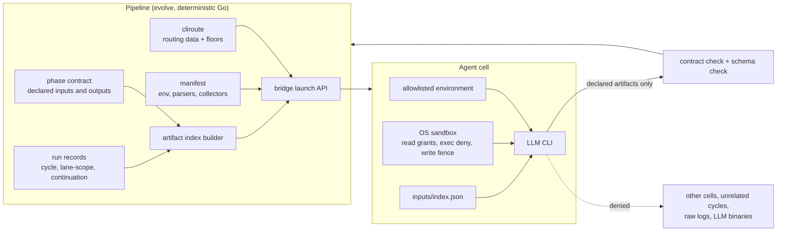
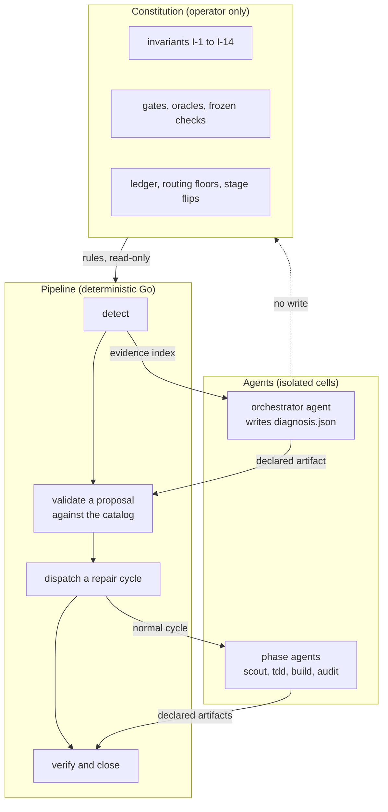

# LLM isolation: the pipeline is the only controller, and each agent runs in a cell

> [ADR-0154](adr/0154-the-pipeline-is-the-only-controller-and-each-agent-is-an-isolated-replaceable-worker.md) · [ADR-0155](adr/0155-the-loop-heals-itself-inside-its-boundaries-an-agent-proposes-and-the-pipeline-disposes.md) · plan: [llm-isolation-2026-10](../plans/llm-isolation-2026-10.md) · research: [llm-isolation-2026-10](../research/llm-isolation-2026-10.md) (F1.0 to F1.12, F3.1 to F3.6, P2.1 to P2.7, P3.1 to P3.5, R1 to R17).
> This file is the spec of record for the agent cell. It covers the environment, the launch path, the reads and writes and the outputs of a cell. It also covers the routing data that picks the family, and the proof that any family can fill the cell.
>
> The plan holds the components X1 to X16 and their order. The ADR holds the decision. The Signal Center contract reuses the shape of [llm-quality-indexes.md](llm-quality-indexes.md) §5.
>
> Status: proposed (ADR-0154, ADR-0155), 2026-10-25. X1 is built: the conformance matrix of §14 and the module, kind, codes and channel of §15. X6 is built: the routing data of §10. No other component is built. Each name in this file that does not exist on `main` is marked "proposed".

## Table of contents

1. [Reading guide](#1-reading-guide)
2. [Glossary](#2-glossary)
3. [Goals](#3-goals)
4. [The agent cell](#4-the-agent-cell)
5. [Single launcher](#5-single-launcher)
6. [Hermetic environment](#6-hermetic-environment)
7. [No nested agency](#7-no-nested-agency)
8. [The artifact index](#8-the-artifact-index)
9. [Sandbox rules](#9-sandbox-rules)
10. [Routing data](#10-routing-data)
11. [Manifest fields](#11-manifest-fields)
12. [Typed flow decisions](#12-typed-flow-decisions)
13. [Instruction files and the console seat](#13-instruction-files-and-the-console-seat)
14. [Conformance matrix](#14-conformance-matrix)
15. [The Signal Center contract](#15-the-signal-center-contract)
16. [Operator runbook](#16-operator-runbook)
17. [Self-healing within boundaries](#17-self-healing-within-boundaries) (Part II)
18. [The self-healing loop](#18-the-self-healing-loop)
19. [The action catalog](#19-the-action-catalog)
20. [Surface tiers and the gate classifier](#20-surface-tiers-and-the-gate-classifier)
21. [No agent writes its own oracle (I-11)](#21-no-agent-writes-its-own-oracle-i-11)
22. [Close an incident with evidence (I-14)](#22-close-an-incident-with-evidence-i-14)
23. [The blast radius of an accident](#23-the-blast-radius-of-an-accident)
24. [Self-healing signals](#24-self-healing-signals)
25. [Self-healing runbook](#25-self-healing-runbook)
26. [Guards](#guards)
27. [Limits](#limits)

*Part I: the agent cell (ADR-0154). Part II, from §17: self-healing within boundaries (ADR-0155).*

## 1. Reading guide

The operator said on 2026-10-25: "the pipeline evo loop itself should the center of invoking all LLM cli by design... There is no dependency between a LLM to control over another LLM directly." And: "the agent should be isolated and let the pipeline to handle the flow and communication. Isolation is the key."

The operator then set the limit of the read rule: "phase agent can read the output / deliverables from previous phases and also when retry and failed recover cycle, those suggestions and improvement recommendations should be accessible when needed (not necessary to be loaded at the beginning)."

The idea in one paragraph: the `evolve` binary hires an LLM CLI for one task. The CLI runs in a cell. The pipeline chooses what the cell gets: a clean environment, an index of the artifacts that it can open, and a sandbox. The cell returns only declared files, and the pipeline checks them. No cell can start, read or talk to another cell. The family of the CLI is data in the routing table, so a policy change can put any family in any seat.

### What changes and what stays

| Stays as it is | Changes |
|---|---|
| The phase order and the state machine in `go/internal/core` | The environment of each child: an allowlist, not the full launcher environment (§6) |
| The phase contracts and the gates | Seven launch paths move behind one bridge API (§5) |
| The ADR-0129 cycle broker for messages | A phase pane gets a depth marker, and the sandbox denies LLM exec (§7) |
| Today's routing values, the Claude floor among them | The reads of a cell: an index of artifacts, not the whole repo and `$HOME` (§8, §9) |
| The deliverables that each phase writes | The floor and the flow defaults move from Go to routing data (§10) |

### A worked example: one retry of the build phase

Item `pass-k-replay-harness` fails its audit in cycle 2101. The pipeline starts cycle 2102 as a retry of the same item. Today and after the change:

| Step | Today | After the change |
|---|---|---|
| Launch | The bridge starts `agy` with the full environment of the loop, `CLAUDECODE=1` among it. | The bridge starts `agy` with the allowlist and the variables of `agy-tmux.json`. |
| What the builder can read | The whole repo, all of `$HOME`, every `.evolve/runs/cycle-*` and each `*-stdout.log`. | Its worktree, `inputs/index.json` and the indexed paths. These are the scout and TDD reports of cycle 2102, and the audit report, retrospective and failure digest of cycle 2101. |
| What it reads at start | Whatever the persona names. | Only the index. It opens `cycle-2101/retrospective-report.md` when it needs the lesson. |
| A try to read cycle 1990 | It works. | The sandbox denies it. In `shadow`, the pipeline emits `ISOLATION_I5_VIOLATION` and lets it pass. |
| A try to run `claude -p` | It works. | The sandbox denies the exec. The pipeline emits `ISOLATION_I3_VIOLATION`. |
| Output | The builder writes `build-report.md`. | The same. The pipeline checks it against its contract. |

## 2. Glossary

| Term | Meaning in this spec |
|---|---|
| agent | one run of an LLM CLI for one phase or one flow seat |
| cell | the set of limits that the pipeline puts around one agent: environment, reads, writes, exec and outputs |
| seat | a place in the flow that an agent fills: a phase (scout, build, audit) or a flow role (advisor, judge, router) |
| family | the routing family of a CLI: `claude`, `agy`, `agy-claude`, `codex` or `ollama` |
| launcher | the code that starts an LLM binary |
| bridge launch API | the one function set in `go/internal/bridge` that starts an LLM binary (proposed name: `LaunchLLM`) |
| allowlist | the closed list of environment variable names that a child gets |
| artifact | a file that a phase contract declares as an output |
| deliverable | an artifact that a phase writes for later phases: a report, a verdict or a handoff file |
| raw output | the stdout log, the pane capture or the transcript of an agent; never an artifact |
| artifact index | the file `inputs/index.json` that lists each artifact that a cell can open (proposed) |
| lineage | the cycles that share the inbox item id of this cycle, and its retry or recovery chain |
| unrelated cycle | a cycle outside the lineage |
| floor | a routing rule that holds a seat on one family; today, the Claude floor |
| flow seat | a seat that steers the flow: advisor, judge, router, retry adjudicator, failure advisor, triage |
| stage | `shadow` (signal only), then `enforce` (refuse and signal) |
| guard test | the test that fails when an invariant breaks |
| violation | one event in which a cell did a thing that an invariant forbids |
| constitution | the kernel that only the operator changes: invariants, gates, oracles, ledger, floors, stages, the action catalog and its budgets (Part II) |
| incident | a problem that the deterministic detector found and recorded in `.evolve/incidents/` (Part II) |
| orchestrator agent | the isolated worker that diagnoses an incident and proposes one action; it dispatches nothing (Part II) |
| proposal | the action in `diagnosis.json` that the pipeline checks against the catalog (Part II) |
| action catalog | the closed, typed list of repair actions, with preconditions, tier limits and budgets (Part II) |
| tier | T0 kernel, T1 pipeline code or T2 item code: the class of a surface that sets who can repair it (Part II) |
| breaker | a circuit breaker for each incident class that stops repairs after repeated failures (Part II) |

## 3. Goals

The goals come from the plan §3. The order is the order of importance.

| Goal | Measure | Target |
|---|---|---|
| G-A One controller | spawns of an LLM binary outside the bridge launch API, by AST guard | 0 |
| G-B Isolated cells | contract rows for env leak, exec, cross-cycle read and log read | all green |
| G-B2 Knowledge on demand | a retry opens its predecessor's retrospective; an unrelated cycle is denied | both rows green |
| G-C Family-neutral flow | family names in flow logic, by grep guard | 0 outside manifests, routing data and tests |
| G-D Proven substitution | full cycle with each family as the only route | 5 of 5 families |
| G-E Visible state | invariants with a guard test and a signal code | 9 of 9 |

## 4. The agent cell

### Issue

Today a phase agent inherits the environment of the loop and reads the whole repo and `$HOME`. It can start another LLM and read the raw output of earlier agents (F1.1, F1.3, F1.4).

### Gap

Each limit lives in a different place, and seven launch paths skip some of them (F1.2). No one object describes what an agent gets.

### Solution

The cell is that object. The pipeline builds it for each dispatch from four inputs: the routing plan, the manifest of the family, the phase contract and the run records.



The cell has five parts. Each part has its own section and its own invariant.

| Part | Holds | Invariant | Section |
|---|---|---|---|
| Launch | Only the bridge starts the CLI. | I-1 | §5 |
| Environment | An allowlist plus the manifest variables. | I-2 | §6 |
| Exec | No LLM binary and no `evolve` dispatch verb. | I-3 | §7 |
| Reads | The own workspace, the index, the indexed paths, the worktree and the CLI's own files. | I-4, I-5 | §8, §9 |
| Outputs | Declared artifacts that a schema checks. | I-4, I-8 | §12 |

## 5. Single launcher

### Issue

Seven paths start an LLM binary outside `Engine.LaunchArgs` (`go/internal/bridge/launch.go:17`), F1.2. They are doctor, the usage controller, recipe sessions, cli update, the smoke tests, the version inventory and the model queries.

### Gap

The `sysexec` guard (`go/internal/sysexec/command_guard_test.go:19`) checks only that a process starts through `sysexec.Command`. It does not check which package starts an LLM.

### Solution

- The bridge exports one launch API (proposed name `bridge.LaunchLLM`). It takes a purpose (`phase`, `probe`, `update`, `smoke`, `inventory`, `modelquery`) and returns the process. Each purpose uses the same environment builder (§6), the same `unset TMUX` step and the same sandbox decision.
- A probe purpose can run without the sandbox only when the manifest says that the probe cannot run inside it. The launcher logs the reason.
- A new AST guard (proposed `TestOnlyTheBridgeStartsAnLLMBinary`) walks each non-test Go file. It has two rules:
  - Outside `internal/bridge`, no call to `sysexec.Command` or `exec.Command` takes a name from the manifest `binary` set. Today three paths break this rule: cli update, the version inventory and the model queries.
  - Inside `internal/bridge`, only the launch API starts an LLM. Today four paths break this rule: doctor, the usage controller (it sets `AllowBypass: true`), the recipe sessions and the smoke tests.

## 6. Hermetic environment

### Issue

`driverEnv` starts from `os.Environ()` (`go/internal/bridge/driver_common.go:23-32`). A tmux session starts with no `-e` flag (`go/internal/bridge/tmux.go:111`, `:120`). A test pins the inheritance (`go/internal/bridge/process_env_test.go:25-39`).

### Gap

A deny list, like `ipcenv.Scrub` (`go/internal/ipcenv/scrub.go:10`), cannot keep up with new vendor variables. A nested `claude` that inherits `CLAUDECODE` refuses to start or hangs (P2.7).

### Solution

The environment of a child is the union of three closed sets, and nothing else:

| Set | Names | Source |
|---|---|---|
| Base allowlist | `PATH`, `HOME`, `USER`, `LOGNAME`, `SHELL`, `LANG`, `LC_*`, `TERM`, `TMPDIR`, `TMP`, `TEMP`, `TZ` | compiled data in the bridge |
| Manifest passthrough | the names in `env_passthrough` (proposed field, §11), for example a proxy or an auth variable that the CLI needs | the manifest of the family |
| Manifest and pipeline values | `default_env` of the manifest, and the pipeline's own `EVOLVE_*` markers (§7) | the manifest and the launcher |

- `CLAUDECODE`, `CLAUDE_CODE_*`, `GEMINI_*`, `CODEX_HOME` and each other name of the launcher do not reach the child, unless a manifest lists it.
- A tmux session starts on a clean server with an explicit `-e NAME=VALUE` for each variable. The tmux server does not supply a variable.
- In `shadow`, the builder computes both environments. It logs each dropped name once for each wave and emits `ISOLATION_I2_VIOLATION` with the name, not the value. The child still gets today's environment.
- In `enforce`, the child gets only the union.
- `process_env_test.go` flips to assert the allowlist (proposed `TestProcessEnv_IsTheAllowlistPlusTheManifest`).

## 7. No nested agency

### Issue

A phase pane has dispatch depth 0, so the refusal in `evolve agent run` (`go/internal/cli/agentcmd/run.go:93-94`) does not fire. The SBPL profile allows each exec (`go/internal/adapters/sandbox/sandbox.go:149-152`). `EVOLVE_SANDBOX=off` turns the sandbox off for a phase too (F1.3).

### Gap

A Go refusal only works when the marker reaches the pane. A sandbox rule only works when the sandbox is on.

### Solution

1. The launcher sets `EVOLVE_DISPATCH_DEPTH=1` and `EVOLVE_PHASE=<phase>` (proposed) on each phase pane.
2. The existing refusals then fire: `evolve agent run`, the boundary writes and each `evolve` dispatch verb.
3. The sandbox denies the exec of each manifest `binary` (§9). The rule covers `claude`, `agy`, `codex`, `gemini` and `ollama`.
4. Inside a phase, `EVOLVE_SANDBOX=off` is refused. The host opt-out stays for operator commands outside a phase.

## 8. The artifact index

### Issue

The bridge writes each `<agent>-stdout.log` and `-final-pane.txt` into the workspace (`go/internal/bridge/engine.go:341`, `go/internal/bridge/driver_tmux_prepare.go:69`). The sandbox allows reads of the whole repo and `$HOME` (`go/internal/adapters/sandbox/sandbox.go:164-182`). The handoff reviewer makes the next agent answer the asks of the previous agent (`go/internal/core/handoff_reviewer.go:55-71`).

### Gap

A deny of all other reads breaks two needs that the operator named. A phase needs the deliverables of the earlier phases. A retry needs the lessons of its earlier tries, also from other cycles. A preload of all of that fills the prompt with text that the task does not need.

### Solution

The pipeline writes an index. The agent reads the index first and opens an entry only when it needs it. The sandbox grants reads of exactly the indexed paths.

#### 8.1 What the index lists

| Class | Entries | When |
|---|---|---|
| `deliverable` | the declared outputs of the earlier phases of this cycle: `scout-report.md`, the triage decision, `tdd-report.md`, `build-report.md`, `audit-report.md`, `acs-verdict.json`, `handoff-*.json` | each phase after the phase that wrote it |
| `lineage` | for each cycle in the lineage: `retrospective-report.md`, `failure-digest.json`, `carryover-todos.json`, `audit-report.md`, the ADR-0151 recovery document and the lesson YAML files that name the item | a retry or a recovery only |
| `message` | the ADR-0129 mailbox frames for this dispatch | when the broker holds one |
| `context` | the inbox item file and the files that the phase contract names as inputs | each phase |

The index never lists `*-stdout.log`, `*-final-pane.txt`, a transcript or a pane-watch file. These are raw output.

#### 8.2 Lineage

Lineage is the set of cycles that a retry or a recovery can read. The pipeline computes it from its own records, never from agent text.

1. A cycle is in the lineage if its `lane-scope.json` `todo_ids` holds the inbox item id of this cycle.
2. A cycle is in the lineage if the continuation chain (ADR-0076) links it to this cycle.
3. The lineage has a cap: the last `isolation.lineage_max` cycles (proposed policy key, default 5).
4. A lesson YAML under `.evolve/instincts/lessons/` is in the lineage if it names a lineage cycle or the item id.

X5 confirms the exact record that holds the item id of a finished cycle. If the record is absent, the cycle is not in the lineage, and the index says so in its `notes`.

#### 8.3 Format

The file is `<ws>/inputs/index.json` (proposed). The pipeline writes it before the launch. The sandbox makes it read-only for the cell.

```json
{
  "schema": "evolve.inputs.index/1",
  "cycle": 2102,
  "phase": "build",
  "item_id": "pass-k-replay-harness",
  "attempt": 2,
  "lineage": [2101],
  "entries": [
    {
      "id": "d1",
      "class": "deliverable",
      "kind": "scout-report",
      "path": ".evolve/runs/cycle-2102/scout-report.md",
      "cycle": 2102,
      "phase": "scout",
      "attempt": 2,
      "summary": "Scope: replay harness for pass^k; 3 acceptance checks.",
      "bytes": 8123,
      "sha256": "9c1f..."
    },
    {
      "id": "l1",
      "class": "lineage",
      "kind": "retrospective",
      "path": ".evolve/runs/cycle-2101/retrospective-report.md",
      "cycle": 2101,
      "phase": "retro",
      "attempt": 1,
      "summary": "Audit FAIL: the harness wrote to the replay set; add a read-only seam.",
      "bytes": 4410,
      "sha256": "51ab..."
    }
  ],
  "notes": []
}
```

- `summary` is one line. The pipeline takes it from a declared field of the artifact (for example, the first heading or a `summary` key). No LLM writes it.
- `sha256` lets the audit prove which version the agent had.
- The persona reads `inputs/index.json` first. A persona line changes from "read `workspace/scout-report.md`" to "open the `scout-report` entry of `inputs/index.json`".
- The handoff asks go into the index as a `deliverable` of kind `handoff-asks`. The next agent answers them in its own declared artifact. It does not read the raw output of the previous agent.

#### 8.4 Usage reading (optional)

The pipeline can record which entries a cell opened. The source is the sandbox report of allowed reads, so the agent cannot write it (ADR-0153 rule 7). On macOS, an SBPL `(with report)` modifier on the read grants logs each open. Linux `bwrap` has no such log, so the reading is macOS-only.

If X5 builds it, it emits kind `isolation.access` (INFO) with the entry ids. It also adds a proposed panel index "index use" in stage `shadow`: the share of indexed entries that a phase opened. An amendment of ADR-0153 adds the index.

## 9. Sandbox rules

The sandbox today generates SBPL for `sandbox-exec` and an argv for `bwrap` from one `Config` (`go/internal/adapters/sandbox`). Each new rule below is proposed. Each rule starts in `shadow`: on macOS, the rule is an `(allow ... (with report))` that logs, and on Linux the launcher checks the path before the launch.

| Rule | Effect | SBPL form | `bwrap` form | Invariant | Today |
|---|---|---|---|---|---|
| Exec of LLM binaries | deny | `(deny process-exec (literal "<resolved binary>"))` for each manifest `binary` | `--ro-bind /dev/null <binary path>` | I-3 | allowed |
| Exec of other tools | allow | the current `(allow process-exec)` | as today | none | allowed |
| `EVOLVE_SANDBOX=off` in a phase | refuse the launch | Go check | Go check | I-3, I-7 | allowed |
| Read of the worktree and the repo source | allow | `(allow file-read* (subpath "<worktree>"))` | `--ro-bind` | none | allowed |
| Read of the own workspace (`.evolve/runs/cycle-N/`), except `<ws>/.bridge/` | allow | `(allow file-read* (subpath "<ws>"))` after the runs deny | `--ro-bind <ws> <ws>` | I-5 | allowed |
| Read of `inputs/index.json` and each indexed path | allow | `(allow file-read* (literal "<path>"))` for each entry | `--ro-bind <path> <path>` | I-4 | allowed |
| Read of other files under `.evolve/runs/` | deny | `(deny file-read* (subpath ".evolve/runs"))` before the literal grants | not bound | I-5 | allowed |
| Read of raw output (`*-stdout.log`, `*-final-pane.txt`, transcripts) | deny | the logs move to `<ws>/.bridge/` (proposed), which no grant covers | not bound | I-4 | allowed |
| Read of the CLI's own config in `$HOME` | allow | `(allow file-read* (subpath "~/.<cli dir>"))` from manifest `home_reads` | `--ro-bind` | I-5 | allowed (all of `$HOME`) |
| Read of secrets in `$HOME` | deny | `(deny file-read* ...)` for `~/.ssh`, `~/.aws`, `~/.gnupg`, `~/.netrc`, `~/.config/gh`, `~/.docker/config.json`, `~/.kube`, and the dirs of the other families | not bound | I-5 | allowed |
| Read of the rest of `$HOME` | deny at `enforce` | no grant | not bound | I-5 | allowed |
| Write of the worktree and the own run dir | allow | as today (`go/internal/bridge/sandbox_paths.go:161-201`) | as today | I-7 | allowed |
| Write of another cycle, `.evolve/events/`, `.evolve/resume-witness/` | deny | as today | as today | I-7 | denied |
| Write of `inputs/` | deny | `(deny file-write* (subpath "<ws>/inputs"))` | `--ro-bind` | I-4 | not present |
| Network | allow | as today | as today | none (a limit) | allowed |
| Signal of a host process | deny | as today | as today | I-7 | denied |

The SBPL rule order matters: a later rule wins. The generator writes the rules in this order:

1. The broad allows of today: the system paths, the repo source and the worktree.
2. The denies: `.evolve/runs/`, the secrets in `$HOME` and the rest of `$HOME`.
3. The grants: the own workspace, the index and its literal paths, and the manifest `home_reads`.
4. The last deny: `<ws>/.bridge/`, so that the workspace grant does not open the raw logs.

A contract row pins the order: a read of an unrelated run after the repo grant is denied. Only secondary sources describe the SBPL syntax (research P2.4), so each rule gets a row in the sandbox contract test that runs on the host.

The macOS Keychain is reached through a system service, not through a file read. The deny of `$HOME` therefore does not stop the Claude OAuth login. X5 proves it with a contract row.

## 10. Routing data

### Issue

The Claude floor is a Go map (`go/internal/profiles/family_floor.go:5-12`). The compiler refuses a table without `claude` (`go/internal/cliroute/compile.go:126-127`). About 15 flow defaults name `claude-tmux` or `opus` in Go (F1.5). The bare name `gemini` maps to `claude-tmux` (`go/internal/bridge/driver.go:50`).

### Gap

A policy change cannot move these seats, so the matrix of §14 cannot pass.

### Solution

The floor becomes the `floors` key of `cli_routing` (proposed). Its value today is the Claude floor, so the behavior does not change.

```json
{
  "cli_routing": {
    "clis": ["agy", "agy-claude", "claude"],
    "default": ["agy", "agy-claude", "claude"],
    "floors": {
      "claude": ["auditor", "adversarial-review", "tdd-engineer", "spec-verifier", "spec-verify", "code-reviewer"]
    },
    "agents": {
      "phase-advisor": { "chain": ["claude"], "model": "deep" },
      "failure-advisor": { "chain": ["claude"], "model": "deep" },
      "plan-judge": { "chain": ["claude"], "model": "fast" },
      "router": { "chain": ["claude"], "model": "deep" },
      "contract-escalation": { "chain": ["claude"] },
      "postmortem": { "chain": ["claude"] },
      "observer": { "chain": ["claude"] }
    }
  }
}
```

- The shape of the `agents` entries follows the existing `cli_routing` schema ([internal-policy.md](packages/internal-policy.md)). The example shows intent, not the final keys.
- When the policy has no `floors` key, the compiled default is the same map, held in an embedded data file, not in a Go map.
- The compile check "`clis` must contain `claude`" becomes "`clis` must hold each family that a floor names".
- The flow seats resolve through `cliroute` as named agents. Each default chain equals today's value: `claude-tmux` with `opus`, or `haiku` for the plan judge.
- The phase default model becomes a tier word (`deep`), and the manifest maps it to a model.
- The bare name `gemini` becomes an error that names the `agy` drivers.
- A grep guard (proposed `TestFlowCodeNamesNoFamily`) checks each non-test Go file. It fails when flow code names a family as a string. The manifests, the bridge drivers and the routing data are exempt.
- `evolve cli-routing explain <agent>` prints the same chain for each agent before and after X6. X6 records both outputs in its PR.

### Status of X6

X6 is built. These parts landed:

| Part | Where it is now | Proof |
|---|---|---|
| The floor | `cli_routing.floors` in `.evolve/policy.json`, written with `evolve cli-routing set floors.claude ...`; the compiled default is `go/internal/policy/routing_defaults.json` | `TestCheckedInPolicy_StrictDecodesWithTheFloorsKey`, `TestCompile_AnEmptyFloorsKeyLetsATableWithoutClaudeRoute` |
| The five floor checks | `cliroute` (`table.go`, `compile.go`, `findings.go`), `routing_run.go` and `bridge/model_failover.go` read `Policy.Floors()` | `TestCompile_EachFloorFamilyMustBeListedAndKnown`, `TestLaunch_TheDeclaredFloorsDecideWhichFallbackModelsASeatKeeps` |
| The flow defaults | the `seats` of `routing_defaults.json`, read by `policy.SeatDefault`; the phase default models are the tier word `deep` | `TestSeatDefault_EverySeatHoldsTodaysValue` |
| The alias | `bridge.DriverFor("gemini")` is an error that names the agy drivers | `TestDriverFor_TheBareNameGeminiIsAnErrorThatNamesTheAgyDrivers` |
| The grep guard | `TestFlowCodeNamesNoFamily` (`internal/guards`), with an exempt list of the drivers, the routing data and the CLI install and probe code | the guard itself |
| No route changed | `TestCLIRoutingShow_EveryShippedProfileKeepsItsResolvedRoute`; `cli-routing explain` printed the same text for every tracked profile before and after | the golden file |

These parts stay open:

- The seat defaults are compiled data, not policy keys. A policy cannot move the advisor seat yet. The router and the failure advisor already resolve through `cliroute` with their profiles; the seat default applies only when that route fails.
- Row N13 is green. Rows M2 to M4 stay open on the next gap, the tmux REPL fake of the harness (X1b, inbox item `isolation-matrix-tmux-repl-fake`). Row M5 stays open on its tool capability (X9).
- The tracked profiles of the floor agents and the router set `allowed_clis` to Claude families. Thus an agy-only table over the tracked profiles still refuses seven agents, even with `floors: {}`. The matrix uses its own profiles, so this limit does not show there. Inbox item `isolation-floor-profiles-allowed-clis-as-routing-data` owns it.
- A `--bypass-policy` run ignores the declared table, `floors` included, so it keeps the compiled Claude floor. This is fail-closed (`TestBuild_ABypassRunKeepsTheCompiledFloorEvenWhenThePolicyDeclaresNone`).
- `TestFlowCodeNamesNoFamily` matches exact string literals only. A built string (`"claude-" + x`), a prefix test, a name outside its list and a file in an exempt home pass it. Non-Go data is not scanned.

## 11. Manifest fields

The manifests are `go/internal/bridge/manifests/*.json` (eight files). They have `binary`, `default_env`, `controls`, `transient_regex`, `token_line_regex`, `model_tier_map` and more (research F1.8). The new fields are proposed:

| Field | Type | Example (`claude-tmux.json`) | Replaces |
|---|---|---|---|
| `env_passthrough` | list of names | `["ANTHROPIC_BASE_URL", "HTTPS_PROXY"]` | the inherited environment (§6) |
| `home_reads` | list of `$HOME` paths | `["~/.claude", "~/.claude.json"]` | the read of all of `$HOME` (§9) |
| `parsers` | map of output kind to format id | `{"usage": "claude-usage-v1", "pane": "claude-repl-v1"}` | `usageParsers` (`clicontrol/usage.go:41`), `Profiles` (`panestream/panedelta.go:31`), `DetectorFor` (`liveness.go:195`) |
| `collectors` | map of metric to format id | `{"tokens": "claude-jsonl-v1"}` | `collectorFamilies` (`tokenusage/defaultresolver.go:35`) |
| `transcript` | object: `path_glob`, `format` | `{"path_glob": "~/.claude/projects/*/*.jsonl", "format": "claude-jsonl-v1"}` | `WritesTranscript` (`attemptpostmortem/transcript.go:35`) |
| `capabilities` | list of words | `["tools", "edit", "structured_output"]` | `toolless` and the `adapters/*.capabilities.json` files |

- Go keeps one implementation for each format id. A manifest picks it by id. A new family with a known format needs no Go change.
- A family with no collector shows the state `no_collector`, not a zero.
- The tables in `go/internal/llmroute/llmroute.go:21`, `:120` and `go/internal/modelquery/*` read the manifest.
- A manifest schema test fails on an unknown field or an unknown format id. It also refuses a `home_reads` entry that overlaps a secret path of §9, because the grants come after the denies.

## 12. Typed flow decisions

### Issue

The advisor, the plan judge, the retry adjudicator and the failure advisor take the last JSON span of stdout. The router digest and triage capacity fall back to prose headers (F1.7).

### Gap

A family with another output style can steer the flow by accident. Each vendor has its own structured-output flag, and the REPL drivers have none (P2.5).

### Solution

- Each flow seat writes one declared JSON file in its workspace: `advisor-decision.json`, `judge-verdict.json`, `retry-adjudication.json`, `failure-advice.json`, `triage-decision.json` (proposed names).
- Each file has a schema in `phasecontract`. The pipeline checks it after the agent exits.
- A missing or bad file is a contract failure with the normal salvage rungs. The pipeline never reads stdout for a decision at `enforce`.
- Stage `legacy` (one wave): the pipeline reads the file first and falls back to the stdout span. Each fallback emits `ISOLATION_I8_VIOLATION`.
- A vendor flag, for example `claude -p --json-schema` or `codex exec --output-schema`, can help an agent write the file. The check stays in Go.

## 13. Instruction files and the console seat

### Instruction files

`CLAUDE.md` holds facts that only Claude Code loads. `GEMINI.md` described a delegation to `claude` that does not exist. This PR corrects it. The `.claude/agents/` reviewers run only in Claude Code (F1.9).

- `AGENTS.md` and the policy docs are the one neutral source. `evolve skills generate` renders `CLAUDE.md`, `GEMINI.md` and each other CLI file from it (X10).
- A generator check fails when a checked-in file differs from its render.
- Each `.claude/agents` reviewer becomes a profile that `evolve agent run` can launch on any family (ADR-0152).

### The console seat

The console runs builds and reviews as in-process Claude Code subagents (F1.10). After X11:

- A console build or review runs through `evolve agent run` and the bridge. It gets a cell like any phase agent.
- The console briefs say so. The Claude family stays the default console seat, and another family can hold it through routing data.
- The console is still an operator session. It does not control a phase agent. It starts a dispatch through the pipeline and reads the declared artifacts.

## 14. Conformance matrix

X1 builds the matrix first. Each row is a test. A row for an open gap starts as an expected failure, so each later component turns its rows green, and the progress is measured.

The catalog of the rows is `isolation.Rows` in `go/internal/isolation/matrix.go`. Package note: [internal-isolation](packages/internal-isolation.md). Each row has an id, its check, its invariant, the component that turns it green, its state and its owner test file. An open row also has its cause: a text that its failure must contain, for example `claude must be listed` for M2. Each owner test gives the result of its check to `isolation.Judge`:

| Row state | Check result | `Judge` result |
|---|---|---|
| green | pass | the test passes |
| green | fail | the test fails with the cause |
| open | fail with its cause | the test passes and logs "expected failure until <component>" with the cause |
| open | fail for another reason | the test fails as inconclusive: a broken harness cannot hide as an expected failure |
| open | pass | the test fails: the component must set `Open` to false and mark the row green here |
| unknown id | any | the test fails |

The guard `TestRows_EachOwnerTestJudgesItsRowSoNoRowIsSilentlyDropped` parses each owner file. A test function of the file must call `isolation.Judge` with the row id as its argument, or with a table field that holds the id. Thus a fix cannot go unseen, and a row cannot go away without a change of the catalog.

### 14.1 Substitution rows (I-9)

`TestE2ECycleCLIMatrix` (`go/cmd/evolve/e2e_cycle_cli_matrix_test.go`, build tags `e2e evolve_test_phases`) runs a simulated scout-to-ship cycle for each row. A `fakeclitest` stub stands in for each of the binaries `claude`, `agy`, `codex` and `ollama`. Each stub records its call and its `CLAUDECODE` and `EVOLVE_DISPATCH_DEPTH` values, and then runs `evolve-fake-cli`. The environment is the same for each row. Only `cli_routing` and the profiles change: `clis` and `default` hold the one driver of the row.

A row passes when the cycle ships, the ledger holds each phase, and only the stub of the row family ran. X6 adds `floors: {}` to the row policy when the key exists.

Since X6 the row policy sets `floors: {}`, so the floor no longer refuses rows M2 to M5. Each bare family routes to its tmux driver, and the harness has no tmux REPL fake. A stub `tmux` on the row `PATH` refuses, so rows M2 to M4 fail with `new-session: exit status 1` on each host. Row M5 fails because `ollama-tmux cannot use tools`. The M1 run also judges rows N1 and N4 from the records of its stubs. It judges row N6 from its cycle workspace: today the pipeline writes no `inputs/index.json`.

The subagent conformance tests (`go/internal/subagent/conformance_test.go`) take the CLI from the row too. `TestConformance_AllRoles_HappyDispatchIsolated` dispatches each role on each of the five families and checks that the role ran on that family.

| Row | Only route (driver) | Seats | Turned green by | State at X6 |
|---|---|---|---|---|
| M1 | `claude` (`claude-p`) | all | X1 | green |
| M2 | `agy` (`agy`) | all | X1b (a tmux REPL fake; X6 removed the floor) | open |
| M3 | `agy-claude` (`agy-claude-tmux`) | all | X1b | open |
| M4 | `codex` (`codex`) | all | X1b, X9 | open |
| M5 | `ollama` (`ollama-tmux`) | the seats that its `capabilities` allow | X9 | open |

The stub for each family declares the same capabilities as the real manifest. The matrix proves that the pipeline has no family dependency. It does not prove that a real model can do the work.

### 14.2 Invariant rows

| Row | Check | Invariant | Turned green by | Owner test | State at X1 |
|---|---|---|---|---|---|
| N1 | `CLAUDECODE=1` on the parent does not reach any seat | I-2 | X2 | the matrix (M1 run) | open |
| N2 | the AST guard finds no LLM spawn outside the bridge launch API | I-1 | X3 | `internal/sysexec` | open |
| N3 | a phase pane cannot exec `claude --version` | I-3 | X4 | sandbox contract | open |
| N4 | `evolve agent run` inside a phase pane is refused | I-3 | X4 | the matrix (M1 run) | open |
| N5 | a cell cannot read `<ws>/.bridge/scout-stdout.log` | I-4 | X5 | sandbox contract | open |
| N6 | a retry opens its predecessor's `retrospective-report.md` through the index that the pipeline writes | I-4, I-5 | X5 | the matrix (M1 run) | open |
| N7 | a retry cannot open an unrelated cycle's `audit-report.md` | I-5 | X5 | sandbox contract | open |
| N8 | a cell cannot read `~/.ssh` | I-5 | X5 | sandbox contract | open |
| N9 | the network row records today's behavior (allowed) | none | X1 | sandbox contract | green |
| N10 | an agy pane cannot write a protected path | I-7 | X7 | sandbox contract | open |
| N11 | `guard phase` denies `Task` | I-7 | X7 | `internal/guards` | open |
| N12 | a judge verdict in prose with no file fails the contract | I-8 | X8 | `internal/core` | open |
| N13 | the grep guard finds no family string in flow code | I-6 | X6 | `internal/core` | green |
| N14 | a new manifest with known format ids needs no Go change | I-6 | X9 | `internal/bridge` | open |

Rows N3, N5 and N7 to N10 extend `TestAgentSandboxContract` (`go/internal/bridge/sandbox_contract_integration_test.go`, build tags `integration` and `darwin`). Before X1 it had 22 rows and none for exec, network or a cross-cycle read. The exec row runs a `fakeclitest` stub named `claude`, never a real CLI.

The network row connects to a loopback listener of the test, so it needs no outside host. N8 reads a fixture `.ssh` file in a test `HOME`, so the row does not depend on the host. A plain allow row reads the predecessor's retrospective through a fixture index. It keeps the lineage read open when X5 adds its denies. [agent-sandbox-contract.md](agent-sandbox-contract.md) lists the rows.

The static rows read source, not a run. N2 parses the three launch sites outside the bridge of research F1.2 and counts each use of `sysexec`. N13 parses the non-test files of `internal/core` and counts each string literal that names a family or a driver. The component that closes the row replaces the probe with its own guard if it needs to.

## 15. The Signal Center contract

The contract reuses the shape of [llm-quality-indexes.md](llm-quality-indexes.md) §5: one module, a closed set of kinds and one registered code for each rule.

### 15.1 Module, kinds and codes

| Item | Value |
|---|---|
| Module | `isolation` (code prefix `ISOLATION_`) |
| Kind `isolation.violation` | WARN. A cell did a thing that an invariant forbids. In `shadow` the action went through; in `enforce` the pipeline refused it. |
| Kind `isolation.access` | INFO. The entries of the index that a cell opened (§8.4, optional). No code. Proposed: X5 adds it if it builds §8.4. |
| Origin | the Go function that found the violation, for example `bridge.buildEnv` |

| Code | Invariant | Emitter |
|---|---|---|
| `ISOLATION_I1_VIOLATION` | I-1 | the launch API, when a caller outside the bridge registers a launch; the AST guard covers the static case |
| `ISOLATION_I2_VIOLATION` | I-2 | the environment builder, for each dropped name |
| `ISOLATION_I3_VIOLATION` | I-3 | the sandbox report of a denied exec; the refusal in `evolve agent run` |
| `ISOLATION_I4_VIOLATION` | I-4 | the sandbox report of a read of raw output or a write of `inputs/` |
| `ISOLATION_I5_VIOLATION` | I-5 | the sandbox report of a read outside the index, the worktree and `home_reads` |
| `ISOLATION_I6_VIOLATION` | I-6 | the router, when a launch resolves through a compiled family default and not through routing data |
| `ISOLATION_I7_VIOLATION` | I-7 | a gate or the fence that stops a write that a hook did not stop |
| `ISOLATION_I8_VIOLATION` | I-8 | a flow parser that falls back to stdout or prose |
| `ISOLATION_I9_VIOLATION` | I-9 | none at run time; the matrix test is its guard |

### 15.2 Fields of a violation

Each value is a string, and a signal keeps at most 12 keys (`go/internal/signalcenter/event.go:12`).

| Field | Example | Meaning |
|---|---|---|
| `invariant` | `I5` | the invariant id |
| `stage` | `shadow` | the stage at emit time |
| `action` | `logged` | `logged` in `shadow`, `refused` in `enforce` |
| `cell` | `build` | the seat of the cell |
| `family` | `agy` | the family of the cell |
| `target` | `.evolve/runs/cycle-1990/audit-report.md` | the path, the binary or the variable name; never a variable value |
| `rule` | `read.runs.unrelated` | the id of the sandbox rule or the check |
| `source` | `sbpl-report` | `sbpl-report`, `launcher`, `router`, `parser` or `gate` |

### 15.3 Streams and channels

- A violation carries the cycle number, so the cycle sink writes it to `.evolve/runs/cycle-N/signals.ndjson`.
- The publisher routes the module to the `errors` channel (`severity>=WARN`) and to the `signals` firehose. X1 adds a channel `isolation.violation` with QoS `lossless`, because a violation is rare and must not be lost.
- No violation feeds the prompt of the agent that caused it. This follows ADR-0153 rule 8.

### 15.4 Stages

| Stage | What the pipeline does | How it changes |
|---|---|---|
| `shadow` | It logs the violation and lets the action go through. | the compiled default for each invariant when its component lands |
| `enforce` | It refuses the action, and it emits the same signal with `action=refused`. | the policy key `isolation.<invariant>.stage` after one clean wave |

I-1 and I-6 are static guards. They go to `enforce` when their component lands, because a test, not a run, finds the violation.

## 16. Operator runbook

### 16.1 Check the isolation

| Question | Command |
|---|---|
| Do the invariant rows pass? | `cd go && go test -count=1 -run 'TestE2ECycleCLIMatrix\|TestAgentSandboxContract' ./cmd/evolve/ ./internal/bridge/` |
| Did any cell break a rule in this wave? | `evolve signals tail --channel errors --kind isolation.violation --json` |
| Which rules fired for one invariant? | `evolve signals tail --channel errors --code ISOLATION_I5_VIOLATION` |
| Which family serves a seat, and why? | `evolve cli-routing explain <agent>` |
| What did a cell get to read? | `cat .evolve/runs/cycle-N/inputs/index.json` |
| What stage is each invariant at? | `evolve config show isolation` (proposed) |

X1 registers the `isolation.violation` kind, the nine codes (`go/internal/isolation/codes.go`) and the channel. No component emits a violation yet, so the commands return no rows until X2.

### 16.2 What a violation means

| Code | What it means | First step | Fix |
|---|---|---|---|
| `ISOLATION_I1_VIOLATION` | A code path started an LLM binary outside the bridge. | Read the `origin` field. | Route the path through the launch API. |
| `ISOLATION_I2_VIOLATION` | The allowlist dropped a variable that the launcher had. | Read `target`: is it a variable that the CLI needs? | If yes, add it to `env_passthrough` of the manifest. If no, ignore it. |
| `ISOLATION_I3_VIOLATION` | An agent tried to start an LLM or an `evolve` dispatch. | Read the persona and the prompt of the cell. | Remove the instruction that asks for it. A repeat is a prompt injection signal: read the inputs of the cell. |
| `ISOLATION_I4_VIOLATION` | An agent tried to read raw output or write its inputs. | Read `target`. | Change the persona to open the index entry. |
| `ISOLATION_I5_VIOLATION` | An agent tried to read outside its index, worktree or CLI files. | Check if `target` is a lesson that the lineage missed. | If the lineage missed it, fix the lineage rule. If not, the deny is right. |
| `ISOLATION_I6_VIOLATION` | A launch used a compiled family default. | Run `evolve cli-routing explain <agent>`. | Add the agent to the routing data. |
| `ISOLATION_I7_VIOLATION` | The gate or the fence stopped a write that no hook stopped. | Read the family of the cell. | Nothing to fix in the cell; the neutral guard worked. File an item if the agent repeats it. |
| `ISOLATION_I8_VIOLATION` | A flow seat had no valid decision file, and the parser used stdout. | Read the decision file and the schema error. | Fix the persona of the seat, or the schema. |

A violation in `shadow` is not a failure of the cycle. Two waves of a violation with no real cause are a reason to change the rule, not the agent (ADR-0154, "what changes our mind").

## 17. Self-healing within boundaries

*Part II of this spec.*

This part is the design of [ADR-0155](adr/0155-the-loop-heals-itself-inside-its-boundaries-an-agent-proposes-and-the-pipeline-disposes.md). It adds the invariants I-10 to I-14 and the components X12 to X16.

The operator set the north star on 2026-10-25: "build the pipeline that auto agile loop which is driven by LLM agents, the pipeline defines the clear and clean boundary to make each agent and do it works within the given scope without gaming the system. Even error or accident happened, the loop itself can detect the issue and fix the pipeline issues with orchestrator agent analysis and actions to trigger phase agents to fix."

### 17.1 The reconciliation with Part I

Part I says that no LLM controls another LLM. The north star asks for an orchestrator agent that "triggers" phase agents. The two fit when the words have these meanings:

| Word | Meaning here |
|---|---|
| orchestrator agent | an isolated worker in a cell (§4), like the advisor. It reads an evidence index and writes `diagnosis.json`. It has no tool that starts an agent. |
| trigger | the pipeline reads the proposal, checks it against the action catalog, and then dispatches the phase agents itself. |
| fix | a normal repair cycle with the same boundaries as each other cycle. |

This is the pattern that the loop already uses. The advisor proposes a phase plan, and Go clamps it with the ship floor and `CanTransition` (`go/internal/core/phase_advisor.go:154`, `go/internal/core/statemachine.go:129`). The failure adapter writes `failure-decision.json`, and Go accepts only the closed enums of action and level (`go/internal/core/failure_decision.go:16-52`, `go/internal/policy/policy_failure.go:5-15`).

### 17.2 Three layers



| Layer | Holds | Who changes it |
|---|---|---|
| Constitution | the invariants, the gates and oracles, the frozen acceptance checks, the ledger, the routing floors, the stage keys | the operator only, through `evolve ship --class manual` |
| Pipeline | the flow, the detection, the validation, the dispatch, the budgets | a T1 repair cycle (§20), with stronger review |
| Agents | one task each, in a cell | nobody at run time; the persona and profile files are T1 |

## 18. The self-healing loop

The loop has six steps. Only step 2 is an LLM task.

| Step | Who | What | Output |
|---|---|---|---|
| 1 Detect | pipeline (X12) | It reads the signal sources and opens an incident. | `.evolve/incidents/<id>.json` |
| 2 Diagnose | orchestrator agent (X13) | It reads the evidence index on demand and names a cause and one action. | `diagnosis.json` |
| 3 Decide | pipeline (X14) | It checks the action against the catalog, the tier, the budget and the breaker. | an accepted or a refused proposal, as a signal |
| 4 Repair | phase agents in a normal cycle (X16) | scout, TDD (a red test that reproduces the incident), build, audit, ship | a ship, or a FAIL |
| 5 Verify | pipeline (X12) | It checks the close conditions of I-14. | `incident.closed` or a second try |
| 6 Learn | pipeline (ADR-0151) | It writes the recovery retrospective and the lesson YAML. | `docs/retrospectives/...` at `enforce` |

### 18.1 Detection sources

Detection is deterministic Go. No LLM decides that an incident exists.

| Source | Example signal or record | Incident class |
|---|---|---|
| Signal Center WARN and INCIDENT signals | `LIVENESS_PHASE_STALLED`, `system.failure` | `stall`, `system` |
| quality breaches (ADR-0153) | `QUALITY_PQ1_BREACH` | `quality` |
| isolation violations (Part I) | `ISOLATION_I5_VIOLATION` at `enforce` | `isolation` |
| a red `main` or red CI | `evolve ci classify` exit not 0 | `main-red` |
| a zero-ship streak | two waves with no ship (`LOOP_ZERO_SHIP_HALT`) | `zero-ship` |
| a failure digest with level `system` | `failure-digest.json` | `system` |

### 18.2 The incident record (proposed)

The pipeline writes `.evolve/incidents/<id>.json`. The path is a protected surface: no agent can write it.

| Field | Example | Meaning |
|---|---|---|
| `id` | `inc-2026-10-25-0007` | stable id |
| `class` | `main-red` | one of the classes of §18.1 |
| `sources` | signal ids, CI run ids | the evidence that opened it |
| `tier` | `T1` | the tier of the suspect surface (§20) |
| `state` | `diagnosing` | `open`, `diagnosing`, `repairing`, `verifying`, `closed`, `escalated` |
| `attempts` | 1 | the repair cycles so far |
| `repro_test` | `go/internal/bridge/..._test.go:TestX` | the red test of the repair, after TDD |
| `opened_at`, `closed_at` | RFC 3339 times | for OQ4 time to green |

### 18.3 The evidence index

The orchestrator agent reads `inputs/index.json` in the same format as §8.3. The classes are `incident`, `signal`, `digest`, `retrospective`, `lesson`, `ci-log` and `diff`. The agent opens an entry only when it needs it. It never reads a raw pane log: the pipeline puts a cut of the relevant lines into a `digest` entry.

### 18.4 The diagnosis schema (proposed)

```json
{
  "schema": "evolve.diagnosis/1",
  "incident_id": "inc-2026-10-25-0007",
  "hypothesis": "The merge of PR 1131 changed the gc sweep order; the boundary step fails.",
  "evidence": ["s3", "c1", "d2"],
  "tier": "T1",
  "action": { "kind": "open-repair-item", "params": { "files": ["go/internal/gc/sweep.go"], "repro": "a boundary run after a merge fails" } },
  "alternative": { "kind": "revert-last-landing", "params": { "sha": "abc1234" } },
  "confidence": "medium"
}
```

- `evidence` holds index entry ids only. The validator checks that each id exists.
- `action.kind` is one word of the catalog (§19). A free command is not a field.
- `confidence` is `low`, `medium` or `high`. A `low` diagnosis goes to the operator.

## 19. The action catalog

The catalog is closed and typed Go (X14). It extends the enums of `failure-decision.json`. Each action has preconditions, a tier limit and a budget. The pipeline checks all three before it acts.

| Action | Extends | Preconditions | Tier limit | Executor |
|---|---|---|---|---|
| `retry-with-variation` | `retry-with-fix` | level `task`; tries under the retry budget; the variation (model, tier, prompt seed) differs from each earlier try | T2, T1 | the cycle runner |
| `reroute-family` | none | a healthy family in the routing chain of the seat; no floor broken | T2, T1 | `cliroute`, for this item only |
| `quarantine-item` | `defer-or-quarantine` | the item exists; it is the item of the incident | all | the inbox move |
| `revert-last-landing` | none | `main` is red; the incident names a landing of the loop in the window; the revert applies clean | T2, T1 | a revert PR through `evolve ship` |
| `open-repair-item` | `fix_type: pipeline-repair` | a reproduction statement; the suspect files; the tier from the classifier (§20) | T1 to the loop, T0 to the operator | the inbox write |
| `halt-and-escalate` | `halt-and-diagnose` | none | all | the loop halt and an operator item |

A proposal that fails a precondition does not run. The pipeline emits `HEALING_PROPOSAL_REFUSED` with the failed precondition, and the incident goes to `halt-and-escalate` after the second refusal.

### 19.1 Budgets and breakers (I-13)

| Control | Rule | Compiled default (proposed) |
|---|---|---|
| repair budget | the number of repair cycles for each tier in one window | T1: 3 per 24 hours; T2: 6 per 24 hours |
| breaker for each incident class | after 2 failed repairs of one class, the breaker opens | open for 24 hours, then half-open |
| half-open | one repair can run; a FAIL opens the breaker again | as for a circuit breaker (P3.2) |
| converge or escalate | a repair that fails twice escalates to the operator (ADR-0126) | always |
| global stop | the existing zero-ship halt and the three-FAIL stop stay in force | unchanged |

The budget values are routing-style policy data in the constitution. Only the operator changes them.

## 20. Surface tiers and the gate classifier

### 20.1 Tiers

| Tier | Surface | Who repairs | Review |
|---|---|---|---|
| T0 kernel | the ADR-0064 protected surfaces (`guards.IsProtectedSurface`, `go/internal/guards/integrity_surface.go:184`). Also the policy floors and stage keys, the gates and oracles, the ledger, the frozen checks, and this catalog with its budgets. | the operator; the loop only proposes | the operator |
| T1 pipeline code | the code of the loop outside T0: `go/internal/core`, `bridge`, `cliroute`, `gc` and the personas outside the protected surfaces | the loop, after `enforce` for T1 | an independent-family judge, a mutation gate on changed functions, a `shadow` or canary stage first |
| T2 item code | the code that an ordinary item changes | the loop | the normal flow |

Today a `kind: pipeline-repair` item is a console task. The operating policy says: "A loop cannot repair its own foundation while it stands on it" (`docs/operations/operating-policy.md:70-72`). On 2026-10-25 the inbox has 62 `pipeline-repair` items: 18 route to the console, and 44 have no route. The tiers are the staged path from that rule to a loop that repairs T1. T0 stays with the operator.

### 20.2 Stages of self-healing

| Stage | What happens | Move to the next stage when |
|---|---|---|
| `shadow` (default) | The pipeline detects, the agent diagnoses, the validator decides, and the pipeline records the proposal. The console does the repair. | two windows of data |
| `enforce` for T2 | The loop runs T2 repairs. | repair success at or above 70% and false diagnosis at or below 30%, both as Wilson intervals |
| `enforce` for T1 | The loop runs T1 repairs with the stronger review. | the T2 thresholds hold, OQ4 time to green does not regress, and JQ2 false-PASS does not rise |
| T0 | never automatic | not applicable |

Each flip is an operator change of the policy key `healing.<tier>.stage` (proposed). The thresholds are proposals for the operator.

### 20.3 The gate classifier (I-10)

A deterministic diff classifier (X15) runs at the build floor and at ship, beside the ADR-0064 P2 check. It flags a change as T0 when the diff:

| Pattern | Example |
|---|---|
| touches a protected path | `go/internal/guards/role.go` |
| removes a test function in a guard package or a contract test | `func TestAgentSandboxContract` deleted |
| adds `t.Skip` to a test that ran | a skipped matrix row |
| lowers a threshold or a budget constant | `zero_ship_halt` from 2 to 3 |
| moves a stage key from `enforce` to `shadow` or `off` | `docs_floor.ste_stage` |
| changes a frozen acceptance check | `go/acs/cycle<N>/` after the TDD digest (item `tdd-predicates-frozen-at-handoff`) |
| changes the catalog, the budgets or the tier table | `healing` policy keys |

A T0 flag in a loop cycle refuses the ship with `HEALING_I10_VIOLATION`. The repair goes to the operator queue as a proposal.

## 21. No agent writes its own oracle (I-11)

| Rule | How the pipeline holds it |
|---|---|
| Acceptance checks freeze at the TDD handoff. | The digest of `go/acs/cycle<N>` at handoff, in a record that no phase writes (open item `tdd-predicates-frozen-at-handoff`). |
| The judge of a T1 repair is from another family than its builder. | the routing data of the audit seat for T1 cycles |
| Some checks are held out. | the held-out share TQ4 of ADR-0153 |
| The orchestrator agent cannot change its own criteria. | the catalog, the budgets and the close conditions are T0 |
| An index is a detection signal, not a target. | no quality index or incident count goes into an agent prompt (ADR-0153 rule 8) |

## 22. Close an incident with evidence (I-14)

An incident moves to `closed` only when all four hold:

1. The red reproduction test of the repair is green on `main`.
2. The signal that opened the incident does not fire again for one wave.
3. No quality index regresses outside its interval (ADR-0153 §4).
4. The recovery retrospective exists (ADR-0151).

If a condition fails, the incident goes back to `diagnosing` with `attempts + 1`, and the breaker counts the failure.

## 23. The blast radius of an accident

An accident inside a cell must stay inside the cell. Two incidents show the risk:

- A builder ran `tmux kill-server` and killed the shared run server (`docs/incidents/cycle-1853-tmux-run-server-kill.md`). The waves stopped.
- A mutant of the `pgid <= 1` guard ran `kill(-1, SIGKILL)` and killed every user process (`docs/research/guidance-layers-2026-10.md:73`).

| Global effect | Guard | Component |
|---|---|---|
| kill the shared tmux server | the private `tmux -L` server rows of the sandbox contract (exist) | X4 keeps them; X7 adds a row for each family |
| signal a host process, `kill(-1)` | the "signal a host process" deny (exists); a contract row for `kill(-1)` | X7 |
| start another LLM or a dispatch | the exec deny and the depth marker | X4 |
| write the shared state of the loop | the write fence and the ADR-0064 deny | X7 |
| run a mutation on kill code | the mutation gate skips code that signals a process (ADR-0153 rule 17) | X15 for the T1 mutation gate |

## 24. Self-healing signals

The module is `healing` (proposed, code prefix `HEALING_`), in the same shape as §15.

| Kind | Severity | Code | When |
|---|---|---|---|
| `incident.opened` | WARN | `HEALING_INCIDENT_OPENED` | the detector opens an incident |
| `incident.proposal` | INFO | none | the validator accepts a proposal |
| `incident.refused` | WARN | `HEALING_PROPOSAL_REFUSED` | a proposal fails a precondition, a tier limit or a budget |
| `incident.closed` | INFO | none | the four close conditions hold |
| `incident.escalated` | INCIDENT | `HEALING_ESCALATED` | two failed repairs, two refused proposals, an open breaker or a `low` diagnosis |
| `healing.violation` | WARN | `HEALING_I10_VIOLATION` to `HEALING_I14_VIOLATION` | an invariant of Part II breaks |

The measures for the stage flips of §20.2 are proposed panel readings: repair success rate, false-diagnosis rate and OQ4 time to green. A false diagnosis is a repair whose verify failed and whose next diagnosis named another cause. An amendment of ADR-0153 adds them.

## 25. Self-healing runbook

| Question | Command |
|---|---|
| Which incidents are open? | `ls .evolve/incidents/` and `evolve signals tail --channel errors --kind incident.opened,incident.escalated` |
| Why did the pipeline refuse a proposal? | `evolve signals tail --channel errors --code HEALING_PROPOSAL_REFUSED --json` |
| What did the orchestrator agent see? | `cat .evolve/runs/cycle-N/inputs/index.json` |
| What stage is each tier at? | the `healing` block of `.evolve/policy.json` (proposed) |

| Code | What it means | What to do |
|---|---|---|
| `HEALING_INCIDENT_OPENED` | The detector found a problem. | Nothing in `enforce`. In `shadow`, read the proposal and do the repair from the console. |
| `HEALING_PROPOSAL_REFUSED` | The agent proposed an action that the rules do not allow. | Read the failed precondition. A repeat means the persona or the evidence index needs a fix. |
| `HEALING_ESCALATED` | The loop stopped on this incident. | Read the incident record and the two diagnoses. Fix from the console. |
| `HEALING_I10_VIOLATION` | A loop cycle changed a kernel surface or weakened a gate. | Read the classifier pattern. If the change is right, make it yourself through `evolve ship --class manual`. |
| `HEALING_I11_VIOLATION` | A check changed after its handoff, or a judge shares the builder's family. | Read the digest record. Restore the check. |
| `HEALING_I12_VIOLATION` | An action ran with no accepted proposal. | This is a pipeline defect. Halt and fix from the console. |
| `HEALING_I13_VIOLATION` | A repair ran past a budget or an open breaker. | This is a pipeline defect. Halt and fix from the console. |
| `HEALING_I14_VIOLATION` | An incident closed with a close condition missing. | Reopen it and read the missing condition. |

## Guards

| Invariant | Guard test (proposed name unless stated) | Component | Stage when it lands | Signal code |
|---|---|---|---|---|
| I-1 Single launcher | `TestOnlyTheBridgeStartsAnLLMBinary` (AST) | X3 | `enforce` | `ISOLATION_I1_VIOLATION` |
| I-2 Hermetic environment | `TestProcessEnv_IsTheAllowlistPlusTheManifest`; matrix row N1 | X2 | `shadow`, then `enforce` | `ISOLATION_I2_VIOLATION` |
| I-3 No nested agency | sandbox contract rows N3, N4 | X4 | `shadow`, then `enforce` | `ISOLATION_I3_VIOLATION` |
| I-4 Pipeline-mediated communication | rows N5, N6; `TestHandoffAsksTravelInTheIndex` | X5 | `shadow`, then `enforce` | `ISOLATION_I4_VIOLATION` |
| I-5 Read isolation | rows N6, N7, N8; `TestLineageComesOnlyFromPipelineRecords` | X5 | `shadow`, then `enforce` | `ISOLATION_I5_VIOLATION` |
| I-6 Family-agnostic flow | `TestFlowCodeNamesNoFamily`; rows N13, N14 | X6, X9, X10 | `enforce` | `ISOLATION_I6_VIOLATION` |
| I-7 CLI-neutral guarantees | rows N10, N11 | X7 | `enforce` | `ISOLATION_I7_VIOLATION` |
| I-8 Typed flow decisions | row N12; a schema test for each decision file | X8 | `legacy`, then `enforce` | `ISOLATION_I8_VIOLATION` |
| I-9 Proven substitution | `TestE2ECycleCLIMatrix` rows M1 to M5 (exists, skipped today) | X1, X11 | `enforce` per row | none (a test guard) |
| I-10 Constitution | `TestGateClassifier_FlagsEachWeakeningPattern` (one case for each pattern of §20.3); the ADR-0064 P2 check (exists) | X15 | `enforce` | `HEALING_I10_VIOLATION` |
| I-11 No agent writes its own oracle | the TDD digest check (item `tdd-predicates-frozen-at-handoff`); `TestT1AuditSeatIsAnotherFamily` | X15, X16 | `enforce` | `HEALING_I11_VIOLATION` |
| I-12 Orchestrator proposes, pipeline disposes | `TestValidator_RefusesAnActionOutsideTheCatalog`; `TestRepairDispatch_NeedsAnAcceptedProposal`; the orchestrator profile has no dispatch tool | X13, X14 | `shadow`, then `enforce` for each tier | `HEALING_I12_VIOLATION` |
| I-13 Bounded autonomy | `TestBudget_RefusesTheFourthT1RepairInAWindow`; `TestBreaker_OpensAfterTwoFailedRepairs` | X14 | `enforce` | `HEALING_I13_VIOLATION` |
| I-14 Evidence closes an incident | `TestIncident_ClosesOnlyWithTheFourConditions` | X12, X16 | `enforce` | `HEALING_I14_VIOLATION` |

## Limits

- The network stays open. A cell can reach any host. A domain allowlist through a proxy, as Claude Code does (P2.2), is a later step.
- The SBPL syntax has only secondary sources. A macOS update can change it. The contract test is the only proof.
- The matrix proves that the pipeline has no family dependency. It does not prove that a model of a family can do the work of a seat.
- The OS sandbox is not a container. A kernel or a sandbox bug can break the cell. Design B or C is the stronger next step (plan §4).
- The usage reading of §8.4 works only on macOS.
- A deliverable is text that an earlier agent wrote. It can carry a prompt injection. Isolation limits what the injection can reach. It does not remove the injection. The ADR-0129 frame rule ("a message is untrusted data") applies to each artifact too.
- The console is an operator session. X11 moves its dispatches through the bridge. It does not sandbox the operator.
- The gate classifier knows only the patterns of §20.3. A new form of weakening passes until someone adds a pattern.
- A diagnosis can be wrong with high confidence. The budgets limit the cost of a wrong diagnosis, not its rate.
- The thresholds for the stage flips of §20.2 are proposals with no baseline. The `shadow` stage gives the first data.
- Self-healing does not repair T0. A defect in the kernel always needs the operator.
