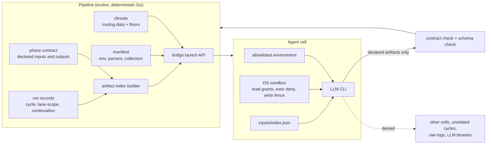
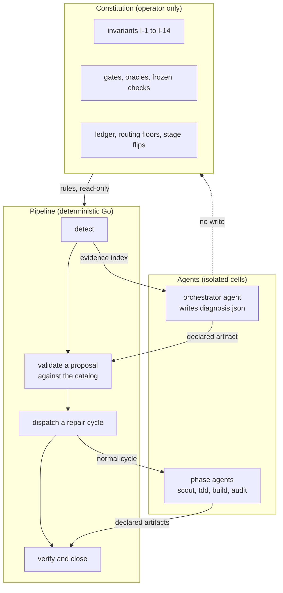

# LLM isolation: the pipeline is the only controller, and each agent runs in a cell

> [ADR-0154](adr/0154-the-pipeline-is-the-only-controller-and-each-agent-is-an-isolated-replaceable-worker.md) · [ADR-0155](adr/0155-the-loop-heals-itself-inside-its-boundaries-an-agent-proposes-and-the-pipeline-disposes.md) · [ADR-0156](adr/0156-the-cli-is-the-service-interface-and-the-pipeline-reads-no-ambient-control-flags.md) ·
> plan: [llm-isolation-2026-10](../plans/llm-isolation-2026-10.md). Research: [llm-isolation-2026-10](../research/llm-isolation-2026-10.md) (F1.0 to F1.12, F3.1 to F3.6, P2.1 to P2.7, P3.1 to P3.5, F4.1 to F5.6, P4.1 to P4.6, R1 to R19).
> This file is the spec of record for the agent cell. It covers the environment, the launch path, the reads and writes and the outputs of a cell. It also covers the routing data that picks the family, and the proof that any family can fill the cell.
>
> The plan holds the components X1 to X19 and their order. The ADRs hold the decisions. [cli-contract.md](cli-contract.md) is the spec of record for the verbs of I-15. The Signal Center contract reuses the shape of [llm-quality-indexes.md](llm-quality-indexes.md) §5.
>
> Status: proposed (ADR-0154, ADR-0155, ADR-0156), 2026-10-25. Each name in this file that does not exist on `main` is marked "proposed".
>
> Component state on 2026-10-26 (the plan §6.1 has the full table):
> - X1: merged in #1121. The conformance matrix of §14 and the module, kind, codes and channel of §15 are on `main`. The follow-up X1b (#1128) adds a fake `tmux` (`go/internal/faketmux`), so the rows M2 to M4 run a full cycle and are green.
> - X2: merged in #1122 at stage `shadow` (the policy key `isolation.i2.stage`). The flip to `enforce` is an operator decision.
> - X3: merged in #1127. The single launch API of §5.1 and its AST guard `TestOnlyTheBridgeStartsAnLLMBinary` are on `main`, and matrix row N2 is green.
> - X4: merged in #1126, and the dispatch credential of I-3 merged in #1132. The request channel of §7.2.1 (item `isolation-dispatch-request-channel`) is built at stage `shadow`.
> - X5: merged in #1133 at stage `shadow` (the policy key `isolation.i5.stage`).
> - X6: merged in #1123. The routing data of §10 is on `main`: `cli_routing.floors`, with the compiled default in `go/internal/policy/routing_defaults.json`. The follow-up X6b (item `isolation-floor-profiles-allowed-clis-as-routing-data`) moves the `allowed_clis` pins of 7 profiles.
> - X7: merged in #1135 at stage `shadow` (the policy key `isolation.i7.stage`). The sandbox holds the protected write rule for each family, `guard phase` follows §7.2 for `Agent` and `Task`, and rows N10 and N11 are green (§9.1).
> - X8: merged in #1131.
> - X10: built in this change. `AGENTS.md` is the one source. `evolve skills generate` renders its digest into `CLAUDE.md` and `GEMINI.md`, and the four `.claude/agents` reviewers from their neutral personas (§13).
> - X9: built in this change. The manifest fields of §11 pick the parsers, the collectors and the transcript format, and row N14 is green (§11.1).
> - X11 to X19: not started, except the parts that the plan §6.1 lists as merged.

## Table of contents

1. [Reading guide](#1-reading-guide)
2. [Glossary](#2-glossary)
3. [Goals](#3-goals)
4. [The agent cell](#4-the-agent-cell)
5. [Single launcher](#5-single-launcher)
6. [Hermetic environment](#6-hermetic-environment)
7. [No nested agency](#7-no-nested-agency)
8. [The artifact index](#8-the-artifact-index)
9. [Sandbox rules](#9-sandbox-rules)
10. [Routing data](#10-routing-data)
11. [Manifest fields](#11-manifest-fields)
12. [Typed flow decisions](#12-typed-flow-decisions)
13. [Instruction files and the console seat](#13-instruction-files-and-the-console-seat)
14. [Conformance matrix](#14-conformance-matrix)
15. [The Signal Center contract](#15-the-signal-center-contract)
16. [Operator runbook](#16-operator-runbook)
17. [Self-healing within boundaries](#17-self-healing-within-boundaries) (Part II)
18. [The self-healing loop](#18-the-self-healing-loop)
19. [The action catalog](#19-the-action-catalog)
20. [Surface tiers and the gate classifier](#20-surface-tiers-and-the-gate-classifier)
21. [No agent writes its own oracle (I-11)](#21-no-agent-writes-its-own-oracle-i-11)
22. [Close an incident with evidence (I-14)](#22-close-an-incident-with-evidence-i-14)
23. [The blast radius of an accident](#23-the-blast-radius-of-an-accident)
24. [Self-healing signals](#24-self-healing-signals)
25. [Self-healing runbook](#25-self-healing-runbook)
26. [The CLI service contract (X17)](#26-the-cli-service-contract-x17) (Part III)
27. [No ambient control flags (X18)](#27-no-ambient-control-flags-x18)
28. [The CLI-neutral task assignment (X19)](#28-the-cli-neutral-task-assignment-x19)
29. [Guards](#guards)
30. [Limits](#limits)

*Part I: the agent cell (ADR-0154). Part II, from §17: self-healing within boundaries (ADR-0155). Part III, from §26: the CLI service contract and no ambient control flags (ADR-0156).*

## 1. Reading guide

The operator said on 2026-10-25: "the pipeline evo loop itself should the center of invoking all LLM cli by design... There is no dependency between a LLM to control over another LLM directly." And: "the agent should be isolated and let the pipeline to handle the flow and communication. Isolation is the key."

The operator then set the limit of the read rule: "phase agent can read the output / deliverables from previous phases and also when retry and failed recover cycle, those suggestions and improvement recommendations should be accessible when needed (not necessary to be loaded at the beginning)."

The idea in one paragraph: the `evolve` binary hires an LLM CLI for one task. The CLI runs in a cell. The pipeline chooses what the cell gets: a clean environment, an index of the artifacts that it can open, and a sandbox. The cell returns only declared files, and the pipeline checks them. No cell can start, read or talk to another cell. The family of the CLI is data in the routing table, so a policy change can put any family in any seat.

### What changes and what stays

| Stays as it is | Changes |
|---|---|
| The phase order and the state machine in `go/internal/core` | The environment of each child: an allowlist, not the full launcher environment (§6) |
| The phase contracts and the gates | Seven launch paths move behind one bridge API (§5) |
| The ADR-0129 cycle broker for messages | A phase pane gets a depth marker, and the sandbox denies LLM exec (§7) |
| Today's routing values, the Claude floor among them | The reads of a cell: an index of artifacts, not the whole repo and `$HOME` (§8, §9) |
| The deliverables that each phase writes | The floor and the flow defaults move from Go to routing data (§10) |

### A worked example: one retry of the build phase

Item `pass-k-replay-harness` fails its audit in cycle 2101. The pipeline starts cycle 2102 as a retry of the same item. Today and after the change:

| Step | Today | After the change |
|---|---|---|
| Launch | The bridge starts `agy` with the full environment of the loop, `CLAUDECODE=1` among it. | The bridge starts `agy` with the allowlist and the variables of `agy-tmux.json`. |
| What the builder can read | The whole repo, all of `$HOME`, every `.evolve/runs/cycle-*` and each `*-stdout.log`. | Its worktree, `inputs/index.json` and the indexed paths. These are the scout and TDD reports of cycle 2102, and the audit report, retrospective and failure digest of cycle 2101. |
| What it reads at start | Whatever the persona names. | Only the index. It opens `cycle-2101/retrospective-report.md` when it needs the lesson. |
| A try to read cycle 1990 | It works. | The sandbox denies it. In `shadow`, the pipeline emits `ISOLATION_I5_VIOLATION` and lets it pass. |
| A try to run `claude -p` | It works. | The sandbox denies the exec. The pipeline emits `ISOLATION_I3_VIOLATION`. |
| Output | The builder writes `build-report.md`. | The same. The pipeline checks it against its contract. |

## 2. Glossary

| Term | Meaning in this spec |
|---|---|
| agent | one run of an LLM CLI for one phase or one flow seat |
| cell | the set of limits that the pipeline puts around one agent: environment, reads, writes, exec and outputs |
| seat | a place in the flow that an agent fills: a phase (scout, build, audit) or a flow role (advisor, judge, router) |
| family | the routing family of a CLI: `claude`, `agy`, `agy-claude`, `codex` or `ollama` |
| launcher | the code that starts an LLM binary |
| bridge launch API | the one function set in `go/internal/bridge` that starts an LLM binary (proposed name: `LaunchLLM`) |
| allowlist | the closed list of environment variable names that a child gets |
| artifact | a file that a phase contract declares as an output |
| deliverable | an artifact that a phase writes for later phases: a report, a verdict or a handoff file |
| raw output | the stdout log, the pane capture or the transcript of an agent; never an artifact |
| artifact index | the file `inputs/index.json` that lists each artifact that a cell can open (built by X5, §8.5) |
| lineage | the cycles that share the inbox item id of this cycle, and its retry or recovery chain |
| unrelated cycle | a cycle outside the lineage |
| floor | a routing rule that holds a seat on one family; today, the Claude floor |
| flow seat | a seat that steers the flow: advisor, judge, router, retry adjudicator, failure advisor, triage |
| stage | `shadow` (signal only), then `enforce` (refuse and signal) |
| guard test | the test that fails when an invariant breaks |
| violation | one event in which a cell did a thing that an invariant forbids |
| constitution | the kernel that only the operator changes: invariants, gates, oracles, ledger, floors, stages, the action catalog and its budgets (Part II) |
| incident | a problem that the deterministic detector found and recorded in `.evolve/incidents/` (Part II) |
| orchestrator agent | the isolated worker that diagnoses an incident and proposes one action; it dispatches nothing (Part II) |
| proposal | the action in `diagnosis.json` that the pipeline checks against the catalog (Part II) |
| action catalog | the closed, typed list of repair actions, with preconditions, tier limits and budgets (Part II) |
| tier | T0 kernel, T1 pipeline code or T2 item code: the class of a surface that sets who can repair it (Part II) |
| breaker | a circuit breaker for each incident class that stops repairs after repeated failures (Part II) |

## 3. Goals

The goals come from the plan §3. The order is the order of importance.

| Goal | Measure | Target |
|---|---|---|
| G-A One controller | spawns of an LLM binary outside the bridge launch API, by AST guard | 0 |
| G-B Isolated cells | contract rows for env leak, exec, cross-cycle read and log read | all green |
| G-B2 Knowledge on demand | a retry opens its predecessor's retrospective; an unrelated cycle is denied | both rows green |
| G-C Family-neutral flow | family names in flow logic, by grep guard | 0 outside manifests, routing data and tests |
| G-D Proven substitution | full cycle with each family as the only route | 5 of 5 families |
| G-E Visible state | invariants with a guard test and a signal code | 9 of 9 |

## 4. The agent cell

### Issue

Today a phase agent inherits the environment of the loop and reads the whole repo and `$HOME`. It can start another LLM and read the raw output of earlier agents (F1.1, F1.3, F1.4).

### Gap

Each limit lives in a different place, and seven launch paths skip some of them (F1.2). No one object describes what an agent gets.

### Solution

The cell is that object. The pipeline builds it for each dispatch from four inputs: the routing plan, the manifest of the family, the phase contract and the run records.



The cell has five parts. Each part has its own section and its own invariant.

| Part | Holds | Invariant | Section |
|---|---|---|---|
| Launch | Only the bridge starts the CLI. | I-1 | §5 |
| Environment | An allowlist plus the manifest variables. | I-2 | §6 |
| Exec | No new LLM CLI process and no `evolve` dispatch verb. The subagents of the own harness stay allowed. | I-3 | §7 |
| Reads | The own workspace, the index, the indexed paths, the worktree and the CLI's own files. | I-4, I-5 | §8, §9 |
| Outputs | Declared artifacts that a schema checks. | I-4, I-8 | §12 |

## 5. Single launcher

### Issue

Seven paths start an LLM binary outside `Engine.LaunchArgs` (`go/internal/bridge/launch.go:17`), F1.2. They are doctor, the usage controller, recipe sessions, cli update, the smoke tests, the version inventory and the model queries.

### Gap

The `sysexec` guard (`go/internal/sysexec/command_guard_test.go:19`) checks only that a process starts through `sysexec.Command`. It does not check which package starts an LLM.

### Solution

- The bridge exports one launch API (`bridge.LaunchLLM`). It takes a purpose (`phase`, `probe`, `update`, `smoke`, `inventory`, `modelquery`) and returns the process. Each purpose uses the same environment builder (§6), the same `unset TMUX` step and the same sandbox decision.
- A probe purpose can run without the sandbox only when the manifest says that the probe cannot run inside it. The launcher logs the reason.
- A new AST guard (`TestOnlyTheBridgeStartsAnLLMBinary`) walks each non-test Go file. It has two rules:
  - Outside `internal/bridge`, no call to `sysexec.Command` or `exec.Command` takes a name from the manifest `binary` set. Today three paths break this rule: cli update, the version inventory and the model queries.
  - Inside `internal/bridge`, only the launch API starts an LLM. Today four paths break this rule: doctor, the usage controller (it sets `AllowBypass: true`), the recipe sessions and the smoke tests.

### 5.1 As built (X3)

The launch API is in `go/internal/bridge/launch_llm.go`. It has more than one entry, because an LLM child is a bare process or a tmux pane.

| Entry | Purposes | Callers |
|---|---|---|
| `LaunchLLM(ctx, deps, LLMExec)` | `probe`, `update`, `inventory`, `modelquery` | the doctor (`doctor.go`), the CLI updater (`cliupdate.Exec`), the version inventory (`looppreflight.CLIVersion`), the model queries (`ModelQueryRunner`, which `cmd/evolve` injects into `modelquery`) |
| `launchPane(ctx, purpose, driver, cfg, deps)` | `smoke` | `BootSmokeTest`, `LiveSmokeTest` |
| `Engine.LaunchArgs` and `launchSwept` | `phase` | each phase dispatch |
| `newRecipeDriver` | `probe` | the usage controller, the `/help` and `/model` captures, `RunRecipe` |

Each entry applies the same three steps:

1. The environment comes from `Deps.cellEnv` (§6). `LaunchLLM` uses `probeEnv`, and a pane uses `paneEnv`. At `enforce`, `CLAUDECODE` does not reach a child.
2. The child has no `TMUX` and no `TMUX_PANE`. `LaunchLLM` removes the two names from the environment at each stage. A pane shell sends `unset TMUX TMUX_PANE` (`paneTmuxDetachLine`) before the launch command. The recipe pane sends it too.
3. The sandbox decision follows the purpose. A `phase` or `smoke` pane uses the sandbox wrap of its driver. Each other purpose runs outside the sandbox and logs `[bridge] <purpose> <binary> runs unsandboxed: <reason>`. The reason is the manifest field `probe_unsandboxed_reason`. Each manifest has one (`TestEveryManifestGivesTheReasonItsProbeRunsUnsandboxed`). A binary with no manifest logs `no family manifest names this binary`.

The permission bypass of the CLI has more than one source:

| Source | Grant | Launches |
|---|---|---|
| `launchArgs` (`go/internal/bridge/engine.go:277`) | `--allow-bypass` on each phase dispatch | each phase pane |
| `consensusdispatch.go:299` | `--allow-bypass` on each voter launch | each consensus voter |
| `--allow-bypass` of `evolve bridge launch` (`launch.go`, `parseLaunchArgs`) | the flag of a manual launch; X18d removed the `BRIDGE_ALLOW_BYPASS` environment form | a manual `evolve bridge launch` |
| `launchPurposeConfig` (`launch_llm.go`) | `AllowBypass` on the `Config` | the `probe` and `smoke` purposes |

Thus each phase runs with the permission bypass of its CLI. The permission prompt of the CLI is not the limit of a cell. The limit is the OS sandbox and the cell boundary of I-7. X3 does not change the phase grants.

For a non-phase launch, `launchPurposeConfig` is the only grant, and only the `probe` and `smoke` purposes get it. The usage controller does not set it. The guard sees only a `Config` grant, not the argv flag or the environment variable.

The `probe` purpose must keep the grant. The control capture boots the same REPL as a phase pane. The prompt markers and the auto-responder patterns of each manifest are proven only for the bypass boot. A boot in another permission mode shows other dialogs, for example the plan approval of claude. A live control capture in plan mode must prove that boot before the grant goes. The inbox item `isolation-probe-bypass-plan-mode-proof` tracks that proof.

`LLMExec.Drop` removes names after the manifest defaults. The updater drops the auto-update off switch of its family, so `agy update` does not see `AGY_CLI_DISABLE_AUTO_UPDATE=1`.

The guard `TestOnlyTheBridgeStartsAnLLMBinary` (`go/internal/sysexec/llm_launch_guard_test.go`) parses each non-test file under `cmd`, `internal` and `pkg`. The LLM binaries are `claude`, `agy`, `codex`, `gemini`, `ollama` and each `binary` of the manifests. The guard reports these spawns:

| Rule | Where | Spawn |
|---|---|---|
| Program | each file | a process start with an LLM program. `processStart` lists the process starts. They are the `sysexec` helpers, `os/exec` (also with an alias), `os.StartProcess` and `syscall.Exec`. `syscall.ForkExec`, a `Runner` and each call with the 8 arguments of a `RunFunc` are process starts too. An LLM program is an LLM name literal or a `.Binary` selector. It is also `exec.LookPath` of an LLM program, or a local name that the function set to one of them. |
| Shell | each file | a process start of `sh`, `bash`, `zsh`, `dash` or `tmux` with a string literal that has an LLM word, for example `sh -c "claude -p hi"` or `tmux send-keys … "claude …"` |
| Keys | each file | a `SendKeys` call with a string literal that has an LLM word |
| Research sites | the three files of F1.2 outside the bridge | each process start, with any program |
| Bridge | `internal/bridge`, outside the launch API | a `Runner` call with a program that is not a literal, a `Driver.Launch` call, a `launchCmdLine` call, and each `AllowBypass` grant of `true` |

For the guard, the launch API is the functions `LaunchLLM`, `launchSwept`, `launchPane`, `launchPurposeConfig` and `newRecipeDriver`, and an explicit list of driver functions (`bridgeDriverLaunchFuncs`, as `file:function`). A new function in a driver file is not in the API. The drivers are inside the API, because only the API calls `Driver.Launch`. `TestLLMSpawns_FindsEachSpawnShapeOutsideTheLaunchAPI` pins each rule with a fixture.

Before the change, the guard found 9 spawns on 7 paths:

| Path | Spawns |
|---|---|
| doctor | `doctorDeep`, `doctorVersion` (2 `Runner` calls) |
| usage controller | `ControllerFactory.For` (`AllowBypass: true`) |
| smoke tests | `BootSmokeTest`, `LiveSmokeTest` (`Driver.Launch`), `smokeLaunchConfig` (`AllowBypass = true`) |
| cli update | `cliupdate.Exec` (a `sysexec.RunFunc` call) |
| version inventory | `execVersion` (`sysexec.Command`) |
| model queries | `modelquery.defaultRunner` (`sysexec.Command`) |

After the change, the guard finds 0, and row N2 is green.

Limits:

- The guard follows a program name inside one function and from the constants and variables of its file. Outside a research site, the guard does not find a name from a parameter, a field, a return value, another file or a string build. Any `.Binary` selector counts as an LLM program, so the rule is broad on purpose.
- A `RunFunc` with a number of arguments other than 8 is not found. An example is a `RunFunc` wrapped in a closure with other arguments.
- A shell or keys string is found only when it is a literal. A string from `fmt.Sprintf` or a variable passes.
- The guard finds an `AllowBypass` grant only when its value is the literal `true`. `cfg.AllowBypass = !false` or a grant from a variable passes.
- The subpackages of `internal/bridge` (for example `internal/bridge/recipe`) are outside the bridge for the guard. Only the program rules apply there.
- Each `LaunchLLM` call writes one `[bridge] <purpose> <binary> runs unsandboxed: <reason>` line to the stderr of the process. The loop log thus gets one line for each probe of each CLI at each boundary.
- The recipe sessions do not use the sandbox. The probe reason of the manifest covers them.
- `modelquery` cannot import the bridge, because the bridge imports `modelquery`. Thus `cmd/evolve` injects `bridge.ModelQueryRunner` through `modelquery.UseLauncher`. With no launcher, a model query starts nothing and returns an error.

## 6. Hermetic environment

### Issue

`driverEnv` starts from `os.Environ()` (`go/internal/bridge/driver_common.go:23-32`). A tmux session starts with no `-e` flag (`go/internal/bridge/tmux.go:111`, `:120`). A test pins the inheritance (`go/internal/bridge/process_env_test.go:25-39`).

### Gap

A deny list, like `ipcenv.Scrub` (`go/internal/ipcenv/scrub.go:10`), cannot keep up with new vendor variables. A nested `claude` that inherits `CLAUDECODE` refuses to start or hangs (P2.7).

### Solution

The environment of a child is the union of three closed sets, and nothing else:

| Set | Names | Source |
|---|---|---|
| Base allowlist | `PATH`, `HOME`, `USER`, `LOGNAME`, `SHELL`, `LANG`, `LC_*`, `TERM`, `TMPDIR`, `TMP`, `TEMP`, `TZ` | compiled data in the bridge |
| Manifest passthrough | the names in `env_passthrough` (proposed field, §11), for example a proxy or an auth variable that the CLI needs | the manifest of the family |
| Manifest and pipeline values | `default_env` of the manifest, and the pipeline's own `EVOLVE_*` markers (§7) | the manifest and the launcher |

- `CLAUDECODE`, `CLAUDE_CODE_*`, `GEMINI_*`, `CODEX_HOME` and each other name of the launcher do not reach the child, unless a manifest lists it.
- A tmux session starts on a clean server with an explicit `-e NAME=VALUE` for each variable. The tmux server does not supply a variable.
- In `shadow`, the builder computes both environments. It logs each dropped name once for each wave and emits `ISOLATION_I2_VIOLATION` with the name, not the value. The child still gets today's environment.
- In `enforce`, the child gets only the union.
- `process_env_test.go` flips to assert the allowlist (`TestProcessEnv_IsTheAllowlistPlusTheManifest`).
- The pipeline markers are one named list, `ipcenv.Markers()` (I-16, §27). X2 closed review finding H2 inside the bridge with a list of its own. X18b moved that list into `ipcenv`, so the bridge and the cycle read the same data. `buildCycleEnv` now copies only the `EVOLVE_*` names that `ipcenv.Carried` accepts.

#### 6.1 As built (X2)

The builder is `Deps.cellEnv` in `go/internal/bridge/hermetic_env.go`. Each LLM child of the bridge gets its environment from it. The headless drivers call it through `dispatchEnv`. The tmux and recipe panes call it through `paneEnv`, and the doctor probes through `probeEnv`.

| Item | As built |
|---|---|
| Stage source | the policy key `isolation.i2.stage` (`{"isolation":{"i2":{"stage":"enforce"}}}`), read by `policy.IsolationEnvStage`. `Deps.envStage` reads it from the policy of the project root (`paths.ResolveFromEnv`) when `Deps.EnvStage` is empty, so each bridge entry follows the policy. An explicit `Deps.EnvStage` wins. |
| Stage default | `shadow` (an empty value), resolved by `channel.ResolveStage`. An unknown word is `off`. |
| `off` | today's environment, no signal |
| `shadow` | today's environment, one `ISOLATION_I2_VIOLATION` for each dropped name, `action=logged` |
| `enforce` | the union only, one `ISOLATION_I2_VIOLATION` for each dropped name, `action=refused` |
| Base allowlist | the names of the table above and each `LC_*` name |
| Pipeline markers | the cell part of the marker list, `ipcenv.CellMarkers()` (X18b): `EVOLVE_PROJECT_ROOT`, `EVOLVE_WORKTREE_ROOT`, `EVOLVE_CYCLE_STATE_FILE`, `EVOLVE_TMUX_SOCKET`, the four `EVOLVE_FLEET*` keys, `EVOLVE_DISPATCH_DEPTH` and `EVOLVE_PHASE`. It applies to the launcher and to `Deps.Env`. A gate or bypass name (`EVOLVE_BYPASS_*`, `EVOLVE_SANDBOX*`, `EVOLVE_MSG_TOKEN`, `BRIDGE_*`) never reaches a child at `enforce`. |
| Operator opt-ins | The policy key `bridge.allow_anthropic_base_url` passes `ANTHROPIC_BASE_URL`, and `bridge.allow_openai_api_key` passes `OPENAI_API_KEY` (X18d). So the route that the operator opted into stays the route of the child. Each opt-in that is on emits `CONTROL_BYPASS_USED` at each start of the bridge adapter of a cycle. |
| Excluded always | `EVOLVE_DISPATCH_ID` (the dispatch adds its own tag), and each name that is not a shell identifier |
| Filter | `ipcenv.Keep`, the allowlist twin of the `ipcenv.Scrub` deny list |
| Report once | `Deps.EnvDrops` (`EnvDropLog`) keeps the family and name pairs that it reported. The in-process adapter shares one log for its process. An engine with no log gets its own. |
| Bare execs | `LaunchLLM` (§5.1) gives `probeEnv(bin)` to the doctor, the updater, the version inventory and the model queries. It follows the stage of the policy, with no signal. |

The manifest field `env_passthrough` is built (§11). The parser refuses a name that is not a shell identifier, and it refuses each loop, bridge and credential name, as for `default_env`. So `ANTHROPIC_API_KEY`, `ANTHROPIC_BASE_URL` and `OPENAI_API_KEY` cannot pass through.

Each manifest also lists the proxy names `HTTPS_PROXY`, `HTTP_PROXY`, `NO_PROXY`, `ALL_PROXY` and their lowercase forms.

| Manifest | `env_passthrough` besides the proxies |
|---|---|
| `claude-tmux`, `claude-p` | `CLAUDE_CONFIG_DIR`, `CLAUDE_CODE_OAUTH_TOKEN`, `NODE_EXTRA_CA_CERTS`; Bedrock: `CLAUDE_CODE_USE_BEDROCK`, `AWS_PROFILE`, `AWS_REGION`, `AWS_ACCESS_KEY_ID`, `AWS_SECRET_ACCESS_KEY`, `AWS_SESSION_TOKEN`, `AWS_BEARER_TOKEN_BEDROCK`; Vertex: `CLAUDE_CODE_USE_VERTEX`, `ANTHROPIC_VERTEX_PROJECT_ID`, `CLOUD_ML_REGION`, `GOOGLE_APPLICATION_CREDENTIALS` |
| `codex`, `codex-tmux` | `CODEX_HOME`, `SSL_CERT_FILE` |
| `agy`, `agy-tmux`, `agy-claude-tmux` (from its base) | `XDG_CONFIG_HOME`, `GEMINI_API_KEY`, `GOOGLE_API_KEY`, `GOOGLE_APPLICATION_CREDENTIALS`, `GOOGLE_CLOUD_PROJECT`, `GOOGLE_CLOUD_LOCATION`, `GOOGLE_GENAI_USE_VERTEXAI` |
| `ollama-tmux` | `OLLAMA_HOST`, `OLLAMA_API_KEY` |

At `enforce`, a tmux pane starts through `execTmux.NewSessionEnv`. No value of the cell environment is in an argv:

1. The bridge writes the cell environment to a 0600 script in a new 0700 directory under `TMPDIR` (`writeCellEnvFile`). The script first removes its own directory, then exports each pair and runs `exec /bin/sh`. The open script stays readable to the shell after the removal.
2. The tmux client runs with the base allowlist names and `TMUX_TMPDIR` only, so no passthrough value is in its environment. A server that this client starts has a clean global environment.
3. The pane command is `/bin/sh -c 'exec /usr/bin/env -i TERM="$TERM" /bin/sh <script>'`. tmux runs it with no `default-shell`, so no shell startup file runs. `env -i` clears each variable of the server and the client. `TERM` stays, because tmux sets it from `default-terminal`.
4. The same tmux command sets the session option `@evolve_env` to a fingerprint of the cell environment (`envFingerprint`). It also prints the id of the new session (`-P -F '#{session_id}'`).
5. `NewSessionEnv` returns only after the pane shell has removed the directory (`awaitCellEnvConsumed`). The wait is at most `cellEnvConsumeTimeout` (30 s, the bound of one tmux command). So a kill or a reap after the start finds no file.
6. A failed start removes the directory. It kills a session only by the id that its own `new-session` printed (`createdSessionID`). A start that fails on a duplicate name prints no id, so it kills nothing. It never kills a session that it did not create.
7. Each start first sweeps the stale directories in `TMPDIR` (`sweepStaleCellEnv`). Such a directory is left only when the bridge process dies during a start, for example on a host restart. The sweep removes a directory only when all of these are true:
   - its name starts with `evolve-cellenv-`, and it is a real directory, not a link;
   - it is older than `cellEnvStaleAfter` (10 minutes), which is much longer than a start can take;
   - it holds one regular file, `env`, and that file starts with the line `/bin/rm -rf <the directory>`, which only `writeCellEnvFile` writes. A name match alone never removes a directory.

At `enforce`, a named session that exists before the launch is used again only when its `@evolve_env` matches the fingerprint of this cell (`checkReusedSessionEnv`). Otherwise the launch stops at the safety gate with "env fingerprint mismatch". A session of another cell or another cycle has another environment, so the gate refuses it too. That is the intent.

A controller that cannot start a session in this way refuses the launch. The bridge never falls back to a polluted pane.

The guards are these tests:

- row N1 of the matrix (green, §14.2)
- `TestN1_LauncherClaudeVariablesReachNoSeatAtEnforce`, the bridge-level form of row N1, for all eight manifests
- `TestCellEnv_ShadowKeepsTodaysEnvAndReportsEachDroppedNameWithoutItsValue`
- `TestProcessEnv_IsTheAllowlistPlusTheManifest`
- `TestTmuxBoot_AtEnforceThePaneIsBornWithTheCellEnvOnly`
- the integration tests `TestRealTmux_APollutedServerGivesThePaneOnlyItsEnvPairs` and `TestRealTmux_ASecretValueIsInNoArgvAndNoLeftoverFile`
- the integration tests `TestRealTmux_AKilledSessionLeavesNoEnvFile`, `TestRealTmux_AFailedStartNeverKillsASessionItDidNotCreate` and `TestRealTmux_AFailedStartLeavesNoEnvFile`
- `TestNewSessionEnv_APaneThatNeverReadsItsFileFailsTheStartRemovesTheFileAndKillsOnlyItsOwnSessionID` and `TestSweepStaleCellEnv_RemovesOnlyOldDirsThatCarryTheirOwnBridgeHeader`

Known differences from the design:

- tmux sets `SHELL` in a pane to its `default-shell` option. The name is in the base allowlist, but the value can come from the server option and not from `-e`.
- The pane shell is `/bin/sh`, not the login shell of the operator. A user startup file does not change the cell environment.
- The report is once for each family and name in a process, not once for each wave.
- The values are in the environment of the pane processes, as the CLI needs them. The script file exists only until the pane shell reads it, and `NewSessionEnv` returns only after that. If the bridge process dies during a start, the file stays until the next start sweeps it (step 7).
- Only the in-process adapter wires `Deps.Signals`. The other bridge entries follow the stage but emit no shadow signal.
- With no explicit `Deps.EnvStage`, each child reads `policy.json` once. The project root comes from `Deps.Env`, then the process. A policy that cannot be read or parsed gives a `WARN isolation stage` line, and the stage stays `shadow`.
- `envMap` in `go/cmd/evolve/cmd_bridge.go` feeds only the flag fallback of `parseLaunchArgs`. It does not reach a child, so X2 does not change it.

## 7. No nested agency

### Issue

A phase pane has dispatch depth 0, so the refusal in `evolve agent run` (`go/internal/cli/agentcmd/run.go:93-94`) does not fire. The SBPL profile allows each exec (`go/internal/adapters/sandbox/sandbox.go:149-152`). `EVOLVE_SANDBOX=off` turns the sandbox off for a phase too (F1.3).

### Gap

A Go refusal only works when the marker reaches the pane. A sandbox rule only works when the sandbox is on.

### Solution

1. The launcher sets `EVOLVE_DISPATCH_DEPTH=1` and `EVOLVE_PHASE=<phase>` (proposed) on each phase pane.
2. The existing refusals then fire: `evolve agent run` and the boundary writes. The other dispatch verbs do not read the markers yet (§7.1).
3. The sandbox denies the exec of each manifest `binary` (§9). The rule covers `claude`, `agy`, `codex` and `ollama`. `gemini` has no manifest, so it has no rule (§7.1).
4. Inside a phase, the sandbox opt-out is refused. The host opt-out stays for operator commands outside a phase. Since X18d it is the audited `--sandbox-off=<reason>` parameter, not `EVOLVE_SANDBOX=off`.

#### 7.1 As built (X4)

A worked example: the scout pane of cycle 7 runs `claude --version` from its Bash tool. The pane carries `EVOLVE_DISPATCH_DEPTH=1` and `EVOLVE_PHASE=scout`. At `enforce` the macOS profile denies the exec, and the shell prints `Operation not permitted`. The agent then runs `evolve agent run scout`, and the command stops with "refused inside a phase".

| Item | As built |
|---|---|
| Markers | `ipcenv.DispatchDepthKey` (`EVOLVE_DISPATCH_DEPTH`) and `ipcenv.PhaseKey` (`EVOLVE_PHASE`). `Deps.cellMarkers` sets the depth of the launcher plus 1, and the phase to `cfg.Agent`. |
| Path of the markers | `Deps.cellEnv` adds them to `Deps.Env`, and both names are in `ipcenv.CellMarkers()`. So each stage of §6.1 gives them to the child. A tmux pane and a recipe pane also get them as `export` lines before the launch line. At `shadow` such a pane inherits the environment of the server. |
| Refusals that now fire | `evolve agent run` (`go/internal/cli/agentcmd/run.go:93`) and the boundary writes (`go/cmd/evolve/boundary_write.go:14`). Both read the depth through `subagent.ReadDispatchDepth`, which calls `ipcenv.DispatchDepth`. `subagent run` only checks its depth cap of 3, and `phase`, `loop` and `wave` read no marker. |
| Strength of the markers | advisory. `env -u EVOLVE_DISPATCH_DEPTH -u EVOLVE_PHASE evolve agent run` passes the marker refusal. The dispatch credential (§7.1.1) is the layer that does not depend on the agent. Row N4 now proves that layer. |
| The sandbox opt-out in a phase | `bypass.Check` refuses `--sandbox-off` when `EVOLVE_PHASE` is set or the dispatch depth is more than 0 (X18d). As a second layer, `launchSwept` refuses the launch when the launcher carries `EVOLVE_PHASE` and `Deps.SandboxMode` is `off`. The error is `bridge.ErrSandboxOffInPhase`, the exit code is `ExitSafetyGate`, and the bridge emits `ISOLATION_I3_VIOLATION` with `action=refused` and `rule=sandbox.off.phase`. |
| Why the phase marker and not the depth | A fan-out worker has depth 1 or more, but the pipeline starts it, not an agent. It carries no `EVOLVE_PHASE`, so a host opt-out still works for it. |
| Exec deny set | `Deps.execDenyTargets`. The files: the `binary` of each registered manifest, found on `PATH` (`Deps.LookPath`) and resolved to its real path. The roots: each `install_roots` entry of a manifest (`~/` is the home directory), resolved to its real path when it exists. `claude-p` and `claude-tmux` declare `~/.local/share/claude/versions`, because the native installer keeps each earlier version there. `codex` and `codex-tmux` declare `/opt/homebrew/Caskroom/codex`. `gemini` has no manifest, so it has no rule. |
| Stage source | the policy key `isolation.i3.stage`, read by `policy.IsolationExecStage`. An explicit `Deps.ExecStage` wins. The default is `shadow`. `Deps.envStage` and `Deps.execStage` share `Deps.isolationStage`. |
| SBPL, `enforce` | `(deny process-exec (require-all (literal "<real path>") (require-not (signing-identifier "com.apple.sandbox-exec"))))` for each file and for `/usr/bin/sandbox-exec`, and the same rule with `subpath` for each root |
| SBPL, `shadow` | the same match as `(allow process-exec ... (with report))`. The sandbox writes a report to the system log, and the exec goes through. |
| `bwrap`, `enforce` | `--ro-bind /dev/null <real path>` for each file and `--tmpfs <root>` for each root, after every other bind |
| `bwrap`, `shadow` | no bind. The launcher only resolves the paths. |
| `off` | no exec rule |

Three facts set the form of the SBPL rule. Each was measured on macOS on 2026-10-26 with a stub script:

- A `literal` matches the real path of the file, not the path of a symlink. A deny of `~/.local/bin/claude` does not stop the exec, because that file is a symlink to `~/.local/share/claude/versions/<v>`. So the generator writes the real path.
- `sandbox-exec` applies the profile before it starts the CLI. A plain deny of the real path also stops the launch of the cell. The `signing-identifier` filter matches the process that does the exec. So the first exec, by `sandbox-exec`, goes through, and each later exec, by a shell or by the CLI, is denied.
- A process in the cell can run `sandbox-exec` again with the same profile, and that exec of the CLI then comes from `sandbox-exec`. The deny of `/usr/bin/sandbox-exec` closes this path. A contract row pins it.

The guards are these tests:

- row N3 (`TestAgentSandboxContract`, green on darwin only), the row "exec an older installed version of the claude stub under the install root" and the row "re-enter the profile through sandbox-exec to exec the claude stub"
- `TestAgentSandboxContract_TheLauncherStillStartsTheCLIThatTheCellCannotExec` and `TestAgentSandboxContract_ShadowReportsTheExecAndLetsItRun`
- row N4 (`TestAgentSandboxContract`, green on darwin only): the real `evolve` binary in the cell runs `env -u EVOLVE_DISPATCH_DEPTH -u EVOLVE_PHASE evolve agent run` at `enforce`. It exits 3, and the text names the dispatch credential (§7.1.1).
- the marker check of the M1 run of the matrix: a stub in the phase pane runs the real `evolve agent run`. It records the exit code 2 and the text "refused inside a phase".
- `TestCellEnv_EachStageGivesTheChildTheDepthAndPhaseMarkers`, `TestLaunchSwept_RefusesSandboxOffInsideAPhaseWithANamedErrorAndASignal`
- `TestSandboxWrap_EnforceDeniesTheRealPathOfEachManifestBinaryOnMacOS`, `TestSandboxWrap_EnforceMasksEachOtherFamilyBinaryOnLinux` and `TestSandboxWrap_EnforceDeniesEveryInstalledVersionUnderTheManifestInstallRoot`

Known differences from the design:

- At `shadow` no Go code emits `ISOLATION_I3_VIOLATION` for an exec. The report stays in the system log of macOS, and Linux has no report. A reader of the sandbox reports does not exist yet. X5 needs the same reader for I4 and I5.
- On Linux the bind of `/dev/null` also hides the file from the launch of the cell. So `bwrap` masks the binaries and roots of the other families only, and a cell can still exec its own CLI. This gap is accepted at `shadow`. Item `isolation-linux-own-family-exec` proposes the fix: an exec rule of Landlock or seccomp that the launcher applies after the exec of the CLI. A bind of the CLI to a private path does not close the gap, because the private path stays reachable.
- The deny is best effort. The launcher finds each binary on its own `PATH`. A copy of a CLI at another path in the cell has no rule.
- The macOS form depends on a measured behavior of `signing-identifier`: the filter matches the process that does the exec. A macOS update can change it. `TestAgentSandboxContract_TheLauncherStillStartsTheCLIThatTheCellCannotExec` fails first in that case.
- A root covers each version that the installer keeps. A CLI without a declared root has one literal. A version that is installed during the run gets its rule at the next launch.
- A copy of `/usr/bin/sandbox-exec` does not run. On Darwin 27 the kernel kills a copied Apple platform binary with `Killed: 9` (exit 137), in the cell and outside it (review of #1126, 2026-10-26).
- Two gaps stay open, because a rule for them also blocks the `go test` binaries in `/tmp`. A CLI that an interpreter runs, for example `node gemini.js`, is not an exec of the CLI file. A binary that the agent copies into the worktree or `/tmp` has no rule.
- Before the flip to `enforce`: the deny of `/usr/bin/sandbox-exec` breaks a CLI that uses its own Seatbelt for its tool calls. Examples are Claude Code with its sandbox setting on, and codex without `--yolo`. Of the claude and codex manifests, only `claude-tmux` and `codex-tmux` pass `--dangerously-skip-permissions` and `--yolo`. The agy drivers pass `--dangerously-skip-permissions` too. The headless `claude-p` and `codex` drivers do not, so the deny puts them at risk at `enforce`.
- A CLI can also exec its own binary for a helper. The `shadow` reports must show no such exec before the flip.
- The marker refusals depend on the environment. An agent that unsets the markers avoids them. The exec deny and the dispatch credential (§7.1.1) are the guards that do not depend on the agent.
- The marker refusal of `evolve agent run` emits no signal. The credential refusal emits `ISOLATION_I3_VIOLATION` (§7.1.1).

#### 7.1.1 The dispatch credential (as built)

The markers are advice. An agent can unset them, and then `evolve agent run` dispatches (review of #1126, 2026-10-26). The sandbox cannot deny the `evolve` binary, because the profiles run `evolve phase verify`. So a dispatch verb now needs a capability that a cell never holds: the dispatch credential.

A worked example: the scout pane of cycle 7 runs `env -u EVOLVE_DISPATCH_DEPTH -u EVOLVE_PHASE evolve wave next`. The verb opens `~/.evolve/dispatch/held/credential`. At `enforce` the macOS profile denies the read, so the verb exits 3:

```
evolve wave next: refused inside a phase: wave next is class D; it is an operator or boundary verb. This process does not hold the pipeline dispatch credential (dispatch credential: open /Users/op/.evolve/dispatch/held/credential: operation not permitted), and a phase cell never holds it.
```

| Item | As built |
|---|---|
| The credential | `go/internal/dispatchcred`. A 0600 file `held/credential` with 32 random bytes in hex, in a 0700 directory. The writer makes a temporary file and links it to the name, so a reader never sees a part of a token. `Store.Hold` opens it with `O_NOFOLLOW` and accepts only a regular 0600 file with a token of this form. The check is a read: the token value is not compared. |
| The location | `~/.evolve/dispatch`, where `~` is the home directory of the passwd entry of the uid (`user.LookupId`). It never comes from `HOME`, `EVOLVE_PROJECT_ROOT` or the current directory. A test binary can set the root at link time (`-ldflags -X .../dispatchcred.root=DIR`). |
| The gated verbs | Each verb that is not class A (X17e, [cli-contract.md](cli-contract.md) §4.4). The class table is `go/internal/agentclass`. Each verb that the table does not name is class D, for example `subagent dispatch-parallel`, `compose` and `fanout-dispatch`. `dispatchWith` in `go/cmd/evolve/dispatch_gate.go` checks the class before the verb runs. The loop step of `boundary run` checks again, because it calls the loop in the process (`gatedLoop`). |
| The launch API | `Deps.requireDispatchCredential` (`go/internal/bridge/dispatch_credential.go`) runs in each entry of the X3 launch API (§5.1). The entries are `LaunchLLM`, `launchPane`, `launchSwept` and `newRecipeDriver`. Each LLM launch of the binary passes one of them. So a launch with no credential is refused at `enforce`, from any caller. The refusal is `ErrNoDispatchCredential` with `ExitSafetyGate` and `rule=launch.credential`. The verb gate is the early refusal with the clear message. |
| The denies | `Deps.dispatchCredentialDeny` in `go/internal/bridge/dispatch_credential.go`. At each sandboxed launch at `shadow` or `enforce`, the launcher writes the credential and the stage. It denies the read of `held/`: SBPL `deny file-read*`, and `bwrap` `--tmpfs`, `--chmod 000` and `--remount-ro`. |
| The write denies | The parent of the store (`~/.evolve`) goes to `DenyPaths`, and each higher ancestor goes to `DenyLiterals`. So a cell cannot write the stage or a credential. It also cannot rename an ancestor or swap in a symlink for it (review of #1132, round 2). If `Ensure` fails, the launcher keeps each deny and writes a WARN line. |
| The stage | the policy key `isolation.i3.stage`, the same stage as the exec deny, read from a file that the cell cannot change. The launcher writes it to `~/.evolve/dispatch/stage`, outside `held/`. A missing file is `shadow`. When the credential read is denied (`EPERM` or `EACCES`), a missing file is `enforce`. Only a launch makes a cell, and the launch writes the stage. A file that cannot be read, or a word that is not `off`, `shadow` or `enforce`, is `enforce`. |
| `off` | no deny, no store write and no check |
| `shadow` | The cell cannot read the credential. The verb emits `ISOLATION_I3_VIOLATION` with `action=logged` and runs. |
| `enforce` | The verb emits `ISOLATION_I3_VIOLATION` with `action=refused` and exits 3. A class R refusal names the request path of its kind, for example `.evolve/runs/cycle-<N>/requests/dispatch-<n>.json`. The request channel of §7.2.1 reads that file. |
| The signal | `rule=verb.class.r` or `verb.class.d`, `target` is the verb, `source=dispatch-credential` (cli-contract.md §4.5). The verb publishes it under the events role `dispatch`, and it goes to the stderr of the verb, which the pane captures. |
| The hermetic env | No environment name carries the credential or its path. So X2 cannot pass it to a child (§6.1). |

How the operator and the pipeline hold the credential:

- **The operator.** The shell of the operator runs outside a cell, so it can read the file. If the file does not exist, the first gated verb writes it. The operator does no setup.
- **The pipeline.** `evolve loop`, `wave next` and the fan-out of `subagent dispatch-parallel` run outside a cell. The bridge writes the file before it wraps a cell, so each cell finds it and cannot read it.

| Id | Decision | Because | Rejected options and why |
|---|---|---|---|
| D1 | A file in a fixed per-user directory, found through the passwd entry | A cell can set `HOME`, `EVOLVE_PROJECT_ROOT` and its current directory. A path from any of them points the check at a file that the cell writes. | A path under the project `.evolve`: the project root comes from the environment. A token in the environment: X2 is an allowlist, but the cell can set any variable for its own child. A unix socket of the plane: a separate daemon for one check, and the same path question. |
| D2 | The first gated verb of the operator writes a missing file | The operator experience stays the same. A cell cannot write the file: the profile gives no write grant under `~/.evolve`, and `bwrap` mounts `held/` read-only. | `evolve loop` writes it only: the first `evolve agent run` on a new host then refuses. |
| D3 | The launcher writes the stage next to the credential | The cell reads the stage from a file that it cannot change. | The policy of the project root: a cell can point the root at a policy with no stage, which is `shadow`. |
| D4 | The verb gate covers each command that starts a dispatch, and the launch API checks each LLM launch | A verb gate alone misses an in-process caller (`boundary run` called the loop directly, review of #1132). The launch API is the one place where each LLM launch passes (X3). X17e replaced the list of gated verbs with the class table, so a new command is class D. The table lists the hooks of the cell (`guard`, `postedit-validate`) as class A. | A list of gated verbs (the design of #1132): a new verb that changes shared state is open until someone adds it. |

Known differences from the design:

- The verb gate and the launch check are checks of the shipped binary. A cell that runs its own `evolve` binary, built from the source or an older one, has neither. The exec deny of §7.1 and the write scope of §9 are then the backstops. For each in-process path of the shipped binary, the launch check is the backstop of the verb gate.
- A cell outside a sandbox can read the credential, so the gate passes. This is the same limit as each sandbox rule: `--sandbox-off` for a host run, and an unsupported host.
- In a cell the violation signal reaches stderr only. A cell cannot write `.evolve/events` (§9), and the verb does not know its cycle.
- A credential with the wrong mode or content refuses each gated verb of the operator at `enforce`. The operator removes `~/.evolve/dispatch/held/credential`, and the next verb writes a new one.
- A launch with no `Deps.Signals`, for example `ModelQueryRunner`, the CLI updater and the version inventory, emits no shadow signal. At `enforce` it is still refused.
- A host where the passwd lookup fails has no store. The launcher then adds no deny, and each gated verb reports the cause as at `shadow` and never refuses.
- Each process of the uid outside a cell holds the credential. The boundary is the cell, not the user.
- On a host with several projects, the stage file holds the stage of the last sandboxed launch.
- The row N4 runs on darwin only. The `bwrap` mask has a unit test (`TestSandboxWrap_TheCellCannotReadTheDispatchCredentialOnLinux`), not a contract row.
- X17e checks each R and D verb at the same verb gate (cli-contract.md §4.4). A command that execs an LLM only through the launch API (`doctor`, `cli`, `clihealth`, `cli-routing`, `models`, `setup`, `practice`, `release-verify-clis`) is refused by the launch check.

The guards are these tests:

- row N4 and the rows "evolve phase scout", "evolve subagent run", "evolve loop" and "evolve wave next with the env markers stripped is refused at enforce", and the rows "read the dispatch credential", "turn the dispatch stage off", "plant a dispatch credential" "rename an ancestor of the dispatch store under a writable home" and "swap a symlink to a store of its own in for an ancestor of the dispatch store" (`TestAgentSandboxContract`)
- `TestLaunchAPI_EachEntryRefusesALaunchWithNoDispatchCredentialAtEnforce`, `TestAgentClasses_EachVerbThatAPersonaRunsIsAOrR` and `TestAgentClass_EveryVerbOfTheTableIsGatedByItsClass`
- `TestAgentSandboxContract_TheHostHoldsTheCredentialThatTheCellCannotRead`
- `TestDispatchVerbs_RefuseWithoutTheDispatchCredential`, `TestDispatchVerbs_ShadowReportsAndRuns` and `TestAgentClass_AnAVerbInACellRunsAsOutsideACell`
- the rows "X17e: evolve inbox add (class R) in a cell is refused at enforce" and "X17e: evolve inbox claim (class D) in a cell is refused at enforce" (`TestAgentSandboxContract`)
- `TestSandboxWrap_TheCellCannotReadTheDispatchCredentialOnMacOS` and `TestSandboxWrap_TheCellCannotReadTheDispatchCredentialOnLinux`
- `TestDefault_IsUnderThePasswdHomeAndIgnoresHOME` and `TestStore_HoldRefusesAForgedOrMaskedCredential`

#### 7.2 The boundary of I-3 (operator, 2026-10-26)

The operator refined I-3 two times on 2026-10-26:

> "agent can spawn its own subagent inside it's LLM cli within it's phase but if it was to spawn other phase agent, it must send the request back to the evo loop for orchestrator to justify if it is the reasonable request."

> "the same phase agent is allowed to spawn any type of subagent based on its needs within it's family (e.g. opus can decide if it want to spawn haiku for research or simple tasks), it depends on its harness design, the evo loop just need to set the right boundary for it's execution."

The boundary is the cell around the CLI process that the bridge starts. The harness of the CLI decides what runs inside the process. The pipeline decides the limits of the cell.

| Action of the agent | Rule | Why |
|---|---|---|
| Start a subagent of its own harness, of any type and any model of the same family. It runs in the own CLI process, with no new exec of an LLM binary. Examples: an Opus seat starts a Haiku Task subagent of Claude Code for research, or another CLI uses its own feature. | allow | The harness chooses the subagent and its model. The subagent runs inside the cell, so the limits of the cell apply to it. |
| Start a new LLM CLI process of any family, its own family too | deny | A new CLI is a new agent outside the control of the pipeline. The exec deny of §7.1 stops it at `enforce` on macOS. On Linux the own family stays open (§7.1), and at `shadow` the exec is only reported. |
| Run `evolve agent run` | deny | The phase markers make it refuse, and the dispatch credential makes the refusal hold when the agent unsets them (§7.1.1). |
| Run another `evolve` dispatch verb: `phase <name>`, `subagent run`, `loop`, `wave next`, `cycle run`, `boundary run`, `bridge launch`, `compose` and the others of §7.1.1 | deny | The cell cannot read the dispatch credential, so the verb refuses at `enforce`. Each LLM launch of the binary checks the credential too (§7.1.1). |
| Ask for another phase agent | request | The agent writes a dispatch request. The pipeline checks it, and the orchestrator judges it. |

The pipeline does not choose or limit the model of an in-harness subagent. The "always the latest model" routing rule ([model-discovery-and-catalog.md](model-discovery-and-catalog.md)) governs the model that the pipeline assigns to a seat. It does not govern the internal choices of a harness.

The pipeline enforces the boundary of the cell, and each in-harness subagent runs inside it:

- the read and write scope of the sandbox (§9);
- the input index (§8);
- the exec denies: no new LLM CLI process and no `evolve` dispatch (§7.1);
- the network policy (§9);
- the time budget of the seat, and a token budget (the token cap is proposed);
- the telemetry of the dispatch.

How an in-harness subagent counts:

- **Budget.** The usage of the subagent is usage of the CLI process, so it counts against the budget of the cell. The artifact timeout of the dispatch covers its time. A token cap for each seat is proposed.
- **Telemetry.** The bridge records one dispatch for the CLI. A subagent gets no own dispatch record.
- **Usage collector.** Each manifest usage collector must count the token usage of the subagents of the harness, or flag it as not counted. This is a requirement on the `collectors` field of X9 (§11, proposed).
- **Manifest.** Each family manifest declares the capability `inprocess_subagents` when its harness can run subagents in its own process. As built, `claude-p` and `claude-tmux` declare it (§7.2.1). The rule "a profile cannot ask for subagents on a family without the capability" is proposed: no check reads the capability yet.

The dispatch request (built by item `isolation-dispatch-request-channel`, §7.2.1):

1. The agent writes a typed request, a declared output such as `requests/dispatch-<n>.json`. It names the target role, the reason, the inputs and the expected output.
2. The pipeline validates the request in Go: the schema, the allowed roles and two caps.
   - The caps are the number of requests for each cycle and the depth of a chain of requests.
   - The proposed policy key `isolation.dispatch_requests` holds them.
3. The orchestrator agent of [ADR-0155](adr/0155-the-loop-heals-itself-inside-its-boundaries-an-agent-proposes-and-the-pipeline-disposes.md) judges if the request is reasonable. The catalog of §19 gets a new action, "dispatch phase agent" (ADR-0155, amended 2026-10-26).
4. If the request is approved, the pipeline dispatches the agent. The result goes into the lineage index of the requester (§8).
5. A refused request gets a recorded reason. The requesting agent never dispatches an agent itself.

#### 7.2.1 The request channel (as built)

A worked example. The build agent of cycle 7 needs the suspect files of a failure. It cannot run `evolve agent run fault-localization`: the verb is class R, and a cell has no dispatch credential (§7.1.1). The refusal names the request path. The agent writes `.evolve/runs/cycle-7/requests/dispatch-1.json`:

```json
{"schema":"evolve.request/1","kind":"dispatch","what":{"verb":"agent run","args":{"role":"fault-localization"}},
 "why":"The build fails in a parser that the scout report does not name.","inputs":["build-report.md"],
 "expected_output":{"artifact":"the suspect files of the failure"}}
```

1. The build phase ends. Before the dispatch returns, `cycleRun.handoffRequests` gives the cell to the channel (`go/internal/core/request_handoff.go`).
2. `agentrequest.Channel.Handoff` reads `requests/dispatch-1.json` and emits `isolation.request`.
3. The validator checks the file in Go, and each check passes:
   - the strict schema and the kind `dispatch`;
   - the role, which is in `isolation.dispatch_requests.roles`;
   - the cycle cap (cycle 7 has fewer than 3 requests) and the depth cap (the depth is 1);
   - the input `build-report.md`, which is a plain file of the workspace.
4. The channel writes the evidence workspace `.evolve/runs/request-7-dispatch-1/`. Entry `q1` is a copy of the request, and entry `i1` is the input. A failure of this write refuses the request with the precondition `evidence`.
5. The seat `selfheal-orchestrator` judges the request through `evolve agent run`. It writes `diagnosis.json` with `incident_id` `dispatch-1` and the action `dispatch-phase-agent`.
6. `phasecontract.ParseDiagnosis` checks the judgement. `selfheal.Validator.Decide` checks the action against the catalog of §19, at tier T2, with the request as validated.
7. At `enforce` the pipeline runs `evolve agent run fault-localization --json --keep --file <ws>/build-report.md`. The record `.evolve/lineage/requests/cycle-7/dispatch-1.json` gets the decision `run`, the run label and the report.
8. The pipeline reads the requests in the kept workspace of that run at depth 2. Then it removes the workspace.
9. The index of the next phase lists the record as a `deliverable` of kind `request` (§8). A retry of the item lists it as a `lineage` entry.

| Item | As built |
|---|---|
| Request file | `requests/<kind>-<n>.json` in the workspace of the cell. The pipeline reads the files in order of the kind and the number. A file with another name is not read. One grammar in `go/internal/agentclass` (`RequestFile`, `ChildRequest`, `ValidRequestName`, `KindDispatch`) gives the file form, the name of a nested request and the name check of the judgement. |
| Schema | `evolve.request/1` (`agentclass.RequestSchema`), parsed by `agentrequest`. An unknown key, trailing data, an empty `why` or no `expected_output.artifact` is a refusal. |
| Kinds | `dispatch` only. The kind in the file name and in the file must be the same. The kinds `inbox-add`, `routing-proposal`, `quality-reading` and `code-refresh` of [cli-contract.md](cli-contract.md) §4.3 are refused with precondition `kind`. Item `cli-agent-tool-surface` adds their executors. |
| Validator | `agentrequest.Channel.check`, in this order: `kind`, `role`, `cycle-cap`, `depth-cap`, `input`. Each input is a clean relative path to a plain file in the workspace of the requester, by the rule of `inputindex.FileEntry`. The same entries go into the evidence index. |
| Policy | `isolation.dispatch_requests`: `stage` (`off`, `shadow`, `enforce`; default `shadow`), `roles` (default `fault-localization`, `premise-challenge`, `dependency-map`), `per_cycle` (default 3) and `max_depth` (default 1). A value of 0 takes the default. `evolve agent capabilities --json` prints the block as `caps.dispatch`. |
| Cycle cap | the number of records of the cycle in `.evolve/lineage/requests/cycle-<N>/`. Each request that the channel reads counts, also a refused one. |
| Depth | A request of a phase agent has depth 1. A request in the workspace of an agent that a request dispatched has the depth of its parent plus 1. Its name is `<parent>.<file>`, for example `dispatch-1.dispatch-1`. |
| Judge | the seat `selfheal-orchestrator` (ADR-0155). Its persona has the section "Judge a dispatch request". `dispatch-phase-agent` approves. Each other action refuses, with `params.reason` or the hypothesis as the reason (precondition `judged`). |
| Catalog | `dispatch-phase-agent` is the seventh action of `selfheal.CatalogActions` and of `phasecontract.DiagnosisActions`. Its tier is T2, and its precondition is `request-validated`: an approval of a request that the validator did not pass is refused. A catalog refusal has the precondition `catalog`, and its reason starts with the word of the catalog, for example `request-validated: ...`. |
| `shadow` | The channel validates, judges and records. The decision is `approved`, and no agent runs. |
| `enforce` | An approved request runs. A failed run gets the decision `failed`. |
| Record | `evolve.request.record/1` in `.evolve/lineage/requests/cycle-<N>/<name>.json`, where no cell can write. The record keeps the `sha256` of the request. A file with a record and the same digest is not read again. A file with a record and another digest is a new request under a used name. The channel refuses it once with the precondition `name`. Its record name is `<name>~<12 hex digits>`. |
| Index | `inputindex.Build` lists each record of the cycle (`deliverable`) and of each lineage cycle (`lineage`), with kind `request`. The summary names the request, the role, the decision and the reason. |
| Signals | `isolation.request` (INFO) for each request that parses. `isolation.request.decision`: INFO for `run` and `approved`, WARN `ISOLATION_REQUEST_REFUSED` for a refusal, WARN `ISOLATION_REQUEST_FAILED` for a failed run. |
| Errors | Three faults are errors: an unreadable `requests/` directory, a corrupt record and a record that cannot be written. Core then prints `[orchestrator] WARN request channel of <phase>`. The cycle goes on. A cancelled cycle reads no further request. The channel removes the kept workspace of each run, also after a failed run or a failed record. |
| Manifest | the capability `inprocess_subagents` (`bridge.CapabilityInprocessSubagents`), declared by `claude-p` and `claude-tmux` |

| Id | Decision | Because | Rejected options and why |
|---|---|---|---|
| RC1 | The channel reads the requests at the end of each phase dispatch, before the next phase. | The next phase then finds the result in its index (cli-contract.md §4.3: "The pipeline reads the requests at the handoff of the phase"). | A pass at the boundary: the requester and the next phases of the cycle never see the result. |
| RC2 | The judge is the seat `selfheal-orchestrator`, and it answers with the diagnosis schema. | ADR-0155 names that seat as the orchestrator agent. The schema, the catalog and the validator of X13 and X14 then check the judgement with no new contract. | A new seat with a new judgement schema: a second profile, persona and routing row for one decision. |
| RC3 | The validator runs before the judge. | A request that fails a Go check costs no LLM launch. | The judge first: a cap or a schema error then costs a launch. |
| RC4 | The record lives in `.evolve/lineage/requests/`. | The repo is read-only for a cell, so a cell cannot forge a decision or a result (§8.5). | The workspace of the cell: the next phase of the cycle can write it. |
| RC5 | A dispatched role runs through `evolve agent run`, which admits only a standalone profile. | `agent run` refuses a built-in phase and a writer with no worktree, so a request cannot start a second build. | A phase runner of the cycle: it reads and writes the cycle state. |

Known differences from the design:

- The kind `dispatch` is the only kind with an executor. The other request kinds of cli-contract.md §4.3 wait for item `cli-agent-tool-surface`.
- A request with the role of a built-in phase, for example `scout`, is refused by `agent run`. The decision is `failed`.
- The judge has the same limit as the diagnosis seat: at `isolation.i5.stage=enforce` it cannot read its evidence workspace (§18.6).
- At `shadow` each valid request costs one launch of the judge.
- A dispatched agent writes its requests into its own kept workspace. The profiles of the default roles have no `Write` tool grant, so a nested request is rare until a profile grants it.
- The signals go to the signal stream. No events channel routes the kinds `isolation.request` and `isolation.request.decision` yet.
- No check reads the capability `inprocess_subagents` yet. Item `isolation-inprocess-subagents-profile-check` adds the reader.
- The evidence workspace of each request stays under `.evolve/runs/` as the record of the judgement, as the evidence of an incident does (§18.6).
- The seats run in the process of the loop through `evolve agent run`, which takes no context. A cancel stops the channel between requests, not during a seat.

The guards are these tests:

- `TestDispatchRequest_AValidRequestIsDispatchedByThePipeline` and `TestAgentRequest_AnApprovedRequestIsRunByThePipeline`
- `TestHandoff_AnUnreasonableRequestIsRefusedWithARecordedReason`
- `TestHandoff_ARequestOfADispatchedAgentIsRefusedPastTheDepthCap` and `TestHandoff_ARequestPastTheCycleCapIsRefused`
- `TestAgentRequest_ADirectAgentRunInACellIsRefusedAndNamesTheFileThatThePipelineReads` and the row "agent run" of `TestDispatchVerbs_RefuseWithoutTheDispatchCredential`
- `TestHandoff_TheValidatorRefusesBeforeTheOrchestratorJudges` and `TestHandoff_TheCatalogDisposesOfTheJudgement`
- `TestHandoff_ANewRequestUnderADecidedNameIsRefusedOnce`, `TestHandoff_ANestedRequestUnderTheDepthCapIsJudgedAndRun` and `TestRequestName_TheFileTheChildAndTheNameShareOneGrammar`
- `TestDispatch_HandsTheRequestsOfTheFinishedPhaseToTheChannel`, `TestWireOrchestratorDeps_RequestChannelWired` and `TestBuild_ListsTheRequestRecordsOfTheCycleAndOfItsLineage`
- `TestManifests_DeclareInProcessSubagentsOnlyForAHarnessThatRunsThem`

## 8. The artifact index

### Issue

The bridge writes each `<agent>-stdout.log` and `-final-pane.txt` into the workspace (`go/internal/bridge/engine.go:341`, `go/internal/bridge/driver_tmux_prepare.go:69`). The sandbox allows reads of the whole repo and `$HOME` (`go/internal/adapters/sandbox/sandbox.go:164-182`). The handoff reviewer makes the next agent answer the asks of the previous agent (`go/internal/core/handoff_reviewer.go:55-71`).

### Gap

A deny of all other reads breaks two needs that the operator named. A phase needs the deliverables of the earlier phases. A retry needs the lessons of its earlier tries, also from other cycles. A preload of all of that fills the prompt with text that the task does not need.

### Solution

The pipeline writes an index. The agent reads the index first and opens an entry only when it needs it. The sandbox grants reads of exactly the indexed paths.

#### 8.1 What the index lists

| Class | Entries | When |
|---|---|---|
| `deliverable` | the declared outputs of the earlier phases of this cycle: `scout-report.md`, the triage decision, `tdd-report.md`, `build-report.md`, `audit-report.md`, `acs-verdict.json`, `handoff-*.json` | each phase after the phase that wrote it |
| `lineage` | for each cycle in the lineage: `retrospective-report.md`, `failure-digest.json`, `carryover-todos.json`, `audit-report.md`, the ADR-0151 recovery document and the lesson YAML files that name the item | a retry or a recovery only |
| `message` | the ADR-0129 mailbox frames for this dispatch | when the broker holds one |
| `context` | the inbox item file and the files that the phase contract names as inputs | each phase |

The index never lists `*-stdout.log`, `*-final-pane.txt`, a transcript or a pane-watch file. These are raw output.

#### 8.2 Lineage

Lineage is the set of cycles that a retry or a recovery can read. The pipeline computes it from its own records, never from agent text.

1. A cycle is in the lineage if its `lane-scope.json` `todo_ids` holds the inbox item id of this cycle.
2. A cycle is in the lineage if the continuation chain (ADR-0076) links it to this cycle.
3. The lineage has a cap: the last `isolation.lineage_max` cycles (proposed policy key, default 5).
4. A lesson YAML under `.evolve/instincts/lessons/` is in the lineage if it names a lineage cycle or the item id.

X5 confirms the exact record that holds the item id of a finished cycle. If the record is absent, the cycle is not in the lineage, and the index says so in its `notes`.

#### 8.3 Format

The file is `<ws>/inputs/index.json` (built by X5, §8.5). The pipeline writes it before the launch. The sandbox makes it read-only for the cell.

```json
{
  "schema": "evolve.inputs.index/1",
  "cycle": 2102,
  "phase": "build",
  "item_id": "pass-k-replay-harness",
  "attempt": 2,
  "lineage": [2101],
  "entries": [
    {
      "id": "d1",
      "class": "deliverable",
      "kind": "scout-report",
      "path": ".evolve/runs/cycle-2102/scout-report.md",
      "cycle": 2102,
      "phase": "scout",
      "attempt": 2,
      "summary": "Scope: replay harness for pass^k; 3 acceptance checks.",
      "bytes": 8123,
      "sha256": "9c1f..."
    },
    {
      "id": "l1",
      "class": "lineage",
      "kind": "retrospective",
      "path": ".evolve/runs/cycle-2101/retrospective-report.md",
      "cycle": 2101,
      "phase": "retro",
      "attempt": 1,
      "summary": "Audit FAIL: the harness wrote to the replay set; add a read-only seam.",
      "bytes": 4410,
      "sha256": "51ab..."
    }
  ],
  "notes": []
}
```

- `summary` is one line. The pipeline takes it from a declared field of the artifact (for example, the first heading or a `summary` key). No LLM writes it.
- `sha256` lets the audit prove which version the agent had.
- The persona reads `inputs/index.json` first. A persona line changes from "read `workspace/scout-report.md`" to "open the `scout-report` entry of `inputs/index.json`".
- The handoff asks go into the index as a `deliverable` of kind `handoff-asks`. The next agent answers them in its own declared artifact. It does not read the raw output of the previous agent.

#### 8.4 Usage reading (optional)

The pipeline can record which entries a cell opened. The source is the sandbox report of allowed reads, so the agent cannot write it (ADR-0153 rule 7). On macOS, an SBPL `(with report)` modifier on the read grants logs each open. Linux `bwrap` has no such log, so the reading is macOS-only.

If X5 builds it, it emits kind `isolation.access` (INFO) with the entry ids. It also adds a proposed panel index "index use" in stage `shadow`: the share of indexed entries that a phase opened. An amendment of ADR-0153 adds the index.

X5 did not build the usage reading. The report reader of §8.5 reads only the guarded rules, not the grants. The grants carry no report, so the reading stays proposed.

The usage reading is built in [cell-context-index.md](cell-context-index.md) §8 (CX3, §13 there). A report on each grant names the path that the cell read. The pipeline maps the path to its entry and writes the access log. The same file adds the context layers L0 to L3, the token estimates, the required flag and the budgets. CX1 to CX3 are built, and CX4 to CX7b are proposed.

#### 8.5 As built (X5)

A worked example. Cycle 7 builds the item `item-a`, and cycle 6 failed on the same item. Before the build launch, the pipeline writes `.evolve/runs/cycle-7/inputs/index.json` with `lineage: [6]` and `attempt: 2`. The index lists the scout report of cycle 7 as a `deliverable`, and the retrospective of cycle 6 as a `lineage` entry.

The cell opens the retrospective of cycle 6. Cycle 9 built `item-b`. A read of the audit report of cycle 9 gets `Operation not permitted` at `enforce`.

| Item | As built |
|---|---|
| Builder | package `inputindex` ([internal-inputindex](packages/internal-inputindex.md)). `Build` reads only pipeline records. |
| Writer | `writeInputIndex` (`go/internal/core/input_index.go`). `cycleRun.dispatch` calls it before the first try of each phase. A failure prints `WARN input index for <phase>`, and the cell gets no index grants. |
| Item id | the fleet scope of the orchestrator (`fleet_scope` of the cycle context). The first dispatch of a run writes it to `.evolve/lineage/cycle-N.json` before the index (`inputindex.WriteRecord`). Each later dispatch of the same run id reads that record (`inputindex.ReadRecord`), and a new run of the cycle number replaces it. No cell can write `.evolve/lineage/`, because the repo is read-only for a cell. With no item id, the index has no lineage and a note. |
| Lineage | each cycle whose record in `.evolve/lineage/` holds an item id of the cycle. Also the cycle of the continuation registry entry of each item id (`continuation.ReadRegistryEntry`). The cap is the last `isolation.lineage_max` cycles, default 5. The `lane-scope.json` of a workspace is never read, because a cell can write its workspace (review of #1133, HIGH-1). |
| Format | as §8.3, with two changes. `item_ids` is a list, because a lane scope can hold more than one id. `attempt` is the number of lineage cycles before the cap, plus 1. |
| Lineage entries | For each lineage cycle: `retrospective-report.md`, `failure-digest.json`, `carryover-todos.json`, `audit-report.md`, `retrospectives/*.md` (ADR-0151) and `failure-lesson*.yaml`. Also each lesson under `.evolve/instincts/lessons/` that names an item id or the `cycle-N` of a lineage cycle. |
| Raw output | `inputindex.IsRawOutput`: a path under `.bridge/`, or a name that ends in `-stdout.log`, `-stderr.log`, `-stdout.clean.txt`, `-final-pane.txt`, `-final-scrollback.txt` or `-pane-watch.json`. The index lists none. |
| Raw logs | stay in the workspace. The sandbox denies the reads and the writes of them by name (§9), so no reader of the logs changes. The write deny stops a rename or a hard link to a name that no rule matches. The same two denies cover `<ws>/.bridge/`. |
| Pinned files | `<ws>/lane-scope.json` gets a write deny (`write.pipeline.file`), as a second guard after the record. |
| Read grants | `Deps.readIsolation` (`go/internal/bridge/read_isolation.go`) gives the sandbox the real path of each indexed path and of the index. |
| Stage source | the policy key `isolation.i5.stage`, read by `policy.IsolationReadStage`. An explicit `Deps.ReadStage` wins. The default is `shadow`. One stage covers the I-4 and the I-5 rules. |
| Shadow signal | each guarded rule carries `(with message "evolve-cell=<dispatch id> rule=<rule> inv=<I4\|I5>")`. After the launch, `Deps.reportReadViolations` reads the reports of the dispatch id with `/usr/bin/log show`. It emits one `ISOLATION_I4_VIOLATION` or `ISOLATION_I5_VIOLATION` for each rule and target, at most 20 for each cell. `action` is `logged` for a reported allow and `refused` for a deny. |
| Handoff asks | each `handoff-*.json` is a `deliverable` of kind `handoff-asks`. The correction of the handoff reviewer names the `handoff-asks` entry of the index. |
| Personas | `agents/agent-templates.md` §"The input index", and the builder, auditor, tdd-engineer, build-planner and retrospective personas open index entries, not fixed workspace paths. |

Three facts set the form of the rules. Each was measured on macOS on 2026-10-26 with `sandbox-exec` and a scratch profile:

- A grant of `file-read*` after a deny of `file-read-data` does not reopen the path. The grant must name `file-read-data` too. So the workspace and index grants name both operations.
- A deny of `file-read-data` keeps the metadata reads. `ls` of the own workspace and a path walk through `.evolve/runs/` still work.
- `(with message "...")` adds its text to the kernel report of the rule. `log show --predicate 'sender == "Sandbox" AND eventMessage CONTAINS "evolve-cell=<id> "'` returns only the reports of one cell. An allowed read logs `allow file-read-data <path>`, and a denied read logs `deny(1) file-read-data <path>`.

The guards are these tests:

- rows N5, N7 and N8 (`TestAgentSandboxContract`, darwin), and the allow row "a retry opens its predecessor's retrospective through inputs/index.json"
- the deny rows for a raw log of the own workspace: a read, a rename and a hard link
- the deny rows for a write of `inputs/index.json`, of `lane-scope.json` and of a record in `.evolve/lineage/`
- the allow row "the Claude OAuth login reads its Keychain item through the security service"
- `TestAgentSandboxContract_AForgedLaneScopeGainsNoGrantAtTheNextDispatch`: a shadow cell forges its `lane-scope.json`, and the next enforce cell still cannot read the unrelated cycle
- `TestDispatch_ALaneScopeThatACellRewroteNeitherNamesTheItemNorJoinsTheLineage` and `TestWriteInputIndex_TheFirstRecordOfTheCycleWinsOverALaterScope`
- `TestAgentSandboxContract_ShadowReportsTheExecAndLetsItRun`: at `shadow` each guarded read goes through
- row N6 (the matrix, M1 run at `isolation.i5.stage=enforce`): a phase index lists the scout report and no raw output
- `TestLineageComesOnlyFromPipelineRecords`, `TestHandoffAsksTravelInTheIndex` and `TestDispatch_TheIndexIsTheOnlyLineageInputAndNoEntryIsPreloadedIntoTheRequest`
- `TestGenerateSBPL_EnforceDeniesOtherRunsSecretsAndRawOutputAndGrantsTheIndex` and `TestBwrapPrefix_EnforceHidesOtherRunsAndRebindsTheOwnWorkspaceAndTheIndex`
- `TestReportReadViolations_EmitsOneSignalForEachGuardedReadOfTheCell`

Known differences from the design:

- The rest of `$HOME` stays readable. The deny of §9 needs the `home_reads` field of each manifest. X9 adds the field, but the sandbox does not read it yet. X5 denies the listed secrets only.
- The CLI transcripts stay readable: `~/.claude/projects/*/*.jsonl` and `~/.gemini`. So a claude cell can read the raw transcript of another cell. Item `isolation-home-transcripts-before-i4-enforce` closes this gap, and I-4 must not go to `enforce` before it.
- A cycle that ran before X5 has no record in `.evolve/lineage/`, so it is in no lineage.
- A source under a symlinked directory, or a file with a second hard link, is not an entry.
- The secret rules cover the secrets that exist at the launch. A secret that the cell makes later has no rule.
- The secret list does not hold the directories of the other families yet.
- Linux has no report. At `shadow` the `bwrap` prefix adds nothing, and no signal comes.
- On Linux, `bwrap` masks the raw files that exist at the launch. A raw log that the bridge makes later is not masked. The SBPL rule matches by name, so macOS has no such gap. The item `isolation-home-transcripts-before-i4-enforce` tracks the Linux gap too.
- A grant is kept only when its real path is inside `.evolve/runs/` and is not raw output. A lesson under `.evolve/instincts/lessons/` gets no grant, because the repo grant already covers it.
- The kernel can merge repeated reports, so the reader sees each rule and target once. The unified log can lag the end of the cell, so the reader waits for a fence report first ([cell-context-index.md](cell-context-index.md) §8). The fence makes a lost report unlikely, but it does not prove its absence. A failed read prints `WARN isolation read reports`.
- Only the phases of a cycle get an index. A flow seat (advisor, judge, router) and an `evolve agent run` launch get no index, so at `enforce` they read only their own workspace inside `.evolve/runs/`.
- The `message` class and the `context` class of §8.1 have no entries yet. Component CX4 of [cell-context-index.md](cell-context-index.md) adds them. The inbox item file and `lane-scope.json` stay readable, because the repo grant covers `.evolve/inbox/` and the workspace grant covers `lane-scope.json`.
- An `evolve` verb that the agent runs inside the cell and that reads other run directories is a violation at `shadow`. The `shadow` signals must show none before the flip to `enforce`.

## 9. Sandbox rules

The sandbox today generates SBPL for `sandbox-exec` and an argv for `bwrap` from one `Config` (`go/internal/adapters/sandbox`). Each new rule below is proposed. Each rule starts in `shadow`: on macOS, the rule is an `(allow ... (with report))` that logs, and on Linux the launcher checks the path before the launch.

| Rule | Effect | SBPL form | `bwrap` form | Invariant | Today |
|---|---|---|---|---|---|
| Exec of LLM binaries | deny | `(deny process-exec (require-all (literal "<real path>") (require-not (signing-identifier "com.apple.sandbox-exec"))))` for each manifest `binary` and `/usr/bin/sandbox-exec`, and the same rule with `subpath` for each `install_roots` entry (§7.1) | `--ro-bind /dev/null <real path>` for each binary and `--tmpfs <root>` for each root, other families only (§7.1) | I-3 | built at `shadow` (X4, §7.1) |
| Exec of other tools | allow | the current `(allow process-exec)` | as today | none | allowed |
| the sandbox opt-out (`--sandbox-off`) in a phase | refuse the launch | Go check | Go check | I-3, I-7 | refused (X4, §7.1) |
| Read of the worktree and the repo source | allow | `(allow file-read* (subpath "<worktree>"))` | `--ro-bind` | none | allowed |
| Read of the own workspace (`.evolve/runs/cycle-N/`), except `<ws>/.bridge/` | allow | `(allow file-read* file-read-data (subpath "<ws>"))` after the runs deny | `--bind <ws> <ws>` after the `tmpfs` | I-5 | built (X5, §8.5) |
| Read of `inputs/index.json` and each indexed path | allow | `(allow file-read* file-read-data (literal "<path>"))` for each entry | `--ro-bind-try <path> <path>` | I-4 | built (X5) |
| Read of other files under `.evolve/runs/` | deny | `(deny file-read-data (subpath ".evolve/runs"))` before the literal grants | `--tmpfs .evolve/runs` | I-5 | built at `shadow` (X5) |
| Read of raw output (`*-stdout.log`, `*-final-pane.txt`; the CLI transcripts in `$HOME` stay open, §8.5 and §11.1) | deny | `(deny file-read-data (require-all (subpath ".evolve/runs") (regex #"(-stdout\.log\|...)$")))` and a deny of `<ws>/.bridge/`, after the grants | `--ro-bind /dev/null <file>` for each raw file of the workspace, `--tmpfs <ws>/.bridge` | I-4 | built at `shadow` (X5); the logs stay in the workspace |
| Read of the CLI's own config in `$HOME` | allow | `(allow file-read* (subpath "~/.<cli dir>"))` from manifest `home_reads` | `--ro-bind` | I-5 | allowed (all of `$HOME`) |
| Read of secrets in `$HOME` | deny | `(deny file-read-data ...)` for `~/.ssh`, `~/.aws`, `~/.gnupg`, `~/.netrc`, `~/.config/gh`, `~/.docker/config.json`, `~/.kube`, and the dirs of the other families | `--tmpfs <dir>`, `--ro-bind /dev/null <file>` | I-5 | built at `shadow` for the listed secrets (X5); not the dirs of the other families |
| Read of the rest of `$HOME` | deny at `enforce` | no grant | not bound | I-5 | allowed |
| Write of the worktree and the own run dir | allow | as today (`go/internal/bridge/sandbox_paths.go:161-201`) | as today | I-7 | allowed |
| Write of another cycle, `.evolve/events/`, `.evolve/resume-witness/` | deny | as today | as today | I-7 | denied |
| Write of a protected path of the worktree or the repo root | deny | `(deny file-write* (subpath "<base>/<dir>"))` for each directory fragment of `guards.ProtectedSurfaceManifest`, `(deny file-write* (prefix "<base>/<file>"))` for each file fragment, after every write grant (§9.1) | `--ro-bind <path> <path>` for each protected path that exists | I-7 | built at `shadow` (X7, §9.1) |
| Write of `inputs/` | deny | `(deny file-write* (subpath "<ws>/inputs"))` | `--ro-bind-try` | I-4 | built at `shadow` (X5) |
| Network | allow | as today | as today | none (a limit) | allowed |
| Signal of a host process | deny | as today | as today | I-7 | denied |

The SBPL rule order matters: a later rule wins. The generator writes the rules in this order:

1. The broad allows of today: the system paths, the repo source and the worktree.
2. The denies: `.evolve/runs/`, the secrets in `$HOME` and the rest of `$HOME`.
3. The grants: the own workspace, the index and its literal paths, and the manifest `home_reads`.
4. The last deny: `<ws>/.bridge/`, so that the workspace grant does not open the raw logs.

A contract row pins the order: a read of an unrelated run after the repo grant is denied. Only secondary sources describe the SBPL syntax (research P2.4), so each rule gets a row in the sandbox contract test that runs on the host.

The macOS Keychain is reached through a system service, not through a file read. The deny of `$HOME` therefore does not stop the Claude OAuth login. X5 proves it with a contract row: the cell reads the item `Claude Code-credentials` of a fixture keychain with `security find-generic-password`.

### 9.1 As built (X7)

Before X7, the four kernel guards were Claude Code PreToolUse hooks only (`.claude/settings.json`, research F1.6). An agy, codex or ollama pane got none of them. X7 puts each guarantee in a layer that does not depend on the CLI. The hooks stay as defence in depth in Claude Code panes.

A worked example: the build pane of an agy cell runs `echo x > go/internal/guards/role.go` in its worktree. At `enforce` the macOS profile denies the write, and the shell prints `Operation not permitted`. A write of `go/internal/feature/x.go` in the same worktree goes through. At `shadow` both writes go through, and the sandbox writes a report of the protected write to the system log.

| Hook guarantee | CLI-neutral layer | Where |
|---|---|---|
| `guard role`: a cycle does not change the control plane | the sandbox denies each write of a protected path (new); the ship tripwire refuses a cycle diff that touches a protected path (exists) | `bridge.Deps.withProtectedWrites`, `sandbox.writeProtectedWriteRules`; `ship.verifyNoControlPlaneEdits` (`go/internal/phases/ship/integrity.go:11`) |
| `guard role`: a phase writes only its workspace and its worktree | the sandbox write grants (exist); the fence of a read-only phase restores each write outside its writable paths (exists) | `go/internal/bridge/sandbox_paths.go`; `go/internal/phases/runner/worktree_fence.go:12` |
| `guard ship`: only `evolve ship` lands a commit | the sandbox grants the write of the own branch ref only, not of `main` (exists); the ship binds the audit to the tree (exists) | `bridge.sandboxGitWritePaths`; `go/internal/phases/ship/` |
| `guard docdelete`: no delete of committed docs | the ship refuses the deletion of a file under `docs/` or `knowledge-base/` (exists) | `ship.refuseCommittedDocDeletion` (`go/internal/phases/ship/committed_doc_guard.go:17`) |
| `guard phase`: a session outside a cell cannot start a phase persona during a cycle | the exec deny of each LLM binary and the cell markers (X4, §7.1); the hook judges `Agent` and `Task` alike (X7, row N11) | `go/internal/guards/phase.go` |
| no global effect: `kill(-1)` from a cell | the SBPL profile grants `signal` only to `(target same-sandbox)` under `(deny default)`; `bwrap` runs the cell with `--unshare-pid` (exist; a contract row pins both, §23) | `go/internal/adapters/sandbox/sandbox.go` |

| Item | As built |
|---|---|
| Protected paths | `bridge.Deps.withProtectedWrites` maps each fragment of `guards.ProtectedSurfaceManifest` onto the real path of the worktree, and at `enforce` also of the repo root. A fragment that ends in `/` is a directory, so it gets `subpath`. Any other fragment is a file prefix, for example `probe_quarantine`, so it gets `prefix`. Thus the role guard and the sandbox read one list. |
| Rule order | At `enforce`, `GenerateSBPL` writes the deny rules last, because a later SBPL rule wins. At `shadow`, it writes the report rules directly after the write grants, so each later deny still wins. The repo root is read-only, so a `shadow` report rule for it can open the root again. Thus `shadow` covers the worktree only. `BwrapPrefix` writes the binds after the worktree bind and before the exec masks. |
| Stage source | the policy key `isolation.i7.stage`, read by `policy.IsolationGuaranteeStage`. An explicit `Deps.GuaranteeStage` wins. The default is `shadow`. |
| SBPL, `enforce` | `(deny file-write* (subpath "<path>"))` and `(deny file-write* (prefix "<path>"))` |
| SBPL, `shadow` | the same match as `(allow file-write* ... (with report))` |
| `bwrap`, `enforce` | `--ro-bind <path> <path>` for each protected directory that exists and for each file that starts with a protected prefix |
| `bwrap`, `shadow` | no bind |
| `off` | no protected rule |

Three facts set the form of the rule. Each was measured on macOS on 2026-10-26 with `sandbox-exec` and a scratch directory:

- `prefix` is a valid SBPL filter. It denies `probe_quarantine.go` and allows `other.go` in the same directory.
- A `subpath` deny of a directory also denies a rename of the directory itself.
- The match is on the resolved path. A write of `GO/internal/guards/role.go` on a case-insensitive volume is denied by the rule for `go/internal/guards`.

The guards are these tests:

- row N10, `TestAgentSandboxContract_N10_AnAgyPaneCannotWriteAProtectedPath` (darwin, build tag `integration`): an `agy-tmux` cell writes three protected paths and gets `Operation not permitted` for each. It still writes `go/internal/guards2/x.go`, a sibling of a protected directory.
- row N11, `TestIsolationMatrix_N11_GuardPhaseAllowsAnInCellTaskAndDeniesAnOutOfCellPhasePersonaTask`: a `Task` inside a cell passes, and a phase-persona `Task` outside a cell during a cycle is denied. A revert of either branch fails the row.
- `TestSandboxContract_KillMinusOneFromACellReachesNoHostProcess`: it reads the generated profiles and runs no signal (§23)
- `TestWithProtectedWrites_EnforceDeniesEachManifestFragmentUnderEachBase`, `TestSandboxWrap_TheProtectedRulesNameTheRealPathsOfASymlinkedWorktreeAndTheRoot`, `TestGenerateSBPL_EnforceDeniesEachProtectedPathAfterTheWorktreeGrant` and `TestBwrapPrefix_EnforceBindsEachProtectedPathReadOnlyBeforeTheExecMasks`

Known differences from the design:

- At `shadow` no Go code emits `ISOLATION_I7_VIOLATION`. The report stays in the system log of macOS. The reader of the sandbox reports that X4 and X5 need is also the reader for I-7.
- A rename of a parent directory of a protected path, for example `mv go/internal x`, is not denied. The ship tripwire lists each old path of the rename, so the cycle cannot ship it.
- On Linux a protected path that does not exist at the launch gets no bind, because `bwrap` binds only a path that exists. A new file with a protected prefix also gets no bind. The ship tripwire refuses each such file.
- `guard phase` follows §7.2:
  - Inside a cell (`EVOLVE_PHASE` set by the launcher), each `Agent` and `Task` call passes. A phase agent can start any subagent of its own harness.
  - Outside a cell, during a cycle, the hook denies a call whose `subagent_type` names a phase persona. A phase persona is `evolve-*`, with or without a plugin prefix. Thus the console or an operator session cannot act as a phase. A generic subagent passes.
  - The marker is advisory, because an agent can set or unset it. That is acceptable, because the hook is defence in depth. The cell boundary (sandbox, exec deny, dispatch credential) is the limit.

## 10. Routing data

### Issue

Before X6 (#1123), the Claude floor was a Go map (`go/internal/profiles/family_floor.go:5-12`), and the compiler refused a table without `claude` (`go/internal/cliroute/compile.go:126-127`). About 15 flow defaults named `claude-tmux` or `opus` in Go (F1.5), and the bare name `gemini` mapped to `claude-tmux`. X6 moved both to data or retired them.

### Gap

A policy change cannot move these seats, so the matrix of §14 cannot pass.

### Solution

The floor becomes the `floors` key of `cli_routing` (built in X6, #1123). Its value today is the Claude floor, so the behavior does not change.

```json
{
  "cli_routing": {
    "clis": ["agy", "agy-claude", "claude"],
    "default": ["agy", "agy-claude", "claude"],
    "floors": {
      "claude": ["auditor", "adversarial-review", "tdd-engineer", "spec-verifier", "spec-verify", "code-reviewer"]
    },
    "agents": {
      "phase-advisor": { "chain": ["claude"], "model": "deep" },
      "failure-advisor": { "chain": ["claude"], "model": "deep" },
      "plan-judge": { "chain": ["claude"], "model": "fast" },
      "router": { "chain": ["claude"], "model": "deep" },
      "contract-escalation": { "chain": ["claude"] },
      "postmortem": { "chain": ["claude"] },
      "observer": { "chain": ["claude"] }
    }
  }
}
```

- The shape of the `agents` entries follows the existing `cli_routing` schema ([internal-policy.md](packages/internal-policy.md)). The example shows intent, not the final keys.
- When the policy has no `floors` key, the compiled default is the same map, held in an embedded data file, not in a Go map.
- The compile check "`clis` must contain `claude`" becomes "`clis` must hold each family that a floor names".
- The flow seats resolve through `cliroute` as named agents. Each default chain equals today's value: `claude-tmux` with `opus`, or `haiku` for the plan judge.
- The phase default model becomes a tier word (`deep`), and the manifest maps it to a model.
- The bare name `gemini` becomes an error that names the `agy` drivers.
- A grep guard (proposed `TestFlowCodeNamesNoFamily`) checks each non-test Go file. It fails when flow code names a family as a string. The manifests, the bridge drivers and the routing data are exempt.
- `evolve cli-routing explain <agent>` prints the same chain for each agent before and after X6. X6 records both outputs in its PR.
- X6 alone does not make an agy-only table compile. 7 tracked profiles still set `allowed_clis` to Claude families: `auditor`, `adversarial-review`, `tdd-engineer`, `spec-verifier`, `spec-verify` and `code-reviewer` set `["claude"]`, and `router` sets `["agy-claude", "claude"]` (`.evolve/profiles/*.json`). The follow-up X6b (item `isolation-floor-profiles-allowed-clis-as-routing-data`) moves these pins into the `floors` data, so that the matrix rows M2 and M3 can pass.

### Status of X6

X6 is built. These parts landed:

| Part | Where it is now | Proof |
|---|---|---|
| The floor | `cli_routing.floors` in `.evolve/policy.json`, written with `evolve cli-routing set floors.claude ...`; the compiled default is `go/internal/policy/routing_defaults.json` | `TestCheckedInPolicy_StrictDecodesWithTheFloorsKey`, `TestCompile_AnEmptyFloorsKeyLetsATableWithoutClaudeRoute` |
| The five floor checks | `cliroute` (`table.go`, `compile.go`, `findings.go`), `routing_run.go` and `bridge/model_failover.go` read `Policy.Floors()` | `TestCompile_EachFloorFamilyMustBeListedAndKnown`, `TestLaunch_TheDeclaredFloorsDecideWhichFallbackModelsASeatKeeps` |
| The flow defaults | the `seats` of `routing_defaults.json`, read by `policy.SeatDefault`; the phase default models are the tier word `deep` | `TestSeatDefault_EverySeatHoldsTodaysValue` |
| The alias | `bridge.DriverFor("gemini")` is an error that names the agy drivers | `TestDriverFor_TheBareNameGeminiIsAnErrorThatNamesTheAgyDrivers` |
| The grep guard | `TestFlowCodeNamesNoFamily` (`internal/guards`), with an exempt list of the drivers, the routing data and the CLI install and probe code | the guard itself |
| No route changed | `TestCLIRoutingShow_EveryShippedProfileKeepsItsResolvedRoute`; `cli-routing explain` printed the same text for every tracked profile before and after | the golden file |

These parts stay open:

- The seat defaults are compiled data, not policy keys. A policy cannot move the advisor seat yet. The router and the failure advisor already resolve through `cliroute` with their profiles; the seat default applies only when that route fails.
- Row N13 is green. Rows M2 to M4 stayed open on the next gap, the tmux REPL fake of the harness. X1b (inbox item `isolation-matrix-tmux-repl-fake`) closes that gap, and the rows are green. Row M5 stays open on its tool capability (X19c, §11.1).
- The tracked profiles of the floor agents and the router set `allowed_clis` to Claude families. Thus an agy-only table over the tracked profiles still refuses seven agents, even with `floors: {}`. The matrix uses its own profiles, so this limit does not show there. Inbox item `isolation-floor-profiles-allowed-clis-as-routing-data` owns it.
- A `--bypass-policy` run ignores the declared table, `floors` included, so it keeps the compiled Claude floor. This is fail-closed (`TestBuild_ABypassRunKeepsTheCompiledFloorEvenWhenThePolicyDeclaresNone`).
- `TestFlowCodeNamesNoFamily` matches exact string literals only. A built string (`"claude-" + x`), a prefix test, a name outside its list and a file in an exempt home pass it. Non-Go data is not scanned.

## 11. Manifest fields

The manifests are `go/internal/bridge/manifests/*.json` (eight files). They have `binary`, `default_env`, `controls`, `transient_regex`, `token_line_regex`, `model_tier_map` and more (research F1.8). `env_passthrough` is built (X2), and `install_roots` is built (X4). X9 builds the fields of the table below:

| Field | Type | Example (`claude-tmux.json`) | Replaces | State |
|---|---|---|---|---|
| `env_passthrough` | list of names | `["CLAUDE_CONFIG_DIR", "HTTPS_PROXY"]` | the inherited environment (§6) | built (X2) |
| `install_roots` | list of paths that start with `/` or `~/` | `["~/.local/share/claude/versions"]` | the one-file exec deny (§7.1) | built (X4) |
| `parsers` | map of output kind to format id; the kind is `pane` | `{"pane": "claude-repl-v1"}` | the family keys of `panestream.Profiles` and the `switch` of `panestream.DetectorFor` | built (X9); the usage read is `controls.usage.windows` |
| `collectors` | map of metric to format id; the metric is `tokens` | `{"tokens": "claude-jsonl-v1"}` | `collectorFamilies`, `isClaudeDriver` and `isAgyDriver` (`tokenusage/defaultresolver.go`) | built (X9) |
| `transcript` | object: `format` | `{"format": "claude-jsonl-v1"}` | the name test of `KnownTranscriptFormat` (`attemptpostmortem/transcript.go`) | built (X9); `path_glob` stays proposed |
| `capabilities` | list of words: `tools`, `edit` | `["tools", "edit"]` | `toolless` | built (X9); the `adapters/*.capabilities.json` files stay |
| `context_window` | a number of tokens | `200000` | the family `switch` of `tokenusage.EffectiveWindow` | built (X9) |
| `home_reads` | list of `~/` paths | `["~/.claude", "~/.claude.json"]` | the read of all of `$HOME` (§9) | the data is built (X9); the sandbox does not read it yet |

The rules of the fields:

- Go keeps one implementation for each format id. A manifest picks it by id. A new family with a known format needs no Go change.
- A family with no collector shows the state `no_collector`, not a zero. A collector counts the tokens of the in-harness subagents too, or it flags them as not counted (§7.2).
- The tables in `go/internal/llmroute/llmroute.go:21`, `:120` and `go/internal/modelquery/*` read the manifest (proposed; §11.1 lists them as open).
- A manifest schema test fails on an unknown field or an unknown format id. It also refuses a `home_reads` entry that overlaps a secret path of §9, because the grants come after the denies.

### 11.1 As built (X9)

Each format id has one implementation in Go. The manifest names the id, and the pipeline passes the id to the implementation:

| Format id | Field | Implementation |
|---|---|---|
| `claude-repl-v1`, `codex-repl-v1`, `agy-repl-v1`, `ollama-repl-v1` | `parsers.pane` | `panestream.Profiles` and the detector table of `panestream.DetectorFor` |
| `claude-jsonl-v1` | `collectors.tokens`, `transcript.format` | the transcript chain of `tokenusage.Resolver` and `attemptpostmortem.ClaudeTranscript` |
| `agy-conversation-v1` | `collectors.tokens` | `tokenusage.AgyConversationCollector` |

The usage read needs no format id. Since #1158 it is the manifest data `controls.usage.windows`, which `quotastate.ReadWindows` reads. The legacy parsers of `clicontrol.ParseUsage` are keyed by the ids `claude-usage-v1` and `codex-usage-v1` now, and no production code calls them.

The pipeline reads the manifest in three places:

1. `paneProfileFor` (`bridge/tmux_pane_checks.go`) picks the pane profile from `parsers.pane`.
2. `manifestTokenWindow` (`bridge/attempt_telemetry.go`) puts `collectors.tokens` and `context_window` into `tokenusage.Window`.
3. `transcriptFormatOf` (`phases/runner/postmortem.go`) gives `transcript.format` to `attemptpostmortem.TranscriptFor`.

Worked example: matrix row N14 (`TestIsolationMatrix_N14_ANewManifestWithKnownFormatIDsNeedsNoGoChange`) writes a manifest for the family `newfam-tmux` into the manifest directory. The manifest names `claude-repl-v1` and `claude-jsonl-v1`, and it declares one usage window. With no Go change, the bridge loads it, picks the Claude pane profile and reads the usage window. It also reads the token collector, the window and the tool capability from it.

The state `no_collector`:

- If the manifest names no token collector and no other source has usage, `tokenusage.Resolver` returns the source `no_collector` and the fill `-1`. The LLM call record keeps that source.
- `clicontrol.ParseUsage` returns the state `no_collector` for a format id with no parser.
- `evolve clihealth usage` prints `no_collector` for a family whose manifest has no usage command or no `controls.usage.windows`.
- A manifest with no `capabilities` key loads, but the bridge prints a line on stderr: the driver has no tool use. A manifest written before X9, for example a full copy that `evolve bridge add-rule` wrote, thus shows its missing fields.

The checks:

- `parseManifest` refuses an unknown kind, an unknown format id and an unknown capability. It also refuses a `home_reads` entry outside `~/`, the entry `~/.`, an entry over a secret path in any case, and a negative `context_window`.
- `TestEmbeddedManifests_DecodeStrictlyAndNameOnlyKnownFormatIDs` decodes each embedded manifest and refuses an unknown field. It found the key `_note` in `codex-tmux.json`, so that key is now `note` in `ParamSpec`.
- The guard `TestParserPackagesNameNoFamily` (`internal/guards`) reads the string literals of `panestream`, `clicontrol`, `tokenusage` and `attemptpostmortem`. It fails on a family name, or a family prefix such as `"claude-"`. On `origin/main` at `b7d54a934` (2026-10-27), `TestFlowCodeNamesNoFamily` and `TestParserPackagesNameNoFamily` together reported 28 literals. `TestFlowCodeNamesNoFamily` no longer exempts `tokenusage` and `attemptpostmortem`.

The decisions:

| Id | Decision | Because | Rejected options and why |
|---|---|---|---|
| X9-D1 | The runtime decode keeps unknown fields legal; the schema test refuses them for the embedded manifests. | An operator overlay in `.evolve/bridge-manifests` with an old key must still load. | A strict runtime decode: one stale key stops each launch of that driver. |
| X9-D2 | The bridge, not `tokenusage`, maps a driver to its collector. | `tokenusage` cannot import `bridge`, and an overlay manifest must count. | A second embedded copy of the manifests in a leaf package: an overlay is then not seen. |
| X9-D3 | The context window is the manifest field `context_window`. | `tokenusage.EffectiveWindow` was a family `switch`; the window is data of the driver. | Keep the switch: the guard of X9 fails on it. |

Behavior changes:

- A driver name must match a manifest exactly. A name in mixed case, such as `CLAUDE-TMUX`, has no manifest, so it has no collector and no tripwire. The router never makes such a name.
- An empty CLI was the Claude default in `tokenusage` and `attemptpostmortem`. `ValidateRequest` refuses an empty CLI before a launch, so that default was unused.

The transcripts in `$HOME`:

- The pipeline reads the CLI transcripts, and the cell does not need them. `tokenusage` reads `~/.claude/projects` in the bridge process, and `attemptpostmortem` reads the transcript in the runner.
- The cell can still read the transcripts, because the sandbox grants all of `$HOME` except the secrets of §9. X9 adds the `home_reads` data for that deny. Item `isolation-home-transcripts-before-i4-enforce` builds the deny, and I-4 and I-5 must not go to `enforce` before it.

Open parts:

- The tables `cliBinaryFor` and `interactiveDriverFor` (`llmroute/llmroute.go`) and the family keys of `modelquery` still copy manifest data. Item `isolation-x9b-route-and-model-tables-from-manifests` owns them.
- No collector counts the tokens of the in-harness subagents or flags them as not counted (the rule of §11).
- No code reads the capability `edit` yet; X19c reads it. The `adapters/*.capabilities.json` files are a second source of capabilities.
- `home_reads` does not refuse the directory of another family yet. The deny item adds that check before it uses the field.
- `evolve bridge add-rule` writes a full copy of the manifest, not a merge patch.
- Row M5 stays open. An `ollama-tmux` cell has no `tools` capability, so it cannot run the edit seats of a cycle. Only the capability routing of X19c can give those seats to another driver, so X19c closes M5.

## 12. Typed flow decisions

### Issue

The advisor, the plan judge, the retry adjudicator and the failure advisor take the last JSON span of stdout. The router digest and triage capacity fall back to prose headers (F1.7).

### Gap

A family with another output style can steer the flow by accident. Each vendor has its own structured-output flag, and the REPL drivers have none (P2.5).

### Solution

- Each flow seat writes one declared JSON file in its workspace: `advisor-decision.json`, `judge-verdict.json`, `retry-adjudication.json`, `failure-advice.json`, `triage-decision.json` (proposed names).
- Each file has a schema in `phasecontract`. The pipeline checks it after the agent exits.
- A missing or bad file is a contract failure with the normal salvage rungs. The pipeline never reads stdout for a decision at `enforce`.
- Stage `legacy` (one wave): the pipeline reads the file first and falls back to the stdout span. Each fallback emits `ISOLATION_I8_VIOLATION`.
- A vendor flag, for example `claude -p --json-schema` or `codex exec --output-schema`, can help an agent write the file. The check stays in Go.

### 12.1 As built (X8)

X8 keeps the file names that the seats already wrote. The bridge waits for the declared file of each seat (`Completion: artifact`), so a rename gives no gain and breaks the captures and the personas.

| Seat | Declared file | Schema seat in `phasecontract` | Required keys | Reader |
|---|---|---|---|---|
| advisor plan | `routing-plan.json` (array) | `advisor-plan` | `phase`, `run` for each element | `Advisor.Plan` (`go/internal/core/advisor/advisor.go`) |
| advisor re-plan | `routing-replan.json` (array) | `advisor-replan` | `phase`, `run` for each element | `Advisor.RePlan` |
| advisor proposal | `routing-proposal.json` | `advisor-proposal` | `next_phase`, `justification` | `Advisor.Propose` |
| plan judge | `routing-judge.json` | `plan-judge` | `score`, `rationale` | `PlanJudge.GradePlan` (`go/internal/core/phase_judge.go`) |
| retry adjudicator | `failure-adjudication.json` | `retry-adjudicator` | `action`, `justification` | `bridgeRetryAdjudicator.Adjudicate` (`go/internal/core/retry_adjudicator_agent.go`) |
| failure advisor | `failure-advice.json` | `failure-advisor` | `cause`, `pane_substr`, `justification` | `FailureAdvisor.Advise` (`go/internal/core/failure_advisor.go`) |
| triage | `triage-decision.json` | `triage` | `top_n` | `CapReviewer.Review` (`go/internal/triagecap/flow_stage.go`) |

The schemas are `phasecontract.FlowDecisions` (`go/internal/phasecontract/flow_decision.go`). `FlowDecision.Validate` refuses prose around the JSON, trailing data, the wrong top-level shape, an unknown key and a missing key. `TestFlowDecision_ValidateRejectsAnUnknownFieldAndAMissingField` runs both refusals for each seat.

The stage is the policy key `isolation.i8.stage`. The checked-in policy does not set it, and the compiled default is `legacy`.

| Stage | The decision comes from | Signal (`ISOLATION_I8_VIOLATION`) |
|---|---|---|
| `legacy` (default) | the declared file if it passes its schema; else the stdout span, as before X8 | `rule=flow.fallback.stdout`, `action=logged`, for each fallback |
| `shadow` | the stdout span, as before X8; the file only when no span exists | `rule=flow.shadow.disagree`, `action=logged`, when the file and the span differ |
| `enforce` | the declared file only; a missing or bad file gives no decision | `rule=flow.file.invalid`, `action=refused` |

Each launched seat binds its file to its launch in two layers. Before the launch, `FlowDecision.Clear` removes the file of an earlier launch. If the remove fails, the seat does not launch. After the launch, `FlowDecision.Read` refuses a file that is older than the launch, at each stage, with `rule=flow.file.stale` and `action=refused`. Thus a stale file never decides, and the decisions at `legacy` match the code before X8 (`TestLegacyFlowDecisions_MatchMainOnTheOutputFixtures`). The triage decision is a phase deliverable with no launch of its own, so it has no launch binding (inbox item `isolation-x8-triage-floor-prose-gaps`).

Each seat calls `FlowDecision.Resolve`. It reads the stage from `<root>/.evolve/policy.json`, reads the file and emits the violation. An unknown stage value or a policy that does not parse logs a WARN and keeps `legacy`.

At `enforce` the seats keep their normal failure paths. The advisor returns `ADVISOR_RESPONSE_UNPARSEABLE`, and the caller keeps the static spine. The judge gives no opinion. The retry adjudicator gives the policy default. The failure advisor returns an error, and the operator gets the escalation.

The two report readers have no decision file of their own:

- The router digest (`go/internal/router/digest.go`) reads `goal_type`, `deliverable_kind` and `cycle_size_estimate` from the prose headers of `scout-report.md` and `triage-report.md` when the handoff is absent. Each such read goes into `RoutingSignals.ProseFallbacks`. At `enforce` the digest refuses the read and adds a `DigestDegraded` reason. The orchestrator emits `rule=flow.fallback.prose` once for each fallback in a cycle (`cycleRun.reportProseFallbacks`).
- The triage capacity clamp counts the floors in the report prose when `triage-decision.json` declares no valid `committed_floors`. At `legacy` it emits `rule=flow.fallback.prose`. At `enforce` it never counts the prose. A missing or bad declaration emits `action=refused`, and the review fails with a reason that asks for the file, as a contract failure. Thus an agent cannot skip the clamp when it omits the file.

`LastBalancedSpan` lives only in `go/internal/core/advisor/span.go`. The guard `TestFlowCode_OnlyTheLegacySpanFileNamesLastBalancedSpan` (`go/internal/core/flow_span_guard_test.go`) fails when another file of `internal/core`, `internal/router`, `internal/triagecap` or `internal/phasecontract` names it. Two readers keep the span parse, and neither is a new decision: the resume reads the recorded `routing-plan.json`, and `evolve routing replay` reads a captured response.

The personas `evolve-router`, `evolve-failure-adjudicator`, `evolve-failure-advisor` and `evolve-triage` name their file and its schema. The judge has no persona; its prompt names `routing-judge.json`. The advisor prompts without a persona now name their file too.

The flip to `enforce` is an operator decision after one clean wave at `legacy`. The span parsers go away in a later change, after the flip.

## 13. Instruction files and the console seat

### Instruction files

Before X10, `CLAUDE.md` held facts that only Claude Code loaded. `GEMINI.md` described a delegation to `claude` that does not exist. This PR corrects it. The `.claude/agents/` reviewers run only in Claude Code (F1.9).

- `AGENTS.md` and the policy docs are the one neutral source. `evolve skills generate` renders `CLAUDE.md`, `GEMINI.md` and each other CLI file from it (X10).
- A generator check fails when a checked-in file differs from its render.
- Each `.claude/agents` reviewer becomes a profile that `evolve agent run` can launch on any family (ADR-0152).

**As built (X10).** The renders are a table in `go/internal/skillcheck/instructions.go`. Each render replaces the `GENERATED:instructions` region of its target, and the text outside the region stays hand-written:

| Target | Source | Hand-written part of the target |
|---|---|---|
| `CLAUDE.md`, `GEMINI.md` | the `instructions-digest` region of `AGENTS.md` | the overlay of the CLI |
| `.claude/agents/<name>.md` | `agents/evolve-diff-<name>.md`, without its frontmatter | the Claude Code frontmatter (tool list, model) |

- The facts that only `CLAUDE.md` had moved to the `AGENTS.md` section "Operating rules and runtime facts". Thus Codex and agy, which read `AGENTS.md`, get the same policy as Claude Code.
- The four reviewers are the phases `architecture-reviewer`, `code-reviewer`, `code-simplifier` and `go-reviewer` (`catalog: on-demand`, so the advisor never selects them). Their profiles are `.evolve/profiles/diff-<name>.json`. `evolve agent run <name>` routes them through `cli_routing` like any seat. `TestAgentRun_EachDiffReviewerRunsOnANonClaudeFamily` runs each one with an agy-first table and a fake bridge, and asserts a driver of a non-Claude family.
- The personas name no tool of one family. They say "read the 40 lines around a hunk", not the tool syntax of a family (I-17).
- Each CLI file holds only the digest, because a CLI loads its file into each session and each phase pane. The full rules stay in `AGENTS.md` and the docs, and a CLI reads them when a task needs them. The byte budget of each CLI file is 21,513 bytes, the size of `CLAUDE.md` before X10. `evolve skills check` fails with a `BUDGET:` line when a render is larger (`TestInstructionBudget_TheCheckedInCLIFilesStayWithinTheirByteBudget`). `evolve skills generate` still writes a render over its budget and prints the `BUDGET:` line, as it does for a manifest problem. After X10, `CLAUDE.md` is 6,551 bytes and `GEMINI.md` is 7,182 bytes.
- Each reviewer verdict uses the words of the pipeline (`PASS`, `WARN`, `FAIL`), so the deliverable contract can parse it. The code simplifier has the `plan` archetype, because it gives patches and no verdict. A read-only seat gives each edit as a patch.
- The guard is the drift check of `evolve skills check` (`TestCheck_CleanRepoNoDrift` and `TestInstructionDiffs_TheCheckedInGeminiFileMatchesItsRender`).
- Rejected: a copy of all of `AGENTS.md` in each file. It made `CLAUDE.md` 46 KB, about 6,000 more tokens in each session. Rejected: an `@AGENTS.md` import line in each file. It loads the same tokens, other CLIs do not read it, and no check can compare an import with its source. Rejected: one rendered file per CLI with no hand-written part. The Claude Code frontmatter and the tool names of each CLI are data of that CLI, so they stay in its file.

### The console seat

The console runs builds and reviews as in-process Claude Code subagents (F1.10). After X11:

- A console build or review runs through `evolve agent run` and the bridge. It gets a cell like any phase agent.
- The console briefs say so. Claude stays first for the build seat. Each review seat follows `cli_routing`, and another family can hold each seat through routing data.
- The console is still an operator session. It does not control a phase agent. It starts a dispatch through the pipeline and reads the declared artifacts.

**As built (X11).** The spec of record is [agent-run.md](agent-run.md) §7 and §8.

| Seat | Profile | Routing data | Record |
|---|---|---|---|
| Review | `code-simplifier`, `go-reviewer`, `architecture-reviewer`, `docs-review` | `cli_routing.default` (agy first) | the launch record of each run |
| Review on the Claude floor | `code-reviewer` | the Claude floor | the launch record |
| Audit of a diff | `adversarial-review` (no profile is named `auditor`) | the Claude floor | the launch record |
| Build | `console-builder` with `--worktree` and `--writable` | `cli_routing.agents.console-builder`: Claude first | the launch record and the fenced worktree |

- Each `evolve agent run` writes `.evolve/agent-runs/<run label>.json`. The record names the profile, the driver, the family, the model and the tree state before and after the run.
- `evolve commit-gate run --reviewers run:<run label>` attests a review from its record. The record must have a driver and no `FAIL` verdict, and both tree states must equal the staged tree. The attestation lists each run under `review_runs`.
- Each run has a Signal Center with the role `agent`, so a cell violation reaches the `isolation.violation` channel, as in a cycle.
- `TestConsoleReviewChain_ANonClaudeSeatReviewsAndTheGateAttestsTheBridgeRecords` runs the simplifier and the Go reviewer on an agy-first table and attests both runs. `TestConsoleBuildSeat_RoutingDataMovesTheSeatToAnotherFamily` moves the build seat to agy through routing data.
- The console briefs and the operating rules of `AGENTS.md` tell the console to use these seats. An in-process Claude Code subagent stays possible, but its review has no launch record.

## 14. Conformance matrix

X1 builds the matrix first. Each row is a test. A row for an open gap starts as an expected failure, so each later component turns its rows green, and the progress is measured.

The catalog of the rows is `isolation.Rows` in `go/internal/isolation/matrix.go`. Package note: [internal-isolation](packages/internal-isolation.md). Each row has an id, its check, its invariant, the component that turns it green, its state and its owner test file. An open row also has its cause: a text that its failure must contain, for example `ollama-tmux cannot use tools` for M5. Each owner test gives the result of its check to `isolation.Judge`:

| Row state | Check result | `Judge` result |
|---|---|---|
| green | pass | the test passes |
| green | fail | the test fails with the cause |
| open | fail with its cause | the test passes and logs "expected failure until <component>" with the cause |
| open | fail for another reason | the test fails as inconclusive: a broken harness cannot hide as an expected failure |
| open | pass | the test fails: the component must set `Open` to false and mark the row green here |
| unknown id | any | the test fails |

The guard `TestRows_EachOwnerTestJudgesItsRowSoNoRowIsSilentlyDropped` parses each owner file. A test function of the file must call `isolation.Judge` with the row id as its argument, or with a table field that holds the id. Thus a fix cannot go unseen, and a row cannot go away without a change of the catalog.

### 14.1 Substitution rows (I-9)

`TestE2ECycleCLIMatrix` (`go/cmd/evolve/e2e_cycle_cli_matrix_test.go`, build tags `e2e evolve_test_phases`) runs a simulated scout-to-ship cycle for each row. A `fakeclitest` stub stands in for each of the binaries `claude`, `agy`, `codex` and `ollama`. Each stub records its call and its `CLAUDECODE` and `EVOLVE_DISPATCH_DEPTH` values, and then runs `evolve-fake-cli`. The environment is the same for each row. Only `cli_routing` and the profiles change: `clis` and `default` hold the one driver of the row.

A row passes when the cycle ships, the ledger holds each phase, and only the stub of the row family ran. X6 adds `floors: {}` to the row policy when the key exists.

Since X6 the row policy sets `floors: {}`, so the floor no longer refuses rows M2 to M5. Each bare family routes to its tmux driver. Row M5 fails because `ollama-tmux cannot use tools`.

Before X1b, a stub `tmux` on the row `PATH` refused, so rows M2 to M4 failed with `new-session: exit status 1` on each host. X1b puts a fake `tmux` there ([internal-faketmux](packages/internal-faketmux.md)). Each pane of the fake is a detached process that reads a FIFO and writes a screen file, so no tmux server starts. The pane runs the stub of the row family, and the stub runs `evolve-fake-cli` as a REPL. Thus each tmux driver boots, pastes the prompt and waits for the artifact, as with a real CLI.

The `agy` REPL of the fake draws the footer label of its `--model` value, so the launch model check of `agy-claude-tmux` reads a Claude label. The row thus proves that the driver sends a Claude model and reads the footer label. It does not prove that agy serves the model that it was asked for; the bridge real-tmux tests own that. Each row keeps its real check: the cycle ships, the ledger holds each phase, and only the stub of the row family ran.

The row policy also sets `isolation.i2.stage` to `enforce`, so the stubs see the cell environment. Each stub writes its record to a log path in its script, not in an environment variable. The M1 run also judges row N1 from the records of its stubs, and it checks the marker refusal of `evolve agent run`. It judges row N6 from its cycle workspaces at `isolation.i5.stage=enforce`: a phase index must list the scout report and no raw output.

The subagent conformance tests (`go/internal/subagent/conformance_test.go`) take the CLI from the row too. `TestConformance_AllRoles_HappyDispatchIsolated` dispatches each role on each of the five families and checks that the role ran on that family.

| Row | Only route (driver) | Seats | Turned green by | State at X1b |
|---|---|---|---|---|
| M1 | `claude` (`claude-p`) | all | X1 | green |
| M2 | `agy` (`agy`) | all | X1b (a fake `tmux`; X6 removed the floor) | green |
| M3 | `agy-claude` (`agy-claude-tmux`) | all | X1b | green |
| M4 | `codex` (`codex`) | all | X1b | green |
| M5 | `ollama` (`ollama-tmux`) | the seats that its `capabilities` allow | X19c | open |

The stub for each family declares the same capabilities as the real manifest. The matrix proves that the pipeline has no family dependency. It does not prove that a real model can do the work.

### 14.2 Invariant rows

| Row | Check | Invariant | Turned green by | Owner test | State at X1 |
|---|---|---|---|---|---|
| N1 | `CLAUDECODE=1`, `EVOLVE_SANDBOX` and `EVOLVE_BYPASS_SHIP_GATE` on the parent do not reach any seat | I-2 | X2 | the matrix (M1 run, policy `isolation.i2.stage=enforce`) | green (X2) |
| N2 | the AST guard finds no LLM spawn outside the bridge launch API | I-1 | X3 | `internal/sysexec` | green (X3) |
| N3 | a phase pane cannot exec `claude --version` | I-3 | X4 | sandbox contract | green (X4) |
| N4 | `evolve agent run` in a cell with the env markers stripped is refused at `enforce` (darwin only) | I-3 | X4 | the sandbox contract | green (X4) |
| N5 | a cell cannot read `<ws>/.bridge/scout-stdout.log` | I-4 | X5 | sandbox contract | green (X5) |
| N6 | a retry opens its predecessor's `retrospective-report.md` through the index that the pipeline writes | I-4, I-5 | X5 | the matrix (M1 run) | green (X5) |
| N7 | a retry cannot open an unrelated cycle's `audit-report.md` | I-5 | X5 | sandbox contract | green (X5) |
| N8 | a cell cannot read `~/.ssh` | I-5 | X5 | sandbox contract | green (X5) |
| N9 | the network row records today's behavior (allowed) | none | X1 | sandbox contract | green |
| N10 | an agy pane cannot write a protected path | I-7 | X7 | sandbox contract | green (X7, at `enforce`) |
| N11 | `guard phase` allows an in-cell `Task` and denies an out-of-cell phase-persona `Task` during a cycle | I-7 | X7 | `internal/guards` | green (X7) |
| N12 | a judge verdict in prose with no file fails the contract | I-8 | X8 | `internal/core` | green (X8, at `enforce`) |
| N13 | the grep guard finds no family string in flow code | I-6 | X6 | `internal/core` | green |
| N14 | a new manifest with known format ids needs no Go change | I-6 | X9 | `internal/bridge` | green (X9) |
| N15 | a cell lists its `inputs/index.json` and opens a required entry through `evolve context index` and `evolve context open` | I-4 | CX2 ([cell-context-index.md](cell-context-index.md)) | the matrix (M1 run) | green (CX2) |
| N16 | an open of an indexed path writes one access record that names its entry | I-4 | CX3 | sandbox contract | green (CX3) |
| N17 | a cell cannot write the access log `.evolve/context-access/` | I-4 | CX3 | sandbox contract | green (CX3) |

Rows N3, N5 and N7 to N10 extend `TestAgentSandboxContract` (`go/internal/bridge/sandbox_contract_integration_test.go`, build tags `integration` and `darwin`). Before X1 it had 22 rows and none for exec, network or a cross-cycle read. The exec row runs a `fakeclitest` stub named `claude`, never a real CLI.

The network row connects to a loopback listener of the test, so it needs no outside host. N8 reads a fixture `.ssh` file in a test `HOME`, so the row does not depend on the host. A plain allow row reads the predecessor's retrospective through an index that `inputindex.Build` writes from fixture records. It keeps the lineage read open when X5 adds its denies. [agent-sandbox-contract.md](agent-sandbox-contract.md) lists the rows.

The static rows read source, not a run. N2 runs the scan of `TestOnlyTheBridgeStartsAnLLMBinary` (§5.1) over the tree and counts each LLM spawn outside the launch API. N13 parses the non-test files of `internal/core` and counts each string literal that names a family or a driver. The component that closes the row replaces the probe with its own guard if it needs to.

## 15. The Signal Center contract

The contract reuses the shape of [llm-quality-indexes.md](llm-quality-indexes.md) §5: one module, a closed set of kinds and one registered code for each rule.

### 15.1 Module, kinds and codes

| Item | Value |
|---|---|
| Module | `isolation` (code prefix `ISOLATION_`) |
| Kind `isolation.violation` | WARN. A cell did a thing that an invariant forbids. In `shadow` the action went through; in `enforce` the pipeline refused it. |
| Kind `isolation.access` | INFO. The entries of the index that a cell opened (§8.4, optional). No code. Proposed: X5 adds it if it builds §8.4. |
| Origin | the Go function that found the violation, for example `bridge.buildEnv` |

| Code | Invariant | Emitter |
|---|---|---|
| `ISOLATION_I1_VIOLATION` | I-1 | the launch API, when a caller outside the bridge registers a launch; the AST guard covers the static case |
| `ISOLATION_I2_VIOLATION` | I-2 | the environment builder, for each dropped name |
| `ISOLATION_I3_VIOLATION` | I-3 | built: the refusal of the sandbox opt-out in a phase (`rule=sandbox.off.phase`). Proposed: the sandbox report of a denied exec, and the refusal in `evolve agent run` (§7.1). |
| `ISOLATION_I4_VIOLATION` | I-4 | built (X5): the sandbox report of a read of raw output or a write of `inputs/`, read by `Deps.reportReadViolations` on macOS |
| `ISOLATION_I5_VIOLATION` | I-5 | built (X5): the sandbox report of a read of another run directory or a home secret, read by `Deps.reportReadViolations` on macOS |
| `ISOLATION_I6_VIOLATION` | I-6 | the router, when a launch resolves through a compiled family default and not through routing data |
| `ISOLATION_I7_VIOLATION` | I-7 | a gate or the fence that stops a write that a hook did not stop |
| `ISOLATION_I8_VIOLATION` | I-8 | a flow parser that falls back to stdout or prose |
| `ISOLATION_I9_VIOLATION` | I-9 | none at run time; the matrix test is its guard |
| `ISOLATION_CONTEXT_REQUIRED_UNOPENED` | I-4 | built (CX3): the bridge, when a cell closes without a read of a required entry of its index; kind `isolation.context`, INFO ([cell-context-index.md](cell-context-index.md) §8) |
| `ISOLATION_CONTEXT_BUDGET_OVER` | I-4 | built (CX3): the bridge, when required entries of a layer passed its token budget; kind `isolation.context`, WARN ([cell-context-index.md](cell-context-index.md) §6) |
| `ISOLATION_REQUEST_REFUSED` | I-3 | built: the request channel, when the validator or the orchestrator agent refuses a request; kind `isolation.request.decision`, WARN (§7.2.1) |
| `ISOLATION_REQUEST_FAILED` | I-3 | built: the request channel, when the dispatch of an approved request fails; kind `isolation.request.decision`, WARN (§7.2.1) |

### 15.2 Fields of a violation

Each value is a string, and a signal keeps at most 12 keys (`go/internal/signalcenter/event.go:12`).

| Field | Example | Meaning |
|---|---|---|
| `invariant` | `I5` | the invariant id |
| `stage` | `shadow` | the stage at emit time |
| `action` | `logged` | `logged` in `shadow`, `refused` in `enforce` |
| `cell` | `build` | the seat of the cell |
| `family` | `agy` | the family of the cell |
| `target` | `.evolve/runs/cycle-1990/audit-report.md` | the path, the binary or the variable name; never a variable value |
| `rule` | `read.runs.unrelated` | the id of the sandbox rule or the check |
| `source` | `sbpl-report` | `sbpl-report`, `launcher`, `router`, `parser` or `gate` |

### 15.3 Streams and channels

- A violation carries the cycle number, so the cycle sink writes it to `.evolve/runs/cycle-N/signals.ndjson`.
- The publisher routes the module to the `errors` channel (`severity>=WARN`) and to the `signals` firehose. X1 adds a channel `isolation.violation` with QoS `lossless`, because a violation is rare and must not be lost.
- No violation feeds the prompt of the agent that caused it. This follows ADR-0153 rule 8.

### 15.4 Stages

| Stage | What the pipeline does | How it changes |
|---|---|---|
| `shadow` | It logs the violation and lets the action go through. | the compiled default for each invariant when its component lands |
| `enforce` | It refuses the action, and it emits the same signal with `action=refused`. | the policy key `isolation.<invariant>.stage` after one clean wave |

I-1 and I-6 are static guards. They go to `enforce` when their component lands, because a test, not a run, finds the violation.

## 16. Operator runbook

### 16.1 Check the isolation

| Question | Command |
|---|---|
| Do the invariant rows pass? | `cd go && go test -count=1 -run 'TestE2ECycleCLIMatrix\|TestAgentSandboxContract' ./cmd/evolve/ ./internal/bridge/` |
| Did any cell break a rule in this wave? | `evolve signals tail --channel errors --kind isolation.violation --json` |
| Which rules fired for one invariant? | `evolve signals tail --channel errors --code ISOLATION_I5_VIOLATION` |
| Which family serves a seat, and why? | `evolve cli-routing explain <agent>` |
| What did a cell get to read? | `cat .evolve/runs/cycle-N/inputs/index.json` |
| What stage is each invariant at? | `evolve config show isolation` (proposed) |

X1 registers the `isolation.violation` kind, the nine codes (`go/internal/isolation/codes.go`) and the channel. No component emits a violation yet, so the commands return no rows until X2.

### 16.2 What a violation means

| Code | What it means | First step | Fix |
|---|---|---|---|
| `ISOLATION_I1_VIOLATION` | A code path started an LLM binary outside the bridge. | Read the `origin` field. | Route the path through the launch API. |
| `ISOLATION_I2_VIOLATION` | The allowlist dropped a variable that the launcher had. | Read `target`: is it a variable that the CLI needs? | If yes, add it to `env_passthrough` of the manifest. If no, ignore it. |
| `ISOLATION_I3_VIOLATION` | An agent tried to start an LLM or an `evolve` dispatch. | Read the persona and the prompt of the cell. | Remove the instruction that asks for it. A repeat is a prompt injection signal: read the inputs of the cell. |
| `ISOLATION_I4_VIOLATION` | An agent tried to read raw output or write its inputs. | Read `target`. | Change the persona to open the index entry. |
| `ISOLATION_I5_VIOLATION` | An agent tried to read outside its index, worktree or CLI files. | Check if `target` is a lesson that the lineage missed. | If the lineage missed it, fix the lineage rule. If not, the deny is right. |
| `ISOLATION_I6_VIOLATION` | A launch used a compiled family default. | Run `evolve cli-routing explain <agent>`. | Add the agent to the routing data. |
| `ISOLATION_I7_VIOLATION` | The gate or the fence stopped a write that no hook stopped. | Read the family of the cell. | Nothing to fix in the cell; the neutral guard worked. File an item if the agent repeats it. |
| `ISOLATION_I8_VIOLATION` | A flow seat had no valid decision file, and the parser used stdout. | Read the decision file and the schema error. | Fix the persona of the seat, or the schema. |

A violation in `shadow` is not a failure of the cycle. Two waves of a violation with no real cause are a reason to change the rule, not the agent (ADR-0154, "what changes our mind").

## 17. Self-healing within boundaries

*Part II of this spec.*

This part is the design of [ADR-0155](adr/0155-the-loop-heals-itself-inside-its-boundaries-an-agent-proposes-and-the-pipeline-disposes.md). It adds the invariants I-10 to I-14 and the components X12 to X16.

The operator set the north star on 2026-10-25: "build the pipeline that auto agile loop which is driven by LLM agents, the pipeline defines the clear and clean boundary to make each agent and do it works within the given scope without gaming the system. Even error or accident happened, the loop itself can detect the issue and fix the pipeline issues with orchestrator agent analysis and actions to trigger phase agents to fix."

### 17.1 The reconciliation with Part I

Part I says that no LLM controls another LLM. The north star asks for an orchestrator agent that "triggers" phase agents. The two fit when the words have these meanings:

| Word | Meaning here |
|---|---|
| orchestrator agent | an isolated worker in a cell (§4), like the advisor. It reads an evidence index and writes `diagnosis.json`. It has no tool that starts an agent. |
| trigger | the pipeline reads the proposal, checks it against the action catalog, and then dispatches the phase agents itself. |
| fix | a normal repair cycle with the same boundaries as each other cycle. |

This is the pattern that the loop already uses. The advisor proposes a phase plan, and Go clamps it with the ship floor and `CanTransition` (`go/internal/core/phase_advisor.go:154`, `go/internal/core/statemachine.go:129`). The failure adapter writes `failure-decision.json`, and Go accepts only the closed enums of action and level (`go/internal/core/failure_decision.go:16-52`, `go/internal/policy/policy_failure.go:5-15`).

### 17.2 Three layers



| Layer | Holds | Who changes it |
|---|---|---|
| Constitution | the invariants, the gates and oracles, the frozen acceptance checks, the ledger, the routing floors, the stage keys | the operator only, through `evolve ship --class manual` |
| Pipeline | the flow, the detection, the validation, the dispatch, the budgets | a T1 repair cycle (§20), with stronger review |
| Agents | one task each, in a cell | nobody at run time; the persona and profile files are T1 |

## 18. The self-healing loop

The loop has six steps. Only step 2 is an LLM task.

| Step | Who | What | Output |
|---|---|---|---|
| 1 Detect | pipeline (X12) | It reads the signal sources and opens an incident. | `.evolve/incidents/<id>.json` |
| 2 Diagnose | orchestrator agent (X13) | It reads the evidence index on demand and names a cause and one action. | `diagnosis.json` |
| 3 Decide | pipeline (X14) | It checks the action against the catalog, the tier, the budget and the breaker. | an accepted or a refused proposal, as a signal |
| 4 Repair | phase agents in a normal cycle (X16) | scout, TDD (a red test that reproduces the incident), build, audit, ship | a ship, or a FAIL |
| 5 Verify | pipeline (X12) | It checks the close conditions of I-14. | `incident.closed` or a second try |
| 6 Learn | pipeline (ADR-0151) | It writes the recovery retrospective and the lesson YAML. | `docs/retrospectives/...` at `enforce` |

### 18.1 Detection sources

Detection is deterministic Go. No LLM decides that an incident exists.

| Source | Example signal or record | Incident class |
|---|---|---|
| Signal Center WARN and INCIDENT signals | `LIVENESS_PHASE_STALLED`, `system.failure` | `stall`, `system` |
| quality breaches (ADR-0153) | `QUALITY_PQ1_BREACH` | `quality` |
| isolation violations (Part I) | `ISOLATION_I5_VIOLATION` at `enforce` | `isolation` |
| a red `main` or red CI | `evolve ci classify` exit not 0 | `main-red` |
| a zero-ship streak | two waves with no ship (`LOOP_ZERO_SHIP_HALT`) | `zero-ship` |
| a failure digest with level `system` | `failure-digest.json` | `system` |

### 18.2 The incident record (built by X12, §18.5)

The pipeline writes `.evolve/incidents/<id>.json`. The path is a protected surface: no agent can write it.

| Field | Example | Meaning |
|---|---|---|
| `id` | `inc-2026-10-25-0007` | stable id |
| `class` | `main-red` | one of the classes of §18.1 |
| `sources` | signal ids, CI run ids | the evidence that opened it |
| `tier` | `T1` | the tier of the suspect surface (§20) |
| `state` | `diagnosing` | `open`, `diagnosing`, `repairing`, `verifying`, `closed`, `escalated` |
| `attempts` | 1 | the repair cycles so far |
| `repro_test` | `go/internal/bridge/..._test.go:TestX` | the red test of the repair, after TDD |
| `opened_at`, `closed_at` | RFC 3339 times | for OQ4 time to green |

### 18.3 The evidence index (built by X13, §18.6)

X13 builds the classes `incident`, `signal`, `digest` and `retrospective`. The classes `lesson`, `ci-log` and `diff` have no entry yet (§18.6).

The orchestrator agent reads `inputs/index.json` in the same format as §8.3. The classes are `incident`, `signal`, `digest`, `retrospective`, `lesson`, `ci-log` and `diff`. The agent opens an entry only when it needs it. It never reads a raw pane log: the pipeline puts a cut of the relevant lines into a `digest` entry.

### 18.4 The diagnosis schema (built by X13, §18.6)

This is the design. §18.6 amends it: the built schema has no `tier` key and requires `expected_effect`.

```json
{
  "schema": "evolve.diagnosis/1",
  "incident_id": "inc-2026-10-25-0007",
  "hypothesis": "The merge of PR 1131 changed the gc sweep order; the boundary step fails.",
  "evidence": ["s3", "c1", "d2"],
  "tier": "T1",
  "action": { "kind": "open-repair-item", "params": { "files": ["go/internal/gc/sweep.go"], "repro": "a boundary run after a merge fails" } },
  "alternative": { "kind": "revert-last-landing", "params": { "sha": "abc1234" } },
  "confidence": "medium"
}
```

- `evidence` holds index entry ids only. The validator checks that each id exists.
- `action.kind` is one word of the catalog (§19). A free command is not a field.
- `confidence` is `low`, `medium` or `high`. A `low` diagnosis goes to the operator.

### 18.5 As built (X12)

X12 builds step 1 (detect) and step 5 (verify) in `go/internal/selfheal` ([package note](packages/internal-selfheal.md)). It is deterministic Go and never acts. The verb `evolve selfheal incidents [--json]` runs one pass.

| Part | As built |
|---|---|
| Sources | the channels `errors` and `loop`, the run directories (`run.json`, `triage-decision.json`, `defect-ledger.json`, `failure-decision.json`), `ship-journal.jsonl`, the runs of `required.yml` from `gh`, and `usage-windows.json`. The level of `failure-decision.json` and the `gh` runs replace `failure-digest.json` and `evolve ci classify` of §18.1. |
| Classes | the six of §18.1, and six from the incidents of 2026-10-26: `repair-loop`, `claim-churn`, `ci-hang`, `flaky-test`, `lane-starvation` and `usage-blind` |
| Isolation | only an action that a cell tried and the pipeline refused at `enforce`. A drop of the launcher (`source=launcher`, I-2) is the control at work and opens no record. |
| Fingerprint | `<class>:<subject>`, for example `repair-loop:retro-minting-files-through-inbox-add-lane`. The id is `inc-<date>-<8 hex of the fingerprint hash>`. |
| Severity | the highest severity of the evidence; INCIDENT at 3 occurrences or on a protected surface |
| Tier | T0 when the evidence names a protected surface, else T1 or T2 by class (§20.1) |
| Pass | level-triggered: it reads the whole window each time. A closed record whose fingerprint is in the window again reopens, and an observed fingerprint cannot close. |
| Close | `Incident.Close` with the four conditions of §22. A record with no `repro_test` stays open until X16. |
| Stage | the policy key `healing.detector.stage`: `shadow` (default) or `off`. `enforce` is refused until X16 (item `selfheal-repair-cycle-path`). |

The record has the fields of §18.2 and some more fields ([internal-selfheal.md](packages/internal-selfheal.md)). `.evolve/incidents/`, `go/internal/selfheal/`, `go/cmd/evolve/cmd_selfheal.go` and `go/internal/policy/healing.go` are in `guards.ProtectedSurfaceManifest`. The states are `open` and `closed`. X16 adds the other states of §18.2 with a new major schema version, because X16 runs the repairs that move a record through them.

### 18.6 As built (X13)

X13 builds step 2 (diagnose). The orchestrator agent is the on-demand seat `selfheal-orchestrator`. The verb `evolve selfheal propose [--json]` runs it for each open incident ([package note](packages/internal-selfheal.md)). The seat proposes. It acts on nothing, and the pipeline records its proposal for X14.

A worked example: the record `inc-2026-10-27-235078cd` (`ci-hang:main`, T1) has the sources `ci:40265789886` and `ci:40269772364`.

1. The verb writes `.evolve/runs/selfheal-inc-2026-10-27-235078cd/inputs/index.json`. Entry `i1` is the incident record. A note names the two CI runs, because the pipeline has no CI log cut yet.
2. The verb runs `evolve agent run selfheal-orchestrator --json` with an input that names the incident and the evidence workspace.
3. The agent runs `evolve context open i1 --workspace <ws> --json` and writes `diagnosis.json`, for example the action `open-repair-item` with `files` and `repro`.
4. `phasecontract.ParseDiagnosis` checks the file. The verb writes `.evolve/incidents/proposals/inc-2026-10-27-235078cd.json` with the state `proposed`.

| Part | As built |
|---|---|
| Seat | `.evolve/phases/selfheal-orchestrator/phase.json` (catalog `on-demand`), the profile `.evolve/profiles/selfheal-orchestrator.json` and the persona `agents/evolve-selfheal-orchestrator.md`. `evolve agent run` launches it through the bridge. `cli_routing` picks the family: the shipped route is `agy-tmux`, `agy-claude-tmux`, `claude-tmux`. |
| No dispatch (I-1, I-3) | The profile denies `Task`, `Agent`, `evolve agent`, `phase`, `subagent`, `loop`, `selfheal` and `inbox`, and each LLM CLI. It allows only `Read`, `Grep`, `Glob`, `evolve context index`, `evolve context open` and the write of `diagnosis.json`. The sandbox is on, read-only on the repository, with no network. |
| Rows N3 and N4 | `TestAgentSandboxContract_TheSelfhealOrchestratorSeatHoldsN3AndN4` (darwin, tag `integration`) runs the rows under the profile of the seat. The cell cannot exec an LLM binary. `evolve agent run` and `evolve selfheal propose` with the markers stripped get the credential refusal. |
| Evidence index | `selfheal.WriteEvidence` writes `.evolve/runs/selfheal-<incident id>/inputs/index.json` in the format `evolve.inputs.index/2` of §8.5. The seat reads it with `evolve context index` and `open --workspace`. |
| Classes | `incident` is the record (`i1`, the required entry). `signal` is a cut of the source signals, and the `INBOX_CURATOR_PROPOSAL` signals whose `id` or `target` is the subject. `digest` and `retrospective` are `failure-digest.json` and `retrospective-report.md` of each source cycle. `lesson`, `ci-log` and `diff` have no entry yet. The index names the missing CI runs and the diff in `notes`. |
| Diagnosis | `diagnosis.json`, the flow seat `selfheal-orchestrator` of `phasecontract.FlowDecisions`. `phasecontract.ParseDiagnosis` checks it; the table below has the rules. |
| Low confidence | `Proposal.WithDiagnosis` records `halt-and-escalate` for a `low` diagnosis. The record keeps the action of the agent in `diagnosis` and the proposed action in `action`. The rule is in `selfheal`, not in `phasecontract`: the schema checks the shape, and the pipeline decides the action (X14). |
| Proposal record | `.evolve/incidents/proposals/<incident id>.json`, schema `evolve.healing.proposal/1`. The state is `proposed` (the diagnosis passed), `refused` (it failed the check) or `failed` (the run gave no diagnosis). The directory is under the protected `.evolve/incidents/`. |
| Pass | `selfheal.Pending` selects each open incident with no current proposal: INCIDENT first, then by id, at most `max_per_pass`. A proposal is current while the incident keeps its `recurrence` and `last_seen_at`. A `failed` run is tried again after `healing.orchestrator.retry_after_hours` (6 by default, X14). Until then, the incident gives its slot to the next incident. |
| Stage | the policy key `healing.orchestrator.stage`: `shadow` (default) records the proposals, and `off` runs no agent. `enforce` is refused until X16. `healing.orchestrator.max_per_pass` is 2 by default. |
| Boundary | `evolve boundary run` and `evolve wave next` run `evolve selfheal incidents` and then `evolve selfheal propose` after `evolve inbox curate --apply`. A failed agent run is a `failed` record and exit 0, so it does not stop the boundary. An I/O fault is exit 2 and stops the boundary. |

The rules of `evolve.diagnosis/1`, for the validator of X14:

| Key | Type | Rule |
|---|---|---|
| `schema` | string | `evolve.diagnosis/1` |
| `incident_id` | string | the id of the incident of the run |
| `hypothesis` | string | not empty |
| `evidence` | array of strings | one id or more; each id is an entry of the evidence index |
| `action` | object | `kind` is one word of the catalog; `params` has each required param and no param that the kind does not take |
| `alternative` | object, optional | the same rules as `action` |
| `expected_effect` | string | not empty |
| `confidence` | string | `low`, `medium` or `high` |

An unknown key at any level, a missing key, prose around the JSON or trailing data also fails the check.

| `kind` | Required params | Optional params | Param rules |
|---|---|---|---|
| `retry-with-variation` | `item`, `variation` | none | `variation` is `model`, `tier` or `prompt-seed` |
| `reroute-family` | `item`, `family` | none | none |
| `quarantine-item` | `item` | `reason` | none |
| `revert-last-landing` | `sha` | none | 7 to 40 lowercase hex characters |
| `open-repair-item` | `files`, `repro` | none | each file is a clean path inside the repository |
| `halt-and-escalate` | none | `reason` | none |
| `dispatch-phase-agent` | `request` | none | the name of a request file, such as `dispatch-1` or `dispatch-1.dispatch-1` |

Two changes from §18.4:

- The diagnosis has no `tier` key. The tier comes from the incident record, so the agent cannot lower the tier of its own incident.
- `expected_effect` is required, because the operator asked for the expected effect of each proposal (2026-10-27). X16 can verify it after a repair.

The catalog of §19 also names `dispatch-phase-agent`. Item `isolation-dispatch-request-channel` added it to the schema and to the X14 catalog as the seventh action (§7.2.1). The seat proposes it only when it judges a dispatch request.

Limits:

- At `isolation.i5.stage=enforce`, an `evolve agent run` launch has no index grant (§8.5), so the seat cannot read the evidence workspace. The seat works at `shadow`. A read grant for the evidence workspace must land before the flip of `isolation.i5.stage`.
- The `ci-log` and `diff` classes have no cut. A `flaky-test` diagnosis thus cannot name the test.
- The verb runs one agent at a time. Each pass is cut at `max_per_pass` incidents, so a boundary waits for at most that number of runs.

## 19. The action catalog

The catalog is closed and typed Go (X14). It extends the enums of `failure-decision.json`. Each action has preconditions, a tier limit and a budget. The pipeline checks all three before it acts.

| Action | Extends | Preconditions | Tier limit | Executor |
|---|---|---|---|---|
| `retry-with-variation` | `retry-with-fix` | level `task`; tries under the retry budget; the variation (model, tier, prompt seed) differs from each earlier try | T2, T1 | the cycle runner |
| `reroute-family` | none | a healthy family in the routing chain of the seat; no floor broken | T2, T1 | `cliroute`, for this item only |
| `quarantine-item` | `defer-or-quarantine` | the item exists; it is the item of the incident | all | the inbox move |
| `revert-last-landing` | none | `main` is red; the incident names a landing of the loop in the window; the revert applies clean | T2, T1 | a revert PR through `evolve ship` |
| `open-repair-item` | `fix_type: pipeline-repair` | a reproduction statement; the suspect files; the tier from the classifier (§20) | T1 to the loop, T0 to the operator | the inbox write |
| `halt-and-escalate` | `halt-and-diagnose` | none | all | the loop halt and an operator item |
| `dispatch-phase-agent` (amended 2026-10-26, built by §7.2.1) | none | a dispatch request that the pipeline validated; under the cap for each cycle and the depth cap; the target role is allowed | T2 | the pipeline dispatch |

A proposal that fails a precondition does not run. The pipeline emits `HEALING_PROPOSAL_REFUSED` with the failed precondition, and the incident goes to `halt-and-escalate` after the second refusal.

### 19.1 Budgets and breakers (I-13)

| Control | Rule | Compiled default (proposed) |
|---|---|---|
| repair budget | the number of repair cycles for each tier in one window | T1: 3 per 24 hours; T2: 6 per 24 hours |
| breaker for each incident class | after 2 failed repairs of one class, the breaker opens | open for 24 hours, then half-open |
| half-open | one repair can run; a FAIL opens the breaker again | as for a circuit breaker (P3.2) |
| converge or escalate | a repair that fails twice escalates to the operator (ADR-0126) | always |
| global stop | the existing zero-ship halt and the three-FAIL stop stay in force | unchanged |

The budget values are routing-style policy data in the constitution. Only the operator changes them.

### 19.2 As built (X14)

X14 builds step 3 (decide) in `go/internal/selfheal` ([package note](packages/internal-selfheal.md)). It is deterministic Go. In `shadow` it records a decision for each proposal and applies nothing. The console does the repair.

A worked example. The pass of §18.6 gives the record `inc-2026-10-27-235078cd` (`ci-hang:main`, T1) the action `open-repair-item` with the file `go/internal/gc/devidle.go`.

1. `evolve selfheal propose` parses `diagnosis.json` and builds the proposal, as in §18.6.
2. `Validator.Decide` finds the action in the catalog. `open-repair-item` runs at each tier, so the tier limit holds.
3. It checks the precondition `files-exist`: the file is in the repository. The file `go/internal/gc/sweep.go` of §18.6 does not exist, so the same check refuses that diagnosis.
4. It checks the repair controls of T1. No repair of the incident failed, and the breaker of the class `ci-hang` is closed. The ledger has 0 accepted T1 repairs in the last 24 hours.
5. The decision is `accepted`. The verb writes it into the proposal record and appends it to `.evolve/incidents/decisions.jsonl`. Then it publishes one INFO `selfheal.decision` event.

Three earlier accepted T1 repairs in the window change step 4. The decision is then `refused` with the precondition `budget`, and the event has the code `HEALING_PROPOSAL_REFUSED`. That is the guard of the plan: "a fourth T1 repair in one window runs" fails (`TestBudget_RefusesTheFourthT1RepairInAWindow`).

The validator checks in this order. The first check that fails names the refusal.

| Order | Check | Precondition name | Holds for |
|---|---|---|---|
| 1 | The action is in the catalog. | `catalog` | each action |
| 2 | The tier of the incident is in the tier limit of §19. | `tier-limit` | each action |
| 3 | The preconditions of the action (table below). | see below | each action |
| 4 | The incident has fewer than 2 failed repairs (ADR-0126). | `converge` | a repair at T1 or T2 |
| 5 | The breaker of the incident class is closed, or half-open with no repair yet. | `breaker` | a repair at T1 or T2 |
| 6 | The budget of the tier has room in the window. | `budget` | a repair at T1 or T2 |

A repair is `retry-with-variation`, `reroute-family`, `revert-last-landing` or `open-repair-item`. `quarantine-item` is an inbox move, and `halt-and-escalate` is a stop. `dispatch-phase-agent` is a dispatch with its own caps (§7.2.1). So no budget or breaker holds these three. The console repairs a T0 `open-repair-item` outside the loop, so no loop control holds it. Its decision is `accepted` and does not escalate.

| Action | Preconditions | Inventory that the verb reads |
|---|---|---|
| `retry-with-variation` | `item-known`, `variation-new` | the pending inbox ids (`inboxfile.PendingIDs`); the accepted retries of the incident in the ledger |
| `reroute-family` | `item-known`, `family-known` | the pending inbox ids; the installed CLI families (`bridge.InteractiveFamilies`) |
| `quarantine-item` | `item-known`, `item-of-incident` | the pending inbox ids; the subject of the incident |
| `revert-last-landing` | `main-red`, `landing-in-window` | an open `main-red` incident; the `cycle` landings of `ship-journal.jsonl` in the detector window |
| `open-repair-item` | `files-exist` | the files of the repository |
| `halt-and-escalate` | none | none |
| `dispatch-phase-agent` | `request-validated` | the request that the channel validated (§7.2.1). The verb `selfheal propose` gives no request, so it refuses this action for an incident. |

| Part | As built |
|---|---|
| Catalog | `selfheal.CatalogActions` is the closed list. `TestCatalog_HasEachKindOfTheDiagnosisSchema` fails when the catalog and `phasecontract.DiagnosisActions` differ. |
| Budget | the accepted repairs of the tier in the ledger, in the last `window_hours`. A loop tier with no budget value refuses each repair, so a missing value cannot remove the bound. An accepted decision in `shadow` counts too, so `shadow` measures the budget that `enforce` will apply. |
| Breaker | It reads the repair outcomes of the class in time order. `breaker_failures` failures in a row open it. It stays open for `breaker_open_hours`, then it is half-open. One accepted repair can run in the half-open state. A FAIL opens the breaker again, and a PASS closes it. |
| Escalation | A decision escalates on a `converge` or `breaker` refusal, on the second refusal of one incident, and on an accepted `halt-and-escalate`. A low diagnosis is an accepted `halt-and-escalate`, so it escalates. |
| Schema refusal | A diagnosis that fails `ParseDiagnosis` is a refusal with the precondition `diagnosis`. It counts for the second-refusal rule. A `failed` run is no proposal and gets no decision. |
| Records | one line for each decision in `.evolve/incidents/decisions.jsonl` (schema `evolve.healing.decision/1`), and the field `decision` of the proposal record. The verb writes the ledger first, because the budget reads it. The repair outcomes are `.evolve/incidents/repairs.jsonl`, which X16 writes. The directory is protected. |
| Dispatch | `Proposal.Dispatchable` returns the action only for an accepted decision, else `ErrNoAcceptedProposal` (`TestRepairDispatch_NeedsAnAcceptedProposal`). X16 calls it. In `shadow` nothing calls it. |
| Stage | the policy key `healing.validator.stage`: `shadow` (default) records the decisions, and `off` decides nothing. `enforce` is refused until X16. |

| Policy `healing.validator` | Default | Meaning |
|---|---|---|
| `window_hours` | 24 | the budget window |
| `t1_repairs` | 3 | the T1 repairs in one window |
| `t2_repairs` | 6 | the T2 repairs in one window |
| `breaker_failures` | 2 | the failed repairs of one class in a row that open its breaker |
| `breaker_open_hours` | 24 | the time that an open breaker stays open |

Limits:

- No repair runs before X16, so `repairs.jsonl` is empty. The `converge` and `breaker` checks thus refuse nothing on live data until X16 writes outcomes.
- `family-known` checks that the family is installed. It does not check the health of the family or the routing floors of the seat. The incident names no seat.
- `revert-last-landing` does not check that the revert applies clean. The executor of X16 must check it, because only a real revert can prove it.
- The incident record keeps the states `open` and `closed`. An escalation is a decision and a signal, not a new incident state (§18.5).

## 20. Surface tiers and the gate classifier

### 20.1 Tiers

| Tier | Surface | Who repairs | Review |
|---|---|---|---|
| T0 kernel | the ADR-0064 protected surfaces (`guards.IsProtectedSurface` in `go/internal/guards/integrity_surface.go`). Also the policy floors and stage keys, the gates and oracles, the ledger, the frozen checks, and this catalog with its budgets. | the operator; the loop only proposes | the operator |
| T1 pipeline code | the code of the loop outside T0: `go/internal/core`, `bridge`, `cliroute`, `gc` and the personas outside the protected surfaces | the loop, after `enforce` for T1 | an independent-family judge, a mutation gate on changed functions, a `shadow` or canary stage first |
| T2 item code | the code that an ordinary item changes | the loop | the normal flow |

Today a `kind: pipeline-repair` item is a console task. The operating policy says: "A loop cannot repair its own foundation while it stands on it" (`docs/operations/operating-policy.md:70-72`). On 2026-10-25 the inbox has 62 `pipeline-repair` items: 18 route to the console, and 44 have no route. The tiers are the staged path from that rule to a loop that repairs T1. T0 stays with the operator.

### 20.2 Stages of self-healing

| Stage | What happens | Move to the next stage when |
|---|---|---|
| `shadow` (default) | The pipeline detects, the agent diagnoses, the validator decides, and the pipeline records the proposal. The console does the repair. | two windows of data |
| `enforce` for T2 | The loop runs T2 repairs. | repair success at or above 70% and false diagnosis at or below 30%, both as Wilson intervals |
| `enforce` for T1 | The loop runs T1 repairs with the stronger review. | the T2 thresholds hold, OQ4 time to green does not regress, and JQ2 false-PASS does not rise |
| T0 | never automatic | not applicable |

Each flip is an operator change of the policy key `healing.<tier>.stage` (proposed). The thresholds are proposals for the operator.

### 20.3 The gate classifier (I-10)

A deterministic diff classifier (X15) runs at the build floor and at ship, beside the ADR-0064 P2 check. It flags a change as T0 when the diff:

| Pattern | Example |
|---|---|
| touches a protected path | `go/internal/guards/role.go` |
| removes a test function in a guard package or a contract test | `func TestAgentSandboxContract` deleted |
| adds `t.Skip` to a test that ran | a skipped matrix row |
| lowers a threshold or a budget constant (as built: changes one, §20.4) | `zero_ship_halt` from 2 to 3 |
| moves a stage key from `enforce` to `shadow` or `off` | `docs_floor.ste_stage` |
| changes a frozen acceptance check | `go/acs/cycle<N>/` after the TDD digest (item `tdd-predicates-frozen-at-handoff`) |
| changes the catalog, the budgets or the tier table | `healing` policy keys |

A T0 flag in a loop cycle refuses the ship with `HEALING_I10_VIOLATION`. The repair goes to the operator queue as a proposal.

### 20.4 As built (X15)

- `go/internal/gateclass` holds the tier table and the classifier ([internal-gateclass.md](packages/internal-gateclass.md)). It is pure Go: the callers give it the diff, the untracked paths and the cycle.
- The build floor runs it (`core.GateClassifierFloorChecks`). Each flag is a floor failure, and the builder must restore the change.
- Ship runs it for `--class cycle` after the P2 check and before the audit binding (`refuseWeakenedGates`). A flag refuses the ship with `GATE_WEAKENED` and emits `HEALING_I10_VIOLATION`.
- The classifier is at `enforce` and has no stage key. A manual ship does not run it.
- The classifier flags by pattern at each tier. A T2 path, for example a guard test outside the protected list, gets a flag when a pattern matches. The tiers are data until X16 routes a repair by them.
- The classifier flags each change of a threshold or budget number, not only a lower one. A raised halt count is also weaker, and a diff does not show the direction of the rule.
- The `frozen-check` pattern flags a change of a predicate package of another cycle. The digest of item `tdd-predicates-frozen-at-handoff` is not built yet.
- The T1 judge rule is `cliroute.Decision.IndependentOf`. It removes the builder family from the audit seat, or refuses with `ErrNoIndependentFamily`. X16 calls it for a T1 repair cycle.
- The classifier package, the ship check and the floor check are on the protected list (`go/internal/guards/integrity_surface.go`). The manifest is the one home of the T0 paths. An entry with `Constitution: true` is also a healing constitution path.

## 21. No agent writes its own oracle (I-11)

| Rule | How the pipeline holds it |
|---|---|
| Acceptance checks freeze at the TDD handoff. | The digest of `go/acs/cycle<N>` at handoff, in a record that no phase writes (open item `tdd-predicates-frozen-at-handoff`). |
| The judge of a T1 repair is from another family than its builder. | the routing data of the audit seat for T1 cycles |
| Some checks are held out. | the held-out share TQ4 of ADR-0153 |
| The orchestrator agent cannot change its own criteria. | the catalog, the budgets and the close conditions are T0 |
| An index is a detection signal, not a target. | no quality index or incident count goes into an agent prompt (ADR-0153 rule 8) |

## 22. Close an incident with evidence (I-14)

An incident moves to `closed` only when all four hold:

1. The red reproduction test of the repair is green on `main`.
2. The signal that opened the incident does not fire again for one wave.
3. No quality index regresses outside its interval (ADR-0153 §4).
4. The recovery retrospective exists (ADR-0151).

If a condition fails, the incident goes back to `diagnosing` with `attempts + 1`, and the breaker counts the failure.

## 23. The blast radius of an accident

An accident inside a cell must stay inside the cell. Two incidents show the risk:

- A builder ran `tmux kill-server` and killed the shared run server (`docs/incidents/cycle-1853-tmux-run-server-kill.md`). The waves stopped.
- A mutant of the `pgid <= 1` guard ran `kill(-1, SIGKILL)` and killed every user process (`docs/research/guidance-layers-2026-10.md:73`).

| Global effect | Guard | Component |
|---|---|---|
| kill the shared tmux server | the private `tmux -L` server rows of the sandbox contract (exist) | X4 keeps them; X7 adds a row for each family |
| signal a host process, `kill(-1)` | the "signal a host process" deny (exists); the contract row `TestSandboxContract_KillMinusOneFromACellReachesNoHostProcess` reads the profiles and runs no signal (§9.1) | X7 (built) |
| start another LLM or a dispatch | the exec deny and the depth marker | X4 |
| write the shared state of the loop | the write fence, the protected write rule and the ADR-0064 deny | X7 (built, §9.1) |
| run a mutation on kill code | the mutation gate skips code that signals a process (ADR-0153 rule 17) | X15 for the T1 mutation gate |

## 24. Self-healing signals

The module is `healing` (built by X12, code prefix `HEALING_`), in the same shape as §15.

| Kind | Severity | Code | When |
|---|---|---|---|
| `incident.opened` | WARN | `HEALING_INCIDENT_OPENED` | the detector opens an incident |
| `incident.proposal` | INFO | none | the validator accepts a proposal |
| `incident.refused` | WARN | `HEALING_PROPOSAL_REFUSED` | a proposal fails a precondition, a tier limit or a budget |
| `incident.closed` | INFO | none | the four close conditions hold |
| `incident.escalated` | INCIDENT | `HEALING_ESCALATED` | two failed repairs, two refused proposals, an open breaker or a `low` diagnosis |
| `healing.violation` | WARN | `HEALING_I10_VIOLATION` to `HEALING_I14_VIOLATION` | an invariant of Part II breaks |

As built (X12): one kind `selfheal.incident` with a field `transition` replaces `incident.opened` and `incident.closed` ([internal-selfheal.md](packages/internal-selfheal.md) has the codes). X13 emits no signal: in `shadow` it writes the proposal records only (§18.6). X15 emits `HEALING_I10_VIOLATION` with the kind `gate.rejected` (§20.4).

As built (X14): one kind `selfheal.decision` with a field `verdict` replaces `incident.proposal`, `incident.refused` and `incident.escalated`. The lossless channel `selfheal.decision` keeps each one. An accepted decision is INFO with no code. A refusal has the code `HEALING_PROPOSAL_REFUSED` and the field `precondition`. An escalated refusal adds a second event with the code `HEALING_ESCALATED`. An accepted `halt-and-escalate` is one `HEALING_ESCALATED` event.

X14 emits no `HEALING_I12_VIOLATION` or `HEALING_I13_VIOLATION`: in `shadow` no repair runs, so no repair can break I-12 or I-13. X16 emits them at its dispatch.

The measures for the stage flips of §20.2 are proposed panel readings: repair success rate, false-diagnosis rate and OQ4 time to green. A false diagnosis is a repair whose verify failed and whose next diagnosis named another cause. An amendment of ADR-0153 adds them.

## 25. Self-healing runbook

| Question | Command |
|---|---|
| Which incidents are open? | `evolve selfheal incidents --json`, or `evolve signals tail --channel selfheal.incident` |
| Why did the pipeline refuse a proposal? | `evolve signals tail --channel errors --code HEALING_PROPOSAL_REFUSED --json` |
| What did the orchestrator agent see? | `evolve context index --workspace .evolve/runs/selfheal-<incident id> --json` |
| What did the orchestrator agent propose? | `evolve selfheal propose --json`, or `cat .evolve/incidents/proposals/<incident id>.json` |
| What stage is each tier at? | the `healing` block of `.evolve/policy.json`: `healing.detector.stage` (X12), `healing.orchestrator.stage` (X13) and `healing.validator.stage` (X14) are built, and the tier keys are proposed |
| What did the validator decide, and why? | `evolve signals tail --channel selfheal.decision --json`, or `.evolve/incidents/decisions.jsonl` |

| Code | What it means | What to do |
|---|---|---|
| `HEALING_INCIDENT_OPENED` | The detector found a problem. | Nothing in `enforce`. In `shadow`, read the proposal and do the repair from the console. |
| `HEALING_PROPOSAL_REFUSED` | The agent proposed an action that the rules do not allow. | Read the failed precondition. A repeat means the persona or the evidence index needs a fix. |
| `HEALING_ESCALATED` | The loop stopped on this incident. | Read the incident record and the two diagnoses. Fix from the console. |
| `HEALING_I10_VIOLATION` | A loop cycle changed a kernel surface or weakened a gate. | Read the classifier pattern. If the change is right, make it yourself through `evolve ship --class manual`. |
| `HEALING_I11_VIOLATION` | A check changed after its handoff, or a judge shares the builder's family. | Read the digest record. Restore the check. |
| `HEALING_I12_VIOLATION` | An action ran with no accepted proposal. | This is a pipeline defect. Halt and fix from the console. |
| `HEALING_I13_VIOLATION` | A repair ran past a budget or an open breaker. | This is a pipeline defect. Halt and fix from the console. |
| `HEALING_I14_VIOLATION` | An incident closed with a close condition missing. | Reopen it and read the missing condition. |

## 26. The CLI service contract (X17)

*Part III of this spec: the control surface of the pipeline ([ADR-0156](adr/0156-the-cli-is-the-service-interface-and-the-pipeline-reads-no-ambient-control-flags.md)). It adds the invariants I-15 and I-16 and the components X17 and X18.*

The operator said on 2026-10-25: "Make sure evo loop cli can be invoked for most of the core functions all the time. It's the interfaces for other services to use it's functions anytime."

### Issue

The CLI has 112 verbs and no contract document (research F4.1). Many core verbs print prose only, and no JSON output has a schema version (F4.2). Usage errors exit 1 in some verbs and 10 in others (F4.3). `evolve loop status foo` starts a real loop (F4.4). Five inbox verbs refuse during a wave (F4.5).

### Gap

Part I isolates the agents. It says nothing about the callers of the pipeline. A service that calls `evolve` today parses prose, guesses the exit codes and cannot curate the inbox during a wave.

### Solution

**I-15 The CLI is the service contract.** [cli-contract.md](cli-contract.md) is the spec of record. It has five parts:

| Part | Rule | Section of cli-contract.md |
|---|---|---|
| Envelope | `--json` prints one object with `schema`, `ok`, `data`, `error` and `warnings`. | §2 |
| Exit codes | one table: 0 ok, 1 failed, 2 io, 3 refused, 4 queued, 10 usage, 11 input | §3 |
| Availability | each core verb is `always`, `queued`, `leased` or `boundary` | §4 |
| Core verbs | the list, with the class, the flags today and the schema id | §5 |
| New verbs | `inbox claim`, `dossier show`, `cycle resume`, `wave stop`, `events` (E9), `quality show` | §6 |

The isolation link: inside a phase pane, each writing verb refuses with exit 3. A phase agent then cannot use the service interface to act outside its cell (I-3).

X17 lands in five ordered items, because the first defect can start a loop:

| Item | Scope | Red test first |
|---|---|---|
| X17a | `loop status <word>` goes to the status reader and exits 10 | `TestLoopStatus_AnExtraWordNeverStartsALoop` |
| X17b | the envelope, the exit table, `--json` and `--project-root` on each core verb; the guard against the registry | `TestCLIContract_DocMatchesTheRegistry` fails on a missing verb |
| X17c | the inbox and `cli-routing` writers queue during a wave; `gc` takes a lease | `TestInboxEdit_DuringAWaveQueuesAndExitsFour` |
| X17d | `inbox claim`, `dossier show`, `cycle resume`, `wave stop`, `quality show` | one envelope test for each new verb |
| X17e (amended 2026-10-26) | the agent class of each verb, `agent capabilities --json`, the request kinds and the credential check ([cli-contract.md](cli-contract.md) §4.1 to §4.5, §28 of this file) | `TestAgentClasses_MatchTheContract` fails, because `agent capabilities` does not exist |

The `events` verbs are E9 of the [events plan](../plans/event-notification-protocol-2026-10.md). X17b sets the envelope that E9 uses. X17 does not build them a second time.

## 27. No ambient control flags (X18)

The operator said on 2026-10-25: "this refactory is also the good timing to remove the global flag that should be removed and replaced with dynamic configuration long time ago".

### Issue

- Before X18b, `buildCycleEnv` copied each `EVOLVE_*` variable of the operator shell into the cycle (`go/cmd/evolve/cmd_loop_args.go:341-352` on `603389ebd`).
- The review of #1122 (H2) found that the first X2 build passed each `EVOLVE_*` and `BRIDGE_*` name. At `enforce` the merged X2 passed only its own marker list (§6.1). Before X18b, at the default `shadow` each name reached the child, and `buildCycleEnv` copied each `EVOLVE_*` name into the cycle.
- So each knob and each bypass reaches each LLM child (F5.5). `EVOLVE_SANDBOX`, which §7 refuses in a phase, is one of them.
- `policy.Parse` ignores an unknown key (`go/internal/policy/patch.go:9-21`), so a knob that moves into the policy file needs a strict decode first (F5.4).
- The registry has 26 rows, but the header of control-flags.md says 35, and many readers are not in the registry (F5.1, F5.3).

### Gap

A deny list in the bridge cannot keep up with new names, which is the same reason as I-2. A knob in the environment also leaves no record of who set it and when.

### Solution

**I-16 No ambient control.** The pipeline reads no control value from the environment. Each reader goes into one of five classes, and each class has one fix. [control-flags.md](control-flags.md#classes-of-the-readers-outside-the-registry) lists the names.

| Class | Count | Fix | Item |
|---|---|---|---|
| (a) pipeline markers | 24 `EVOLVE_*`, 8 `BRIDGE_*` (X18d retired `BRIDGE_HUMAN_INPUT_FLAG`) | one named Go list, `ipcenv.Markers()` (built). It is the only source of `EVOLVE_*` and `BRIDGE_*` names in a cell. It grew from the bridge list of X2. | X18b |
| (b) operator knobs | 19 | move into `.evolve/policy.json`, strict-decoded, or into a CLI parameter (built). The pipeline reads them at each cycle start. A former name that is set prints one WARN, and the policy value wins. | X18c |
| (c) bypasses | 10 | an explicit CLI parameter that writes a ledger record and a `CONTROL_BYPASS_USED` signal, or removal | X18d |
| (d) dead names | 6 | delete, with the registry rows | X18e |
| (e) test seams | 8 | move behind an injected field of a `Deps` struct; tests set the field | X18e |

X18a and X18b go first, in either order. X18c to X18e follow X18b, and X18c also needs X18a:

1. **X18a** (built) makes `policy.Parse` strict at every level. The red test `TestPolicyParse_RefusesAnUnknownKey` parses a policy with the key `fleet.cuont`.
   - `DisallowUnknownFields` names only the last key (`json: unknown field "cuont"`). So `Parse` first walks the raw JSON against the `Policy` type and fails with `ErrUnknownKey` and the full path: `unknown policy key "fleet.cuont"` (`go/internal/policy/strict_keys.go`).
   - Three top-level metadata keys stay allowed, so a downstream file keeps its load: `$schema`, `description` and `version`.
   - The tracked file had three stale keys with no reader: `description`, `disposition` (the live key is `failure_disposition`) and `version`. X18a removes them. The fixture `testdata/headroom-builder.policy.json` has none.
   - The loop refuses to start on a refused policy: the `cli-routing` preflight check halts and names the key (`TestLoopPreflight_AnUnknownPolicyKeyRefusesTheLoopStart`). The loop keeps no last-known-good copy. A boundary rebuild and a preflight run before each batch, and the plane policy changes only at a boundary.
   - A best-effort reader that runs mid-wave calls `policy.LoadOrDefaults`. It prints one `[policy] WARN` line and uses the compiled defaults, but each safety floor fails closed to `enforce`. 20 former silent readers use it, and the docs floor of the build handoff uses it too. The five readers under `internal/bridge` and `internal/adapters/bridge` still drop the error, because builders X3 and X4 change that code now; item `control-flags-bridge-policy-readers` moves them.
   - Rollout: a strict binary refuses a key that a newer PR adds, as the `floors` key of X6 did. At the boundary, rebuild the plane binary (`make -C <plane>/go build`) before the next `wave next`. `wave next` names that remedy when it meets `ErrUnknownKey`. Each PR that adds a policy key must add the schema field in the same PR.
2. **X18b** (built) adds the marker list and closes the `buildCycleEnv` leak.
   - `ipcenv.Markers()` (`go/internal/ipcenv/markers.go`) had the 33 markers (32 since X18d). `ipcenv.CellMarkers()` is the part that reaches an LLM cell, and the bridge reads it.
   - `ipcenv.UnmovedControls()` had the 29 names and patterns of classes (b) and (c) that X18c and X18d had not moved. `ipcenv.Carried` accepted a marker or one of these. Since X18d, `Carried` accepts only a marker.
   - `buildCycleEnv` of `evolve loop` and the request of `evolve cycle run` copy only the `EVOLVE_*` names that `Carried` accepts (`carriedEnv`). No `BRIDGE_*` name of the shell reaches the cycle. `EVOLVE_BYPASS_SHIP_GATE` and each dead name stay out (`TestCarriedEnv_CarriesOnlyTheMarkers` since X18d). The class (b) knobs still reach the cycle, so X18b changes no knob.
   - Row N1 of the matrix sets `EVOLVE_SANDBOX` and `EVOLVE_BYPASS_SHIP_GATE` on the parent. At `enforce` no seat gets them, and at `shadow` the row fails.
   - It adds the AST guard `TestNoControlFlagReadOutsideTheMarkerList` (`go/internal/guards/control_flags_test.go`):
     - It walks each non-test Go file and finds each `os.Getenv`, `os.LookupEnv` and `envchain` read. A function that passes its parameter to such a read is a reader too. An index of a map whose name contains `env` is a read.
     - It resolves constant concatenations such as `"EVOLVE_"+"RESUME"`, also through a constant of another package.
     - It judges only the `EVOLVE_*` and `BRIDGE_*` names, so an outside name (`HOME`, `PATH`, `TMUX`, `CI`, `CLAUDE_CODE_*`) needs no list. It allows a marker and a control that is not yet moved. X18b also allowed the test seams of class (e), and X18e removed that allowance.
     - It fails on each other name, and on a declared control that no code reads. `TestControlFlagLists_OnlyShrink` holds the ceiling, so the list can only shrink.
3. **X18c** (built) moves the knobs of class (b). No code reads a class (b) name from the environment now.
   - Each knob that duplicates a key keeps the key, for example `mandatory_phases`, `pins` and the `--lane` parameter. The other knobs get a new strict key: `router.*`, `gates.phase_io`, `cli_health.enabled`, `bridge.max_concurrent` and `workflow.intent_delta` ([policy-config.md](policy-config.md#routing-and-run-knobs-x18c)).
   - `router.ApplyPolicy` is the one projection of the routing keys, so the cycle, `router.PolicyForProject`, `evolve phase verify` and the dashboard agree. `EVOLVE_COMMIT_EVIDENCE` had no consumer, so it got no key.
   - `evolve loop --cli` and `--model` reach the router as typed overrides (`cliroute.WithOverrides`), not as cycle environment names. The profile holds the system prompt and the permission mode, and `evolve plan-and-execute` sets `core.PhaseRequest.PermissionMode`.
   - The design replaces the shadow wave of the plan with a simpler rule. The policy value wins at once, and a former name that is set prints one `[policy] WARN` at the cycle start (`ipcenv.RetiredInUse`). The WARN stays for one release.
   - `ipcenv.UnmovedControls()` kept the 10 class (c) names. The ceiling of `TestControlFlagLists_OnlyShrink` went from 29 to 10, and `TestRetiredControls_HaveNoProductionRead` stops a class (b) reader from coming back.
4. **X18d** (built) turns each bypass into a parameter or a policy key, or removes it. No code reads a class (c) name from the environment now.
   - The new package `go/internal/bypass` holds the audit. `bypass.Check` refuses a use inside an LLM cell. `bypass.Record` writes one `control_bypass` ledger entry, and then one `CONTROL_BYPASS_USED` signal (module `control`) with the name, the operator account, the reason and the time. A failed ledger write refuses the bypass and emits no signal.
   - The audited parameters are `--sandbox-off=<reason>` of `evolve loop` and `evolve cycle run`, `--auto-confirm=<reason>` of `evolve ship --class manual`, and `--human-input=<reason>` of `evolve bridge launch`. `rollback` passes `--auto-confirm` to its ship child with a reason. The engine refuses `--human-input` when its `Deps.RecordBypass` sink is not set. `--auto-confirm` writes no record in `--dry-run`, and `--human-input` writes none in `--dry-run` or `--validate-only`.
   - The policy keys are `sandbox.mode` (`auto` or `on`; the parse refuses `off`), `bridge.allow_anthropic_base_url` and `bridge.allow_openai_api_key`. Each credential opt-in that is on emits `CONTROL_BYPASS_USED` once at each start of the bridge adapter (`bypass.Emit`, actor `policy.json`).
   - X18d removed `EVOLVE_USE_PHASE_REGISTRY`, the environment form of `-operator`, and `EVOLVE_PHASE_<X>_BIN` with `runner.PerPhase`. It also removed the environment forms of `--allow-bypass`, `--dry-run` and `--human-input`, and the `BRIDGE_HUMAN_SIMULATION` gate.
   - Each former name is in `ipcenv.RetiredControls()`, so a set name prints one `[policy] WARN`. X18d deleted `ipcenv.UnmovedControls()` and `TestControlFlagLists_OnlyShrink`, because the list became empty. The guard now allows only a marker.
5. **X18e** (built) deletes the dead names and moves the test seams.
   - The dead names, their 5 registry rows, their writers and the persona text that named them are gone.
   - A test of the bridge sets `Deps.Binaries`. An E2E test puts the fake CLI first on `PATH`, and its project holds the `agents/` personas. The layout takes each directory from the project and plugin roots, and `evolve commit-gate run` reads no test switch.
   - `TestRemovedControlNames_HaveNoProductionRead` and `TestFlagRegistryRows_EachHasAProductionReader` (`go/internal/guards/control_flags_test.go`) keep both classes empty.

When X18 is done, `evolve flags generate` prints only the marker list and the outside list. control-flags.md then describes the markers, and the knobs are in [runtime-reference.md](../operations/runtime-reference.md) as policy keys.

## 28. The CLI-neutral task assignment (X19)

*This section is the design of I-17 ([ADR-0154](adr/0154-the-pipeline-is-the-only-controller-and-each-agent-is-an-isolated-replaceable-worker.md) rules 20 to 24).*

The operator said on 2026-10-25: "for different LLM clis, when assigned the tasks through agent bridge, the task assignment should only contains the general info without any LLM cli specification and settings. The specific setting for that particular LLM should be attached and hidden under agent bridge driver which is designed location for attaching LLM cli special configuration. The Pipeline itself must be agnostic for the assignment and configurations, LLM specification can only be appended under the driver layer."

### Issue

CLI specifics live above the driver layer today (research F6.1 to F6.6):

| Leak | Evidence on `72561f774` | Owner |
|---|---|---|
| A named CLI in the assignment | `core.PhaseRequest.ModelRoutingCLI`, `ModelRoutingTier`, `ModelRoutingEffort` (`go/internal/core/phase.go:101-105`); the runner overlay (`go/internal/phases/runner/routing.go:94`, `:113`) | X19a (built) |
| The advisor names a CLI | the plan schema asks for `"cli"` (`go/internal/core/advisor/prompt.go:90`) | X19a (built) |
| CLI syntax in profiles | `cli` and `cli_fallback` in 93 agent profiles; Claude tool syntax in `allowed_tools` and `disallowed_tools`, for example `Bash(evolve phase verify:*)` in 93 profiles; `extra_flags_by_cli` in 27 profiles | X19b |
| Claude tools in personas | 14 of 106 files under `agents/` | X19b |
| Family and model literals in flow code | `phase_advisor.go:73`, `failure_advisor.go:54`, `phase_judge.go:28`, `contract_escalation.go:22`; the default model `opus` of four phases | X6, merged in #1123 after this read (not X19) |
| Per-agent CLI and model flags | `EVOLVE_<AGENT>_CLI`, `_MODEL` (control-flags.md class (b)) | X18c (not X19) |
| Guards as Claude Code hooks | `.claude/settings.json` | X7 (not X19; built, the hooks are defence in depth, §9.1) |

### Gap

I-6 says that flow logic names no family. It does not say what the assignment holds. A persona, a profile and a request can still carry a vendor's syntax, so a new family needs a change above the driver.

### Solution

**The neutral TaskAssignment (X19a built the first part).** The pipeline sends only these fields to the bridge:

| Field | Example | Today's source |
|---|---|---|
| role or profile id | `builder` | the profile name |
| input index | `inputs/index.json` (§8) | the workspace paths in the persona |
| output contract and schema | `build-report.md`, the `phasecontract` schema | `output_artifact` |
| capability tier | `fast`, `balanced`, `deep`, `top` | `model_tier_default`, `Assignment.Tier` (before X19a, `ModelRoutingTier`) |
| effort intent | `low`, `medium`, `high` | `Assignment.Effort` (before X19a, `ModelRoutingEffort`) |
| budgets and timeouts | turns, tokens, wall time | `max_turns`, `max_budget_usd` |
| sandbox intents | read inputs, write worktree, run command class X, network yes or no | `allowed_tools`, `disallowed_tools`, `sandbox` |
| persona text | the CLI-neutral persona | `agents/<name>.md` |
| tool surface (amended 2026-10-26) | `evolve agent capabilities --json` | as built (X17e): a short section that `preparePrompt` adds to the prompt of each phase cell. It points to the verb and names the request directory of the cell. |

**The driver binding is opaque.** `cli_routing` picks a driver identity, for example `agy-tmux`. The pipeline passes the identity through and never branches on it. Only the bridge reads it.

**What X19a built (2026-10-27).** These changes are on the branch of item `cli-neutral-task-assignment-and-guard`:

| Change | Where | Proof |
|---|---|---|
| `core.TaskAssignment` holds the tier and the effort. `PhaseRequest.Assignment` replaces `ModelRoutingTier` and `ModelRoutingEffort`. | `go/internal/core/phase.go` | `TestPhaseRequest_CarriesANeutralAssignmentAndNoDriverOnTheWire` |
| `PhaseRequest.Driver` is an opaque `llmroute.Binding` with no JSON key. It replaces `ModelRoutingCLI`. Only the contract escalation sets it, and the runner reports the model source `escalation`. | `go/internal/core/phase.go`, `go/internal/llmroute/binding.go` | `TestBinding_CarriesTheDriverOpaquely` |
| `llmroute.EscalationTarget` does the family comparison of the contract escalation, so core compares no two drivers. | `go/internal/core/contract_escalation.go` | `TestEscalationTarget_PicksTheFirstAllowedDriverOfAnotherFamily` and the contract escalation tests of `internal/core` |
| The advisor plan has no `cli` field. `PhasePlanEntry` and `MintSpec` lost `CLI`, and the phase cards lost `allowed_clis`. The prompt and the persona `agents/evolve-router.md` ask for a tier only. The `advisor-plan` contract refuses a `cli` key in a plan entry, and the decoder drops a `cli` key in a `mint` block. | `go/internal/router`, `go/internal/core/advisor`, `go/internal/phasecontract/flow_decision.go` | `TestPhasePlanEntry_TheAdvisorCannotNameACLI`, `TestComposePlanPrompt_ElicitsATierAndNoCLI`, `TestFlowDecision_ValidateRejectsProseAndTheWrongShape` |
| The plan clamp checks the tier envelope only. Its pin check and its model-catalog check needed a CLI, so X19a removed them and `WithModelCatalogLookup`. | `go/internal/router/model_routing_clamp.go` | `TestClampPlanModelRouting_*` |

The remaining fields of the table above stay where they are today. X19b moves the sandbox intents and the persona text, and X19c adds the needed capabilities.

**The driver and manifest layer holds everything else:**

| CLI specific | Home after X19 |
|---|---|
| model names | the manifest `model_tier_map` |
| CLI flags, such as a permission-bypass flag and `--strict-mcp-config` | the manifest `default_args`, or a driver flag table |
| tool allowlist syntax, such as `Bash(evolve phase verify:*)` | the driver translates the neutral sandbox intents into its syntax |
| system-prompt delivery | the driver |
| environment passthrough | the manifest `env_passthrough` (proposed, X2) |
| dialog auto-responses | the manifest `interactive_prompts` |
| output, transcript and usage parsing | the manifest `parsers`, `collectors`, `transcript` (built, X9) |

**Capability negotiation.** Each driver declares its capabilities in the manifest `capabilities` field (X9 built `tools` and `edit`): tools, structured output, sandbox support and context size. A profile names the capabilities that its seat needs, for example `["edit", "shell"]`. The router keeps only the drivers that have each needed capability. When no driver in the chain has them, the router refuses the seat with a routing error. It never downgrades in silence.

**What stays in a profile.** A family preference list is routing data, so it stays, or moves into `cli_routing` (X6b). The profile keeps the role, the output, the tier, the budgets, the needed capabilities and the sandbox intents.

**The pipeline tool surface (amended 2026-10-26, X17e).** The operator said on 2026-10-26: "make sure that LLM cli is able to justify how to interact with the evo loop pipeline as it can decide how to leverage evo loop cli to help it to complete its tasks."

A neutral assignment must also tell the agent which `evolve` verbs it can use. Today only the Claude tool syntax of the profiles does this. The spec of record is [cli-contract.md](cli-contract.md) §4.1 to §4.5:

- Each verb has an agent class: `A` runs in the cell, `R` goes through a request, and `D` is denied. Each verb outside the allowlist is `D`.
- `evolve agent capabilities --json` (built, X17e) lists the classes, the schemas and the request paths of the current cell. The assignment field "tool surface" points to it.
- An `R` request uses the path of the dispatch request of §7.2 on the branch of #1126. Go validates it, the orchestrator agent judges it, and the pipeline runs it.
- `R` and `D` verbs need the dispatch credential of item `isolation-dispatch-capability-token`, so the class is a rule and not advice.

A worked example: the build agent of cycle 2101 finds a defect outside its item. It runs `evolve agent capabilities --json` and sees that `inbox add` is `R`. It writes `requests/inbox-add-1.json` with the reason and `build-report.md` as the input. At the handoff the pipeline validates the request, the orchestrator approves it, and the pipeline files the item. The item id goes to the lineage index of the build. If the agent runs `evolve inbox add` directly, the verb exits 3 and names the request path.

**The persona text (proposed, X19b).** The shared persona of each phase gets this CLI-neutral text. It names no tool syntax of a family:

> You can use the `evolve` command to check and to understand your work. Run `evolve agent capabilities --json` first. It lists each verb and its class. Run an `A` verb when it helps your task.
>
> For an `R` verb, write a request file at the path that the output gives. In `why`, give the fact from your inputs that makes the request necessary. Say why your own task cannot do the work. Do not ask for work outside the scope of your item. Do not run a `D` verb.
>
> The pipeline and the orchestrator decide each request. The result comes back in your input index.

This text replaces no part of X19b. X19b puts it in the personas when it makes them neutral.

### Guard

`TestNoCLISpecificsAboveTheDriver` (`go/internal/guards/cli_neutral_assignment_test.go`, built by X19a) walks each non-test Go file. X19b adds the tracked profiles and personas. Outside `internal/bridge` and the routing-data loader, it fails on:

- a model name from any manifest `model_tier_map`;
- a CLI flag from any manifest `default_args` or driver flag table;
- a vendor tool-permission pattern, such as `Bash(` or `Edit(` followed by an argument;
- a driver identity used in a comparison or a switch.

The guard starts with an allowlist of today's sites, and the allowlist can only shrink. X6 removes the Go family literals, and X19a to X19c remove the rest.

X19a built three rules of the list. A field of `PhaseRequest`, `PhasePlanEntry` or `MintSpec` must not name a CLI. A string literal must not hold the JSON key `"cli":`. A `==`, `!=` or `switch` must not test a driver identity. A driver identity is a name that ends in `cli` or `driver`, its `String()`, or a call of `Family`, `BaseCLI` or `Bind`.

The exempt homes are the homes of `TestFlowCodeNamesNoFamily`, plus `internal/llmroute`, `internal/cliroute` and `internal/policy`. The model-name, CLI-flag and tool-pattern rules come with X19b.

The allowlist counts the sites of each declaration. A count above its entry fails, and a count below its entry also fails, so each fixed site must leave the list. It started on `146776a26` with 10 sites and 11 findings. X19a removed 5 sites: `PhaseRequest`, `PhasePlanEntry`, `MintSpec`, the plan schema of the advisor prompt and the family comparison of the contract escalation. These 5 sites stay:

| Site | Rule | Owner |
|---|---|---|
| `cmd/evolve/cmd_bridge.go` `emitProbeJSON` | a filter on the probed CLI name | an operator verb of the bridge; a later item |
| `cmd/evolve/routing_run.go` `overrideAllowed` | a family compare on an operator override | the routing data of `cmd/evolve`; a later item |
| `internal/cli/phasecmd/phases.go` `scaffoldProfileJSON` | the key `"cli":` in a new profile | X19b (the profiles) |
| `internal/llmcalls/aggregate.go` `lessPerformance` | a sort key on the CLI name | a report, not a branch; a later item |
| `internal/resolvellm/resolvellm.go` `Result.JSON` | the key `"cli":` in the resolver output | X19b |

### Relation to the other components

| Component | Owns | X19 does not |
|---|---|---|
| X6 | the floor, the flow-seat defaults and the default models | rebuild the flow-seat chains |
| X6b | the `allowed_clis` pins of 7 profiles | move those pins |
| X9 | the manifest `parsers`, `collectors`, `transcript` and `capabilities` fields | add a second capability field; X19c uses the X9 field |
| X10 | the instruction files `CLAUDE.md`, `GEMINI.md` and the `.claude/agents` reviewers | render instruction files; X19b neutralizes only the personas under `agents/` |
| X18 | the per-agent `EVOLVE_<AGENT>_*` flags | touch the environment |
| X7 | the Claude Code hooks | change the hooks |
| X17e | the agent classes, `agent capabilities` and the request kinds ([cli-contract.md](cli-contract.md) §4.1 to §4.5) | define the classes; X19a adds only the field "tool surface", and X19b adds the persona text |
| X4 (#1126) | the I-3 wording of 2026-10-26, the dispatch request and the dispatch credential | define the credential or the dispatch request a second time |

X19 lands in three items:

| Item | Scope | Red test first | Depends on |
|---|---|---|---|
| X19a | The neutral `TaskAssignment`; `ModelRoutingCLI` leaves `PhaseRequest`; the advisor proposes a tier, not a CLI (the capabilities come with X19c); the guard with its shrinking allowlist | `TestNoCLISpecificsAboveTheDriver` lists `ModelRoutingCLI` and the advisor `"cli"` field | X6 |
| X19b | Neutral sandbox intents in the profiles, which each driver translates. `extra_flags_by_cli` moves into the manifests. The 14 persona files that name a Claude Code tool or feature become neutral. | the guard lists `Bash(evolve phase verify:*)` in 93 profiles | X19a, X6b |
| X19c | Capability negotiation: profiles name the needed capabilities, and the router refuses a seat with no capable driver | a seat that needs `edit` routes to a driver with no `edit` capability today | X9, X19a, X6b |

## Guards

| Invariant | Guard test (proposed name unless stated) | Component | Stage when it lands | Signal code |
|---|---|---|---|---|
| I-1 Single launcher | `TestOnlyTheBridgeStartsAnLLMBinary` (AST) | X3 | `enforce` | `ISOLATION_I1_VIOLATION` |
| I-2 Hermetic environment | `TestProcessEnv_IsTheAllowlistPlusTheManifest`; matrix row N1 | X2 | `shadow`, then `enforce` | `ISOLATION_I2_VIOLATION` |
| I-3 No nested agency | sandbox contract rows N3 and N4 | X4 | `shadow`, then `enforce` | `ISOLATION_I3_VIOLATION` |
| I-4 Pipeline-mediated communication | rows N5, N6; `TestHandoffAsksTravelInTheIndex` (built) | X5 | `shadow` (built), then `enforce` | `ISOLATION_I4_VIOLATION` |
| I-5 Read isolation | rows N6, N7, N8; `TestLineageComesOnlyFromPipelineRecords` (built) | X5 | `shadow` (built), then `enforce` | `ISOLATION_I5_VIOLATION` |
| I-6 Family-agnostic flow | `TestFlowCodeNamesNoFamily`; rows N13, N14 | X6, X9, X10 | `enforce` | `ISOLATION_I6_VIOLATION` |
| I-7 CLI-neutral guarantees | rows N10, N11; `TestSandboxContract_KillMinusOneFromACellReachesNoHostProcess` | X7 | `shadow`, then `enforce` | `ISOLATION_I7_VIOLATION` |
| I-8 Typed flow decisions | row N12; `TestFlowDecision_ValidateRejectsAnUnknownFieldAndAMissingField`; `TestFlowCode_OnlyTheLegacySpanFileNamesLastBalancedSpan` | X8 | `legacy`, then `shadow`, then `enforce` (§12.1) | `ISOLATION_I8_VIOLATION` |
| I-9 Proven substitution | `TestE2ECycleCLIMatrix` rows M1 to M5 (exists, skipped today) | X1, X11 | `enforce` per row | none (a test guard) |
| I-10 Constitution | `TestGateClassifier_FlagsEachWeakeningPattern` (one case for each pattern of §20.3); the ADR-0064 P2 check (exists) | X15 | `enforce` | `HEALING_I10_VIOLATION` |
| I-11 No agent writes its own oracle | the TDD digest check (item `tdd-predicates-frozen-at-handoff`); `TestT1AuditSeatIsAnotherFamily` | X15, X16 | `enforce` | `HEALING_I11_VIOLATION` |
| I-12 Orchestrator proposes, pipeline disposes | `TestValidator_RefusesAnActionOutsideTheCatalog` (built); `TestRepairDispatch_NeedsAnAcceptedProposal` (built); the orchestrator profile has no dispatch tool | X13, X14 | `shadow`, then `enforce` for each tier | `HEALING_I12_VIOLATION` |
| I-13 Bounded autonomy | `TestBudget_RefusesTheFourthT1RepairInAWindow` (built); `TestBreaker_OpensAfterTwoFailedRepairs` (built) | X14 | `shadow` (built), then `enforce` with X16 | `HEALING_I13_VIOLATION` |
| I-14 Evidence closes an incident | `TestIncident_ClosesOnlyWithTheFourConditions` | X12, X16 | `enforce` | `HEALING_I14_VIOLATION` |
| I-15 The CLI is the service contract | `TestLoopStatus_AnExtraWordNeverStartsALoop`; `TestCLIContract_DocMatchesTheRegistry`; `TestCLIContract_EachCoreVerbPrintsOneEnvelope`; `TestAgentClasses_MatchTheContract` (X17e) | X17 | `enforce` | none (a test guard); X17e: `ISOLATION_I3_VIOLATION` with `rule=verb.class.r` or `verb.class.d` |
| I-16 No ambient control | `TestNoControlFlagReadOutsideTheMarkerList` (AST); `TestPolicyParse_RefusesAnUnknownKey`; matrix row N1 extended with `EVOLVE_SANDBOX` and `EVOLVE_BYPASS_SHIP_GATE` | X18 | `enforce` | `CONTROL_BYPASS_USED` (INFO, for each audited bypass) |
| I-17 The assignment is CLI-neutral | `TestNoCLISpecificsAboveTheDriver` (a shrinking allowlist); a routing test that refuses a seat with no capable driver | X19a to X19c | `enforce` | none (a test guard); a routing refusal is a normal routing error |

## Limits

- The network stays open. A cell can reach any host. A domain allowlist through a proxy, as Claude Code does (P2.2), is a later step.
- The SBPL syntax has only secondary sources. A macOS update can change it. The contract test is the only proof.
- The matrix proves that the pipeline has no family dependency. It does not prove that a model of a family can do the work of a seat.
- The OS sandbox is not a container. A kernel or a sandbox bug can break the cell. Design B or C is the stronger next step (plan §4).
- The usage reading of §8.4 works only on macOS.
- A deliverable is text that an earlier agent wrote. It can carry a prompt injection. Isolation limits what the injection can reach. It does not remove the injection. The ADR-0129 frame rule ("a message is untrusted data") applies to each artifact too.
- The console is an operator session. X11 moves its dispatches through the bridge. It does not sandbox the operator.
- The gate classifier knows only the patterns of §20.3. A new form of weakening passes until someone adds a pattern.
- A diagnosis can be wrong with high confidence. The budgets limit the cost of a wrong diagnosis, not its rate.
- The thresholds for the stage flips of §20.2 are proposals with no baseline. The `shadow` stage gives the first data.
- Self-healing does not repair T0. A defect in the kernel always needs the operator.
- The CLI contract covers the core verbs only. A caller that needs a push channel or a call faster than a process start needs a daemon, which is a separate decision.
- X18 removes the control flags from the pipeline. It does not stop an operator who edits the policy file by hand. The strict decode and the boundary read make such an edit visible.
