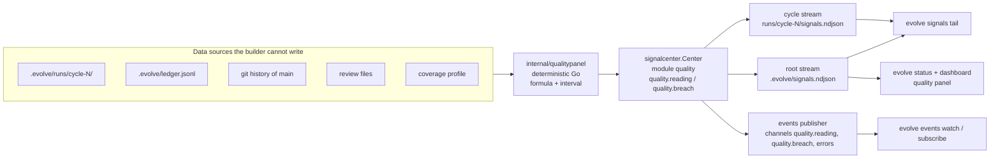

# Quality indexes: a panel of measured readings for an LLM development loop

> [ADR-0153](adr/0153-quality-is-a-panel-of-separate-indexes-with-intervals-that-the-signal-center-publishes.md) · plan: [llm-quality-indexes-2026-10](../plans/llm-quality-indexes-2026-10.md) · research: [llm-quality-indexes-2026-10](../research/llm-quality-indexes-2026-10.md) (F2.1 to F2.16, P3.1 to P4.3, R1 to R8).
> This file is the spec of record for each quality index: its formula, its data source, its interval, its stage and its signal. The plan holds the components and their order. The ADR holds the decision. The Signal Center design is in [signal-center-design.md](signal-center-design.md), and the event channels are in [event-channels.md](event-channels.md).
>
> Status: proposed, 2026-10-21. No index is computed in code yet. The baselines below come from one-time Go programs (research §2).

## Table of contents

1. [Reading guide](#1-reading-guide)
2. [Terms](#2-terms)
3. [Goals](#3-goals)
4. [Rules for every index](#4-rules-for-every-index)
5. [The Signal Center contract](#5-the-signal-center-contract)
6. [Code indexes](#6-code-indexes)
7. [Test indexes](#7-test-indexes)
8. [Pipeline indexes](#8-pipeline-indexes)
9. [Judge indexes](#9-judge-indexes)
10. [Outcome indexes](#10-outcome-indexes)
11. [Health view](#11-health-view)
12. [Operator runbook](#12-operator-runbook)
13. [Guards](#guards)
14. [Limits](#limits)

## 1. Reading guide

The operator asked on 2026-10-21: "Build all necessary docs and I want to turn those concepts into measurable indexes for llm." Then: "Those indexes should be monitored in the unified signal center which is designed to monitor the overall system health."

An index here is a measured reading with an interval, not a score. The loop has five layers, and each layer has its own indexes. No index adds into another. A reader looks at the panel and asks which layer moved.

| Layer | Question | Indexes |
|---|---|---|
| Code | Is the code easy for an agent to change safely? | CQ1 to CQ5 |
| Tests | Do the tests catch a wrong change? | TQ1 to TQ4 |
| Pipeline | Does the loop turn items into ships, and how consistently? | PQ1 to PQ4 |
| Judges | Do the auditors and reviewers find real defects? | JQ1 to JQ4 |
| Outcomes | What happened on `main` after the ship? | OQ1 to OQ4 |

### The index table

"Emit" says when the collector computes the index (§5.4). "No data" means that the data source does not exist yet, and the named component creates it.

| Id | Index | Unit | Emit | Stage | Baseline (2026-10-21) |
|---|---|---|---|---|---|
| CQ1 | Unit conformance | % of functions | wave (tree), cycle (changed) | report | 88.8% of 11,296; 83.5% with 100% coverage |
| CQ2 | Change locality | files, packages per ship | cycle | report | median 7 files [6, 7], 2 packages [2, 2], n = 119 |
| CQ3 | Interface depth | lines per exported symbol | tree | shadow | median 15.2; 99 of 316 packages under 10 |
| CQ4 | Duplication | repeated 5-line windows per 1,000 lines | tree | shadow | 22.7 (tree); per added line: no data |
| CQ5 | Judgment surface | conditional rules in prose | tree | shadow | 49 (37 in agents, 12 in skills) |
| TQ1 | Mutation efficacy on changed functions | % of mutants killed | cycle | shadow | no data (Q5) |
| TQ2 | Revert sensitivity | % of changed hunks | cycle | shadow | no data (Q6) |
| TQ3 | Test value | unique kills per test-second | tree | shadow | no data (Q5) |
| TQ4 | Held-out share | % of acceptance checks | cycle | shadow | no data (Q10) |
| PQ1 | Ship rate | % of cycles | wave | report | 64.0% [56.9, 70.5] (waves 82 to 140); last 10 waves 42.4% [31.2, 54.4] |
| PQ2 | pass^k per phase | probability | replay | shadow | no valid data (Q9) |
| PQ3 | Comparison noise floor | percentage points | on request | report | MDE 24 points at 66 cycles per arm |
| PQ4 | Deadline and system-fail rate | % of cycles | wave | report | deadline 16.7% [12.0, 22.7]; system-fail 4.8% [2.6, 8.9] |
| JQ1 | Seeded-defect recall | % of seeded defects found | corpus run | shadow | no data (Q8) |
| JQ2 | False-PASS rate | % of PASS ships | report | shadow | no data (Q7) |
| JQ3 | Independent-review escalation | % of reviewed PRs | wave | report | 41.8% [32.6, 51.7], n = 98 |
| JQ4 | Judge family diversity | % of judge calls | wave | report | 0 of 234 audit calls off Claude [0, 1.6] |
| OQ1 | Escape rate | escapes per 100 ships | report | shadow | no data (Q7) |
| OQ2 | 14-day churn | % of added lines | report | report | 9.0% of production Go (4,271 of 47,424) |
| OQ3 | Revert rate | % of first-parent commits | report | report | 0 of 695 [0, 0.55] |
| OQ4 | Recovery count and time to green | recoveries, hours | wave | shadow | no data (Q4) |

### Where the evidence comes from

Each index section names its research ids. The ids resolve in the [research dossier](../research/llm-quality-indexes-2026-10.md), and this table gives the main outside source of each layer.

| Index | Main source | Strength |
|---|---|---|
| CQ1 | `cyclop` default and Sonar cognitive complexity ([Sonar](https://community.sonarsource.com/t/s3776-reason-for-the-current-default-value-of-15/127103)) | tool defaults |
| CQ2 | agents explore more than they edit ([arXiv 2604.13108](https://arxiv.org/pdf/2604.13108)) | preprint |
| CQ3 | deep and shallow modules ([mejba.me](https://www.mejba.me/blog/improve-codebase-architecture-skill-deep-modules), [aihero.dev](https://www.aihero.dev/how-to-make-codebases-ai-agents-love)) | practitioner blogs, weak |
| CQ4, OQ2 | GitClear ([DevClass](https://devclass.com/2025/02/20/ai-is-eroding-code-quality-states-new-in-depth-report/)) | secondary, observational, weak |
| CQ5 | AGENTS.md rule 5 | synthesis |
| TQ1, TQ3 | Meta ACH ([arXiv 2501.12862](https://arxiv.org/html/2501.12862v1)), [gremlins](https://redirect.github.com/go-gremlins/gremlins) | industrial paper |
| TQ2 | the reviews of #1103, #1106 and #1107 | local |
| TQ4 | ImpossibleBench ([LessWrong](https://www.lesswrong.com/posts/qJYMbrabcQqCZ7iqm/impossiblebench-measuring-reward-hacking-in-llm-coding-1)), EvilGenie ([arXiv 2511.21654](https://arxiv.org/html/2511.21654v2)) | secondary summary, preprint |
| PQ1, PQ4 | local cycle records; Wilson ([Brown, Cai and DasGupta](https://projecteuclid.org/download/pdf_1/euclid.ss/1009213286)) | local, textbook |
| PQ2 | τ-bench ([arXiv 2406.12045](https://arxiv.org/pdf/2406.12045)) | preprint; the estimator form is our synthesis |
| PQ3 | paired tests ([arXiv 2604.17849](https://arxiv.org/pdf/2604.17849)), noise audit ([arXiv 2608.22331](https://arxiv.org/pdf/2608.22331)), MDE ([arXiv 2305.16459](https://arxiv.org/pdf/2305.16459)) | preprints, textbook |
| JQ1, JQ4 | judge calibration and self-preference ([Arthur](https://www.arthur.ai/column/can-you-trust-llm-as-judge-calibrating-automated-evals), [LangChain](https://www.langchain.com/resources/llm-as-a-judge)) | vendor, weak |
| JQ2, JQ3, OQ1, OQ3, OQ4 | local review files, Git history and ADR-0151 | local |

### How the pieces fit



The collector computes. The Signal Center carries. The readers show. No reader decides (§5.6).

## 2. Terms

"Quality index" in this file is not the review-score grammar of `internal/qualityindex` and the `quality-index` skill ([review-loop-and-quality-index.md](review-loop-and-quality-index.md)). That grammar scores one review. The indexes here measure the loop, and their package is `internal/qualitypanel` (proposed).

| Term | Meaning |
|---|---|
| Index | One number that answers one question, with a formula, a unit, a window, an interval and a stage. |
| Lane | One autonomous build loop that works one item at a time. |
| Cycle | One item from claim to ship or to stop, with its record in `.evolve/runs/cycle-N/`. |
| Wave | One batch of lanes between two boundaries, with its record in `.evolve/waves/wave-N.json`. |
| Boundary | The step between two waves: stop the loop, merge, sync `main`, clean up (`evolve wave next`). |
| Ship | A cycle that lands its commit on `main`. The **ship rate** is ships divided by cycles. |
| Seal | The `cycle.sealed` signal that a cycle emits when it ends by its own path. A cycle with no seal was stopped from outside. |
| Census | A reading over the whole population, for example every function of the tree. It has no sample error, so it has no interval. |
| `n_min` | The smallest sample for which an index emits a breach. Under it, the reading says `status=inconclusive`. |
| pass@k | The chance that at least one of k tries passes. It measures capability, where pass^k measures consistency. |
| Goodhart's law | "When a measure becomes a target, it ceases to be a good measure." An agent that sees a number optimizes the number, not the goal. |
| Reading | One computed value of one index, emitted as one `quality.reading` signal. |
| Breach | A reading whose whole interval is on the bad side of its threshold (§4.4). |
| Window | The set of data that one reading covers, for example "the cycles of wave 140" or "the last 10 waves". |
| Stage | `shadow`, `report` or `gate` (§4.5). |
| Wilson interval | A 95% confidence interval for a proportion that stays inside [0, 1] and works for small n (research P4.1). |
| Cluster bootstrap | Resample whole clusters (for example all cycles of one wave) with replacement 2,000 times, and read the 2.5th and 97.5th percentiles of the statistic (P4.2). |
| MDE | Minimum detectable effect: the smallest true difference that a test finds with 80% power at α = 0.05 for the given sample (P4.3). |
| pass^k | The chance that all k independent tries of the same item pass (P3.1). |
| Mutant | A copy of the code with one small, deliberate fault. A test run kills it when a test fails, and the mutant lives when all tests pass. |
| Mutation efficacy | Killed mutants divided by killed plus lived mutants. |
| Equivalent mutant | A mutant that behaves the same as the original code. No test can kill it. |
| Change locality | How few files and packages one shipped item touches. |
| Interface depth | How much body a package hides behind each exported symbol. A deep package has a small interface and a large body. |
| Judgment surface | The decisions that live in prompt prose instead of typed code. |
| Held-out check | An acceptance check that the builder can neither see nor change. |
| False PASS | A PASS verdict on a change that a later fact proves wrong. |
| Escape | A defect on `main` that a later item must fix. |
| Churn | Lines that a later change revises or removes within 14 days after they land. |
| Recovery | An item that failed and then shipped on a later try (ADR-0151). |
| Builder | The phase agent that writes the change. The **measured agent** of an index is the agent whose work the index judges. |

## 3. Goals

| Goal | Measure | Target |
|---|---|---|
| G1 Each quality question has a number with an interval | indexes with a formula, a source and an interval method | 21 of 21 in this spec |
| G2 The numbers live in one monitoring home | indexes that emit through `signalcenter` and no other store | all computed indexes |
| G3 A number cannot be raised by the agent that it measures | indexes that read a report the measured agent writes about its own work | 0. Tree indexes read `main` after the landing. CQ5 is the one exception: an author can move it, so it stays a trend and never gates. |
| G4 Noise is not read as change | stage flips without the sample rule of §4.6 | 0 |
| G5 A person can act on a breach | breach codes with a runbook entry (§12) | all |

The order of the goals is the order of priority. G3 comes before G4, because a gamed index with a correct interval is still wrong.

## 4. Rules for every index

### Issue

On 2026-10-21, three PRs had 100% coverage and a test that did not probe the change (F2.7). A soak rule "zero misses" held only because its denominator was always empty (F2.7). One wave of 5 cycles has a ship-rate interval 65 points wide (F2.3).

### Gap

The current gates (sizeratchet, cover-changed, apicover, ACS) each answer a yes-or-no question on one change. None states its uncertainty. None tracks a trend. None checks that its own denominator is not empty.

### Solution

#### 4.1 Data sources

An index reads only data that the measured agent cannot write after the fact. These sources are the Git history of `main`, the hash-chained ledger and the signal streams. The review files of the independent reviewer and the CI coverage profile also qualify. An index never reads a report that the measured agent writes about itself (R3).

The outcome of a cycle comes from `run.json` `shipped`, the `ship.landed` signal and the `cycle.sealed` signal. `run.json` `final_verdict` alone is not an outcome: in cycle 2024 it says PASS, and the seal says FAIL (F2.2).

#### 4.2 Rates

A rate is k of n. Its interval is the Wilson 95% interval (z = 1.96):

```
p̂          = k / n
centre     = (p̂ + z²/(2n)) / (1 + z²/n)
half-width = z / (1 + z²/n) × sqrt( p̂(1 − p̂)/n + z²/(4n²) )
interval   = [max(0, centre − half-width), min(1, centre + half-width)]
```

Worked example: wave 140 shipped 3 of its 5 cycles: 60.0% [23.1, 88.2]. If only 4 cycles count, 3 of 4 gives 75.0% [30.1, 95.4]. Both intervals overlap almost the whole range, so one wave tells almost nothing.

#### 4.3 Medians and other statistics

A median carries a cluster bootstrap interval: 2,000 resamples of whole waves, with a fixed seed so that the reading repeats. A census of the whole tree (CQ1, CQ3, CQ4, CQ5) has no sample error, so it carries no interval. Its reading says `method=census`.

#### 4.4 Breach test

Each index has a direction (`higher_is_better` or `lower_is_better`) and a threshold. A reading breaches only when its whole interval is on the bad side of the threshold. For a higher-is-better rate, that means `hi < threshold`. A point value under the threshold with an interval that crosses it is not a breach. It is reported as `status=inconclusive`.

#### 4.5 Stages

| Stage | What happens | Who sets it |
|---|---|---|
| `shadow` | The collector computes and emits `quality.reading`. No breach signal. | compiled default for a new index with no baseline |
| `report` | The collector also emits `quality.breach` (WARN) on a breach. | compiled default for an index with a baseline. The key `quality.indexes.<id>.stage` overrides it. |
| `gate` | The collector still emits `quality.reading` and `quality.breach` as in `report`. A gate outside the Signal Center reads the index and can refuse a ship. | an ADR amendment, then the gate's own policy key |

Nine indexes have a baseline and a reader in their first component. They start at `report`: CQ1, CQ2, PQ1, PQ3, PQ4, JQ3, JQ4, OQ2 and OQ3. The baseline counts as their first window. They still emit no breach under `n_min`. The other twelve start at `shadow`.

The Signal Center never moves an index between stages. A listener observes and never decides ([signal-center-design.md](signal-center-design.md) §3, "Listeners observe; they never decide").

#### 4.6 The sample rule for a stage flip

- `shadow` to `report`: at least 3 windows of readings with the source present, and each window has at least `n_min` items (given per index).
- `report` to `gate`: all of the following.
  - The MDE at the current n is smaller than the effect that the gate claims to defend. MDE = (1.96 + 0.84) × sqrt(2 p̄(1 − p̄) / n) for a rate.
  - In `report`, at most 1 breach in 10 windows had no matching real defect.
  - A paired comparison (the same items before and after) supports the effect, when the gate changes a configuration (PQ3).
  - The operator records the flip in an ADR amendment.

Worked example: PQ1 over the last 10 waves has p̄ = 0.42 and n = 66. Its MDE is 24 points. A configuration that claims a 10-point gain needs about 382 cycles per arm, or a paired replay (PQ2).

#### 4.7 Rules against a game of the index

- No index feeds the prompt of the agent that it measures. The builder sees its gates. It does not see the panel or the thresholds (R8).
- Each rule that claims "zero misses" also emits its denominator. A denominator of 0 emits `QUALITY_VACUOUS_DENOMINATOR` (R6).
- Each index names its most likely game and its counter-measure in its own section.

## 5. The Signal Center contract

### Issue

The operator wants one home for system health. Today health facts live in `cli-health.json`, `evolve status`, the dashboard snapshot and the signal streams. A new dashboard for quality adds a sixth place.

### Gap

The Signal Center has closed sets of modules and kinds (`go/internal/signalcenter/event.go:44-79`, `:98-142`). It has no `quality` module and no quality kinds. A WARN or INCIDENT signal must carry a registered code, or `Normalize` stamps it `SIGNALCENTER_UNREGISTERED_CODE` ([signal-codes.md](signal-codes.md)). A cycle-0 signal reaches the root stream `.evolve/signals.ndjson` only when its kind is in `legacyProjectKinds` (`go/cmd/evolve/cmd_cycle.go:376-392`).

### Solution

#### 5.1 Module, kinds and codes

The collector component (Q1) adds these to the closed sets and to the code registry. `evolve signals codes generate` then writes them into [signal-codes.md](signal-codes.md), and `evolve signals codes check` stays green.

| Item | Value |
|---|---|
| Module | `quality` (code prefix `QUALITY_`) |
| Kind `quality.reading` | INFO. One computed reading. No code, because an INFO signal carries none. |
| Kind `quality.breach` | WARN. A reading in `report` stage failed the breach test (§4.4). Code `QUALITY_<ID>_BREACH`. |
| Kind `quality.warning` | WARN. The collector cannot compute an index. |
| Origin | the Go function that computed the reading, for example `qualitypanel.ShipRate` |

The codes:

| Code | Kind | When |
|---|---|---|
| `QUALITY_<ID>_BREACH` | `quality.breach` | one code per index that has a threshold: 19 codes. PQ3 and JQ4 have no threshold and no code. |
| `QUALITY_SOURCE_ABSENT` | `quality.warning` | a declared source file or directory does not exist |
| `QUALITY_VACUOUS_DENOMINATOR` | `quality.warning` | a reading has n = 0 where the index expects data |
| `QUALITY_SOURCE_UNREADABLE` | `quality.warning` | a source exists but does not parse |

#### 5.2 Fields of a reading

Each value is a string, because `Event.Fields` is `map[string]string` (`event.go:181-197`). `Normalize` keeps at most `MaxFields` = 12 keys and drops the rest (`event.go:12`, `normalize.go:94-107`). A reading therefore carries 11 keys. The unit, the direction and the baseline of each index live in the index registry of `internal/qualitypanel`, not in the signal.

| Field | Example | Meaning |
|---|---|---|
| `index` | `PQ1` | the index id |
| `value` | `0.424` | the point value, in the unit |
| `lo`, `hi` | `0.312`, `0.544` | the interval bounds; empty for a census |
| `method` | `wilson95` | `wilson95`, `bootstrap95`, `census` or `pass_k_unbiased` |
| `n` | `66` | the sample size |
| `window` | `waves:131-140` | the data that the reading covers |
| `stage` | `report` | the stage at emit time |
| `threshold` | `0.40` | the breach test input; the direction comes from the registry |
| `status` | `ok` | `ok`, `inconclusive`, `breach` or `no_data` |
| `source` | `.evolve/runs` | the data source that the reading read |

#### 5.3 Streams

- A reading about one cycle carries `cycle: N`. The current cycle sink writes it to `.evolve/runs/cycle-N/signals.ndjson`.
- A reading about a wave, a tree or a report carries cycle 0. Q1 adds the three quality kinds to `legacyProjectKinds`, so the root sink writes them to `.evolve/signals.ndjson`.
- The collector builds its Center with `newRoleSignalCenter("quality", …)` (`cmd_cycle.go:396`), so `rootwire.Attach` also routes each signal to the event channels.

#### 5.4 Emission points

The computation is deterministic Go in `internal/qualitypanel`. It runs off the critical path of a lane, so a slow index cannot stall a ship.

| When | Command | Indexes |
|---|---|---|
| Each wave boundary, after `sync-main` and before `gc` | `evolve quality report --scope wave` | PQ1, PQ4, JQ3, JQ4, OQ4, CQ1 (tree), and the cycle indexes for each cycle of the closing wave: CQ1 (changed), CQ2, TQ1, TQ2, TQ4 |
| On request, and at a boundary when the last tree reading is older than 24 hours | `evolve quality report --scope tree` | CQ3, CQ4, CQ5, TQ3, OQ1, OQ2, OQ3, JQ2 |
| A corpus run | `evolve quality report --scope judges` | JQ1 |
| A replay run | `evolve quality report --scope replay` | PQ2 |
| A comparison request | `evolve quality compare --index PQ1 --a <window> --b <window>` | PQ3 |

The boundary step is today's list `loop-stop`, `pr merge`, ratchet, `sync-main`, `gc` (`go/cmd/evolve/cmd_boundary.go:154-159`) with one new step before `gc`. The cycle indexes run at the boundary after the ship, not in the cycle. A later gate that needs TQ1 before the ship moves it into the audit, by its own ADR amendment.

#### 5.5 Channels

The event-channel publisher (E6, `go/internal/events/publisher`) and the channel catalog (E7, `go/internal/policy/policy_events.go:19-36`) are on `main`. The `evolve events` command (E9) is not on `main` on 2026-10-21. Q1 adds two default channels:

| Channel | Route | QoS | Why |
|---|---|---|---|
| `quality.breach` | `kind=quality.breach,quality.warning` | `lossless` | A breach is rare and must not be lost. |
| `quality.reading` | `kind=quality.reading` | `best_effort` | Readings are many and a reader can recompute them. |

A breach also reaches the `errors` channel (`severity>=WARN`), and every reading reaches the `signals` firehose. The dotted names let a subscriber take both with `--channel 'quality.>'` ([event-channels.md](event-channels.md), and the research amendments of the event-notification-protocol plan). Program subscriptions wait for E9.

#### 5.6 What the Signal Center does not do

The Signal Center does not compute an index, choose a threshold, change a stage or refuse a ship. The ledger, the cycle state and the gate artifacts stay the deciding evidence ([ADR-0101](adr/0101-signal-center.md)). A breach is a call for a person to look.

## 6. Code indexes

### CQ1 Unit conformance

**Why the standard metric is not enough.** A size limit alone (the sizeratchet) lets a 30-line function with 12 branches pass. An agent writes long, branchy functions at no cost, and a reviewer reads them at a high cost. CQ1 joins four limits so that one cheap rewrite cannot satisfy it.

**What it measures.** The share of production functions that are small on all four axes, and the share of the changed functions of a ship that are.

| Field | Value |
|---|---|
| Question | Are the units small enough that an agent and a reviewer can hold each one in mind? |
| Formula | conforming / all, where conforming means lines ≤ 30, cyclomatic ≤ 10, nesting ≤ 3, params ≤ 4. Cyclomatic = 1 + count of `if`, `for`, `range`, `case`, `select` case, `&&`, `||`. Nesting counts `if`, `for`, `range`, `switch`, `select` and `func` literals. |
| Unit | % of functions |
| Window | tree: the tree at the boundary; changed: the functions that the ship of one cycle adds or changes |
| Source | `go/**/*.go` without `_test.go`, `testdata/`, `go/acs/`, `go/test/`; coverage from `go/coverage.txt` (written by `make test-integration`, `go/Makefile:126-143`) through `go tool cover -func` |
| Interval | tree: census. Changed: Wilson over the changed functions of the wave. |
| Baseline | 88.8% of 11,296 functions at `e0b8433fe`; 83.5% of 11,256 also have 100% coverage (F2.10) |
| Stage and threshold | `report`. Changed functions: higher is better, threshold 90%, `n_min` 30 functions per wave. Tree: breach when it falls 1.0 point below the baseline. |
| Good and bad | 95% of changed functions is good. Under 80% means that new code is larger than the code base norm. |
| WARN action | Read the non-conforming changed functions in the reading `source`. File a split item if one function exceeds two limits. |
| Game and counter | An agent splits a function into many tiny helpers. CQ3 (interface depth) and CQ2 (locality) fall when it does, so the panel shows the move. |
| Relation to gates | The sizeratchet (`go/internal/sizeratchet`) bounds lines only. Cover-changed (`go/Makefile:206`) demands 100% coverage on changed functions. CQ1 adds the other three limits. Q3 can turn it into a ratchet on changed functions. |
| Evidence | `cyclop` default 10 (P3.10). The limit of 10 matches the current scanner, not cognitive complexity 15. |

### CQ2 Change locality

**Why the standard metric is not enough.** Classic metrics count lines changed. For an agent, the cost is in the search: it spends much of its effort to find the place to edit (P3.6). A change that touches many packages also has a large blast radius.

**What it measures.** How many files and Go packages one shipped item touches.

| Field | Value |
|---|---|
| Question | Can one item be done in one place? |
| Formula | for each shipped cycle: files = paths in `git show --numstat <commit_sha>` without `.evolve/`; packages = distinct directories of the `.go` paths; lines = added + deleted. The reading is the median over the window. |
| Unit | files, packages and lines per ship |
| Window | the ships of one wave; rolling 10 waves |
| Source | `.evolve/runs/cycle-N/ship-binding.json` `commit_sha` and `run.json` `shipped`; Git history |
| Interval | cluster bootstrap 95% by wave |
| Baseline | median 7 files [6, 7], 2 packages [2, 2], 428 lines [305, 480], n = 119 (F2.6). The bootstrap of the baseline resampled ships, not waves. |
| Stage and threshold | `report`. Lower is better. Breach when the 10-wave median of packages is above 3. `n_min` 20 ships. |
| Good and bad | 1 to 2 packages per item is good. A rise means that items are larger or that the code couples more. |
| WARN action | Read the ships with the most packages. Check if the item was too large (split rule of the inbox) or if a package boundary leaks. |
| Game and counter | An agent ships one item as several small items. Count per inbox item id, not per commit, and read PQ1 next to it. |
| Relation to gates | No gate. The tokens that an agent reads before its first edit are not recorded in `llm-calls.ndjson` (no data). Q2 adds that part when the bridge records it. |
| Evidence | P3.6 (preprint and practitioner post) |

### CQ3 Interface depth

**Why the standard metric is not enough.** Classic metrics reward small modules. An agent can split code at no cost, which gives "a fractal of small modules with no center" (P3.7). A shallow package makes each change cross more interfaces.

**What it measures.** How much body each package hides behind each exported symbol.

| Field | Value |
|---|---|
| Question | Do packages hide their detail behind a small interface? |
| Formula | per internal package with at least one exported symbol: logical lines / exported symbols. Logical lines = non-blank lines that are not only a brace, a parenthesis, `package` or `import`. Exported symbols = exported funcs (with an exported receiver type), types, consts and vars. The reading is the median, plus the count of packages under 5. |
| Unit | lines per exported symbol |
| Window | the tree |
| Source | `go/internal/**/*.go` without tests |
| Interval | census |
| Baseline | median 15.2 (p10 6.4, p90 44.2); 99 of 316 packages under 10 (F2.11) |
| Stage and threshold | `shadow`. A threshold waits for 3 windows. Proposed: breach when a new package enters with a ratio under 5. |
| Good and bad | A ratio over 20 is a deep package. Under 5 means that the package is mostly interface. |
| WARN action | Ask if the new package can merge into its caller. |
| Game and counter | An agent unexports symbols. That is the wanted move if callers do not need them; apicover still requires a test that names each exported symbol. |
| Relation to gates | apicover (`go/internal/apicover`) requires a test per exported symbol, so a shallow package also costs more tests. |
| Evidence | practitioner blogs only (P3.7). Weak. |

### CQ4 Duplication

**Why the standard metric is not enough.** An agent copies a block faster than it finds the shared helper. GitClear reports that duplicated blocks rose eight times in 2024 (P3.9, secondary and observational).

**What it measures.** How many 5-line blocks appear in two or more places.

| Field | Value |
|---|---|
| Question | Does the code repeat itself? |
| Formula | Normalize each production `.go` line: trim spaces, and drop blank and brace-only lines. Count each 5-line window whose text occurs in two or more places. Divide by logical lines and multiply by 1,000. The diff form counts the windows of added lines that match a window elsewhere, per 1,000 added lines. |
| Unit | repeated windows per 1,000 lines |
| Window | tree; diff form: the ships of one wave |
| Source | `go/**/*.go` without tests; Git diff of each ship |
| Interval | census (tree); bootstrap by wave (diff form) |
| Baseline | 22.7 per 1,000 logical lines (3,550 windows in 156,436 lines) (F2.12). Diff form: no data. |
| Stage and threshold | `shadow`. Proposed: breach when the diff form is above twice the tree rate for 3 waves. |
| Good and bad | A diff form under the tree rate means new code repeats less than old code. |
| WARN action | Read the repeated windows. File one item to move each block into one helper. |
| Game and counter | An agent renames variables in a copy. Normalize identifiers in the diff form (a later refinement). |
| Relation to gates | No gate. The "never duplicate" rule of the house is prose only. |
| Evidence | P3.9 (secondary). Weak. |

### CQ5 Judgment surface

**Why the standard metric is not enough.** In a classic program, all decisions are code. In this loop, some decisions live in prompt prose, where no test runs them. A decision in prose can drift each time a model changes. Typed code is deterministic and testable (rule 5 of AGENTS.md).

**What it measures.** A countable proxy for decisions in prose: conditional rule lines in agent and skill files.

| Field | Value |
|---|---|
| Question | How many decisions do we leave to a prompt that typed code can make? |
| Formula | count of lines in `agents/*.md` and `skills/*/SKILL.md` that match `^\s*[-*0-9.]+\s*\**(If|When|Unless)\b`. The pattern takes a list marker or a bold mark, then the word. |
| Unit | rule lines |
| Window | the tree |
| Source | `agents/`, `skills/` |
| Interval | census |
| Baseline | 49: 37 in 106 agent files and 12 in 34 skill files (F2.16) |
| Stage and threshold | `shadow`. Trend only. A threshold needs a person to label which lines are code candidates. |
| Good and bad | A fall with no loss of behavior means that rules moved into code. |
| WARN action | none in `shadow` |
| Game and counter | An author rewrites "If X, do Y" as "Do Y for X". The proxy misses it. The proxy is a trend signal, never a gate. |
| Relation to gates | none |
| Evidence | synthesis from AGENTS.md rule 5. No outside study. |

## 7. Test indexes

### TQ1 Mutation efficacy on changed functions

**Why the standard metric is not enough.** Coverage says that a line ran, not that a test checks it. On 2026-10-21, three PRs had 100% coverage and a test that did not probe the change (F2.7). An agent can reach 100% coverage with tests that assert nothing.

**What it measures.** The share of small faults in the changed functions that the tests catch.

| Field | Value |
|---|---|
| Question | Do the tests fail when the new code is wrong? |
| Formula | killed / (killed + lived) over the mutants of the changed functions. TIMED OUT counts as killed (Stryker rule, P3.5). NOT COVERED is reported as its own count. NOT VIABLE is dropped. |
| Unit | % of mutants |
| Window | the changed functions of one cycle; pooled per wave |
| Source | `gremlins` (installed in `~/go/bin`) run on the packages of the ship at its commit, limited to the changed line ranges |
| Interval | Wilson over mutants; cluster bootstrap by cycle for the wave |
| Exclusions | Never mutate a function that sends a signal to a process. This covers any body that calls `syscall.Kill`, `unix.Kill`, `os.Process.Kill` or `os.Process.Signal`. It also covers the packages `go/internal/proctree`, `go/internal/bridge` (`dispatch_reap.go`) and `go/internal/gc`. A kill-guard mutant once killed every user process (house rule). |
| Baseline | no data. This task did not run mutation. |
| Stage and threshold | `shadow`. Proposed: higher is better, threshold 80%, `n_min` 20 mutants per wave. |
| Good and bad | Over 90% is strong. Under 60% means that the tests mostly run the code without checks. |
| WARN action | Read the lived mutants. Each one names a line and a change that no test catches. Write the test, or show that the mutant is equivalent. |
| Game and counter | An agent writes a change-detector test that pins the exact output (P3.10). TQ2 and TQ3 catch a test that kills many mutants but finds no real fault. Equivalent mutants lower the score unfairly; an LLM filter reached 0.95 precision in ACH (P3.4), and Q5 defers it. |
| Relation to gates | It complements cover-changed (`go/Makefile:206`, `go/internal/core/cover_changed_floor.go`), which proves only that lines ran. |
| Evidence | Meta ACH (P3.4, industrial); gremlins states (P3.5) |

### TQ2 Revert sensitivity

**Why the standard metric is not enough.** The independent reviewers found the three slack tests of 2026-10-21 by one move: revert the change and see if a test fails (F2.7). That move is deterministic, so a program can do it.

**What it measures.** The share of changed hunks whose covering tests fail when the hunk is reverted.

| Field | Value |
|---|---|
| Question | Does some test depend on each part of the change? |
| Formula | For each production hunk of the ship, revert only that hunk on the ship commit. Run the tests that cover its lines (from the coverage profile). The hunk is sensitive when one test fails. Value = sensitive / hunks. A hunk that does not compile when reverted alone counts as sensitive and is reported. |
| Unit | % of hunks |
| Window | one cycle; pooled per wave |
| Source | Git diff of the ship; per-test coverage of the touched packages |
| Interval | Wilson |
| Baseline | no data. Worked example: in #1103 the reviewer reverted the change and the test still passed, so that hunk counts as not sensitive. |
| Stage and threshold | `shadow`. Proposed: higher is better, threshold 90%, `n_min` 15 hunks per wave. |
| Good and bad | 100% is the target. Each insensitive hunk is a change that no test protects. |
| WARN action | Read the insensitive hunks and write a test that fails without each one. |
| Game and counter | An agent adds a test that asserts the source text. Kill-guard paths are excluded as in TQ1. A source-text assertion is a change-detector; TQ3 shows that it kills no unique mutant. |
| Relation to gates | The console brief already asks each builder to check "the two most important branches" by revert. TQ2 measures it for every hunk. |
| Evidence | local (F2.7) |

### TQ3 Test value

**Why the standard metric is not enough.** Test code is 3.06 times the size of production code (F2.15). Size says nothing about value. A test that kills no mutant that another test does not also kill costs time and adds nothing.

**What it measures.** Unique mutants killed per second of test time, and the tests that kill no unique mutant.

| Field | Value |
|---|---|
| Question | Which tests earn their run time? |
| Formula | for each test t: unique(t) = mutants that t kills and no other test kills. Value = Σ unique(t) / Σ seconds(t), plus the count of tests with unique(t) = 0. |
| Unit | unique kills per test-second; count of tests |
| Window | one package per run, rotated over the tree |
| Source | gremlins per-test results (Q5), `go test -json` times |
| Interval | census per package |
| Baseline | no data |
| Stage and threshold | `shadow`. No threshold until 3 rotations. |
| Good and bad | A test with zero unique kills is a candidate for removal or for a sharper assertion. |
| WARN action | none in `shadow` |
| Game and counter | An agent deletes tests to raise the rate. A deletion that lowers TQ1 is visible on the panel. The coverage rule forbids a deletion that drops a guard (house rule). |
| Relation to gates | The test-time budget of CI (the CI wall-time plan). |
| Evidence | synthesis; ACH (P3.4) for kill-based test value |

### TQ4 Held-out share

**Why the standard metric is not enough.** An agent that can see and edit its acceptance tests can pass them without the task. Hidden tests cut the ImpossibleBench cheat rate from 54% to near zero (P3.3, secondary).

**What it measures.** The share of acceptance checks for an item that the builder cannot see or change.

| Field | Value |
|---|---|
| Question | How much of the acceptance does the builder not control? |
| Formula | held-out checks / all acceptance checks of the cycle. A check is held out when three facts are true. A phase other than the builder wrote it. It is outside the write scope of the builder (`lane-scope.json`). Its file hash at audit equals its hash at hand-off (`handoff-tdd-build.json`). |
| Unit | % of checks |
| Window | one cycle; pooled per wave |
| Source | `.evolve/runs/cycle-N/handoff-tdd-build.json`, `lane-scope.json`, `acs-verdict.json` |
| Interval | Wilson |
| Baseline | no data. The hash comparison does not exist (Q10). |
| Stage and threshold | `shadow`. Proposed: higher is better, threshold 50%. |
| Good and bad | A high share means that the builder cannot shape its own exam. |
| WARN action | Read which checks the builder can change. Move them to the TDD phase or to a protected path. |
| Game and counter | Read-only tests stop edits but not special cases in the code (P3.3). TQ1 and TQ2 on the same change catch code that fits only the visible tests. |
| Relation to gates | The ACS gate ([acs-predicate-quality-gate.md](acs-predicate-quality-gate.md)) judges each predicate. TQ4 measures who owns them. |
| Evidence | ImpossibleBench (secondary), EvilGenie (P3.3) |

## 8. Pipeline indexes

### PQ1 Ship rate

**Why the standard metric is not enough.** A classic build success rate assumes that a rerun gives the same result. Here, one wave has 4 to 16 cycles, and its interval is 40 to 70 points wide (F2.3). A ship rate without an interval invites a decision on noise.

**What it measures.** The share of cycles that land a commit on `main`.

| Field | Value |
|---|---|
| Question | What share of the work that the loop starts reaches `main`? |
| Formula | ships / cycles. A cycle belongs to wave w when `cycle_floor(w) ≤ cycle < cycle_floor(w+1)`. A cycle ships when `run.json` `shipped` is true or its stream has `ship.landed`. A cycle counts when its run directory exists. |
| Unit | % of cycles |
| Window | one wave; rolling 10 waves; all recorded waves |
| Source | `.evolve/waves/wave-N.json` (`number`, `cycle_floor`); `.evolve/runs/cycle-N/run.json`, `signals.ndjson` |
| Interval | Wilson |
| Baseline | waves 82 to 140: 119 of 186 = 64.0% [56.9, 70.5]. Last 10 waves: 28 of 66 = 42.4% [31.2, 54.4]. Waves 137 to 140: 2/5, 1/6, 2/5, 3/5 (F2.3). |
| Stage and threshold | `report`. Higher is better. Rolling 10 waves: breach when `hi` < 0.40. `n_min` 40 cycles. |
| Good and bad | Read it next to PQ4. A fall with a rise in PQ4 is an infrastructure problem, not an item problem. |
| WARN action | Run `evolve wave status` for the last waves and read the seal reasons. Apply the zero-ship halt rule of the operating policy when two cycles in a row ship nothing. |
| Game and counter | The loop picks only easy items. Read the inbox rank: the pick order comes from `evolve inbox rank`, not from the builder. A rise in PQ1 with a fall in TQ1 or a rise in OQ1 is suspect. |
| Relation to gates | The zero-ship halt rule (operating policy §4.1) is a point rule on 2 cycles. PQ1 is the trend. |
| Evidence | local; P4.1 |

### PQ2 pass^k per phase

**Why the standard metric is not enough.** A single success rate hides inconsistency. A 90% pass@1 agent passes all 8 of 8 tries only about 57% of the time (P3.1). For an autonomous loop, consistency matters more than a best case.

**What it measures.** The chance that a phase passes all k tries of the same frozen input.

| Field | Value |
|---|---|
| Question | If we run the same phase on the same item k times, how often do all k pass? |
| Formula | per item i with n tries and c passes: C(c, k) / C(n, k). Value = mean over items. Report k = 1, 2, 4. |
| Unit | probability |
| Window | one replay set: a fixed list of items at a fixed base commit |
| Source | a replay harness (Q9) that runs one phase k times through `evolve agent run` ([ADR-0152](adr/0152-one-phase-agent-runs-from-the-command-line-with-no-cycle-through-the-phase-runner.md)) on a frozen input |
| Interval | cluster bootstrap by item |
| Baseline | no valid data. Production gives no repeats: no item shipped twice, because a ship consumes it. Of 17 items with two or more tries, 13 shipped at last (76.5% [52.7, 90.4]) (F2.4). |
| Stage and threshold | `shadow`. No threshold until 3 replay sets. |
| Good and bad | A wide gap from pass^1 to pass^4 means an unstable phase. |
| WARN action | none in `shadow` |
| Game and counter | A replay set of easy items. The set is fixed in config and changes only by a recorded decision. |
| Relation to gates | It is the paired comparison that PQ3 needs for a configuration change. |
| Evidence | τ-bench (P3.1). The estimator is the complement of the unbiased pass@k form; we did not see it in a primary source. |

### PQ3 Comparison noise floor

**Why the standard metric is not enough.** "The new model shipped 3 of 4, the old one 2 of 5" reads as a gain. With these samples, the MDE is over 80 points. Many published gains are inside the noise floor (P3.2).

**What it measures.** For a proposed comparison, the smallest difference that the data can show, and the paired test result.

| Field | Value |
|---|---|
| Question | Is this difference larger than the noise? |
| Formula | MDE = (1.96 + 0.84) × sqrt(2 p̄(1 − p̄) / n) for two equal arms. For paired data (the same items in both arms), report the McNemar exact test on the discordant pairs. |
| Unit | percentage points |
| Window | the two windows that the request names |
| Source | the index readings of the two windows |
| Interval | the MDE is the interval |
| Baseline | PQ1 at p̄ = 0.42: 87 points at 5 cycles per arm and 24 points at 66 cycles per arm. A 10-point MDE needs 382 cycles per arm (P4.3). |
| Stage and threshold | `report`. A comparison whose observed difference is under its MDE emits `status=inconclusive`. |
| Good and bad | Not a quality value. It guards each decision that cites another index. |
| WARN action | Do not act on an inconclusive comparison. Run a paired replay (PQ2). |
| Game and counter | Window choice after the fact. The request names its windows before the data of the second window exists. |
| Relation to gates | The sample rule of §4.6 uses this MDE. |
| Evidence | P3.2 (preprints), P4.3 (textbook) |

### PQ4 Deadline and system-fail rate

**Why the standard metric is not enough.** A failed cycle in a classic pipeline is a failed build. Here, a cycle also ends when a lease deadline stops it or when the host fails. Those ends say nothing about the item.

**What it measures.** The share of cycles that end for a reason outside the item.

| Field | Value |
|---|---|
| Question | How often does the system, not the item, end a cycle? |
| Formula | deadline = cycles with no `cycle.sealed` signal, plus cycles sealed with `termination_reason` "stopped: lane deadline". System-fail = cycles whose stream has `ORCHESTRATOR_SYSTEM_FAILURE`, `LOOP_SYSTEM_FAILURE_HALT` or a `BRIDGE_EXIT_*_TIMEOUT` code. Each divided by all cycles. |
| Unit | % of cycles |
| Window | one wave; rolling 10 waves |
| Source | `.evolve/runs/cycle-N/signals.ndjson`; the ledger `inbox-lifecycle` `release` entries that name a lease deadline |
| Interval | Wilson |
| Baseline | deadline 31 of 186 = 16.7% [12.0, 22.7]; system-fail 9 of 186 = 4.8% [2.6, 8.9]; either 36 of 186 = 19.4% [14.3, 25.6]. Four cycles are in both counts (F2.5, F2.16) |
| Stage and threshold | `report`. Lower is better. Deadline: breach when `lo` > 0.20 over 10 waves. System-fail: breach when `lo` > 0.05. |
| Good and bad | Under 10% deadline is healthy. A rise points at the host, the quota or the deadline policy. |
| WARN action | Check usage first (house rule), then the lease and the deadline settings, then host load. |
| Game and counter | A cycle that ends itself early with a planned no-work seal avoids the deadline count. Count planned no-work seals as their own reading next to it. |
| Relation to gates | The halt rules for system fails in the operating policy. |
| Evidence | local |

## 9. Judge indexes

### JQ1 Seeded-defect recall

**Why the standard metric is not enough.** An audit PASS rate says how often the judge agrees, not how often it is right. A judge that passes everything has a fine PASS rate.

**What it measures.** The share of known, planted defects that the auditor and the reviewers find.

| Field | Value |
|---|---|
| Question | When we plant a defect, does the judge find it? |
| Formula | found / seeded over a fixed corpus. A defect is found when the judge's report names its file and line range, or its seeded id, with a severity of MEDIUM or more. Report per judge and per defect class. |
| Unit | % of seeded defects |
| Window | one corpus run |
| Source | a seeded-defect corpus (Q8): past real defects re-applied to a frozen tree, each with its class and expected finding; judges run through `evolve agent run` |
| Interval | Wilson |
| Baseline | no data |
| Stage and threshold | `shadow`. Proposed: higher is better, threshold 75% (the low end of the practitioner range, P3.8). |
| Good and bad | Under 50% in one class means the judge is blind to that class. |
| WARN action | Read the missed classes. Add a deterministic check for each class that a program can find. |
| Game and counter | The judge learns the corpus. Keep the corpus out of every prompt and rotate a held-out part. |
| Relation to gates | It calibrates the audit verdict and the code-review phase (ADR-0124). |
| Evidence | P3.8 (vendor claims). Weak for the threshold. |

### JQ2 False-PASS rate

**Why the standard metric is not enough.** A judge PASS is only as good as what happens after it. Classic metrics have no link from a later defect back to the verdict that let it in.

**What it measures.** The share of PASS ships that a later fact proves wrong.

| Field | Value |
|---|---|
| Question | How often does a PASS let a wrong change in? |
| Formula | false PASS ships / PASS ships in the window. A PASS ship is false when one of three facts occurs within 14 days. The facts are a revert, a `Fixes-Ship` link (Q7) and a red `main` CI run that starts at the ship. |
| Unit | % of PASS ships |
| Window | ships 14 to 44 days old, so each ship has had 14 days |
| Source | Git history; the fix link of Q7; CI history through `gh run list` |
| Interval | Wilson |
| Baseline | no data. No revert in 30 days (F2.14), and no fix link exists. |
| Stage and threshold | `shadow`. Proposed: lower is better, threshold 10%. |
| Good and bad | Read it next to OQ1. |
| WARN action | Read each false PASS. Add its defect to the JQ1 corpus. |
| Game and counter | A fix item that does not declare its link. The inbox lint can require the link on an item whose source names a shipped commit. |
| Relation to gates | It is the outcome check of every audit gate. |
| Evidence | synthesis |

### JQ3 Independent-review escalation

**Why the standard metric is not enough.** Each PR passes its builder's own review before an independent reviewer reads it. How often that reviewer still finds a HIGH defect measures the gap between the two.

**What it measures.** The share of reviewed PRs where the independent review found a HIGH or CRITICAL defect.

| Field | Value |
|---|---|
| Question | How often does a PR that passed its builder's review still carry a serious defect? |
| Formula | PRs whose review file names at least one HIGH or CRITICAL finding / reviewed PRs. Today a finding is matched by a pattern: a heading that starts with the severity, `HIGH-1` or `HIGH 1:` forms, `**HIGH` and `[HIGH]`. A line "HIGH 0" does not count. |
| Unit | % of reviewed PRs |
| Window | the reviews of one wave; all reviews |
| Source | `dev/console-notes/reviews/pr-*.md` (host path, not in Git; the first line is `VERDICT: PASS`, `FIX` or `BLOCK`) |
| Interval | Wilson |
| Baseline | 41 of 98 = 41.8% [32.6, 51.7]. Verdicts: 62 PASS, 35 FIX, 1 BLOCK (F2.8). |
| Stage and threshold | `report`. Lower is better. Breach when `lo` > 0.40 over the last 30 reviews. `n_min` 30. |
| Good and bad | Under 20% means that the builder review catches most serious defects. |
| WARN action | Read the classes of the HIGH findings. A class that recurs gets a deterministic check or a builder rule. |
| Game and counter | A reviewer writes fewer HIGH findings. JQ1 measures the reviewer's recall on seeded defects, so a quiet reviewer shows up there. |
| Relation to gates | ADR-0126 convergence: after round 2, only CRITICAL and HIGH findings block. JQ3 counts exactly those. |
| Evidence | local. Q8 replaces the pattern with a structured severity field (R7). |

### JQ4 Judge family diversity

**Why the standard metric is not enough.** A judge from the same model family as the author tends to prefer that family's output (P3.8). Agreement between two Claude reviewers is weaker evidence than agreement across families.

**What it measures.** The share of judge calls that run on a model family other than the builder's.

| Field | Value |
|---|---|
| Question | Does any judge come from another model family? |
| Formula | judge calls (audit and review phases) whose `cli` maps to a family other than the builder's family in the same cycle / all judge calls |
| Unit | % of judge calls |
| Window | one wave |
| Source | `.evolve/runs/cycle-N/llm-calls.ndjson` (`phase`, `cli`, `model`); the family map of the CLI routing table |
| Interval | Wilson |
| Baseline | 0 of 234 audit calls ran off `claude-tmux` [0, 1.6]. Build calls: `claude-tmux` 295, `agy-tmux` 95, `agy-claude-tmux` 18 (F2.9). |
| Stage and threshold | `report`. Higher is better. No breach threshold and no breach code: the `claudeFamilyFloor` routing rule keeps the auditor on Claude by design (CLAUDE.md). A change to that rule is a separate decision. |
| Good and bad | A rise shows cross-family judgment. Read it next to JQ1. |
| WARN action | none |
| Game and counter | A judge call on another family that only repeats the first judge. Measure JQ1 per family. |
| Relation to gates | The `claudeFamilyFloor` seats in the routing table |
| Evidence | P3.8 (vendor) |

## 10. Outcome indexes

### OQ1 Escape rate

**Why the standard metric is not enough.** A classic defect rate counts bug reports. Here the loop files its own fixes as inbox items, and nothing links a fix to the ship that caused it.

**What it measures.** Defects on `main` that a later item had to fix, per 100 ships.

| Field | Value |
|---|---|
| Question | How many defects get past all gates? |
| Formula | 100 × ships named by a fix link (Q7) / ships in the window |
| Unit | escapes per 100 ships |
| Window | ships 14 to 44 days old |
| Source | the fix link of Q7 (an inbox field `escapes` and a commit trailer `Fixes-Ship: <sha>`) |
| Interval | Wilson on the share of ships with an escape |
| Baseline | no data |
| Stage and threshold | `shadow` |
| Good and bad | Read it next to TQ1, TQ2 and JQ1. |
| WARN action | none in `shadow` |
| Game and counter | A fix filed with no link. The inbox lint requires the link when the item's source names a commit. |
| Relation to gates | It is the outcome of all gates together. |
| Evidence | synthesis |

### OQ2 14-day churn

**Why the standard metric is not enough.** Lines added is a cost, not a value. Code that someone rewrites within two weeks was likely wrong or unclear. GitClear reports churn as an AI-era signal (P3.9, secondary).

**What it measures.** The share of added lines that a later commit on `main` changes or removes within 14 days.

| Field | Value |
|---|---|
| Question | How much new code survives its first two weeks? |
| Formula | Take each first-parent commit C on `main` that is 14 to 30 days old. added(C) = added lines of `.go` files in the diff to the first parent. survived(C) = lines that `git blame --first-parent` attributes to C at the snapshot S. S is the last first-parent commit before C + 14 days. Churn = 1 − Σ survived / Σ added. Report production Go and all `.go` plus `.md`. |
| Unit | % of added lines |
| Window | commits 14 to 30 days old |
| Source | Git history of `main` |
| Interval | cluster bootstrap by commit (Q4) |
| Baseline | production Go: 4,271 of 47,424 = 9.0%; all `.go` and `.md`: 3.8% (274 commits) (F2.13) |
| Stage and threshold | `report`. Lower is better. Breach when the production Go churn is above 15% for 2 windows. |
| Good and bad | Some churn is healthy refactor. A rise with a rise in OQ1 means rework. |
| WARN action | Read the commits with the highest churn. Check if their items were under-specified. |
| Game and counter | An agent avoids a needed refactor to keep churn low. CQ1 and CQ4 show the debt that builds up. A pure move counts as churn, so a large move explains a spike. |
| Relation to gates | none |
| Evidence | P3.9 (secondary, observational) |

### OQ3 Revert rate

**Why the standard metric is not enough.** Reverts are rare here, because the loop repairs forward. A revert rate alone reads near zero and hides the repairs (F2.14).

**What it measures.** The share of first-parent commits on `main` that revert another commit.

| Field | Value |
|---|---|
| Question | How often do we undo a landed change? |
| Formula | first-parent commits whose subject starts with `Revert` or whose body has `This reverts commit` / first-parent commits |
| Unit | % of first-parent commits |
| Window | the last 30 days |
| Source | Git history of `main` |
| Interval | Wilson |
| Baseline | 0 of 695 [0, 0.55] (F2.14) |
| Stage and threshold | `report`. Lower is better. Breach when `lo` > 0.02. |
| Good and bad | Near zero is expected. Read OQ1 for forward repairs. |
| WARN action | Read each revert and its cause. Add the cause to the JQ1 corpus. |
| Game and counter | A forward fix instead of a revert. OQ1 counts those. |
| Relation to gates | none |
| Evidence | local |

### OQ4 Recovery count and time to green

**Why the standard metric is not enough.** A failed item that ships on a later try counts as a ship in PQ1. The cost of the failed tries is invisible.

**What it measures.** How many items recover after a failure, and how long they take.

| Field | Value |
|---|---|
| Question | How much does the loop pay to recover a failed item? |
| Formula | recoveries = items that `recoveryretro.Recoveries` returns for the window; time to green = median hours from the first failed try to the ship |
| Unit | recoveries; hours |
| Window | one wave |
| Source | the recovery detector of [ADR-0151](adr/0151-the-host-writes-a-retrospective-document-for-each-recovery-and-each-judgment-lesson.md) (`go/internal/recoveryretro/recovery.go:33`) over the dossiers in `knowledge-base/cycles/` and `.evolve/dossiers-pending/` |
| Interval | Wilson on the share of items that recover; bootstrap for the median |
| Baseline | no data. The retrospective is at stage `shadow`, and `docs/retrospectives/` does not exist on `main`. |
| Stage and threshold | `shadow` |
| Good and bad | A short time to green means that a failure teaches the next try. |
| WARN action | none in `shadow` |
| Game and counter | Not a target for an agent. |
| Relation to gates | [recovery-retrospective.md](recovery-retrospective.md) |
| Evidence | local design |

## 11. Health view

### Issue

`evolve status` prints the loop line, the open PRs and the CI state (`go/cmd/evolve/cmd_status.go:211-247`). The dashboard snapshot holds the loop, the queue, the cycles and a trend (`go/internal/dashboard/model.go:14-23`). CLI health lives in `.evolve/cli-health.json`. None shows quality.

### Gap

A separate quality dashboard splits health into two homes, which the operator rejected.

### Solution

- `evolve status` gains a "Quality" block after the loop line. It shows one line per index in `report` or `gate` stage, in layer order: id, value, interval, n, window, stage and status. A breach line is marked with `!`.
- The dashboard `Snapshot` gains `Quality []QualityReading`, from the latest `quality.reading` per index in the root stream and the cycle streams.
- `evolve status --quality all` also shows the `shadow` indexes.
- There is no total. The panel shows separate readings, next to the loop liveness and CLI health lines, so a reader sees which layer moved (ADR-0153 decision 2).

Example of the block (values from the baselines):

```
Quality (report stage; [95% interval], n, window)
  CQ1  changed-unit conformance   no reading yet
  CQ2  packages per ship          2.0 [2.0, 2.0]    n=119  waves:82-140
  PQ1  ship rate                  42.4% [31.2, 54.4] n=66  waves:131-140
  PQ4  deadline rate              16.7% [12.0, 22.7] n=186 waves:82-140
  JQ3  review escalation          41.8% [32.6, 51.7] n=98  reviews:all  !
  JQ4  judge family diversity      0.0% [0.0, 1.6]  n=234 cycles:1819-2028
  OQ2  14-day churn (prod Go)      9.0%              n=274 commits:14-30d
  OQ3  revert rate                 0.0% [0.0, 0.55]  n=695 days:30
```

## 12. Operator runbook

### See the readings

| Need | Command |
|---|---|
| The live stream of quality readings and breaches | `evolve signals tail --kind quality.reading,quality.breach,quality.warning --follow` |
| Only the breaches | `evolve signals tail --kind quality.breach --json` |
| One breach code | `evolve signals tail --code QUALITY_PQ1_BREACH` |
| The panel | `evolve status` (report stage) or `evolve status --quality all` |
| A fresh computation | `evolve quality report --scope wave` or `--scope tree` |
| A comparison with its MDE | `evolve quality compare --index PQ1 --a waves:121-130 --b waves:131-140` |
| A program subscription (after E9) | `evolve events watch --channel 'quality.>' --json` |

`evolve signals tail` takes `--kind` and `--code` today (`go/cmd/evolve/cmd_signals_tail.go:84-90`). It has no `--module` flag, so the kind list is the module filter.

### Act on a breach code

| Code | First step | Then |
|---|---|---|
| `QUALITY_CQ1_BREACH` | Open the non-conforming changed functions. | File a split item for each function that exceeds two limits. |
| `QUALITY_CQ2_BREACH` | Open the ships with the most packages. | Split the next similar item, or file a boundary item. |
| `QUALITY_CQ3_BREACH` to `QUALITY_CQ5_BREACH` | Read the named packages or lines. | File a refactor item when the cause is clear. |
| `QUALITY_TQ1_BREACH` | Open the lived mutants. | Write the missing test or mark the mutant equivalent with a reason. |
| `QUALITY_TQ2_BREACH` | Open the insensitive hunks. | Write a test that fails without each hunk. |
| `QUALITY_TQ3_BREACH` | Open the tests with no unique kill. | Sharpen or remove each one, with the coverage rule in force. |
| `QUALITY_TQ4_BREACH` | Open the checks that the builder can change. | Move them to the TDD phase or a protected path. |
| `QUALITY_PQ1_BREACH` | Read PQ4 first. | If PQ4 is also high, fix the system. If not, read the seal reasons of the failed cycles. |
| `QUALITY_PQ2_BREACH` | Read the phase with the largest drop from pass^1 to pass^k. | Fix its persona or its contract. |
| PQ3 (no code) | PQ3 reports `inconclusive`, not a breach. | Run a paired replay. |
| `QUALITY_PQ4_BREACH` | Check the usage windows first. | Then the lease deadline, then host load. |
| `QUALITY_JQ1_BREACH` | Read the missed defect classes. | Add a deterministic check per class. |
| `QUALITY_JQ2_BREACH` | Read each false PASS. | Add it to the seeded corpus. |
| `QUALITY_JQ3_BREACH` | Group the HIGH findings by class. | Add a check or a builder rule for each recurring class. |
| JQ4 (no code) | JQ4 has no threshold. | Read it next to JQ1. |
| `QUALITY_OQ1_BREACH` | Read each escape and its gate. | Add the missed check. |
| `QUALITY_OQ2_BREACH` | Read the commits with the highest churn. | Check their item specs. |
| `QUALITY_OQ3_BREACH` | Read each revert. | Add its cause to the corpus. |
| `QUALITY_OQ4_BREACH` | Read the slowest recoveries. | Read their retrospectives. |
| `QUALITY_SOURCE_ABSENT` | Read `fields.source`. | Restore the source, or file the component that creates it. |
| `QUALITY_VACUOUS_DENOMINATOR` | Read `fields.index`. | Find why the sample is empty; a rule that holds on an empty set proves nothing. |
| `QUALITY_SOURCE_UNREADABLE` | Read `fields.source` and the reason. | Fix the writer of the file. |

### Decide a stage flip

1. Read at least 3 windows of the index in its current stage.
2. Check the sample rule of §4.6. Run `evolve quality compare` for the MDE.
3. For a flip to `gate`, write the claimed effect and the evidence in an ADR amendment.
4. Set `.evolve/policy.json` `quality.indexes.<id>.stage`. Never flip a stage from a listener or a prompt.

## Guards

| Rule | Guard | State |
|---|---|---|
| Every index emits through `signalcenter` | the Q1 acceptance test reads `evolve signals tail --kind quality.reading` output for each computed index | planned (Q1) |
| The registry and `signal-codes.md` agree | `evolve signals codes check` (a `cmd/evolve` test) | exists; Q1 adds the codes |
| No listener changes a stage | stage is read only from policy; the collector has no write path to policy | planned (Q1) |
| No mutation of kill paths | the TQ1 exclusion list, with a test that a kill path is refused | planned (Q5) |
| A rule with an empty denominator is loud | `QUALITY_VACUOUS_DENOMINATOR` | planned (Q1) |
| An outcome never comes from `final_verdict` alone | a collector test on the cycle-2024 shape | planned (Q2) |

## Limits

- An index does not prove quality. It points at a place to look.
- The judgment-surface proxy (CQ5) counts phrases, not decisions.
- The review index (JQ3) reads a host directory that is not in Git, and its severity match is a pattern until Q8 adds a field.
- pass^k needs a replay harness; production data cannot give it.
- The churn method counts a moved line as churned.
- The baselines are one snapshot at `e0b8433fe`. The CQ2 baseline interval resampled ships, not waves.
- The thresholds are proposals. Each one waits for the sample rule of §4.6.
