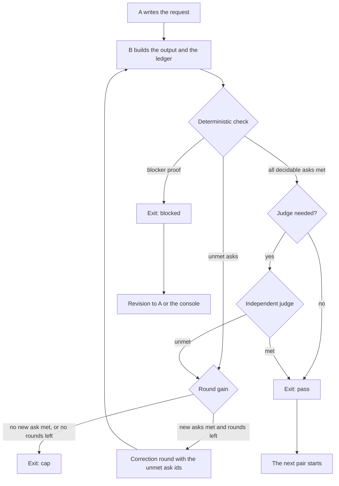

# Phase handoff contract: each phase checks its output against the request of the phase before it

> [ADR-0141](adr/0141-every-phase-handoff-is-a-request-build-check-loop-with-three-exits.md) · plan: [phase-handoff-contract-2026-10](../plans/phase-handoff-contract-2026-10.md) · research: [phase-handoff-contract-2026-10](../research/phase-handoff-contract-2026-10.md).
> This file is the spec of record for the request, the ledger, the check and the exits of each phase pair. The plan holds the components and their order. The task contract ([ADR-0098](adr/0098-task-contract-block.md)) holds how the inbox acceptance gets into the prompts.
>
> **Terms used throughout:**
> - **Phase pair (`A → B`):** two phases where the output of A is an input of B.
> - **Request:** the numbered asks that A gives to B.
> - **Ask:** one item of a request, with an id, a text, a source, an evidence kind and a `required` flag.
> - **Ledger:** the file that B writes, with one entry for each ask.
> - **Check:** the deterministic layer, then the judge layer, on a ledger.
> - **Exit:** pass, cap or blocked.
> - **Revision:** the message of a blocked exit to A or to the console.

## Table of contents

- [1. Goals](#1-goals)
- [2. The loop of one pair](#2-the-loop-of-one-pair)
- [3. The pairs and their requests](#3-the-pairs-and-their-requests)
- [4. The ledger](#4-the-ledger)
- [5. The check](#5-the-check)
- [6. The exits](#6-the-exits)
- [7. The chain and the audit](#7-the-chain-and-the-audit)
- [8. A worked example: cycle 1950](#8-a-worked-example-cycle-1950)
- [9. Code layout](#9-code-layout)
- [Guards](#guards)
- [Limits](#limits)

## 1. Goals

| Goal | Measure | Target |
|---|---|---|
| G1. Each phase pair has a check of the output against the request. | pairs with a check | 5 of 5 |
| G2. A request that cannot be met ends its loop in one round. | rounds on a blocked request | 1 |
| G3. "Confident" is measured. | the pass condition | each required ask met, with resolved evidence |
| G4. The checker is independent of the author. | judge seats on the model of their author | 0 at stage enforce |
| G5. One shared design. | new private gate types or sources of the ask | 0 |
| G6. The audit validates against the first request. | deciding audit chain links | the deterministic links, at stage enforce |

The order of the goals is the order of the build. G2 and G1 come first, because they stop the loss of work in cycles 1946 and 1950.

## 2. The loop of one pair

### Issue

Cycle 1946 spent three build rounds on a request that needed a protected file. The builder named the conflict in round 2, and the loop sent the same failure back (research F1.2).

### Gap

The correction loop (`go/internal/core/cyclerun_correction.go:27-31`) has two ends: approve or exhaust. A request that no output can meet always exhausts. No reviewer reads the request itself.

### Solution

Each pair runs one loop. A writes the request. B builds its output and its ledger. The check reads the ledger against the request. The exit decision picks the next step.



A correction round gives B only the ids of the unmet asks and the evidence that failed. It does not give a generic "fix it". The round reuses the existing loop and its cap (`go/internal/policy/fleet.go:48-49`).

## 3. The pairs and their requests

### Issue

Each check that exists today reads the ask from its own source (research F1.11), and three pairs have no check (F1.10).

### Gap

A fifth check with a fifth source adds to the problem. The registry already names each pair (`gate_in`, `gate_out` in `docs/architecture/phase-registry.json`), but no code reads the names (F1.12).

### Solution

The `handoff` policy block declares each pair. A request builder in `go/internal/handoff` makes the request of each pair from one source.

| Pair | Source of the request | Asks | Evidence kinds | Judge |
|---|---|---|---|---|
| `scout-triage` | the scout selection | each selected slug | a `top_n` entry, or a `deferred` or `dropped` entry with a reason | none |
| `triage-tdd` | the inbox acceptance of each committed item (the task contract) | each acceptance entry | a predicate name that the ACS package declares, and its red run | spec fidelity |
| `tdd-build` | the tdd predicates | each predicate | the green run of the predicate on the build tree | none |
| `build-audit` | the inbox acceptance and the tdd predicates | each acceptance entry | the ledgers of `triage-tdd` and `tdd-build` | implementation fidelity |
| `intent-scout` | the `acceptance_checks` of `intent.md`, when the intent phase runs | each check | a scout task that names it | intent fidelity |

The `triage-tdd` request comes from `composeTaskContract` (`go/internal/core/task_contract.go:133`), which already resolves the inbox acceptance verbatim. This keeps one source for the inbox acceptance.

## 4. The ledger

### Issue

The tdd persona asks for an AC-Materialization table, but Go checks only its heading (research F1.7). An output can claim anything.

### Gap

A table in a Markdown report has no ids and no pointers that code can resolve.

### Solution

B writes `.evolve/runs/cycle-N/handoff-<pair>.json` next to its report. The schema:

```json
{
  "schema_version": 1,
  "pair": "triage-tdd",
  "request_digest": "sha256:…",
  "output_digest": "sha256:…",
  "author": {"cli": "claude-tmux", "model": "claude-opus-5-5", "tier": "deep"},
  "round": 1,
  "entries": [
    {
      "ask": "a1",
      "status": "met",
      "evidence": [{"kind": "predicate", "ref": "go/acs/cycle1950/predicates_test.go:TestC1950_001"}],
      "note": ""
    },
    {
      "ask": "a2",
      "status": "blocked",
      "evidence": [{"kind": "path", "ref": "go/internal/core/blocker_breaker.go:76"}],
      "note": "the error return after json.MarshalIndent is unreachable for []ResolvedFingerprint"
    }
  ]
}
```

- `status` is one of `met`, `unmet`, `blocked` and `not_applicable`. A `not_applicable` entry must have a `note`.
- `request_digest` binds the ledger to one request. A ledger for an old request does not count.
- `output_digest` is the tree digest of the output, so the audit binding (`go/internal/phases/ship/audit.go:27`) and the ledger name the same tree.
- `author` comes from the dispatch record, not from the agent, so an agent cannot write another identity.

## 5. The check

### Issue

A model that checks its own output usually makes the result worse. A checker of the same family shares the errors of the author (research P2.1, P2.3).

### Gap

The only content check today is a model (the audit chain), and it is the same check for every phase.

### Solution

The check has two layers. The deterministic layer always runs first.

**The deterministic layer (Go, no tokens):**

1. The ledger parses, has the right `pair` and the `request_digest` of the current request.
2. Each ask has exactly one entry. No entry names an ask that is not in the request.
3. Each evidence pointer resolves: a path and line, a declared test, an ACS predicate or a recorded command result.
4. The run result agrees with the status. A `met` predicate is green on the build tree and was red before.
5. The blocker proof (§6) runs on each `blocked` entry and on each `unmet` entry.

**The judge layer (a model, only where a pair declares a judge):**

- It runs only on entries that passed the deterministic layer, and only to ask "does this evidence meet the meaning of this ask?".
- Its seat is another family, or a stronger tier, than the `author` of the ledger. At stage enforce, a seat on the model of the author is refused.
- It writes its result for each ask, with its own identity, to the same `handoff-<pair>.json` under `judge`.

**The pass condition:** each `required` ask is `met`, the deterministic layer resolved its evidence, and the judge (if any) agrees. A stated confidence never counts (research P2.10).

## 6. The exits

### Issue

Cycle 1950 had two predicates that contradict each other. The loop can only approve or exhaust, so the cycle sealed FAIL after its rounds (research F1.3).

### Gap

No exit means "the request is wrong", and an agent claim alone must not stop a loop, or a lane can escape a real failure.

### Solution

| Exit | Condition | What happens |
|---|---|---|
| pass | the pass condition (§5) holds | the next pair starts |
| cap | the redispatch cap is spent, or a round meets no new ask | the existing exhaustion path (`go/internal/core/correction_exhaustion.go:14-43`) |
| blocked | the blocker proof holds for at least one required ask | a revision goes to A, or to the console; the cycle ends as "blocked: needs console", not FAIL; the salvage snapshot stays |

**The blocker proof is deterministic.** It holds in two cases:

1. **A protected path:** a lane cycle can meet the ask only with a change to a protected path (`go/internal/guards/integrity_surface.go`).
2. **A conflict:** two asks of the same request cannot both be met. Example: one ask forbids a production edit, and another ask needs a line that only a production edit can reach.

An agent can name a blocker in its ledger. The exit decision accepts it only when the proof holds. A claim without proof is `unmet`.

**The revision** names the ask ids, the proof and the pair. The console, or the requester phase in a later round, rewrites the request. This is the `C → A` edge that the operator asked for: a later phase sends the request back, and the earlier phase does not repeat it.

## 7. The chain and the audit

### Issue

The audit chain checks each earlier phase, but it runs in shadow and only at the end (research F1.8).

### Gap

The auditor reads Markdown reports and judges them. It has no record of what each phase was asked and what it proved.

### Solution

The ledgers form a chain. The request of each pair comes from the output of the pair before it, and each ledger holds the digest of its request. The audit walks the chain:

1. Each ledger exists, passed its check, and holds the digest of the request from the pair before it.
2. **Validation:** each inbox acceptance entry (the first request) maps through the chain to a `met` entry of `tdd-build`.
3. The links of the audit chain read the ledgers as their evidence. At stage enforce, the deterministic links decide. The judged links (narrative and delivery) stay as the auditor writes them.

Steps 1 and 2 are verification and validation in the sense of research P2.16. Each pair checks that it built what it was asked. The audit checks that the result meets the first need.

## 8. A worked example: cycle 1950

The item `core-package-coverage-batches-after-1944` had two acceptance entries:
- "go test … of ./internal/core reports 100.0% of statements";
- "./internal/core 100 is listed in go/.cover-strict".

The tdd phase wrote `TestC1950_001` (100.0% of `AppendResolvedFingerprint`, error branches included) and `TestC1950_002` (the batch must not edit production code).

| Step | Today | With the handoff contract |
|---|---|---|
| `triage-tdd` request | the acceptance is in the prompt, but the file path was wrong (research F1.4) | asks `a1` and `a2`, each with its acceptance text |
| tdd ledger | none | `a1` met by `TestC1950_001`; `a2` met by a cover-strict predicate; `TestC1950_002` listed as a constraint |
| deterministic check | none | the conflict proof: `TestC1950_002` forbids the production edit that the only uncovered statement (`blocker_breaker.go:76`, an error return after `json.MarshalIndent`) needs |
| exit | the build ran 2 corrections, then FAIL | blocked in round 1 of `triage-tdd`, before the build ran |
| result | the work of the build was lost | a revision to the console names `a1` and `TestC1950_002`; PR #979 carries the change at the console |

## 9. Code layout

| Path | What it holds | Protected |
|---|---|---|
| `go/internal/handoff` | the types, the ledger schema, parse and validate (H1) | no |
| `go/internal/handoff/request` | the request builders for each source (H2) | no |
| `go/internal/handoff/evidence` | the evidence resolvers (H3) | no |
| `go/internal/handoff/exit` | the exit decision and the blocker proof (H4, H5) | no |
| `go/internal/policy/handoff.go` | the `handoff` policy block (H6) | no |
| `go/cmd/evolve/cmd_handoff.go` | `evolve handoff check` and `evolve handoff show` (H7) | no |
| `go/internal/core` and `go/cmd/evolve/cmd_cycle.go` | the handoff reviewer in the reviewer chain (H8) | yes, console |
| `agents/` and `go/internal/core/task_contract.go` | the ledger in the personas and the request in the task contract (H9) | yes, console |

The `handoff` package depends on `inboxbatch`, `committedset` and the guards manifest. It does not depend on `core`, so `core` can call it without a cycle.

## Guards

| Rule | Guard | State |
|---|---|---|
| A ledger names only the asks of its request. | the H1 validate test | planned |
| Each evidence pointer resolves in code. | the H3 resolver tests | planned |
| A blocked exit needs proof, not a claim. | the H5 test: a claim with no proof is `unmet` | planned |
| A round with no new met ask ends the loop. | the H4 test | planned |
| A judge seat is not the model of the author at stage enforce. | the H10 refusal test | planned |
| Each pair starts at shadow. | the H6 default test | planned |
| The replay of cycles 1946 and 1950 ends blocked in round 1. | the H7 replay test with the archived run artifacts | planned |

## Limits

- The deterministic layer proves that evidence exists and runs. It does not prove that the evidence means what the ask means. The judge covers that part, and a judge is a model.
- The blocker proof covers two cases: a protected path and a conflict between asks. Other kinds of an impossible request (for example, a missing fact) end at cap, as today.
- The design does not sign the ledgers. All phases run in one trust domain.
- The design does not change the phase order, and it does not add a phase.
