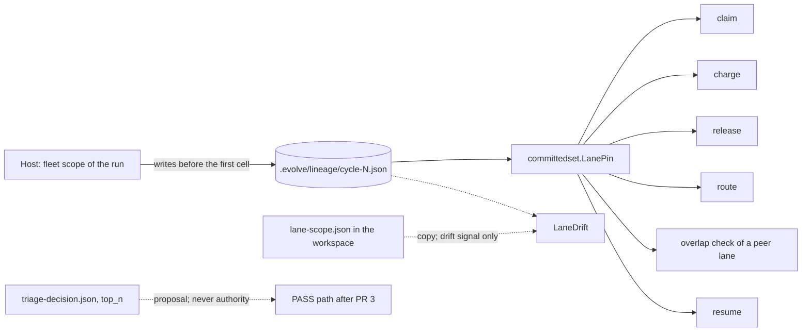

# The queue trust root: the host decides what a cycle may do to the queue, and no file of a cell decides

**Status:** proposed, 2026-11-05. PR 1 is built and in review on the branch `feat/one-trust-root-for-the-queue`. No code of this design is on `main`. Each new name in this file is a proposal until its component lands: `committedset.ReadRecord`, `ReadLaneDoc`, `LaneDrift`, `prebuild_brake_items` and `prebuild_brake_window_cycles`.

> [ADR-0160](adr/0160-the-host-lineage-record-is-the-one-trust-root-for-what-a-cycle-may-do-to-the-queue.md) · plan: [queue-authority-from-host-facts-2026-11](../plans/queue-authority-from-host-facts-2026-11.md) · research: [queue-trust-root-2026-11](../research/queue-trust-root-2026-11.md).
> This file is the spec of record for the host lineage record and its one reader. It also covers the write boundary, the typed route reason, the mover refusal and the breaker. [llm-isolation](llm-isolation.md) holds the sandbox and the input index.
>
> **Terms used throughout:**
> - **Pin:** the item ids that a lane owns.
> - **Host record:** `.evolve/lineage/cycle-N.json`. The host writes it.
> - **Workspace:** the directory of one cycle under `.evolve/runs`. A cell can write in it.
> - **Cell:** the sandboxed process of one phase agent.
> - **Claim, charge, release, route, promote:** the five acts on an inbox item. A claim moves it into `processing/`. A charge adds one to `failure_count`. A release returns it to the inbox. A route sends it to the console. A promote marks it done.
> - **Breaker:** the rule that parks an item after repeated failures before build.
> - **Brake:** the rule that stops the breaker when many items fail with one cause.

## Table of contents

- [1. Goals](#1-goals)
- [2. A worked example](#2-a-worked-example)
- [3. The host record](#3-the-host-record)
- [4. One reader and a reference guard](#4-one-reader-and-a-reference-guard)
- [5. The workspace copy and the drift signal](#5-the-workspace-copy-and-the-drift-signal)
- [6. The write boundary](#6-the-write-boundary)
- [7. The typed route reason](#7-the-typed-route-reason)
- [8. The mover refusal and the PASS path](#8-the-mover-refusal-and-the-pass-path)
- [9. The breaker and the brake](#9-the-breaker-and-the-brake)
- [Guards](#guards)
- [Limits](#limits)

## 1. Goals

| Goal | Measure | Target |
|---|---|---|
| No file in a workspace gives authority over the queue | Readers of the pin file outside `committedset` and a short list | 0 |
| A forged pin changes no item | `b` and `c` item files after a real cycle with a forged pin | Identical |
| A damaged or unwritable record never gives the file authority | The probes of research F1.11 | A signal, a stopped cycle |
| The PASS path moves only items of the record | Promote list with `top_n` `[a, b, c]` and the record `[a]` | `[a]` (after PR 3) |
| A route reason holds host text only | An injection string in `routed_reason`, the ledger and signals | Absent |
| A shared fault does not park the queue | The brake on the real closeout | Fires |

The goals are in priority order. The first goal comes from five blocked rounds: a fault of this class closes at its source (synthesis).

## 2. A worked example

Lane L has the record `[a]`. Item `a` names `go/internal/guards/role.go`. Items `b` and `c` belong to other lanes.

| Event | Result |
|---|---|
| A cell writes `lane-scope.json` with `[b, c]` | Each reader still gets `[a]`. The host emits one violation signal that names both lists. |
| The claim step runs | It claims `a`. `b` and `c` do not move. |
| Code asks the mover to release `b` for this cycle | The mover refuses and emits a signal (section 8). |
| A cell writes `.evolve/lineage/cycle-N.json` | The sandbox denies the write (section 6). |
| A cell plants a link from `token-usage.json` to the record | The host write refuses the link. The record keeps `[a]`. |
| Triage writes a card for `a` that names the path | The host routes `a` at once, with a reason that holds only the path (section 7). |
| A resume starts a new run of cycle N with the forged file in place | The record keeps `[a]`. |
| The record cannot be written because `.evolve/lineage` is blocked | The dispatch stops with a named failure. No cell starts. |
| The record is damaged | The readers give no authority. The cycle stops with one signal. |
| Scout fails on `a` in two cycles, and no other item shares the cause | The breaker parks `a`. |
| Scout fails on `a`, `b` and `c` with one cause in the window | The brake fires. Nothing parks, and each continuation stays. |

## 3. The host record

### Issue

On `main`, four files that a cell can write give a cycle authority over the queue: `lane-scope.json`, `triage-decision.json`, `build-report.md` and `audit-fail-reason.json` (research F1.2). The role guard allows each write under the workspace (`go/internal/guards/role.go:83-85`). The sandbox pin on `lane-scope.json` is on only at the stage `enforce`, and the default is `shadow` (`go/internal/bridge/read_isolation.go:65`, `docs/architecture/llm-isolation.md:783`). Six review rounds found a new reader or a new file with the same fault each time (research F1.1).

### Gap

Each earlier design moved the authority to another place, and a cell reached it. #1290 used a new record in the workspace. The rebuild used a value in memory, which a reader in another process cannot get (`go/internal/core/lane_scope_assembly.go:71`). A fix at one reader cannot close a fault that 61 lines in 29 files share (research F1.3).

### Solution

The host record is the one source. Its shape is `{"cycle", "run_id", "item_ids"}`. The host writes it before the first dispatch of each run, from the fleet scope that the orchestrator holds in memory (`go/internal/core/cyclerun_dispatch.go:96`, `go/internal/core/input_index.go:53-62`). This code exists today for the input index. The design extends its use.

Four rules govern the record:

1. The record lives in `.evolve/lineage/`, which is outside every workspace. The repo is read-only for a cell, and the contract rows prove it (research F1.13).
2. The host value wins at the start of a run. A new run of the same cycle keeps the ids of its record (D3). A resume cannot turn a forged file into a record (research F1.5). This amends `llm-isolation.md`, which says that a new run replaces the record.
3. The record is valid only when `cycle` matches the file name and the key `item_ids` exists (D15).
4. A record with no ids, or no record at all, means "no pin". A cycle with no pin takes its ids from `top_n`, as on `main`. Such a cycle is not a lane (research F1.14).

The record type and its reader live in `committedset`, because `inputindex` imports `committedset` (`go/internal/inputindex/build.go:13`). `inputindex` calls the reader.

## 4. One reader and a reference guard

### Issue

About 30 production sites read the pin or the decision file, through `committedset`, `core.LaneScopeIDs`, `loadLaneScope`, `readLanePin` and `CommittedIDsFor` (research F1.3). Three readers of the pin existed. The fault spread because each one read the file.

### Gap

A check at each reader needs 30 or more edits, and the next new reader reopens the fault. The guard of PR 1 flags a read only when the call and the file name appear in one expression. It missed 6 of 8 planted forms (research F1.12).

### Solution

`committedset.LanePin(workspace)` is the one reader. `core.LaneScopeIDs`, `loadLaneScope` and `readLanePin` call it (D2). `CommittedIDsFor` goes away, and the closeouts call `committedset.Committed` (D6).

The reader follows this order:

1. Derive the project root and the cycle from the workspace path. Another workspace shape reads the file, as on `main`.
2. Read the record. If it is valid and holds ids, return them.
3. If the record is missing (`os.ErrNotExist`), read the file. No cell has run at that point.
4. If the record is damaged, return no authority and raise a signal (D15).

The reference guard replaces the call-shape guard (D17). It fails on any reference to `LanePinFile`, `LaneScopeFile` or a string that contains `lane-scope.json`, outside `committedset` and a short list. The list holds the write in `core/lanescope.go`, the sandbox pin in `bridge/read_isolation.go` and the message text. A new use must change the list, and a reviewer reads that change.

## 5. The workspace copy and the drift signal

### Issue

The agent needs to read its own assignment, so `lane-scope.json` stays in the workspace. If the file differs from the record, a cell wrote it. The old signal text said that a cell "may have" written the file, and it fired only on a normal exit of a phase.

### Gap

The signal runs after the try loop ends normally. A cell that forges the file and then aborts the phase raises no signal (research F1.1, round 6). When the record is the damaged side, the old text blames the file, and the file is correct (research F1.10).

### Solution

The file is a copy, and it grants nothing. `LaneDrift` compares the record and the file, and it runs on each exit path of a dispatch (D18). It emits one violation signal for each cycle, and the text names both lists, the file and the next step. It states the true cause: "the file differs from the record; the host kept the record". If the record is the damaged side, the signal says so (D15).

## 6. The write boundary

### Issue

A cell must not write the record, and the host must not be made to write it. Today, three paths reach the record or its trust:

- A direct write by a cell. The sandbox contract rows `write a pipeline lineage record in .evolve/lineage/` and `rewrite the lane-scope.json of the own workspace` expect `contractDeny` (`go/internal/bridge/sandbox_contract_integration_test.go:204`, `:208`).
- A write by the host through a link. The host writes `token-usage.json` and the raw logs into the workspace with `os.WriteFile` (`go/internal/bridge/tmux_repl_report.go:20`, `go/internal/bridge/driver_tmux_repl.go:129`). A planted link sends that write to the record (research F1.10).
- A failed write. On `main`, a failed record write prints a WARN, and the cell starts (`go/internal/core/input_index.go:34`).

### Gap

A deny on the cell write does not stop the host from writing where a cell points. The "no cell has run" argument fails when the write fails or the record is damaged, because a cell can write the file during the fault (research F1.11). The file-name guard does not see a host write at all.

### Solution

Five rules close the three paths:

1. The sandbox grant check refuses any write grant that covers `.evolve/lineage`. A contract test proves a deny on the real sandbox (D5).
2. A host write into a workspace goes through one helper that refuses a symlink (D16). A guard test lists the helper as the only allowed writer in `go/internal/bridge`.
3. The record has the mode 0444. `atomicwrite` renames a new file into place, so the host can still replace it. A host `os.WriteFile` through a link fails with a permission error (D16).
4. A record that cannot be written for a fleet cycle stops the dispatch with a named failure (D14). Pass `req.GoalHash` through `indexTarget`, so that `cycleRecord` never reads the file to fill a field.
5. Only `os.ErrNotExist` reads the file. A damaged record gives no authority (D15).

## 7. The typed route reason

### Issue

Six sites move an item to the console. Two reason strings embed agent text: `(the lane said: %s)` and the test and file names of a predicate (`go/internal/core/blocker_proof.go:299`, `:301`, `go/internal/core/tdd_protected_route.go:58`). A reviewer probe put an injection string into `routed_reason`, the ledger and a signal (research F1.7).

### Gap

A check at each caller repeats the fault. A sixth caller can pass a string again.

### Solution

`RouteConsole` takes a typed reason (D8). Host values build it: a refusal code and a proven protected path. Only the operator verb can pass free text, through a constructor that says so. The compiler lists each caller that must change, and a string no longer compiles.

Triage routes a protected card when it detects it, if the card is in the pin and the item names the path (D7). The route does not wait for a closeout, which a failure before build never reaches. The ledger and the signal center receive the route.

## 8. The mover refusal and the PASS path

### Issue

The PASS path of post-ship reads the agent. `committedInboxIDs` starts from `inboxmover.CommittedIDs(body)`, the `top_n` of the agent, (`go/internal/phases/ship/postship.go:261`), and joins it to the pin (`:283-297`). `ClosesInboxIDs` runs on the same path (`:299`). `SupersededInboxIDs(body)` (`:159`) and `ClosesInboxIDs(readBuildReport(...))` (`:266`) add two more agent lists. A reviewer probe with the record `[a]` and `top_n` `[a, b, c]` returned `[a b c]` (research F1.9).

### Gap

PR 1 moves the readers of the pin file to the record. It does not touch these three lists. A check in each consumer repeats the fault.

### Solution

`lifecycle.Mover` refuses an act of a cycle on an item outside its record, and it emits a signal (D9). The PASS path takes its ids from the record, and it intersects each agent list with the record before the mover sees it. An operator verb is not bound to a cycle, so the refusal does not apply to it.

This part is built in PR 3. Until then, **PR 1 closes the authority of the pin file and does not close the agent lists on the PASS path.** A forged `top_n` can promote an item of another lane on a landed PASS. The first draft of the plan said that PR 1 "closes the class". That statement was false.

## 9. The breaker and the brake

### Issue

A system-level failure before build never raised `failure_count`, so each wave claimed the same item again (cycles 2133 and 2151). The first brake of #1290 read two dead inputs. `LastCycleNumber` advances on each verdict (`go/internal/core/cyclerun.go:202`). The fingerprint comes from `audit-fail-reason.json`, which a failure before build does not write (`go/internal/cycleoutcome/cycleoutcome.go:172`). On the real closeout, the brake gave `brakeSignals=0 breakerSignals=3` and parked three items (research F1.8).

### Gap

A breaker with no fleet view names a message poison during an outage (research P2.5). A breaker that charges ids from a file that a cell writes charges forged ids. So the breaker needs PR 1 first.

### Solution

- **Charge.** The breaker charges each failure before build against the items of the record, except the host fault codes of a `RefusalDisposition` field (D10).
- **Cause key.** The key is the last phase and `SystemFailure.Category`. It does not use the audit fingerprint (D11).
- **Brake.** When `prebuild_brake_items` distinct items hold one cause inside `prebuild_brake_window_cycles`, nothing parks, and one signal goes out. The first values are 3 and 15. They are estimates (D12).
- **Order.** The continuation goes only after the park succeeds, so a braked item keeps its salvage (D13).
- **Source of the window.** The window comes from the item stamps and `CycleResult`, not from `state.json`.

## Guards

| Rule | Guard | State |
|---|---|---|
| The host record is the only source of the pin | `TestLanePin_*` and the journey with a forged pin | In review (PR 1) |
| No code outside a short list names the pin file | The reference guard, with 8 planted forms | In review (PR 1); the 8-form version is planned (D17) |
| A cell cannot write the record | `TestAgentSandboxContract` rows, and `TestResolveSandboxWriteGrants` | In review (PR 1). The console ran the rows on 2026-11-05 |
| A damaged or unwritable record stops the cycle | Probe tests of research F1.11 | Planned (PR 1 round 2: D14, D15) |
| A host write into a workspace refuses a link | Helper test and a guard test | Planned (PR 1 round 2: D16) |
| The drift signal fires on each exit path | Dispatch test with a failing phase | Planned (PR 1 round 2: D18) |
| A route reason is a type | The compiler, and an injection test | Planned (PR 2) |
| The mover refuses an act outside the record | Mover test and a post-ship journey | Planned (PR 3) |
| The brake fires on the real closeout | Journey with `state.json` as `finalizeCycle` leaves it | Planned (PR 4) |

## Limits

- PR 1 does not close the agent lists on the PASS path. PR 3 does. Between the two, a forged `top_n` can promote an item of another lane on a landed PASS.
- A cycle with no pin takes its ids from `top_n`. Such a cycle is not a lane. The checked-in `fleet.count` is 4 (`.evolve/policy.json:122`).
- A cycle with no record trusts the file. The host writes the record before the first cell, so no cell ran at that point. This holds only when the record is missing, not when it is damaged.
- The reference guard proves that no code names the pin file outside the list. It does not prove that no code reads an agent id from another file.
- A reviewer found about 60 calls of `os.WriteFile`, `os.Create` or `os.OpenFile` in non-test code, and nobody classified them. D16 covers the ones that write into a workspace, and the list is not complete.
- `cycleclassify` reads an agent-written report to decide if a failure is charged. D11 replaces this for the breaker only.
- Three real poison items with one cause inside the window brake. They keep their retries until an operator reads the signal. This fails in the safe direction.
- `SystemFailure` can be nil on a verdict FAIL. Then the key is the last phase alone. PR 4 measures this on real closeouts.
- If a cycle number is ever reused with another assignment, the cells see the new ids and the readers see the old record. Plan Q1 asks if this can happen.
- The design does not stop a prompt injection from steering an agent. It stops the result from becoming authority over the queue.
- No outside source covers an agent-written file as a control plane (research P2.7). The evidence for this design is our own.
