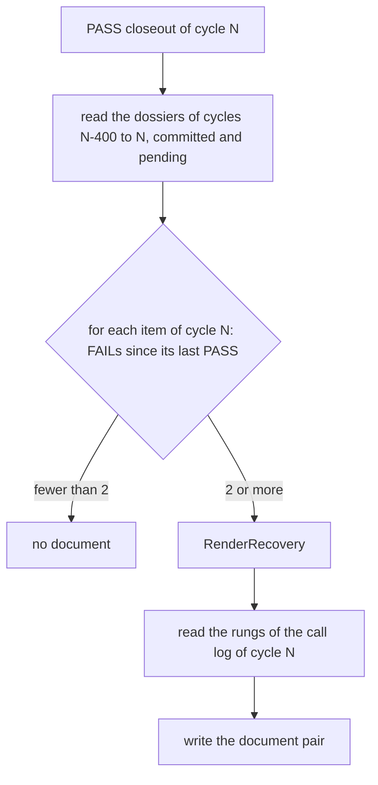

# Recovery retrospectives: the host records how a failed item finally shipped

> [ADR-0151](adr/0151-the-host-writes-a-retrospective-document-for-each-recovery-and-each-judgment-lesson.md) · plan: [recovery-retrospective-2026-10](../plans/recovery-retrospective-2026-10.md) · research: [recovery-retrospective-2026-10](../research/recovery-retrospective-2026-10.md).
> This file is the spec of record for the recovery retrospective and for the judgment-lesson document. The package note [internal-recoveryretro.md](packages/internal-recoveryretro.md) holds the code map.
>
> **Terms used throughout:**
>
> - *recovery*: a PASS cycle that ships an item after two or more FAIL dossiers since the last pass of the item.
> - *try row*: one line of the history table, made from one committed cycle dossier.
> - *judgment lesson*: the P1 carryover todo `cycle-<N>-judgment-<phase>` from `recordJudgmentLesson`.
> - *document pair*: a markdown document and its lesson YAML, with the same base name.
> - *stage*: `shadow` writes into the cycle workspace only. `enforce` publishes to `docs/retrospectives/`.

## Table of contents

1. [Goals](#1-goals)
2. [The recovery document](#2-the-recovery-document)
3. [The judgment-lesson document](#3-the-judgment-lesson-document)
4. [The lesson YAML](#4-the-lesson-yaml)
5. [Where the closeout writes](#5-where-the-closeout-writes)
6. [The enforce stage](#6-the-enforce-stage)
7. [Guards](#7-guards)
8. [Limits](#8-limits)

## 1. Goals

| Goal | Measure | Target |
|---|---|---|
| G1 Each recovery has a document with each try and the difference | document pairs against recoveries | one pair for each recovery |
| G2 A judgment todo leaves the log only with its document on `main` | judgment todos with no published document | 0 after one boundary at `enforce` |
| G3 The recall still finds each lesson | a keyword query for the item | the lesson YAML is returned |
| G4 No LLM call, and nothing on `main` at `shadow` | LLM calls; files outside the workspace | 0; 0 |

The goals are in order. G4 holds first, because the stage is `shadow` until the operator moves it.

## 2. The recovery document

### Issue

An item can fail in many cycles before it ships. `tokenopt-handoff-digests-per-edge-remainder` failed in seven cycles and shipped in cycle 1944 (research F2.4). The retrospective phase runs only on FAIL or WARN, so the pass leaves no record.

### Gap

The inbox item keeps only its last failure (`bumpWith`, `go/internal/inboxmover/lifecycle/item.go`), and a quarantine release resets the counter. The item cannot give the history.

### Solution

The committed cycle dossiers give the history. `Recoveries` takes the dossiers of a window and the PASS dossier of the cycle. For each item of the PASS dossier, it collects the FAIL dossiers that name the item, in cycle order. A PASS dossier of the same item resets the list. Two or more failures make a recovery.

`RenderRecovery` writes these sections:

1. **The header:** the item, the ship cycle and its commit, and the count of failed tries.
2. **Tries:** one row for each try: cycle, verdict, class, fingerprint, first reason, mark. A row with the class `unknown` or a fingerprint that starts with `worktree|` gets the mark `infrastructure?`.
3. **Difference:** the last failed try against the passed try. It lists the phases that only one try ran and the phases whose model changed. It lists the ladder rungs above `R0` that the passed try used, and the count of distinct fingerprints. When it finds no difference, it says that the pass can be luck.
4. **Lesson:** one fixed sentence that the host builds from the item, the count, the classes and the ship cycle.
5. **Judgment:** a placeholder. A person or a later stage writes the reason for the pass here.

A worked example with the values of `inboxbatch-utf8-and-resolution` (F2.6):

| Cycle | Verdict | Class | Fingerprint | Mark |
|---|---|---|---|---|
| 1804 | FAIL | `gate-block` | `build\|gate-block\|9af1ff95a11a` | |
| 1806 | FAIL | `unknown` | `worktree\|unknown\|38ddaf05594b` | `infrastructure?` |
| 1808 | FAIL | `gate-block` | `build\|gate-block\|0b91bd88eb78` | |
| 1809 | PASS | — | — | |

The lesson sentence of this example is: "The item `inboxbatch-utf8-and-resolution` failed in 3 tries with the classes `gate-block` and `unknown`. Cycle 1809 shipped it. Before a new try of a similar item, read the difference above." `TestRenderRecovery_ShowsEachTryTheMarkAndTheDifference` pins this example.

## 3. The judgment-lesson document

### Issue

`recordJudgmentLesson` (`go/internal/core/judgment_lesson.go`) stamps its todo with the `intent-rejected` retention, so the todo never expires. PR #1081 left this todo open as a policy choice.

### Gap

A TTL alone drops a lesson that has no other record. A todo that never expires grows the carryover log.

### Solution

The operator decided on 2026-10-21 that the lesson moves to a document. `JudgmentLessons` selects each todo whose id matches `cycle-<N>-judgment-<phase>`. `RenderJudgmentLesson` writes the cycle, the phase and the lesson text. The base name of the document is the todo id, so the same lesson always has the same name.

## 4. The lesson YAML

The recall (`internal/research`) reads only `.yaml` and `.yml` files. Each document pair thus has a lesson YAML in the shape of `internal/research`:

| Field | Recovery | Judgment lesson |
|---|---|---|
| `id` | the base name | the todo id |
| `pattern` | `recovery of <item>` | `judgment of <phase>` |
| `description` | the lesson sentence | the todo action |
| `source` | `docs/retrospectives/<base>.md` | the same |
| `type` | `recovery` | `judgment` |
| `preventiveAction` | read the document before a new try of a similar item | read the document before the phase judges a similar plan |
| `failureContext.failedStep` | empty | the phase |
| `failureContext.errorCategory` | the failure classes | empty |

The writer quotes each value with `strconv.Quote`. A Go double-quoted string is a valid YAML double-quoted scalar, so the writer has no error path. `TestLessonYAML_IsRecalledByTheKnowledgeBase` parses both files through `research.FileKB`.

## 5. Where the closeout writes

`cycleRun.completeCycle` calls `writeShadowRetrospectives` after the dossier write (`go/internal/core/cycle_closeout.go`, `go/internal/core/retrospective_shadow.go`). It runs on each verdict:

- A PASS cycle can write recovery pairs.
- Each closeout writes a pair for each judgment todo in the state. At `shadow`, each workspace thus gets a fresh copy. At `enforce`, the same name gives the same file, so a second write changes nothing.

At `shadow`, `recoveryretro.WriteShadow` writes the pairs into `<workspace>/retrospectives/` and nowhere else. It reads the dossiers from `knowledge-base/cycles/` and `.evolve/dossiers-pending/`, because a fleet lane leaves its dossier pending until the boundary. It returns each path that it wrote and joins each error. The closeout prints one WARN line for the errors and goes on.

## 6. The enforce stage

The next PR builds this stage (plan C4 to C6). It is a design here, not code.

1. The key `retrospectives.stage` takes `shadow` or `enforce`. The compiled default stays `shadow`.
2. At `enforce`, the closeout writes the pairs into `.evolve/retrospectives-pending/`.
3. The boundary publish commits the pending pairs into `docs/retrospectives/` with the dossiers.
4. After the publish, a judgment todo whose `docs/retrospectives/<id>.md` is in the published tree leaves the carryover log through `carryover.Retire`. The check repeats at each closeout, so a failed publish keeps the todo.
5. `docs/retrospectives/` joins the default recall roots.

## 7. Guards

| Rule | Guard | State |
|---|---|---|
| Two failures since the last pass make a recovery | `TestMinFailures_IsTheFewestFailuresThatMakeARecovery`, `TestRecoveries_AnEarlierPassResetsTheFailureCount` | built |
| The window bounds the history | `TestHistoryWindow_BoundsTheDossiersThatWriteShadowReads` | built |
| A cycle in both dossier directories counts once | `TestWriteShadow_ACycleInBothDossierDirsCountsOnce` | built |
| An unreadable call log writes no recovery pair, so no rung line is false | `TestWriteShadow_AnUnreadableCallLogIsAnError` | built |
| An infrastructure failure gets its mark | `TestRenderRecovery_ShowsEachTryTheMarkAndTheDifference` | built |
| The host text passes the strict STE lint | `TestRenderRecovery_PassesTheStrictSTELint`, `TestRenderJudgmentLesson_NamesTheCycleThePhaseAndQuotesTheLesson` | built |
| Agent text cannot break a code span or a table | `quote` and `cell` replace backticks, line breaks and `\|` | built |
| The shadow stage writes only into the workspace | `TestWriteShadow_APassAfterFailuresWritesTheRecoveryPairInTheWorkspaceOnly`, `TestRunCycle_TheCloseoutWritesTheShadowRetrospectiveIntoTheWorkspace` | built |
| A write failure never stops the closeout | `TestWriteShadow_AWriteFailureIsReturnedAndTheOtherPairsStillWrite`, `TestWriteShadowRetrospectives_AFailureIsAWarnLineOnly` | built |
| A judgment todo leaves the log only with its document on `main` | the C5 tests | planned |

## 8. Limits

- The document states facts. It does not prove why the passed try passed.
- A try before cycle 1624 has no row, because those dossiers have no `tasks`. A try outside the window of 400 cycles has no row.
- A FAIL dossier names each item of its cycle. A multi-item FAIL thus counts for each item, also for an item that the failure did not touch.
- A cycle that only released the item (triage committed other items) is not a try. The ledger counts it, and the document does not.
- The rung line shows no climb until the retry ladder leaves `shadow`.
- At `shadow`, a document lives only as long as its run dir. The GC removes the run dirs.
