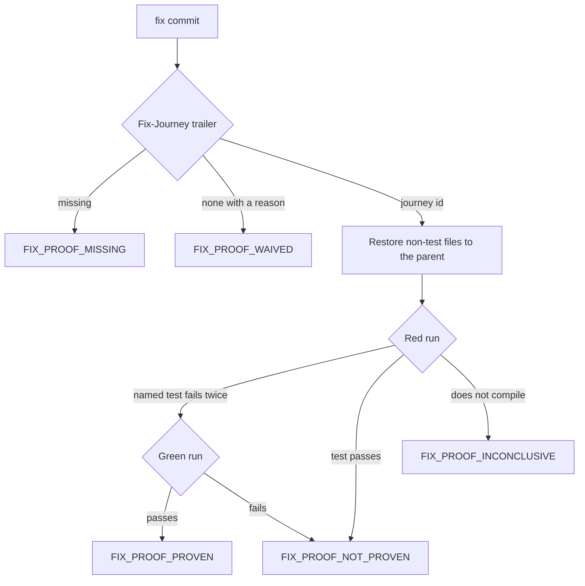

# Regression proof and supervision: a fix proves itself, and a stuck agent says why

**Status:** proposed, 2026-11-04. Each new name in this file is a proposal until its component lands: `GUARD_DENIED`, `guard_refused`, `FIX_PROOF_*`, `FLOOR_RETAKE_*`, `regression_proof.stage`, `Fix-Journey` and `go/test/journeys`.

> [ADR-0159](adr/0159-the-loop-keeps-its-integration-train-and-takes-six-practices-from-the-2026-harness-projects.md) · plan: [harness-practices-2026-11](../plans/harness-practices-2026-11.md) and [§10 of the integration plan](../plans/wave-integration-2026-10.md#10-amendment-of-2026-11-04-console-prs-enter-the-train) · research: [harness-practices-2026-11](../research/harness-practices-2026-11.md).
> This file is the spec of record for the regression proof gate, the journey registry, derived cycle liveness, the terminal refusal and the floor retake. [wave-orchestrator](wave-orchestrator.md) holds the integration train.
>
> **Terms used throughout:**
> - **Journey:** one path that a user or the loop depends on, named as a sentence, with one test that drives it.
> - **Journey test:** a test that runs the path through its real entry point, with the input shape that production writes.
> - **Red run:** the journey test on the tree without the fix.
> - **Green run:** the journey test on the tree with the fix.
> - **Terminal refusal:** a stop that no retry and no other family can change.

## Table of contents

- [1. Goals](#1-goals)
- [2. A worked example](#2-a-worked-example)
- [3. The journey registry](#3-the-journey-registry)
- [4. The regression proof gate](#4-the-regression-proof-gate)
- [5. Derived cycle liveness](#5-derived-cycle-liveness)
- [6. The terminal refusal](#6-the-terminal-refusal)
- [7. Floor parity](#7-floor-parity)
- [8. The landed identity](#8-the-landed-identity)
- [9. Seat health states](#9-seat-health-states)
- [Guards](#guards)
- [Limits](#limits)

## 1. Goals

| Goal | Measure | Target |
|---|---|---|
| Each fix has a proven journey test | `FIX_PROOF_*` signals | 100% at enforce |
| A refusal costs one stall limit | Denial to end of chain | At most 6 minutes |
| A floor red names its test | Floor reports | 100% |
| A one-off red does not end a cycle | Cycles lost to a red that the retake passes | 0 |

The goals are in priority order. The first goal is the rule of the operator.

## 2. A worked example

PR #1286 fixes a real defect. The `claude-cloud` launch line had a `--` separator, and the real CLI refused it. Each test used a fake CLI, so each review passed (research F3.7).

Under this design the fix goes as follows:

| Step | Action | Result |
|---|---|---|
| 1 | The author records the real CLI argument output as a fixture, and adds a test that checks the launch line against it. | The journey has a test |
| 2 | The author adds the row `cloud-launch-reaches-the-cli` to the registry. | The row resolves |
| 3 | The commit message has `Fix-Journey: cloud-launch-reaches-the-cli`. | The gate has a target |
| 4 | The gate restores each non-test file of the commit to its parent, and it runs the test. | The named test fails on an assertion, so the gate goes on |
| 5 | The gate runs the test on the commit. | It passes: `FIX_PROOF_PROVEN` |

A test that passes in step 4 gets `NOT_PROVEN`. That result means that the test does not depend on the fix.

## 3. The journey registry

### Issue

A brief asks for a test of each fix. Nothing records which journeys exist or which test guards each one. Ten CRITICAL findings sat on green trees (research F3.6).

### Gap

An inbox item has acceptance text, and a test has a name. No machine-readable link joins them. Anthropic's harness keeps a JSON list because a model is less likely to overwrite JSON than Markdown (research F8.5).

### Solution

The registry is one JSON file at `go/test/journeys/journeys.json`. Each row has four fields.

| Field | Meaning | Example |
|---|---|---|
| `id` | A short slug | `cloud-launch-reaches-the-cli` |
| `journey` | One sentence in plain words | A cloud launch reaches the real CLI |
| `test` | The package and the test name | `internal/bridge.TestClaudeCloud_...` |
| `issue` | The inbox id or the PR | `#1286` |

A guard test in `go/test/journeys` fails when a row names a test that does not exist. The file and each test that it names are on the protected surface, so a cycle cannot remove or weaken them (research F8.3). A row never goes away by edit. A retired journey keeps its row with the field `retired` and a reason.

**Who adds a row.** A lane cannot change a protected path, so a lane adds no row. A lane fix names its test: `Fix-Journey: test:<package>.<Test>`, and the gate runs it. The lane writes the row as a held proposal ([ADR-0157](adr/0157-the-loop-works-its-own-code-a-narrow-fence-and-held-proposals.md)), and the console adds it at the boundary. Until then the gate reports `FIX_PROOF_PROVEN` with `row=pending`.

## 4. The regression proof gate

### Issue

The rule "prove it red" lives in a brief. A builder reports its own red. An agent can also edit a failing test (research F8.3).

### Gap

The commit gate checks reviews, coverage and lint. It has no check that a test depends on the fix. We found no outside gate of this kind (research F8.2).

### Solution

The gate runs in `evolve commit-gate` and in the ship gate. The red run uses a temporary worktree. Test files come from the commit, and each other file comes from the parent. This keeps the copy of the test that the author wrote and removes the fix.

The red run must fail twice, and each failure must name the journey test, so a one-off or an unrelated failure is not proof. A failure that names no such test is `INCONCLUSIVE`. A compile failure is `INCONCLUSIVE` too, because a test can need an API that the fix adds. Neither blocks. A high share of this result means that the design must change (ADR-0159).

The stage key is `regression_proof.stage`, in `shadow` first. At shadow each result is a signal and blocks nothing. At enforce `FIX_PROOF_MISSING` and `FIX_PROOF_NOT_PROVEN` block.

The floor already runs the tests of the changed packages, the `PASS_TO_PASS` idea of SWE-bench. The gate adds the `FAIL_TO_PASS` half (research F8.1).

## 5. Derived cycle liveness

### Issue

After cycle 2151 sealed, the role guard refused a standalone agent. When `cycle_id` is not 0, the guard confines a write to the workspace and the worktree (`go/internal/guards/role.go:57`). The file still held 2151 with `phase` `aborted`, so a standalone agent outside those paths got a refusal (research F3.4).

### Gap

The state file records the last cycle. It does not state that the cycle is alive. The loop clears the marker only on a clean exit (`go/cmd/evolve/cmd_loop.go:223`), so an abort keeps it.

### Solution

The guard derives the answer from live facts:

| Phase | Owner lease | Answer |
|---|---|---|
| Live phase | Any | Active: keep each rule |
| `aborted` or end | Live | Active: keep each rule |
| `aborted` or end | Proven dead or absent | Not active |
| Any | Unreadable | Active: keep each rule |

The last row fails closed. The guard reads the run lease in the cycle workspace (`.lease`). The owning loop holds it, and it ends when that loop exits. The check reuses `runlease.OwnerLive`, as `SealCycle` does (`go/internal/core/reset.go:121`). The guard writes nothing.

## 6. The terminal refusal

### Issue

A denied agent stopped and waited at its prompt. The 300-second stall limit worked. Then the chain tried 2 more families, and a second incident repeated this for 35 minutes in all (research F3.5). The summary said "after a quota wall", which was not the cause.

### Gap

The chain treats each stall as transient. A guard denial does not depend on the family, so a retry cannot change it (research F6.5).

### Solution

Each guard denial emits `GUARD_DENIED` with the run id. When a stall limit ends a run, the bridge reads the denials of that run. A denial in the run makes the terminal reason `guard_refused`:

- The dispatch chain stops.
- `evolve selfheal propose` stops the pass, and it records each other incident as skipped with this reason.
- The summary names the guard and the path.

A stall with no denial keeps today's behavior.

## 7. Floor parity

### Issue

One nameless red ended cycle 2151, and 6 reruns passed (research F3.2). The floor keeps the last 400 bytes (`go/internal/core/build_floor_reviewer.go:184-190`).

### Gap

The audit tier removes env-exclusive packages under a live loop (`go/internal/phases/audit/ciparitygate/tierscope.go:20`) and retakes a red run serialized (`go/internal/phases/audit/ciparitygate/tier.go:94`). The floor does neither.

### Solution

- The floor and the audit tier call one scope function, so the rule has one home.
- A red floor retakes the failed packages once, serialized, under the audit lock.
- A green retake lets the build go on, and it emits `FLOOR_RETAKE_GREEN` with the test names.
- A red retake fails the floor, with `FLOOR_RETAKE_RED`.
- The diagnostic parses each `--- FAIL:` line and each failed package. It keeps these names first, then the tail of the output.

## 8. The landed identity

### Issue

`git patch-id --stable` reads the context lines (`go/internal/integration/landed.go:55`). In our test, a peer edit 2 lines from a cycle change altered the patch-id (research F3.9).

### Gap

A composed cycle then reads as not landed, so component I7 of the [integration plan](../plans/wave-integration-2026-10.md) composes it again.

### Solution

The diff that feeds `patch-id` uses `-U1`, one line of context. Research F3.9 shows why: `-U3` breaks on a nearby peer edit, and `-U0` matches the same text at another position. A peer edit next to the change is a merge conflict, so it never reaches this compare. The trailer decides first, and the patch-id checks the recorded change. A deliverable record gains a schema version, because the old ids do not compare with the new ones.

## 9. Seat health states

### Issue

A pane that waits for an answer reads `busy-stagnant` or a stall. An operator reads the pane to learn the cause (research F6.4).

### Solution

`evolve wave status` shows one state for each seat, derived from existing pane data:

| State | Meaning |
|---|---|
| `working` | Output within the stall window |
| `blocked` | At its prompt, with no deliverable |
| `stalled` | Busy, with no output for the window |
| `zombie` | The session is gone, and the run is open |
| `idle` | The deliverable exists |

This is a read-only view. It kills nothing. The host sentinel reads the same states.

## Guards

| Rule | Guard | State |
|---|---|---|
| A registry row names a real test | Test in `go/test/journeys` | Planned (R5) |
| A `fix:` commit has a proof | `regression_proof.stage` | Planned (R6), shadow first |
| A terminal phase with a dead owner is not active | Role guard test | Planned (R1) |
| A guard denial ends the chain | Bridge test | Planned (R2) |
| The floor and audit share one scope | One function, with a test on each caller | Planned (R3) |
| A nearby peer edit keeps the identity | Integration test | Planned (R4) |

## Limits

- The gate proves that a test depends on the fix. It does not prove that the test covers the whole journey.
- A test that fails twice by chance on the old tree and passes on the new tree still reads as proof.
- A fix that adds an API gets `INCONCLUSIVE`, so the gate proves less for that fix.
- A behavior-preserving change states `none`, and a review seat judges the reason.
- Health states read pane text, so a new CLI version can change what they see.
- This design does not address semantic conflicts between deliverables. Test layer L2 of the [integration plan](../plans/wave-integration-2026-10.md) holds that work.
