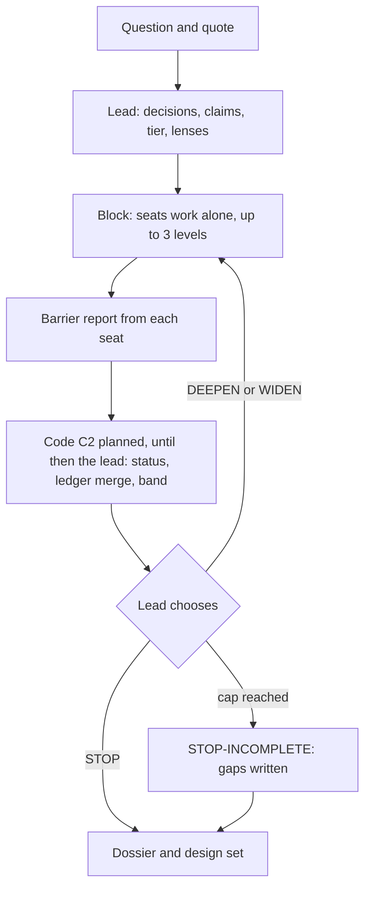

# Research loop: an LLM-steered run inside a code envelope, gated in depth blocks by evidence coverage

> [ADR-0171](adr/0171-research-is-an-llm-steered-loop-inside-a-code-envelope-gated-in-depth-blocks-by-evidence-coverage.md) · plan: [research-diversity-and-depth-2026-11](../plans/research-diversity-and-depth-2026-11.md) · research: [research-diversity-and-depth-2026-11](../research/research-diversity-and-depth-2026-11.md).
> This file is the spec of record for the research loop. The operating rules for the lead and the seats are in [skills/research/references/loop.md](../../skills/research/references/loop.md). The templates of the ledger and the barrier report are in [skills/research/references/ledger.md](../../skills/research/references/ledger.md). The skill entry is [skills/research/SKILL.md](../../skills/research/SKILL.md).
>
> The operator asked on 2026-11-27: "When it reach to multiple layers search (e.g. every 3 layer depth) it report the status and update summary to the main session and decide if it has enough confidence to end the research or continue to the next multiple layer search"
>
> **Status:** proposed. Code for the guards marked "planned" does not exist. Until it exists, the lead applies each rule in shadow (D14). The lead sets each seat status by the status rules (§4). It computes the band by the band rules (§6). It forces STOP-INCOMPLETE at a cap and records the result.
>
> Each place in this file that names code says "code (C2, planned)". The shadow rule applies to each such place.
>
> **Terms used throughout:**
> - **Lead:** the console main session. It acts for the operator. It starts each seat and decides at each barrier.
> - **Seat:** one researcher that the console starts. A seat works alone inside a block.
> - **Level:** one hop from a source that the seat read.
> - **Block:** up to three levels of follow-up for each seat, then a barrier. The size is configuration.
> - **Barrier:** the point at the end of a block where each seat returns its report and the lead decides.
> - **Claim:** one statement that a decision needs. The ledger tracks it.
> - **Decision-driving claim:** a claim that can change the leading option of a decision.
> - **Band:** HIGH, MEDIUM or LOW. Code (C2, planned) computes it from the ledger. Until then, the lead computes it in shadow.
> - **Tier:** T0, T1 or T2. It sets the envelope from the stakes of the decision.

## Table of contents

1. [Goals](#1-goals)
2. [The roles](#2-the-roles)
3. [The claim ledger](#3-the-claim-ledger)
4. [The barrier report](#4-the-barrier-report)
5. [The tiers and the envelope](#5-the-tiers-and-the-envelope)
6. [The band](#6-the-band)
7. [The decision verbs](#7-the-decision-verbs)
8. [The loop-back marker](#8-the-loop-back-marker)
9. [Ownership: code and LLM](#9-ownership-code-and-llm)
10. [A worked example](#10-a-worked-example)
11. [Guards](#11-guards)
12. [Limits](#12-limits)

## 1. Goals

| Goal | Measure | Target |
|---|---|---|
| Diverse views | Lenses with at least one supported or contradicted claim | The builder, skeptic and measurer lenses on each request |
| A justified stop | Runs whose stop reason cites ledger ids and a band | 100% of the runs |
| No stop below the tier band | Runs that stop below the band of the tier without STOP-INCOMPLETE | 0 |
| No error read as done | Seat statuses of "errored" or "stalled" that appear as "covered" | 0 |
| Linked documents | ADR options and drivers with a finding id | 100% |

The order of the goals: a justified stop first, because a wrong stop wastes the whole run. Diverse views second. Links third.

## 2. The roles

### Issue

The skill before this change ran one fan-out and then wrote. No role read the results and decided to continue ([skills/research/SKILL.md:64-66 at commit 6dd24b4](https://github.com/mickeyyaya/evolve-loop/blob/6dd24b416b9288e5c6fcc7ec70ebfc8509f6a30a/skills/research/SKILL.md#L64-L66)). This change rewrites that file, so the line numbers of the old text do not match the file on this tree. A seat cannot tell how much budget remains. Nobody records why a run stopped.

### Gap

A prompt cannot fix this. Agents stop too early on 51–79% of the questions in the measured studies (P3.2 of the dossier). The skill needs a barrier, a record that code can check and a rule that the lead cannot lower.

### Solution



| Role | Who | Duty |
|---|---|---|
| Lead | The console main session, for the operator | Splits the question, starts the seats, reads each barrier, chooses the verb, reports to the main session. |
| Seat | A researcher that the console starts | Works alone in a block, fills the ledger delta, returns the barrier report. |
| Verifier | A seat that did not write the claim | Checks if the cited source supports the claim. |
| Contrarian | One seat after block 1 | Reads the ledger and argues the strongest case against the leading option. |
| Code | The `evolve research` verbs (planned, C2) | Counts, caps, sets the status, computes the band, forces the stop. Until C2 exists, the lead does this work in shadow, by the written rules. |

The AGENTS.md rule "No LLM in the pipeline starts or directs another" holds. The lead is the console and acts for the operator. No phase agent starts a seat.

## 3. The claim ledger

The lead makes the ledger before the first query. The lead splits the question into the decisions that it must support. For each decision, the lead writes the claims that the decision requires.

| Field | Values | Set by |
|---|---|---|
| `id` | `C<n>`, never reused | Lead |
| `decision` | `DEC<n>` | Lead |
| `driving` | yes or no. A claim is driving when it can change the leading option. | Lead |
| `state` | `open`, `supported`, `contradicted`, `unverifiable` | Seat proposes. A verifier confirms. |
| `sources` | links or `path:line`, with the span that supports the claim | Seat |
| `independent` | count of independent sources | Code counts (C2, planned; until then the lead counts). The seat lists. |
| `label` | `measured`, `maker claim`, `search summary`, `synthesis` | Seat |
| `verified_by` | the seat id of the verifier, or empty | Lead assigns |

Rules for the ledger:

1. Two sources are independent when neither one cites or copies the other and they do not come from one vendor.
2. A driving claim is covered when it is `supported` and has two independent sources. One is not the vendor.
3. A claim with the label `synthesis` is never the only support of a T2 driving claim.
4. A seat adds a new claim only with a decision id. A claim with no decision is dropped.

## 4. The barrier report

Each seat returns this report at the end of a block. The template is in [ledger.md](../../skills/research/references/ledger.md).

| Field | Content | Set by |
|---|---|---|
| `status` | `covered`, `budget-capped`, `stalled`, `timed-out`, `errored` | Code (C2, planned). Until then, the lead sets it by the status rules below. |
| `ledger_delta` | the claims that the seat added or changed | Seat |
| `open_leads` | each lead with the claim id that it can change | Seat |
| `exhausted` | the queries and the dead ends, as a list | Code dedups (C2, planned; until then the lead) |
| `conflicts` | pairs of claim ids that disagree | Seat |
| `leading_option` | the option that the seat favors for each decision | Seat |
| `verbal_confidence` | a number from 1 to 5, for the log only | Seat |
| `calls_used` | the count of tool calls | Code counts (C2, planned; until then the lead counts) |

The status is a closed set. Code (C2, planned) sets it from facts: the calls used, the clock, the exit of the process and the count of new claims. Until C2 exists, the lead sets it from the same facts, by these rules. A seat cannot write its own status.

| Status | Condition |
|---|---|
| `covered` | The seat ended inside its caps, with no error, and each claim of its brief is `supported`, `contradicted` or `unverifiable`, each with sources. |
| `budget-capped` | The calls used reached the cap of the tier while a claim of the brief is still `open`. |
| `stalled` | The last level of the seat added no new supported or contradicted claim, and a claim of the brief is still `open`. |
| `timed-out` | The clock cap ended the seat before it finished. |
| `errored` | A tool error or a run error ended the seat. |

`errored`, `stalled`, `budget-capped` and `timed-out` never count as `covered`. When two conditions hold, the lead takes the first that ends the seat in this order: `errored`, `timed-out`, `budget-capped`, `stalled`.

## 5. The tiers and the envelope

The lead sets the tier before the first query. A tier only rises. The numbers are design choices. No source measures them.

| Tier | Decision | Seats | Blocks | Calls for each seat in a block |
|---|---|---|---|---|
| T0 | A two-way door, one small decision | 1–2 | 1 | 10 or fewer |
| T1 | A plan or a reversible design | 3 | 2 or fewer | 15 or fewer |
| T2 | An ADR, a protected surface or a one-way door | 4–5 | 4 or fewer | 15 or fewer, a hard stop at 20 |

The lead can raise the tier at any barrier with a reason. A contradiction on a driving claim also raises the tier. A loop-back run takes the tier of the decision that the marker blocks.

## 6. The band

Code (C2, planned) computes four values from the ledger at each barrier. Until C2 exists, the lead computes them in shadow, by the rules of this section. The thresholds are first values. The shadow log (C4) tunes them.

Three values set the band: coverage, stability and verification. Progress does not set the band. Progress is a guard on the verb: it detects a stall and blocks DEEPEN. It is logged at each barrier.

| Input | Definition | First values |
|---|---|---|
| Coverage | The share of required claims that are `supported`. Driving claims are tracked apart. | Floor: 90% for HIGH, 70% for MEDIUM |
| Stability | The leading option of each decision is the same as at the last barrier. In block 1, the option at level 3 equals the option at level 2. | Held, or not held |
| Verification | The share of driving claims that a seat which did not write them checked as supported. | 100% for HIGH, 50% for MEDIUM |
| Progress | New supported claims for each call. From block 2, divide it by the same value of the last block. Block 1 has no baseline: it shows the plain count of new supported claims, and it is stalled only at 0 new claims. | Falling below 0.5. Stalled at 0 new claims. |

| Band | Rule |
|---|---|
| HIGH | Coverage 90% or more. Every driving claim is covered (rule 2 of §3). No driving claim is contradicted. Stability held. Verification 100%. |
| MEDIUM | Coverage 70% or more. No driving claim is contradicted. Stability held, or verification 50% or more. |
| LOW | Any other state. |

A stalled run (progress at 0 new supported claims in the block) cannot take the verb DEEPEN. The lead chooses WIDEN or STOP-INCOMPLETE. Progress falling below 0.5 is a warning that the lead must name in its reason. It does not block a verb.

## 7. The decision verbs

At each barrier the lead chooses one verb and cites ledger ids. Before the lead orders more search, it re-reads the evidence that the seats already gathered. Strong frameworks missed an answer that they had retrieved in 26–31% of the samples.

| Verb | Meaning | When |
|---|---|---|
| STOP | The research is enough. | The band is at or above the band of the tier. |
| DEEPEN | Send seats one block deeper on named leads. | A lead names a claim that it can change (the value-of-information gate). |
| WIDEN | Add a new angle or a new lens. | A required claim has no lead, a driving claim is contradicted, or the run stalled. |
| STOP-INCOMPLETE | Stop with written gaps. | Forced by code (C2, planned) at a cap. Until then, the lead must choose it at a cap. The lead can also choose it before a cap. |

| Tier | Lowest band for STOP |
|---|---|
| T0 | MEDIUM |
| T1 | MEDIUM, with every driving claim covered |
| T2 | HIGH |

The lead can always continue inside the caps. The lead cannot STOP below the band of its tier. At a cap, code (C2, planned) forces STOP-INCOMPLETE. Until C2 exists, the lead applies this rule in shadow. Each open claim becomes a written gap in the dossier. A T2 run that ends in STOP-INCOMPLETE goes to the operator.

### The lead gate

A seat follows a lead one level deeper only when it names the claim or the decision that the lead can change. A lead that every option predicts in the same way has no diagnostic value. The seat drops it.

### The report to the main session

At each barrier the lead reports in this form:

```
Block <n> of <max> · tier <T> · band <HIGH|MEDIUM|LOW>
Inputs: coverage <x%> · stability <held|not held> · verification <x%> · progress <ratio>
Decisions: DEC1 leads with <option>; DEC2 leads with <option>
Choice: <STOP|DEEPEN|WIDEN|STOP-INCOMPLETE> because <reason with ledger ids>
Budget left: <blocks> blocks, <calls> calls for each seat
```

## 8. The loop-back marker

An ADR, spec or plan writer marks a missing fact with `NEEDS-EVIDENCE: <claim>`.

1. Each marker becomes a narrow research run of one block, at the tier of the decision that it blocks.
2. A pass handles at most five markers for each document. Rank them by impact times uncertainty.
3. A marker that is still open after two runs goes to the operator.
4. A document with an open marker does not ship. Until the gate (C3) exists, `docs-review` checks it.

## 9. Ownership: code and LLM

The table shows the end state. Until C2 exists, the lead does each work item of the Code rows in shadow, by the written rules.

| Work | Owner |
|---|---|
| Tier caps, calls, clock, budget display | Code |
| Dedup of queries and sources, exhausted list | Code |
| Seat status, stall detection, counts | Code |
| Independence count, band computation | Code |
| Link and id checks, the forced stop | Code |
| The split into decisions and claims | LLM (lead) |
| Seat briefs and lenses | LLM (lead) |
| The check that a source supports a claim | LLM (a seat that did not write the claim) |
| The lead gate on each lead | LLM (seat and lead) |
| The choice of STOP, DEEPEN or WIDEN inside the band | LLM (lead) |

The rule behind the split: code counts, the LLM judges meaning. Every number that drives a stop comes from code.

## 10. A worked example

The request of this design set. The decision is an ADR, so the tier is T2. The lead finds two decisions and six claims.

| Decision | Claim | Driving |
|---|---|---|
| DEC1 stop signal | C1 verbal confidence is a poor stop signal | yes |
| DEC1 stop signal | C2 a coverage check stops better than a self-report | yes |
| DEC1 stop signal | C3 the seats have no token logits | no |
| DEC2 diversity | C4 debate between like agents converges | yes |
| DEC2 diversity | C5 a stance found from the subject adds coverage | yes |
| DEC2 diversity | C6 a contrarian seat improves the decision | no |

**Block 1.** Four seats start: builder, skeptic, measurer and neighbour. Each has 15 calls and three levels. The seats used 52 calls in all.

| Seat | Status | Ledger delta | Open lead |
|---|---|---|---|
| builder | covered | C2 supported (1 source: BATS) | none |
| skeptic | budget-capped | C4 supported (1 source: Debate or Vote) | C5 source check |
| measurer | covered | C1 supported (2 sources: HALT, TASR), C2 supported (1 source: HALT) | none |
| neighbour | stalled | none | none |

The lead merges the ledger (code does this once C2 exists). C1, C2 and C4 are `supported`: 3 of 6 claims, so coverage is 50%. C3, C5 and C6 are `open`.

Driving claims C1 and C2 are covered: C1 has HALT and TASR, and C2 has BATS and HALT. C4 has one source, and C5 has none. Stability is held at level 3. Verification is 0%. Coverage 50% is below 70%, so the band is LOW.

Progress has no baseline in block 1. The block added 3 new supported claims, so it is not stalled.

The lead reports:

```
Block 1 of 4 · tier T2 · band LOW
Inputs: coverage 50% · stability held · verification 0% · progress n/a (first block, 3 new supported claims)
Decisions: DEC1 leads with a coverage stop; DEC2 has no leading option
Choice: DEEPEN on C4 and C5, and WIDEN with a contrarian seat and a verifier, because C4 has one source, C5 has none and the neighbour seat stalled
Budget left: 3 blocks, 15 calls for each seat
```

**Block 2.** The seats used 50 calls in all.

| Seat | Status | Ledger delta |
|---|---|---|
| builder | covered | C5 supported (STORM, measured) |
| skeptic | covered | C4 gets a second source (The Cost of Consensus), so C4 has two |
| measurer | covered | C3 supported (1 source: TASR, which needs logits) |
| contrarian | covered | C6 supported (1 source: Schweiger and others 1989, search summary). It argues for a novelty stop and finds no measured support. |
| builder (second pass) | covered | C5 gets a second source (the Anthropic lead prompt, a vendor), so C5 has two |
| verifier | covered | Checks C1, C2, C4 and C5. Each is supported. The verifier wrote none of them. |

C3, C5 and C6 are new `supported` claims, so all 6 of 6 are `supported`: coverage is 100%. The driving claims C1, C2, C4 and C5 each have two independent sources, and one is not the vendor, so each is covered. Verification is 4 of 4 driving claims, 100%. Stability is held. No claim is contradicted. The band is HIGH.

Progress is 3 new supported claims in 50 calls, which is 0.06 for each call. Block 1 had 3 in 52 calls, which is 0.058. The ratio is 1.0.

```
Block 2 of 4 · tier T2 · band HIGH
Inputs: coverage 100% · stability held · verification 100% · progress 1.0
Decisions: DEC1 leads with a coverage stop; DEC2 leads with independent seats and no debate
Choice: STOP because the T2 band is HIGH, every driving claim (C1, C2, C4, C5) is covered, and the contrarian found no measured counter-case (C6)
Budget left: 2 blocks, 15 calls for each seat
```

The run used two of four blocks. The depth log records the band, the choice and the stop reason.

## 11. Guards

| Rule | Guard | State |
|---|---|---|
| The tier only rises | `evolve research` records the tier and rejects a lower one | planned (C2) |
| Calls and blocks stay inside the caps | `evolve research` counts and forces STOP-INCOMPLETE | planned (C2) |
| The status is a closed set that code sets | The schema check of the barrier report | planned (C2) |
| The band comes from the ledger | `evolve research` computes the band | planned (C2) |
| The lead cites ledger ids that exist | The id check of the depth log | planned (C2) |
| The lead cannot STOP below the tier band | `evolve research` refuses the verb | planned (C2) |
| An open marker blocks a document | A marker gate in the docs checks | planned (C3) |
| An open marker blocks a document, by review | The lead asks the `docs-review` seat to look for `NEEDS-EVIDENCE` | manual |
| The thresholds match real rework | The shadow log compares each run with later rework | planned (C4) |
| The text of each file is STE | `evolve docs ste-lint --strict` | built |
| No phase agent starts a seat | [go/internal/guards/phase.go](../../go/internal/guards/phase.go) | built |
| Until C2 exists, the lead sets each seat status by the written rules, computes the band and applies the forced stop at a cap | The status rules of §4, the band rules of §6, the depth log and the method line of the dossier | manual (shadow, by the skill, C1) |

## 12. Limits

- The design does not run a seat. The console starts each seat through `evolve agent run`.
- The thresholds of the band have no measured source. They are first values.
- All measured stop results come from short-answer benchmarks. A long report can fail in ways that they do not show.
- A second model family helps only when the console has one.
- Until C2 exists, the lead computes the band by hand. A wrong count is possible, and the depth log is the only record.
