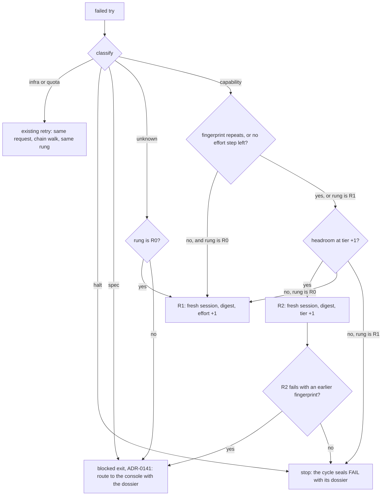

# The retry ladder

- **Status:** design of record, accepted 2026-10-19. The operator chose `max_tier: deep`, `max_effort: high` and a shadow-only critic arm. Stage `shadow` until the operator moves it.
- **Decision:** [ADR-0142](adr/0142-a-capability-failure-climbs-one-bounded-retry-ladder.md). **Plan:** [retry-ladder-2026-10](../plans/retry-ladder-2026-10.md). **Research:** [retry-ladder-2026-10](../research/retry-ladder-2026-10.md).
- **Amendment (accepted 2026-10-20):** [ADR-0146](adr/0146-a-defect-that-survives-two-builder-rounds-is-fixed-from-the-finders-spec-and-verified-by-another.md) changes the rungs. R1 retries with the findings at the same tier and effort. R2 is the old R1 (effort +1, or a tier step). R3 is a fix from the finder's spec, which another check verifies. That makes four tries (R0 to R3).
- **Precedence:** until F2 of the plan lands, the plan's rung table overrides sections 3 and 4 below. Its table is in the plan [finder-fix-ownership-2026-10](../plans/finder-fix-ownership-2026-10.md).

## Table of contents

- [1. What the ladder does](#1-what-the-ladder-does)
- [2. The flow](#2-the-flow)
- [3. The classifier](#3-the-classifier)
- [4. The rungs](#4-the-rungs)
- [5. Where the ladder runs](#5-where-the-ladder-runs)
- [6. The try record](#6-the-try-record)
- [7. Policy](#7-policy)
- [8. Signals](#8-signals)

## 1. What the ladder does

The ladder decides the resources of the next try of a phase agent after a failed try. It answers three questions in order:

1. Can a stronger try fix this failure? It classifies the failure. Only a capability failure climbs.
2. Which resource goes up? First the effort at the same tier, then one tier step. Each raised try starts a fresh session with a digest of the failure.
3. When does it stop? After one tier step, or when two tiers fail on the same check.

The ladder never decides that a cycle ships. The gates decide that. The ladder only gives the next try a better chance, or ends the tries sooner.

## 2. The flow



## 3. The classifier

The classifier reads facts that the host already has. It calls no model.

| Class | Signals | Source |
|---|---|---|
| `infra` | exit codes 80 (REPL boot timeout), 81 (artifact timeout), 87 (model mismatch), 124 and 127; a teardown error; exit 85 without a quota bench | `bridge/exitcodes.go`, `llmroute/llmroute.go:19`, `IsInfraTeardownError` |
| `quota` | exit code 85 when the usage probe or the bench confirms a quota wall. Exit 85 is also `ExitUnknownPrompt`, so the code alone does not decide. | `llmroute/tier_fallback.go:9`, `bridgechain`, `usageprobe` |
| `halt` | exit codes 2 (safety gate), 3 (cost leak), 10 (bad flags), 86 (respond-loop guard) and 99 (require-full unmet) | `bridge/exitcodes.go` |
| `spec` | the audit class is `intent-malformed` or `intent-rejected`. The host proves a `BLOCKER protected-path` or `predicate-conflict` (PR #983). A floor failure is outside the lane scope or on a protected path. Two tiers have one fingerprint. | `failurelog`, `core/blocker_proof.go`, the lane scope |
| `capability` | a floor failure is inside the lane scope. Examples: a unit test fails, a red predicate stays red, or a changed function is below full coverage. A contracted deliverable is missing. The audit class is `code-audit-fail` or `code-build-fail`. | the build handoff floor, the audit verdict |
| `unknown` | none of the above | — |

The fingerprint of a try is the set of violation codes of its first failed check, the identity that the contract escalation already uses (`core/contract_escalation.go`). When a check has no codes, the fingerprint is the normalized text of the check.

- A `halt` failure never climbs. It keeps the present halt rules.
- An audit FAIL whose class maps to `defer-or-quarantine` (`intent-malformed`, fix type `reintent`) never climbs and is never rebuilt in its cycle. The retry envelope declines it to retro, and retro ends the cycle with an `audit-fail-defer: ` reason. The router cannot overrule that end (`core/reintent_decision.go`, [internal-core](packages/internal-core.md)).
- The FAIL closeout of a cycle that the defer ended routes its committed items by the `fix_type` of the decision that ended the cycle (`cycleoutcome/defer_route.go`). The cycle result carries that decision as a value (`core.DeferOf`), so the closeout reads no workspace file. `auditDeclineDefers` picks the decision in this order: the class of the audit, the class of the build, then a cleared `failure-decision.json`. The category text does not decide. The table below gives the route.

| `fix_type` | Route of each committed item | Failure count |
|---|---|---|
| `reintent` | `inbox route-console` (`inboxmover.RouteConsole`). The `routed_reason` names the cycle, the category and the `fix_type`. | not bumped |
| `pipeline-repair` | The closeout files one console item `pipeline-repair-cycle-<N>`, with that `routed_reason`. Each item gets a `deps` entry on it, so it waits until the repair lands. | not bumped |
| any other value, or no defer decision | the plain release, with a WARN that says why | bumped |
| a route or a `deps` edit that fails for one item | that item has the plain release, with a WARN. The other items keep their route. | bumped for that item only |

- The route uses the existing writers: `RouteConsole`, `File` and the edit verb. It adds no new writer and no flag.
- The `deps` entry is written while the cycle still holds the claim (`inboxmover.EditHeld`). Thus no lane can claim the item before it waits on the companion.
- The drain skips the failure bump only for the ids that routed (`CycleOutcome.RoutedIDs`).
- A second closeout of the same cycle reuses the companion item and adds no second `deps` entry.
- Only the result closeout routes. A cycle that the defer ended returns no error, so it always reaches `closeoutCycleOutcome`. The error exits of `cmd/evolve` use the closeout without a result.

- A quota exit inside a raised rung keeps the rung. The chain walk moves to the next family at the same rung, and the walk is not a new try of the ladder.

## 4. The rungs

A rung has four parts: the context, the effort, the tier and the family. The effort never goes down when the tier goes up.

| Rung | Context | Effort | Tier |
|---|---|---|---|
| R0 | new | the base effort | the base tier (`agents.<agent>.model`) |
| R1 | fresh session with the digest | one step up, to at most `max_effort` | the base tier |
| R2 | fresh session with the digest | the larger of the R1 effort and the default of the new tier | one step up, to at most `max_tier` |

The family realizer turns a rung into a model from the tier table of each family manifest. On agy the effort is part of the model name, so agy has no effort step past Flash High at balanced.

Two worked rungs with today's policy:

- **build**, base agy Flash High at balanced: R1 has no effort step on agy, so the ladder goes from R0 to R2. R2 is the first healthy deep family: Argon Medium, then agy-claude Opus, then claude opus.
- **tdd-engineer**, base claude sonnet at high effort: with `max_effort: high`, R1 has no step. R2 is claude opus at high effort. The seat is claude only, so if opus has no headroom, the ladder stops.

## 5. Where the ladder runs

Every retry path asks the decider for the next rung. None of them sets a tier or an effort itself.

| Path | Today | With the ladder |
|---|---|---|
| Contract correction ladder | changes the CLI family on the second identical block (`core/cyclerun_correction.go:111`) | each correction is the next rung |
| Audit repair round | raises tdd and build to `audit_retry_2plus` (`core/retry_tier_escalation.go:84`) | the next rung after the last correction |
| Gate remediation | clears the overlay (`core/cyclerun_remediate.go:53`) | keeps the current rung |
| Next item after a failure | starts the build at deep when `failure_count >= 1` (`core/retry_tier_escalation.go:31`) | starts at R2 only when the last failure was `capability` at R1 or higher |
| Infra re-dispatch | the same request | unchanged |

### The failure record of an item

Each sealed FAIL of a lane item writes one failure record on the item. The next-item row above reads it.

| Key | Value | Writer |
|---|---|---|
| `failure_count` | one more than before | the failure drain, `lifecycle.bumpWith` |
| `last_failure_class` | the classifier class of the failure: `capability` or `spec` | the same rewrite |
| `last_failure_fingerprint` | `retryladder.Fingerprint` of the first reason in `audit-fail-reason.json` | the same rewrite |

- The closeout (`cycleoutcome.FailureInputsFor`) maps the cycle class to a classifier class. An `infra` or `quota` class is system-level, so the drain writes no record. At the retry ceiling, the drain parks a charged item in `quarantine/`.
- The keys are loop stamps in the field-owner table (`inboxbatch/fieldowner.go`), so `sync-main` accepts them as stamps.
- From 2026-10-13 to 2026-10-20, no lane FAIL charged its item. The blame rule did not know the `code-build-fail` and `code-audit-fail` spellings of the FAIL sentinel. So every item kept `failure_count` 0, and the deep floor and the ceiling did not fire. [internal-cycleoutcome.md](packages/internal-cycleoutcome.md) has the evidence.
- A `spec` failure now also charges the item. Until L5 of the plan lands, a charged item starts its next build at deep. With D10, only a `capability` record does that.

The ladder serves the phases that produce a deliverable: build, tdd, scout, triage, fault localization and bug reproduction. Judge seats never climb.

The raise reaches the dispatch through its own field, not the advisor overlay:

- `PhaseRequest` carries the ladder rung beside `ModelRoutingCLI` and `ModelRoutingTier`. L3 added its effort part, `ModelRoutingEffort`. The runner puts it into `llmroute.Overlay.Effort`, and the bridge sends it as `--effort` over the tier default. On agy-tmux, a ladder effort above the variant of the model name is capped, and the launch writes the requested and the granted effort ([internal-bridge](packages/internal-bridge.md)).
- A new `cliroute` step runs after `overlayTier`. It applies the ladder tier and effort, ignores `modelFixed`, and clamps them to `max_tier` and `max_effort`.
- The allowed set and the family floor (`profiles/family_floor.go`) still apply. A floor seat never goes below its floor.
- `evolve cli-routing set` validates `max_tier` and `max_effort` when it compiles the table.
- L4 built these four rules in `cliroute` (`applyLadder`, `clampLadder`) and in `evolve cli-routing set` (`--max-tier`, `--max-effort`). The rung reaches the router as `llmroute.Overlay.LadderTier` and `Overlay.Effort`. L5 sets them from the decider ([internal-cliroute](packages/internal-cliroute.md)).

## 6. The try record

Each dispatch writes one try record into `llm-calls.ndjson`. These fields are new:

| Field | Value |
|---|---|
| `rung` | `R0`, `R1` or `R2` |
| `failure_class` | the class of the try before it, empty on R0 |
| `fingerprint` | the fingerprint of the try before it |
| `effort` | the effort sent to the CLI |
| `served_model` | the model id that the CLI reports, not the tier alias |
| `context` | `new`, `fresh` or `kept` |
| `ladder_stage` | `shadow` or `enforce` |
| `ladder_would` | at `shadow`, the rung that the decider chose |

`attempt` counts every dispatch of the phase in the cycle, including the correction rounds.

L0 writes these fields. Until L5 wires the decider, each try records `rung` `R0`, `context` `new` and `ladder_stage` `shadow`, and `failure_class`, `fingerprint` and `ladder_would` stay empty. `attempt` lives in the memory of the cycle run, so a resumed process starts it at 1 again. `served_model` is the transcript model of the try (`tokenusage.Result.ServedModel`), else the footer label that the launch model check verified, else empty ([internal-bridge](packages/internal-bridge.md)). `evolve ladder report` reads the records of the run dirs and prints, for each rung and class, the tries, the fixes and the tokens.

## 7. Policy

```json
"cli_routing": {
  "agents": {
    "builder": {"cli": ["agy", "agy-claude", "claude"], "model": "balanced", "max_tier": "deep", "max_effort": "high"}
  }
},
"workflow": {
  "retry_ladder": {"stage": "shadow"}
}
```

- `model` is the base rung. Without `max_tier`, the ladder stops at `deep`. Without `max_effort`, it stops at `high`.
- The ladder never sets `max` effort and never reaches the top tier unless `max_effort` or `max_tier` names it.
- `evolve cli-routing set` is the only writer of the routing table, as for every other key.

## 8. Signals

| Code | Severity | Meaning |
|---|---|---|
| `LADDER_DECISION` | INFO | the rung of the next try, with the class and the fingerprint |
| `LADDER_STOP_SPEC` | WARN | two tiers failed on one check, so the failure became `spec` |
| `LADDER_NO_HEADROOM` | WARN | no family has headroom at the target tier, so the try stays at R1 |
