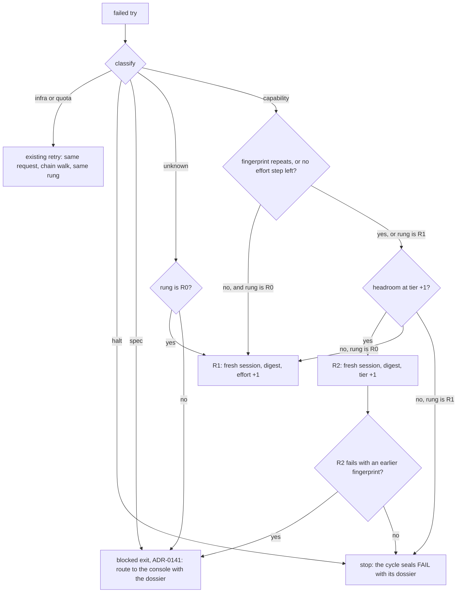

# The retry ladder

- **Status:** design of record, accepted 2026-10-19. The operator chose `max_tier: deep`, `max_effort: high` and a shadow-only critic arm. Stage `shadow` until the operator moves it.
- **Decision:** [ADR-0142](adr/0142-a-capability-failure-climbs-one-bounded-retry-ladder.md). **Plan:** [retry-ladder-2026-10](../plans/retry-ladder-2026-10.md). **Research:** [retry-ladder-2026-10](../research/retry-ladder-2026-10.md).
- **Amendment (accepted 2026-10-20):** [ADR-0146](adr/0146-a-defect-that-survives-two-builder-rounds-is-fixed-from-the-finders-spec-and-verified-by-another.md) changes the rungs. R1 retries with the findings at the same tier and effort. R2 is the old R1 (effort +1, or a tier step). R3 is a fix from the finder's spec, which another check verifies. That makes four tries (R0 to R3).
- **Amended by:** [ADR-0158](adr/0158-a-repair-round-runs-only-for-a-finding-the-lane-can-fix-and-the-auditor-applies-a-small-prescribed-fix.md) (Accepted, 2026-10-27). ADR-0158 decides these changes, and the items of its [plan](../plans/cost-aware-repair-2026-10.md) build them. In an `audit_fix` round, the auditor applies the patch and a fresh judge reviews it. A hand-off finding that blocks stops the round before `ChooseAuditFix`, and `AllPrescribed` counts only the lane findings (§5).
- **Precedence:** until F2 of the plan lands, the plan's rung table overrides sections 3 and 4 below. Its table is in the plan [finder-fix-ownership-2026-10](../plans/finder-fix-ownership-2026-10.md).

## Table of contents

- [1. What the ladder does](#1-what-the-ladder-does)
- [2. The flow](#2-the-flow)
- [3. The classifier](#3-the-classifier)
- [4. The rungs](#4-the-rungs)
- [5. Where the ladder runs](#5-where-the-ladder-runs)
- [6. The try record](#6-the-try-record)
- [7. Policy](#7-policy)
- [8. Signals](#8-signals)

## 1. What the ladder does

The ladder decides the resources of the next try of a phase agent after a failed try. It answers three questions in order:

1. Can a stronger try fix this failure? It classifies the failure. Only a capability failure climbs.
2. Which resource goes up? First the effort at the same tier, then one tier step. Each raised try starts a fresh session with a digest of the failure.
3. When does it stop? After one tier step, or when two tiers fail on the same check.

The ladder never decides that a cycle ships. The gates decide that. The ladder only gives the next try a better chance, or ends the tries sooner.

## 2. The flow



## 3. The classifier

The classifier reads facts that the host already has. It calls no model.

| Class | Signals | Source |
|---|---|---|
| `infra` | exit codes 80 (REPL boot timeout), 81 (artifact timeout), 87 (model mismatch), 124 and 127; a teardown error; exit 85 without a quota bench | `bridge/exitcodes.go`, `llmroute/llmroute.go:19`, `IsInfraTeardownError` |
| `quota` | exit code 85 when the usage probe or the bench confirms a quota wall. Exit 85 is also `ExitUnknownPrompt`, so the code alone does not decide. | `llmroute/tier_fallback.go:9`, `bridgechain`, `usageprobe` |
| `halt` | exit codes 2 (safety gate), 3 (cost leak), 10 (bad flags), 86 (respond-loop guard) and 99 (require-full unmet) | `bridge/exitcodes.go` |
| `spec` | the audit class is `intent-malformed` or `intent-rejected`. The host proves a `BLOCKER protected-path` or `predicate-conflict` (PR #983). A floor failure is outside the lane scope or on a protected path. Two tiers have one fingerprint. | `failurelog`, `core/blocker_proof.go`, the lane scope |
| `capability` | a floor failure is inside the lane scope. Examples: a unit test fails, a red predicate stays red, or a changed function is below full coverage. A contracted deliverable is missing. The audit class is `code-audit-fail` or `code-build-fail`. | the build handoff floor, the audit verdict |
| `unknown` | none of the above | — |

The fingerprint of a try is the set of violation codes of its first failed check, the identity that the contract escalation already uses (`core/contract_escalation.go`). When a check has no codes, the fingerprint is the normalized text of the check.

- A `halt` failure never climbs. It keeps the present halt rules.
- An audit FAIL whose class maps to `defer-or-quarantine` (`intent-malformed`, fix type `reintent`) never climbs and is never rebuilt in its cycle. The retry envelope declines it to retro, and retro ends the cycle with an `audit-fail-defer: ` reason. The router cannot overrule that end (`core/reintent_decision.go`, [internal-core](packages/internal-core.md)).
- The FAIL closeout of a cycle that the defer ended routes its committed items by the `fix_type` of the decision that ended the cycle (`cycleoutcome/defer_route.go`). The cycle result carries that decision as a value (`core.DeferOf`), so the closeout reads no workspace file. `auditDeclineDefers` picks the decision in this order: the class of the audit, the class of the build, then a cleared `failure-decision.json`. The category text does not decide. The table below gives the route.

| `fix_type` | Route of each committed item | Failure count |
|---|---|---|
| `reintent` | `inbox route-console` (`inboxmover.RouteConsole`). The `routed_reason` names the cycle, the category and the `fix_type`. | not bumped |
| `pipeline-repair` | The closeout files one console item `pipeline-repair-cycle-<N>`, with that `routed_reason`. Each item gets a `deps` entry on it, so it waits until the repair lands. | not bumped |
| any other value, or no defer decision | the plain release, with a WARN that says why | bumped |
| a route or a `deps` edit that fails for one item | that item has the plain release, with a WARN. The other items keep their route. | bumped for that item only |

- The route uses the existing writers: `RouteConsole`, `File` and the edit verb. It adds no new writer and no flag.
- The `deps` entry is written while the cycle still holds the claim (`inboxmover.EditHeld`). Thus no lane can claim the item before it waits on the companion.
- The drain skips the failure bump only for the ids that routed (`CycleOutcome.RoutedIDs`).
- A second closeout of the same cycle reuses the companion item and adds no second `deps` entry.
- Only the result closeout routes. A cycle that the defer ended returns no error, so it always reaches `closeoutCycleOutcome`. The error exits of `cmd/evolve` use the closeout without a result.

- A quota exit inside a raised rung keeps the rung. The chain walk moves to the next family at the same rung, and the walk is not a new try of the ladder.

## 4. The rungs

A rung has four parts: the context, the effort, the tier and the family. The effort never goes down when the tier goes up.

| Rung | Context | Effort | Tier |
|---|---|---|---|
| R0 | new | the base effort | the base tier (`agents.<agent>.model`) |
| R1 | fresh session with the digest | one step up, to at most `max_effort` | the base tier |
| R2 | fresh session with the digest | the larger of the R1 effort and the default of the new tier | one step up, to at most `max_tier` |

The family realizer turns a rung into a model from the tier table of each family manifest. On agy the effort is part of the model name, so agy has no effort step past Flash High at balanced.

Two worked rungs with today's policy:

- **build**, base agy Flash High at balanced: R1 has no effort step on agy, so the ladder goes from R0 to R2. R2 is the first healthy deep family: Argon Medium, then agy-claude Opus, then claude opus.
- **tdd-engineer**, base claude sonnet at high effort: with `max_effort: high`, R1 has no step. R2 is claude opus at high effort. The seat is claude only, so if opus has no headroom, the ladder stops.

## 5. Where the ladder runs

Each retry path gets its rung from one place, the ladder state of the cycle. L5 built this wiring on 2026-10-27:

- The contract correction, the resumed correction and the audit repair round ask one decider, `cycleRun.askLadder` (`go/internal/core/retry_ladder.go:49`). It calls `retryladder.Next`.
- Gate remediation asks nothing. It keeps the rung that the decider stored.
- The next-item rule reads the class of the last failure, not a try of this cycle. When the `failure_count` of a scoped item reaches the threshold, the rule stores R2 or R0 as the first rung of the cycle. It then records one `LADDER_DECISION`.

| Path | Before L5 | With the ladder (L5) |
|---|---|---|
| Contract correction ladder | changed the CLI family on the second identical block | the same-rung corrections run first. When `fleet.contract_correction_retries` is spent, the loop asks the decider (`core/cyclerun_correction.go:58`). A raise gives one more try at the new rung. |
| Resumed contract correction | the same corrections, with no tier change | the same rule, through `climbResumed` (`core/resume.go:414`) |
| Audit repair round | raised tdd and build to `audit_retry_2plus` | the first tdd or build dispatch of each repair round asks the decider once (`ladderForDispatch`, `core/resume_policy.go:18`) |
| Gate remediation | cleared the overlay | keeps the rung of the cycle (`keepLadderRung`, `core/cyclerun_remediate.go:54`) |
| Next item after a failure | started the build at deep when `failure_count >= 1` | at `enforce`, starts at R2 with the deep tier only when the last failure of a scoped item was `capability` (`core/retry_tier_escalation.go:48`). The first rung of the cycle is then R2, so the try record and the later paths see it. |
| Infra re-dispatch | the same request | unchanged |

The stage key `workflow.retry_ladder.stage` selects the effect:

- At `shadow`, the decider records `LADDER_DECISION` with the rung that it chose. The dispatch of today runs: the CLI escalation of the contract ladder, the `audit_retry_2plus` raise and the `failure_count` floor.
- At `enforce`, the choice of the decider runs. The CLI escalation of the contract ladder is off, and the profile raise of the repair round is off.
- The cycle state keeps the rung in `ladder` (`cyclestate.LadderState`). At `shadow`, that rung is the rung that the ladder chose but did not apply. At `enforce`, each later dispatch of a climbing seat in the cycle keeps the rung (D10).
- A stop at `enforce` ends the correction loop. The handoff then takes the rejection exit of today. A stop in a repair round keeps the current rung for that round.

### The audit_fix rung

The operator decided on 2026-10-27: "make sure audit will involve fix and trigger another review for its changes; balance cost and output". Cycle 2035 spent about 100 LLM minutes and 67 M cache-read tokens on a fix that the audit had already prescribed exactly. The four agy builds used 65 minutes and 50.6 M of those tokens. The fix was about 20 lines of a test helper and 2 goldens.

`audit_fix` is a rung of the decider for the repair round after an audit FAIL. `retryladder.ChooseAuditFix` (`go/internal/retryladder/audit_fix.go`) applies these rules in order:

| Order | Rule | Result |
|---|---|---|
| 1 | the cycle already chose `audit_fix` | `used_this_cycle`: no `audit_fix` |
| 2 | the failure block has no defect | `no_findings`: no `audit_fix` |
| 3 | a defect has no concrete prescription | `unprescribed`: no `audit_fix` |
| 4 | a defect cites no file path | `uncited`: no `audit_fix` |
| 5 | the estimate is above `max_files`, `max_lines`, `max_code_lines` (with `no_new_production_logic`) or `max_tokens` | the name of that limit: no `audit_fix` |
| 6 | none of the above | `small_prescribed`: `audit_fix` |

- Every defect has a prescription when the failure block has at least as many non-blank `prescription` entries as `defects`.
- `retryladder.EstimateAuditFix` reads the file paths that the defects and the prescriptions cite. A cited span `file:a-b` counts its lines, `file:a` counts 1 line, and a path without a span counts 10 lines. The lines of a non-test `.go` file are production code. The token estimate is 12 tokens for each line. These numbers are an estimate, and the shadow wave measures them.
- A defect that cites no file estimates 0 lines, so it passed each limit before rule 4. Rule 4 declines it (review note of #1173).
- The rung reads its own stage, `workflow.retry_ladder.audit_fix.stage`. It can run at `enforce` while `workflow.retry_ladder.stage` stays at `shadow` (ADR-0158).
- The repair round records one `LADDER_AUDIT_FIX` signal with the rule and its data. `audit_fix` is `would` at `shadow`, `chosen` at `enforce` and `decline` at `off` or when a rule declines.
- The cycle state keeps the choice in `ladder.audit_fix`, so a cycle chooses it at most once. A `chosen` mark with no registered handler does not use this allowance, because nothing ran (review note of #1173).
- The execution plugs in through `core.RungHandler` and `core.WithRungHandler(retryladder.RungAuditFix, h)`. The signal names the handler as `registered` or `absent`. Until a handler runs, the repair round keeps the rungs of this section.

The handler is `internal/auditfix` ([package note](packages/internal-auditfix.md)). It uses two seats (ADR-0158 decisions 8 to 13):

1. The auditor applies the patch in its loaded session, inside the cycle worktree. The patch changes only the cited files, inside the `audit_fix` bounds.
2. A fresh seat reviews only the patch and the prescriptions. Its session is never the session of the auditor. The routing picks another family when the chain has one, and a lower tier is allowed.
3. The handoff floor, cover-changed and ACS run again on the patched tree. The original audit verdict stays the verdict for the rest of the diff.
4. A pass lets the cycle go on to ship. A refused patch, a failed review or a red gate restores the tree. Then one escalation runs: a raised build with the L6 digest. A second failure stops the cycle with `audit_fix_exhausted`.
5. A patch on a fence path joins the held proposal at `held_proposals` `enforce` (ADR-0157). At another stage, the handler refuses it.
6. The handler writes `audit-fix.json` in the run directory. It has the patch, each finding id with its prescription, and the reason for each change.

No production code registers the handler yet. The inbox item `wire-cost-aware-repair-call-sites` wires it, because the call sites are on the fence.

### Limits of the L5 wiring

- At `enforce`, the ladder replaces the CLI escalation and the same-CLI salvage retry of the contract ladder. It also replaces the `audit_retry_2plus` raise. A repair round that the ladder does not raise runs at the current rung.
- At `enforce`, a raise can add a try after `fleet.contract_correction_retries` is spent, also when that value is 0. The decider allows at most two raised tries, so the loop ends.
- The decider gets the default bounds. `cliroute` then clamps the tier and the effort to the `max_tier` and `max_effort` of the agent. So the target in `LADDER_DECISION` can be above the served rung.
- `retryladder.Climbs` holds the climbing seats as a list in Go, not as phase data. A new phase from `evolve phases create` does not climb.
- The resumed correction uses a partial `cycleRun`. Its routing has no environment snapshot, and its ladder state stays inside the correction loop.
- At `shadow`, the cycle state still records the rung that the ladder chose, and the audit repair ask still reads the findings. The dispatch does not change.
- The rung of the cycle is the same for each climbing seat. A raise of scout also applies to tdd and build, above the floor of each seat.

### Why the same-rung corrections come first

The operator decided on 2026-10-27: "1 correction, then escalate". A failed build gets one correction at the same rung. The try after that one starts a fresh session at a raised rung. The console sets `fleet.contract_correction_retries` to 1 in a separate policy change.

- Cycle 2035 of wave 142 recorded four build tries on agy, all at R0, in `llm-calls.ndjson`. Try 1 was the first build. Try 2 was correction 1/2, for an STE lint and a floor failure. Try 3 was correction 2/2, for 11 of 26 functions below 100% coverage. Try 4 was a repair round after an audit FAIL.
- After try 4, the audit gave WARN and the ship stopped on `REPO_CONTRACT_GATE`. A second audit FAIL started repair round 2/2, and a fifth build dispatch has no try record. The operator reported that the cycle reached its lane deadline. The run dir does not record that stop.
- Each of those tries was a new tmux session, with the names `n6`, `n7`, `n8` and `nd` in the run dir. `BRIDGE_CONTEXT_FILL_HIGH` reported 130.6%, 73.4% and 83.2% for build tries 1, 3 and 4. The fill grew inside each session, from the tool calls of the try. Each try also sent the full phase prompt again (49 KB in `build-prompt.txt`).
- Thus a new session alone does not change the behavior of today. L6 changes the content of the prompt and the rung. A raised try gets a bounded digest in place of the correction text, at a stronger tier or effort.

### The fresh session and the digest (L6)

A raised try (R1 or R2 at `enforce`) gets three changes:

- `PhaseRequest.Ladder` carries the rung, the class, the fingerprint and `context` `fresh` (`retryladder.Try`). The runner copies it into `BridgeRequest.Ladder` and puts its tier into `llmroute.Overlay.LadderTier` (`phases/runner/routing.go:94`). The effort goes into `ModelRoutingEffort`.
- The correction directive is the digest (`retryladder.Digest.Render`, `retryladder/digest.go:26`). The digest has the failed checks verbatim and the audit findings (`audit_repair_findings` on a repair round). It also has the changed files of the worktree and the tries before this one, with their rungs, classes and fingerprints.
- The digest stays inside `workflow.retry_ladder.digest_tokens` (default 2000). The size uses 4 bytes for each token. `Render` cuts a longer digest at a rune boundary, and the last line of the digest says so. The first failed check comes first, so a cut keeps it.

Each phase dispatch is a new bridge launch with an ephemeral session, because no phase profile names a session. A test proves that a raised try opens a new session. Its try record has the rung, `context` `fresh` and `ladder_stage` `enforce`. The digest replaces the correction text of the old rung, and the prompt carries no transcript of an old pane.

The tier step uses routing data only. `ladderRoute` (`core/retry_ladder.go:100`) reads the chain and the tier ceilings of the routing decision of the phase. It never names a family. The router then picks the first healthy family of the chain at the ladder tier. It clamps the tier and the effort to `max_tier` and `max_effort`.

The auditor seat does not climb. `retryladder.Climbs` is false for the auditor, the adversarial review, the code reviewer and the spec verifiers, so the decider does not run for them. A repair round goes back to tdd or build. In an `audit_fix` round, the auditor applies the patch and a fresh seat judges it: the two-seat rule of ADR-0158. The auditor never approves its own patch.

### The failure record of an item

Each sealed FAIL of a lane item writes one failure record on the item. The next-item row above reads it.

| Key | Value | Writer |
|---|---|---|
| `failure_count` | one more than before | the failure drain, `lifecycle.bumpWith` |
| `last_failure_class` | the classifier class of the failure: `capability` or `spec` | the same rewrite |
| `last_failure_fingerprint` | `retryladder.Fingerprint` of the first reason in `audit-fail-reason.json` | the same rewrite |

- The closeout (`cycleoutcome.FailureInputsFor`) maps the cycle class to a classifier class. An `infra` or `quota` class is system-level, so the drain writes no record. At the retry ceiling, the drain parks a charged item in `quarantine/`.
- The keys are loop stamps in the field-owner table (`inboxbatch/fieldowner.go`), so `sync-main` accepts them as stamps.
- From 2026-10-13 to 2026-10-20, no lane FAIL charged its item. The blame rule did not know the `code-build-fail` and `code-audit-fail` spellings of the FAIL sentinel. So every item kept `failure_count` 0, and the deep floor and the ceiling did not fire. [internal-cycleoutcome.md](packages/internal-cycleoutcome.md) has the evidence.
- A `spec` failure also charges the item. At `shadow`, a charged item starts its next build at deep, as before L5. At `enforce`, only a `capability` record does that. The orchestrator reads the class through `inboxmover.ReadLastFailureClass`.
- The item records no rung. Thus the next-item rule reads the class only. It does not check the condition "at R1 or higher" of D10.

The ladder serves the phases that produce a deliverable: build, tdd, scout, triage, fault localization and bug reproduction. Judge seats never climb.

The raise reaches the dispatch through its own field, not the advisor overlay:

- `PhaseRequest` carries the ladder rung beside `ModelRoutingCLI` and `ModelRoutingTier`. L3 added its effort part, `ModelRoutingEffort`. The runner puts it into `llmroute.Overlay.Effort`, and the bridge sends it as `--effort` over the tier default. On agy-tmux, a ladder effort above the variant of the model name is capped, and the launch writes the requested and the granted effort ([internal-bridge](packages/internal-bridge.md)).
- A new `cliroute` step runs after `overlayTier`. It applies the ladder tier and effort, ignores `modelFixed`, and clamps them to `max_tier` and `max_effort`.
- The allowed set and the family floor (`cli_routing.floors`, since X6) still apply. A floor seat never goes below its floor.
- `evolve cli-routing set` validates `max_tier` and `max_effort` when it compiles the table.
- L4 built these four rules in `cliroute` (`applyLadder`, `clampLadder`) and in `evolve cli-routing set` (`--max-tier`, `--max-effort`). The rung reaches the router as `llmroute.Overlay.LadderTier` and `Overlay.Effort`. L5 sets them from the decider at `enforce` ([internal-cliroute](packages/internal-cliroute.md)).

## 6. The try record

Each dispatch writes one try record into `llm-calls.ndjson`. These fields are new:

| Field | Value |
|---|---|
| `rung` | `R0`, `R1` or `R2` |
| `failure_class` | the class of the try before it, empty on R0 |
| `fingerprint` | the fingerprint of the try before it |
| `effort` | the effort sent to the CLI |
| `served_model` | the model id that the CLI reports, not the tier alias |
| `context` | `new`, `fresh` or `kept` |
| `ladder_stage` | `shadow` or `enforce` |
| `ladder_would` | at `shadow`, the rung that the decider chose |

`attempt` counts every dispatch of the phase in the cycle, including the correction rounds.

L0 writes these fields, and `retryladder.Try.Mark` fills them from `BridgeRequest.Ladder`. A try without a ladder decision records `rung` `R0`, `context` `new` and `ladder_stage` `shadow`. At `shadow`, a try that follows a decision also records its `failure_class`, its `fingerprint` and `ladder_would`. A raised try at `enforce` records its rung, `context` `fresh` and `ladder_stage` `enforce`.

`attempt` lives in the memory of the cycle run, so a resumed process starts it at 1 again. `served_model` is the transcript model of the try (`tokenusage.Result.ServedModel`), else the footer label that the launch model check verified, else empty ([internal-bridge](packages/internal-bridge.md)). `evolve ladder report` reads the records of the run dirs and prints, for each rung and class, the tries, the fixes and the tokens.

## 7. Policy

```json
"cli_routing": {
  "agents": {
    "builder": {"cli": ["agy", "agy-claude", "claude"], "model": "balanced", "max_tier": "deep", "max_effort": "high"}
  }
},
"workflow": {
  "retry_ladder": {
    "stage": "shadow", "digest_tokens": 2000,
    "audit_fix": {"stage": "shadow", "max_files": 3, "max_lines": 40, "max_code_lines": 10, "max_tokens": 6000, "no_new_production_logic": true}
  }
}
```

- `workflow.retry_ladder.stage` is `shadow` or `enforce`. An absent key means `shadow`. Another word fails the load of the policy. The checked-in policy sets `shadow`, so one wave records the decisions before L8 moves the stage.
- `workflow.retry_ladder.digest_tokens` is the token budget of the digest of a raised try, from 64 to 16000. An absent key or 0 means 2000.
- `workflow.retry_ladder.audit_fix.stage` is `off`, `shadow` or `enforce`. An absent key means `shadow`. Another word fails the load of the policy.
- `workflow.retry_ladder.audit_fix` gives the size limits of the `audit_fix` rule. Each number is from 0 to its cap (50 files, 2000 lines, 2000 code lines, 64000 tokens), and 0 means the default. `no_new_production_logic` applies `max_code_lines`. Its default is true.

- `model` is the base rung. Without `max_tier`, the ladder stops at `deep`. Without `max_effort`, it stops at `high`.
- The ladder never sets `max` effort and never reaches the top tier unless `max_effort` or `max_tier` names it.
- `evolve cli-routing set` is the only writer of the routing table, as for every other key.

## 8. Signals

The codes belong to the signal module `ladder`, kind `ladder.decision`. `core/retry_ladder.go` registers them.

| Code | Severity | Meaning |
|---|---|---|
| `LADDER_DECISION` | INFO | the rung of the next try, with the class and the fingerprint |
| `LADDER_STOP_SPEC` | WARN | two tiers failed on one check, so the failure became `spec` |
| `LADDER_NO_HEADROOM` | WARN | no family has headroom at the target tier, so the try stays at R1 |
