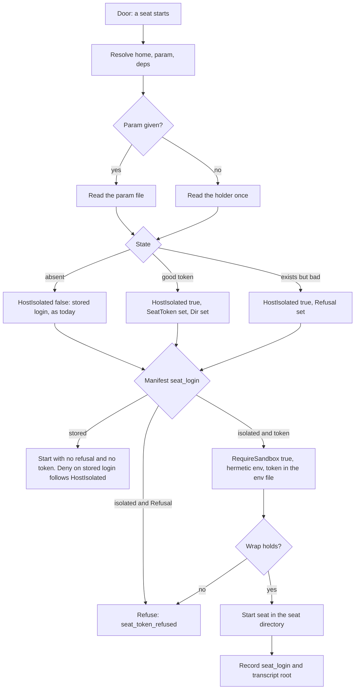

# Seat login: the token file is the stage, and a seat holds a narrow token in its own directory

**Status:** proposed, 2026-11-06. Each new name in this file is a proposal until its pull request lands: `seatlogin.Resolve`, `Decision`, `paths.SeatRoot`, `evolve auth seat-token`, `--seat-token-file`, `seat_login` and `seat_token_refused`. The file names the existing code that each part changes.

> [ADR-0163](adr/0163-a-seat-holds-a-narrow-token-in-its-own-directory-and-the-token-file-is-the-stage.md) · plan: [seat-login-isolation-2026-11](../plans/seat-login-isolation-2026-11.md) · research: [claude-login-split-2026-11](../research/claude-login-split-2026-11.md).
> This file is the spec of record for the login of a `claude` seat. It covers the token file, the read at each door, the seat directory, the grants, the denies, the record, the signals and the test rows. The plan holds the goals and the order. The ADR holds the rejected options.
>
> **Terms used throughout:**
> - **Seat:** one `claude` process in a cell, started by the bridge.
> - **Stored login:** the login of the operator in the Keychain and in `~/.claude/.credentials.json`.
> - **Token:** the one-year token from `claude setup-token`. It can only make model requests (research F7.2).
> - **Holder:** the file `<home>/.evolve-seat/holder/token`, mode `0600`. It is the only stage of the design.
> - **Seat directory:** `paths.SeatRoot(home)`. A seat gets `CLAUDE_CONFIG_DIR` set to it. It holds no credential.
> - **Door:** the code path that starts a seat: `launchSwept`, and `launchPane` for a smoke.
> - **Boundary:** a time when no loop lane is live.
> - **Parameter seat:** one seat that runs with `--seat-token-file`, while the holder stays untouched.

## Table of contents

- [1. Goals](#1-goals)
- [2. The token file is the stage](#2-the-token-file-is-the-stage)
- [3. Resolve at each door](#3-resolve-at-each-door)
- [4. The seat directory and what a seat sees](#4-the-seat-directory-and-what-a-seat-sees)
- [5. The carrier of the token](#5-the-carrier-of-the-token)
- [6. Grants, denies and each OS](#6-grants-denies-and-each-os)
- [7. Launch purposes](#7-launch-purposes)
- [8. The record and the readers](#8-the-record-and-the-readers)
- [9. The signals](#9-the-signals)
- [10. The test rows](#10-the-test-rows)
- [Guards](#guards)
- [Limits](#limits)

## 1. Goals

The goals G1 to G5 are in [the plan](../plans/seat-login-isolation-2026-11.md#3-goals-and-non-goals). This design serves them as follows.

| Goal | What this design does for it | Where the proof is |
|---|---|---|
| G1. No forced login caused by a seat | A seat has no path to the stored login, so a seat cannot renew or replace it. | Row 7 (live, L2) |
| G2. A seat cannot touch the stored login | The cell has a deny on the stored login and no grant on it. | Rows 1, 3 and 5 |
| G3. No auth error in a seat | A seat uses the token, which does not refresh. | Row 7 and L8 |
| G4. One source on each OS | The holder file is the one source on macOS and Linux. | The CI job with `bubblewrap` |
| G5. A logout reads as a logout | Each state has a pinned text that names the next step. | Row 6 |

## 2. The token file is the stage

### Issue

Seats share the stored login of the host. The bridge passes each seat the real `HOME` (research F3.5). A sandboxed seat cannot write the Keychain, and it can write `~/.claude` (research F3.2, F3.3). A refused Keychain write moves the new login to the file (research F3.1). So one bad renewal reaches each seat.

### Gap

A fix needs a switch that moves the fleet from the stored login to the token. A switch that moves across processes needs a state. The first design gave that state a record, a lock, a census of seats and a rule for old binaries. Four reviews found a fault in each part. Nine of the ten HIGH findings of the last two rounds were on that one mechanism.

The harm of a race here is no worse than today. A seat that started on the stored login stays on it until its process ends. The first design treated the race as a safety property. This design treats it as a limit.

### Solution

The holder is the stage. There is no record, no lock, no census and no registry.

- **If the holder exists and holds a token, each seat whose manifest says `seat_login: isolated` runs with the token.**
- **If the holder is absent, each seat runs as it does today.**

That is the whole protocol. The move is one atomic act, and the operator does it at a boundary.

| Verb | Effect | Where it runs |
|---|---|---|
| `evolve auth seat-token set --project-root <loop root>` | Reads the token from stdin. Refuses a value that lacks the documented token prefix. Writes the holder with a rename. Never prints the value. | Boundary only |
| `evolve auth seat-token clear --project-root <loop root>` | Removes the holder. This is the rollback. | Boundary only |

- Both verbs are Denied in `agentclass/table.go`, so no agent can run them.
- A rename gives each reader the old state or the new one.
- Each verb calls `liveRunsOf` directly on the required `--project-root`. The runbook names that root as the loop root.
- The verb always refuses while a lane is live, with a pinned text. It never queues. It runs before it reads stdin.
- The gate is a courtesy. It avoids a cycle that is split across two transcript roots. It is not a safety property.
- A lease exists only inside a cycle, so a wave between two cycles reads as a boundary. That is acceptable for this purpose.
- Each verb emits one signal with the verb name and the time.

**A worked example.** The operator mints a token with `claude setup-token`. The operator runs one parameter seat on it. The loop reaches a boundary.

The operator pipes the token into `evolve auth seat-token set`. The next seat that starts reads the holder and runs isolated. A seat that started before the move stays on the stored login until it ends.



## 3. Resolve at each door

### Issue

A launch that reads the host state in two places can see two answers. A smoke that skips the read can pass while each seat fails. A caller that holds no decision cannot refuse in time.

### Gap

A flag in the environment or in a package variable gives each caller its own answer. The first design also read the stage in several places. Each place needed its own guard.

### Solution

`seatlogin.Resolve(home, param, deps) Decision` runs once for each launch, at each door. It runs for each family. No other read of the holder exists in a launch.

| Field of `Decision` | Meaning |
|---|---|
| `HostIsolated` | A holder or a parameter exists. The stored-login deny and the removal of `~/.claude` follow this fact, for the cell of each family. |
| `SeatToken` | The token for the seat. Only a door whose manifest says `seat_login: isolated` joins it. |
| `Dir` | The seat directory. |
| `Refusal` | The pinned text and the state, when the file is bad. Only an isolated door acts on it. |

- The parameter wins over the holder. `evolve agent run --seat-token-file <path>` gives one seat the isolated shape and leaves the holder untouched.
- A file that exists but is empty, unreadable or not mode `0600` gives `HostIsolated: true` and a `Refusal`. The deny fails closed.
- An empty `home` gives a `Refusal`.
- The manifest holds the data: `seat_login: isolated|stored`. `claude-tmux` and `claude-p` are `isolated`.
- `claude-cloud` is `stored` until L3 measures it, because the token has no claude.ai connectors (research F7.2). A row holds this.
- A manifest with no field reads as `stored`. A codex launch with a bad holder starts with no refusal, no token and the stored-login deny present.
- `Deps.SeatLogin` is the seam. It sits beside `EnvStage`. An empty seam falls back to the real reader, `seatlogin.OS`. No production root sets the seam, and the code has no refusal for an empty seam.
- The refusal uses a new exit class, `seat_token_refused`. It has no transient sentinel, so `loopAbort` stays as it is.
- A `looppreflight` check refuses a bad holder at loop start. `evolve doctor` and `looppreflight` warn on "seat root present, holder absent".

**The seam has a fallback, not a scan.** An empty `Deps.SeatLogin` uses `seatlogin.OS`, which reads the real home. In production this is correct, so the build has no source scan of the `Deps{` literals and no refusal for an empty seam. A refusal turns a concern of tests into a failure mode of production in up to 89 test files.

The cost of the fallback: a test that launches a claude driver with an empty seam reads the real home. Only package `bridge` hides it. It uses a test default that reports the seat directory of the real home as absent. A test in another package, such as `cmd/evolve` or `acs`, reads the real home. On a host that holds a token, such a test can isolate or refuse.

The sample that supports the fallback passes under a temp home with no holder, a bad holder and a good holder. It holds the packages `./internal/adapters/bridge` and `./internal/subagent/...`, and a subset of `cmd/evolve` (`Bridge|AgentRun|Recipe|CLIHealth|ModelsLive`). The sample is not the whole repository.

Roots that can set the seam in a later change:

| Root | File |
|---|---|
| The bridge adapter | `adapters/bridge/bridge.go` |
| The loop preflight boot | `looppreflight/boot.go` |
| The doctor boot | `opscmd/doctor_boot.go` |
| The live doctor | `opscmd/doctor_live.go` |
| The health canary | `cli_health_canary.go` |
| `bridgeLaunchDeps` | `cmd_bridge.go` |
| `bridgePromptDispatcher.launcher` | `cmd_models_live.go` |
| `execAdapterDeps` | `subagent/bridgeadapter.go` |
| `RunRecipe` | `cmd_bridge.go` |

This section replaces the proposal of the design card (finding F4 and the review item H-1 of revision 4). The card proposed a refusal and a scan. This build does not have them.

## 4. The seat directory and what a seat sees

### Issue

A directory with no stored login gives a renewal nothing to act on (research F4.5, synthesis). The vendor documents `CLAUDE_CONFIG_DIR` as the form of one login for each directory (research F7.3).

### Gap

A bare empty directory drops the settings, the plugins and the trust that a seat needs. On 2026-11-02 a change of this kind failed each seat at one time (plan, risks).

### Solution

- `paths.SeatRoot(home)` is one directory for each host. A seat gets `CLAUDE_CONFIG_DIR` set to it.
- The bridge provisions the directory at launch. The act is idempotent and atomic.
- The directory holds no credential. A test holds this.
- The holder lives in its own directory, `holder/`, under the seat root. The cell never gets a grant on it.
- `integrity_surface.go` gets a fragment for `/.evolve-seat/`.

**What a seat sees.** The seat directory starts from the real launch shape, not from empty.

- A closed table decides each user key of the settings. A test fails on a key with no decision. `skipDangerousModePermissionPrompt` is in the table.
- `autoMemoryEnabled` is `false`.
- A measurement of the plugins decides which plugins the seat sees. The measurement comes before the grant list.

## 5. The carrier of the token

### Issue

A token in an `argv`, a log, a signal or a pane leaks to any reader of those. The existing rule is that no cell environment value appears in any `argv`.

### Gap

`exportLines` and `probeEnv` build the environment for several launch paths. A token in the shared set reaches paths that need no token.

### Solution

- The token joins only the `hermeticEnv` set, in the `enforce` branch of `cellEnv`.
- It travels in the `0600` consume-once env file. `exportLines` and `probeEnv` never see it.
- An isolated seat selects the hermetic branch for that launch, whatever the stage of the tree. Only an explicit `off` refuses, with a pinned text. There is one stage, not two.
- When `SeatToken` is set, the door sets `cfg.RequireSandbox = true`. A token seat whose wrap fails refuses, nested or not.
- `--sandbox-off` refuses a seat with a token, also outside a phase. A token must not reach an unconfined pane.
- The explicit refusal for `--sandbox-off` runs before the existing checks, because `ConfinementSatisfied` passes the opt-out.
- The value of the token appears in no `argv`, no scrollback, no `.sb` file, no signal, no log and no output of a verb. Row 6 proves this.

## 6. Grants, denies and each OS

### Issue

A cell that can read the holder reads the token. A cell that can write `~/.claude` can write the stored login. The profile grants writes under `~/.claude` today (research F3.3).

### Gap

A deny that depends on the state of the host fails when a cell starts before the state changes. A deny on one file does not cover a file that appears later.

### Solution

**Grants.** The cell gets named subpaths only.

- `.claude.json` and `settings.json` of the seat directory are read-only to the cell.
- `~/.claude` leaves `homeStateWriteDirs` when `HostIsolated` is true.

**Denies.**

| Deny | Rule |
|---|---|
| The holder | Unconditional, in each state, for the cell of each family. It is on the `holder/` directory, through `DenyReadPaths`, which works on a directory. The bridge creates the directory before the sandbox starts. So a cell that started before `set` is still denied. |
| The stored login | Follows `HostIsolated`. It covers `~/.claude/.credentials.json` for the cell of each family. |

**Each OS.**

| OS | The stored-login deny | The holder deny |
|---|---|---|
| macOS | A deny in the profile, with the file read and write refused. | `DenyReadPaths` on the `holder/` directory. |
| Linux | A typed mask row for the file, only when the file exists. It does not go through `cfg.DenyReadPaths`. | `DenyReadPaths` on the `holder/` directory. |

- A CI job with `bubblewrap` runs the Linux rows. It fails loudly if `bubblewrap` is absent.
- L3 measures if a cell can read the secret of the Keychain item. The probe of 2026-11-05 read the metadata only (research F3.2). Until L3 reports, this is a limit.

## 7. Launch purposes

### Issue

Several launches use `claude` for other reasons than a lane seat. A rule for the seat shape that covers all of them breaks the usage probe and the update.

### Gap

A smoke that uses the stored login can pass while each seat fails on the token. A green smoke then clears an auth bench for the wrong reason.

### Solution

A closed table maps each launch purpose to a login.

| Purpose | Login |
|---|---|
| Lane seat (`launchSwept`) | The seat shape, if the manifest says `isolated`. |
| Smoke (`PurposeSmoke`, `launchPane`) | The seat shape. A smoke tests the token. |
| Probe | The stored login. |
| Update | The stored login. |
| Inventory | The stored login. |
| `bridge recipe run --worktree` | Refuses when `HostIsolated` is true. The recipe path calls the same function. |

A row holds that each caller of `driver.Launch` holds a resolved `Decision`.

## 8. The record and the readers

### Issue

After a move, an operator cannot tell which seats ran on the token. The readers of spend and of the post-mortem do not know which root holds the transcript.

### Gap

The holder cannot report its own history. A lost holder puts each later seat on the stored login, and nothing marks that change.

### Solution

- Each `claude` launch writes `seat_login: isolated|stored` on the record of each try. The transcript root is not on the record in this build. It lands with the readers. The home is `llmcalls.Record`, through its `marks` seam. The record never holds the token.
- The field leaves `launchSwept` through an observer, like `observeDispatchID`. It also goes on `core.BridgeResponse`, because the post-mortem reader and the login wall read it.
- A plane that runs a binary without this design writes no field. That reads as `stored`.
- A smoke writes no record. Its reader looks in both roots.
- Readers look in both roots. The readers land in a later pull request, after the verbs and before `seat-token set`. Until then, each seat of a token host writes its transcripts under the seat directory. The post-mortem and the spend readers do not see them.
- Do not run `evolve auth seat-token set` before the readers land.
- L8 counts auth errors by place with this field. L2 uses it as its detector: any `stored` launch in the window means no result.
- L2 adds a runbook line: the console is closed, and no doctor or probe runs in the window. The L0 `mdat` is sampled at both ends.

## 9. The signals

### Issue

A refused token and a logout look the same to a reader who sees only a quota wall. The operator then waits for the wrong thing (plan, G5).

### Gap

A text with a variable form cannot be tested by equality. A text that holds the token leaks it.

### Solution

Each text is pinned whole, and no text holds a token. A test checks the equality of each text.

```
bridge: the seat token at <path> is empty, so no claude seat can start. Next: run claude setup-token, then evolve auth seat-token set, or run evolve auth seat-token clear to go back to the stored login.
bridge: the seat token at <path> has mode <mode>, not 0600, so no claude seat can start. Next: run evolve auth seat-token set again.
bridge: the seat token at <path> was refused: <status>. Next: run claude setup-token, then evolve auth seat-token set. The stored login of the console is not affected.
```

- The third text is not claimed until a fixture exists. One parameter seat runs with a deliberately bad token in a scratch directory. The pane is captured as the fixture. The pattern of L5 then matches that real text.
- The next step of a login wall names the holder when the seat is isolated. That function is a proposal of the login signal card, which L5 builds. `Decision` reaches the wall through a new field on `core.BridgeResponse`.
- One more text exists for each of these states: unreadable file, empty home, the live-lane refusal, an `off` stage, a failed wrap. The build pins each text whole.
- The verbs `set` and `clear` emit one signal each, with the verb name and the time.

## 10. The test rows

1. **Red proof.** A real launch today has no `CLAUDE_CONFIG_DIR`, and the cell can read the holder path.
2. **Journey.** A stub seat runs through `evolve agent run` with a planted token in a temp home. The env holds the token. The directory is set. The transcript root is the seat root. The post-mortem reads it in the pull request of the readers.
3. **Preservation.** A host with no token gives a launch shape that is byte-equal to today, except the holder deny.

   The holder read and the verbs land in one pull request, so no verb can arm a binary that lacks the read.
4. **Wiring.** One test for each entry. A test that no launch reads the holder twice. A test that each caller of `driver.Launch` holds a resolved `Decision`.
5. **Mutation.** Remove the deny. Fall back to the stored login on a bad file. Remove the empty-file check. Each mutant must fail a row.
6. **Signal.** Equality of each text. A canary token runs through the real launch, and a scan covers each output of the launch.
7. **Live, L2.** A seat runs across an expiry of the stored login, on this host, with a real token. The behaviour of the CLI can change, so it runs after each boundary update of the CLI.

Rows for the cases of this design:

| Case | Row |
|---|---|
| Absent `i2` with a token | The seat is hermetic with no refusal. |
| `shadow` with no token | The launch is byte-equal to today. |
| Explicit `off` with a token | The launch refuses with the pinned text. |
| A bad holder with a codex launch | The launch starts with no refusal, no token, and the stored-login deny present. |
| A stub wrap that returns `nil, false`, with a token | The launch refuses, nested or not. |
| The same wrap, with no token | The launch is unchanged. |
| `claude-cloud` | The manifest says `stored`. |
| `--sandbox-off` with a token | The launch refuses, in a phase and outside it. |
| `bridge recipe run --worktree`, isolated | The launch refuses. |

## Guards

| Rule | Guard | State |
|---|---|---|
| No agent runs `seat-token set` or `clear` | `agentclass/table.go`, class Denied | Proposed |
| A cell cannot read the holder | `DenyReadPaths` on `holder/`, unconditional | Proposed |
| A seat directory holds no credential | A test on the provisioned directory | Proposed |
| A new `Deps{` literal sets the seam | Not built. The fallback to `seatlogin.OS` makes the scan unneeded in production. | Dropped |
| Each text is pinned | The equality tests of row 6 | Proposed |
| The token appears in no output | The canary scan of row 6 | Proposed |
| Each user key has a decision | The closed table test of section 4 | Proposed |

## Limits

- **A seat that started before the move** finishes its turn on the stored login. A console `evolve agent run` during the move is the same, because the gate sees loop lanes only.
- **A plane with a binary behind the reader** has no reader, and it still uses the stored login. The runbook asks each running plane to be at or past the commit of the reader. L8 counts it by place. G1 is not met until then.
- **A lost holder** puts each later seat on the stored login. The design cannot tell a lost holder from a rollback. The record (section 8) and the warning of `doctor` make the change visible. They do not prevent it.
- **The token is a credential in the cell.** The operator accepted this exception on 2026-11-05. The token can only make model requests, so it is narrower than the stored login.
- **The token has no claude.ai connectors and no Remote Control** (research F7.2). A seat that needs them runs on the stored login by manifest.
- **The token lasts one year.** The runbook states the renewal date, one year from the mint. The seat does not renew the token.
- **The gap F7.8 stays open.** No page names a loop of one user's own seats as allowed or refused. Only Anthropic can close this gap. An API key is the one path with no doubt in the terms (research F7.6).
- **The gate of the verbs sees loop lanes only.** It does not see a console run, and it does not see a cycle that is between two lanes.
- **A parameter seat from a console** where the sandbox cannot apply refuses at the first step of L2. The runbook says so.
- **Keychain read from a cell** is measured by L3. Until then, the design does not claim that a cell cannot read the secret.
- **A console logout with another cause** is not fixed. The rise of 2026-11-02 and the older console pattern stay open (research section 6).
- **A test cannot prove the behaviour of the real CLI** near an expiry. Row 7 is a live run for that reason.
