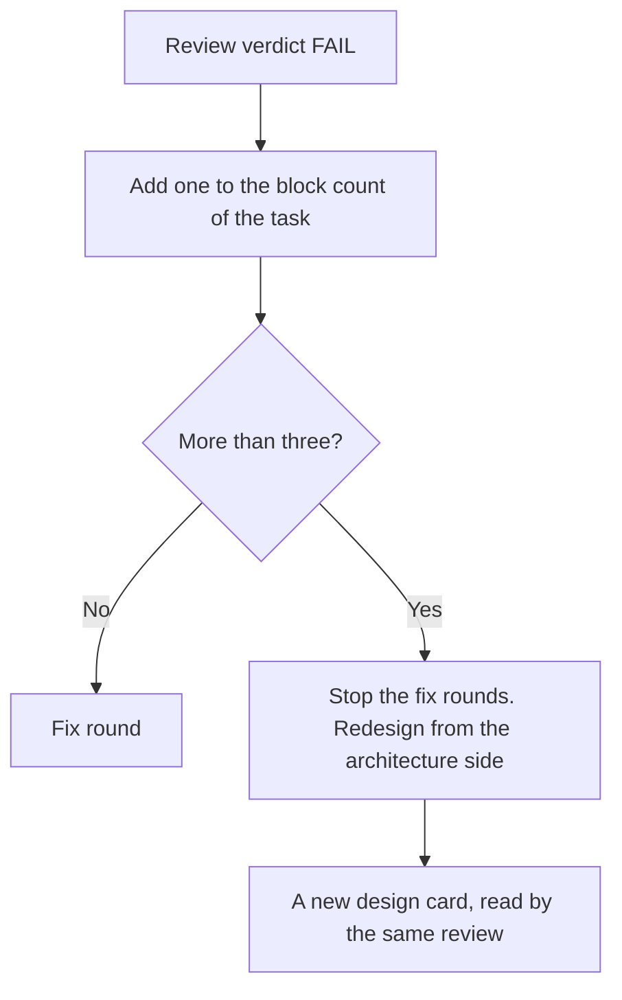

# Signal accuracy: a signal states its cause, its evidence and a next step that works

**Status:** proposed, 2026-11-05. Each new name in this file is a proposal until its component lands. The names are the design card, `signals count`, `agent show`, the class field of a failure reason and the `redesign` result.

> [ADR-0161](adr/0161-a-pipeline-blocker-fix-meets-six-test-rows-and-a-signal-states-its-cause-and-next-step.md) · plan: [pipeline-blockers-2026-11](../plans/pipeline-blockers-2026-11.md) · research: [pipeline-blockers-2026-11](../research/pipeline-blockers-2026-11.md).
> This file is the spec of record for the content of a signal, the source of a failure class and the one-reader rule. It also covers the wiring of entries, the logout cause, the redesign past three blocks and the debug verbs.
> [signal-center-design](signal-center-design.md) holds the transport of signals. [signal-codes](signal-codes.md) holds the code registry. [convergence-policy](convergence-policy.md) holds the ladder.
>
> **Terms used throughout:**
> - **Signal:** a message from the pipeline to an operator or an agent: a log line, a reason file, a digest or a status line.
> - **Cause:** the true reason of a failure. A cause is known when a host fact shows it.
> - **Host fact:** a value that the pipeline reads from the system, not from text that an agent writes. Examples: an exit code, a route field, a probe result.
> - **Class:** the label that a failure gets, for example `infra-error` or `gate-block`.
> - **Evidence handle:** the file, the command or the id that lets a reader check the cause.
> - **Entry:** one place where a fact is read or a fix must apply. Examples: the fresh path and the resume path, each isolation stage, each driver family.
> - **Design card:** the six-field record that the author writes before the first test.

## Table of contents

- [1. Goals](#1-goals)
- [2. A worked example](#2-a-worked-example)
- [3. The content of a signal](#3-the-content-of-a-signal)
- [4. The source of a class](#4-the-source-of-a-class)
- [5. One reader for each fact](#5-one-reader-for-each-fact)
- [6. Every entry is wired](#6-every-entry-is-wired)
- [7. A logout is not a quota wall](#7-a-logout-is-not-a-quota-wall)
- [8. More than three blocks is a redesign](#8-more-than-three-blocks-is-a-redesign)
- [9. The console uses verbs, not scripts](#9-the-console-uses-verbs-not-scripts)
- [Guards](#guards)
- [Limits](#limits)

## 1. Goals

| Goal | Measure | Target |
|---|---|---|
| A signal states a true cause or "unknown" | Findings of the group "false or missing cause" in the first review | 0 |
| A signal gives a next step that works | A journey test follows the step | 100% of new signals |
| A class does not depend on free text | A table test with a hostile text for each writer | 100% of writers |
| A fact has one reader | Duplicate counts and parsers found by the review | 0 |
| A routine event does not fill the log | Lines for each launch at WARN | 0 |

The goals are in priority order. The first goal is the rule of the operator: "The signal needs to be accurate without any mistake, showing clear guidances for agent to debug".

## 2. A worked example

Cycle 2157 failed in the build phase. The floor rejected the resumed build. The failure text holds the test name `TestResumeKeepsLadderRung_AQuotaPausedResumeCheckpointsTheRungOfItsCorrectionLoo…` (`R/.evolve/runs/cycle-2157/audit-fail-reason.json`).

| Step | Today | Under this design |
|---|---|---|
| 1. The host writes the reason | One text, with the host line and the test output together | The host writer sets `class=gate-block` and writes the text |
| 2. The digest reads the reason | `classifyPreClass` finds `quota` in the text | The digest copies the class from the field |
| 3. The operator reads the digest | `pre_class=infra-error` (`failure-digest.json`) | `class=gate-block`, the cause, the evidence handle and the next step |
| 4. The operator acts | Looks for a quota wall that does not exist | Opens the floor report named by the handle |

The proposed text of step 3 for this cycle:

| Part | Content |
|---|---|
| Operation | Build handoff floor on the resumed build of cycle 2157 |
| Item | `retry-ladder-resume-keeps-ladder-state` |
| Cause | The floor found a declared blocker on a protected path that the resume path did not prove (finding F1.6) |
| Evidence | `.evolve/runs/cycle-2157/audit-fail-reason.json` |
| Impact | The cycle ended as FAIL after 3 build attempts |
| Next step | Route the item to the console with `evolve inbox route-console`. Do not send a fourth correction. |

A second case is the logout in [section 7](#7-a-logout-is-not-a-quota-wall).

## 3. The content of a signal

### Issue

12 of 38 findings in seven reviews are a false cause, no cause, or a next step that fails (research F1.15). Three examples:
- The message for a routed card names `surface ""` and not `route:console-only` (B2).
- The ship message tells a lane to run `evolve ship --class manual`. The step gives a clean exit and ships nothing (B4).
- A lost pipeline variable opens an isolation incident in which no cell tried an action (B9).

### Gap

The policy says that a degraded path must WARN "with specifics" (`operating-policy.md` §3.7). It does not say which specifics. A test of a message checked fragments, so a missing cause passed (B4: a test pinned the false step).

### Solution

A signal has six parts. [Research R1](../research/pipeline-blockers-2026-11.md#4-refinements-to-adopt) gives the source.

| Part | Rule | Example (B4, proposed text) |
|---|---|---|
| Operation | The step that the pipeline tried | `ship verify: control-plane check` |
| Item | The path, the id or the cycle that it concerns | `go/internal/core/resume_execution.go` |
| Cause | A cause that a host fact shows, or the word `unknown` with what was checked | `the lane tree differs from the audited base at this path` |
| Evidence handle | A file, a command or an id | `git diff --name-only <base> -- <path>` in the lane worktree |
| Impact | The state: blocked, skipped, degraded or informational | `blocked: the cycle does not ship` |
| Next step | A step that works for the reader who gets this signal | `Restore the file in the lane, or route the item to the console` |

Four rules apply to the six parts.
1. The cause is a host fact. If no host fact shows it, the cause is `unknown`, and the signal lists what the program checked.
2. The next step works for the reader. A step for the console does not go to a lane. The B4 message failed this rule.
3. A signal that fires on a routine event is INFO, and one signal covers one launch.
4. A signal at WARN names a loss. It never reports normal behaviour (B9).

The test of a signal reads the whole text with equality. A fragment check can pass while a part is missing.

## 4. The source of a class

### Issue

`classifyPreClass` returns the first rule whose words occur in the text, and the first rule holds `quota`, `bridge` and `teardown` (`go/internal/core/failure_digest.go:54-70`). `AssembleFailureDigest` joins all reasons into that text (line 75). A test name in the text gave `infra-error` to a gate block (research F1.10).

### Gap

The first fix kept the host line as the source and removed the other lines. The review showed that the first line still holds free text: `agentGradedFailReason` and `epilogueCauseSuffix` copy the text of an agent or a cause into it. A class from words is fragile whatever the line (B8 CRITICAL 1; research P2.5).

### Solution

The writer of a failure sets the class. Each host writer sets one field, and the digest copies it.

| Rule | Detail |
|---|---|
| The field | Each reason has a `class` that the host writer sets from a host fact. |
| No match | A reason with no class gets `unknown`, and the signal says so. |
| The text | Text is for people. No code reads it to choose a class. |
| The table test | For each writer, a test feeds a hostile text (for example, a test name with `quota`) and checks the class through the real writer function. |

The older word list stays only as a fallback for a reason file that predates the field. It signals each use, so that the count of fallbacks falls to zero.

## 5. One reader for each fact

### Issue

Three faults had two readers for one fact:
- The halt and the status counted ships in two ways. Two probes gave `waves=[0 0] halted=true` where the status counted a ship (B5).
- A fourth parser of `go test -json` was added, and the repo-contract floor still listed fixture failures (B8).
- The floor read the lane tree against the base, and the ship check read the main checkout against `HEAD` (B4).

### Gap

A fix that adds a second reader fixes the case in the incident and leaves the old reader to disagree. The fixtures hid this: the halt tests wrote only `phase-timing.json`, and the status tests wrote only `run.json`. No test gave both readers one disk state.

### Solution

A fact has one home and one reader function. Every consumer calls it.

| Fact | Home (proposed) | Consumers |
|---|---|---|
| Ships of a run | One function of the wave package that counts the cycles of a time window by their current outcome | The halt, the status, the wave facts, `wave watch` |
| Failed tests of a run | One leaf package that reads `go test -json` | The build floor, the repo-contract floor, the ship check |
| The tree that a control-plane check reads | One rule: the lane tree against the audited base | The build floor, the ship check, the sibling check |

A test gives all consumers one disk state and checks that they agree.

## 6. Every entry is wired

### Issue

Two fixes reached one of several entries:
- The seal of the predicate base ran at the fresh Build entry. A resume that started at an earlier phase had no base, so a true blocker never routed (B3 CRITICAL 1).
- The host directory reached a tmux cell at `enforce`, but not at `shadow` or `off`, and a test claimed all three (B6 CRITICAL 1).

### Gap

The wiring proof of the policy (§3.3) asks for proof on the composed live path. It does not say that every entry needs a proof. A test through one entry passes while another entry keeps the fault.

### Solution

The design card lists each entry. The wiring row has one test for each entry, and each test fails when that entry loses the fix.

| Fix | Entries to list |
|---|---|
| B3 | The fresh Build path, the resume that starts at Build, the resume that starts at an earlier phase |
| B6 | Each isolation stage (`off`, `shadow`, `enforce`) and each driver family |
| B5 | The halt, `wave status`, the wave facts and `wave watch` |

## 7. A logout is not a quota wall

### Issue

Near 01:00 on 2026-11-05 the claude CLI was logged out. Lanes reported `quota-pause` at 56 percent weekly usage. Reviews returned an empty report and an empty verdict. The loop stopped until the operator ran /login near 07:10 (research F1.12).

### Gap

The pipeline has no class for a logout. A search of non-test Go code finds no text for it (research F1.12). The quota stop reason is the nearest class, and its next step is to wait for a reset that does not help. An empty report is not a cause.

### Solution

The classifier separates three causes, in this order. The evidence for each comes from what the CLI prints and from the usage probe.

| Cause | Host fact | Next step (proposed) |
|---|---|---|
| Logout | The CLI prints its login prompt, or the probe fails to authenticate | Run `/login` in the CLI, then `evolve clihealth clear claude` |
| Quota wall | The usage probe shows the limit reached | Wait for the reset time in the signal, or use another family |
| Unknown | Neither fact | State `unknown`, list what was checked, and name the pane tail as the evidence handle |

Two more rules apply:
- A review run with an empty report states that the run did not complete. The signal does not call it a verdict.
- A real quota wall still reports quota.

The next step for a logout comes from the inbox item `logout-is-reported-as-a-quota-wall`. I did not verify that the verb `clihealth clear` exists. The exact text of a logged-out pane is not captured yet (plan Q2).

## 8. More than three blocks is a redesign

### Issue

Seven fixes had 38 findings after their builds. Four fixes were blocked twice. A fix that is blocked again and again with the same approach adds cost and no new information.

### Gap

The convergence ladder already counts the rounds. Round 3 is rung 2, "change the strategy", with a fresh-context fixer or a new plan (`convergence-policy.md` §3). For a pipeline blocker this is too weak. The operator ordered a redesign "from architecture perspective with ultrathink".

### Solution

A task that has more than three blocks stops its fix rounds and gets a redesign. The count is for each task, across review rounds and rebuilds, so it is not the round count of the ladder. Plan Q1 holds the open question on how the two meet.

| Step | Rule |
|---|---|
| Count | One block is one FAIL verdict with an open blocking finding. The count is for each task, across review rounds and rebuilds. |
| Trigger | More than three blocks stops the fix rounds (component P1). |
| Redesign | The console runs the redesign at the top tier. The input is the reports of all blocks and the design card. |
| Output | A new design card. The same architecture review reads it before any new test. |
| After the redesign | The count of the new design starts at zero. More than three blocks escalates it again. |

The count of blocks is also the measure for ADR-0161 decision 9.

## 9. The console uses verbs, not scripts

### Issue

The audit of wave 155 used scratch commands: a JSON print of each review report, and a line count of `loop.log` by field. The operator asked: "Why do we have bash script?" and "Could we just build the debug cli in evolve loop for your use and cover with tests?"

### Gap

Class A verbs exist for `signals tail`, `wave status`, `agent list` and `dossier show`. Three steps have no verb (research F1.20). A scratch script has no test, so its output is not proof.

### Solution

Two read-only verbs join the one for a cycle. The names are proposals. `evolve debug cycle N` of [ADR-0162](adr/0162-the-console-reads-through-a-tested-read-only-debug-family-and-writes-no-scratch-scripts.md) answers the question for one cycle, so this spec does not add a verb for it.

| Verb | Replaces | Output |
|---|---|---|
| `evolve signals count --run <id> [--code C] --by <field>` | A count of log lines with `grep` | A table of counts for each value of the field, with `--json` |
| `evolve agent show <run label>` | A JSON print of a launch record and its report | The verdict, the finding counts, the report and the launch record path |

Each verb has a golden test of its output from a fixture. Each verb is class A. The rule for a new verb: if the console does a step by hand twice, it files an inbox item for a verb.

## Guards

| Rule | Guard | State |
|---|---|---|
| A signal code is registered | `evolve signals codes check`, run by a test of `cmd/evolve` | Exists ([signal-codes](signal-codes.md)) |
| A signal text has the six parts | The equality helper of the signal test (component P2) | Proposed |
| A class is set by the writer | A table test with a hostile text for each writer | Proposed |
| A fact has one reader | A test that gives all consumers one disk state | Proposed |
| Each entry is wired | One wiring test for each entry of the design card | Proposed |
| A task with more than three blocks gets a redesign | The block count of the task (component P1) | Proposed |
| A debug verb is read-only | `evolve agent capabilities --json` lists it as class A | Proposed |

## Limits

- The design does not prove that a cause is true in a case that no fixture models. The journey test with real output covers the first case (the logout).
- A host fact can be wrong or missing. Then the signal says `unknown`, and the evidence handle is the way to check.
- The design card does not find a fault that its author cannot see. A review seat reads it for that.
- The design does not cover each other signal code. The inbox item `signal-catalog-accuracy-audit` owns that check.
- The rule of more than three blocks stops a patch loop. It does not choose the better design.
- The debug verbs read facts. They do not fix a fault.
