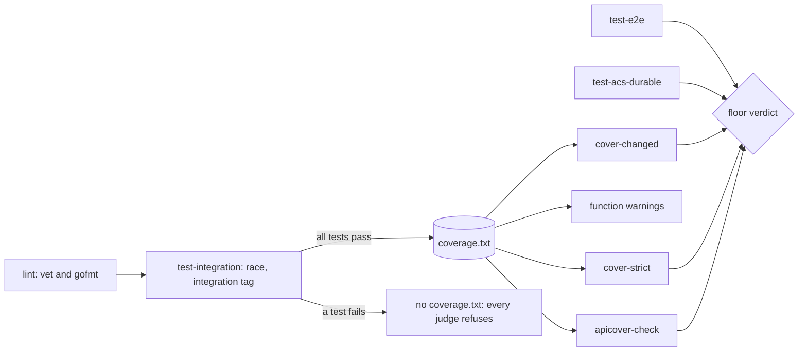

# The test system: one run, many judges, one home for each helper

> [ADR-0131](adr/0131-one-test-run-feeds-every-coverage-gate.md) (Accepted, 2026-10-12) · plan: [test-system-efficiency-2026-10.md](../plans/test-system-efficiency-2026-10.md) · research: [test-system-efficiency-2026-10.md](../research/test-system-efficiency-2026-10.md) (F1.1 to F5.5, R1 to R13).
> This file is the spec of record for the design of the test system. It covers the design of one test case, the flow of a test run, isolation, the helper kits, scale and the lanes that write tests.
> [go/docs/testing.md](../../go/docs/testing.md) stays the how-to: the build tags, the Make targets and the CI shape. [test-refactoring-design-2026-09-14.md](test-refactoring-design-2026-09-14.md) stays the protocol for a refactor that removes or merges tests.
>
> **Terms used throughout:**
> - **Run:** one `go test` process over a set of packages.
> - **Instrumented run:** the one run that writes the coverage profile, `make test-integration`.
> - **Judge:** a gate that reads the output of a run and gives a verdict. A judge does not run tests.
> - **Floor:** the targets that a lane runs before it opens a pull request.
> - **Pole:** a package whose wall time sets the end of a run.
> - **Kit:** a package that only tests import. It holds the shared helpers of one domain.
> - **Seam:** a point where a test replaces a dependency of production code.
> - **Serial test:** a test that changes process state, so it cannot run in parallel.

## Table of contents

1. [Goals](#1-goals)
2. [The layers](#2-the-layers)
3. [The design of one test case](#3-the-design-of-one-test-case)
4. [The run: measure once, judge many times](#4-the-run-measure-once-judge-many-times)
5. [Isolation](#5-isolation)
6. [Helpers: one home for each helper](#6-helpers-one-home-for-each-helper)
7. [Wall time and scale](#7-wall-time-and-scale)
8. [The lanes that write tests](#8-the-lanes-that-write-tests)
9. [Guards](#9-guards)
10. [Limits](#10-limits)

## 1. Goals

| Goal | Measure | Target |
|---|---|---|
| Effect | A test fails when its behavior breaks. | Each changed function at 100%, and each function has a killed mutant. |
| Efficiency | The time from a change to a verdict. | The local floor runs each test one time. |
| Scale | The growth of the wall time with the growth of the suite. | Each package stays inside its wall budget (§7). |
| No duplication | Extra copies of equal helper bodies. | The count goes down only (§6.4). |

The goals have an order. Effect comes first. A faster suite that misses a defect is a failure.

## 2. The layers

The suite has two axes. [go/docs/testing.md](../../go/docs/testing.md) defines them.

- **The cost axis** is a build tag: default, `integration`, `e2e` and `acs`. The tag selects what a run compiles.
- **The granularity axis** is a convention: unit, functional, component, integration and e2e. It tells what a test exercises.

This design keeps both axes. It adds no tag and moves no test.

## 3. The design of one test case

### 3.1 Intent first

A test states one behavior in its name, `Test<Unit>_<Behavior>`. The assertion checks that behavior. If the behavior breaks, the test fails. A test that still passes after the behavior breaks is a defect (AGENTS.md rule 9).

### 3.2 The case set

For each function under test, the author considers each class below. The author writes each case that applies.

| Class | Cases |
|---|---|
| Edge values | empty, nil and zero inputs; one element; the boundary and one step on each side of it; unicode and long text where code parses text |
| Error paths | each returned error; each failing dependency through a seam; a cancelled context; a deadline |
| Table | one table for the cases of one behavior, with a name for each row |
| Real process | a real `git`, `tmux` or subprocess, with the `integration` tag, through `internal/gittest` or `internal/tmuxtest` |
| Fuzz | a native fuzz target for each parser or decoder, with a seed corpus |
| Property | an invariant over many inputs, for example idempotence, order or a round trip |
| Regression | a test named for the incident or the cycle that found the defect |
| Concurrency | `fixtures.StressN` with an invariant that holds after the storm, under `-race` |

A test that only checks "no error" for a function that returns data is not a test of the data. Assert the data.

### 3.3 Proof of effect

1. Write the test first, and see it fail.
2. Make the change, and see the test pass.
3. Change one condition, comparison or return in the function with `go test -overlay`. See the test fail.
4. Record each mutant and the test that kills it in the lane report.

### 3.4 Arrange, act, assert

A test has three parts in this order: arrange, act, assert. A blank line separates the parts. A test has no comments ([ADR-0111](adr/0111-code-carries-no-comments.md)). The names of the test, the table rows and the helpers tell the intent.

## 4. The run: measure once, judge many times

### 4.1 Issue

The local floor ran the same tests three times: `test`, `test-integration` and `apicover-enforce`. `cover-strict` then ran 51 packages one at a time. These repeats used 55% of the floor time (research F2.5).

### 4.2 Gap

Each coverage gate measured its own numbers with its own run. No gate read the numbers of another run. No run proved that it passed.

### 4.3 Solution

1. **One instrumented run.** `make test-integration` is the only run that writes coverage for the runtime packages.
2. **A profile only from a green run.** The run writes `coverage.partial.txt`. It renames the file to `coverage.txt` only when `go test` exits 0. At its start, the run deletes the old `coverage.txt`.
3. **Judges only read.** `cover-changed`, `cover-strict`, `apicover-check` and the function warnings read `coverage.txt`. A judge with no profile refuses.
4. **A fresh profile.** A judge refuses a profile that is older than a changed source file. `covchanged` already does this check (`freshReader`).
5. **One parser.** Each Go judge parses the profile through `covchanged.ParseProfile`.
6. **Same numbers.** The per-package percent from the profile equals the percent of `go test -cover` for that package (research F2.6). A test pins this equality on a sample package.

### 4.4 The local floor

This floor takes effect when plan T2 merges. Until then, the floor in [go/docs/testing.md](../../go/docs/testing.md) applies. The floor has the same order as CI. Run one target at a time.

| Order | Target | Runs tests |
|---|---|---|
| 1 | `lint` | no (it compiles the default build) |
| 2 | `test-integration` | yes, the one instrumented run |
| 3 | `test-e2e` | yes, a different tag set |
| 4 | `test-acs-durable` | yes, a different tag set |
| 5 | `cover-changed` | no |
| 6 | `cover-strict` | no |
| 7 | `apicover-check` | no |

`make test` is not in the floor. It stays as the fast loop of a developer. `lint` still compiles the default build, so a fast test that uses a tagged symbol still fails the floor.

## 5. Isolation

### 5.1 The hermetic rule

A test reads only the state that it makes. The rule covers these sources:

| Source | Rule | Where it is |
|---|---|---|
| Environment | A test that builds a bridge engine pins `Deps.LookupEnv`. | [hermetic-driver-tests.md](../conventions/hermetic-driver-tests.md) |
| Repository | A test makes its own repository with `internal/gittest`. It never reads the live repository or `.evolve/runs/`. | [go/docs/testing.md](../../go/docs/testing.md) |
| Host home | A test never reads the home directory of the host. A test that builds a real engine sets the Claude config root to a temporary directory. | This document, research F3.4 |
| Clock | A test uses an injected clock or `fixtures.FixedClock`. | `go/test/fixtures` |
| Network | A test uses no network. | `internal/testhost` for host tools |

The host home rule comes from a test that read 10 GB of host transcripts in 479 s (research F3.4). CI has an empty home, so CI did not see it.

### 5.2 Parallel by default

A hermetic test calls `t.Parallel`. A serial test is one of these:

- a test that calls `t.Setenv` or `t.Chdir` (Go refuses `t.Parallel` there);
- a test that changes a package variable;
- a test that holds a host resource, for example a fixed port or a shared tmux server.

A serial test stays short. A slow serial test is a defect of the design. Move its slow part to a parallel test, or replace its process state with a seam.

### 5.3 The order of seams

| Rank | Seam | Test stays parallel |
|---|---|---|
| 1 | A field of the dependency struct that the function already takes | yes |
| 2 | A parameter of the function | yes |
| 3 | A package variable, bound to the exact original value | no |

Use rank 3 only when the function has no dependency struct and a new parameter changes many callers. Never delete a guard to reach 100%. A seam reaches it.

## 6. Helpers: one home for each helper

### 6.1 The kits

| Kit | Domain |
|---|---|
| `go/test/fixtures` | doubles of the `core` ports, the workspace builder, clocks, assertions, `StressN` |
| `internal/gittest` | git repositories, clones, bare remotes, git config without maintenance |
| `internal/tmuxtest` | real tmux servers and sessions |
| `internal/fakeclitest` | the fake CLI binaries for the drivers |
| `internal/routingtest`, `internal/cliroute/cliroutetest` | routing tables and their fixtures |
| `internal/kerneltest` | the transition kernel fixture |
| `internal/testhost` | the decision to skip or fail when a host tool is absent |
| `pkg/acsassert` | the helpers of ACS predicates |

### 6.2 Where a new helper goes

1. Use the standard library first: `os.WriteFile`, `slices.Equal`, `slices.Contains`, `strings.Contains`, `strconv.Itoa`, `maps.Equal`.
2. Use a kit function when one exists. Read the kit before you write a helper.
3. A helper that one test file uses stays in that file.
4. When a second package needs the same helper, move it to the kit of its domain.
5. A helper with no kit domain goes to `go/test/fixtures`.

### 6.3 Names in a shared package

Many lanes add files to one package at the same time. A new top-level name in a test file is specific to the file, for example `campaignAbs`, not `absRoot`. Two equal names in one package break the build after both merges, and each pull request is green alone (research F4.6).

### 6.4 The duplicate ratchet

1. A scanner normalizes the body of each non-test function in each runtime test file.
2. It counts the extra copies of equal bodies.
3. `go/.test-dup-baseline` holds the count.
4. A structure test fails when the count is above the baseline.
5. A change that lowers the count must lower the baseline in the same commit.

The ratchet scans the runtime test files. Old cycle directories under `acs/` are history. The ratchet scans an `acs/` directory only when it is newer than the baseline date.

### 6.5 Predicate helpers

Each cycle wrote its own copy of the same predicate helpers: 597 copies (research F4.2). `pkg/acsassert` gets these helpers:

- the module directory;
- a `go test` run with its JSON result, and a check that tests ran;
- the tail of an output;
- the coverage of one function;
- a walk of the module.

The persona text of the phases that write predicates names them.

## 7. Wall time and scale

### 7.1 The model

`go test` runs packages at the same time. The wall time of a run is close to the build time plus the time of the poles (research F3.2). Thus the work on wall time goes to the poles. A pole holds most of its time in few tests (research F3.3).

### 7.2 The budget

| Item | Value |
|---|---|
| Wall budget of one package under `-race` | 180 s on CI |
| Warning | a package over its budget, in the latency report of each CI run |
| Hard limit | the `go test` timeout of the recipe, set to 20 minutes (plan T4) |

The timeout is a stop for a hung run. The budget is the alarm for growth. On 2026-10-12, `internal/core` passed the 10-minute default timeout under local load (research F3.7).

### 7.3 The order of remedies for a pole

1. Make the test hermetic. A test that reads host state is slow in a way that grows (research F3.4).
2. Fix the production cost when the test shows one (research F3.5).
3. Add `t.Parallel` to independent slow tests (research F3.8).
4. Build a shared binary one time for each package, with `sync.Once` or in `TestMain`.
5. Replace a real wait with an injected clock or an event.
6. Move a slow black-box test set to a sibling package directory. It then runs as its own test binary, at the same time as the original package.

Do not raise the budget to make a pole pass. A raise needs a record in the plan with the reason.

### 7.4 Fake time

`testing/synctest` removes real waits from tests that use timers. The module baseline is Go 1.23, and CI has a Go 1.23 lane. Thus this design does not use `synctest` yet. When the baseline reaches Go 1.25, it replaces remedy 5.

### 7.5 Change-scoped iteration

A lane can run the tests of the packages that its change touches and of their importers, through `changedpkgs.ImporterClosure`. This gives fast feedback inside a lane. It never replaces the floor. The full floor runs before each pull request, and CI runs the full suite.

## 8. The lanes that write tests

### 8.1 Roles

| Role | Model | Work |
|---|---|---|
| Console | Opus | the design, the batches, the briefs, the reviews, the commit gate and the merge |
| Test lane | Sonnet | the test cases, the seams, the mutants and the floor |
| Small mechanical lane | Haiku | a rename, a move to a kit, a removal of comments |
| Simplifier | Haiku | the first review pass |
| Reviewers | Opus at medium effort | the Go review and the design review |

### 8.2 The brief of a test lane

A brief names the batch, the worktree and the scratch directory. It requires the case set (§3.2), the proof (§3.3) and the floor (§4.4). It also has these rules:

- new tests go in new files that end in `_backfill_<lane>_test.go`, or in the file of the behavior;
- each new top-level name is specific to its file (§6.3);
- production code changes only to add a seam (§5.3);
- the lane stages its work and does not commit;
- the lane keeps a progress file, so a restart on another model can continue.

### 8.3 The merge train

The console merges the pull requests of a batch one at a time. After each merge, it rebases the next branch and builds the package. A duplicate name then fails before the merge, not on `main`.

## 9. Guards

| Rule | Guard | State |
|---|---|---|
| A changed function is at 100% | `make cover-changed`, CI step | in force |
| A package keeps its floor | `make cover-strict`, CI step | in force; it becomes a judge (§4.3) |
| An export is named and executed | `make apicover-check`, CI step | in force |
| A judge needs a green run | the rename of `coverage.partial.txt` | plan T2 |
| No new raw `git init` fixture | `internal/rawgitratchet` | in force |
| A test pins the environment of a driver | `TestRunTmuxREPL_ArtifactDebounceHermeticUnderAmbientFleetEnv` | in force |
| No new duplicate helper | the duplicate ratchet (§6.4) | plan T5 |
| A package stays inside its budget | the latency report (§7.2) | plan T4 |
| Each mutex has a stress test | `TestEveryMutexHasStressTest` | in force |
| Code has no comments | the commit gate | in force |

## 10. Limits

- The budget is a CI number. A loaded host is slower. The local floor reports, and CI decides.
- The duplicate ratchet sees only equal bodies after normalization. Two helpers with the same intent and a different body pass it. The review still checks for them.
- A judge can only be as true as the instrumented run. The S1 meta-tests of 2026-09-14 still prove that a failed test fails the gate.
- Change-scoped iteration can miss a test that reads a file and not a Go import. The full floor covers this case.
