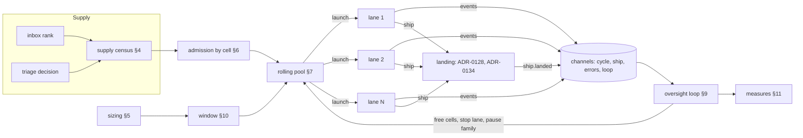

# Wave orchestrator: one component supplies, admits, backfills and oversees every lane

> [ADR-0139](adr/0139-a-wave-orchestrator-supplies-admits-and-backfills-every-lane.md) (Proposed, 2026-10-17) · plan: [wave-orchestrator-2026-10](../plans/wave-orchestrator-2026-10.md) · research: [wave-orchestrator-2026-10](../research/wave-orchestrator-2026-10.md) (F2.1 to F2.24, P3.1 to P3.17, R1 to R8).
>
> This file is the spec of record for how the loop runs its lanes. It holds the census, the sizing, the admission, the pool, the lease, the oversight, the window, the measures and the scale limits. The plan holds the decisions, the components and the order. The ADR holds the decision. Landing stays in [fleet-landing-queue](fleet-landing-queue.md) (ADR-0128, ADR-0134). The events come from [event-channels](event-channels.md) (ADR-0127).
>
> Written in the Issue / Gap / Solution shape.
>
> **Terms used throughout:**
> - **Lane:** one fleet cycle, with its own process and its own worktree.
> - **Slot:** a place for one lane. The width is the number of slots.
> - **Todo:** one unit of work that a lane takes, from the inbox or from a triage decision.
> - **Supply:** the todos that a lane can take now: lane-routable, with their `deps` met, and not claimed.
> - **Cell:** a module package with its module-internal dependencies, as `PartitionGraph` computes it. The unit of admission.
> - **Hub cell:** one cell that holds the hub packages. Its capacity is 1.
> - **Admissible:** a todo whose cells overlap no cell of a lane in flight.
> - **Lease:** the record that a lane is alive. It holds the last heartbeat and the deadline.
> - **Window:** the number of slots that the orchestrator fills. It is at most `fleet.count`.
> - **Pairwise conflict rate:** the share of landed lanes that needed a rebase or a re-audit at landing.

## Table of contents

- [1. Goals](#1-goals)
- [2. Architecture](#2-architecture)
- [3. A worked example](#3-a-worked-example)
- [4. The supply census](#4-the-supply-census)
- [5. Sizing](#5-sizing)
- [6. Admission by cell](#6-admission-by-cell)
- [7. The rolling pool](#7-the-rolling-pool)
- [8. The lane lease](#8-the-lane-lease)
- [9. The oversight loop](#9-the-oversight-loop)
- [10. The adaptive window](#10-the-adaptive-window)
- [11. Measures](#11-measures)
- [12. Scale](#12-scale)
- [13. Config keys, signals and commands](#13-config-keys-signals-and-commands)
- [14. Stages](#14-stages)
- [Guards](#guards)
- [Limits](#limits)

## 1. Goals

| Goal | Measure | Target |
|---|---|---|
| G1. At least 4 lanes at once | the median realized width over 3 runs | ≥ 4 when the supply is ≥ 4 |
| G2. Few conflicts | the pairwise conflict rate | ≤ 5% |
| G3. Busy slots | the busy lane time over the slot time | ≥ 0.85 at width 4 |
| G4. One overseer | the share of stalls and deadlines that the orchestrator acts on | 100% |
| G5. Scale | the cost of each step as a function of N, and a soak at N = 16 | stated, and the soak passes |
| G6. Known supply | each plan records its supply and the cause of each refusal | every plan |

The order of the goals is the order of the work. Supply first: an empty supply makes every other goal void. Then conflicts: more lanes without admission only make more conflicts. Then busy slots, oversight and scale.

## 2. Architecture

The orchestrator replaces the fire-and-wait wave on the loop's fleet path. It is deterministic Go in the loop process, and it runs no LLM (ADR-0139 decision 1). It reuses built parts: `fleet.RunPool`, `fleet.PartitionGraph`, `fleet.FreshenSpecs`, `clihealth`, `inboxrank` and the event reader of ADR-0127.

The orchestrator owns four kinds of state. All of it lives in memory, and the run record under `.evolve/waves/` keeps a copy:

| State | Shape | Writer |
|---|---|---|
| the cell table | cell → the lane that holds it | admission (§6), oversight (§9) |
| the lease table | lane → the last heartbeat and the deadline | the lease (§8) |
| the window | one integer | sizing (§5), the window (§10) |
| the measures | counters for each run | oversight (§9) |

## 3. A worked example

This example uses real packages of this repository. `fleet.count` is 4, and `agy-claude` is benched, as on 2026-10-17 (F2.2).

1. **Sizing.** `agy-claude` has `claude` after it in each chain that the wave uses. The bench costs no slot, so the window is 4 (§5).
2. **Supply.** After the routing remedy of the plan (O2a), the census finds 6 admissible todos. Their cells, from `PartitionGraph`:

| Todo | Files | Cells |
|---|---|---|
| a | `go/internal/inboxrank/inboxrank.go` | `inboxrank` |
| b | `go/internal/quotastate/windows.go` | `quotastate` |
| c | `go/internal/fleet/pool.go` | `fleet` |
| d | `go/internal/inboxrank/explain.go` | `inboxrank` |
| e | `go/internal/sysexec/command.go` | the hub cell |
| f | `docs/operations/wave-operations.md` | none (outside `go/`) |

3. **Admission.** The pool takes the todos in rank order: a, b, c, d, e, f.
   - a, b and c have disjoint cells. Each one takes a slot.
   - d shares `inboxrank` with a. d waits.
   - e takes the hub cell. Its capacity is 1, so e takes the fourth slot.
   - f has no cell in `go/`, so it is always admissible. The window is full, so f waits for a slot.
4. **Backfill.** Lane b lands after 22 minutes. `ship.landed` frees the cell `quotastate`. The pool takes the next admissible todo, f, at once.
5. **A cell frees.** Lane a lands. Its cell `inboxrank` frees, and d becomes admissible. d takes the next free slot.

Today's file partition puts a and d in one lane, because their files differ, and the wave waits for its slowest lane. The orchestrator keeps them apart in time and keeps every slot busy.

## 4. The supply census

### Issue

On 2026-10-17, 0 of 230 inbox items can go to a lane (F2.6). The lane-routable supply fell from 41 on 2026-09-15 to 1 (F2.17). Three runs planned zero lanes (F2.4). The loop finds out only after K starved waves, through one inbox item (F2.16).

### Gap

No step counts the supply before a plan. The plan reads the last triage decision and widens it from the inbox (F2.5). When both are empty, the plan is empty, and the cause is not recorded. The routing rules send 170 items to the console by derivation (F2.7), and nothing tells the console which rule holds which item.

### Solution

Before each plan, the census reads the ranked inbox through `inboxrank.Order` and classifies each item:

| Class | Rule | Source |
|---|---|---|
| `admissible` | lane-routable, `deps` met, not claimed, and its cells are free | `inboxbatch.PartitionConsole`, §6 |
| `waiting_cell` | lane-routable, but a lane in flight holds one of its cells | §6 |
| `waiting_deps` | a `deps` item is open | `inboxrank` |
| `console_route` | an explicit `route: console*` | `inboxbatch.IsConsoleRoute` |
| `console_kind` | a `pipeline-*` kind | `consoleroute.go:49-56` |
| `console_protected` | a protected fix surface | `consoleroute.go:58-80` |

The census writes one record for each plan into the run record, and it publishes `orchestrator.supply` on the `loop` channel. The record holds the count of each class and the ids of the console items with their reasons.

When the admissible count is below the window, the census publishes `LOOP_ORCH_SUPPLY_SHORT` with the counts. When it is below twice the window, the census writes a split proposal for each mixed item. A mixed item names protected files and files that are not protected. The console accepts a proposal with `evolve inbox split <id>` (plan O2c). The split makes two items:

- The **console part** keeps every protected file, the route and the acceptance that a grader judges.
- The **lane part** keeps the files that are not protected. It has `deps` on the console part when it needs the console part first.

The census never routes an item itself. ADR-0074 keeps the routing authority, and the four guards of F2.23 keep the protected files safe.

## 5. Sizing

### Issue

Every run of 2026-10-16 and 2026-10-17 shrank the wave from 3 to 2. 23 of the 25 benches named `agy-claude` (F2.2).

### Gap

`Engine.Size` passes every active bench to `QuotaAwareCount`, and each bench costs one slot (`size.go:15`, `quota.go:9-39`). The shrink does not check if the chain has a family after the benched one. `agy-claude` has `claude` after it in the deep and top chains, so a lane on that seat walks to `claude`.

### Solution

**Status: Built (O1, 2026-10-17).** `fleet.ChainAwareBenches` (`go/internal/fleet/quota_chain.go`) gives the benches that cost a slot. `Engine.Size` passes them to `fleet.QuotaAwareCount`.

The sizing step reads each `cli_routing` chain as families. A chain costs one slot when every family in it is benched. The slot goes to the last family of that chain. Thus two chains with the same last family cost one slot. A bench of any other family costs nothing and writes one INFO line. The line names the healthy family that a lane walks to, or says that no lane chain uses the family.

`cliroute.FamilyChains` reads the chains from `default`, `work`, `agents.<agent>.cli` and `tiers.<tier>.clis`. It does not read `after_chain`, so the set is conservative. The `Chains` port of the `Engine` calls it. The caller of `Engine.Size` loads the policy once (`loopwave.LoadRouting`) and passes the `cli_routing` block, so `Size` reads no second snapshot. When the policy is unreadable, or the table gives no chain, every bench costs one slot, as before. An unreadable policy also writes one WARN line, from `LoadRouting`.

Known limits: the step charges one slot for each empty chain. When many lanes share one chain and that chain empties, the shrink undercounts. `fleet.min_lanes` bounds the undercount, and the O6 oversight loop re-sizes on the bench event. A scoped bench (for example `claude@opus`) marks its whole family as down, which overcounts and is the safe direction.

Example: on 2026-10-17, `agy` and `agy-claude` are benched. Each chain of the table ends in `claude`, and `claude` is healthy. The wave keeps all 4 lanes.

The window starts at `fleet.count`, minus the slots that the benches cost, and never below `fleet.min_lanes`. The budget step of `fleetbudget` stays as it is (`size.go:16-36`).

The sizing step runs at the start of each run and again on each `clihealth` bench event (§9). The window can thus shrink while lanes run. A shrink never stops a lane in flight. It only stops the next admission.

## 6. Admission by cell

### Issue

The live partition is file-disjoint (F2.8). File-based parallel agents gain nothing over sequential work (P3.1), and uncoordinated agents conflict in 20–42% of pairs (P3.3). A conflict that reaches landing costs about 24 minutes (F2.11).

### Gap

`PartitionGraph` computes package sets, but nothing calls it (F2.9). ADR-0134 designs admission by cell (S14), but it is not built (F2.10). A card with no `files` gets its id as its only file, so it never conflicts (F2.8).

### Solution

The admission step is ADR-0134 S14, built inside the orchestrator.

1. **Cells of a todo.** `PartitionGraph` maps each Go file to its module-internal packages, from `go list -deps`. A file outside `go/` maps to no cell. A todo with no files takes the cell of the package that its text names. With no package, it takes the hub cell (ADR-0139 decision 8).
2. **The hub cell.** The packages with the most importers form one cell with a capacity of 1. On 2026-10-13 these were `sysexec` (147 importers), `log` (125), `atomicwrite` (124) and `signalcenter` (120) (ADR-0134 research F2.16). A todo that touches a hub package holds the whole hub cell. The global-zone files `go.mod`, `go.sum` and `.evolve/policy.json` also map to the hub cell.
3. **The test.** A todo is admissible when no cell of it is in the cell table. Admission puts each of its cells in the table, with the lane id.
4. **The release.** `ship.landed`, a lane failure or a lane stop removes the cells of that lane from the table (§9).
5. **Rank order.** The step takes the todos in `inboxrank` order. It stops at the first `scan_k` admissible todos (§12). A todo that waits keeps its rank. It does not lose its place to a later todo of lower rank when its cell frees.

The cell table is the shared view of all lanes in flight that the console has by hand today (F2.15). `evolve wave status` prints it.

The cells come from the tree at the run's base. A lane that adds an import adds an edge that the table does not hold. The landing proof of ADR-0128 finds that edge at landing. This is the reason why admission lowers the conflict rate but does not replace the landing proof.

## 7. The rolling pool

### Issue

A barrier wave waits for its slowest lane. We simulated it with the lane durations of cycles 1900–1920. A barrier of 4 lanes keeps about 66% of the slot time busy, and 16 lanes keep 49% (F2.13).

### Gap

`Supervisor.Run` returns only after `wg.Wait()` (`fleet.go:94`). `RunPool` backfills a free slot, but it runs only under `scheduling: pool`, it uses the file rule, and its `onTransition` hook is `nil` (F2.14).

### Solution

The orchestrator runs `RunPool` as its scheduler, with three changes:

1. **Admission.** The pool asks the admission step (§6) for its next todo, in place of its own file rule.
2. **Freshness.** The pool runs `FreshenSpecs` on each todo just before launch, as the wave path does now (`launcher.go:36-45`).
3. **Transitions.** Each transition (`launched`, `exited`, `backfilled`, `idle`) goes to the `loop` channel through `onTransition`. The console and `evolve wave watch` read the channel.

A run ends when the supply is empty and no lane is in flight, or on an operator stop (`evolve loop-stop --wait`). The wave boundary work (merge, `gc`, the code-index refresh, `cli update`) runs at the end of a run, as it does now after a wave. The rule "merge only at the boundary" thus holds unchanged: a run is one boundary-to-boundary unit.

A run has a length limit, `fleet.orchestrator.run_max_lanes`, in lanes launched. It keeps boundaries regular, so merges and binary refreshes still happen. Its default is `4 × fleet.count`.

## 8. The lane lease

### Issue

A wave lane has no deadline (F2.12). The console decides by hand when a stuck lane has run too long (F2.15).

### Gap

`Supervisor` has `CycleTimeout`, but only `evolve campaign` sets it (`cmd_campaign.go:194`). The phase observer of each lane signals `LIVENESS_PHASE_STALLED`, but it kills nothing, and no component reads its signals across lanes.

### Solution

Each lane gets a lease when it launches. The lease holds:

- **The heartbeat:** the time of the last event of that lane on the `cycle` channel. A phase start, a phase end and an observer report each count. The lease adds no new writer: the lane's existing events are its heartbeat.
- **The deadline:** the 95th percentile of the lane time over the last 50 cycles, with a floor of `fleet.orchestrator.deadline_floor_minutes` (default 60). The plan's Q1 measures it in shadow first.

The oversight loop (§9) acts on a lease:

| Condition | Action |
|---|---|
| No heartbeat for `stall_minutes` (default 20) | publish `LOOP_ORCH_LANE_STALLED`. The lane keeps its slot. |
| The deadline passes | stop the lane through its process-group stop, release its inbox claim, free its cells, and publish `LOOP_ORCH_LANE_DEADLINE`. |
| The lane stops twice for one todo | park the todo with `route: console` and the reason `deadline twice` |

The restart rule follows OTP (P3.14): a todo gets one more try, and a second stop sends it to the console. A stop never runs a second copy of a lane in parallel, because a copy costs a full lane and writes `main` (P3.15).

A stop must not be a broad kill. The orchestrator stops only the process group that its own launch made, through the injected stop of `sysexec`, and never by a name match.

## 9. The oversight loop

### Issue

No component sees all lanes of a wave at once (F2.15). The console watches `evolve wave watch`, which polls every 5 s, and it acts by hand.

### Gap

Each phase observer sees one cycle. `wave status` and `wave watch` only print. The quota state is read once, before the wave.

### Solution

The oversight loop is one goroutine in the loop process. It reads the ADR-0127 channels through `internal/events/reader`. It arms the kernel wake, reads to the end of each log, and then waits. It never polls (ADR-0139 decision 11). Each event maps to one action:

| Event (channel) | Action |
|---|---|
| `phase.*`, observer reports (`cycle`) | update the heartbeat of the lane (§8) |
| `cycle.sealed` (`cycle`) | record the verdict. On a FAIL, free the cells of the lane. |
| `ship.landed` (`ship`) | free the cells of the lane, count a clean landing or a conflict (§11), and call the pool to backfill |
| `GIT_FLEET_REBASE_NEEDED` and the ADR-0128 tier events (`ship`) | count a landing conflict for the window (§10) |
| a `clihealth` bench or unbench (`errors`) | run the sizing step again (§5). A family with no fallback stops taking new lanes. |
| `LIVENESS_PHASE_STALLED` (`errors`) | publish `LOOP_ORCH_LANE_STALLED` once for the lane |
| an operator stop (`loop`) | stop all admission. Lanes in flight finish. |
| the lease deadline timer | §8 |

The deadline needs a timer, because "nothing happened" is not an event. The loop holds one timer for the nearest deadline, not one timer for each lane.

The loop observes and acts only on its own lanes. It does not edit a lane's worktree, its verdict or its ship. The landing stays with ADR-0128 and ADR-0134.

## 10. The adaptive window

### Issue

At a large width, a fixed window hides a rising conflict rate. Each conflict at landing costs about 24 minutes (F2.11).

### Gap

The width is a fixed `fleet.count`, and only quota benches change it.

### Solution

**Deferred (plan O8).** The window has no effect at width 4. It starts when `fleet.count` goes above 6, with the ADR-0134 group commit. At or below width 4, the window is the sized count of §5. Above width 4, the window follows Zuul's rule (P3.10):

- It starts at `fleet.orchestrator.window.start` (default 4).
- It grows by 1 for each clean landing, up to the sized count.
- It halves on each landing conflict, down to `fleet.orchestrator.window.min` (default 4).

The window never stops a lane in flight. A smaller window only delays the next admission.

## 11. Measures

**State: Built (O7, 2026-10-17).** `evolve wave status --json` reports these values for the current run (`measures`) and for each of the last 3 runs (`runs`, the oldest first). The pure package `internal/wavemeasure` computes them from facts that already exist. The command computes them each time it runs. It writes no record and starts no timer. Package note: [internal-wavemeasure.md](packages/internal-wavemeasure.md).

| Measure | Definition | Source |
|---|---|---|
| `width_sized` | the width after the quota shrink and the budget | the last `loop.wave` record with `fields.width_sized` in the run, else `fleet.count` (`width_source`: `signal` or `policy`) |
| `width_realized` | the time-weighted median of the lanes in flight over the run time. Idle time counts as width 0. | the lane intervals |
| `utilization` | the busy lane time over `width_sized` times the run time | the lane intervals |
| `conflict_rate` | the landed lanes that needed a rebase or a re-audit at landing, over all landed lanes (`conflicts`, `landed`) | `recoverFromShipError` calls `recordShipError` before it recovers. A lane that rebased and then landed thus still holds the event: a `ship.error` with `SHIP_GIT_FLEET_REBASE_NEEDED`, `SHIP_GIT_FLEET_REBASE_CONFLICT` or `SHIP_AUDIT_BINDING_HEAD_MOVED` in the lane's stream |
| `admission_waits` | the todos that waited for a cell. It is 0 until O3 registers its code. | the count of `LOOP_ORCH_ADMIT_WAIT` in the run |
| `deadline_stops` | the lanes that the lease stopped | not built: it arrives with O5, which emits `LOOP_ORCH_LANE_DEADLINE` |
| `supply` | the class counts of the last census (§4) | not built: O6 adds it |

The facts:

- **The run window.** It starts at the `started_at` of the wave record. It ends at `ended_at`, else at the next record's `started_at`. A current run whose loop is not live ends at the mtime of its loop log. `wave next` uses the same rule to close a wave.
- **The one exception to "reads state and signals".** `wave status` reads the mtime of the loop log for the run end. It reads the metadata only, never the text. A live run ends at the clock.
- **A lane interval.** It is the span of the cycle's signals: from the first event to `cycle.sealed`. The phase times of the cycle dossier widen it. A lane with no seal and no dossier is in flight, and it ends at the end of the run window.
- **The sized width.** The loop writes one INFO `loop.wave` record at each sizing, with `fields.width_sized` and `fields.desired`, to `.evolve/signals.ndjson`. Before O7, no record held the sized width. The loop log has the line `wave count X -> Y`, but `wave status` reads state and signals, never the text log. A run from before O7 thus shows `width_source: policy`.

The conflict rate is the main measure of G2 (P3.3, P3.8). No outside source gives a good predictor of conflicts, so the loop measures its own rate.

### The baseline before O4

Measured on 2026-10-17 on the runtime plane, read-only, with the O7 binary (`evolve wave status --json --project-root <runtime>`):

| Wave | Cycles | `width_sized` (source) | `width_realized` | `utilization` | `conflicts` / `landed` |
|---|---|---|---|---|---|
| 118 | 1923 | 3 (policy) | 1 | 0.32 | 0 / 1 |
| 119 | 1924 | 3 (policy) | 1 | 0.32 | 0 / 1 |
| 120 | 1925 | 3 (policy) | 1 | 0.33 | 0 / 1 |

The loop log of each of the three runs has `wave count 3 -> 2`, because `agy-claude` was benched. With the sized width 2, the utilization is 0.48 to 0.49. Each run fell back to one sequential cycle (`LOOP_WAVE_DISPATCH_FAILED`: fewer than 2 file-disjoint todos). Thus the realized width is 1, and no lane landed on a moved `main`.

## 12. Scale

This section gives the cost of each step as a function of the lane count N and the limit of N with its cause.

### The cost of each step

| Step | Cost for each call | Calls | Reason |
|---|---|---|---|
| Census (§4) | O(I) for I inbox items | one for each plan | one pass over the ranked inbox |
| Cells of a todo (§6) | one `go list -deps` for each directory, cached for the run | one for each new directory | `PartitionGraph` calls it once for each directory |
| Admission test (§6) | O(c) map lookups for c cells of a todo | at most `scan_k` todos for each free slot | the scan stops at the first `scan_k` admissible todos (P3.12) |
| Release (§9) | O(c) | one for each lane end | |
| Event handling (§9) | O(1) for each event | one for each event | the channels push. No poll tick. |
| Deadline timer (§8) | O(log N) | one for each lane | one timer on a heap of deadlines |
| Memory | O(N + cells) | | the cell table and the lease table |

No step compares all pairs of lanes. The cost thus grows linearly with N, not with N². At N = 200 with `scan_k` 32 and about 10 cells for each todo, one admission is about 320 map lookups (synthesis).

### The limits of N

| Limit | Value | Cause | What raises it |
|---|---|---|---|
| Disjoint Go cells | about 139 lanes | the import graph: at most 139 packages with no edge between any two (ADR-0134 research F2.16) | work outside `go/`, which has no cell. Smaller hub packages. |
| The serial landing | about 6 lanes | one landing takes about 5 minutes (ADR-0134 research §2.1). The median lane takes 31 minutes (F2.13). Little's law gives 31 / 5 ≈ 6 lanes before landings queue (synthesis). | ADR-0134: content-keyed verification and group commit |
| Host CPU | an estimate of 8–12 lanes on one host | this host has 14 CPUs. Each lane's build floor and audit run `go test` over the module. | lanes on more hosts, a later plan |
| Host memory | above the CPU limit | one agy phase uses about 350 MB, and one Claude Code phase about 1.5 GB, on a 64 GB host (2026-10-17, `ps`) | none needed before the CPU limit |
| Quota | changes each hour | the benches of §5 | more families in each chain |

The first limit that binds is the serial landing, at about 6 lanes. A width of 4 is inside it. A width above 6 needs ADR-0134's group commit. The orchestrator then raises its window through §10, and the conflict rate shows if the cells hold.

## 13. Config keys, signals and commands

### Config keys

All keys are under `.evolve/policy.json` `fleet`, strict-decoded by `policy.FleetConfig()`.

| Key | Type | Default | Meaning |
|---|---|---|---|
| `count` | int | 4 (was 3) | the largest window |
| `min_lanes` | int | 2 | the smallest window after sizing |
| `orchestrator.stage` | `shadow` \| `enforce` | `shadow` | §14 |
| `orchestrator.scan_k` | int | 32 | the admissible todos that admission scans for each free slot |
| `orchestrator.deadline_floor_minutes` | int | 60 | the floor of the lane deadline |
| `orchestrator.stall_minutes` | int | 20 | the heartbeat gap that reports a stall |
| `orchestrator.run_max_lanes` | int | `4 × count` | the lanes that one run launches before its boundary |
| `orchestrator.window.start` | int | 4 | §10 |
| `orchestrator.window.min` | int | 4 | §10 |

`scheduling` goes away when the orchestrator is at `enforce`: the orchestrator always uses the pool. A policy with `scheduling` set then gets one WARN.

### Signals

| Code | Channel | When |
|---|---|---|
| `orchestrator.supply` | `loop` | after each census |
| `LOOP_ORCH_SUPPLY_SHORT` | `loop` | the admissible count is below the window |
| `LOOP_ORCH_ADMIT_WAIT` | `loop` | a todo waits for a cell. Once for each todo. |
| `LOOP_ORCH_LANE_STALLED` | `errors` | §8 |
| `LOOP_ORCH_LANE_DEADLINE` | `errors` | §8 |
| `LOOP_ORCH_FAMILY_PAUSED` | `loop` | §9: a family with no fallback stops taking new lanes |
| `LOOP_ORCH_WINDOW` | `loop` | §10: the window changes |

Each code goes into the Signal Center registry.

### Commands

| Command | What it does |
|---|---|
| `evolve wave status [--json]` | adds the measures of §11 and the cell table |
| `evolve wave supply [--json]` | runs the census (§4) read-only and prints its classes and its split proposals |
| `evolve inbox split <id>` | the console accepts a split proposal (§4) |

## 14. Stages

| Stage | What the orchestrator does | Exit |
|---|---|---|
| `shadow` | The barrier wave runs as now. The orchestrator computes the census, the sizing, the admission and the leases. It records each action that it computes, and changes nothing. | 3 runs: the admission costs at most 10% of the width. No computed deadline stop hits a lane that passed later. |
| `enforce` | The orchestrator runs the lanes. | the soak at N = 16 with the simulated driver passes, and the conflict rate is at most 5% over 3 runs |

The stage key is one key for the whole orchestrator (ADR-0139 decision 16). Each component lands in shadow first, so each part has a measure before it acts.

## Guards

| Rule | Guard | State |
|---|---|---|
| The orchestrator runs no LLM. | a structure test: the orchestrator package imports no bridge and no driver package | proposed (O6) |
| The orchestrator never polls. | the AST guard of ADR-0127 bans `time.Sleep`, `time.Tick` and `time.NewTicker` in the orchestrator package | proposed (O6) |
| Two lanes in flight never hold one cell. | `TestAdmit_ATodoInABusyCellWaits` and a property test over random todos | proposed (O3) |
| The hub cell admits one lane. | `TestAdmit_TheGlobalCellAdmitsOne` | proposed (O3) |
| A stop is never a broad kill. | the stop takes the injected process-group stop of the launch, and a test pins that no name match is used | proposed (O5) |
| The census never routes an item. | `TestSupply_RecordsTheCauseOfEachRefusal` checks that the inbox files do not change | proposed (O6) |
| A split keeps every protected file in the console part. | `TestInboxSplit_TheConsolePartKeepsEveryProtectedFile` | proposed (O2c) |
| A bench with a fallback keeps its slot. | `TestQuotaAwareCount_ABenchWithAFallbackKeepsTheLane` | proposed (O1) |

## Limits

- **Landing.** The orchestrator does not land. ADR-0128 and ADR-0134 own the queue, the tiers and the group commit. Above about 6 lanes, the width needs their group commit (§12).
- **Edges added in a lane.** Cells come from the tree at the run's base. An import that a lane adds is found at landing, not at admission (§6).
- **Accuracy of the cells.** The package graph of `go list -deps` misses runtime coupling: shared files under `.evolve/`, shared test data and generated outputs. The landing proof of ADR-0128 covers these (fleet-landing-queue §7).
- **Supply.** The census measures the supply and proposes splits. It does not create work from a goal. A goal-split planner phase is plan design D, which is deferred (plan Q3).
- **Hosts.** One host runs all lanes. The CPU limit of 8–12 lanes is an estimate. The soak at N = 16 measures it.
- **What a test cannot prove.** A soak with the simulated driver proves the scheduling and the cost of each step. It does not prove the conflict rate of real LLM lanes. Only live runs measure that.
