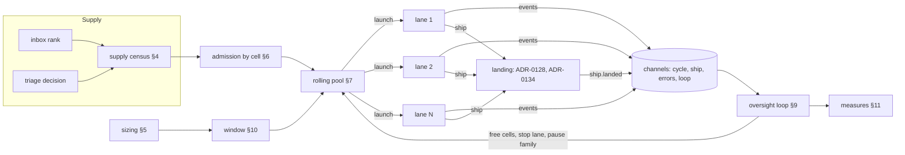

# Wave orchestrator: one component supplies, admits, backfills and oversees every lane

> [ADR-0139](adr/0139-a-wave-orchestrator-supplies-admits-and-backfills-every-lane.md) (Proposed, 2026-10-17) · plan: [wave-orchestrator-2026-10](../plans/wave-orchestrator-2026-10.md) · research: [wave-orchestrator-2026-10](../research/wave-orchestrator-2026-10.md) (F2.1 to F2.24, P3.1 to P3.17, R1 to R8).
>
> This file is the spec of record for how the loop runs its lanes. It holds the census, the sizing, the admission, the pool, the lease, the oversight, the window, the measures and the scale limits. The plan and the ADR hold the decisions. The orchestrator owns integration: the order, the compose, the test and the push of the deliverables of a wave (§15, [ADR-0147](adr/0147-the-wave-orchestrator-owns-integration-and-decides-when-the-wave-reaches-main.md)). It reuses the composition, the overlap proof and the tiers of [fleet-landing-queue](fleet-landing-queue.md) (ADR-0128, ADR-0134). The events come from [event-channels](event-channels.md) (ADR-0127).
>
> Written in the Issue / Gap / Solution shape.
>
> **Terms used throughout:**
> - **Lane:** one fleet cycle, with its own process and its own worktree.
> - **Slot:** a place for one lane. The width is the number of slots.
> - **Todo:** one unit of work that a lane takes, from the inbox or from a triage decision.
> - **Supply:** the todos that a lane can take now: lane-routable, with their `deps` met, and not claimed.
> - **Cell:** a module package that a todo edits. `internal/admission` computes it from `go list -deps`. The unit of admission.
> - **Hub cell:** one cell that holds the hub packages. Its capacity is 1.
> - **Admissible:** a todo whose cells overlap no cell of a lane in flight.
> - **Lease:** the record that a lane is alive. It holds the last heartbeat and the deadline.
> - **Window:** the number of slots that the orchestrator fills. It is at most `fleet.count`.
> - **Pairwise conflict rate:** the share of landed lanes that needed a rebase or a re-audit at landing.

## Table of contents

- [1. Goals](#1-goals)
- [2. Architecture](#2-architecture)
- [3. A worked example](#3-a-worked-example)
- [4. The supply census](#4-the-supply-census)
- [5. Sizing](#5-sizing)
- [6. Admission by cell](#6-admission-by-cell)
- [7. The rolling pool](#7-the-rolling-pool)
- [8. The lane lease](#8-the-lane-lease)
- [9. The oversight loop](#9-the-oversight-loop)
- [10. The adaptive window](#10-the-adaptive-window)
- [11. Measures](#11-measures)
- [12. Scale](#12-scale)
- [13. Config keys, signals and commands](#13-config-keys-signals-and-commands)
- [14. Stages](#14-stages)
- [15. Integration](#15-integration)
- [Guards](#guards)
- [Limits](#limits)

## 1. Goals

| Goal | Measure | Target |
|---|---|---|
| G1. At least 4 lanes at once | the median realized width over 3 runs | ≥ 4 when the supply is ≥ 4 |
| G2. Few conflicts | the pairwise conflict rate | ≤ 5% |
| G3. Busy slots | the busy lane time over the slot time | ≥ 0.85 at width 4 |
| G4. One overseer | the share of stalls and deadlines that the orchestrator acts on | 100% |
| G5. Scale | the cost of each step as a function of N, and a soak at N = 16 | stated, and the soak passes |
| G6. Known supply | each plan records its supply and the cause of each refusal | every plan |

The order of the goals is the order of the work. Supply first: an empty supply makes every other goal void. Then conflicts: more lanes without admission only make more conflicts. Then busy slots, oversight and scale.

## 2. Architecture

The orchestrator replaces the fire-and-wait wave on the loop's fleet path. It is deterministic Go in the loop process, and it runs no LLM (ADR-0139 decision 1). It reuses built parts: `fleet.RunPool`, `internal/admission`, `fleet.FreshenSpecs`, `clihealth`, `inboxrank` and the event reader of ADR-0127.



The orchestrator owns four kinds of state. All of it lives in memory, and the run record under `.evolve/waves/` keeps a copy:

| State | Shape | Writer |
|---|---|---|
| the cell table | cell → the lane that holds it | admission (§6), oversight (§9) |
| the lease table | lane → the last heartbeat and the deadline | the lease (§8) |
| the window | one integer | sizing (§5), the window (§10) |
| the measures | counters for each run | oversight (§9) |

## 3. A worked example

This example uses real packages of this repository. `fleet.count` is 4, and `agy-claude` is benched, as on 2026-10-17 (F2.2).

1. **Sizing.** `agy-claude` has `claude` after it in each chain that the wave uses. The bench costs no slot, so the window is 4 (§5).
2. **Supply.** After the routing remedy of the plan (O2a), the census finds 6 admissible todos. Their cells, from `internal/admission`:

| Todo | Files | Cells |
|---|---|---|
| a | `go/internal/inboxrank/inboxrank.go` | `inboxrank` |
| b | `go/internal/quotastate/windows.go` | `quotastate` |
| c | `go/internal/fleet/pool.go` | `fleet` |
| d | `go/internal/inboxrank/explain.go` | `inboxrank` |
| e | `go/internal/sysexec/command.go` | the hub cell |
| f | `docs/operations/wave-operations.md` | none (outside `go/`) |

3. **Admission.** The pool takes the todos in rank order: a, b, c, d, e, f.
   - a, b and c have disjoint cells. Each one takes a slot.
   - d shares `inboxrank` with a. d waits.
   - e takes the hub cell. Its capacity is 1, so e takes the fourth slot.
   - f has no cell in `go/`, so it is always admissible. The window is full, so f waits for a slot.
4. **Backfill.** Lane b lands after 22 minutes. `ship.landed` frees the cell `quotastate`. The pool takes the next admissible todo, f, at once.
5. **A cell frees.** Lane a lands. Its cell `inboxrank` frees, and d becomes admissible. d takes the next free slot.

Today's file partition puts a and d in one lane, because their files differ, and the wave waits for its slowest lane. The orchestrator keeps them apart in time and keeps every slot busy.

## 4. The supply census

### Issue

On 2026-10-17, 0 of 230 inbox items can go to a lane (F2.6). The lane-routable supply fell from 41 on 2026-09-15 to 1 (F2.17). Three runs planned zero lanes (F2.4). The loop finds out only after K starved waves, through one inbox item (F2.16).

### Gap

No step counts the supply before a plan. The plan reads the last triage decision and widens it from the inbox (F2.5). When both are empty, the plan is empty, and the cause is not recorded. The routing rules send 170 items to the console by derivation (F2.7), and nothing tells the console which rule holds which item.

### Solution

Before each plan, the census reads the ranked inbox through `inboxrank.Order` and classifies each item:

| Class | Rule | Source |
|---|---|---|
| `admissible` | lane-routable, `deps` met, not claimed, and its cells are free | `inboxbatch.PartitionConsole`, §6 |
| `waiting_cell` | lane-routable, but a lane in flight holds one of its cells | §6 |
| `waiting_deps` | a `deps` item is open | `inboxrank` |
| `console_route` | an explicit `route: console*` | `inboxbatch.IsConsoleRoute` |
| `console_kind` | a `pipeline-*` kind | `consoleroute.go:49-56` |
| `console_protected` | a protected fix surface | `consoleroute.go:58-80` |

The census writes one record for each plan into the run record, and it publishes `orchestrator.supply` on the `loop` channel. The record holds the count of each class and the ids of the console items with their reasons.

When the admissible count is below the window, the census publishes `LOOP_ORCH_SUPPLY_SHORT` with the counts. When it is below twice the window, the census writes a split proposal for each mixed item. A mixed item names protected files and files that are not protected. The console accepts a proposal with `evolve inbox split <id>` (plan O2c). The split makes two items:

- The **console part** keeps every protected file, the route and the criteria that name its files.
- The **lane part** keeps the files that are not protected and the criteria that name only those files. It has `deps` on the console part when it needs the console part first.
- A criterion that names no file judges the whole item, so both parts keep it.

**State: Built (O2c, 2026-10-18).** `evolve inbox split <id>` and the pure package `internal/inboxsplit` exist. The census that calls `inboxsplit.Proposals` is part of O6 and is not built yet. Until then, the command computes the proposal from the pending item when the console runs it. Package note: [internal-inboxsplit.md](packages/internal-inboxsplit.md).

**The fix of 2026-10-18.** The split refuses an item whose text names a protected path or a console file. It refuses a part with no criterion. A lane part that only verifies waits for the console part.

The supply that the pool gets at `enforce` is the ranked backlog up to `max(fleet.count, scan_k)`, not `fleet.count` (§6, the fix of 2026-10-19).

The census never routes an item itself. ADR-0074 keeps the routing authority, and the four guards of F2.23 keep the protected files safe.

**State: built (O6, 2026-10-18).** `orchestrator.Census` ([internal-orchestrator.md](packages/internal-orchestrator.md)) has two calls:

- `Count` reads the inbox and writes nothing. It returns the count of each class, the cause of each refusal and the split proposals.
- `Take` runs `Count`. Then it appends the record to `.evolve/waves/supply.json`, which keeps the last 12 plans, and it publishes the events.

The loop and the console use the two calls as follows:

- The loop calls `Take` one time for each plan, in `dispatchFleetIteration`. The call is after the disk check and before the plan.
- When no plan runs, the loop makes no call.
- The census, the pool admission and the admission shadow of one plan share one load of the module graph.
- When that load fails, the census counts each ready item as `admissible` and prints a `[loop] WARN` line.
- A census error prints a `[loop] WARN` line. It never stops the loop.
- `evolve wave supply` calls `Count`. It writes no record and publishes no event (§13).

The census builds on the lane menu of `inboxmover.RankLaneMenu`, the same menu as `evolve inbox rank`:

- A console item gets its class from the reason of `inboxbatch.ConsoleRouted`: `route:` is `console_route`, `kind:` is `console_kind`, and every other reason is `console_protected`.
- A waiting item is `waiting_deps`. This class also holds an item that another lane has claimed. The reason names the dependency or the claim.
- The ready items go to `admission.Admitter` in rank order, with the lanes in flight as holdings. An item that conflicts with an earlier admitted item is `waiting_cell`, as in §6 step 7.
- With no module graph, every ready item is `admissible`, and the record holds a warning.

The registry spells the event `orchestrator.supply` as `LOOP_ORCH_SUPPLY`, because a code must match `MODULE_SNAKE_CASE`. The proposal step is a function value. A nil value proposes nothing. The wiring to `inboxsplit.Proposals` waits for PR #959. Until then, the loop and `evolve wave supply` pass a nil value, and the proposals stay empty.

**The directory rule (built, O2b, 2026-10-17; amended, 2026-10-18).** A declared directory routes to the console only when it lies inside a protected fragment (ADR-0139 decision 5). Thus `files: ["go/internal/core/"]` is lane work.

On 2026-10-18, the live review of the split found 17 of 112 lane parts that listed a protected path or a directory that holds one. The operator chose to keep four lanes supplied. Only `evolve inbox split` judges a directory with `guards.TouchesProtectedSurface`, so it refuses to put a directory that holds a fragment in a lane part. The claim floor accepts some items that the split refuses.

A declared protected path is binding, a file or a directory. An operator `route:lane` cannot relax it, because triage's breaker refuses the card whatever the route. A heuristic derivation stays open to `route:lane`. Package notes: [internal-guards.md](packages/internal-guards.md) and [internal-lanerouting.md](packages/internal-lanerouting.md).

## 5. Sizing

### Issue

Every run of 2026-10-16 and 2026-10-17 shrank the wave from 3 to 2. 23 of the 25 benches named `agy-claude` (F2.2).

### Gap

`Engine.Size` passes every active bench to `QuotaAwareCount`, and each bench costs one slot (`size.go:15`, `quota.go:9-39`). The shrink does not check if the chain has a family after the benched one. `agy-claude` has `claude` after it in the deep and top chains, so a lane on that seat walks to `claude`.

### Solution

**Status: Built (O1, 2026-10-17).** `fleet.ChainAwareBenches` (`go/internal/fleet/quota_chain.go`) gives the benches that cost a slot. `Engine.Size` passes them to `fleet.QuotaAwareCount`.

The sizing step reads each `cli_routing` chain as families. A chain costs one slot when every family in it is benched. The slot goes to the last family of that chain. Thus two chains with the same last family cost one slot. A bench of any other family costs nothing and writes one INFO line. The line names the healthy family that a lane walks to, or says that no lane chain uses the family.

`cliroute.FamilyChains` reads the chains from `default`, `work`, `agents.<agent>.cli` and `tiers.<tier>.clis`. It does not read `after_chain`, so the set is conservative. The `Chains` port of the `Engine` calls it. The caller of `Engine.Size` loads the policy once (`loopwave.LoadRouting`) and passes the `cli_routing` block, so `Size` reads no second snapshot. When the policy is unreadable, or the table gives no chain, every bench costs one slot, as before. An unreadable policy also writes one WARN line, from `LoadRouting`.

Known limits: the step charges one slot for each empty chain. When many lanes share one chain and that chain empties, the shrink undercounts. `fleet.min_lanes` bounds the undercount, and the O6 oversight loop re-sizes on the bench event. A scoped bench (for example `claude@opus`) marks its whole family as down, which overcounts and is the safe direction.

Example: on 2026-10-17, `agy` and `agy-claude` are benched. Each chain of the table ends in `claude`, and `claude` is healthy. The wave keeps all 4 lanes.

The sized count is `fleet.count`, minus the slots that the benches cost, and never below `fleet.min_lanes`. The window (§10) is at most the sized count. The budget step of `fleetbudget` stays as it is (`size.go:16-36`).

The sizing step runs at the start of each run and again on each `clihealth` bench event (§9). The window can thus shrink while lanes run. A shrink never stops a lane in flight. It only stops the next admission.

## 6. Admission by cell

### Issue

The live partition is file-disjoint (F2.8). File-based parallel agents gain nothing over sequential work (P3.1), and uncoordinated agents conflict in 20–42% of pairs (P3.3). A conflict that reaches landing costs about 24 minutes (F2.11).

### Gap

`PartitionGraph` computes package sets, but nothing calls it (F2.9). ADR-0134 designs admission by cell (S14), but it is not built (F2.10). A card with no `files` gets its id as its only file, so it never conflicts (F2.8).

### Solution

**Built (shadow), 2026-10-17:** [`internal/admission`](packages/internal-admission.md) (plan O3). The admission step is ADR-0134 S14, built for the orchestrator. In the `shadow` stage, the loop runs it after the file partition of each wave. It records each todo that it holds back, and it changes no lane. At the stage `enforce`, the barrier wave does not run, and the pool of §7 admits each todo by this rule.

1. **The edited packages.** `E(t)` is the set of module-internal packages that todo `t` edits: the packages of its Go files. Another path under `go/` maps to its nearest enclosing package. A file outside `go/` maps to no package.
   - Known limit: a todo with only files outside `go/` (docs, scripts) maps to no cell. So does a todo with non-Go files that no package encloses. Such a todo conflicts with nothing, and admission admits it at once. Only the landing proof of ADR-0128 finds a clash between such todos.
2. **The reach.** `D(p)` is the set of module-internal transitive imports of package `p`, from `go list -deps`. It excludes the hub packages. `D(E)` is the union of `D(p)` for each `p` in `E`.
3. **The conflict rule.** Two todos `t1` and `t2` conflict when one of these holds:
   - `E(t1)` and `E(t2)` meet;
   - `E(t1)` meets `D(E(t2))`;
   - `E(t2)` meets `D(E(t1))`;
   - both hold the hub cell.
4. **The hub cell.** A todo that edits a hub package holds the hub cell. The hub cell has a capacity of 1, so two such todos conflict. An import of a hub never conflicts, because `D` excludes the hubs. The global-zone files `go.mod`, `go.sum` and `.evolve/policy.json` (`fleet.IsGlobalZone`) also map to the hub cell, and so does `go/Makefile`.
   - The module-root files `go/go.mod`, `go/go.sum` and `go/Makefile` sit in no package. The hub cell is thus the only cell that holds them.
5. **A todo with no files.** It takes the packages of the `go/internal/<pkg>` paths in its inbox title or summary. When its text names no known package, it takes the hub cell (ADR-0139 decision 8, plan D7). A todo whose only file is its own id (the placeholder of `fleet.TodosFromTriage`) has no files.
6. **The hub set.** A hub is a package that at least `fleet.orchestrator.hub_min_importers` module packages import, directly or transitively. On 2026-10-17 the counts were `sysexec` 151, `log` 127, `atomicwrite` 126, `signalcenter` 122, then `ipcenv` 116. The default 120 gives these four hubs. The transitive count reproduces ADR-0134 research F2.16. The direct count does not.
7. **The test.** A todo is admissible when it conflicts with no lane in flight and with no todo admitted before it. `Admit` records the cells of each decision and the lane or todo that blocks it.
8. **The release.** `ship.landed`, a lane failure or a lane stop removes the lane from the in-flight list (§9).
9. **Rank order.** The step takes the todos in `inboxrank` order. It stops after `scan_k` admitted todos (§12). A todo that waits keeps its rank. It does not lose its place to a later todo of lower rank when its cell frees.

The cell table is the shared view of all lanes in flight that the console has by hand today (F2.15). `evolve wave status` prints it (plan O7).

The cells come from the tree at the run's base. A lane that adds an import adds an edge that the table does not hold. The landing proof of ADR-0128 finds that edge at landing. Admission thus lowers the conflict rate, but it does not replace the landing proof.

**The shadow never delays a launch.** The shadow observation, including the `go list`, runs in its own goroutine while the lanes launch. A panic in it is recovered and logged as one WARN, and the launch is not told. The loop joins the observation after the launch returns. Its line and events thus appear once the lanes are done. The launched specs never change.

**The shadow record.** For each wave, the loop log gets one line: `[loop] wave N: admission shadow (stage S): admission launches A lane(s), the file partition launches F; W todo(s) wait for a cell`. A is the admitted count, capped at the wave count. Each todo that waits gets one `LOOP_ORCH_ADMIT_WAIT` event with `todo`, `rank`, `cells`, `blocked_by`, `blocked_by_lane` and `stage`. The wave run record under `.evolve/waves/` belongs to `evolve wave next`, not to the inner waves of the loop, so it gets no field yet.

**The first measure (2026-10-17, width 4).** The ready list is empty, so both widths are 0. Each of the last 10 triage decisions holds 1 todo, so both widths are 1. The 9 todos of those decisions as one wave give 4 and 4.

In 30 windows of 8 pending items, admission gives 58 lanes against 120. The cause: 120 of the 244 pending items edit `cmd/evolve` or `internal/core`, which import most of the module. The S14 exit takes 3 live runs ([internal-admission.md](packages/internal-admission.md) §Findings).

**The supply depth of the pool (fix, 2026-10-19).** At `enforce`, admission picks the lanes from a backlog of up to `max(fleet.count, scan_k)` todos. The file-disjoint widen does not cut the backlog to `fleet.count`.

- **The defect.** Cycle 1951 (wave 129) ran 1 lane of 4 at `fleet.count=4`, with 22 ranked todos in the inbox.
- **The cause chain.**
  1. `dispatchPool` (`cmd_loop_window.go`) gave `fleet.count` to `Engine.PlanFn` as the plan width.
  2. `WidenNarrowDecision` (`decision.go`) took file-disjoint todos up to that width, plus one cluster mate. The pool got 5 of 22 todos.
  3. The 4 todos after rank 0 edit `cmd/evolve` or `internal/core`. Each conflicts with the cell of rank 0, so `AdmitByCell` (`orchestrator/pool.go`) returned -1.
  4. `fleet.RunPool` (`fleet/pool.go`) stops the fill when admission refuses and a lane is in flight. One lane ran.
  5. `scan_k` went only to the shadow admission (`cmd_loop_admission.go`), not to the supply of the pool.
- **The fix.** `loopwave.PoolSupply` gives the plan width of the pool. At `enforce`, the width is `max(fleet.count, scan_k)`. At `shadow`, and with no stage, the width is `fleet.count`, as before. `scan_k` is thus the one owner of the supply depth.
- **The bounds stay.** The pool launches at most `min(fleet.count, concurrency)` lanes at a time. A run launches at most `run_max_lanes` lanes in total. A deeper backlog claims no inbox item at plan time, because the plan only reads the inbox. A lane claims its item in its own cycle (`ClaimPending`), after the launch.
- **The pool line.** A todo that the pool never launches is not a lane. Its result carries `fleet.ErrNeverLaunched`, and `loopwave.Tally` does not count it. Thus `pool N: X/Y lanes ok` counts only the launched lanes.
- **The proof.** On a copy of the wave-129 inbox, the deep plan gives 21 todos, and the pool holds 4 live lanes before the first exit. The old plan gives 5 todos and 1 lane. Pinned by `TestPoolSupply_AtEnforceAHotRankZeroCellStillFillsTheTarget`, `TestPoolSupply_ADeepSupplyStaysInsideTheTargetAndTheRunCap` and `cmd/evolve` `TestDispatchPool_AtEnforceThePoolIsSuppliedPastTheFleetCount`.
- **The limit.** The widen still drops a todo that shares a file with an earlier todo, unless it is a cluster mate of one lane. Such a todo cannot run beside that todo, so the drop costs no live lane. The reach of `cmd/evolve` was wide until the decision below.
- **The leaf decision (approach (b), 2026-10-19, wave 131).** In wave 131 the pool fell to 3 of 4 lanes at 07:05:32 (`LOOP_ORCH_POOL_IDLE live=3`) while 18 items were lane-ready. The running lane edited `go/cmd/evolve`. `go list` Deps is transitive, so its reach held 266 internal packages, and every Go todo waited.
  - **Rule.** A leaf package has no importer in the module graph. Nothing compiles against it. A todo whose edited packages are all leaves gets an empty reach. The composed-tree gate of the ship (ADR-0105) catches API drift. A todo with one non-leaf package keeps the full reach of every package it edits, the leaf ones too. Its edits still conflict with a todo that edits the same package. The hub rule is unchanged.
  - **Rejected (a): direct imports only.** It shrinks the reach of every package, not only of leaves. A change to a non-leaf package then misses a transitive importer that it can break. It gives up safety where the leaf rule gives up none.
  - **Rejected (c): reach by the exported API.** It needs a type-level diff of each edit before the launch. Admission runs before the build, so the diff does not exist yet. Its cost and its false negatives are high for a gain that the leaf rule already gives.
  - **Pinned by** `TestAdmit_ALeafLaneHoldsNoReachOverAnUnrelatedPackage` and the predicates `TestC1972_002` and `TestC1972_007`.

**The shared-edit rule (ADR-0143, plan W1, built at stage `shadow`, 2026-10-20).** The reach of a lane that edits `internal/core` still held the backlog after the leaf rule. In wave 133 such a lane held 13 ready items for 71 minutes (research F2.3). `internal/core` imports 86 internal packages directly, so a smaller reach frees almost nothing (F2.4).

- **The rule.** Admission holds a candidate only when its edits meet the edits of a lane in flight, or when both hold the hub cell. The reach checks (items 3b and 3c above) leave the rule. The composed-tree gate of the ship owns API drift between lanes (ADR-0105, research F2.5). The code name of the rule is `admission.Admitter.Optimistic`.
- **The stage key.** `fleet.orchestrator.admission` (`shadow` \| `enforce`, compiled default `shadow`) chooses the rule. `policy.OrchestratorConfig.OptimisticAdmission()` reads it. Each `admission.Admitter` of the loop takes it: the pool (`cellAdmission`), the supply census (`Census.Optimistic`, set in `cmd_supply_wiring.go`) and the wave shadow (`admissionShadow`). Thus at `enforce` the census and the pool count by one rule. The loop gives the census no lanes in flight, so the census compares each ready item only with the ready items of higher rank.
- **At `shadow`.** The reach rule decides, so the admitted set does not change. For each candidate that the reach rule holds, `Admit` also tests the shared-edit rule against the same holders. When that rule admits it, `Admit` calls `OnShadow`, and the sink `orchestrator.RecordShadow` publishes one `LOOP_ORCH_ADMISSION_SHADOW` event with `todo`, `held_by`, `rank`, `cells` and `reason`. The reason names the package where an edit meets a reach, for example `reach meets internal/router`.
- **Once for each pair.** The pool asks admission again for each free slot, so the same held todo comes back on each pass. `orchestrator.RecordShadow` publishes each pair of todo and holder once in a pool run. A new holder of the same todo gets its own event.
- **At `enforce`.** The shared-edit rule decides, and nothing records the shadow.
- **A worked example.** Lane `core-todo` edits `go/internal/core/state.go`, and candidate `router-todo` edits `go/internal/router/router.go`. Core imports router, so the reach rule holds `router-todo` behind `core-todo`. The two todos edit no common package, so the shared-edit rule admits `router-todo`. At `shadow` the pool records `todo=router-todo held_by=core-todo reason="reach meets internal/router"` once, and `router-todo` waits. At `enforce`, `router-todo` launches.
- **Why a second stage key.** `fleet.orchestrator.stage` is already `enforce`, and the pool runs only at that stage. The new rule needs its own shadow inside that pool, so it gets its own key (ADR-0143 decision 4).
- **The measure that moves the stage (plan D3).** The shadow counts the candidates that the new rule frees. At `shadow` those candidates do not run beside their holder, so no composed-gate failure between such lanes can occur yet. The failure rate of D3 thus needs the ship-side record of plan D2. W1 does not build it. It is component W1b of the plan.
- **Pinned by** `TestAdmit_OptimisticAdmitsACandidateThatOnlyTheRunningLaneImports`, `TestAdmit_OptimisticStillHoldsTwoTodosThatEditOnePackage`, `TestAdmit_OptimisticKeepsTheHubRule`, `TestAdmit_ShadowRecordsEachAdmissionTheReachRuleHoldsWithItsHolder`, `TestAdmit_ShadowNamesThePackageWhereTheReachOfTheCandidateMeetsTheEditOfTheHolder` and the 500-round property `TestAdmit_OptimisticAdmitsExactlyTheTodosThatShareNoPackageAndAreNotBothHubs`. In `orchestrator`: `TestRecordShadow_TwoPassesOverOneHeldTodoPublishOnce`, `TestRecordShadow_TheTodoAndItsHolderAreTheKeyNotTheReason` and `TestCensus_AtEnforceACandidateThatOnlyMeetsARunningLaneReachIsAdmissible`. In `cmd/evolve`: `TestCellAdmission_AtEnforceACoreLaneDoesNotHoldARouterTodo`, `TestAdmissionShadow_AtTheEnforceAdmissionKeyTheSharedEditRuleCounts` and `TestSupplyWiring_TheCensusTakesTheAdmissionRuleOfTheKey`.

## 7. The rolling pool

### Issue

A barrier wave waits for its slowest lane. We simulated it with the lane durations of cycles 1900–1920. A barrier of 4 lanes keeps about 66% of the slot time busy, and 16 lanes keep 49% (F2.13).

### Gap

`Supervisor.Run` returns only after `wg.Wait()` (`fleet.go:94`). `RunPool` backfills a free slot, but it runs only under `scheduling: pool`, it uses the file rule, and its `onTransition` hook is `nil` (F2.14).

### Solution

**Built (enforce only), 2026-10-17:** [`internal/orchestrator`](packages/internal-orchestrator.md) `Pool` (plan O4). At the stage `shadow`, the barrier wave runs as before, and the pool does not run. At the stage `enforce`, the loop runs the pool in place of the wave `Supervisor`, whatever `scheduling` says. A policy with `scheduling: pool` at `enforce` gets one WARN at batch start.

The orchestrator runs `RunPool` as its scheduler, with three changes:

1. **Admission.** The pool asks the admission step (§6) for its next todo, in place of its own file rule.
2. **Freshness.** The pool runs `FreshenSpecs` on each todo just before launch, as the wave path does now (`launcher.go:36-45`).
3. **Transitions.** Each transition goes to the `loop` channel through `onTransition`. The transitions are `launched`, `exited`, `backfilled`, `resupplied` and `idle`, published as `LOOP_ORCH_LANE_LAUNCHED`, `LOOP_ORCH_LANE_EXITED`, `LOOP_ORCH_LANE_BACKFILLED`, `LOOP_ORCH_POOL_RESUPPLIED` and `LOOP_ORCH_POOL_IDLE`. The console and `evolve wave watch` read the channel.

`RunPool` takes the changes as hooks of `fleet.PoolConfig` (`Next`, `Prepare`, `Resupply`), so the scheduler stays one function. With no hook, it keeps the file rule. The in-flight list of admission is the list of running lanes, so a lane exit frees its cells at once. The module graph loads once for each run. If it does not load, the run admits by the file rule and the loop writes one WARN.

A run ends when the supply is empty and no lane is in flight, or on an operator stop (`evolve loop-stop --wait`). The wave boundary work (merge, `gc`, the code-index refresh, `cli update`) runs at the end of a run, as it does now after a wave. The rule "merge only at the boundary" thus holds unchanged: a run is one boundary-to-boundary unit.

A run has a length limit, `fleet.orchestrator.run_max_lanes`, in lanes launched. It keeps boundaries regular, so merges and binary refreshes still happen. Its default is `4 × fleet.count`.

The operator stop is the brake file of `evolve loop-stop` or a cancelled batch. The pool reads it at each admission. An admission happens only at a run start and at a lane exit, so the check is not a poll. At the run end, the loop prints `[loop] pool N: X/Y lanes ok (orchestrator, target=W)`. The boundary work runs at the next iteration.

**The soak (2026-10-17, goal G5).** `evolve fleet soak --count 16 --pool` ran 64 simulated lanes at `enforce`. The peak in-flight was 16 of 16, and all 64 lanes passed. The run took 43.6 s, with 88.0 lanes a minute and a utilization of 0.91 ([internal-orchestrator.md](packages/internal-orchestrator.md) §Findings).

An earlier run found a cross-lane race on `knowledge-base/cycles/`, which the barrier hides. The tree-diff guard of a lane counted the dossier of another cycle as its own leak. The guard now keys a dossier to its cycle, and the soak ran with no exclusion.

**The resupply (2026-10-19, [pool-resupply-2026-10](../plans/pool-resupply-2026-10.md)).** The plan source gives the backlog at the run start. Work that becomes ready later (for example, an item whose `deps` ship in the run) is not in it. In wave 130 the pool thus ran 1 lane of 4 for 3 hours while 23 items were ready. Now, when the fill after a lane exit leaves a slot free, the pool calls its `Resupply` port one time:

- The loop gives the port the same `PlanFn` path as the run start, for the same wave index. The rank, the console-route filter, the protected-path filter and admission by cell thus apply to each new todo.
- The pool gives the port the todos that it holds. The plan depth is `PoolSupply` plus that count, so the held todos cannot fill the cut of the ranked list.
- The plan releases stale claims, as at the run start. A claim whose holder has a live lease stays, so the lanes in flight keep their claims.
- The pool adds only the todos whose id it does not hold, and publishes `LOOP_ORCH_POOL_RESUPPLIED` for each. Then it fills again. If a slot stays free, it publishes `LOOP_ORCH_POOL_IDLE`.
- The port runs only on a lane exit, and not when the pool is stopped or at `run_max_lanes`. An empty inbox thus costs one plan call for each exit, and no timer.
- The results grow with the backlog: `results[i]` is the result of the i-th todo that the run held.
- A plan error writes one WARN and adds nothing. The slot waits for the next exit.
- Only the orchestrator pool gets the port. The rolling pool of `scheduling: pool` has no launch limit, so it keeps its fixed backlog.

**An empty pool always admits.** When no lane is in flight and the supply is not empty, `fleet.RunPool` launches the top todo even when admission refuses it. Nothing can conflict with an empty set. A refusal there can only end the run with work left.

## 8. The lane lease

### Issue

A wave lane has no deadline (F2.12). The console decides by hand when a stuck lane has run too long (F2.15).

### Gap

`Supervisor` has `CycleTimeout`, but only `evolve campaign` sets it (`cmd_campaign.go:194`). The phase observer of each lane signals `LIVENESS_PHASE_STALLED`, but it kills nothing, and no component reads its signals across lanes.

### Solution

**Built, 2026-10-17:** [`internal/orchestrator`](packages/internal-orchestrator.md) `Leases` (plan O5). The pool at `enforce` holds an `enforce` lease table. The barrier wave at `shadow` holds a `shadow` lease table, so the stage exit is measured on live waves.

Each lane gets a lease when it launches. The lease holds:

- **The heartbeat:** the time of the freshest live signal of that lane. The lease adds no new writer: the lane's existing files are its heartbeat.
  - `RunsHeartbeat` finds the cycle of the lane by its `lane-scope.json`. The heartbeat is the latest time of two kinds. One is the last time stamp of its `signals.ndjson`. The other is the modification time of each `<agent>-pane-watch.json`, `<agent>-events.ndjson` and `<agent>-stdout.log` in the cycle workspace. The newest of these files is a file of the current phase.
  - A long `build` or `go test` phase writes no cycle event for many minutes. But the bridge writes the pane-watch snapshot again each time the pane changes, and the observer writes its heartbeat event each 12 polls (`observerengine.HeartbeatEvery`). Thus a busy phase keeps a fresh heartbeat.
  - When no cycle holds the lane, the heartbeat is unknown. The lease then reports no stall, and it checks again after `stall_minutes`. It does not count from the launch time, because a lane can start before its cycle directory exists.
- **The deadline:** the 95th percentile of the lane time over the last 50 cycles, without the longest lane time. Its floor is `fleet.orchestrator.deadline_floor_minutes` (default 60). The lane time of a cycle is the span of its `signals.ndjson`. The loop computes the deadline once for each batch. On 2026-10-17 the 44 lane times of cycles 1873 to 1928 give 95.1 minutes (plan Q1).

**Why the deadline removes the longest lane.** With 44 samples, the nearest-rank p95 is the third-longest lane time, so the two longest lanes set it. We compared three rules on the same 44 samples (median 39.0 minutes, longest 118.1 minutes):

| Rule | Deadline | Decision |
|---|---|---|
| The p95 of all samples | 98.9 min | rejected: one more long lane moves it to the next outlier |
| The p95 of the samples without the longest lane | 95.1 min | chosen |
| The p90 times 1.25 | 116.2 min | rejected: the factor 1.25 has no measure, and the value is almost the longest lane |

The chosen rule stays a percentile of measured lane times, and one outlier cannot set it. With one sample, the rule keeps that sample.

The oversight loop (§9) acts on a lease:

| Condition | Action |
|---|---|
| No heartbeat for `stall_minutes` (default 30) | publish `LOOP_ORCH_LANE_STALLED`. The lane keeps its slot. |
| The deadline passes | stop the lane through its process-group stop, release its inbox claim, free its cells, and publish `LOOP_ORCH_LANE_DEADLINE`. |
| The lane stops twice for one todo | park the todo with `route: console` and the reason `deadline twice` |

The stage decides the action:

| Stage | A stall | A passed deadline | A lane that exits after its deadline |
|---|---|---|---|
| `shadow` | `LOOP_ORCH_LANE_STALLED` once | `LOOP_ORCH_LANE_DEADLINE` with `action` `recorded`. Nothing stops. | `LOOP_ORCH_LANE_LATE_EXIT` with its `status`: `ok` is a stop that the exit rule of §14 counts |
| `enforce` | `LOOP_ORCH_LANE_STALLED` once | `LOOP_ORCH_LANE_DEADLINE` with `action` `stopped`, then the stop and the claim release. The todo does not launch again in the same run. | `LOOP_ORCH_LANE_LATE_EXIT` with `stopped` true. A second stop, in any run of the batch, parks the todo. |

One timer serves all lanes. A heap holds the next time of each lane: the earlier of its deadline and its stall time. The timer is armed for the top of the heap. The deadline timer is the only timer in the orchestrator.

The restart rule follows OTP (P3.14): a todo gets one more try, and a second stop sends it to the console. Since 2026-10-19 the one more try comes in a later run, not at once in the same run. In wave 130 the relaunch at once repeated the stall, with no event for 76 minutes. The release puts the todo back in the inbox for a later plan, as a Kafka share group does with a released record ([pool-resupply-2026-10](../plans/pool-resupply-2026-10.md) D8). The lease table lives for the batch, so its stop count spans the runs. A stop never runs a second copy of a lane in parallel, because a copy costs a full lane and writes `main` (P3.15).

A stop must not be a broad kill. The orchestrator stops only the lane that its own launch made, and never by a name match. The lease cancels the child context of that launch. The launch of `cmd/evolve` (`execCycleLaunch`, which uses `sysexec.Command`) then sends SIGTERM to that one lane process, and the lane stops its own phase process groups. The package holds no pid and imports no process package. A guard test checks this.

**The dispatch reap after a stop.** The lane reaps its own dispatches when it stops (`bridge/dispatch_reap.go`: a grace time of 2 s and a limit of 30 s). This can take longer than the `WaitDelay` of 10 s of `sysexec`. Go then sends SIGKILL to the lane, and the children of the lane (tmux, the LLM CLI, `go test`) stay alive with no parent. Thus, after a stopped lane returns, the pool calls its `Reap` port one time:

- `cmd/evolve` (`reapLane`, `cmd_loop_lane_reap.go`) finds the cycle of the lane and reads the process table. The dispatch ids of the lane are the `EVOLVE_DISPATCH_ID` tags of that cycle on this project root.
- It runs the sweep of `evolve gc dispatch` (`gc.StaleDispatch` and `proctree.Reaper`, through `gcRun.reapDispatches`), but only for those ids. The proof is the same: the owner of the dispatch is dead, and the process carries the tag or is in the recorded pane tree.
- A lane that was not stopped gets no reap. When no cycle holds the lane, or the process table does not list, the loop writes a WARN, and `evolve gc` stays the backstop.

The port is in `cmd/evolve`, because the orchestrator package imports no `os/exec`, `sysexec` or `proctree`.

## 9. The oversight loop

### Issue

No component sees all lanes of a wave at once (F2.15). The console watches `evolve wave watch`, which polls every 5 s, and it acts by hand.

### Gap

Each phase observer sees one cycle. `wave status` and `wave watch` only print. The quota state is read once, before the wave.

### Solution

The oversight loop is one goroutine in the loop process. It reads the ADR-0127 channels through `internal/events/reader`. It arms the kernel wake, reads to the end of each log, and then waits. It never polls (ADR-0139 decision 11). Each event maps to one action:

| Event (channel) | Action |
|---|---|
| `phase.*`, observer reports (`cycle`) | update the heartbeat of the lane (§8) |
| `cycle.sealed` (`cycle`) | record the verdict. On a FAIL, free the cells of the lane. |
| `ship.landed` (`ship`) | free the cells of the lane, count a clean landing or a conflict (§11), and call the pool to backfill |
| `GIT_FLEET_REBASE_NEEDED` and the ADR-0128 tier events (`ship`) | count a landing conflict for the window (§10) |
| a `clihealth` bench or unbench (`errors`) | run the sizing step again (§5). A family with no fallback stops taking new lanes. |
| `LIVENESS_PHASE_STALLED` (`errors`) | publish `LOOP_ORCH_LANE_STALLED` once for the lane |
| an operator stop (`loop`) | stop all admission. Lanes in flight finish. |
| the lease deadline timer | §8 |

The deadline needs a timer, because "nothing happened" is not an event. The loop holds one timer for the nearest deadline, not one timer for each lane.

The loop observes and acts only on its own lanes. It does not edit a lane's worktree, its verdict or its ship. The integration of §15 owns the landing.

**State: the library is built (O6, 2026-10-18). The loop wiring of the oversight waits for the event producers E10 and E11 of the [event notification plan](../plans/event-notification-protocol-2026-10.md).** `orchestrator.Oversight` ([internal-orchestrator.md](packages/internal-orchestrator.md)) runs `Next` of `internal/events/reader` in a loop. The reader arms the kernel wake, reads to the end of each log, and then waits. The oversight arms no timer. The lease table of §8 keeps the one timer.

The oversight finds the lane of an event by the cycle number. A lane that no cycle holds yet, and a cycle of another loop, get no action.

| Event | How the oversight matches it | At `enforce` |
|---|---|---|
| a phase signal | kind `phase.dispatched`, `phase.outcome` or `phase.aborted`, or module `observer`, but not the code `LIVENESS_PHASE_STALLED` | `Leases.Beat` moves the heartbeat |
| `cycle.sealed` | the kind | record the verdict. On `final_verdict` `FAIL`, free the cells |
| `ship.landed` | the kind | free the cells, count the landing and kick the pool |
| a rebase code | `SHIP_GIT_FLEET_REBASE_NEEDED`, `SHIP_GIT_FLEET_REBASE_CONFLICT` or `SHIP_AUDIT_BINDING_HEAD_MOVED` | mark the lane. The next landing of the lane counts as a conflict |
| a stall report | the code `LIVENESS_PHASE_STALLED` | `Leases.Stall` publishes `LOOP_ORCH_LANE_STALLED` once |
| a quota signal | the code `BRIDGE_USAGE_EVIDENCE` or `LIVENESS_PANE_EXHAUSTED` | run the sizing step, set the limit of the intake, and publish `LOOP_ORCH_FAMILY_PAUSED` for each new family |
| a halt | kind `loop.halt` | stop all admission |

At `shadow`, an action publishes `LOOP_ORCH_OVERSIGHT_ACTION` with `applied` false, and nothing else changes. A heartbeat and a stall are observations, so both stages apply them.

- **Freeing the cells.** `Intake.Free` marks the lane. Admission then ignores the cells of that lane, and the pool fills an open slot at once (`fleet.PoolConfig.Kick`). The lane keeps its slot until it exits.
- **The window hook.** `LandingObserver` has `CleanLanding` and `Conflict`. The adaptive window of §10 (plan O8) has both methods, so `*Window` needs no adapter. With no observer, the landing is only counted in the action record.
- **A lane that left.** The oversight keeps the cycle of a lane until the `cycle.sealed` event of that cycle comes. Thus a landing or a seal that arrives after the lane exited is still counted and recorded. It frees no cells then, because the exit freed them. A lane that exits before the oversight reads any event of its cycle is not found.
- **No producer yet.** No code emits a bench event, an unbench event or an operator stop today. The oversight reads `BRIDGE_USAGE_EVIDENCE` and `LIVENESS_PANE_EXHAUSTED` for a bench, and `loop.halt` for a stop. An unbench by expiry gives no event. The next quota signal, or the next run, runs the sizing again (§5).
- **A gap record.** A gap on a channel can lose one early release. The exit of the lane still frees its cells, so the pool loses speed and keeps its safety.

## 10. The adaptive window

### Issue

At a large width, a fixed window hides a rising conflict rate. Each conflict at landing costs about 24 minutes (F2.11).

### Gap

The width is a fixed `fleet.count`, and only quota benches change it.

### Solution

**State: built (O8), 2026-10-18.** `orchestrator.Window` holds the size ([internal-orchestrator.md](packages/internal-orchestrator.md)). At `enforce`, the pool admits a lane only while the lanes in flight number fewer than the size. At `shadow`, the loop builds no window, so nothing publishes. The caller that moves the window is not built (see "What feeds the window").

The window has no effect at width 4. At or below `window.min` (default 4), the window is the sized count of §5. Above that width, the window follows Zuul's rule (P3.10):

- It starts at `fleet.orchestrator.window.start` (default 4).
- It grows by 1 for each clean landing, up to the sized count.
- It halves on each landing conflict, down to `fleet.orchestrator.window.min` (default 4). The halving rounds down.

The window never stops a lane in flight. A smaller window only delays the next admission.

**How the pool reads the window.** `fleet.RunPool` reads the window at each fill: the first fill of a run, and the fill after each lane exit (`fleet/pool.go:103-122`). It admits a lane while the lanes in flight number fewer than the smaller of the pool width and the window. The floor is 1, so a window of 0 cannot stop a run. `orchestrator.Pool` gives the window to `RunPool` only when its stage is `enforce` (`orchestrator/pool.go:71-76`).

**The slots that the window holds back.** A slot that the window holds back is not idle, so the pool publishes no `LOOP_ORCH_POOL_IDLE` for it. A window that grows between two lane exits fills its new slot at the next exit.

**The size.** `Resize(sized)` runs when sizing (§5) changes the sized count. A smaller count clamps the window. A larger count does not open it: only a clean landing grows it. The floor is the smaller of `window.min` and the sized count. The window thus stays at or above `window.min` while the sized count is above `window.min`.

**The sized count.** The loop gives the window the smaller of `fleet.count` and `fleet.concurrency`, which is the pool width. Thus the window never exceeds the pool width, and each halving binds at once.

**The signal.** The window publishes `LOOP_ORCH_WINDOW` once for each change, with the old size, the new size, the sized count and the cause (`clean_landing`, `conflict` or `resize`).

**The config.** Both keys must be at least 1. `window.min` must not exceed `window.start`, and `window.start` must not exceed `fleet.count`. A violation refuses the policy, as for the other `fleet.orchestrator` keys. An unset `window.min` follows `window.start` down, so `window.start` of 2 alone is valid.

**What feeds the window.** The window moves only when a caller runs `CleanLanding` or `Conflict`. That caller is the O6 loop, on each `ship.landed` and each landing conflict (§9). O6 is not built. Until it is, the window stays at `window.start`.

**The width before O6.** Until O6 is built, the pool at `enforce` runs `window.start` lanes, whatever `fleet.count` says. To run all `fleet.count` lanes before then, set `window.start` to `fleet.count`.

**The limit of the window.** The window bounds the conflict rate. It does not lift the serial landing limit of about 6 lanes (§12). One landing takes about 5 minutes, so landings queue at a larger width, whatever the window says. The group commit of ADR-0134 lifts that limit, and this component does not build it. This window also differs from the composition window of the landing queue ([fleet-landing-queue §4](fleet-landing-queue.md#4-the-composition-order)).

## 11. Measures

**State: Built (O7, 2026-10-17).** `evolve wave status --json` reports these values for the current run (`measures`) and for each of the last 3 runs (`runs`, the oldest first). The pure package `internal/wavemeasure` computes them from facts that already exist. The command computes them each time it runs. It writes no record and starts no timer. Package note: [internal-wavemeasure.md](packages/internal-wavemeasure.md).

| Measure | Definition | Source |
|---|---|---|
| `width_sized` | the width after the quota shrink and the budget | the last `loop.wave` record with `fields.width_sized` in the run, else `fleet.count` (`width_source`: `signal` or `policy`) |
| `width_realized` | the time-weighted median of the lanes in flight over the run time. Idle time counts as width 0. | the lane intervals |
| `utilization` | the busy lane time over `width_sized` times the run time | the lane intervals |
| `conflict_rate` | the landed lanes that needed a rebase or a re-audit at landing, over all landed lanes (`conflicts`, `landed`) | `recoverFromShipError` calls `recordShipError` before it recovers. A lane that rebased and then landed thus still holds the event: a `ship.error` with `SHIP_GIT_FLEET_REBASE_NEEDED`, `SHIP_GIT_FLEET_REBASE_CONFLICT` or `SHIP_AUDIT_BINDING_HEAD_MOVED` in the lane's stream |
| `admission_waits` | the todos that waited for a cell. It is 0 until O3 registers its code. | the count of `LOOP_ORCH_ADMIT_WAIT` in the run |
| `deadline_stops` | the lanes that the lease stopped | not built: it arrives with O5, which emits `LOOP_ORCH_LANE_DEADLINE` |
| `supply` | the class counts of the last census (§4) | `Measures.Supply` carries it. `wave status` reads `.evolve/waves/supply.json` and takes the last census inside the run (O6). A run with no census has no `supply`. A record that it cannot read gives a warning, and the other measures stay. |

The facts:

- **The run window.** It starts at the `started_at` of the wave record. It ends at `ended_at`, else at the next record's `started_at`. A current run whose loop is not live ends at the mtime of its loop log. `wave next` uses the same rule to close a wave.
- **The one exception to "reads state and signals".** `wave status` reads the mtime of the loop log for the run end. It reads the metadata only, never the text. A live run ends at the clock.
- **A lane interval.** When the run has pool signals, the pool gives each interval. A `LOOP_ORCH_LANE_LAUNCHED` or `LOOP_ORCH_LANE_BACKFILLED` opens a lane, and the next `LOOP_ORCH_LANE_EXITED` of the same `fields.todo` closes it (`wave.MeasureFacts`). The cycles then give only `landed` and the conflicts.
  - Why: a lane that the lease stops at its deadline has no `cycle.sealed`. In wave 130 the cycles 1955 and 1957 thus stayed in flight, and `wave status` printed `width 3/4 · utilization 0.83` while the pool ran 1 lane of 4. The pool signals give `width 1/4` (`TestWaveStatus_Wave130CountsTheLiveLanesFromThePool`).
  - A run with no pool signals uses the span of the cycle's signals: from the first event to `cycle.sealed`. The phase times of the cycle dossier widen it. A lane with no seal and no dossier is in flight, and it ends at the end of the run window.
- **The sized width.** The loop writes one INFO `loop.wave` record at each sizing, with `fields.width_sized` and `fields.desired`, to `.evolve/signals.ndjson`. Before O7, no record held the sized width. The loop log has the line `wave count X -> Y`, but `wave status` reads state and signals, never the text log. A run from before O7 thus shows `width_source: policy`.

The conflict rate is the main measure of G2 (P3.3, P3.8). No outside source gives a good predictor of conflicts, so the loop measures its own rate.

### The baseline before O4

Measured on 2026-10-17 on the runtime plane, read-only, with the O7 binary (`evolve wave status --json --project-root <runtime>`):

| Wave | Cycles | `width_sized` (source) | `width_realized` | `utilization` | `conflicts` / `landed` |
|---|---|---|---|---|---|
| 118 | 1923 | 3 (policy) | 1 | 0.32 | 0 / 1 |
| 119 | 1924 | 3 (policy) | 1 | 0.32 | 0 / 1 |
| 120 | 1925 | 3 (policy) | 1 | 0.33 | 0 / 1 |

The loop log of each of the three runs has `wave count 3 -> 2`, because `agy-claude` was benched. With the sized width 2, the utilization is 0.48 to 0.49. Each run fell back to one sequential cycle (`LOOP_WAVE_DISPATCH_FAILED`: fewer than 2 file-disjoint todos). Thus the realized width is 1, and no lane landed on a moved `main`.

## 12. Scale

This section gives the cost of each step as a function of the lane count N and the limit of N with its cause.

### The cost of each step

| Step | Cost for each call | Calls | Reason |
|---|---|---|---|
| Census (§4) | O(I) for I inbox items | one for each plan | one pass over the ranked inbox |
| Cells of a todo (§6) | one `go list -deps ./...` for the module, 0.8 s for 303 packages | one for each plan | `LoadModuleGraph` loads the whole graph once |
| Admission test (§6) | O(c) map lookups for c cells of a todo | at most `scan_k` todos for each free slot | the scan stops at the first `scan_k` admissible todos (P3.12) |
| Release (§9) | O(c) | one for each lane end | |
| Event handling (§9) | O(1) for each event | one for each event | the channels push. No poll tick. |
| Deadline timer (§8) | O(log N) | one for each lane | one timer on a heap of deadlines |
| Memory | O(N + cells) | | the cell table and the lease table |

No step compares all pairs of lanes. The cost thus grows linearly with N, not with N². At N = 200 with `scan_k` 32 and about 10 cells for each todo, one admission is about 320 map lookups (synthesis).

### The limits of N

| Limit | Value | Cause | What raises it |
|---|---|---|---|
| Disjoint Go cells | about 139 lanes | the import graph: at most 139 packages with no edge between any two (ADR-0134 research F2.16) | work outside `go/`, which has no cell. Smaller hub packages. |
| The serial landing | about 6 lanes | one landing takes about 5 minutes (ADR-0134 research §2.1). The median lane takes 31 minutes (F2.13). Little's law gives 31 / 5 ≈ 6 lanes before landings queue (synthesis). | ADR-0134: content-keyed verification and group commit |
| Host CPU | 4 lanes without a budget (F12.1). An estimate of 8–12 lanes with the lane CPU budget. | this host has 14 CPUs. Each lane's build floor and audit run `go test` over the module. | the lane CPU budget (below). Lanes on more hosts, a later plan. |
| Host memory | above the CPU limit | one agy phase uses about 350 MB, and one Claude Code phase about 1.5 GB, on a 64 GB host (2026-10-17, `ps`) | none needed before the CPU limit |
| Quota | changes each hour | the benches of §5 | more families in each chain |

The first limit that binds is the serial landing, at about 6 lanes. A width of 4 is inside it. A width above 6 needs ADR-0134's group commit. The orchestrator then raises its window through §10, and the conflict rate shows if the cells hold. The window (built, O8) bounds the conflicts. It does not lift this limit.

### The lane CPU budget

Each `go test` that a lane runs gets one share of the host CPUs. The share is `procs = max(1, host CPUs / fleet width)`. The lane gives the share to the child three times: `-p procs`, `-parallel procs` and `GOMAXPROCS=procs` in the child environment.

**F12.1** Wave 122 (2026-10-17) was the first wave with 4 lanes. Cycle 1931's ship floor ran `go test -json -count=1 -timeout 20m ./internal/core` at 634% CPU (`ps`, 21:02). The load average was 15–18 on the 14 CPUs of the host.
*Implication:* one lane floor alone can fill the host, so the host CPU limit of the table above binds at width 4, not at 8–12.

**F12.2** On the same day, the same load caused two Claude REPL boot timeouts (exit 80). They were the build of cycle 1928 and the `doctor live` run of the boundary (inbox `boot-timeout-reported-as-all-families-exhausted`).
*Implication:* an oversubscribed host fails the phases of all lanes, not only the slow lane.

**F12.3** `go test` sets `-p` and `GOMAXPROCS` to the host CPU count when the caller does not set them. Before this budget, only the integration tier of `ciparitygate` passed `-p`, with a fixed value of 4. At width 4 it thus asked for 16 packages.

The formula divides the CPUs among the lanes. The floor of 1 keeps a lane alive on a host with fewer CPUs than lanes. A worked example: 14 CPUs at width 4 gives `procs` 3, so the 4 lanes ask for 12 CPUs.

`GOMAXPROCS` is necessary because the two flags do not bound the CPU use:

- `-p` bounds the number of packages that build and run at the same time. `-parallel` bounds the number of parallel tests in one test binary. The two multiply: a budget of 3 can still run about 9 test goroutines.
- Only `GOMAXPROCS` bounds the threads that run Go code. It bounds the compiler, the linker and the CPU use inside each test binary.

The width is `EVOLVE_FLEET_WIDTH` (`ipcenv.FleetWidthKey`). Each fleet launch path sets it to the effective width after the shrink ([internal-fleet](packages/internal-fleet.md)). The lane process reads it from its own environment, because each lane is a separate process. A console run has no width, so the budget changes nothing, and the integration tier keeps its 4.

The package `internal/lanebudget` ([its note](packages/internal-lanebudget.md)) owns the formula, and each site that builds a `go test` argv goes through it. `TestEveryGoTestArgvGoesThroughTheLaneBudget` fails on a new site that does not. `releasepreflight` is exempt: it runs only on the console, before a release.

The budget does not make a lane faster. It makes the lanes share the host, so the load stays below the CPU count. The live check is the load average during the test floors of a wave at width 4 (`uptime` and `evolve wave status`).

## 13. Config keys, signals and commands

### Config keys

All keys are under `.evolve/policy.json` `fleet`, decoded by `policy.FleetConfig()`. The `orchestrator` block is strict-decoded: an unknown key, an unknown `stage`, a negative number or a `window` key out of range refuses the policy. Built on 2026-10-17: `stage`, `scan_k`, `hub_min_importers`, `deadline_floor_minutes`, `stall_minutes` and `run_max_lanes`. Built on 2026-10-18: `window.start` and `window.min`. Built on 2026-10-20: `admission` (ADR-0143).

| Key | Type | Default | Meaning |
|---|---|---|---|
| `count` | int | 4 (was 3) | the largest window |
| `min_lanes` | int | 2 | the smallest window after sizing |
| `orchestrator.stage` | `shadow` \| `enforce` | `shadow` | §14 |
| `orchestrator.admission` | `shadow` \| `enforce` | `shadow` | the admission rule (§6, ADR-0143). At `shadow` the reach rule decides, and the shared-edit rule is recorded. At `enforce` the shared-edit rule decides. |
| `orchestrator.scan_k` | int | 32 | the admissible todos that admission scans for each free slot; at `enforce`, also the supply depth of the pool, `max(count, scan_k)` (§6) |
| `orchestrator.hub_min_importers` | int | 120 | the importer count (direct or transitive) that makes a package a hub (§6) |
| `orchestrator.deadline_floor_minutes` | int | 60 | the floor of the lane deadline |
| `orchestrator.stall_minutes` | int | 30 | the heartbeat gap that reports a stall |
| `orchestrator.run_max_lanes` | int | `4 × count` | the lanes that one run launches before its boundary |
| `orchestrator.window.start` | int | 4 | the window at the start of a run (§10). At least 1, at most `count`. |
| `orchestrator.window.min` | int | 4 | the smallest window after a conflict (§10). At least 1, at most `window.start`. Unset, it is 4 or `window.start`, whichever is smaller. |

`scheduling` goes away when the orchestrator is at `enforce`: the orchestrator always uses the pool. A policy with `scheduling` set then gets one WARN.

### Signals

| Code | Channel | When |
|---|---|---|
| `LOOP_ORCH_SUPPLY` | `loop` | §4: after each census. The registry spelling of `orchestrator.supply`. INFO. |
| `LOOP_ORCH_SUPPLY_SHORT` | `loop` | the admissible count is below the window. INFO. |
| `LOOP_ORCH_ADMIT_WAIT` | `loop` | a todo waits for a cell. Once for each todo. |
| `LOOP_ORCH_ADMISSION_SHADOW` | `loop` | §6: at `admission` `shadow`, the reach rule holds a todo that the shared-edit rule admits. Once for each todo and holder in a pool run. INFO. Fields `todo`, `held_by`, `rank`, `cells`, `reason`. |
| `LOOP_FLEET_POLICY_INVALID` | `loop` | `.evolve/policy.json` does not load at batch start (for example a misspelt `fleet.orchestrator` key), so the loop runs sequential until it is fixed |
| `LOOP_ORCH_LANE_LAUNCHED` | `loop` | §7: the first fill of a run launched a lane. INFO. |
| `LOOP_ORCH_LANE_EXITED` | `loop` | §7: a lane exited and freed its slot and its cells. INFO. |
| `LOOP_ORCH_LANE_BACKFILLED` | `loop` | §7: a freed slot took the next admissible todo. INFO. |
| `LOOP_ORCH_POOL_IDLE` | `loop` | §7: a slot stays free after a lane exit. INFO. |
| `LOOP_ORCH_POOL_RESUPPLIED` | `loop` | §7: a resupply after a lane exit added a todo that the run did not hold. INFO. |
| `LOOP_ORCH_LANE_STALLED` | `errors` | §8 |
| `LOOP_ORCH_LANE_DEADLINE` | `errors` | §8 |
| `LOOP_ORCH_LANE_LATE_EXIT` | `loop` | §8: a lane exited after its deadline. INFO. |
| `LOOP_ORCH_LANE_RECOVERY_FAILED` | `errors` | §8: the claim release or the park after a stop failed |
| `LOOP_ORCH_FAMILY_PAUSED` | `loop` | §9: a family with no fallback stops taking new lanes. INFO. |
| `LOOP_ORCH_OVERSIGHT_ACTION` | `loop` | §9: the oversight mapped one event to an action. `applied` is false at `shadow`. INFO. |
| `LOOP_ORCH_WINDOW` | `loop` | §10: the window changed size. Once for each change. INFO. Fields `old`, `new`, `sized`, `cause`. |

Each code goes into the Signal Center registry.

### Commands

| Command | What it does |
|---|---|
| `evolve wave status [--json]` | adds the measures of §11 and the cell table |
| `evolve wave supply [--json]` | runs the census (§4) read-only and prints its classes, the cause of each refusal and its split proposals. It writes no record. Built (O6). |
| `evolve inbox split <id> [--lane-after-console] [--json] [--project-root P]` | the console accepts a split proposal (§4). Built (O2c). |

## 14. Stages

| Stage | What the orchestrator does | Exit |
|---|---|---|
| `shadow` | The barrier wave runs as now. The orchestrator computes the census, the sizing, the admission and the leases. It records each action that it computes, and changes nothing. | 3 runs: the admission costs at most 10% of the width. No computed deadline stop hits a lane that passed later. |
| `enforce` | The orchestrator runs the lanes. | the soak at N = 16 with the simulated driver passes, and the conflict rate is at most 5% over 3 runs |

The stage key is one key for the whole orchestrator (ADR-0139 decision 16). Each component lands in shadow first, so each part has a measure before it acts. One exception: `admission` stages the admission rule of ADR-0143 inside the pool, which runs only at `stage` `enforce` (§6).

## 15. Integration

> [ADR-0147](adr/0147-the-wave-orchestrator-owns-integration-and-decides-when-the-wave-reaches-main.md) (Proposed, 2026-10-20) · plan: [wave-integration-2026-10](../plans/wave-integration-2026-10.md) (D1 to D23) · research: [wave-integration-2026-10](../research/wave-integration-2026-10.md) (F2.1 to F2.7, M1 to M16).

### Issue

Each lane lands its own deliverable on `main`. The landings race each other and the other writers of `main`. About one lane in four needed a rebase recovery in waves 130 to 135 (research F2.4). A console merge during a wave strands the next lane (F2.6).

### Gap

No part of the system owns the order of the landings or the decision to push. The landing queue of ADR-0128 and ADR-0134 has the parts of an integration engine, but each lane still lands itself. A patch to the per-lane ship cannot remove the race, because the plane's `main` holds local-only commits (F2.7).

### Solution

The orchestrator owns integration. A fleet lane delivers its audited change to the orchestrator and does not push `main`. The orchestrator orders the deliverables and composes them on one integration branch. It tests the combined tree and decides when a batch goes to `main` as one PR.

```
 lane A ─┐ deliver                    integration/w<wave>-b<n>
 lane B ─┼──────────► order (D3) ──► compose + L1 prefix ──► L2 batch ──► flush (D7) ──► batch PR ──► L3 CI ──► fast-forward main ──► L4
 lane C ─┘                               │ conflict or red                                    │ red: re-run, then split (D10)
                                         ▼                                                    ▼
                                  eject to the lane with the diff it met (D6)          eject the culprit
```

**The deliverable record (D2).** A lane's ship stops before `main` and writes one record. The record holds the cycle commits, the audit binding, the declared scope and the deps. It also holds the inbox rank, the risk class, the `base_sha` and the patch-id of each commit. It publishes the kind `ship.delivered` on the `ship` channel, which the oversight reads by `kind=ship.*`.

The landed identity of a cycle is its trailer plus its patch-id, not a SHA, because each compose makes a new SHA. The ledger, the dossier closeout and the consume check find a cycle on `main` by that identity. `ship.landed` comes after the merge. So the oversight frees the cells of the lane at the merge (§9, D20). The lane exit still frees the slot, and the pool backfills it at once (§7).

**The order (D3).** The order is a deterministic score, in this sequence of keys:

1. the deps: a producer before its consumer;
2. the conflict graph of ADR-0134: deliverables with no shared cell keep their place;
3. the inbox rank, and the count of queued items that the deliverable unblocks;
4. low risk before high risk;
5. low verification cost before high cost;
6. the time of delivery.

The score is a pure function. The same input always gives the same order. No LLM decides the order.

**The compose (D4, D5, D23).** Each batch has its own branch, `integration/w<wave>-b<n>`, cut from `origin/main` when its first deliverable composes. Each deliverable composes onto the branch tip as one commit, with trailers for its cycle and its audit binding. The compose changes the tree that the audit saw. The overlap proof of ADR-0128 accepts that change and records it as a witness. Each compose then runs the gates of its tier (ADR-0128 §8), scoped and cached by the verdict store.

**Ejection (D6).** A textual conflict, a failed gate or a tier-T4 proof ejects the deliverable. The orchestrator sends it back to its lane with the diff of the change it met. The retry ladder of ADR-0142 takes the lane. No LLM resolves a conflict by default (research M16).

**The flush (D7 to D9).** The orchestrator flushes the batch as one PR when the first of these holds:

- the wave ends;
- the batch reaches its cap;
- its oldest deliverable reaches `max_age_minutes`;
- a deliverable unblocks queued work.

The cap adapts like the window of Zuul. It starts at 4, halves on a red batch that the re-run confirms and grows by 1 on a green batch, between 1 and 4. A risky deliverable flushes alone: one that touches the protected surface or the global zone.

**The merge (D10, D11).** On a red CI, the orchestrator runs the PR once more to screen a flake. On a second red, it splits the batch in halves until each part has at most 2 deliverables.

When the CI is green and `origin/main` still equals the batch base, the orchestrator fast-forwards `main` to the tested tip. So `main` holds the tree that CI tested, with one commit for each cycle, and GitHub marks the PR merged. If `main` moved, the orchestrator composes again and tests again. It does not use a rebase merge, because a rebase merge rewrites each SHA and can land a tree that no CI tested.

**The other writers of `main` (D12, D13).** The loop's own commits (dossier closeouts, inbox stamps) go to a bookkeeping batch of their own. That batch holds no code, skips L2, and flushes alone at each code flush and at wave end. A console PR that merges into `main` makes the orchestrator compose the open batch again on the new `main`. It cancels a CI run of the old tip. The patch-ids show which deliverables `main` already holds.

**Ownership (D19, D20, D22).**

- The integration record `.evolve/waves/integration-<wave>.json` holds the branch, the tip, the open PR, the members and the loop lease epoch. Each branch write uses `--force-with-lease` on the recorded tip. On a resume, the new lease holder adopts the branch or discards it, and closes a PR of an older epoch.
- The cells of a deliverable stay held until its merge. An ejected deliverable goes back to its lane, so a new lane in the same cell can still conflict with it.
- One blocking `gh run watch` child in `internal/integration` wakes the orchestrator on the CI result. The `max_age_minutes` flush uses one `time.AfterFunc` for the oldest deliverable, in `internal/integration`. `internal/orchestrator` keeps its no-timer guard.
- After each merge, the plane's `main` moves by a fast-forward (I11). It holds no local-only commit, because of D12.

#### The test strategy for the combined tree (D16 to D18)

Each lane passed its own tests on its own base. The integration branch holds a tree that no lane tested. Four layers test that tree:

| Layer | When | What runs | On a red |
|---|---|---|---|
| L1 Prefix | after each compose | the gates of the deliverable's tier, scoped to the affected packages | eject that deliverable |
| L2 Batch | before the flush pushes the PR | build, vet and gofmt; the tests of the affected set; the acceptance predicates (`acs/cycleN`) of each deliverable. Also the repo-contract pack, cover-changed over the batch diff and cover-strict of each touched package. | run L2 on each prefix, and eject the first deliverable whose prefix fails |
| L3 PR | on the batch PR | the required CI of `main` | re-run once, then split (D10) |
| L4 After merge | after the batch lands | the CI of `main`, the weekly macOS run, the latency gates (ADR-0144) | classify and re-run once; bisect by cycle commit; revert the culprit's commit alone, and eject it. A confirmed red after a green L3 is a system failure of ADR-0072. |

- **The affected set** is each package that a deliverable edits, plus every package that imports one of them, through any path.
- **Each deliverable's predicates run on the combined tree**, because two changes that pass alone can fail together (research M14).
- **A flake gets one re-run, in every layer.** A test that fails and then passes does not eject a deliverable, and does not halve the cap. The record keeps its name.
- **Each layer records its verdict for each deliverable** in the integration record: the tests that ran, the tests that the store skipped, and the result.

#### Stage

`fleet.integration.stage` starts at `shadow` (D14). At `shadow`, lanes land as today. The orchestrator runs a textual compose only, records its order, its composes and its flush decisions, and changes nothing. It runs no test gate, so the host load stays as today. At `enforce`, no lane writes `main`. This is a second stage key, an exception to the single key of §14, because integration can only start after the pool is at `enforce`.

| Stage | Exit |
|---|---|
| `shadow` | 3 waves with at least 2 deliverables each. The recorded order has no dependency inversion. The textual compose predicts the real `SHIP_GIT_FLEET_REBASE_*` events with a precision and a recall of at least 0.8. |
| `enforce` | Over 10 batches, the batch red rate is below one in three. The median time from delivery to merge is at most the per-lane baseline. |

The merge window of the PR-latency plan (P2) waits for `enforce` (D15). At `enforce`, the window of §10 takes its conflict feed from `SHIP_INTEGRATION_EJECTED` with `cause=conflict`, and the ship and zero-ship counters count merged deliverables (D21).

#### Config keys, signals and commands

| Key | Type | Default | Meaning |
|---|---|---|---|
| `integration.stage` | `shadow` \| `enforce` | `shadow` | the stage above |
| `integration.cap` | int | 4 | the largest batch; the adaptive cap stays between 1 and this value |
| `integration.max_age_minutes` | int | 45 | the age of the oldest deliverable that flushes a batch |

The keys are under `.evolve/policy.json` `fleet`.

| Code | Channel | When |
|---|---|---|
| `SHIP_INTEGRATION_DELIVERED` | `ship` | a lane delivered a record |
| `SHIP_INTEGRATION_COMPOSED` | `ship` | a deliverable composed and passed L1 |
| `SHIP_INTEGRATION_EJECTED` | `errors` | a deliverable went back to its lane, with the cause and the layer |
| `SHIP_INTEGRATION_FLUSHED` | `ship` | a batch PR opened, with the trigger of D7 |
| `SHIP_INTEGRATION_MERGED` | `ship` | a batch PR merged |
| `SHIP_INTEGRATION_REVERTED` | `errors` | L4 reverted one commit |

| Command | What it does |
|---|---|
| `evolve wave integration status [--json]` | prints the order, the batch, the cap, the age of the oldest deliverable and the verdict of each layer |

Each code goes into the Signal Center registry under the module prefix `SHIP_`. The kind `ship.delivered` is new (I0).

**State: proposed (2026-10-20).** The components are I0 to I11 and I3b of the plan.

## Guards

| Rule | Guard | State |
|---|---|---|
| The orchestrator runs no LLM. | `TestOrchestrator_ImportsNoBridgeAndNoDriverPackage`: the package imports no bridge, no `subagent` and no `consensusdispatch` package | built (O6) |
| The orchestrator never polls. | `TestOrchestrator_NeverPollsAndNeverStopsALaneByItself` bans `time.Sleep`, `time.Tick`, `time.NewTicker`, `time.After` and `time.NewTimer` in `internal/orchestrator`. Only `time.AfterFunc` of the lease table stays | built (O4, O5, O6) |
| Two lanes in flight never hold one cell. | `TestAdmit_ATodoInABusyCellWaits` and `TestAdmit_TwoAdmittedTodosNeverConflict` | built (O3) |
| The hub cell admits one lane. | `TestAdmit_TheGlobalCellAdmitsOne` | built (O3) |
| The shadow changes no lane. | `TestAdmit_ShadowRecordsTheWaitAndChangesNothing` | built (O3) |
| A stop is never a broad kill. | the stop cancels the launch context of that lane only (`TestLease_AnEnforcedDeadlineStopsOnlyThatLaneThroughItsInjectedStop`), and the guard test refuses `syscall.Kill`, `os.FindProcess`, `os/exec`, `sysexec` and `proctree` in the package | built (O5) |
| The shadow lease keeps the barrier. | `TestWave_AShadowLeaseKeepsTheBarrierLaunchesExactlyAsToday` | built (O5) |
| The census never routes an item. | `TestSupply_RecordsTheCauseOfEachRefusal` checks that the inbox files do not change | built (O6) |
| The oversight waits for events only. | `TestOrchestrator_WakesOnlyOnEvents` checks the order arm, read, wait, and that a wake with no event acts on nothing | built (O6) |
| The oversight changes no lane at `shadow`. | `TestOversight_AShadowComputesEveryActionAndChangesNothing` | built (O6) |
| A smaller window never stops a lane in flight. | `TestPool_AShrinkingWindowNeverStopsALaneInFlightAndOnlyDelaysTheNextAdmission` and `TestRunPool_TheWindowHookBoundsAdmissionAndAShrinkNeverStopsALaneInFlight` | built (O8) |
| Only `enforce` lets the window gate admission. | `TestPool_OnlyTheEnforceStageLetsTheWindowGateAdmission` | built (O8) |
| At `shadow`, the loop builds no window. | `TestDispatchPool_AtShadowTheLoopBuildsNoWindow` | built (O8) |
| A window never lifts the `fleet.concurrency` cap. | `TestRunPool_AWindowNeverLiftsTheConcurrencyCap` and `TestLaneWindow_TheSizedCountIsTheSmallerOfTheFleetCountAndTheConcurrencyCap` | built (O8) |
| A split keeps every protected file in the console part. | `TestInboxSplit_TheConsolePartKeepsEveryProtectedFile` | built (O2c) |
| Integration waits for CI and `max_age_minutes` with no poll. | the guard of `internal/orchestrator` stays; `internal/integration` gets its own guard that allows one `gh run watch` child and one `time.AfterFunc` (D22) | proposed (I5) |
| A bench with a fallback keeps its slot. | `TestQuotaAwareCount_ABenchWithAFallbackKeepsTheLane` | proposed (O1) |

## Limits

- **Landing.** Until `fleet.integration.stage` is at `enforce`, each lane lands itself. The integration of §15 reuses the tiers and the overlap proof of ADR-0128 and ADR-0134.
- **Integration.** A deliverable waits in its batch until a flush. The prefix check catches what the scoped gates test, and the batch CI is the backstop. The orchestrator is the single writer of `main` for the loop.
- **Edges added in a lane.** Cells come from the tree at the run's base. An import that a lane adds is found at landing, not at admission (§6).
- **Todos outside `go/`.** A todo whose files are all outside `go/`, or that has unmapped non-Go files, maps to no cell. It conflicts with nothing, so admission cannot hold it back (§6).
- **Accuracy of the cells.** The package graph of `go list -deps` misses runtime coupling: shared files under `.evolve/`, shared test data and generated outputs. The landing proof of ADR-0128 covers these (fleet-landing-queue §7).
- **Supply.** The census measures the supply and proposes splits. It does not create work from a goal. A goal-split planner phase is plan design D, which is deferred (plan Q3).
- **Hosts.** One host runs all lanes. The CPU limit of 8–12 lanes is an estimate. The soak at N = 16 measures it.
- **What a test cannot prove.** A soak with the simulated driver proves the scheduling and the cost of each step. It does not prove the conflict rate of real LLM lanes. Only live runs measure that.
