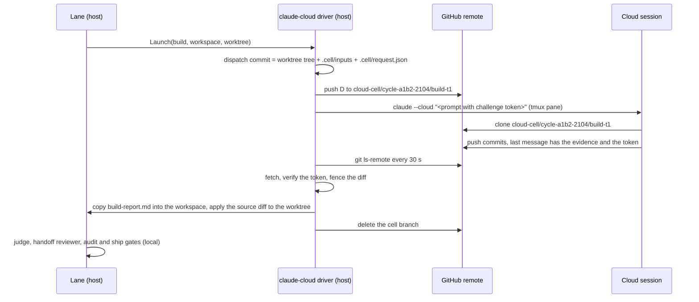

# Plan: the phase agents of up to 8 concurrent cycles run as Claude Code cloud sessions

- **Status:** proposed, 2026-11-03. Nothing is built. The operator answers section 10 before the build starts.
- **Research:** [cloud-phase-cells-2026-11](../research/cloud-phase-cells-2026-11.md). Each id below (F1.4, P2.2, R3) points into it.
- **Specs that the components update when they land:** [llm-isolation.md](../architecture/llm-isolation.md), [wave-orchestrator.md](../architecture/wave-orchestrator.md), [phase-handoff-contract.md](../architecture/phase-handoff-contract.md).
- **ADRs in force:** [ADR-0154](../architecture/adr/0154-the-pipeline-is-the-only-controller-and-each-agent-is-an-isolated-replaceable-worker.md) (invariants I-1 to I-9), [ADR-0139](../architecture/adr/0139-a-wave-orchestrator-supplies-admits-and-backfills-every-lane.md) (the pool). Component CC-12 adds one ADR.
- **Related work:** the driver `claude-cloud` on the branch `cloud/bridge-claude-cloud`, and the decision set D1 to D4 on the branch `docs/architecture-decisions-2026-11`.

**Terms used throughout:**

- **Cloud cell:** a phase cell whose agent runs in a Claude Code cloud session.
- **Dispatch commit:** a commit that the pipeline writes and pushes, with the tree and the inputs of one seat.
- **Cell branch:** `cloud-cell/<cycle branch>/<phase>-t<try>`. It holds one dispatch commit and the return commits of the agent.
- **Importer:** the pipeline step that fetches a cell branch, fences it and copies the return into the workspace.
- **Stage:** `off`, `shadow` or `enforce`. **Size:** XS (under 40 lines), S (under 100), M (under 250), L (more).

## 1. Request

The operator wrote on 2026-11-03:

> "prioritize claude --cloud as highest priority ... Then full 8 cycles concurrency on claude cloud phase agent cycle"

The brief adds two limits. Cloud sessions bill the cloud-session credit of the account. Routines bill plan usage and must not be used. Four local lanes already push the host load to 45 on 14 cores.

## 2. Facts

| Fact | Research id |
|---|---|
| A driver has two methods, `Name` and `Launch`. `Launch` blocks until the seat ends | F1.2 |
| The `git` completion mode already proves a seat with a challenge token in a commit | F1.3 |
| The runner reads the artifact from the local workspace before the judge | F1.1 |
| Each seat gets a fresh session | F1.5 |
| The handoff reviewer and the ship gate need a local tree that the local audit bound | F1.6, F1.8 |
| A trusted record is a pipeline file in a place that a cell cannot write | F1.7 |
| Only 4 phases can write source files | F1.10 |
| The OS sandbox does not reach a cloud VM | F1.13 |
| The kernel gate floors are a large part of the host load | F1.16 |
| The serial landing limit is about 6 lanes | F1.18 |
| The repository is public | F1.20 |
| A cloud session pushes through the GitHub connection of the account | F1.21, P2.2 |
| A cloud session clones the remote at the current branch | P2.2 |
| No documented verb stops a cloud session or reads its status | P2.4 |
| The docs say that cloud sessions count toward plan usage | P2.6 |

## 3. Goals and non-goals

Goals:

1. G-1: each phase agent of a cycle can run in a cloud session, selected by routing data only.
2. G-2: up to 8 lanes run at one time, each with at most one active cloud seat.
3. G-3: each kernel gate runs locally, in the order of the state machine, on a local tree.
4. G-4: each of I-1 to I-8 holds for a cloud cell, and I-9 has a matrix row.
5. G-5: a failed, late or rogue session never changes `main`. It never blocks a lane past its wait budget.
6. G-6: one routing change returns each phase to a local driver.

Non-goals:

- No routines and no scheduled tasks. The driver uses `claude --cloud` only.
- No PR and no merge from a cloud session. The pipeline lands, as today.
- No cloud kernel gate. The audit floor, the EGPS check and the ship gate stay on the host.
- No lane process in the cloud. The lane, its worktree and its state stay local.
- No feature flag. The routing table selects the driver, and each new rule has a policy stage.

## 4. Candidate designs

The research scores four designs in section 4.3 ([research §4](../research/cloud-phase-cells-2026-11.md#4-candidate-designs-and-scores)).

| Design | What one cloud session does | Total of 40 |
|---|---|---|
| A. Phase cells | one seat of one phase | 33 |
| B. Whole-cycle lane | scout to build of one cycle | 24 |
| C. Hybrid | one seat of `tdd` or `build` only | 33 |
| D. One session for each lane | each phase as a follow-up | 27 |

### 4.1 Why A wins

1. **Fact:** the state machine gates each phase. The handoff reviewer needs a local tree after `tdd` and `build` (F1.6).
   **Implication:** each phase must return to the host before the next phase starts.
   **Consequence:** B fails, because it runs four phases with no local gate between them.
2. **Fact:** each seat gets a fresh session (F1.5), and agents talk only through declared artifacts (I-4).
   **Implication:** a session must not carry the context of an earlier phase.
   **Consequence:** D fails, because its follow-ups share one context.
3. **Fact:** A and C use the same driver, the same importer and the same fence. C is A with routing data for `tdd` and `build` only.
   **Implication:** C is not a rival design. C is the first rollout stage of A.
   **Consequence:** A wins on the goal, because the operator asked for the phase agents of the full cycle.

**What changes the decision:** the probe CC-0 can measure a boot and clone time above 10 minutes for each session. Then the cycle time grows by more than 60 minutes. Then C is the end state, not a stage.

### 4.2 The grafts

| Graft | From | What it adds to A |
|---|---|---|
| Rollout order | C | `tdd` and `build` go to the cloud first, for one wave (R1) |
| A nudge inside one seat | D | on a timeout, one follow-up `claude -p ... --cloud <id>` to the same session (R12) |
| A dispatch commit | Captain (P2.11) | the session works on a tree that the pipeline chose, and the return diff has a fixed base |
| Local verify before merge | Copilot, Codex (P2.9, P2.10) | the importer fence and the local gates decide, never the agent |
| A record directory for each task | P2.12 | the session id, the url and the branch go under `.evolve/lineage/cloud/` |

### 4.3 One seat, end to end

The example is the `build` seat of cycle 2104 on lane `a1b2`. The values are examples.

The steps in words:

1. The driver writes a dispatch commit with `git commit-tree`. Its tree is the lane worktree, plus `.cell/inputs/` (the indexed inputs) and `.cell/request.json` (the seat request).
2. The driver checks the dispatch tree against a deny list of private paths. Then it pushes the commit (F1.9).
3. The driver runs `claude --cloud` in a tmux pane, in a pipeline checkout of the cell branch. Thus the session clones that branch (P2.2). The prompt holds the challenge token. The token is not in the tree.
4. The driver reads the session id and the url from the pane, and writes them to `.evolve/lineage/cloud/cycle-2104/build-t1.json`.
5. The driver polls `git ls-remote origin refs/heads/cloud-cell/cycle-a1b2-2104/build-t1`. A new head whose message passes `evidence.Parse(msg).Verify(phase, token)` ends the wait (F1.3).
6. The importer fetches the head and computes the diff from the dispatch commit. The `build` phase is a source writer (F1.10), so the diff can touch the worktree minus the protected surface. A change under `.cell/` is allowed only at `.cell/out/<declared file>`.
7. The importer copies `.cell/out/build-report.md` into the workspace after the launch time (F1.11). It applies the source diff, with `.cell/` excluded, to the local worktree.
8. The driver deletes the cell branch and returns exit 0. The runner judges, and the gates run as today.

## 5. Decisions

| Id | Decision | Research id |
|---|---|---|
| CD1 | Design A, with the grafts of section 4.2 | section 4 |
| CD2 | One cloud session for each seat. A correction round is a new seat with a new session | F1.5 |
| CD3 | The return channel is a cell branch. The importer reads only declared files and the fenced diff from it | F1.7, P2.2 |
| CD4 | A new completion contract `remote-git` reuses the evidence proof of the `git` mode | F1.3 |
| CD5 | The importer fence is the write limit of a cloud cell. It is not a stage: it refuses from the first day | F1.13, I-7 |
| CD6 | The kernel gates stay local. The importer runs before the judge, so the runner code stays as it is | F1.1, F1.6, F1.8 |
| CD7 | A cloud push is an accepted exception to D1, with a ruleset on `cloud-cell/**` and a rogue-ref detector | F1.21 |
| CD8 | Width 8 needs host-load admission and the orchestrator-owned integration at `enforce` | F1.15, F1.18 |
| CD9 | The driver never calls a routine, a scheduled task or the routines fire API | P2.6 |

## 6. Components

Route: `console` means the console builds it, because it touches a protected surface (bridge, ship path, policy). `lane` means a wave lane can build it.

| Id | What | Files | Stage | Size | Proving test (red first) | Route |
|---|---|---|---|---|---|---|
| CC-0 | A live probe: boot time, clone time and the pane output of the session id. It also checks a push to `cloud-cell/**`, the follow-up JSON and the end of an idle session. The results go into a research addendum | `go/cmd/evolve` (`evolve doctor probe claude-cloud`), `docs/research` | none | S | `TestDoctorProbe_ClaudeCloudReportsBootCloneAndPushTimes` on a fake CLI | console |
| CC-1 | The manifest `claude-cloud.json` with `"transport": "cloud"`, a session-id regex, a base wait and the slot cap. Merge with the driver of `cloud/bridge-claude-cloud` | `go/internal/bridge/manifests/`, `go/internal/bridge` | none | S | `TestLoadManifest_ClaudeCloudHasCloudTransportAndSessionRegex` | console: bridge |
| CC-2 | A new package `cloudcell`: the dispatch commit, the private-path deny check, the cell branch name, the push through the pipeline push path | `go/internal/cloudcell` | none | M | `TestDispatch_TheTreeHoldsTheWorktreeAndOnlyIndexedInputs`, `TestDispatch_RefusesAPrivatePath` | console: uses the push path |
| CC-3 | The completion contract `remote-git`: poll `ls-remote`, fetch, verify the evidence and the token | `go/internal/core/ports.go`, `go/internal/bridge/completion.go` | none | M | `TestRemoteGitDetector_AHeadWithoutTheTokenNeverCompletes` | console: bridge |
| CC-4 | The importer: the diff fence by phase class, the copy of declared files by name, the apply of the source diff, the lineage record | `go/internal/cloudcell` | none: refuses from the start (CD5) | M to L | `TestImport_ANonWriterPhaseThatChangesASourceFileIsRefused`, `TestImport_AProtectedPathIsRefused`, `TestImport_TheCopiedFileIsNewerThanTheLaunch` | console |
| CC-5 | The branch sweep and the rogue-ref detector. It deletes the cell branch at the end of the seat and sweeps orphans. It alarms on a moved ref outside `cloud-cell/**` | `go/internal/cloudcell`, `go/cmd/evolve` | `cloud_cells.ref_guard.stage`: `shadow`, then `enforce` | S | `TestRefGuard_AMovedMainWithoutALandingJournalEntryAlarms` | console |
| CC-6 | The timeout ladder: the base wait from the manifest, one follow-up nudge, then exit `81`. A new try gets a new branch | `go/internal/bridge` | none | S | `TestCloudWait_ALatePushToAnOldTryIsIgnored` | console: bridge |
| CC-7 | Usage telemetry: a billing snapshot before and after each seat, and the session url in the dispatch record | `go/internal/bridge/billing.go`, `go/internal/cyclespend` | none | S | `TestCloudSeat_WritesABillingDeltaAndTheSessionURL` | console: bridge |
| CC-8 | The I-9 matrix row: a fake `claude` that emulates `--cloud` by a push to a local bare remote | `go/internal/isolation/matrix.go`, `go/cmd/evolve/e2e_cycle_cli_matrix_test.go`, `go/internal/fakeclitest` | none | M | the new row of `TestE2ECycleCLIMatrix` for `claude-cloud` | console |
| CC-9 | Routing data, stage C: `claude-cloud` first in the chains of `tdd-engineer` and `builder`, and `bridge.max_concurrent.claude-cloud: 4` | `.evolve/policy.json` | data | XS | `evolve cli-routing explain builder` names `claude-cloud` | console: policy |
| CC-10 | Host-load admission: hold a new lane while the 1-minute load for each CPU is above `fleet.admission.max_load_per_cpu` | `go/internal/policy/fleet.go`, `go/internal/fleet/pool.go` | `shadow`, then `enforce` | S to M | `TestPool_HoldsALaneWhileTheLoadPerCPUIsAboveThePolicyValue` with an injected load reader | console: policy |
| CC-11 | Width 8: `fleet.count: 8`, `bridge.max_concurrent.claude-cloud: 8`, the routing of each phase to `claude-cloud`. It needs `fleet.integration.stage: enforce` (ADR-0147) first | `.evolve/policy.json` | data | XS | `evolve wave watch` shows 8 lanes in flight | console: policy |
| CC-12 | Docs: an ADR for cloud cells and a remote-cell section in `llm-isolation.md` with the I-1 to I-9 table. Also a width section in `wave-orchestrator.md` and the cloud handoff in `phase-handoff-contract.md` | `docs/architecture` | none | S | `evolve docs ste-lint --strict`, docs-review | console |

## 7. Order

1. CC-0. The probe measures the facts that the research did not measure (research §6). The result can move the decision of section 4.1.
2. CC-1, then CC-2 and CC-3 in parallel. The manifest comes first, because each later component reads it.
3. CC-4. The importer needs the dispatch commit as its diff base.
4. CC-5 and CC-6. They bound the failure modes before any real seat runs.
5. CC-7 and CC-8. The usage numbers and the matrix row are the proof before a route change.
6. CC-9. Stage C for one wave at width 4. Measure the usage, the boot time and the load.
7. CC-10. The load rule goes to `shadow` in the same wave, then to `enforce`.
8. CC-11. Width 8 only after ADR-0147 is at `enforce` and stage C held for one wave.
9. CC-12 lands with CC-9, so the spec matches the first real route.

The total is about 1 L, 5 M and 6 S or XS components (an estimate from the table).

## 8. Verification

| Goal | Measure | Before | Target |
|---|---|---|---|
| G-1 | the share of seats that ran on `claude-cloud`, from the dispatch records | 0% | 100% after CC-11 |
| G-2 | the lanes in flight at one time, from `evolve wave watch` | 4 | 8 |
| G-3 | each landed cycle has a local handoff check, a local audit entry and an EGPS receipt with 0 red | 100% local today | 100% |
| G-4 | the I-9 row for `claude-cloud`, and 0 importer fence refusals that a gate missed | no row | row green |
| G-5 | rogue-ref alarms, orphan cell branches older than one day | none measured | 0 and 0 |
| G-6 | a routing change back to `claude-tmux` passes the matrix row | not proven | proven by CC-8 |
| host load | the 1-minute load average at width 8, from `uptime` samples | 15 to 63 at width 4 (F1.16) | below `max_load_per_cpu` times 14 |

## 9. Risks

| Risk | Control |
|---|---|
| A session pushes to `main` or to a lane branch | a GitHub ruleset limits the cloud push to `cloud-cell/**`, and CC-5 alarms on any other moved ref |
| A session opens a PR | the prompt forbids it. CC-5 lists the open PRs from `cloud-cell/**` heads and alarms |
| Private data on a public branch (F1.20) | the deny check of CC-2, the branch delete of CC-5 |
| A burst of launches is throttled (P2.8) | the `cliadmit` slot cap and a stagger in CC-1 |
| No stop verb for a session (P2.4) | a late push lands on an old try branch and is ignored (CC-6). The idle session stops by itself |
| The usage of 8 lanes drains the plan | the CC-7 numbers feed `fleetbudget`, and stage C runs one wave before width 8 |
| The gate floors still load the host at width 8 (F1.16) | CC-10 holds new lanes. The lane CPU budget stays |
| The landing queue at width 8 (F1.18) | width 8 waits for ADR-0147 at `enforce` |

## 10. Operator decisions

Each question has the recommended answer first.

1. **Which design?**
   - (a) A, phase cells, with the grafts of section 4.2. *Recommended.*
   - (b) C only: `tdd` and `build` in the cloud, the other phases local.
   - (c) D: one session for each lane. It breaks I-4.
   - (d) B: one session for each cycle. It skips the gates between phases.
2. **Which rollout?**
   - (a) Stage C for one wave at width 4, then each phase, then width 8. *Recommended.*
   - (b) Each phase at once at width 4, then width 8.
   - (c) Only `build` first.
3. **How does width 8 land?**
   - (a) Width 8 waits for the orchestrator-owned integration of ADR-0147 at `enforce`. *Recommended.*
   - (b) Width 8 with per-lane landing, and the queue above 6 lanes is accepted.
   - (c) The width stops at 6.
4. **How is the cloud push limited (D1 exception)?**
   - (a) A GitHub ruleset on `cloud-cell/**` plus the rogue-ref detector. *Recommended.*
   - (b) The detector only.
   - (c) No exception: wait for a return channel without a push.
5. **Where do the inputs travel? The repository is public.**
   - (a) In the dispatch commit, with the private-path deny check and the branch delete. *Recommended.*
   - (b) Inline in the prompt only. The return still uses a public branch.
   - (c) Move the work to a private mirror repository.
6. **Which usage limit applies?**
   - (a) A cap of cloud seats for each wave in `fleetbudget`, set from the CC-7 numbers of stage C. *Recommended.*
   - (b) No cap. The plan limit stops the work.
7. **Which load threshold does CC-10 use?**
   - (a) `max_load_per_cpu: 1.0` (a load of 14 on this host). *Recommended.*
   - (b) `1.5` (a load of 21).
   - (c) No load rule.

## 11. Open questions

- The billing facts conflict: the brief says cloud-session credit, the docs say plan usage (research §2.3). CC-7 measures it.
- The pane output of `claude --cloud` and the push to a branch outside `claude/` are not measured. CC-0 measures them.
- The merge of CC-1 with the driver of `cloud/bridge-claude-cloud` depends on the shape of that branch. It is not on the remote on 2026-11-03.
- Windows: the driver uses tmux. A Windows host needs another TTY host. That gap is the same as for `claude-tmux`.
