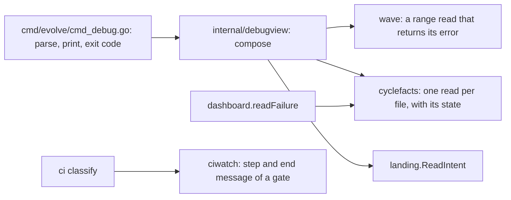

# Plan: A read-only debug CLI that gives the console and agents an accurate signal with a next step

- **Status:** proposed, 2026-11-05. The architecture review passed on 2026-11-05 after four rounds (revision 5 of this plan). The build of rows 1 to 5 of section 6 is in progress.
- **Design:** [debug-cli](../architecture/debug-cli.md). **Decision:** [ADR-0162](../architecture/adr/0162-the-console-reads-through-a-tested-read-only-debug-family-and-writes-no-scratch-scripts.md). **Research:** [debug-cli-2026-11](../research/debug-cli-2026-11.md).
- **Related:** [CLI contract](../architecture/cli-contract.md), [gate input inventory](../architecture/gate-input-inventory.md). Its proof rows are in the [pipeline blockers plan](pipeline-blockers-2026-11.md).

## Table of contents

- [1. Request](#1-request)
- [2. Facts](#2-facts)
- [3. Goals and non-goals](#3-goals-and-non-goals)
- [4. Candidate designs](#4-candidate-designs)
- [5. Decisions](#5-decisions)
- [6. Components](#6-components)
- [7. Order](#7-order)
- [8. Verification](#8-verification)
- [9. Risks](#9-risks)
- [10. Open questions](#10-open-questions)

## 1. Request

The operator, 2026-11-05:

- "Why do we have bash script?"
- "Could we just build the debug cli in evolve loop for your use and cover with tests?"
- "Do the design and architecture review first before build the code"
- "Also follow strictly on TDD"
- "The signal needs to be accurate without any mistake, showing clear guidances for agent to debug"
- "Make sure we have research, design, plan, adr, ...etc docs written in strict format described under docs/"

**Terms used throughout**

| Term | Meaning |
|---|---|
| Console | The operator's agent session, which runs the loop from outside. |
| Cell | The sandboxed process of one phase agent. |
| Run directory | `.evolve/runs/cycle-N`. A cell can write in it, except `inputs/`. |
| Host record | A file that the host writes outside the run directory. |
| Breadcrumb | A next command that a result names. |
| Owner | The package that today reads or writes a fact, for example `wave` or `dossier`. |

**What the reviews changed.** Two reviews found faults before any code existed. Each fix made the design smaller. The reviews also cut `debug ci`, the `git` seam and the second snapshot harness.

| Claim of an earlier revision | What the code shows | Decision now |
|---|---|---|
| An import allow-list proves read-only | `wave` imports `orchestrator`, which imports `inboxmover` (F1.2) | D2 |
| A snapshot on a tree at mode 0555 proves read-only | The write fails, so the snapshot stays equal (F1.13) | D2 |
| Each field of a row can state its source | `wave.Cycle` merges its sources (F1.17) | D3 |
| `dashboard.readFailure` can move and serve the brief | It reads the workspace digest and erases each source (F1.5) | D5 |
| A failed read exits 2 | `ReadCycles` has no error return (F1.4) | D4 |
| The salvage pointer can be a command | A cell writes it (F1.10) | D9 |

## 2. Facts

| Fact | Research id |
|---|---|
| The console wrote 71 scratch files in one session, and four faults came from them. | F1.1 |
| An import list cannot prove read-only: 147 internal packages in the closure. | F1.2 |
| A cell can write the digest, the reason, the cycle state and the signals. The digest record is a host file. | F1.3 |
| Four owner reads drop their error. A probe gave `cycles=0 warnings=0` for a failed read. | F1.4 |
| `dashboard.readFailure` merges its sources and reads the workspace digest. | F1.5 |
| `ci classify` printed `unknown` for a gate that named `internal/policy/fleet.go:22`. | F1.6 |
| The contract has a closed exit table. A new verb is class `D` until the table says otherwise. | F1.7 |
| Cycle 2157 holds a salvage pointer, and the policy says salvage comes before requeue. | F1.8 |
| The landing intent is host-owned. The contract harness hashes the tree around a call. | F1.9 |
| The salvage pointer is prose. 33 of 33 recorded pointers start with a checkable token. | F1.10 |
| A digest exists for 41 of 41 aborted cycles and for 0 of 67 landed cycles. | F1.11 |
| The class of cycle 2157 is a false label from the needle `quota`. | F1.12 |
| A tree at mode 0555 hides a write. | F1.13 |
| `TMPDIR` changed on 30 of 30 calls. Three verbs call `git` or `gh` on purpose. | F1.14 |
| A planted `gh` call survived the shim test. | F1.15 |
| A cell can plant a fresh `.lease`. | F1.16 |
| `wave.Cycle` has no provenance, and a workspace file alone gives `Shipped:true`. | F1.17 |
| `wave status` and a range read on `ReadCycles` disagree on `Termination`. | F1.18 |
| The contract test needs the cases of a verb in the row that adds it. | F1.19 |
| The four review rounds found 8, 9, 6 and 2 faults of CRITICAL or HIGH. | F1.20 |
| Current practice: stdout for the result, stable ids, breadcrumbs, a closed exit table. Weak sources. | P2.1 to P2.6 |

## 3. Goals and non-goals

| Goal | Measure | Target |
|---|---|---|
| G1. The console and an agent answer "why did this cycle stop, can work be saved, what is next" with one call. | `debug cycle N` prints the reason, the salvage read and the next commands. | Cycle 2157 gives all three in a golden test. |
| G2. A read never changes state. | The contract harness hashes the tree, `HOME` and `TMPDIR` and logs each `git` and `gh` call. | 0 changes, and two planted faults fail the test. |
| G3. Each answer states its source. | Each item has a source of `host`, `derived` or `workspace`. | 100% of items. A wrong label fails a test against the sandbox profiles. |
| G4. A failed read is visible. | A failed read exits 2 and names the cause. | 0 silent drops in the reads of the family. |
| G5. A next command works from any directory. | Each `evolve` entry runs from another directory and exits 0 or 1. | 100% of entries. |
| G6. The build follows strict TDD. | The report shows the red output of each row. | 13 of 13 rows. |

**Non-goals.** The family does not replace the review and commit chain. It does not read CI (`ci classify` owns that). It does not add `debug gates` or `debug trees`. It adds no new exit code and no new agent class.

## 4. Candidate designs

The scores are synthesis. They turn the yes and no table of revision 5 of the draft into numbers. Each criterion has a score from 1 (bad) to 5 (good).

| Criterion | A: extend each owner verb | B: a family with its own readers | C: a family that composes the owners | D: keep the scratch scripts |
|---|---|---|---|---|
| One answer for one question | 5 | 1 | 5 | 1 |
| An agent finds the verbs in one place | 1 | 5 | 5 | 1 |
| A range of cycles fits | 1 | 5 | 5 | 3 |
| Size of the change | 3 | 1 | 4 | 5 |
| Drift risk (low is good) | 4 | 1 | 4 | 1 |
| A test covers it | 4 | 4 | 4 | 1 |
| **Score** | **18** | **17** | **27** | **12** |

**C wins, with a part of A.** The deciding criteria are "one answer for one question" and "a range of cycles fits". Only C scores 5 on both, and still has the verbs in one place. A cannot give a range, because `wave status` reports one wave (F1.18). B repeats the owner readers and drifts (F1.5). D has no test, and it caused the faults of F1.1.

The family holds what has no verb today: a range of cycles and one failure brief. CI goes to `ci classify` (D6).

## 5. Decisions

| Id | Decision | Research id | Rejected options and the fact that rules them out |
|---|---|---|---|
| D1 | `internal/debugview` composes the owners. `cmd_debug.go` only parses and prints. | F1.5, F1.6 | Readers in the family: they repeat the owners (candidate B). |
| D2 | The existing contract harness proves read-only on a writable tree through `dispatchWith`. The hash gains mode and mtime. `HOME` and `TMPDIR` are temporary and hashed. Logging shims for `git` and `gh` on `PATH` must stay silent. Mutants go in through `go test -overlay`. | F1.2, F1.9, F1.13, F1.14, F1.15 | An import list: it fails on the first allowed package. A tree at mode 0555: a dropped error hides the write. |
| D3 | Three source kinds, checked against the real sandbox profiles. The digest comes from the host record, with no fallback to the workspace copy. Columns from `wave.Cycle` have the fixed label `workspace`, and `landed` is `host`. | F1.3, F1.9, F1.16, F1.17 | Per-field upgrades: the merge hides the source. A `git` read: it repeats the landing logic. |
| D4 | `wave` gains a range read on the layer of `ReadRunCycles`, which reports each read failure, also of `lane-scope.json`, `llm-calls.ndjson` and the loop signals. `ReadCycles` and `ReadRunCycles` share it. `dossier.ReadDirChecked` joins `ReadDir`. | F1.4, F1.18 | A change of `ReadDir`: four other packages call it. |
| D5 | A small package `cyclefacts` holds `ReadDecision`, `ReadDisposition`, `ReadFailReason` and `ReadDigestRecord`, each with a state. `dashboard.readFailure` calls the first three and keeps its merge. | F1.5, F1.11 | A move of `readFailure`: it reads what D3 forbids. |
| D6 | The step and the end message of a gate go in `ciwatch`, in a new field, and `ci classify` shows them. | F1.6 | A `debug ci` verb: it repeats the same report. |
| D7 | Exit 0 for a read that succeeded. Exit 1 for an absent cycle. Exit 2 for a failed read. Exit 10 for a usage error. Exit 3 stays unused here. | F1.7 | Exit 3 for absent: an agent retries a cycle that never exists. |
| D8 | Class `A` rows in `agentclass/table.go`, `availAlways` rows in `coreVerbs`, and section 5 of the contract. A denied read in a cell is `unreadable`, never a blank. | F1.7, F1.19 | A new read-only mark: it adds a third axis. |
| D9 | The brief holds salvage, route, recurrence and decision. `next` names a checked salvage read first. | F1.8, F1.10 | A command from the raw pointer: a cell writes it. |

**Consequences**

- Good: one tested place to read, with a source on each answer (G2, G3).
- Good: a failed read is visible, so the console does not act on a false empty answer (G4).
- Cost: `debugview` depends on each owner. An owner change can break it, and the journey tests show that at once.
- Cost: three owner changes (`wave`, `dossier`, `ciwatch`) and one new package precede the verbs.
- Cost: the review and commit chain stays outside this family. It needs its own item. `debug gates` and `debug trees` need their own design.
- Risk: the labels are only as true as the sandbox profiles (see section 9).

**What changes our mind**

| Id | We revisit the decision if |
|---|---|
| D1 | An owner cannot give a read with no state change. Then the family does not call it, it reports the gap, and the owner gains a pure read. |
| D2 | A mutant planted in a verb passes the harness. Then the harness gains the missing channel before any new verb ships. |
| D3 | The test of the labels differs from a manual read of the profiles on any path. |
| D4 | A further silent drop shows up in a read of the family. Then that read joins the range read. |
| D5 | A fifth read of `cyclefacts` needs a package that `profiles` cannot import. |
| D7 | The console needs to tell "absent" from "wrong root" in a script. Then the text of exit 1 gains a field, and the code stays. |
| D9 | A real miss shows that a valid pointer names a wrong tree. Then the check gains a read of the tree. |

## 6. Components

The build order is this table, top to bottom. Each row is one red, green and refactor loop. The builder writes the test, runs it, and records the failure, before the code. A compile error is not a red: add the signature with an empty body first.

A test that passes at first is not evidence: the builder states why, and changes the test or removes it. The report has the red output of each row. Fixtures sit in the package that reads them. They are recorded production shapes, trimmed from cycles 2157 and 2161 and from the log of batch five.

| Id | Component | Red test first, and why it fails | Owner and state |
|---|---|---|---|
| C1 | The extended contract harness, then the silent shims | The harness hashes mode, mtime, `HOME` and `TMPDIR`, with the store opened before the baseline. It fails on a write planted in an existing always verb, and on a `gh` call planted in `dossier show`, through `-overlay`. The shims are a field of the contract call, on for `dossier show` and the debug verbs. A hash of each call, failure exits too, applies to the debug verbs only. | `cmd/evolve` tests. In progress. |
| C2 | The range read of `wave` | On an unreadable directory, an unreadable `lane-scope.json` and an unreadable `llm-calls.ndjson`, the read returns each failure. The stub returns none. | `wave`, shared with `ReadRunCycles`. In progress. |
| C3 | `dossier.ReadDirChecked` | On a corrupt file and an unreadable directory it reports each. The range read on a corrupt dossier under `knowledge-base/cycles` returns the failure. The stub returns none. | `dossier`. The range read of C2 calls it. In progress. |
| C4 | `cyclefacts` | Each read returns each state. The stub returns none. `dashboard` calls it with its tests unchanged. | `cyclefacts`, `dashboard`. In progress. |
| C5 | The gate step and end message | `ciwatch` on the recorded log of batch five names `internal/policy/fleet.go:22` and has no nested fixture line. Today it says unknown. The new field leaves `Step` and the inbox item id unchanged. | `ciwatch`, then `ci classify` prints it. In progress. |
| C6 | The table of source kinds | The source table against `realSandboxes`, in a test of package `profiles`, where the helpers live. A planted wrong label fails. | The exported table in `cyclefacts`, which `profiles` can import. |
| C7 | `debugview.Cycles` | Over a recorded tree it holds a cycle at or below the wave floor and an `absent` landing. | `debugview`. |
| C8 | `debugview.Brief` | On cycle 2157 it returns each item with its source and state. The stub returns none. | `debugview`. |
| C9 | The state rules | Each state of the table is selected by its rule, with its digest state and its exact `next`. | `debugview`. |
| C10 | The check of `next` | A valid pointer gives the one `git` form. A planted pointer with `;` gives no command. | `debugview`. |
| C11 | `debug cycles` | Through `dispatchWith`: envelope, schema, exits 0, 2 and 10, with `failCall(cliExitIO, contractBareRoot, ...)` for exit 2. Golden text through `runDebug`. | `cmd_debug.go`, this verb, with its class row and its row in section 5 of the contract. |
| C12 | `debug cycle` | Through `dispatchWith`: envelope, schema, exits 0, 1, 2 and 10. Golden text of cycle 2157. | `cmd_debug.go`, this verb, with its class row and its row in section 5 of the contract. |
| C13 | The check of every `next` entry | Each `evolve` entry of `next` runs through `dispatchWith` on the fixture, from another directory, and exits 0 or 1. Each has class `A`, or class `D` with the console only mark. | The check over both verbs. |

## 7. Order

1. C1 first. Every later row relies on a proof that can fail (F1.15).
2. C2 and C3 next. The family must not give a confident wrong answer (F1.4). C3 follows C2 because the range read calls it.
3. C4 and C5. They are independent owner changes, and `debugview` needs C4.
4. C6 before C7. A source label is wrong until a test checks it.
5. C7 to C10. These rows build the composition, with no CLI yet.
6. C11 and C12 last but one. Each verb brings its own class row and its contract cases (F1.19).
7. C13 last. It runs the printed commands of both verbs.

## 8. Verification

| Measure | Before (2026-11-05) | After (target, not measured) |
|---|---|---|
| Scratch scripts that the console writes for these reads | 71 in one session (F1.1, unverified) | 0 for the questions of the two verbs |
| Silent drops in the reads of the family | 4 (F1.4) | 0 |
| Planted faults that the read-only test catches | 1 of 2 in the old harness (F1.15) | 2 of 2 |
| Coverage of each changed function | not measured | 100% |
| Tests that were red before the code | not applicable | 13 of 13 rows, each with its red output in the report |

Each verb meets the red proof, journey, preservation, wiring, mutation and signal checks of the [pipeline blockers plan](pipeline-blockers-2026-11.md).

## 9. Risks

| Risk | Control |
|---|---|
| An owner is wrong, and the family repeats the wrong answer. | The source label shows the origin. The owner gets the fix. |
| The read-only test proves only the paths that it runs. | Mutants in the build report show that it can fail. The limit is in the design. |
| A label is true today and false after a profile change. | C6 tests the labels against `realSandboxes` on each run. |
| `debugview` breaks when an owner changes. | The journey tests of C8 and C11 to C13 fail at once. |
| A planted salvage pointer puts text in a command. | C10: a pointer that fails the check prints as a labelled value, with no command. |
| A cell at the `enforce` stage cannot read other cycles. | The item is `unreadable`. It is never a blank (D8). |
| `profiles` cannot import `cyclefacts` if it grows. | `cyclefacts` stays small. A wrong import fails at compile time. |

## 10. Open questions

None block the build. Revision 1 asked two questions, and the reviews answered them. The workspace digest is not a host fact (F1.3). `debug` stays apart from `evolve status`, which takes no operand.

One point stays open and does not block C1 to C6. It is the default size of the range of `debug cycles` when `--from` and `--to` are absent. No requirement states it (review round 2). The builder of C7 chooses a size and records it in the design.
