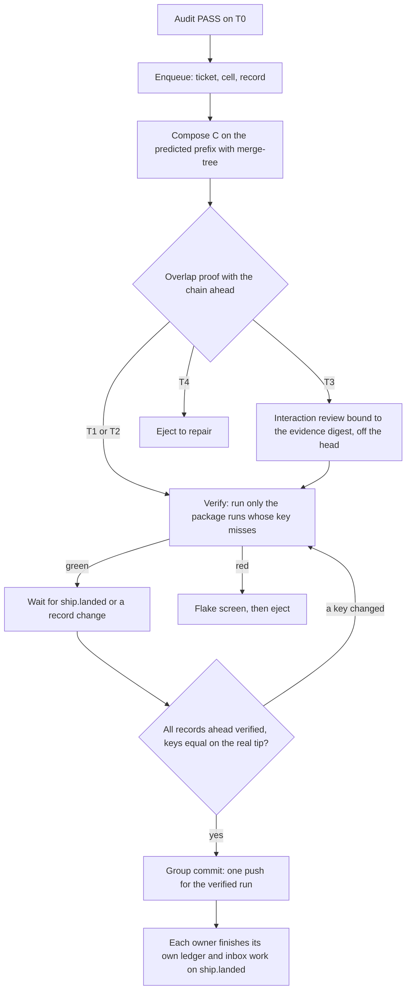

# Plan: fleet landings stay fast from 2 to 200 concurrent lanes

- **Status:** proposed, 2026-10-13. S0 (these documents) is in review in the docs lane `cl-merge-scale`. No code has changed.
- **Decision:** [ADR-0134](../architecture/adr/0134-fleet-landings-scale-through-content-keyed-verification-and-group-commit.md) (Proposed). It amends [ADR-0128](../architecture/adr/0128-landing-queue-tiered-reverification.md).
- **Research:** [fleet-landing-at-scale-2026-10.md](../research/fleet-landing-at-scale-2026-10.md) (findings F2.1 to F3.5 and P4.1 to P8.4, refinements R1 to R12).
- **Design that this plan extends:** [fleet-landing-queue.md](../architecture/fleet-landing-queue.md), the spec of record of the landing queue. Its plan: [concurrent-cycle-landing-2026-10.md](concurrent-cycle-landing-2026-10.md).

**Terms used throughout:** the research dossier defines lane, N, scan, importer backstop, divergence, composed tree, content key and group commit. This plan adds three terms:

- **Verification record:** the proof for one composed tree: the tree id, and for each package run its content key and its result.
- **Chain:** the ordered list of composed commits, each on the one before it, that waits to land.
- **Cell:** a group of module packages that the dispatch treats as one unit of admission (§5.6).

## Table of contents

1. [Request](#1-request)
2. [Facts](#2-facts)
3. [Goals and non-goals](#3-goals-and-non-goals)
4. [Candidate designs](#4-candidate-designs)
5. [The design of the winner](#5-the-design-of-the-winner)
6. [Decisions](#6-decisions)
7. [Components](#7-components)
8. [Order and rollout](#8-order-and-rollout)
9. [Simulation and benchmark](#9-simulation-and-benchmark)
10. [Verification](#10-verification)
11. [Risks](#11-risks)
12. [Open questions](#12-open-questions)

## 1. Request

The operator wrote this on 2026-10-13:

> "Assume there are over 2 (said 200) concurrent loop running and merge randomly, research online to find the best and most efficient way to handle the confliction and provide me at least 3 approaches to handle this issue. I want a full plan to make the conflict / rebase as fast as possible"

Earlier on the same day: "Why does ship take over 5 minutes? Explain in detail".

**The short answer to the second question.** Ship runs the repo-contract scan before it checks the fast-forward. The scan's importer backstop runs `go test -count=1` on each importer of a changed package. `cmd/evolve` imports 84% of the module, so most ships run all of `go test ./cmd/evolve/...`, which took 298 s in cycle 1865. If a peer lands during those minutes, the fast-forward fails. The recovery rebases the lane, and ship runs the whole scan again, with no reuse of the first result (research F2.1 to F2.8).

## 2. Facts

| Fact | Research |
|---|---|
| Ship scans before it checks the fast-forward. | F2.1 |
| Each scan layer runs `go test -count=1`, so no result carries to the next scan. | F2.2 |
| `cmd/evolve` took 298 s of the 354 s scan of cycle 1865; no other package took more than 19 s. | F2.3, F2.4 |
| The importer backstop took 1 min 53 s to 6 min 21 s over 18 runs (2026-10-11 and 2026-10-12). The median is 2 min 58 s. | F2.4 |
| After a divergence, the whole scan runs again. | F2.7, F2.8 |
| `cmd/evolve` has 2,286 test functions; 114 test files change the process state. | F2.5 |
| `cmd/evolve` depends on 84% of the 293 module packages. | F2.6 |
| A cycle runs 58.9 min at the median, so a lane offers about one landing each hour. | F2.14 |
| 19.2% of module package pairs overlap; at most about 139 packages are pairwise disjoint. | F2.15, F2.16 |
| The ADR-0128 queue is serial, with a review only at the head, and its step holds a full scan. | F2.11, F2.12 |
| Today's path at N = 200 costs about 20,100 scans and up to 29,651 LLM phases for one wave. | F3.3 |
| At N ≥ 20 almost every landing overlaps a peer, unless the base is fresh or the work is partitioned. | F3.4, F3.5 |
| Current practice verifies the exact tree that lands, in parallel on a predicted prefix, and splits work by impact. | P4.1 to P5.2 |
| A content key gives "same key, same result" under hermetic tests. The Go test cache misses reads outside the module. | P7.1, P7.3, F2.18 |

## 3. Goals and non-goals

Goals, in priority order:

| Goal | Measure | Target |
|---|---|---|
| G1. Keep every integrity rule. | `ship ⇒ build ∧ audit ∧ tdd`; each landed commit point has a verification record; `main` stays green | zero untested commit points; zero escapes in shadow |
| G2. A rebase costs seconds of test time when the peer change cannot reach the lane's tests. | the test seconds after a divergence | p50 ≤ 60 s at N = 2 |
| G3. The landing has no serial step that holds a scan. | the time inside the landing lock | p95 ≤ 30 s for each group commit |
| G4. Throughput follows N. | landings in one hour | ≥ 0.9 × the offered load at N = 2, 20 and 200, in the simulation |
| G5. Land latency stays flat. | from the end of the audit to `ship.landed` | p50 ≤ 5 min and p95 ≤ 15 min at N = 200, in the simulation |
| G6. LLM work after a rebase stays rare. | LLM phases for each landing after the audit | ≤ 0.2 at N = 20 and 200 |
| G7. No waiter polls. | the AST guard of ADR-0127 | zero timers in the wait paths |

Non-goals:

- No change for a fleet of width 1 or for a manual ship.
- No new dependency in `go/go.mod`, and no feature flag or env flag; each dial is a config key with a stage.
- This plan does not run 200 lanes on one host. It designs the landing for 200, and it proves the design in a simulation (§9).
- No order change inside a group of candidates that overlap (ADR-0128 D3 still holds there).

## 4. Candidate designs

Five approaches, each judged at N = 2, 20 and 200. The numbers are the model of research §3, with "estimate" where the shadow stage measures them.

### 4.1 A: finish ADR-0128 as designed, with a faster scan

**How it works.** One FIFO queue. The head composes `C`, proves the tier, runs the scoped gates, and the ship at the landing runs the repo-contract scan on `C`. This approach adds a content-keyed cache and process shards for `cmd/evolve`, so the scan step drops from about 4.2 min to about 1.8 min (estimate).

- **At N = 200.** The serial step caps the queue at about 33 landings in one hour. The offered load is about 204, so the backlog grows with no limit (research F3.2).
- **LLM work.** A T3 review runs only at the head (ADR-0128 D10), for 5.7 min, so T3 caps the queue at about 10 in one hour. At N ≥ 20 almost every landing is T3 (research F3.4).
- **Integrity.** Full: each landed tree is tested.
- **Cost to build.** The ADR-0128 components Q4 to Q19, plus the cache.

### 4.2 B: a batched merge train with bisection

**How it works.** As GitHub, Graphite, Bors-NG and Mergify do (research P4.1, P4.3, P4.7, P4.8). The queue composes up to b candidates, tests only the top tree once, and lands all b with one push. A red batch splits in two until one candidate stays red.

- **At N = 200.** With p = 5% and b = 8, each candidate costs about 0.38 runs (research P6.1). The throughput is about b times that of A.
- **Integrity.** It fails G1. The commits under the top of a batch are never tested alone (research P6.2). That breaks "never ship an untested merged tree".
- **LLM work.** A red batch can send several lanes back to an Audit before the culprit is known.

### 4.3 C: conflict-partitioned speculative chains with content-keyed verification

**How it works.** GitLab trains, Mergify scopes, Aviator affected targets and Uber SubmitQueue work this way (research P4.2, P4.4, P4.5, P5.1). Each candidate composes on its predicted prefix, the chain, and verifies off the head, in parallel. The overlap proof of ADR-0128 builds a conflict graph, and candidates with no edge land in any order. A content key makes each package result reusable on each tree with the same key.

The holder of the landing lock pushes the verified run of the chain with one push (group commit).

- **At N = 200.** The serial step is a key check and a push, about 0.3 to 0.5 min for a whole group (estimate). Verification is parallel, so the throughput follows the number of workers (§5.8).
- **Integrity.** Full: each commit point of the chain has its own verification record, and a cache hit is a proof only when the key is equal.
- **LLM work.** It does nothing to keep T3 rare. At N = 200, the peer change since the base is large, and the T3 reviews swamp the fleet (research F3.4).

### 4.4 D: optimistic landing with culprit finding after the landing

**How it works.** As TAP postsubmit (research P5.3). Each audited lane lands as soon as it composes clean. CI on `main` runs after each landing, finds the culprit and reverts it.

- **At N = 200.** The best throughput and latency of all five.
- **Integrity.** It fails G1 by design. A red tree reaches `main`, and the repository treats a red `main` as a system failure ([ADR-0072](../architecture/adr/0072-system-failure-policy-and-halt.md)).

### 4.5 E: avoidance only

**How it works.** Partition the work at dispatch so that lanes in flight touch disjoint cells. Refresh the base at the start of the audit, and split `cmd/evolve` into smaller packages. Keep today's ship.

- **At N = 200.** The lanes still diverge, because any landing moves `main` and fails each other fast-forward. The serial step stays one scan, so the cap stays about 14 landings in one hour.
- **LLM work.** Few T3 cases, because peers in flight are structurally disjoint.
- **Limit.** At most about 139 Go lanes can be pairwise disjoint (research F2.16).

### 4.6 Scores

Each criterion has a score from 1 (bad) to 5 (good). Integrity is a gate: an approach with an integrity score below 4 cannot win. The request asks for speed at N = 200. Thus throughput at N = 200 has the weight 3, and latency at N = 2 and 20 has the weight 2. The other criteria have the weight 1.

| Approach | Integrity (gate) | Throughput at N = 200 (×3) | Latency at N = 2 and 20 (×2) | Test cost | LLM cost | Build size (5 = small) | Reuse of ADR-0128 | Weighted score |
|---|---|---|---|---|---|---|---|---|
| A. ADR-0128 with a faster scan | 5 | 1 (about 33 in one hour, T3 at the head) | 4 | 4 | 3 | 4 | 5 | 27 |
| B. Batched train with bisection | 2, out | 4 | 3 | 5 | 2 | 3 | 3 | (31) |
| C. Partitioned speculative chains | 5 | 3 (tests scale; T3 does not) | 4 | 3 | 2 | 2 | 4 | 28 |
| D. Optimistic landing | 1, out | 5 | 5 | 4 | 4 | 3 | 2 | (38) |
| E. Avoidance only | 4 | 1 (about 14 in one hour) | 2 | 4 | 5 | 4 | 4 | 24 |
| **W. C + A + E (the winner, §4.7)** | 5 | 5 | 4 | 4 | 4 | 2 | 4 | **37** |

**Why C wins among the single approaches.** The decisive criterion is throughput at N = 200. A and E keep a serial step that holds a scan. Their cap is thus 14 to 33 landings in one hour, against an offered load of about 204. B and D have the highest raw scores, but both land trees that no test ran, so the integrity gate rules them out. C is the only approach that passes the gate and removes the serial scan.

**What changes our mind.** If the simulation (§9) shows that C without E keeps the T3 share below 20% at N = 200, we drop the admission control of §5.6. If the shadow stage finds one cache escape (§10), the cache returns to shadow. C then uses A's scan until the key is fixed.

### 4.7 The winner: C, with the best parts of A, E, B and D

| Part | From | Why |
|---|---|---|
| The queue, the tiers, the overlap proof, the composition with `merge-tree` and the records | A (ADR-0128) | They exist in design, and Q1, Q3 and Q12 are done (research F2.11). |
| The content-keyed cache and the `cmd/evolve` shards | A | They make each verification short, also at N = 2 with no queue. |
| Speculative chains, independence by the conflict graph, group commit | C | They remove the serial scan (research F2.12). |
| Admission by cell at dispatch, and a refresh of the base at the audit | E | They keep T3 rare at N ≥ 20 (research F3.4, F3.5). |
| The split of `cmd/evolve` tests into the packages that they test | E | The cache rarely skips a package that imports 84% of the module (research F2.6). |
| The adaptive group size for the push | B | The push cost is shared when the backlog grows (research P4.3). |
| A rerun of only the failed tests in the flake screen | B (Mergify) | It is the cheapest part of the flake screen (research P4.3). |
| Culprit mapping in CI after the landing | D | One commit maps to one cycle, so CI on `main` names the culprit at no cost. |

## 5. The design of the winner

### 5.1 The flow at a glance

### 5.2 Step 1: scan the tree that lands (no queue needed)

Today ship scans first and checks the fast-forward last (research F2.1). The first change moves the check:

1. Before the scan, ship runs `CheckFastForward` (`go/internal/phases/ship/landing/integrate.go:28-34`).
2. If `main` moved, ship returns `GIT_FLEET_REBASE_NEEDED` at once, with no scan.
3. The recovery rebases, and the next ship scans the rebased tree.

This saves one stale scan each time that a peer landed during the audit. It changes `runNative` in `go/internal/phases/ship/ship.go:177-184`. It is safe because it adds a check and removes no check.

### 5.3 Step 2: the content key and the verification cache

**The key.** For one package run, the key is the SHA-256 of these inputs:

- the Go version, `GOOS`, `GOARCH`, the build tags and the test flags;
- the blob ids of `go/go.mod` and `go/go.sum`;
- for each module package in the test closure (its `Deps` and its test imports): the blob id of each file that `go list` names;
- for each such package: the tree id of its `testdata/` directory;
- for each data root that the package reads (the data-edge catalog of the [spec](../architecture/fleet-landing-queue.md) §7.4): the tree id or the blob id of that root;
- for a package with an unresolved data root, or for a tree-reading test of `repocontract.TreeReadingTests()`: the id of the whole tree;
- the name and the value of each environment variable that the test binary read in its last run, from its test log (next paragraphs);
- the value of each variable on a declared list of the variables that child processes read;
- for a package whose last run opened a path outside the module, other than its own temp directories: the id of the whole tree.

**Why each input.** The Go test cache keys on the test binary and on the files that the test opens inside the module (research P7.3). Tests here read paths outside the module through `..`, which is why the repository runs `-count=1` (research F2.18). The key adds those paths through the data-edge catalog.

**The gap that the catalog leaves.** The data-edge catalog holds test reads only: "Production reads have no catalog in v1" ([spec](../architecture/fleet-landing-queue.md) §7.4). A test also reads `.evolve/*` through the production loaders of the packages that it imports. The catalog scan of `_test.go` files never sees those reads, so the rule "an unknown read keys on the whole tree" does not catch them. Environment variables are a second gap: the Go test cache keys on them, and a file key does not. Without the last three inputs of the list above, a false hit is possible.

**How the key closes the gap.** The scan runs each test binary with its test log on, the record that `go test` uses for its own cache. The log names each environment variable that the process read, and each file that it opened or checked. The cache stores this read set with each green result.

A lookup has two steps, as in the Go test cache. The first step finds the entries for the file key. The second step checks the recorded variables against their current values, and refuses a hit on any change. A read outside the module makes the key of that package the whole tree, until a catalog of production reads exists.

**What the test log cannot see.** A child process reads files and variables that the parent's log does not record. The declared list covers the variables of child processes. Their file reads stay a limit: S5 counts each escape in shadow, and S6 cannot enforce until S5 has zero escapes (§8). All ids come from git objects, so the key costs one `go list` (1.4 s, research F2.6) and object lookups.

**The cache.** A new package, `internal/testverdict`, stores only green results, by key, under `.evolve/landing/testcache/`, with `atomicwrite`. It never stores a red or a timeout. `evolve gc` sweeps it by age. The existing `internal/verdictcache` stays as it is: it caches audit verdicts by tree id, which is another domain.

**The scan with the cache.** `runRepoContractGateAt` (`go/internal/phases/ship/repocontract.go:410-432`) computes the key of each run that it plans. It runs only the runs whose key misses, and it writes each hit into the scan log with its key. The verification record of the tree lists every run, hit or miss, with its key and its result.

**A worked example (cycle 1865, with the design; the peer part is illustrative).** The lane changed two packages, which the scan log names in its added-test backstop lines: `./internal/cli/opscmd` and `./acs/cycle1865` (research F2.3). The first scan ran 35 packages in 354 s (research F2.3). A peer landed during the scan. On the rebased tree, a package keeps its key when no package in its test closure changed in the peer delta. Only the importers of the peer's packages miss.

Suppose that the peer changed `internal/inboxmover`. Then `cmd/evolve` misses, because it imports that package. Most of the other 34 packages hit. The second scan thus runs `cmd/evolve` only: 298 s with no shards. With four shards and with test selection (§5.4), the target is under 60 s (estimate).

### 5.4 Step 3: `cmd/evolve`

`cmd/evolve` is 84% of the module in its test closure, so its key misses on most changes (research F2.6). Three changes, in this order:

1. **Shards across processes.** The scan builds the test binary once (`go test -c`) and lists its tests (`-test.list`). It then runs k processes, each with a `-test.run` list. A test that changes the process state gets its own process (research F2.5). The free cores set the shard count. Shadow measures the gain under the host load (research F2.17).
2. **A test input map.** A job at the wave boundary runs each `cmd/evolve` test with `-coverpkg` and records the module packages that it covers. The map has the tree id of `cmd/evolve` as its version. The scan selects the tests whose covered packages meet the changed packages. This is Ekstazi and Datadog for one package (research P7.2). It runs in shadow first, and it is valid only for the map's own `cmd/evolve` tree.
3. **Move the tests to their owners.** A test that checks the logic of an internal package moves to that package. The size ratchet (`internal/sizeratchet`) gets a budget for the test seconds of `cmd/evolve`, so the count only goes down. Test lanes on Sonnet do the moves.

### 5.5 Step 4: the queue with speculative chains and group commit

This step amends the ADR-0128 queue. Each rule below names the ADR-0128 decision that it changes.

1. **Verify off the head.** A candidate composes and verifies on its predicted prefix as soon as it enqueues. This changes the spec §9 rule that the head runs the gates.
2. **The head checks keys, not tests.** At the head, the owner recomputes the keys of its record on the real tip. Equal keys need no run; a changed key runs again.
3. **Order by the conflict graph.** Two key-disjoint candidates can land in any order (D9). Candidates that are not key-disjoint keep ticket order. This narrows ADR-0128 D3.
4. **A T3 review off the head.** The `landing-review` binds the evidence digest (spec §6). It runs on the predicted prefix, and a new composition with the same digest keeps it. This narrows ADR-0128 D10.
5. **Group commit.** The holder of `ship.lock` takes the longest run of verified candidates at the front of the chain. It checks each record against its commit, and lands the run with one push. This extends ADR-0128 D2 and CD1.
6. **Each owner finishes its own cycle.** On `ship.landed`, each owner of a landed commit writes its own ledger entry and its own inbox work. No process runs the ship of another cycle, as CD1 requires.
7. **Ejection stays local.** A red candidate leaves the chain. The commits behind it compose again (seconds). Only the package runs whose key changed run again, so a red in one cell costs nothing in another cell.

**Why an order change is safe for key-disjoint candidates.** ADR-0128 D3 kept strict FIFO, because an order change needs every path of the speculation tree verified ([plan](concurrent-cycle-landing-2026-10.md) D3). Take two key-disjoint candidates X and Y. X changes no input of any run in the record of Y, so each key of Y is the same with or without X ahead. The same holds for X. Both orders thus give equal keys for every run, and one verification of each candidate covers both paths of the tree.

If X is ejected, the keys of Y do not change, so Y runs nothing again. Only the commits of X's cell compose again (item 7). The head still recomputes each key on the real tip (item 2), so a wrong claim of disjointness gives a run, not an untested landing.

**Group commit keeps the two-phase landing.** Each owner writes its landing intent (`prepared`) for its own commit before the push ([ADR-0039](../architecture/adr/0039-failure-floor-and-failure-signal-contract.md) §8.1). The holder pushes the top of the run; the push moves `main` to that top in one ref update. Each owner then writes `complete`. A dead holder leaves `prepared` intents that the ADR-0128 rule 16 already resolves.

**The audit binding through a chain.** The audit binds `T0`, and `T0` never changes in the queue. Each composed commit `C_i` gets one verification record. The record holds `T0`, `base0`, the tip, the tree id of `C_i`, the evidence digest and the tier. It also holds each run with its key and result, and the review digest for T3.

Ship acceptance (ADR-0128 Q8) recomputes the keys on the landed tree and refuses a record whose keys differ. So each commit point on `main` has a proof for its exact tree: the "every commit point" rule of research P5.1.

### 5.6 Step 5: admission by cell, and a fresh base

At N ≥ 20, almost every landing meets a peer through the import graph (research F3.4). Tests can scale, but the T3 review is an LLM phase. Two parts keep T3 rare:

1. **Cells.** The dispatch partition of ADR-0128 Q2 groups todos by package. This plan adds a capacity for each cell, as Mergify's `scopes.capacities` (research P4.4). A cell is a package with its dependencies in the module. The hub packages form the global cell, with a capacity of 1. They are `sysexec`, `log`, `atomicwrite`, `signalcenter` and their peers (research F2.16).
2. **Admission.** A wave admits a todo only when no in-flight lane holds a cell that overlaps it. A todo that cannot enter waits at dispatch, where waiting costs nothing. At most about 139 Go lanes can run disjoint (research F2.16), so lanes beyond that work outside `go/` or wait.
3. **A fresh base.** At the start of the audit, the lane composes on the current tip. If the composition is clean and T1 or T2, the lane moves its base before the audit binds. This cuts the window from about 59 min to about 8.5 min (research F3.5).

### 5.7 Where the landing lives

- **One queue for each project and each target branch.** The invariant "green at each commit point" is a property of one branch. The queue store stays in the main repository at `.evolve/landing/queue/` (ADR-0128 D1).
- **No daemon.** The holder of `ship.lock` is the group leader for one push, and the role passes to the next holder. A dead holder is the case that ADR-0128 rules 15 and 16 already cover.
- **One verification pool for each host.** Each owner runs its own verification, and a host-wide semaphore caps the concurrent package runs at the free cores. The cache is per host, and its entries are content-addressed, so a later stage can share it across hosts.
- **Across hosts.** The commit point is the push to `origin`, with the expected old value of `main` (a compare-and-swap). A second host loses the swap and composes again. Open question Q1 (§12) covers a shared queue store.

### 5.8 Wakes, not polls

- A waiter arms the ADR-0127 kernel wait on the queue channel, then reads its state, then waits ([ADR-0127](../architecture/adr/0127-push-only-event-channels.md)).
- `ship.landed` carries the new tip and the landed packages (`go/internal/signalcenter/event.go:135`). Each owner whose cell overlaps those packages recomputes its keys; the others do nothing.
- A record change (verified, ejected, parked) emits one event on the queue channel. No timer wakes a waiter.

### 5.9 The expected gains

| Measure | Today (model) | Winner (estimate, to prove in §9) | Basis |
|---|---|---|---|
| Test time after a divergence, N = 2 | 2 to 6 min, a full rescan | ≤ 60 s p50 | research F2.4, F2.7; §5.3 example |
| LLM phases for each rebase | 1.49 | ≤ 0.2 with cells and a fresh base | research F2.10, F3.5 |
| Serial step for each landing | about 4.2 min | about 0.3 to 0.5 min for a whole group | research F3.1; §5.5 |
| Throughput cap | about 14 in one hour | workers × 60 / Δ, about 240 in one hour with 8 workers and Δ = 2 min | §9 sets the worker count |
| Scans for a wave of 20 | 210 | about 20 first scans plus the key misses | research F3.3 |
| Scans for a wave of 200 | 20,100 | about 200 first scans plus the key misses | research F3.3 |
| Land latency at N = 200 | no limit (load 14.2 times the cap) | p50 ≤ 5 min, p95 ≤ 15 min | research F3.2; §9 |

Δ is the verification time of one candidate on its composed tree after its own first scan. Its own first scan runs before the enqueue, at the build floor, and its results go into the cache.

## 6. Decisions

| Id | Decision | Because | Rejected options and why |
|---|---|---|---|
| D1 | Check the fast-forward before the scan. | F2.1 | Scan first, as today: the result can be for a tree that never lands. |
| D2 | Key each package run by its content: the files, the outside read roots, and the variables and outside reads of its test log. | F2.18, P7.1, P7.3; spec §7.4 | The Go test cache: it misses reads outside the module. Trust by tree id only: any change misses everything. |
| D3 | Store only green results. | A red must always run again. | Cache reds: a flake then sticks. |
| D4 | A package with an unknown read, or with a read outside the module in its test log, keys on the whole tree. | ADR-0128 rule 11; spec §7.4 holds no production reads | Guess its reads: a false hit lands an untested result. Trust the catalog alone: it misses production loaders. |
| D5 | Shard `cmd/evolve` over processes now. | F2.3, F2.5 | Wait for the split: it takes many lanes. |
| D6 | Select `cmd/evolve` tests by a test input map, in shadow first. | P7.2, F2.6 | Select by static imports: they name the whole module. |
| D7 | Move logic tests out of `cmd/evolve`, with a ratchet. | F2.6 | Leave them: the cache never skips them. |
| D8 | Verify off the head, on the predicted prefix. | F2.12, P4.2, P5.2 | Head-only gates (ADR-0128 spec §9): a serial step of minutes. |
| D9 | Candidates that are key-disjoint land in any order. Key-disjoint means: neither candidate changes a key input of a run in the other's record, and the proof shows no edge. | P4.4, P4.5, P5.1; §5.5 | Strict FIFO for all (ADR-0128 D3): a red in one cell stalls every cell. ADR-0128 D3 asked that every path of the speculation tree be verified. For key-disjoint candidates both orders give equal keys, so one verification covers both paths. |
| D10 | A T3 review runs off the head, bound to the evidence digest. | F3.4 | Head-only review (ADR-0128 D10): at most about 10 in one hour. |
| D11 | Land the verified run with one push (group commit). | P4.1, P4.3 | One push for each candidate: the push cost grows with N. |
| D12 | Each commit point keeps its own verification record. | P6.2, P5.1 | Top-only batches: commits under the top stay untested. |
| D13 | Admit todos by cell, with capacity 1 for the global cell. | F2.16, F3.4, P4.4 | No admission: T3 swamps the fleet at N ≥ 20. |
| D14 | Refresh the base at the start of the audit when the composition is T1 or T2. | F3.5 | No refresh: k is about N. A refresh at each phase: more audit churn for little gain. |
| D15 | One queue for each project and branch; one verification pool for each host. | §5.7 | One daemon for the host: a second process that must hold every cycle's state (ADR-0128 CD1). |
| D16 | Waiters wake on events only. | F2.13, ADR-0127 | A poll of the queue: the push-not-poll rule. |
| D17 | Reject optimistic landing and `git rerere` on the landing path. | P5.3, P8.3 | They let an untested tree or an unaudited resolution reach `main`. |

## 7. Components

Each component is one lane, lands unwired first, and starts with its red tests. Each new package is at 100 in `go/.cover-strict` and in `go/.apicover-enforce`. The ADR-0128 components keep their ids (Q-numbers); this plan adds S-numbers.

| Id | Component | Red tests first | Reuses | Protected surface | Stage |
|---|---|---|---|---|---|
| S0 | These documents: the dossier, this plan, ADR-0134, the indexes | none (docs) | the sibling docs | no | n/a (docs) |
| S1 | The fast-forward check before the scan | `TestRunNative_ADivergedLaneReturnsRebaseNeededWithNoScan`, `TestRunNative_AFastForwardLaneStillScans`, `TestRunNative_ADivergedLaneEmitsTheSameCodeAsTheLanding` | `Landing.CheckFastForward` | yes (ship) | enforce at once (it adds a check and removes no check) |
| S2 | Process shards for one large package in the scan, with a side-by-side shadow run | `TestShards_EveryListedTestRunsExactlyOnce`, `TestShards_ARedInOneShardIsARedOfThePackage`, `TestShards_ATestThatSetsEnvRunsInItsOwnProcess`, `TestShards_ASmallPackageRunsInOneProcess`, `TestShards_ATestThatNeedsStateFromAnEarlierTestShowsAsADifference`, `TestShardShadow_ComparesEachTestResultWithTheUnshardedRun`, `TestShardShadow_ChangesNoVerdict` | `runGoTestJSON`, `classifyPackEvents` | yes (ship) | shadow, then enforce |
| S3 | `internal/testkey`: the content key, a pure function | `TestKey_ChangesWhenAFileOfADependencyChanges`, `TestKey_StaysWhenAnUnrelatedPackageChanges`, `TestKey_ChangesWhenADataRootChanges`, `TestKey_ChangesWhenATagOrFlagChanges`, `TestKey_ATreeReadingTestKeysOnTheWholeTree`, `TestKey_AnUnknownReadKeysOnTheWholeTree`, `TestKey_ATestdataChangeChangesTheKey`, `TestKey_ChangesWhenAProductionDependencyReadsAnOutsideRoot`, `TestKey_ChangesWhenAReadEnvVarChanges`, `TestKey_AnOutsideReadInTheTestLogKeysOnTheWholeTree`, `TestKey_AReadInTheTempDirIsNotAnOutsideRead`, `TestKey_AChangeOfADeclaredChildVarChangesTheKey` | the package map of `internal/overlap`, the data-edge catalog of Q5 | yes: a hit skips a test | n/a (an unwired pure function) |
| S4 | `internal/testverdict`: the store of green results | `TestStore_ARedIsNeverStored`, `TestStore_ATimeoutIsNeverStored`, `TestStore_AHitNeedsAnEqualKey`, `TestStore_ATornWriteIsAMiss`, `TestStore_GCRemovesEntriesPastTheirAge` | `atomicwrite` | yes | n/a (an unwired store) |
| S5 | The scan with keys, in shadow: run all as today, record each hit that it can skip, and flag an escape | `TestScanShadow_RunsEveryPackageAndRecordsTheHits`, `TestScanShadow_AHitThatFailsEmitsAnEscape`, `TestScanShadow_ChangesNoVerdict` | S3, S4, `runRepoContractGateAt` | yes (ship) | shadow |
| S6 | The scan with keys, in enforce: run only the misses, and write the verification record | `TestScanEnforce_RunsOnlyTheMisses`, `TestScanEnforce_TheRecordListsEveryRunWithItsKey`, `TestScanEnforce_AnEmptyCacheRunsEverything`, `TestScanEnforce_AStoreErrorRunsEverything` | S5 | yes (ship) | enforce, after the S5 exit |
| S7 | The test input map for `cmd/evolve`, in shadow | `TestInputMap_IsBoundToTheTreeOfCmdEvolve`, `TestInputMap_AStaleMapSelectsEveryTest`, `TestInputMap_ShadowRecallCountsAMissedRed` | `-coverpkg`, S2 | no | shadow, then enforce |
| S8 | The test-seconds ratchet for `cmd/evolve` | `TestSizeRatchet_RefusesMoreTestSecondsInCmdEvolve` | `internal/sizeratchet` | no | enforce |
| S9 | Verify off the head (amends Q7 and Q14) | `TestQueue_ACandidateVerifiesBeforeItIsTheHead`, `TestQueue_TheHeadRunsOnlyTheRunsWhoseKeyChanged` | Q6, Q7, S6 | yes (ship) | shadow, then enforce |
| S10 | Order by the conflict graph (amends Q6) | `TestQueue_ACandidateWithNoEdgeLandsBeforeABlockedOne`, `TestQueue_ACandidateThatChangesAKeyInputOfAPeerKeepsTicketOrder`, `TestQueue_BothOrdersOfKeyDisjointCandidatesGiveEqualKeys`, `TestQueue_CandidatesWithAnEdgeKeepTicketOrder`, `TestQueue_AnEjectionReComposesOnlyItsCell` | Q3 | yes | shadow, then enforce |
| S11 | Group commit (amends Q14 and Q15) | `TestGroupCommit_LandsTheVerifiedRunWithOnePush`, `TestGroupCommit_StopsAtTheFirstUnverifiedRecord`, `TestGroupCommit_EachOwnerWritesItsOwnLedgerEntry`, `TestGroupCommit_ALostSwapComposesAgain`, `TestGroupCommit_ADeadLeaderLeavesPreparedIntentsThatResolve` | ADR-0039 intents, Q8 | yes (ship, ledger) | shadow, then enforce |
| S12 | A T3 review off the head (amends Q10) | `TestReview_RunsOnThePredictedPrefix`, `TestReview_ASameDigestKeepsTheReview`, `TestReview_AnEjectionAheadWithANewDigestRunsAgain` | Q10 | yes | shadow, then enforce |
| S13 | `internal/landingsim` and `evolve landing sim` (§9) | `TestSim_IsDeterministicForASeed`, `TestSim_ReproducesTheRoundModelForTodaysPolicy`, `TestSim_ReplaysTheMeasuredScanTimes`, `TestSim_TheOverlapRateMatchesTheImportGraph` | Q18 census, `go list` | no | n/a (a tool) |
| S14 | Cells and admission at dispatch (extends Q2) | `TestAdmit_ATodoInABusyCellWaits`, `TestAdmit_TheGlobalCellAdmitsOne`, `TestAdmit_ATodoOutsideGoIsAlwaysAdmitted`, `TestAdmit_ShadowRecordsTheWaitAndChangesNothing` | `PartitionGraph`, `PlanFromTriage` | no | shadow, then enforce |
| S15 | A fresh base at the start of the audit | `TestRefresh_AT1CompositionMovesTheBaseBeforeTheBinding`, `TestRefresh_AT3CompositionKeepsTheBase`, `TestRefresh_AConflictKeepsTheBase` | Q4, `pendRebasedChange` | yes (`core`) | shadow, then enforce |
| S16 | The live benchmark at N = 2 and 20 (§9) | `TestBench_NFakeLanesLandSmallRealChangesThroughTheQueue` | `cyclesimulator`, S13 | no | n/a (a benchmark) |
| S17 | The metrics in `evolve wave status` (§10) | `TestWaveStatus_PrintsTheLandingLine` | the signals | no | n/a (a report) |

## 8. Order and rollout

The order puts the measure first, then the gains that need no queue, then the queue.

1. **S0** (this lane), then **S13**: the simulation sets the worker count and proves the design before any enforce stage.
2. **S1 and S8**: small changes that help at N = 2 today. S1 goes live at once, because it adds a check and removes no check.
3. **S2** in shadow: each scan of `cmd/evolve` also runs unsharded, and the two per-test results are compared. S2 enforces after 30 clean comparisons.
4. **S3, S4 and S5**: the cache in shadow. Exit: zero escapes over at least 100 scans and 2 weeks, with at least 500 hits that it can skip.
5. **S6**: the cache in enforce, only after the S5 exit.
6. The ADR-0128 components Q4 to Q8 and Q13 to Q15, in the order of that plan.
7. **S9 to S12**: the queue amendments, in shadow with the ADR-0128 stage 4, then in enforce with stage 5.
8. **S7, S14 and S15**: test selection and the avoidance parts, each in shadow first.
9. **S16 and S17**: the live benchmark, then the default flip.

| Stage | Content | Entry | Exit |
|---|---|---|---|
| 0 | S0, S13 | the operator's choice | the simulation meets G4 and G5 for W at N = 200 |
| 1 | S1 and S8 enforce; S2 shadow | stage 0 | S2: 30 scans with no per-test difference between the sharded and the unsharded run |
| 1b | S2 enforce | stage 1 | the test seconds of a rescan fall by ≥ 30% over 10 rebases |
| 2 | S3 to S5 shadow | stage 0 | zero escapes over at least 100 scans and 2 weeks, with at least 500 hits that it can skip |
| 3 | S6 enforce | the stage 2 exit (S5 escapes are the gate) | G2 holds over 20 rebases |
| 4 | Q4 to Q8, Q13 to Q15, S9 to S12 shadow | stage 3 | the ADR-0128 stage 4 metrics, plus zero record mismatches |
| 5 | S9 to S12 enforce | stage 4 | G1, G3, G6 hold over 20 landings |
| 6 | S7, S14, S15 shadow, then enforce | stage 5 | S7 recall 100% over 50 scans; S14 width cost ≤ 10% |
| 7 | S16, S17, default flip | stage 6 | the benchmark at N = 20 meets G4 and G5 |

## 9. Simulation and benchmark

The model of research §3 is arithmetic. The plan proves the design in two more ways before any enforce stage.

**The simulation (S13).** `internal/landingsim` is a deterministic discrete-event simulator with a seeded random source. Its inputs come from the repository:

- arrivals: one lane gives a candidate after a cycle time drawn from the 67 measured cycle spans (research F2.14);
- changes: changed-package sets drawn from the landing records under `.evolve/landing/` and the cycle signals;
- overlaps: the edges of the real import graph from `go list` (research F2.15);
- test times: the per-package times of the retained scan logs (research F2.3, F2.4);
- reds: a T4 rate of 5% and a flake rate from the `SHIP_QUEUE_GATE_FLAKE` count (default 2% until measured);
- reviews: 5.7 min for each T3 review (earlier dossier F3.6).

It runs each policy (today, A, B, C, E and W) at N = 2, 20 and 200, for 24 simulated hours and 20 seeds. It reports throughput, the p50 and p95 land latency, the scans, the package runs, the LLM phases and the queue length. `evolve landing sim --policy W --n 200 --seed 1 --json` prints one envelope. The first red test checks that the simulator reproduces the round model of research F3.3 for today's policy.

**The live benchmark (S16).** A temporary clone of the repository, N fake lanes from `internal/cyclesimulator` with no LLM, and small real Go changes drawn from past landings. The lanes land through the real queue code and the real scan. It runs at N = 2 and N = 20 on one host. N = 200 runs only in the simulation, because one host cannot run 200 scans (research F2.17).

**What the two prove together.** The simulation chooses the parameters and compares the policies. The benchmark checks that the real code matches the simulator at N = 2 and 20. If the two differ by more than 25% on p50 latency, the simulator is wrong, and stage 7 waits.

## 10. Verification

| Measure | Before (2026-10-13) | After | How measured |
|---|---|---|---|
| Rescan test seconds after a divergence | 113 to 381 s (research F2.4) | ≤ 60 s p50 | the scan log, hits and misses |
| Cache escapes | none (no cache) | 0 | S5: a hit that it can skip, which then fails |
| Serial time in the landing lock | about 4.2 min (model) | ≤ 30 s p95 | the lock hold times |
| LLM phases for each rebase | 1.49 (research F2.10) | ≤ 0.2 | `phase-timing.json` |
| Landings in one hour at N = 20 | cap about 14 (model) | ≥ 18 | S16 benchmark |
| Land latency at N = 200 | no limit (model) | p50 ≤ 5 min, p95 ≤ 15 min | S13 simulation |
| Untested commit points on `main` | 0 | 0 | ship acceptance of each record |

`evolve wave status` gets one landing line (S17): rescan seconds, hit rate, escapes, lock time, group size and LLM phases for each rebase, read from signals.

## 11. Risks

| Risk | Control |
|---|---|
| A test reads a path or a variable that its key does not hold, for example through a production loader. A false hit then lands a red. | The test log records the reads of the process. An outside read keys on the whole tree, and a read variable is in the key (§5.3). S5 counts escapes, and S6 waits for zero. CI on `main` stays the backstop. |
| A child process reads a file that no log records. | A stated limit of §5.3; S5 escapes measure it, and a catalog of production reads is later work (Q5). |
| A sharded run differs from an unsharded run, for example a test that needs the state of an earlier test. | S2 runs side by side in shadow and enforces only after 30 clean comparisons. |
| A flake becomes a stored green. | Only a run that passed is stored, and the key changes when its inputs change; a later red of the same key flags an escape. |
| The test input map of `cmd/evolve` misses a test. | The map is valid for one tree only, and it runs in shadow until its recall is 100% over 50 scans. |
| Shards do not help under high host load. | S2 sizes the shards by free cores, and stage 1 measures the gain. |
| Group commit lands a run whose record is stale. | The leader checks each record against its commit, and the push is a compare-and-swap on `main`. |
| A dead leader leaves a half state. | The two-phase intents of ADR-0039 and the ADR-0128 rule 16 resolve it. |
| Admission by cell lowers the useful width. | S14 runs in shadow first, and its exit needs a width cost of at most 10%. |
| The cache grows without a limit. | `evolve gc` sweeps it by age and under the cap of the Go cache. |

## 12. Open questions

- **Q1.** At N = 200 the lanes run on several hosts. Does the queue store move to refs on `origin`, or does each host keep its store and rely on the compare-and-swap push? The plan assumes the second until the simulation shows the cost of lost swaps.
- **Q2.** Can the fixed scanner pack become incremental by file? Today it keys on the whole tree, at about 54 s for each scan (research F2.4).
- **Q3.** Does a shared cache across hosts pay for its trust model? Content keys allow it, but a shared store needs a writer identity.
- **Q4.** The operator decides the weights of §4.6. Other weights can change the order of A and C, but not the gate on B and D.
- **Q5.** A catalog of production reads, with its own guard test, can replace the whole-tree key for outside reads. It also covers the reads of child processes that the test log cannot see.
