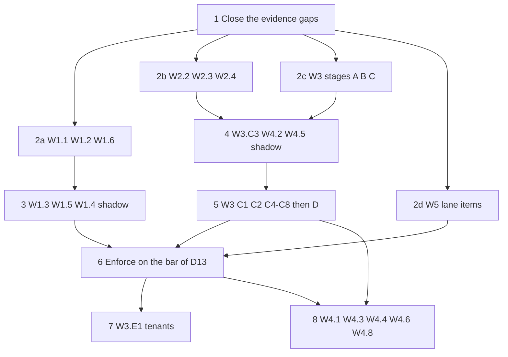

# Plan: harden the host, resume, fleet and self-edit edges of the loop, and run the wave concurrency stages beside them

- **Status:** proposed, 2026-11-27.
- **Design:** [harness-edge-contracts](../architecture/harness-edge-contracts.md). **Decision:** [ADR-0170](../architecture/adr/0170-the-loop-keeps-the-llm-at-the-leaves-and-hardens-its-host-resume-fleet-and-self-edit-edges.md). **Research:** [oss-harness-architectures-2026-11](../research/oss-harness-architectures-2026-11.md).
- This plan builds on [harness-practices-2026-11](harness-practices-2026-11.md) and [harness-self-improvement-2026-11](harness-self-improvement-2026-11.md). The merge-train concurrency dossier is in open PR #1847, `docs/research/merge-train-lane-concurrency-2026-11.md`. It is not on this branch.

## Table of contents

1. [Request](#1-request)
2. [Facts](#2-facts)
3. [Goals and non-goals](#3-goals-and-non-goals)
4. [Candidate designs](#4-candidate-designs)
5. [Decisions](#5-decisions)
6. [Components](#6-components)
7. [Order](#7-order)
8. [Verification](#8-verification)
9. [Risks](#9-risks)
10. [Open questions](#10-open-questions)

## 1. Request

The operator asked on 2026-11-27: "Run another deep dive research to collect the popular open source harness design to learn more about their logics and architecture, record and summarize all the findings using the research skill (build one if it doesn't exist) with research report, adr, design, execution and plan following the policy defined under docs."

The operator asked next: "Rebuild the plan after we collected all research result and write the detailed report with research skill." Earlier the same day the operator asked: "Show me the plan to support concurrency on both cycles in the loop and between waves."

This plan has two parts. Workstream W3 is the execution of the concurrency plan of that day, merged with the fleet findings. Workstreams W1, W2, W4 and W5 are the new work that the research found.

## 2. Facts

| Fact | Research id |
|---|---|
| The production routing chain of the scout phase starts on `claude-tmux`. Headless manifests exist for each family. | F1.1 |
| The stream-json driver of `claude-p` exists. | F1.2 |
| The run lease has three fields, a 10-minute TTL, no resource and no generation. | F1.3 |
| `wave next` refuses with `loop_live` while any run is live. | F1.4 |
| Only audit verdicts have a content-addressed reuse store. | F1.5 |
| agy reads project `.agents/skills/`. | F1.6 |
| Each of the four guards falls back to the tracked `go/evolve`. A guard fails open if both binaries are missing, or if it exits with a code other than 0 and 2. | F1.7 |
| The observer reads the pane through regexes. | F1.8 |
| No graph, contract or policy hash exists in `go/internal`. | F1.9 |
| Four of six runtimes implement ACP, and each runtime has a typed event stream. | P2.4 |
| The OpenHands gain came from the removal of a process boundary. | P3.5 |
| No fleet tool has a hash-chained ledger. | P4.3 |
| A DGM node removed the markers of a detector that was visible to it. | P5.4 |

Measured baselines of the concurrency work (source: `evolve wave status` of wave 191 on 2026-11-27, and the PR #1847 dossier):

| Measure | Now | Source |
|---|---|---|
| Wave width | 1 of 5 (0.20) | `evolve wave status`, wave 191, 2026-11-27 |
| Underfill from admission | 79 of 176 events in 13 days, 75 of them `family_held` | PR #1847 dossier F4.5 |
| Main moves | about 35 a day; 11 of 100 CI runs red | PR #1847 dossier F4.7 and F4.8 |
| Ship recoveries | 46, in 29 of 53 cycles | PR #1847 dossier F4.9 |
| Second wave | refused with `loop_live` | `go/cmd/evolve/cmd_wave_next.go:222-226` |
| Maintenance during a wave | About 20 verbs refuse while a run is live. A grep of `go/` on 2026-11-27 finds 16 direct non-test calls of `runlease.LiveRuns`. With `runlease.LiveOwner` and two wrappers, it finds 28. | `go/internal/runlease/runlease.go:127` |

## 3. Goals and non-goals

**Goals.**

1. Replace pane inference with typed host events, and keep tmux as a typed fallback (W1).
2. Make a resume check the graph, the contract and the policy. Never re-run a finished phase (W2).
3. Raise the wave width from 0.20 to above 0.60, and start a second wave in under 1 minute (W3).
4. Run each pipeline self-edit on a verified-good build, with the evaluators out of the builder's reach (W4).
5. Render the knowledge layer for each host from data, and make the guards fail closed (W5).

**Non-goals.**

- No second loop driver. Waves become tenants of one driver (WC6).
- No LLM supervisor. No LLM starts or directs another (A23).
- No feature flag. Each move uses a stage in policy data.
- No Codex app-server, because the operator has no Codex subscription (A7).
- No event-sourced rewrite and no new store (A14).

## 4. Candidate designs

Scores run from 1 (poor) to 5 (strong). On risk, 5 means low risk to the running loop.

| Criterion | 1. Edges first | 2. Concurrency first | 3. Big rewrite | 4. Combined order |
|---|---|---|---|---|
| C1 Closes the measured width and underfill baselines | 2 | 5 | 3 | 5 |
| C2 Closes the edge gaps F1.1, F1.7, F1.8 and F1.9 | 5 | 2 | 4 | 4 |
| C3 Risk to the running loop | 4 | 3 | 1 | 4 |
| C4 Fit to the hard rules | 5 | 5 | 2 | 5 |
| C5 Time to the first measured signal | 4 | 3 | 1 | 4 |
| C6 Strength of the evidence | 3 | 4 | 2 | 4 |
| **Total (of 30)** | **23** | **22** | **13** | **26** |

**Design 1, edges first.** Typed host events and a structured transport first, then durable resume, scoped leases, self-edit safety and the knowledge layer, in one sequence. It closes the edge gaps. It leaves the width at 0.20 for the length of the sequence.

**Design 2, concurrency first.** The wave stages A to E first, the bridge later. It acts on the measured baselines at once. Stage C pins builds (WC3), and a pin needs the identity hash of A9 (synthesis, A9 reason). Without the hash, a pinned build can resume against a changed graph.

**Design 3, big rewrite.** An event-sourced runtime in the style of OpenHands V1 replaces the state machine. The OpenHands gain of 61% came from the removal of a process boundary between the controller and its executor, and from immutable configuration (P3.5). Evolve-loop has one controller and no such boundary. A rewrite also discards the hash-chained ledger, which no fleet tool has (P4.3). Design 3 has the lowest score on risk, time to signal and rule fit.

**Design 4, combined order.** Stages A to C of W3 run in parallel with the shadow of W1. They touch different packages. Admission, the lease and the train are on one side. The bridge and its manifests are on the other. W2 starts at the same time and must reach shadow before W3 stage C moves to enforce. 

Design 4 wins because it keeps the lanes busy during the edge work. It also respects the one dependency that design 2 ignores: the identity hash before the pinned build.

The condition that changes this choice: the shadow of W1 shows that `claude-p` loses the quota-pause signal (F1.8). Then W1 stops at the typed tmux failures (A6), and the plan keeps the other workstreams.

## 5. Decisions

| Id | Decision | Research id |
|---|---|---|
| D1 | Define one typed event and failure vocabulary. Every transport feeds the failure adapter with it. | A3, P2.4, F1.8 |
| D2 | Put `claude-p` first in the routing data of one phase as a shadow beside tmux. The operator rules on this (Q5). | A1, F1.1, F1.2 |
| D3 | Record the CLI session id in the ledger entry of the phase. | A4, P4.6 |
| D4 | Declare the approval mode and the sandbox mode in each manifest. | A5, P2.3 |
| D5 | Keep tmux as the fallback link, with typed failures. | A6, P4.6 |
| D6 | Treat each phase as one durable unit. A resume never re-runs a finished CLI phase. | A8, P3.2, F1.5 |
| D7 | Write the graph hash, the contract hash and the policy snapshot hash in the first record of a cycle. A resume refuses on a mismatch. | A9, A12, F1.9 |
| D8 | Mark a start with no end as `outcome_unknown`. Finish the reconcile before new admission. | A10, A22, P4.3 |
| D9 | Make the item claim a lease with a generation number. Add the head-SHA compare-and-swap to the merge. | A15, A18, P4.2, P4.5 |
| D10 | Add a breaker at 3 failures, stale-base admission and spawn pacing. | A16, A17, A21, P4.2 |
| D11 | Declare a stall only when two signals agree. Park an operator wait as `blocked`. | A19, A20, P4.4 |
| D12 | Run a pipeline self-edit on a pinned verified-good build. Mount evaluators read-only. | A25, A26, P5.4 |
| D13 | Use one bar for each stage move: one changed axis, at least two matched pairs and a reported interval. | A27, P5.3 |
| D14 | Smoke-test a new build before it becomes Current, and roll back on failure. | A28, P5.4 |
| D15 | Describe each host as profile data, with a byte budget and a frontmatter allowlist. | A33, A34, A35, P6.3 |
| D16 | Add `onFailure: block` to the four guards. The operator rules on this (Q6). | A36, F1.7, P6.2 |
| D17 | Keep the ledger and the state machine. Reject an event-sourced rewrite. | A14, P3.5 |
| D18 | Reject LLM supervisors, force-accept, never-stop loops and environment switches. | A23, A32, A41 |

## 6. Components

Each component moves shadow first, then enforce, on the bar of D13. A component that changes the loop driver, admission, the lease, the gates, the guards or `.claude/settings.json` is console work.

### W1: bridge host protocols

| Id | Component | Red test first | Owner |
|---|---|---|---|
| W1.1 | Typed event and failure vocabulary, with the parser for the `claude-p` stream | A fixture of recorded stream-json lines must map to the named events. An unknown line must map to `unclassified`. | lane |
| W1.2 | Approval mode and sandbox mode fields in each manifest (A5) | A manifest without the fields must fail the manifest schema test. | lane |
| W1.3 | Failure adapter reads typed events at shadow (A3) | A `turn failed` event with a process class must give the same verdict as the pane regex on a recorded pair. | console |
| W1.4 | `claude-p` first for one phase, as a shadow (A1) | The shadow record must hold one typed outcome and one tmux outcome for the same cycle. | console, operator Q5 |
| W1.5 | CLI session id in the phase ledger entry (A4) | A resume with the id must pass `--resume` and must not need a pane. | console |
| W1.6 | Typed failures for the tmux fallback: input box occupied, message not accepted (A6) | A pane that holds a draft must raise the typed failure. | lane |
| W1.7 | Probe agy for ACP or a JSON mode, and record the result (A2) | The probe record must name the mode or state that none exists. | lane |

### W2: durable cycle state and resume

| Id | Component | Red test first | Owner |
|---|---|---|---|
| W2.1 | Phase output as a durable unit, keyed by its inputs (A8) | A resume after a finished phase must not start the CLI. | console |
| W2.2 | Graph hash, contract hash and policy snapshot hash in the first record (A9, A12) | `cycle resume` on a changed graph hash must refuse. | console |
| W2.3 | `outcome_unknown` for a start with no end (A10) | A ledger with a start and no end must give `outcome_unknown` on restart. | console |
| W2.4 | One ledger record for each transition, with its cause (A11) | A transition with no cause must fail the ledger verify. | console |
| W2.5 | Audit-fail retry as a child record from the pre-build barrier (A13) | The failed run must stay readable after the retry. | console |

### W3: fleet control and wave concurrency

The stages follow the concurrency plan of 2026-11-27. A, B and C run in parallel. D needs A. E needs B, C and D.

| Id | Component | Red test first | Owner |
|---|---|---|---|
| W3.A1 | R2a `train-production-promoter` (in flight, wave 191 cycle 2658) | The train must promote a composed batch in the journey test. | lane |
| W3.A2 | R2b `train-rollout-gate-and-enforce-journey` | The journey must fail when the rollout gate is red. | console |
| W3.A3 | R2c flip `fleet.integration.stage` to `enforce` | The stage read must give `enforce` after the gate passes. | console, operator Q2 |
| W3.B1 | R1 focus mode: head items first, other admissible items fill free lanes | A free lane must start an admissible item when a head item holds a lane. | console, operator Q1 |
| W3.B2 | R3 the id-family rule leaves admission; siblings compose in one batch | Two siblings must share one batch. | console |
| W3.B3 | R4 a package cell holds only an edit of the same file | Two edits of one package in different files must run together. | console |
| W3.B4 | WC5 footprint against the real diff at ship, with an aging reservation; A17 stale-base wait | A footprint mismatch must re-enter admission and must not abort. A stale base must not charge the breaker. | console |
| W3.B5 | R5 batch cap, `MaxCap` and max age as `policy.json` data, with AIMD | A green batch must raise the cap by 1. A red batch must halve it. | console |
| W3.B6 | R6 lane gates on changed packages and importers; full suite once for each batch | A lane must run only the changed packages and their importers. | console |
| W3.B7 | R7 lanes build protected-surface items with a console batch review | A protected-surface item in a lane must wait for the batch review. | console, operator Q3 |
| W3.C1 | WC1 resource-scoped leases (worktree, binary, CLI, main, inbox) with a mode; A15 item claim as `inbox/<id>` | A claim of a claimed item must return `ErrAlreadyClaimed`. A shared lease must not block a shared lease. | console |
| W3.C2 | WC2 generation numbers on inbox, ledger and main writes; A18 head-SHA compare-and-swap | A write with a stale generation must fail. A merge with a moved head must refuse. | console |
| W3.C3 | WC3 immutable build paths, pinned for each run, with a drain | A run must keep its build when a newer build lands. A drained build must be deleted. | console |
| W3.C4 | A16 dispatch breaker at 3 failures, with the counter in a scheduling record | The third failure must quarantine the item and route it to the console. | console |
| W3.C5 | A19 liveness from two signals and a mass-death breaker | One silent signal must not give a stall. Half of the lanes silent at once must give a host fault. | console |
| W3.C6 | A20 `blocked` lane state | A lane that waits for the operator must not retry. | console |
| W3.C7 | A21 spawn pacing | Five lane starts in one tick must start one lane and queue the rest. | console |
| W3.C8 | A22 restart reconcile before new admission | After a restart, the reconcile must finish before the first admission. | console |
| W3.D1 | WC4 speculative prefix: test batch k+1 on top of k, depth 2 | A red batch k must discard batch k+1. | console, operator Q4 |
| W3.D2 | A18 conflict as a new inbox item, with a retry cap of 5 | The sixth conflict must escalate. | console |
| W3.E1 | WC6 waves as tenants of one driver | `wave next` must enqueue a tenant and must not refuse with `loop_live`. | console |

### W4: self-improvement safety

| Id | Component | Red test first | Owner |
|---|---|---|---|
| W4.1 | Archive of verified-good builds as rollback targets (A24) | The archive must list the last verified build. | console |
| W4.2 | Pinned last-good build for a cycle that edits pipeline code (A25) | A cycle with a pipeline footprint must run its gates on the pinned build. | console |
| W4.3 | Gate code, baselines and evaluator data read-only in the builder sandbox (A26) | A builder write to gate code must fail. | console |
| W4.4 | The promotion bar as data: one axis, two matched pairs, an interval (A27) | One green cycle must give `insufficient_evidence`. | console |
| W4.5 | Smoke test and rollback of a new build (A28) | A failed smoke test must keep the old pointer. | console |
| W4.6 | Verdict bound to the eval revision; amendment record (A29) | A verdict for an old eval revision must not be reused. | console |
| W4.7 | Symptom classifier that feeds the retrospective inbox item (A30) | An empty patch must map to its symptom class. | lane |
| W4.8 | Net deleted lines as a tie-break between equal verdicts (A31) | Two equal verdicts must rank the smaller diff first. | console |

### W5: the knowledge layer

| Id | Component | Red test first | Owner |
|---|---|---|---|
| W5.1 | Host profile data: skill root, frontmatter allowlist, description limit (A33) | A description over the limit must fail the render. | lane |
| W5.2 | Render to `.agents/skills` with the allowlist (A34) | A vendor key must not reach a profile that forbids it. | lane |
| W5.3 | Byte budget for each host in `skills check` (A35) | A neutral source over the budget must fail the check. | lane |
| W5.4 | `onFailure: block` on the four guard entries (A36) | A guard that exits with code 1 must block the action. | operator: gate config |
| W5.5 | Guard spec render for agy, advisory (A37) | The render must be byte-stable on a second run. | console |
| W5.6 | Free deterministic routing check (A38) | A near-collision of two descriptions must fail the check. | lane |
| W5.7 | Contract Stop hook that blocks once (A39) | A seat with a missing artifact must get one block. | console |
| W5.8 | Paid bootstrap conformance verb for Claude Code and agy (A40) | One named prompt must trigger one named skill. | lane |

## 7. Order

Each phase moves its components shadow first, then enforce.

1. **Close the evidence gaps (W1.7, the check of F1.9, the trace of the tmux preference).** These cost little and decide W1.4 and W2.2. They have no dependency.
2. **Start four streams in parallel.** They touch different packages.
   - W1.1, W1.2 and W1.6 (bridge).
   - W2.2, W2.3 and W2.4 (ledger and resume).
   - W3 stages A, B and C (admission, lease and train), starting with W3.A1 in flight.
   - W5.1, W5.2, W5.3 and W5.6 (skills and rendering).
3. **Run W1.3, W1.5 and W1.4 at shadow.** They need W1.1. W1.4 needs the operator answer Q5. The shadow collects at least two matched pairs on one axis.
4. **Run W3.C3 at shadow with W4.2 and W4.5.** WC3 needs W2.2, because a pinned build must check the graph hash at a resume.
5. **Run W3.C1, W3.C2, W3.C4 to W3.C8 at shadow, then W3.D1 and W3.D2.** Stage D needs stage A. W3.C8 needs W2.3.
6. **Move each component to enforce on the bar of D13.** Follow the enforce order of the concurrency plan:
   - `gc`;
   - the CLI update of an idle CLI;
   - the boundary log;
   - sync-main and inbox, after WC2.
7. **Run W3.E1.** Stage E needs B, C and D.
8. **Run W4.1, W4.3, W4.4, W4.6 and W4.8 after W3.C3.** W4.1 uses the content-addressed builds. W4.3 and W4.4 move to enforce last, because they change what a builder can write.

## 8. Verification

The bar of every stage move is D13. A single green cycle is `insufficient_evidence`.

| Goal | Baseline and source | Target |
|---|---|---|
| Wave width | 0.20 (`evolve wave status`, wave 191, 2026-11-27) | above 0.60 |
| `family_held` underfill | 75 of 176 events in 13 days (PR #1847 dossier F4.5) | near 0 |
| Main moves a day | about 35 (PR #1847 dossier F4.7) | about 10, in batches |
| Maintenance verbs refused by `loop_live` | about 20 verbs (from the 28 lease checks of section 2) | 0 |
| Second wave start | refused (`cmd_wave_next.go:222-226`) | under 1 minute |
| Phase failures classified from typed events (W1) | not measured; the first measure comes from step 1 and step 3 | the target comes from the shadow interval; the plan sets no number before the baseline |
| A resume on a changed graph (W2) | cannot refuse; no hash (F1.9) | refuses in 100% of the test cases |
| Finished phases re-run on resume (W2) | not measured | 0 |
| Builder writes to gate code (W4) | not measured | 0 |
| Guard entries with `onFailure: block` (W5) | 0 of 4 (`.claude/settings.json:10,19,28,37`) | 4 of 4 |

The plan sets no W1 number before the baseline exists, because an invented target has no source.

## 9. Risks

| Risk | Control |
|---|---|
| `claude-p` loses the quota-pause or login signal that the pane gives (F1.8). | The shadow record covers those signals. W1.4 stops if a signal is lost. |
| Stages A to C and W1 collide in one package. | Step 2 splits the streams by package. The footprint admission checks it. |
| A pinned build reads a state format that a newer build changed (WC3). | State formats stay readable by both builds (expand and contract). W2.2 refuses a changed graph. |
| A read-only evaluator mount blocks a legitimate builder write. | W4.3 reads the protected-surface manifest. The shadow reports each blocked write before enforce. |
| The `onFailure` key blocks all guarded actions when a guard has a defect. | Q6 goes to the operator. The shadow of W5.4 runs the guards on a recorded session first. |
| Speculative prefix testing raises CI cost (WC4). | The depth starts at 2. The window halves on a failure. |
| A second driver appears through WC6. | Non-goal. `wave next` enqueues a tenant of the one driver. |

## 10. Open questions

The operator owns Q1 to Q6.

- **Q1.** Use focus mode with backfill (R1) instead of `--only`?
- **Q2.** Flip the train to enforce after R2b passes?
- **Q3.** Let lanes build protected-surface items with a console batch review (R7)?
- **Q4.** Allow merges inside a wave as tested batches (WC4)?
- **Q5.** Put `claude-p` first in the routing data of one phase as a shadow (A1)? Recommended phase: the one with the lowest cost of a wrong result. The plan does not choose it.
- **Q6.** Add `onFailure: block` to the four guards (A36)? The console cannot edit gate config.

Measured fact (2026-11-27): the root `AGENTS.md` is 53,652 bytes. The Codex cap for the `AGENTS.md` chain is 32 KiB (32,768 bytes). A codex route needs `AGENTS.md` shrunk below the cap first. The host profiles of `evolve skills check` have no codex entry for this reason.

Two further questions have no owner yet. Does agy offer ACP or a JSON stream (W1.7)? Why does routing prefer tmux over `claude-p` (step 1)?
