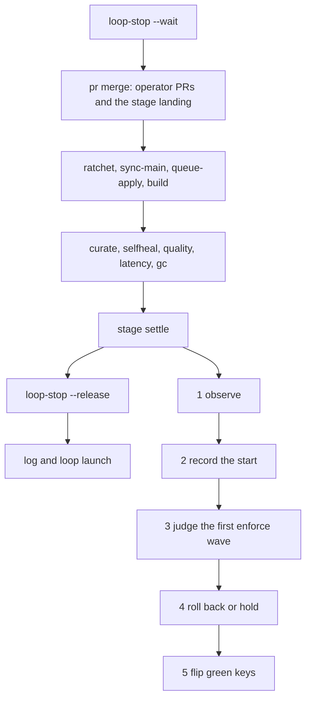

# Plan: a stage flips to enforce on its own when its verified shadow record is green (K5)

- **Status:** proposed, 2026-11-22. This file is a design. It has no code.
- **Parent plan:** [shadow-stage-evidence-2026-11](shadow-stage-evidence-2026-11.md) (component K5, rules C2 and C3). **Spec of record:** [shadow-stage-contract](../architecture/shadow-stage-contract.md) (section 6 and section 10.3). **Decision:** [ADR-0167](../architecture/adr/0167-shadow-stages-prove-themselves-on-chained-evidence.md). **Research:** [shadow-stage-evidence-2026-11](../research/shadow-stage-evidence-2026-11.md).
- **Sibling design:** the K2 and K4 plan (PR #1674, file `plans/shadow-contract-k2-k4-2026-11.md`) sets the evidence seal, the flip and genesis records and the K4 check. This file reuses those names.
- **Home of this file:** the parent plan has one row for K5. This file holds the detail of that row. The parent plan stays the index.

## Table of contents

- [1. Request](#1-request)
- [2. Facts](#2-facts)
- [3. Goals and non-goals](#3-goals-and-non-goals)
- [4. Candidate designs](#4-candidate-designs)
- [5. Decisions](#5-decisions)
- [6. The design of K5](#6-the-design-of-k5)
- [7. Components](#7-components)
- [8. Order and rollout](#8-order-and-rollout)
- [9. Verification](#9-verification)
- [10. Risks](#10-risks)
- [11. Spec amendments](#11-spec-amendments)
- [12. Open questions](#12-open-questions)
- [Limits](#limits)

## Terms used throughout

- **Green:** the verdict of the green rule for one stage key (section 6.1). A green key has a verified chain, enough clean decisions and a wired enforce path.
- **Verified:** `evolve stage verify` read the sealed chain from the ledger and found no break. The chain is hash-chained and complete.
- **Boundary:** the work that `evolve wave next` does between two waves, in the order of `boundarySteps`. No cycle runs during it.
- **Settle step:** the new boundary step of K5. It judges the first enforce wave of each flipped key, then it flips each green key.
- **Flip record, rollback record, applied record:** three ledger entries of K5. Section 6.6 gives their fields.
- **Landing:** the change of the `stage` value in `.evolve/policy.json` on `main`. A landing is a pull request that a verb builds.
- **First enforce wave:** the first wave that launches after the landing is on `main`.
- **Compiled floor:** the number in Go code below which no policy value and no registry value can go.

## 1. Request

On 2026-11-22 the operator said: "Those green features should be enabled after shadow run".

This decision binds the design:

- K5 does not wait for an operator decision on each key.
- When the verified shadow record of a key is green against its thresholds, K5 flips that key from `shadow` to `enforce`.
- A flip happens at a wave boundary and never in the middle of a wave. Each flip has a record.
- K5 rolls the key back to `shadow` when the first enforce wave regresses.

The standing rules of the operator also bind. A flip happens only on a verified record that one verb can recompute. The enforce path must be built and wired before a flip, because PR #1459 nearly enabled a stage with no enforce path. The design adds no feature flag and reads no control value from the environment. The console must not edit a gate config to get its own change through.

## 2. Facts

| Id | Fact | Source |
|---|---|---|
| F2.1 | The spec rejects an auto-flip in decision D4: "A wrong score flips a stage with no human check". The operator decision of 2026-11-22 replaces D4. | `docs/architecture/shadow-stage-contract.md:362-364` |
| F2.2 | The spec says the chain record is the single truth, and `policy.json` is a projection of it. A record with no policy change is `flip pending`. | `docs/architecture/shadow-stage-contract.md:356-358` |
| F2.3 | `Score` sets `Ready` when `Decisions >= max(MinDecisions, 1)`, `Escapes <= MaxEscapes`, `FalseStops <= MaxFalseStops` and `Conflicts == 0`. | `go/internal/stageevidence/score.go:285-289` |
| F2.4 | No seed sets `Promotion`. The seed `entry()` builds a `Shadow` with a key, a signal, fields, a closure and a subtree only. A key with zero data is `Ready` after one clean decision. | `go/internal/gateregistry/seed_stages.go:90-105`; `go/internal/stageevidence/score.go:285` |
| F2.5 | `WindowCycles` and `MaxFalseStopPct` are declared and read nowhere. | `go/internal/gatecontract/shadow.go:44-45`; `grep -rn "WindowCycles\|MaxFalseStopPct"` over `go/` finds no other non-test use |
| F2.6 | `Shadow.Enforce` is a function field. No seed sets it. The baseline has no rule for a missing enforce branch. The rules include `no-registry-entry`, `no-signal`, `no-emit-site`, `no-would-fields`, `would-field-missing`, `signal-unregistered` and `string-typed-stage`. | `go/internal/gatecontract/shadow.go:52`; `go/internal/gateregistry/stage_conformance_test.go:22-29`; `testdata/stage_violations.json` |
| F2.7 | The test `TestEnforceBranchActsAtEnforce` is in the K1 plan. The test file on `main` does not have it. | `go/internal/gateregistry/stage_conformance_test.go` (function list); parent plan K1 row |
| F2.8 | `.evolve/policy.json` is a tracked file. It is a protected surface of class `PolicyGuarantee`. | `git ls-files .evolve/policy.json`; `go/internal/guards/integrity_surface.go:55` |
| F2.9 | A `--class cycle` commit that touches a protected path is refused. The gate classifier flags `stage-off-enforce` when a diff moves a key away from `enforce`. Both checks run for the class `cycle` only. | `go/internal/phases/ship/integrity.go:11-31`; `go/internal/phases/ship/verify.go:125-137`; `go/internal/gateclass/gateclass.go:255-265` |
| F2.10 | The class `manual` needs a commit-gate attestation. The class `release` is "pipeline-internal" and skips the audit. `ship` accepts four classes. | `go/internal/phases/ship/verify.go:139-162`; `go/internal/phases/ship/native.go:26-36` |
| F2.11 | The prefix `chore` has `any_path: true`. The prefix regex accepts a scope. A `chore:` commit of one policy file passes the prefix gate with no edit of the manifest. | `.evolve/commit-prefix-scope.json` (`prefixes.chore`); `go/internal/commitprefixgate/commitprefixgate.go:68` |
| F2.12 | `boundaryHaltSteps` ends with `gc`. `boundaryLaunchSteps` starts with `loop-stop --release`. `wave next` builds its list in `waveSteps`, which wraps `boundaryHaltSteps` with `checkpoint save` before and `reset-sha` and `doctor live` after. A failed step with `advisory: true` does not stop the boundary. A failed step without it stops the boundary before the launch. | `go/cmd/evolve/cmd_boundary.go:224-240`; `go/cmd/evolve/cmd_boundary.go:246-262`; `go/cmd/evolve/cmd_boundary.go:265-280`; `go/cmd/evolve/cmd_wave_compose.go:118-131`; `go/cmd/evolve/cmd_wave_next.go:312-319` |
| F2.13 | The boundary builds the binary (`make build`) before it runs the later steps. The decision version reads the source on disk. | `go/cmd/evolve/cmd_boundary.go:216-218,232`; `go/cmd/evolve/cmd_stage.go:91` |
| F2.14 | The Go code loads the policy at 104 call sites in 96 files, through `policy.Load` or `policy.LoadOrDefaults`. | `grep -rn "policy.LoadOrDefaults\|policy.Load("` over `go/`, 2026-11-22 |
| F2.15 | `wavehealth.Evaluate` returns one of three outcomes, `CONTINUE`, `BRAKE` and `FIX-LOCAL`. `wave checkin` reads `Started` and `Shipped` of the wave and the abnormal cycle events. | `go/internal/wavehealth/types.go:11-16`; `go/cmd/evolve/cmd_wave_checkin.go:99-117` |
| F2.16 | A test pins four checked-in keys at `enforce`: `catalog.refresh_stage`, `comment_floor.stage`, `retrospectives.stage` and `fleet.orchestrator.admission`. A rollback of one of them turns this test red. | `go/internal/policy/stage_flips_checked_in_test.go:17-26` |
| F2.17 | The review-routing plan lists a row C12 for a stage flip. It asks for the trailer `Operator-approved: <item>`. The registry `reviewclass` is a plan item. The `go/` tree has no package of that name. | `docs/plans/review-routing-2026-11.md:102`; `grep -rln reviewclass go/` returns none |
| F2.18 | `evolve ship --pr` opens the pull request of a pushed feature branch, and only for the class `manual`. `evolve pr refresh` builds a derived worktree for a branch. | `go/cmd/evolve/cmd_ship_pr.go:30-41,115-141`; `go/cmd/evolve/cmd_pr.go:10-13` |
| F2.19 | The K2 and K4 plan sets the flip and genesis records as plain `FileLedger.Append` entries. It sets the pure `Check(effective, flipRecords, genesis, genesisRequired)`. The `origin` is `verified` for a K5 flip. | `plans/shadow-contract-k2-k4-2026-11.md` sections 7.3 to 7.5 (PR #1674) |
| F2.20 | The chain reader on the ledger is `FileLedger.StageChain().ReadChain`. It reads the seal entries, then each stored copy. PR #1682 holds it with the seal wiring (K2b to K2e). | `go/internal/adapters/ledger/stage_evidence.go:114-135` (worktree `dev/cl-k2b`) |
| F2.21 | Outside practice: a progressive-delivery tool, for example Flagger, promotes a canary on metric thresholds and rolls it back after a set count of failed checks. A threshold that is too strict gives rollbacks that no fault caused. Source: [Flagger rollback guide](https://oneuptime.com/blog/post/2026-03-13-how-to-implement-automated-rollback-based-on-error-rate-with-flagger/view), a secondary source. | web search, 2026-11-22 |
| F2.22 | A run of n clean trials gives an upper 95% bound of about 3/n for the true rate of the fault (the "rule of three"). 30 clean decisions give about 10%. 150 give about 2%. Source: [rule of three](https://en.wikipedia.org/wiki/Rule_of_three_(statistics)). | web search, 2026-11-22 |
| F2.23 | The step `pr merge` exists only when the operator passes `--merge`. The plan holds the full step list before any step runs. | `go/cmd/evolve/cmd_boundary.go:227-228`; `go/cmd/evolve/cmd_wave_compose.go:18-41`; `go/cmd/evolve/cmd_wave_next.go:312-313` |
| F2.24 | `DecisionVersion` hashes the policy subtree of the key. The subtree is the parent of the `stage` leaf, so the `stage` value is in the hash. | `go/internal/stageevidence/version.go:31-53`; `go/internal/gateregistry/seed_stages.go:93,107` |
| F2.25 | `evolve stage verify` exits 0 when `res.Ready` is true. It prints `ready` and `stage report` prints `ready`. | `go/cmd/evolve/cmd_stage.go:144,152,219` |

*Implication of F2.25:* `Ready` has two readers today, the exit code and the report column. K5 must change the one source of `Ready`, and it must add no second field.

*Implication of F2.24:* a flip changes the policy subtree of its key, so the version changes at once. K5 must keep the stage leaf out of the version.

*Implication of F2.3 and F2.4:* the scorer alone is not a green rule. With zero data in the registry, one decision flips a key. K5 needs a compiled floor.

*Implication of F2.6 and F2.7:* no key has a proof that its enforce path is wired. K5 must add the proof before the first flip. This is the case of PR #1459.

*Implication of F2.8 and F2.9:* a cycle cannot ship a flip, and a hand edit by the console is the act that the classifier denies. A flip needs its own authorization path (section 6.3).

*Implication of F2.12:* a settle step that fails must not stop the launch. A flip that cannot land never blocks a wave.

*Implication of F2.14:* an overlay on the policy at load time cannot reach all readers. Candidate B in section 4.1 depends on this.

## 3. Goals and non-goals

| Goal | Measure |
|---|---|
| G1 A green key flips with no operator step. | A fixture key with a green chain flips through `evolve wave next` with no flag and no approval, in a test. |
| G2 A flip needs a verified record that one verb recomputes. | `evolve stage verify <key> --as-of <seq>` gives the counts and the digest of the flip record. A mismatch fails a named test. |
| G3 A flip never happens in the middle of a wave. | The verb refuses while a wave is live. The test drives the real verb with a live wave. |
| G4 A key with no wired enforce path is never flipped. | The test of the #1459 case: a key with `Enforce` nil and a green chain gets refusal `no-enforce-path`. |
| G5 A regression in the first enforce wave returns the key to `shadow` with a record. | A fixture wave with an escape gives a rollback record and a rollback landing. |
| G6 No human edit of a gate config is needed. | The landing is built by a verb, and the ship class verifies that the diff is a function of ledger records (section 6.3). |
| G7 K5 never refuses a live key. | `TestHeadPolicyAccepted` of K4 passes with the K5 records. |

Non-goals:

- This design does not set the final `MinDecisions` of each key. Q5 of the K2 and K4 plan stays open, and the first scorer run proposes values. The compiled floor holds until then.
- This design does not build an emitter for a key with no signal. Each key has its own emitter item.
- This design does not roll back a grandfathered key by itself (Q2).
- This design does not defend against a party that rewrites the ledger and the stored copies together (limit of ADR-0167).

## 4. Candidate designs

Each criterion scores 1 (poor) to 5 (good). A higher total is better. The scores are synthesis from the facts above.

### 4.1 Axis 1: how a flip becomes the effective stage

| Candidate | Description |
|---|---|
| A | Boundary auto-flip with a policy pull request. A verb writes the flip record, then builds the policy change and ships it in a pull request. The boundary merges it. |
| B | A pipeline-owned stage ledger that overrides `policy.json`. The effective stage is the policy value, raised or lowered by the latest record. No pull request. |
| C | Operator-approved flips with a generated decision list. The verb prints the green keys. The operator approves each one. |
| D | The boundary writes `policy.json` in the main tree and commits it to `main` with no pull request. |

| Criterion | A | B | C | D | Reason |
|---|---|---|---|---|---|
| Follows the operator decision (no wait per key) | 5 | 5 | 1 | 5 | C waits for the operator on each key. The decision of 2026-11-22 forbids it (F2.1). |
| Authorization without a human edit | 4 | 5 | 5 | 1 | A has a typed ship class that verifies the diff (section 6.3). D skips the pull request and the CI. |
| The policy file shows the real stage | 5 | 2 | 5 | 5 | In B, `policy.json` says `shadow` while the code runs `enforce`. The spec says policy is a projection of the record (F2.2). |
| Every reader sees the stage | 5 | 1 | 5 | 5 | B needs one load seam. The code has 104 call sites (F2.14). |
| Speed of a rollback | 3 | 5 | 3 | 4 | A needs a landing, so a rollback takes one boundary. B is immediate in theory. |
| Change size | 3 | 1 | 4 | 4 | B changes the load path of the policy for all readers. |
| Failure modes | 4 | 2 | 4 | 1 | D bypasses CI and the protection of `main`. B hides the state from every tool that reads the file. |
| **Total** | **29** | **21** | **27** | **25** | |

**A wins.** C has the second score, but it breaks the binding operator decision, so C is not eligible. B has the best authorization story and the worst reach. B needs one seam for 104 readers. D skips the gates that protect `main`.

### 4.2 Axis 2: the form of the green rule

| Candidate | Description |
|---|---|
| R1 | Fixed counts with zero defects. Green when decisions and scopes reach a floor and the three defect classes are zero. |
| R2 | An upper confidence bound. Green when 3/n is below a target rate for each key. |
| R3 | A sequential test that stops when the evidence is enough. |

| Criterion | R1 | R2 | R3 | Reason |
|---|---|---|---|---|
| A reader can recompute it by hand | 5 | 4 | 2 | R3 needs a model of the data. |
| Fits the existing `Promotion` data | 5 | 3 | 1 | R1 uses the fields that exist. R2 adds a rate. |
| Defends against few, correlated decisions | 3 | 3 | 4 | One cycle can hold many decisions. R1 adds a floor on scopes to cover it. |
| Change size | 5 | 4 | 1 | |
| **Total** | **18** | **14** | **8** | |

**R1 wins.** R2 is the reason for the floor value: n decisions with no defect bound the true rate at about 3/n (F2.22). The compiled floor of 30 gives about 10%, and a key can raise it by data.

## 5. Decisions

| Id | Decision | Because | Rejected options and why |
|---|---|---|---|
| D1 | A key flips on its own at a boundary when it is green. The decision D4 of the spec is replaced. | F2.1 and the operator decision of 2026-11-22. | C: a wait per key. |
| D2 | The design is candidate A. A verb builds the policy change. A typed ship class `stage-flip` verifies it. | Section 4.1: score 29. F2.8 and F2.9. | B: 104 readers (F2.14). D: no CI and no protection. |
| D3 | The green rule is R1 with a compiled floor. The effective threshold of a key is the strictest of the compiled floor, the registry value and the policy value. A minimum is strict when it is high. A maximum is strict when it is low. A policy value can tighten a threshold and never loosen it. | F2.3 to F2.5, F2.22. | A policy value that can lower a threshold: a policy edit then weakens the proof with no review. |
| D4 | `Judge` is the only place that sets `Result.Ready`. `Score` stops computing it. The exit code and the `ready` column of `stage verify` and `stage report` come from `Judge`. | F2.3 and F2.25. | Two rules, a weak `Ready` and a strict `green`: a tool that reads `ready` then reads the weak rule. |
| D5 | A flip record stores `as_of_seq` and `version`. `evolve stage verify <key> --as-of <seq>` recomputes the counts and the chain digest from the seals up to that entry. It uses the version of the record, not the version on disk. | The operator rule: one verb recomputes the verdict. F2.24. | A record with counts only: nobody can check it later. A version from disk: it changes after any later edit. |
| D6 | The enforce path needs both registry fields, `EnforceSite` and `WiringTest`. The settle step reads `go test -json` and needs a `pass` event for that test. A control mutant must make the same test fail. | F2.6 and F2.7. | A check that `Enforce` is not nil: no seed sets it. An exit code of 0: it also holds for "no tests to run". |
| D7 | The settle step runs in `boundaryHaltSteps` after `gc` and before the launch. It is advisory, and it has a time budget from `policy.json`. At the end of the budget it stops and leaves the rest for the next boundary. | F2.12. | Run in `loop-stop --release`: it is a launch step. No budget: a slow `gh` call or test holds the boundary. |
| D8 | One landing branch, `stage-flip/landing`, holds all unlanded records of a boundary. Each settle step rebuilds it from `origin/main`. `wave next` finds its pull request at plan time, runs `evolve stage landing-check` and adds the number to the merge list. | F2.12 and F2.23. The wave never waits for CI. | One branch for each record: two branches from one base conflict, and the second merges on a moved `main`. A wait for CI in the step: the boundary blocks the wave. |
| D9 | The ship class `stage-flip` has its own diff verifier. It recomputes each flip and each rollback from the ledger and the code. It does not use the commit-gate attestation. | F2.9, F2.10. | The class `manual`: it needs a person and a review fleet for a generated line. The class `cycle`: protected paths are refused. A verifier that trusts the record: a forged ledger entry then turns off a gate. |
| D10 | The commit uses the prefix `chore`. No edit of the prefix manifest. | F2.11. | A new prefix: it edits a gate config. |
| D11 | A rollback uses the same path. Its commit carries the trailer `Gate-change: stage-off-enforce <seq>`. | F2.9. | A rollback with no trailer: the history then hides a gate that moved down. |
| D12 | The first enforce wave is the wave that launches at the boundary where the settle step first sees the new stage in the policy. The watch lasts up to three waves. It ends at the first wave that has enough acted decisions and no regression. | The step must name the wave that it judges. A small wave gives noise (F2.21). | A watch of one wave: a rollback on small n. The merge time of the pull request: no cheap source has it. |
| D13 | A rollback happens on an escape, a conflict, a high stop rate or a `BRAKE` that names the key signal. Section 6.5 has the exact rules. | F2.15. | Any `BRAKE`: a full disk then rolls back a good stage. |
| D14 | A key with two rollbacks is `parked`. It leaves the auto flip until its decision version changes. The version does not hash the `stage` leaf or the K5 values. | The rule "blocked more than 3 times: redesign". F2.24. | A human unpark: it adds a wait per key. A version that hashes the stage leaf: the rollback landing itself unparks the key. |
| D15 | `stage_flip.stage` is a stage key of the registry. At `shadow` the settle step writes one decision record for each key in the scope `boundary:<wave>` and a signal. It writes no flip record and no landing. The console runs `evolve stage flip stage_flip.stage` when that key is green. | The feature flips by the same rule and the same verb as every other key. No feature flag. A step that acts on its own key only is a fork in one verb. | A flag in the environment: banned. Self-flip at `shadow`: the shadow stage then acts. |
| D16 | The policy package imports neither the ledger nor the scorers. The composition root passes the records to the check, as in K4. | K5 item acceptance and spec section 6.3. | A load-time check in `policy`. |
| D17 | `Check` takes a typed set of stage records (flip, rollback, applied and genesis) and `currentWave`. An applied record ends the pending state of its record. A policy that disagrees with an applied record is `stage-drift`, and the loop refuses. | The fail-closed goal of K4. A stale branch or a hand edit must not re-enable or weaken a key. | A `Check` that reads flip records only: a landed rollback is then easy to undo. |

## 6. The design of K5

### 6.1 The green rule

A key is green when `Judge(result, rule)` returns no reason. The inputs are the fields of `stageevidence.Result` (`score.go:115-132`) and the rule of the key.

| Condition | Result field | Default of the rule | Direction of a policy value |
|---|---|---|---|
| The chain verifies | `Error == ""` | required | none |
| Enough decisions in the current version | `Decisions` | at least 30 (compiled floor) | can raise |
| Enough distinct scopes | `Scopes` (new) | at least 5 | can raise |
| No false stop | `FalseStops` | 0 | none |
| No escape | `Escapes` | 0 | none |
| No conflict | `Conflicts` | 0 | none |
| No late record | `len(Late)` | 0 | none |
| Few incomplete scopes | `IncompleteCycles` over scopes with the key | at most 25% | can lower |
| The enforce path is wired | section 6.4 | required | none |
| The key is not parked | section 6.5 | required | none |

The numbers 30, 5 and 25% are estimates. The method is the rule of three (F2.22): 30 clean decisions bound the true fault rate at about 10%. A policy value can raise the first two and lower the third. The ratchet of the K4 file holds the three compiled values and their direction.

The registry `Promotion` of a key keeps the meaning of the spec (section 4.2). `MaxEscapes` and `MaxFalseStops` can only fall, so zero is the floor and the green rule fixes them at zero. `MinDecisions` can only rise. The effective value is the strictest of the compiled floor, the registry value and the policy value.

`Score` needs three small changes. They have red tests in K5a:

- `Result.Scopes` counts the distinct scopes that hold a counted decision.
- `Result.WouldStops` counts the counted decisions with `would_stop` true. The flip record keeps it, and the rollback reads it.
- `Score` takes an `AfterID`. Only a scope with an id above the last rollback of the key counts after a rollback.

*Verified* means that `Verify` ran `VerifyChain` and the ledger reader checked the ledger, the seals and the stored copies first (K2 plan, section 6.5). A broken ledger gives `ledger-broken`. A broken chain gives `broken-chain`. Neither is green.

`Judge` is the one home of the rule (D4). Its signature is `Judge(Result, Rule, Proof, KeyState)`. `Proof` is the outcome of the wiring test and the control mutant. `KeyState` comes from the state function of K5c (section 6.6).

The read verbs `stage verify` and `stage report` run no subprocess. They give `Judge` the stored proof of the latest flip record for the same version, or `static` when none exists. `static` means that both registry fields exist.

The verbs `flip`, `settle` and `landing-check` run the proof fresh. A key that the read verbs call `ready` can fail only on the fresh proof. No other rule differs. `Score` no longer sets `Result.Ready`. `Verify` sets it from `Judge` and fills a new `Result.Reasons` list. The exit code and the `ready` column of `stage verify` and `stage report` follow it, so no tool reads a second, weaker rule (F2.25).

`--as-of <seq>` stops the reader at the seal entries with a ledger sequence up to `<seq>`. It uses the `version` of the record. The flip record stores `as_of_seq`, `version` and the counts. A later run of the verb must print the same counts and the same chain digest.

`DecisionVersion` must not hash the `stage` leaf or the K5 values of `policy.json` (D14, F2.24). K5a excludes them. The decision then keeps its version across a flip, a rollback and a threshold change.

### 6.2 Where the flip runs

The step sits in `boundaryHaltSteps` after `gc` (`cmd_boundary.go:239`). The launch steps follow it. `loop-stop --wait` has stopped the loop by then, so no cycle writes evidence.

The step runs `evolve stage settle --boundary --project-root <root>`. It does five things in this order:

1. **Observe.** Read the effective stage of each key with a flip or rollback record (`policy.EffectiveStages()`, K4a).
2. **Record the start.** When the stage equals the target and no applied record follows, write one. It names the wave that launches now (D12).
3. **Judge the first enforce wave.** Run the rollback rules (section 6.5) for each key whose applied wave is below the current wave.
4. **Roll back or hold.** A regression writes the rollback record. A clean watch writes `stage-applied` with `verdict: held`. This ends the watch.
5. **Flip.** Run `Judge` for each key at `shadow` with no pending record. A green key gets a flip record.

The step seals the scope `boundary:<wave>` with its own decisions before the landing work, and again on each exit path. The budget cannot cut the seal. The scope kind `boundary` is new, and the step owns the seal. Then the step rebuilds the landing branch for all unlanded records (section 6.3).

The step never runs while a wave is live. It uses the live-run check of `wave next` (`checkWaveIdle`, `cmd_wave_next.go:221`). It does not read the brake, because the boundary holds the brake of `loop-stop --wait` itself. If the check fails, the step exits 0 with the signal `STAGE_SETTLE_SKIPPED`. This is the rule "never in the middle of a wave" (G3).

The step is advisory. A failure prints a warning and the launch continues (`cmd_boundary.go:269-271`). K5f gives each advisory step its own reason, because the warning of `runBoundarySteps` names the latency check only. The step has a time budget, the policy value `stage_flip.settle_budget`. At the end of the budget the step stops and leaves the rest for the next boundary. The branch name makes the rebuild safe to repeat.

The landing merges at the next boundary. The settle step of boundary N writes the records and the pull request. At boundary N+1, `wave next` derives the pull request at plan time and adds it to `a.prs`. The `pr merge` step then merges it (D8). The first enforce wave is wave N+1. The delay of one wave is the price of the CI and the protection of `main`.

The existing `pr merge` step exists only when the operator passes `--merge` (`cmd_boundary.go:227-228`, `cmd_wave_compose.go:18-41`). The plan is built before any step runs (`cmd_wave_next.go:312-313`). A step of boundary N cannot add to the list of boundary N. The derivation at plan time is the wiring that D8 needs. K5f pins it with `evolve wave next --dry-run`.

### 6.3 How the policy change is authorized and committed

The classifier denies one act: the console edits a gate config to get its own change through. The flip is not that act. A verb makes it, the ledger holds its cause, and a ship class recomputes the cause from the ledger and the code. No person edits `policy.json`.

The chain of the landing:

1. `evolve stage flip <key>` runs `Judge`, the wiring test and the control mutant (section 6.4). Then it appends the flip record. The settle step calls the same code.
2. The verb builds a derived worktree on the branch `stage-flip/landing` from the tip of `origin/main` (F2.18). It uses the provisioner of `evolve pr refresh`.
3. The verb sets the `stage` of each key with an unlanded record, with the typed policy writer. It adds no other byte.
4. The verb runs `evolve ship --class stage-flip --pr` with the message `chore: stage flip <keys>` and one trailer `Stage-flip: <seq>:<record hash>` for each key.
5. A second run rebuilds the branch from the new tip of `origin/main`. A stale branch is replaced, never merged.
6. At the next boundary, `wave next` runs `evolve stage landing-check stage-flip/landing`. It then puts the pull request first in the merge list (D8).

Rollbacks come first. While any rollback is unlanded, the branch holds rollbacks only, and the flips wait one boundary. Before each rebuild, the step runs the checks for each record alone. It leaves out a record that fails. A failing flip then never holds a rollback.

The new ship class `stage-flip` adds one case to `verifyClass` (`verify.go:125`) and to the class list (`native.go:26-36`). `--pr` is valid for the class `manual` only today (`cmd_ship_pr.go:38-39`), so K5d widens that rule. The verifier refuses unless all six checks hold. `landing-check` runs the same six checks against the current `origin/main` and ships nothing.

| Check | Refusal code |
|---|---|
| The staged diff holds one path, `.evolve/policy.json`. | `stage-flip-extra-path` |
| Each changed leaf is a stage key from `policy.StageKeys()` (K4a). The change is `shadow` to `enforce`, or `enforce` to `shadow`. | `stage-flip-not-a-stage` |
| Each changed key has an unlanded flip or rollback record in the ledger, and a trailer names it. | `stage-flip-no-record` |
| The commit has one parent. `.evolve/policy.json` at the parent equals the same file at the tip of `origin/main`, byte for byte. For each key, the stage leaf at the parent equals the `from` value of its record. | `stage-flip-stale` |
| For a flip, `Judge` run `--as-of` the record gives the stored counts and chain digest. The wiring test passes at the tree of the branch, and the control mutant fails it. | `stage-flip-not-recomputable` |
| For a rollback, `flip_seq` names a verified flip of the same key. A `stage-applied` record names the wave. `Score` recomputes RG1 and RG2 for that wave as-of the record. The stored digests of the wave record and the cycle events (RG3 and RG4) recompute. | `stage-rollback-not-recomputable` |

A rollback of a key whose latest flip has `origin: grandfather` is refused by check six. The rule is in Q2.

Cycle commits cannot change `policy.json` (F2.9). They move `main` during a wave, and they do not make a landing stale. Only another change of the policy file does. A record whose `from` value is stale gets a new record that supersedes it, because the latest record decides (section 6.6).

A hand edit of `policy.json` through any other class has no record. The preflight refuses it (section 6.6). A forged record fails check five or check six. The ledger chain proves the order of the entries. It does not prove who wrote an entry. The recompute is the defense, so a forged `stage-rollback` cannot turn off an enforced gate.

Why no gate config is edited:

- The manifest of the protected surface is unchanged. `.evolve/policy.json` stays a `PolicyGuarantee` row.
- The commit-prefix manifest is unchanged. The prefix `chore` takes any path (F2.11).
- The ship class is code in `go/internal/phases/ship/`. It is protected, so K5d ships it through the review class of a protected change, once, as a normal pull request. The operator approves that code as part of this design. Each later flip needs no approval.
- A rollback diff trips the flag `stage-off-enforce` of the gate classifier for other classes (F2.9). The class `stage-flip` does not run the classifier. The commit still carries `Gate-change: stage-off-enforce <seq>` so the history shows it (D11).

The review class (row C12 of the review-routing plan) asks for `Operator-approved: <item>` (F2.17). The registry `reviewclass` is not on `main`. When it lands, K5g adds a row for a verified flip with the check `landing-check` in place of the trailer. The operator decision of 2026-11-22 is the standing approval. Until the registry exists, the boundary merges the landing through `pr merge` as it merges any green pull request.

### 6.4 The enforce-path proof

The seeds have no `Enforce` function (F2.6). The real enforce branch lives in each decider, for example in `held_proposal_gate.go`. K5b adds two registry fields to `gatecontract.Shadow`. A key needs both:

| Field | Meaning | Check |
|---|---|---|
| `EnforceSite` | an `EmitSite` of the production line where the stage value `enforce` changes behavior (`Path`, `Func`, `Ref`) | the conformance check that already reads `EmitSite` finds the file, the function and the reference (`emitSiteProblem`) |
| `WiringTest` | the package and the name of a test that drives the real entry point with the stage at `enforce` and a counting spy | the settle step runs `go test -json -count=1 -run '^<name>$' <package>` and needs a `pass` event for exactly that test |

Two more checks close the gaps of a bare test run:

- **No tests to run.** The command exits 0 when no test has the name. The step reads the JSON events, not the exit code. A missing `pass` event refuses the flip.
- **The control mutant.** The step runs the test again with a `-overlay` file. The overlay rewrites each use of `EnforceSite.Ref` in `EnforceSite.Func` to the `shadow` outcome. The test must fail. A test with no assertion on the enforce action, or a test that ignores the stage, does not fail, and the step refuses it.

A new baseline rule `no-enforce-site` lists each key that lacks either field today. The baseline only shrinks, so the rule adds no red test to `main`. A key that lacks a field gets the refusal `no-enforce-path` from `Judge`, and no flip record is written. This is the #1459 case: a stage value of `enforce` with no branch that acts on it.

The wiring test of each key is a deliverable of the emitter item of that key. K5b ships the first one for the key of the first flip, as the model.

The step runs the test and the mutant only for a key that is otherwise green. The cost is two runs of one test for each green key at a boundary. The boundary already holds the Go toolchain (F2.13). The flip record stores `wiring_test` and `head`, the commit of the tree that ran it. The ship verifier runs both again (check five).

### 6.5 Rollback

The settle step judges the first enforce wave of a key with the data of that wave only. The wave record gives its cycle ids (`wave.RunFrom`, `readWaveOf`). The sealed chain gives the decisions of those cycles. The wave check-in code gives `Started`, `Shipped` and the abnormal cycle events (`cmd_wave_checkin.go:99-117`).

A key rolls back when one of these holds:

| Id | Regression | Source |
|---|---|---|
| RG1 | The scorer finds an escape or a conflict in the counted records of the wave. | `Score`, the same function as the green rule |
| RG2 | The wave has at least 10 acted decisions (estimate). Its acted stops, divided by its decisions, exceed the shadow rate `WouldStops / Decisions` of the flip record by more than the margin. The margin is a policy value with a compiled default of 5 points (estimate). | records with `acted` true; the flip record |
| RG3 | The wave outcome of `wavehealth.Evaluate` is `BRAKE` or `FIX-LOCAL`, and an abnormal cycle event of the wave carries the signal code of the key. The record stores the digest of the wave record and of those events. | `wavehealth.Outcome`; `Shadow.Signal` |
| RG4 | Every scope of the wave that holds the key is incomplete, for three waves in a row. | `Outcome.Incomplete` |

A `BRAKE` that names no signal of the key rolls nothing back. A full disk or a quota pause is not a fault of the stage. The check-in already separates those causes.

A wave with too few acted decisions, or with an incomplete scope, does not roll back. The evidence is then unproven, so the watch stays open for the next wave. The watch ends after three waves (D12). RG4 then rolls the key back if no wave gave proof.

At `enforce` the decider writes the field `acted` in each record. The conformance rule `no-acted-field` of K5b requires it in `Shadow.Fields` for each key with an `EnforceSite`.

The rollback writes the rollback record, then adds its leaf to the landing branch (section 6.3). The policy change is `enforce` to `shadow`. The landing merges at the next boundary. A regression thus has at most two enforce waves of effect: the first enforce wave, and the wave that runs while the landing waits. The settle step prints the signal `STAGE_ROLLBACK_PENDING` at each launch until the landing merges.

After a rollback:

- The key counts evidence only from scopes above the `last_id` of the rollback record (`AfterID`). The same old evidence cannot flip the key again.
- A key with two rollbacks is `parked` (D14). It leaves the auto flip until `DecisionVersion` differs from the version of its last rollback record. The version does not hash the `stage` leaf, so the rollback landing does not unpark the key. A code fix changes the version, so no person unparks it.
- The step files an inbox item for the cause, with no route unless the item is protected.

A key that a flip record grandfathered (`origin` is `grandfather`) has no baseline. K5 does not roll it back by itself (Q2).

### 6.6 The records and the K4 check

K5 adds two kinds, `stage-rollback` and `stage-applied`, and the `verified` origin of the K4 kind `stage-flip`. K4 sets `stage-flip` and `stage-genesis`. All are plain `FileLedger.Append` entries, as the K2 and K4 plan sets in section 7.3.

| Kind | Fields in `message` |
|---|---|
| `stage-flip` with `origin: verified` | `v`, `key`, `value: enforce`, `origin`, `wave`, `version`, `chain_digest`, `as_of_seq`, `counts` (decisions, scopes, expected stops), `rule_digest`, `from`, `policy_digest`, `wiring_test`, `head`, `reason` |
| `stage-rollback` | `v`, `key`, `value: shadow`, `flip_seq`, `wave`, `cause` (RG1 to RG4), `evidence` (counts), `wave_digest`, `events_digest`, `last_id`, `version`, `from`, `policy_digest` |
| `stage-applied` | `v`, `key`, `record_seq`, `observed` (the stage that the step read), `wave`, `verdict` (`pending-watch` or `held`) |

The state of a key is a pure function of its records in ledger order. The latest flip, grandfather record or rollback sets the target. The applied record of that record says if the policy reached the target. The typed policy gives the actual value. A pending state lasts at most two boundaries, counted from the `wave` field of the record.

| Latest record | Applied record | Effective stage | State | Result of `Check` |
|---|---|---|---|---|
| flip or grandfather | none | shadow | flip pending | accepted; after two boundaries the signal and inbox item `stage-landing-stuck` |
| flip or grandfather | any | enforce | enforced | accepted |
| flip or grandfather | yes | shadow | drift | refused: `stage-drift` |
| rollback | none | enforce | rollback pending | accepted with the signal `STAGE_ROLLBACK_PENDING`; after two boundaries the signal and inbox item `stage-landing-stuck` |
| rollback | any | shadow | rolled back | accepted |
| rollback | yes | enforce | drift (a stale re-enable) | refused: `stage-drift` |
| none | none | enforce | no record | refused when `genesis_required` is true (K4 row 3). A finding when only the genesis record exists. A loud signal when neither holds. |

A refusal halts the loop at the launch. Only `stage-drift` and the genesis rows refuse. This is the fail-closed answer to a hand edit and to a stale branch. A pending state never halts the loop, and `stage-landing-stuck` is a signal and an inbox item only. The boundary that must land a rollback is thus not blocked. `Check` takes `currentWave` as an input, so it needs no clock and no read of the wave registry.

A drift has a repair path.

The settle step adds a restore leaf for each drifted key to the landing branch. The leaf is the target of the latest record. Check three accepts a key whose latest record has an applied record that disagrees with the tip. The refused launch ends the boundary. The next `wave next` merges the restore landing first, and its launch then passes. At the first boundary of a stuck landing, the step files an inbox item for the console.

K4 builds `Check` and the records `stage-flip` with `origin: grandfather` and `stage-genesis`. The K2 and K4 plan gives `Check` the argument `flipRecords`. K5c widens it to the typed set of D17. K4c and K5c agree on the type before K4c merges. The grandfather rule stays: a grandfather record counts only when its key is in the key list of the genesis record. K5 adds no grandfather record.

When `genesis_required` is true and the genesis record is absent, the loop refuses, as K4 sets.

`evolve stage status` lists each key with the rows S1 to S5 and E1 to E4 of the spec. It also lists the green verdict, its reasons and the state of this section. It shows `grandfathered`, `flip pending`, `rollback pending` and `parked` apart.

### 6.7 Worked example

The key is `workflow.retry_ladder.stage`. It has a signal and an emit site today (`seed_stages.go:38-44`). The numbers below are an illustration, not a measurement.

1. After K2e, the ladder writes one record for each decision. In 9 cycles it writes 41 counted decisions with 0 escapes, 0 false stops and 0 conflicts. No late record exists. 1 of 9 scopes is incomplete (11%).
2. At boundary N, the settle step runs `Judge`. The floors hold (41 of 30 decisions, 9 of 5 scopes). The incomplete share is below 25%. The registry row has an `EnforceSite` and a `WiringTest`. The test passes, and the control mutant fails it.
3. The step appends a flip record. It adds the key to `stage-flip/landing`, changes one value and ships the pull request.
4. The launch at boundary N runs wave N at `shadow`. At boundary N+1, `pr merge` merges the pull request. The settle step sees `enforce` in the policy and writes the applied record with wave N+1.
5. Wave N+1 runs at `enforce`. At boundary N+2, the settle step judges wave N+1. It finds no escape, no conflict, a stop rate equal to the shadow rate and outcome `CONTINUE`. It writes `verdict: held`. The watch ends.
6. If wave N+1 has one escape, the step writes a rollback record with cause RG1 and ships the landing. The key stays at `enforce` until boundary N+3 merges the landing.

## 7. Components

K5 starts after the K2 and K4 chain. Each component has its own branch from `origin/main`. The gates are those of the parent plan. They are a red test first, full coverage of the changed functions, no code comment, the review fleet and a boundary merge. The file counts are estimates.

| Id | Component | Files (new / edited) | Red tests first (through the real verb or entry) |
|---|---|---|---|
| K5a | `Judge` with the compiled floors. New `Result` fields `Scopes`, `WouldStops` and `Reasons`, and `AfterID`. `Ready` from `Judge` only. `--as-of` with the stored version. A version that ignores the stage leaf. Raise-only policy values. | 2 new (`stageevidence/judge.go`, `policy/stage_flip.go`), 4 edited (`score.go`, `chainfile.go`, `version.go`, `cmd_stage.go`), 4 test files | `TestVerifyRefusesReadyOnZeroPromotionData` (the real verb, a fixture chain with one clean decision), `TestVerifyExitIsTheJudgeVerdict`, `TestReportAndSettleAgreeOnEvidenceReady`, `TestJudgeNeedsMinScopes`, `TestPolicyValueCannotLowerAFloor`, `TestVerifyAsOfRecomputesTheRecordedCounts`, `TestVerifyAsOfUsesTheRecordedVersion`, `TestVersionIgnoresTheStageLeaf`, `TestLateRecordBlocksReady`, `TestRollbackAfterIDIgnoresOldScopes`. 10 tests. |
| K5b | The enforce-path proof: `EnforceSite`, `WiringTest`, the rules `no-enforce-site` and `no-acted-field`, the baseline entries, the control mutant, the wiring test of the first key | 2 new (`gateregistry/enforce_proof.go`, `stageevidence/wiring.go`), 3 edited (`shadow.go`, `seed_stages.go`, `stage_conformance_test.go`), 3 test files | `TestFlipRefusesAKeyWithNoEnforceSite` (a green chain, `Enforce` nil: the #1459 case), `TestFlipRefusesAKeyWithOnlyOneField`, `TestNoTestsToRunIsNotAPass` (the JSON has no `pass` event), `TestWiringTestFailureRefuses`, `TestControlMutantAtTheEnforceRefMustFailTheWiringTest`, `TestAssertionFreeWiringTestIsRefused`, `TestEnforceSiteRemovalFailsTheRatchet`. 7 tests. |
| K5c | The records `stage-flip` (verified), `stage-rollback`, `stage-applied`, the state function, the K4 `Check` rows of section 6.6 | 2 new (`stageevidence/flip_state.go`, `adapters/ledger/stage_flip.go`), 1 edited (the K4 check), 3 test files | `TestStateOfAKeyFromRecordsInLedgerOrder` (all seven rows), `TestRecordsInACompactedSegmentCount`, `TestStaleReEnableAfterALandedRollbackIsRefused`, `TestHandEditToShadowAfterAppliedIsDrift`, `TestPendingBeyondTwoBoundariesIsStuck`, `TestParkedAfterTwoRollbacksUntilTheVersionChanges`, `TestParkSurvivesItsOwnRollbackLanding`, `TestPolicyPackageImportsNeitherLedgerNorScorers` (`go list -deps`). 8 tests. |
| K5d | The ship class `stage-flip` and its six checks, and the `--pr` rule | 1 new (`phases/ship/stage_flip.go`), 4 edited (`verify.go`, `native.go`, `cmd_ship.go`, `cmd_ship_pr.go`), 2 test files | `TestShipStageFlipRefusesAHandEditedPolicy` (real `evolve ship --class stage-flip --dry-run` on a fixture repo), `TestShipStageFlipRefusesAnExtraPath`, `TestShipStageFlipRefusesAKeyWithNoRecord`, `TestShipStageFlipRefusesAForgedFlip` (edited counts), `TestShipStageFlipRefusesAForgedRollback`, `TestShipStageFlipRefusesARollbackOfAGrandfatheredKey`, `TestShipStageFlipRefusesAChangedPolicyAtTheTip`, `TestShipStageFlipRefusesAFailingWiringTest`, `TestShipStageFlipAcceptsARollbackWithTheGateChangeTrailer`, `TestChorePrefixPassesTheScopeGate`, `TestShipPrAcceptsTheStageFlipClass`. 11 tests. |
| K5e | `evolve stage flip <key>` (with `--dry-run`) and `evolve stage landing-check <branch>`: `Judge`, the wiring proof, the record, the landing branch, the policy change and the pull request | 3 new (`cmd_stage_flip.go`, `cmd_stage_landing.go`, `stageevidence/policywrite.go`), 1 edited (`cmd_stage.go`), 3 test files | `TestFlipWritesTheRecordThenTheDiffThenThePR`, `TestFlipCrashAfterTheRecordIsFinishedByASecondRun`, `TestFlipRefusesWhileAWaveIsLive`, `TestFlipChangesExactlyOneLeafForEachKey`, `TestTwoKeysShareOneLanding`, `TestLandingBranchIsRebuiltFromMainAtEachSettle`, `TestLandingWithAChangedPolicyAtTipIsNotMerged`, `TestLandingStaysValidWhenCyclesMoveMain`, `TestStaleFromValueRecordIsSuperseded`, `TestRollbackLandsWhenACoLandedFlipFailsCheckFive`, `TestDriftIsRestoredByTheNextLanding`, `TestFlipRefusesAStaleBuildRevision`. 12 tests. |
| K5f | `evolve stage settle --boundary`: observe, rollback sweep, flip sweep, the budget, the scope `boundary`; the boundary wiring; the merge list at plan time; the advisory reason | 1 new (`cmd_stage_settle.go`), 4 edited (`cmd_boundary.go`, `cmd_wave_compose.go`, `stageevidence/scope.go`, `seed_stages.go`), 3 test files | `TestWaveStepsPutSettleAfterGcAndBeforeLaunch` (the real `waveSteps`), `TestWaveNextPlanMergesThePendingStageLanding` (`evolve wave next --dry-run`), `TestSettleFailureDoesNotStopTheLaunch`, `TestSettleFailureWarningNamesTheRealReason`, `TestSettleStopsAtItsBudgetAndLeavesTheRest`, `TestSettleSkipsWhileAWaveIsLive`, `TestSettleIsNotSkippedByItsOwnBrake`, `TestSettleRollsBackOnAnEscapeInTheFirstEnforceWave` (fixture wave and chain), `TestSettleKeepsTheKeyOnAnUnnamedBrake`, `TestSettleExtendsTheWatchOnASmallWave`, `TestSettleAtShadowWritesNoRecordAndNoLanding`, `TestBoundaryScopeIsSealedWhenTheBudgetExpires`, `TestStuckLandingDoesNotHaltTheLaunch`. 13 tests. |
| K5g | The loop-start refusals of section 6.6, `evolve stage status`, the spec and parent-plan edits, the review-class row when `reviewclass` exists | 1 new (`cmd_stage_status.go`), 2 edited (`cmd_loop_preflight.go`, the preflight check), 3 test files | `TestPreflightRefusesEnforceWithoutFlipRecord`, `TestPreflightRefusesStageDrift`, `TestStageStatusListsEveryRow`, `TestStageGateRefusesNotReadyVerdict`, `TestHeadPolicyAcceptedWithK5Records`. 5 tests. |

Total for K5: 12 new files, 19 edited files and 66 named tests. The sums add up the rows above. The file counts are estimates.

Each test of the table runs through the verb or the entry point that a user calls. A fake alone does not prove a contract of the real CLI. The ship tests run `evolve ship` on a fixture repository. The boundary tests read the plan of `evolve wave next --dry-run`.

## 8. Order and rollout

The chain of the parent plan is K2, K4, K3, K5. K3 is on `main`.

1. **K2c, K2d, K2e (PR #1682).** Sealed records of the ladder and the held proposals must exist. K5 has nothing to judge before them.
2. **K4a, K4b, K4c, then the migration and the `genesis_required` change.** `Check`, `StageKeys()`, `EffectiveStages()` and the genesis record are inputs of K5c and K5g.
3. **K5a and K5b in parallel.** They share no file. Both come before any flip.
4. **K5c.** The records and the state function.
5. **K5d.** The ship class. It is a protected change. It gets the full seat set.
6. **K5e.** The verb. It has the first use in `--dry-run`.
7. **K5f.** The boundary step. It starts with `stage_flip.stage` at `shadow` (D15).
8. **K5g.** The refusal and `stage status`.

Rollout of the feature itself:

- At `shadow`, the settle step writes one decision record for each key in the scope `boundary:<wave>`. A record holds `would_flip` and `would_rollback`. The step also writes the signal `STAGE_SETTLE_SHADOW`. It writes no flip record and no landing.
- The scorer of `stage_flip.stage` counts a decision with `would_flip` as an escape if its key later shows an escape, a false stop or a conflict. It counts a decision with `would_rollback` as a false stop if the next wave of that key is clean.
- When `stage_flip.stage` is green, the console runs `evolve stage flip stage_flip.stage`. This is the same verb and the same rule as for any key. After the landing, the settle step acts on every key.
- The first real flips need K2e evidence. Only a key with a signal and an emit site can become green. These are the retry ladder, the held proposals and the host pressure of the fleet. Each other key needs its emitter item, its wiring test and its data first.
- The report of `stage report` shows which keys are still empty and why.

Rollback of K5: revert the K5f wiring commit. The step stops, and no new flip starts. The records stay in the ledger. A landing that is open can merge or close by hand. A key already at `enforce` stays there, and its rows in `Check` stay valid.

## 9. Verification

| Check | How | Pass |
|---|---|---|
| Each component | `go test -count=1` for the changed packages | N/N PASS, no regression |
| Coverage | the apicover and cover-changed gates | 100% of the changed functions |
| The red test is red for the right reason | run each new test on the base commit | each fails with the named assertion |
| One verb recomputes a flip | `evolve stage verify <key> --as-of <seq>` against the record | same counts and same chain digest |
| The flip happens only at a boundary | `TestSettleSkipsWhileAWaveIsLive` and `TestWaveStepsPutSettleAfterGcAndBeforeLaunch` | the step is after `gc`, before the launch, and it skips on a live wave |
| The landing merges with no operator step | `TestWaveNextPlanMergesThePendingStageLanding` | the plan of `wave next --dry-run` lists the pull request |
| A forged record is refused | `TestShipStageFlipRefusesAForgedFlip` and `TestShipStageFlipRefusesAForgedRollback` | both refuse |
| A stale re-enable is refused | `TestStaleReEnableAfterALandedRollbackIsRefused` | the preflight refuses with `stage-drift` |
| The enforce path is proved | `TestFlipRefusesAKeyWithNoEnforceSite` and `TestControlMutantAtTheEnforceRefMustFailTheWiringTest` | refusal `no-enforce-path`, and a test that cannot fail is refused |
| No gate config edit | `git diff` of the K5d to K5g branches over the manifest of the protected surface and the prefix manifest | the K5 branches add rows for the new code paths only. No flip commit touches them |
| A hand edit is refused | `TestShipStageFlipRefusesAHandEditedPolicy` and `TestPreflightRefusesEnforceWithoutFlipRecord` | both refuse |
| A regression rolls back | `TestSettleRollsBackOnAnEscapeInTheFirstEnforceWave` | a rollback record and a landing |
| Docs | `evolve docs ste-lint --strict` and `evolve docs index generate` | 0 findings |

## 10. Risks

| Risk | Control |
|---|---|
| The compiled floors are guesses. A key flips on too little data. | The floors come from the rule of three and are estimates. A policy value can raise them. The ratchet holds them. The first scorer run proposes per-key values (Q1). |
| A key is green on correlated decisions from one cycle. | The floor on scopes (5). |
| The decision version reads the source on disk, and the binary is older. | The boundary builds before the settle step (F2.13). The flip refuses when the build revision differs from the checkout. The record stores the version, and `--as-of` uses it (D5). |
| A forged ledger entry turns an enforced gate off. | The ledger chain proves order, not the writer. The ship class recomputes each flip and each rollback (checks five and six), so a forged record fails. |
| A stale landing branch merges over a changed policy. | One branch rebuilt from the tip of `origin/main` at each settle. `landing-check` refuses a changed policy file at the tip (check four). Cycle commits do not trip it. |
| A failing flip holds a rollback in the same landing. | Rollbacks first. The step checks each record alone and leaves out a failing record (section 6.3). |
| The settle step holds the boundary with a slow `gh` call or test. | The budget `stage_flip.settle_budget`. The step leaves the rest for the next boundary. |
| A pending landing never merges. | After two boundaries `Check` reports `stage-landing-stuck`, a signal and an inbox item. It does not halt the launch. |
| A rollback needs one boundary to land. | The regression has at most two enforce waves of effect. The signal `STAGE_ROLLBACK_PENDING` shows each launch. Q3 asks if a faster path is needed. |
| A rollback of a pinned key turns `stage_flips_checked_in_test.go` red (F2.16). | Those four keys are grandfathered, and K5 does not roll back a grandfathered key by itself. A later key at `enforce` is not in that test. |
| The landing pull request waits for a red CI. | The pull request holds one file. If CI is red, the boundary does not merge it. The record stays `flip pending`, and the next settle step rebuilds the branch. |
| The attribution of RG3 misses a fault with no signal. | RG1 and RG2 read the chain, not the signals. A key with no signal cannot be green. |
| A thrash of flip, rollback, flip. | `AfterID` and the `parked` state (D14). |
| The settle step flips a key that the operator wants to keep at `shadow`. | The operator sets a policy value that raises a floor. A key can also stay out of the auto flip through its registry `Promotion` value. Q4 asks if an explicit hold is needed. |
| The new ship class is a second path to change `policy.json`. | Its six checks tie each byte to a record. The class refuses any other change. The review of K5d is the full protected set. |
| The wiring test is slow or flaky at the boundary. | It runs for a green key only, one test of one package. A flaky test refuses the flip and the next boundary tries again. |

## 11. Spec amendments

K5g edits the spec in the same change as the code, with a docs review.

| Section | Edit |
|---|---|
| 6.1 | The flip is `evolve stage flip <key>` and the settle step at the boundary. The policy change goes through the class `stage-flip`. Decision D4 now says: the report is a read verb. The flip is a separate verb, and it runs on its own for a green key (operator decision of 2026-11-22). The rejection of an auto-flip is removed, with this file as the reason. |
| 6.1 | "Two writes in this order" becomes: the record, then the landing. The `stage` value in the policy is a projection that lands at the next boundary. |
| 4.2 | Add the compiled floors and the rule that a policy value can only raise. |
| 10.3 C2 | The flip record holds `as_of_seq`, the counts and the wiring test. A key that is rolled back has a rollback record. The check has the rows of section 6.6. |
| 10.3 C3 | `evolve stage status` also shows `rollback pending` and `parked`. |
| 4.1 | `Shadow` has the fields `EnforceSite` and `WiringTest`. |
| 6.1 condition 3 and S3 | The condition "the key has an `Enforce` function value in its entry" becomes: the key has `EnforceSite` and `WiringTest`, the named test passes, and the control mutant fails it. No seed sets `Enforce`, so the old condition always refuses. |
| 5 (tests) | `TestEnforceBranchActsAtEnforce` (K1) and `TestStageGateRefusesEnforceWithoutActor` (parent plan K5 row) test the `Enforce` function value. K5b and K5g replace them with the named tests of the `EnforceSite` and `WiringTest` rule. |
| 5 (scopes) and the K2 plan D6 | Add the scope kind `boundary`. The settle step owns its seal. |

The ADR changes only its status line. The parent plan edits its K5 row and links this file.

## 12. Open questions

- **Q1** The `MinDecisions` and the margin of RG2 for each key. The compiled values (30 decisions, 5 scopes, 25% incomplete, 5 points) are estimates. The first scorer run proposes values from data.
- **Q2** A grandfathered key has no baseline. Do we want a re-flip by the normal rule for it (the spec allows it), and a rollback after that? This design leaves it out.
- **Q3** Is a faster rollback needed than one boundary? A fast path needs a landing that merges inside the boundary. That blocks the wave on CI, which the operator rule forbids.
- **Q4** Does the operator want an explicit hold for a key? This design has none, because the operator decision says each green feature is enabled.
- **Q5** `fleet.integration.stage` and `inbox.curator.stage` decide on a pool and a curator run (K2 plan, F2.16). Their rollback judges "the first enforce wave" with data of a pool scope. The emitter item of each key sets the rule.

## Limits

- At `shadow`, no key has a first enforce wave. The rollback rules get no data from real waves before the first flip. The fixture tests cover them, and the first enforce wave is the first real test.
- This file has no code. The names of files and tests are the design. A builder reads `go/internal/phases/ship/verify.go`, `go/cmd/evolve/cmd_boundary.go` and the ledger adapter before it fixes the field names.
- The green rule proves that a stage did no harm in shadow. It does not prove that the enforce branch is right in every case. The wiring test proves that the branch acts, and the first enforce wave and the rollback cover the rest.
- The numbers 30, 5, 25% and 5 points are estimates. The method is the rule of three, a bound for a clean run. The bound is for a rate per decision and not for a count in a future wave.
- A party that rewrites the ledger and the stored copies together can forge a record. The protected paths and the ship class limit who can.
- The registry `reviewclass` is not on `main`. The row for a verified flip waits for it.
- The K2 and K4 plan is PR #1674. The names of its records and of `Check` are as that plan sets them. If that plan changes, this file changes.
