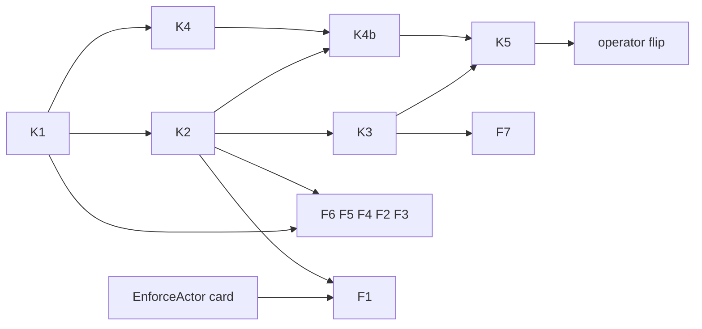

# Plan: shadow stages that prove themselves on intact, verifiable evidence

- **Status:** proposed, 2026-11-15. Aligned with the final spec and card after review round 1.
- **Research:** [shadow-stage-evidence-2026-11](../research/shadow-stage-evidence-2026-11.md). **Decision:** [ADR-0167](../architecture/adr/0167-shadow-stages-prove-themselves-on-chained-evidence.md). **Spec of record:** [shadow-stage-contract](../architecture/shadow-stage-contract.md) (rules S1 to S5, E1 to E4, C1 to C3; fix items F1 to F7). This plan links the spec for each detail and does not repeat it.
- **Related:** [integration-driver-enforce](../architecture/integration-driver-enforce.md) (the EnforceActor card; write-once delivery, rollout section 12), [ADR-0165](../architecture/adr/0165-every-gate-is-a-typed-unit-with-a-conformance-contract.md) (gate contract) and [ADR-0157](../architecture/adr/0157-the-loop-works-its-own-code-a-narrow-fence-and-held-proposals.md) (held proposals).

## Table of contents

- [1. Request](#1-request)
- [2. Facts](#2-facts)
- [3. Goals and non-goals](#3-goals-and-non-goals)
- [4. Candidate designs](#4-candidate-designs)
- [5. Decisions](#5-decisions)
- [6. Components](#6-components)
- [7. Order and dependencies](#7-order-and-dependencies)
- [8. Verification](#8-verification)
- [9. Risks](#9-risks)
- [10. Questions](#10-questions)

## Terms used throughout

- **Stage key, shadow, enforce, escape, false stop:** as in the [research dossier](../research/shadow-stage-evidence-2026-11.md).
- **Evidence record:** one shadow decision, bound into a hash chain.
- **Evidence digest:** a hash over the ordered evidence records of one cycle.
- **Registry:** the existing gate registry (`gatecontract` and `gateregistry`), extended with the shadow-contract fields. There is no second registry.
- **Scorer:** the function that compares a shadow decision with its outcome.
- **Decision version:** a content digest of the Go package closure of the decider, plus the policy subtree that it reads.
- **Grandfather record:** a flip record for a key that was at `enforce` before the contract existed.
- **Seat:** a `console-builder` agent run that builds one component on its own branch.
- **Boundary merge:** the merge of a component branch into `main` by the console at a wave boundary.

## 1. Request

The operator said on 2026-11-15:

- "Carefully review the shadow features and fix the issues if we observed any."
- "Build a strong set of test cases to prevent this type of issue from happening."
- "The evidence and contract is the core of this feature, we must keep both intact and be able to verify, otherwise the whole pipeline is untrustworthy."
- "Start from the research, design, ADR, then building directly from console."

## 2. Facts

| Fact | Research id |
|---|---|
| Pools 2373 and 2378 are "not clean" only because of redelivery. | F2.1 |
| The scan skip keys on the whole tree. It had 2 escapes in about 62 scans (3%). | F2.2 |
| Main CI was red on lint for 5 commits. The main-red stop saw nothing. | F2.3 |
| Two copies of the `pipeline-` rule disagree. The hold stops 5 PASS landings at `enforce`. | F2.4 |
| Three shadow features give no signal. `regression_tia` can skip at most 9 of 44 predicates. | F2.5 |
| The ladder record "unknown at R0 stop R0" comes from `nextItemStartRung`, a hand-coded copy of the decision outside `retryladder`. | F2.6 |
| `max_audit_rounds` 2 stops 40 of 143 shipped cycles. | F2.7 |
| Shadow decisions live in a plain file. The registry is not a protected surface. | F2.8 |
| 10 keys are already at `enforce` (the count of the spec). None has a flip record. | spec section 6.2 |

## 3. Goals and non-goals

| Goal | Measure |
|---|---|
| G1 A shadow decision is a durable, chained record. | An edit, a deletion or a reorder fails `evolve stage verify` in 100% of the mutation tests. |
| G2 A verdict is a function of the chain. | The verdict from a fixture chain equals the golden. |
| G3 A new flip needs a verified verdict. | A new `enforce` without a verified flip record is refused at loop start. |
| G4 The contract cannot weaken unseen. | A removed entry or a lowered threshold fails the ratchet test. |
| G5 The seven known faults close. | The 7 red tests of the spec turn green. |
| G6 An existing enforced key is never refused. | `TestHeadPolicyAccepted` passes with the migration records present. |

Non-goals:

- This plan flips no stage. The operator flips each stage after a `ready` verdict.
- This plan does not defend against a party that rewrites the ledger and the sidecar together (candidate C below addresses it).
- This plan sets no final number for the spend limits. The scorer prints them (F7).

## 4. Candidate designs

Each criterion scores 1 (poor) to 5 (good). A higher total is better. The scores are synthesis from the research findings and the code reads named in each row.

### 4.1 Axis 1: the evidence store

| Candidate | Description |
|---|---|
| A | A per-cycle evidence digest. The seal entry `stage-evidence-seal` of the cycle in the ledger commits to three values. These are the hash of the last record, the record count and the decision counter. The records live in a sidecar file of the cycle. |
| B | A separate hash-chained evidence log with its own tip. The ledger entry cross-links the tip. |
| C | A Merkle log with signed checkpoints (Trillian style). Inclusion and consistency proofs. |

| Criterion | A | B | C | Reason |
|---|---|---|---|---|
| Integrity | 4 | 3 | 5 | A inherits the chain of the ledger. B has two tips that can diverge. C detects a rewrite through old checkpoints (P3.3). |
| Verify cost | 4 | 2 | 5 | A replays only the records of the range. B replays its whole log. C needs O(log n) hashes for one proof. The estimate for A is under 1 second for 10,000 records of 500 bytes. |
| Change size | 4 | 3 | 1 | A adds one ledger entry kind and one package. C adds a log, a signer and a key store. |
| Fit with the ledger | 5 | 3 | 2 | A reuses `entry_seq`, `prev_hash` and `VerifyCycle`. C is a second trust system. |
| Failure modes | 4 | 3 | 2 | A fails closed: a missing record is a count gap. C adds a key to custody and a second trust system to run. |
| **Total** | **21** | **14** | **15** | |

**Recommendation: A.** It scores highest and it needs no new trust system. Choice A matches the seal of spec section 10.2 (E2). Its known limit is a party that rewrites the ledger and the sidecar together. C removes that limit at the cost of key custody. The plan adopts C only if a checkpoint outside the repository becomes necessary (Q3).

### 4.2 Axis 2: the scan-skip key

| Candidate | Description |
|---|---|
| 1 | Exclude impure packages with a hand data list. Add a detector that proposes entries. |
| 2 | Reuse the Go test cache (testlog-tracked environment and files) as the key. |
| 3 | Record the inputs that a package reads (`go test -json` plus the testlog) into the key. |
| 1+ | Candidate 1, plus an escape-driven denylist. An escape adds the package to a stored impure set. |
| 4 | One purity predicate, shared by the scan skip and the TIA. It is the closure of `regressiontia.escapeHatches`. The cache is default-deny: only a package that the predicate proves pure is cacheable. A hand list holds overrides only. |

| Criterion | 1 | 2 | 3 | 1+ | 4 | Reason |
|---|---|---|---|---|---|---|
| Integrity | 2 | 3 | 4 | 3 | 4 | 1 and 1+ fail open: a new impure package is cached until it escapes once, which is the failure class of F2.2. 2 misses `TestMain` files and child processes (P3.5). 4 caches only what it proves, and the escape scorer checks the rule. |
| Verify cost | 5 | 2 | 2 | 5 | 5 | 2 keeps its state in `GOCACHE`, outside the ledger. 3 needs a learn run and a key run. 4 reads the import closure and needs no run. |
| Change size | 5 | 2 | 1 | 4 | 3 | 2 drops `-count=1` and shares one cache across lanes. 3 needs an unstable test-binary option. 4 extracts one function and wires two callers. |
| Fit with the codebase | 3 | 1 | 3 | 3 | 5 | Purity already has a home in `regressiontia`. 1 and 1+ add a second home. 4 reuses the first. |
| Failure modes | 2 | 2 | 3 | 3 | 4 | A list rots (1). A false hit poisons the cache (2). 4 fails closed. Its gap is a standard library path that reads files without an `os` import, and the hatch list data covers it. |
| **Total** | **17** | **10** | **13** | **18** | **21** | |

The scores of candidates 1 and 1+ changed in round 1 of the review. The first scoring ignored the home of purity in `regressiontia` and the fail-open behavior of a list.

**Recommendation: 4.** The fail-open list (1 and 1+) is rejected, because the scan skip can cache the next impure package until it caused an escape. The spec (F2) decides the same. Candidate 3 stays a later option. It needs a stable testlog interface that nobody has verified.

**Comparison: Go's testlog-tracked cache.** The Go test cache is dynamic. It records, at run time, the environment variables and files that the test binary reads. It reruns the test when one changed (P3.5). It does not track files that `TestMain` opens or what a child process reads.

The key of candidate 4 is static: the content hash of the package closure. It is sound only for a package whose closure reaches no input that the hash does not cover. The default-deny predicate guarantees that. For I2 (the `acssuite` and `guards` escapes, which read the environment, `.git` and children), the static rule is stricter than the Go cache.

Candidate 2 stays rejected. The repository rule already says that the Go cache does not see files that tests read through `..` (`CLAUDE.md`). The research notes of 2026-11-15 are the source of this description, not a test run.

## 5. Decisions

| Id | Decision | Because (research and spec) |
|---|---|---|
| D1 | The evidence store is candidate A, matched to the seal entry. | F2.8, P3.3, I4.4; spec E1, E2 |
| D2 | The scan-skip key is candidate 4: one purity predicate, default-deny, a hand list for overrides only. | F2.2, P3.5, I4.7, I4.10; spec F2 |
| D3 | A new stage flips only on a verified, chained flip record. | F2.8, I4.2, I4.3 |
| D4 | One registry home. The shadow contract extends `gatecontract.Entry` and its seeds in `gateregistry`. `core` and `ship` each own a `StageActor` port. `cmd/evolve` builds the entries and injects them. No `stagecontract` package with its own registry exists. | ADR-0165 decisions 15 and 16; spec D2, D6 |
| D5 | The contract tests ship with a baseline of known violations that only shrinks. Each fix removes its entries. | A red test must not break `main` (ADR-0165 decision 8) |
| D6 | The hold uses the routing predicate. Protected paths still hold. | F2.4 |
| D7 | The scorer counts a false stop, an escape and a conflict as three classes. | I4.9 |
| D8 | An empty chain scores `not ready` with a typed error. | I4.2 |
| D9 | The decision version is the digest of the Go package closure of the decider plus the policy subtree that it reads. It is not the build id and not the whole policy. | I4.6; spec E4 |
| D10 | Migration: a grandfather flip record for each key already at `enforce`, written once by `evolve stage migrate`. C2 applies to new flips. | Spec section 6.2 |
| D11 | The C2 check runs in the loop-start preflight, not in the policy loader. | Spec section 6.3 |
| D12 | E2 uses an in-memory decision counter. The seal home is the one in spec section 10.2 (E2). It is its own unconditional `defer` in `runCycle` and in the resume path, registered before the `abnormalEpilogue` defer. It writes one `stage-evidence-seal` ledger entry on every exit. No other seal home exists. | Spec E2 |
| D13 | F6 deletes `nextItemStartRung`. The ladder decision comes from `retryladder.Next`. The ADR-0076 floor stays a separate named rule. The build tier is `max(tier of the ladder target, floor tier)`. No ADR is reversed. | F2.6; spec F6 |
| D14 | A redelivery at `shadow` is information and not a failure (card part 0). Write-once at `enforce` through a `WritePolicy` strategy stays in the card's PR (c), parts 7 and 8. The clean-wave count of `integration.stage` is the `Promotion` data of its registry entry (the one promotion home). | Card sections 10 and 12 |

D5 needs a note. A red test on `main` fails CI. The baseline lists each known violation as a `(key, rule)` pair. The test fails for a violation that is not in the baseline. A fix removes its pairs. A new key cannot add a pair without the operator (C1).

## 6. Components

Each component has its own branch, `console/<id>-<slug>`. A seat builds it with these gates:

1. A failing test first, seen red for the right reason.
2. 100% coverage of the changed functions.
3. No code comment.
4. The review fleet: code-simplifier, then architecture-reviewer and code-reviewer in parallel, then the fixes.
5. A boundary merge by the console.

| Id | Component | Rules and fixes | Red test first | Acceptance |
|---|---|---|---|---|
| K1 | Extend `gatecontract.Entry` with the `Shadow` field (signal, decider, enforce actor, scorer, fields, emit sites, promotion, closure, policy subtree). Seed the entries in `gateregistry`. Add the `StageActor` ports in `core` and `ship`, and the injection in `cmd/evolve`. Unify the stage type. Add the baseline and the conformance tests. | S1 to S5 | `TestEveryStageKeyHasRegistryEntry`, `TestEnforceBranchActsAtEnforce`, `TestEverySignalCodeHasNonTestEmitter`, `TestShadowSignalCarriesWouldFields`, `TestNoStringTypedStageField` | The walk reads the typed policy schema, not the live `policy.json`. The scope and the count of keys come from the schema. A wiring test for each row drives the stage at `enforce` through the production entry point, with a counting spy injected through the `StageActor` port. It does not test that a symbol exists. The test fails for a violation outside the baseline. |
| K2 | Evidence recorder (`stageevidence`), the in-memory decision counter, the evidence record, the per-cycle digest and the seal. | E1, E2 | `TestEvidenceEditFailsVerify`, `TestEvidenceDeleteFailsVerify`, `TestEvidenceReorderFailsVerify`, `TestDeciderReturnWithoutWriteMarksIncomplete`, `TestEvidenceWriteFailureMarksCycleIncomplete`, `TestLateDecisionNotCounted`, `TestFailedCycleEvidenceIsSealedAndScored` | The seal home is the one in spec section 10.2 (E2). It is its own unconditional `defer` in `runCycle` and in the resume path, registered before the `abnormalEpilogue` defer. It writes one `stage-evidence-seal` entry on every exit (10 cases). A decision after the seal is a `late` record that no count includes. Each mutation of the spec turns a named test red. |
| K3 | `evolve stage verify`, `evolve stage report`, the scorer interface and the decision version. | S4, E3, E4 | `TestEveryStageHasScorerAndVerdict`, `TestVerdictRecomputesFromFixtureChain`, `TestScorerMutationChangesGolden`, `TestVersionDigestStableUnderUnrelatedChange`, `TestVersionDigestChangesWithDeciderClosure`, `TestEvidenceOfOtherVersionNotCounted` | The verb prints the range, the digest, the counts and each counted case. A broken chain gives `not ready` and a typed error. The digest covers the closure of the decider and its policy subtree. `TestPromotionReachableByGoodBehavior` replays N cycles with unrelated code and policy edits and expects `ready`. |
| K4 | Protected contract: manifest paths and the ratchet file. | C1 | `TestRegistryRatchet`, `TestViolationBaselineOnlyShrinks`, `TestContractPathsAreProtectedSurface` | The registry, the recorder, the baseline and the tests match `IsProtectedSurface`. A removed entry or a lowered number fails. No second C1 surface exists. |
| K4b | Migration: `evolve stage migrate` writes one grandfather record for each key at `enforce`, and one genesis record. It runs once. | C2 | `TestHeadPolicyAccepted` | The test loads the policy of HEAD with the migration records present and expects acceptance. It also expects that the check is inactive before the genesis record exists. The ratchet holds the genesis record. |
| K5 | Flip verb, loop-start preflight check and `evolve stage status`. | C2, C3 | `TestPreflightRefusesEnforceWithoutFlipRecord`, `TestStageGateRefusesNotReadyVerdict`, `TestStageStatusListsEveryRow`, `TestStageGateRefusesEnforceWithoutActor` | A key at `enforce` with no flip record of any kind is refused at loop start with a typed error. The `policy` package imports neither the ledger nor the scorers. The status verb lists every row of every key and shows `grandfathered` and `flip pending` apart. |
| F6 | Delete `nextItemStartRung`. The ladder decision comes from `retryladder.Next` with a complete input. | S2, S5 | `TestEscalatedBuildTier_UnknownClassStartsNotStop`, `TestNoDecisionLiteralOutsideDecider` | Both tests are red today (spec F6). The ADR-0076 floor is a separate named rule with its own entry and signal. One function names the build tier `max(tier of the ladder target, floor tier)` and has its own test. |
| F5 | Signals for `audit_cascade`, `regression_tia` and `parallel_evaluate`. | S1 | `TestRecordCascadeShadow_EmitsSignal`, `TestEmitTIADecision_EmitsSignal`, `TestEmitTIADecision_WriteErrorIsNotDropped`, `TestOrchestrator_ParallelEvaluateShadowRecordsBatch`, `TestShadowIsNotOff` | Each feature emits one registered signal and one evidence record. `parallel_evaluate` at `shadow` computes the batch and runs serially. The decider moves to the package `parallelevaluate`. The `regression_tia` decision stays open (Q1). |
| F4 | The hold uses the routing predicate. | S5 | `TestSharedRuleHasOnePredicate`, a `Decide` case for `pipeline-repair` | `pipeline-repair` that touches no protected path gives `Hold == false`. A fence path gives a `protected:` reason. The same change adds the "Amended by ADR-0167" note to ADR-0157 decision 8. |
| F2 | Scan skip: the shared `regressiontia.Pure` predicate, default-deny `cacheable` and the override list. | S4 | `TestScanShadow_AmbientEnvChangeDoesNotHit`, `TestCacheable_RefusesPackagesThatReadTheEnvironmentOrGit`, `TestCacheable_DefaultDenyForUnlistedImpurePackage`, `TestScorerCountsFalseStopEscapeConflict` | An unlisted package that imports `os/exec` in its closure is not cacheable. The TIA and the scan skip call the same predicate. An escape proposes an override and writes nothing by itself. |
| F1 | Train delivery at `shadow`: card part 0 (R-a and R-d, the `Redelivered` field and its readers). | S4 | `TestPromotionReachableByGoodBehavior` | A replay of pool 2378 gives a clean wave. A redelivery at `shadow` is information, not a failure. The clean-wave count (N >= 2 clean shadow waves) is the `Promotion` data of the `integration` registry entry. The scorer counts the chained pool outcomes as evidence records. Card part 7 (write-once at `enforce`) and part 8 (H6) stay in the card's PR (c). |
| F3 | Main-red stop for step keys. | S4 | A CI-source test in `main_red_stop_test.go`, and a lane-fixes-the-step test | A red lint step on main opens a stop. A lane that does not fix it gets `CodeMainRedPark`. A lane that fixes it is admitted. An unreadable CI source fails open with a signal. The schema moves to `main-red-stop/v2` with a v1 migration. |
| F7 | Spend limits from the shipped distribution. | S4 | `TestSpendLimitWouldStopShippedCycles` | The 2% and the window of 100 cycles are the `MaxFalseStopPct` and `WindowCycles` fields of the entry, not prose. The test replays a fixture distribution (`testdata/spend_distribution.json`) and does not read the live ledger. The numbers go to `policy.json` from the printed output. |

## 7. Order and dependencies

The spec fixes the order of work (section 8). First come the type unification and registry extension with the baseline. Then come the integrity layer, the migration and the preflight check, and last the fixes. The fix order F6, F5, F4, F2, F1, F3, F7 is a priority, not a dependency chain. Each fix depends only on the components in the table.

| Phase | Components | Depends on | Reason for the place |
|---|---|---|---|
| P0 | K1 | none | The baseline makes each later fix measurable. |
| P1 | K2 and K4, then K3, then K4b, then K5 | K2 and K4 need K1. K3 needs K2. K4b needs K2 and K4. K5 needs K3 and K4b. | A fix without chained evidence cannot prove itself. The check must not be active before the genesis record exists. |
| P2 | F6, F5, F4, F2, F3 | K1 and K2 for each | The cheap fixes that remove a lost escalation or a false stop come first. Each fix emits through the K2 interface. |
| P2 | F7 | K1, K2 and K3 | The scorer prints the distribution. |
| P2 | F1 | K1, K2 and card part 0 | Part 0 ranks first in the card's PR (c). Parts 7 and 8 stay in the card. |
| P3 | The flip of each new stage by the operator | K5 and a `ready` verdict | The preflight refuses a flip without a verified record. |

Two rules for the console:

1. Open each branch from `origin/main`. Do not stack a branch on another open branch.
2. After a rebase, run `evolve pr refresh`.

## 8. Verification

| Check | Command or test | Pass |
|---|---|---|
| Each component | `go test -count=1` for the changed packages | N/N PASS, no regression |
| Changed-function coverage | the apicover and cover-changed gates | 100% |
| Docs | `evolve docs ste-lint --strict --changed refs/remotes/origin/main --added` | 0 findings |
| Integrity | the mutation set of the spec (section 5) | each mutation turns its named test red |
| Wiring | the wiring test of K1 for each row | the spy acted at `enforce` |
| Migration | `TestHeadPolicyAccepted` | the policy of HEAD is accepted |
| Reproducibility | `evolve stage verify <key>` on the fixture chain | equals the golden |
| Contract | `evolve stage status` | every row passes for the flipped key |

The 7 red tests of the spec are the measure of G5. The count of green tests must reach 7 of 7 before the last flip.

## 9. Risks

| Risk | Control |
|---|---|
| A sidecar write fails and the cycle looks complete. | E2: the in-memory counter, the count and the `incomplete` mark. A cycle with a gap never counts. |
| A decider returns without a write. | The counter rises before the write, so the seal sees a counter above the record count. |
| A cycle ends on an exit that skips the seal. | The seal home of spec section 10.2 (E2): its own `defer`, registered before the `abnormalEpilogue` defer, one `stage-evidence-seal` entry on every exit. `TestFailedCycleEvidenceIsSealedAndScored` drives 10 cases. |
| The ledger entry gets too large. | The sidecar holds the records. The seal entry holds the digest only (spec D7). |
| A rewrite of ledger and sidecar together. | The protected paths and the ship gate limit who can. Q3 holds the checkpoint option. |
| A new impure package is cached. | The cache is default-deny. The escape scorer checks the rule and proposes overrides. |
| Evidence never reaches the sample size, because the version changes each cycle. | D9: the version covers the decider closure and its policy subtree only. K3 replays unrelated edits and expects `ready`. |
| The loop refuses its own policy on the first start after the merge. | K4b writes the grandfather records first. The preflight check is inactive until the genesis record exists. |
| The baseline of known violations grows. | The baseline is protected (C1). A new pair needs the operator. |
| F1 needs card part 0. | Part 0 ranks first in the card's PR (c). No other component waits for the card. |

## 10. Questions

The spec decided the other questions of round 1 of this plan. They are closed:

| Round-1 question | Closed by |
|---|---|
| Home of the record in the ledger. | The seal home and the `stage-evidence-seal` entry are those of spec section 10.2 (E2). The entry carries the digest, the count and the counter. The records live in a sidecar. The seat of K2 reads `go/internal/core/ports.go` and the ledger adapter before it picks the field names. |
| The policy digest rule. | D9 and spec E4: the policy subtree that the decider reads. |
| The source of the build id. | Not needed. The version is a content digest. The builder of K3 computes the closure with the closure walk of `regressiontia`. |
| A stable testlog interface. | Only candidate 3 needs it, and candidate 3 stays a later option. |

Open questions for the operator:

- **Q1** The `regression_tia` decision (spec D5): split the corpus into pure and I/O predicates, or retire the stage. The recommendation is to split, and to retire if fewer than 9 predicates are pure. Until the operator decides, the stage stays at `shadow` with the verdict `not ready`.
- **Q2** The minimum sample (`MinDecisions`) of each `Promotion` entry. No source sets it (research section 5). The first scorer run proposes values from the data.
- **Q3** If a checkpoint outside the repository is needed. Decide after K2 and K3 run for one wave.
