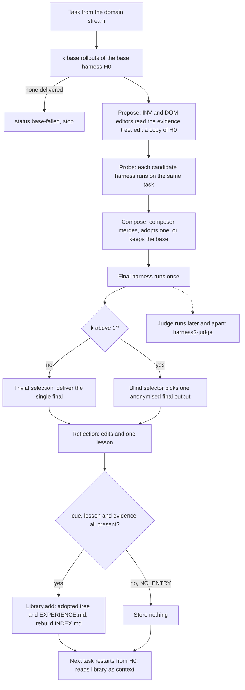

# Harness²: core logic and how it drives harness self-improvement (research, 2026-11)

> Related local research: [self-evolving-loop-autonomy-2026-11](self-evolving-loop-autonomy-2026-11.md) and [harness-practices-2026-11](harness-practices-2026-11.md). The plan that uses it: [harness-self-improvement-2026-11](../plans/harness-self-improvement-2026-11.md). The decision record: [ADR-0169](../architecture/adr/0169-lesson-yield-is-measured-before-a-lesson-store-is-built.md). The design: [harness-self-improvement](../architecture/harness-self-improvement.md).

Date: 2026-11-26. Method: a read of the repository `google-research/harness2` at commit `6868817518876de8fd170c6a8354daca273b6191` (2026-11-02), the GitHub API on 2026-11-26, and the paper arXiv:2610.14224 (v1, 2026-10-09). Three researchers wrote notes from these sources. Each local claim names its file and line. Each outside claim names its link.

"Synthesis" marks our own inference. This file does not decide. A plan decides.

## The request

The operator asked on 2026-11-26:

> "Research on the open source project : google-research/ harness2 and write the report recording the core logics and how it drives harness self improvement and self evolving."

The operator then added: "Check the docs/ folder and writer skill". The writer skill is [docs-write](../../skills/docs-write/SKILL.md). This dossier follows its research template.

**Terms used throughout:**

- **Harness:** the system around a frozen model that makes it an agent: prompts, tools, memory, skills and orchestration. In the repository it is a tree of files.
- **Executor:** the frozen model, run inside OpenCode or Codex, that does the task. It reads the harness.
- **Improver:** the model session that edits a harness. It acts as editor, composer, selector and reflector.
- **INV editor and DOM editor:** two scoped editors. INV edits how the agent works. DOM edits what a practitioner of the domain knows.
- **Propose–Probe–Compose:** the task-level step. Propose two candidate edits, probe each on the same task, compose a final harness.
- **Composer:** the improver session that merges, adopts or rejects the candidate edits. The code calls it `aggregate`.
- **Selector:** the improver session that picks one final output, blind, when k is above 1.
- **Reflection:** the improver session that turns the adopted harness into a lesson for later tasks.
- **Library:** the per-domain store of adopted harnesses and lessons. The paper calls it the improvement harness.
- **EXPERIENCE.md:** the file in the library that records why a harness won and one transferable lesson.
- **Ledger:** the harness2 object that counts rollouts and improver sessions. It is not our hash-chained ledger.
- **k:** the width of one step: the number of base runs, of candidate pairs and of compositions.

## Table of contents

- [1. Local evidence](#1-local-evidence)
- [2. The outside survey](#2-the-outside-survey)
- [3. Adopt or reject](#3-adopt-or-reject)
- [4. Refinements to adopt](#4-refinements-to-adopt)
- [5. Open questions and evidence gaps](#5-open-questions-and-evidence-gaps)

The short answer (synthesis). Harness² does not rewrite its own code. It edits a file tree around a frozen model, for one task at a time, with no score. It keeps the edits that behavior contrasts support. A second loop stores lessons for later tasks. The stage prompts, the selection rule and the Python loop stay fixed.

## 1. Local evidence

**F1.1** The Learn phase runs after Ship on each cycle. The reflector runs every cycle. The retrospective runs on a FAIL or WARN verdict. The memo runs on a PASS verdict (`docs/architecture/learn-phase.md:11-15`).

*Implication:* our loop learns after each cycle, as harness2 learns after each task. Our trigger is the audit verdict. The harness2 trigger is a lesson that contrasts support.

**F1.2** The retrospective writes `retrospective-report.md` and the lesson files `.evolve/instincts/lessons/*.yaml` (`docs/architecture/learn-phase.md:63-64`). `retrofile` lifts the preventive actions of a retro report into weighted inbox todos (`go/internal/retrofile/retrofile.go:1-2`). `faillearn` renders a deterministic failure floor beneath the LLM retrospective (`go/internal/faillearn/faillearn.go:1-3`).

*Implication:* a lesson of ours becomes a ranked work item. A lesson of harness2 becomes read-only context for the next task. We close the loop with a queue. Harness2 closes it with retrieval.

**F1.3** The policy sets `retrospectives` to `stage: enforce`. The publish and the todo retirement of that stage are not built, so the closeout writes the documents only into the cycle workspace (`AGENTS.md:360`).

*Implication:* we have no per-domain index of past lessons that a later seat reads. The harness2 library has `INDEX.md` for that purpose (P2.7).

**F1.4** The inbox rank is computed. The class order and the factor weights sit in `.evolve/policy.json` under `inbox_priority` (`AGENTS.md:343` and `AGENTS.md:355`). The curator reviews intake on events, not on a poll (`docs/architecture/inbox-curator.md:16`). On 2026-11-16 the backlog had 268 open items (`docs/research/self-evolving-loop-autonomy-2026-11.md:51`).

*Implication:* our improvement queue is a long-lived ranked backlog. Harness2 has no queue. It spends one fixed budget on each task and then stops.

**F1.5** Our kernel is frozen. ADR-0155 I-10 says that no agent changes a kernel surface. I-11 says that no agent writes its own oracle. The protected manifest has 228 entries in ten classes (`docs/research/self-evolving-loop-autonomy-2026-11.md:74-80`).

*Implication:* harness2 has the same split in a softer form. It freezes the loop, the prompts and the judge, and it edits the harness tree. It has no pin for guardrail files (issue #94, P2.12).

**F1.6** The ship gate is the binary verdict `acs-verdict.json:red_count == 0`. The native audit computes it from sandbox exit codes, never from the narrative of a model (`AGENTS.md:107-108`).

*Implication:* we have an executable check at the gate. Harness2 works in an open world with no check, so it uses a blind LLM selector. The two designs answer different questions.

**F1.7** The ledger `.evolve/ledger.jsonl` is tamper-evident. Each entry holds the SHA256 of the previous entry (`AGENTS.md:110-111`).

*Implication:* the word "ledger" has two meanings. Ours proves history. The harness2 ledger asserts the spend of one task (P2.10). A plan must name them apart.

**F1.8** The pre-commit review fleet runs code-simplifier, then architecture-reviewer and code-reviewer in parallel, then the fixes (`AGENTS.md:286-290`). A change of only `.md` files gets the `docs-review` run (`AGENTS.md:289`).

*Implication:* we separate the maker from the checker with a rule and a gate. Harness2 separates them with sessions and information views, and by default one model plays all roles (P2.9).

**F1.9** Gates move by stage. `audit_cascade` is at `shadow` (`AGENTS.md:357`). `comment_floor` is at `enforce` (`AGENTS.md:359`). The swarm and `workflow.convergence` default to `shadow` (`AGENTS.md:404` and `AGENTS.md:416`). The dossier on harness practice found that the move to `enforce` has no stated bar (`docs/research/harness-practices-2026-11.md:370`).

*Implication:* we have the stage mechanism that harness2 lacks, and we lack the evidence rule for a move. Harness2 shows the cost of a gain claim with no outside check (issue #201, P2.12).

**F1.10** Our research found that an agent that can edit its grader will do so. A file lock stops the attack, and an instruction does not (`docs/research/self-evolving-loop-autonomy-2026-11.md:123` and `:135`). Agents also edit failing tests even when told not to (`docs/research/harness-practices-2026-11.md:267`).

*Implication:* the answer-free prompts of harness2 are instructions. Its leak globs and tripwire are partial locks. The rubric download that its authors saw confirms the lesson (P2.12).

**F1.11** Our research found no removal test of the harness, and it recorded this as a gap. One outside author removed one component at a time to find the load-bearing ones (`docs/research/harness-practices-2026-11.md:338` and `:371`).

*Implication:* the ablation of harness2 (library, scoping, composition) is a removal test at the level of the method. It is the model for ours (P2.11).

## 2. The outside survey

Base for repository links: `https://github.com/google-research/harness2/blob/6868817518876de8fd170c6a8354daca273b6191/`. A path below is a path under this base. Labels: [code] means the code does this. [docs] means a README or a `docs/` file says this. [paper] means the paper says this.

### 2.1 What the project is

**P2.1** The repository is public, has the Apache-2.0 license and holds Python code. It was created on 2026-10-06. The last push was on 2026-11-02. On 2026-11-26 it had 25,245 stars and 2,526 forks. It has no About description. [code] [GitHub API](https://api.github.com/repos/google-research/harness2)

*Implication:* attention is high. Stars show attention, not quality (synthesis).

**P2.2** It is the official code of "Harness²: Recursive Agent Harnessing for an Open World", by Xu, Chen, CuiZhu, Dalvi Mishra, Ming, Yu, Han, Lee and Pfister. [paper] [arXiv:2610.14224](https://arxiv.org/abs/2610.14224). The README says: "This is not an officially supported Google product." [docs] [README](https://github.com/google-research/harness2/blob/6868817518876de8fd170c6a8354daca273b6191/README.md)

*Implication:* the "²" means recursion, not version 2. The notes found no Harness v1 (synthesis).

**P2.3** The README defines the terms: "A **harness** is the system around a model that enables it to act as an agent: prompts, tools, memory, skills, orchestration, and more. **Harnessing** is the process of optimizing that system." [docs] README lines 19-21.

*Implication:* the word "harness" means an agent scaffold. It does not mean a test harness (synthesis).

**P2.4** The method keeps the model weights fixed. It has two levels of recursion. Task-level recursion refines the harness of the current task with Propose–Probe–Compose, and it uses no ground-truth feedback. Harnessing-level recursion updates a persistent improvement harness with adopted harnesses and lessons. [docs] README lines 23-33.

*Implication:* "self-evolving" here means a task-level edit plus a growing lesson library. It does not mean self-modifying code (synthesis).

**P2.5** The eight editable components are: system prompt, guardrails, memory, tool guidance, subagents, skills, scripts and plugins. A plugin is "the only lever that can enforce something the model cannot skip". [docs] README lines 70-73; [code] `harness2/substrate/opencode.py`.

*Implication:* a harness is a file tree, so a diff, a validation and a library store all work on it (synthesis).

### 2.2 Code architecture

**P2.6** The package `harness2/` has about 14,000 lines and no required runtime dependency (`pyproject.toml`: `dependencies = []`). Its layers are `core/` (method logic), `substrate/` (OpenCode and Codex), `benchmarks/` (LAB, JobBench and WorkBuddy) and `cli/` (seven console scripts). `third_party/` holds the derived runners. [code]

| Layer | Holds | Size or fact |
|---|---|---|
| `harness2/core/` | `recursion.py`, `schedule.py`, `selection.py`, `context.py`, `library.py`, `ledger.py`, `tree.py`, `proposer.py`, `prompts.py`, `judge.py` | `prompts.py` has 1,163 lines |
| `harness2/substrate/` | `base.py`, `opencode.py`, `codex.py` | the `Substrate` protocol and two surfaces |
| `harness2/benchmarks/` | `lab.py`, `jobbench.py`, `workbuddy.py`, runners | one adapter for each benchmark |
| `harness2/cli/` | `run_sweep.py`, `judge.py`, `report.py`, `setup.py`, `check.py`, `demo.py`, `bridge.py` | seven console scripts |
| `third_party/` | `jb_runner/`, `lab_runner/`, `wb_runner/`, `patches/` | derived runners and patches |

The README of `third_party/` says: "Research logic belongs in `harness2/core/`; benchmark interfaces belong in `harness2/benchmarks/`." Source: [third_party/README.md](https://github.com/google-research/harness2/blob/6868817518876de8fd170c6a8354daca273b6191/third_party/README.md).

*Implication:* method logic and benchmark detail are apart. This is the same split as our kernel and our item code (synthesis).

**P2.7** `BenchmarkAdapter` is a protocol in `harness2/core/spec.py` lines 200-250. Its docstring says: "Implement these and the whole method works. Nothing here is method logic." The methods are `tasks`, `domain_of`, `task_prompt`, `task_files`, `execute`, `delivered`, `trajectory`, `deliverable_files`, `deliverable_text`, `base_harness`, `validate_tree` and `score`. Only `core.judge` calls `score`, and only after selection. [code]

*Implication:* a new benchmark needs one adapter. The demo has an adapter of about 80 lines (`harness2/demo.py`) (synthesis).

**P2.8** Two data classes carry all the differences. `SurfaceSpec` (`harness2/core/tree.py` lines 40-60) describes the editable surface of one executor. `BenchSpec` (`harness2/core/spec.py` lines 129-173) is "A value, not a code path". The `Substrate` protocol (`harness2/substrate/base.py` lines 48-78) has `surface`, `materialise`, `execute`, `read_trajectory` and `preflight`. [code]

| Substrate | Always-on files | Cap on always-on text |
|---|---|---|
| `OpencodeSubstrate` | `systemprompt.md`, `guardrails.md`, `LongTermMEMORY.md`, `tool_descriptions/tool_guidance.md` | 24,000 characters |
| `CodexSubstrate` | `AGENTS.md` | 8,000 characters |

*Implication:* the cap treats prompt text as a cost: "every token here competes with the agent's own output budget" (`opencode.py`). A cap is a structural guard on prompt growth (synthesis).

**P2.9** Seven console scripts exist: `harness2` (the sweep), `harness2-judge`, `harness2-report`, `harness2-setup`, `harness2-check`, `harness2-demo` and `harness2-bridge`. The demo runs both recursion modes with no model credential. [code] `pyproject.toml`; [docs] README lines 86-91.

*Implication:* the demo exercises the real `schedule`, `recursion`, `selection` and `library` code with a scripted improver (`harness2/demo.py`). Our own test of a loop can use the same idea (synthesis).

### 2.3 The per-task loop

**P2.10** The control flow runs from the CLI to one task: `harness2` → `run_sweep._main` → `schedule.run_sweep` → `run_domain` → `run_task`. Domains run in parallel threads. The tasks of one domain run in order. Before each task, `lib.retain(task_ids[:i-1])` limits the library to earlier tasks. [code] `harness2/core/schedule.py` lines 737-918.

*Implication:* the library has a causal order. A task never reads a lesson from a later task (synthesis).

**P2.11** `run_task` rolls k base runs `base1..basek` of the unmodified harness. If none delivers output, the status is `base-failed`. Then each mode runs `recursion.run_mode`, the selection and the reflection. The function writes `summary.json`. [code] `schedule.py` lines 619-734.

*Implication:* the improvement of one task does not carry to the next task as a harness. It carries only as a stored lesson (P2.17).

**P2.12** Parallel mode is width. The docstring reads "WIDTH: 2k iid candidates from shared evidence, then k INDEPENDENT compositions". It runs `inv1, dom1, ..., invk, domk` against the base harness, rolls each candidate, runs `agg1..aggk` with the whole pool and the decision notes, and rolls each composition. Sequential mode is depth: k nested passes, where each pass proposes against the current checkpoint and composes `c{t}`. [code] `harness2/core/recursion.py` lines 354-577.

*Implication:* a population here is one generation. There is no archive and no fitness rank (synthesis).

**P2.13** A stage builds an evidence tree, asks the improver for an edit and validates the result. The steps are:

1. `context.build` writes `context/`: the task, full rollouts, deliverables, a harness copy, the pool and the library index.
2. `context.mission` writes a pointer prompt that says "Read it -- do not answer from this message alone".
3. `prop.call(..., harvest="context/harness")` runs an agentic session that edits files in place.
4. `_accept_tree` runs `autotrigger`, `diff_summary`, `harness_tree.validate`, `adapter.validate_tree` and the grader tripwire.
5. A rejected tree gets one retry (`STAGE_ATTEMPTS = 2`) with the error text added.
6. If the retry fails, the stage falls back to the incoming harness (`fell_back=True`).

[code] `recursion.py` lines 141-262; `context.py` lines 521-546.

*Implication:* a bad edit costs one retry and then changes nothing. The failure mode is "no change", not "bad change" (synthesis).

**P2.14** The two editors have scopes. INV owns "how the agent WORKS" and maps each failure to the cheapest component. A repeated step goes to a script, a triggered workflow to a skill, and an ignored invariant to a defensive hook. DOM owns "what a PRACTITIONER knows" and has the rule "Never invent an authority, identifier, standard or citation". Both obey: "Every edit must trace to a moment in a trajectory". The priority order is run divergence, then repeated failure, then visible risk.

"KEEP_BASE is a real answer, not a failure." [code] `harness2/core/prompts.py` lines 347-409.

*Implication:* the prompts turn a model into a scoped, evidence-bound editor. The scope also makes candidates differ on purpose (synthesis).

**P2.15** The composer is "the last gate, and merging an edit launders it". It knows that "a defect in 1/{k} is noise" and that each candidate has one rollout, so one result is weak evidence. An edit whose rollout produced nothing is "UNSAFE". The valid outputs are MERGE, ADOPT ONE WHOLESALE and KEEP_BASE. Each note has the form `kept|revised|dropped -> <edit> -> <trajectory moment>`. [code] `prompts.py` `aggregate`; `compose_round` adds "REPRODUCE an earlier checkpoint verbatim".

*Implication:* composition is a judged merge with a written trail, not a vote. The prompt says "Agreement is support, not independent proof" (synthesis).

### 2.4 The cross-task library

**P2.16** After selection, reflection builds a context with the chosen harness, the base harness, the pool and `adoption.json`. It calls the improver with `prompts.experience` and parses `<edits>` and `<experience>`. Each edit has a verdict of helped, hurt, no observed effect or confounded. The experience has a cue, a lesson, evidence and a confidence. If the cue, the lesson or the evidence is missing, the result is empty (the NO_ENTRY case). [code] `harness2/core/selection.py` lines 402-505.

**P2.17** `Library.add` runs only when the experience is complete. It writes the whole adopted tree and `EXPERIENCE.md` with three sections: "Why this was chosen", "What each edit did" and "Transferable lesson". Then it rebuilds `INDEX.md`. The layout is `<root>/<run-tag>/<mode>/<domain>/INDEX.md` plus `harnesses/<task>/harness/<rel>` and `harnesses/<task>/EXPERIENCE.md`.

"The whole tree is carried, never a summary." Roots are scoped to each run and mode, so each sweep starts every domain empty. [code] `harness2/core/library.py` lines 15-24 and 106-152.

*Implication:* the library is file-based retrieval for a model. It has no embedding and no parameter store (synthesis).

**P2.18** Each task restarts from the base harness H0. The code reads `base_tree = harness_tree.read_tree(surface, adapter.base_harness())` in `run_task`, and the library reaches the improver only as read-only context. The paper says: "Earlier components are selectively reused or adapted through Propose, rather than automatically inherited". [code] `schedule.py`; [paper] [arXiv:2610.14224 §2.3](https://arxiv.org/pdf/2610.14224)

*Implication:* the design avoids two faults of a chained harness: drift and carried errors. Each task proves its own edit against fresh base runs. This is a reason in the design, but the notes do not state it as the authors' reason (synthesis).

**P2.19** The experience prompt guards against false credit. It says: "Selection compared DELIVERABLES with the harnesses hidden, so the choice says which output read best -- not which edit worked." It also says that a lesson that rests only on `confounded` rows "is a guess", and that "Adoption alone never establishes that an edit helped or will transfer". [code] `prompts.py` `experience`.

*Implication:* the lesson gate is the main defense against a polluted library. Issue #197 shows the cost: the gate often returns NO_ENTRY (P2.35).

### 2.5 The signals

**P2.20** At improvement time there is no fitness score. `spec.RunView` is "What the method knows about one finished rollout. Never carries a score." The judge module says: "Nothing in the method imports this module. A judge failure is None, never a zero". Judging runs later, in `harness2-judge`, and scores only the run that the selector chose. [code] `spec.py` lines 176-187; `harness2/core/judge.py`; `harness2/cli/judge.py`.

*Implication:* the signal at improvement time is behavioral contrast: two executions of the same task under matched conditions. The paper says that contrasts "inform subsequent composition rather than verify task correctness" ([arXiv:2610.14224 §2.2](https://arxiv.org/pdf/2610.14224)).

**P2.21** The prompts are answer-free. `ANSWER_FREE` ends each proposer, composer and reflector prompt: "There is no rubric, grading criteria, answer key, reference solution or score anywhere in your context". `BenchPrompts.__post_init__` raises an error if a prompt field contains "benchmark", "evaluation", "grader", "rubric" or "score". [code] `prompts.py`; `spec.py` lines 119-126.

**P2.22** Leak globs and a tripwire guard the evidence. `context.assert_no_leak_paths(root, leak_globs)` runs on the harness, the library, the context tree and the reflection root. The globs are: LAB `("task.json",)`, JobBench `("RUBRICS.json", "eval_result/**", "expected/**", "reference/**")` and WorkBuddy `("tests/**", "solution/**", "environment/**")`. `GRADER_VERDICT_MARKERS` lists seven strings such as `"pass_rate"`. `assert_no_grader_verdicts` scans each context before a session, and `assert_tree_has_no_grader_verdicts` scans each written harness tree. [code] `harness2/core/context.py` lines 419-520; `lab.py` line 507; `jobbench.py` line 518; `workbuddy.py` lines 91-108.

*Implication:* the docstring calls the tripwire "not the defence itself": if it fires, find the read path. This is a detector, not a lock (synthesis).

**P2.23** `tree.validate` checks each proposed harness in one pass and raises one error that lists every problem. It checks the always-on cap, skill triggers, subagents, hooks and script references. Each Python script must compile (`_py_compiles`). `normalize_rel` raises "path escapes the harness", and files outside the surface are dropped and force a retry. [code] `harness2/core/tree.py` lines 336-390.

*Implication:* structural validation is cheap and exact. It is the one fully mechanical gate in the loop (synthesis).

**P2.24** The selector is blind. `assign_ids` maps labels to A, B, C by a sorted order and then a shuffle seeded with `sha1(f"{task_id}|{k}|{mode}")`. The selector sees only `context/task.md`, `context/source/` and anonymised candidate files. The pool holds only the k finals, so a base output cannot win.

The criteria run in order: delivery, conformance, fidelity to the source, internal consistency, operational fitness, finish and values. "Length and polish are not merits in themselves." At k=1 there is no selector session. [code] `selection.py` lines 268-399; `prompts.py` `select`.

*Implication:* with no verifier, the selector is the only judge of final quality. It shares the base model with the editors by default (P2.25).

### 2.6 Roles and isolation

**P2.25** Three model settings exist: the solver (`HARNESS2_SOLVER_MODEL`), the improver (`HARNESS2_IMPROVER_MODEL`, which defaults to the solver) and the judge (`HARNESS2_JUDGE_MODEL`). The improver acts as editor, composer, selector and reflector. The paper used Gemini 3.5 Flash and GLM-5 as executors and Claude Opus 4.8 under OpenCode as the default editor. [code] `harness2/config.py`; [paper] [§3.1](https://arxiv.org/pdf/2610.14224)

*Implication:* the repository default (improver equals executor) is not the paper setup. A reader who wants the paper result must set the improver (synthesis).

**P2.26** Each improver call isolates its session. `Proposer.call` makes a temp directory, copies the evidence to `tmp/context`, writes `MISSION.md`, runs the session, harvests `context/harness` and removes the temp directory. The OpenCode channel denies external directories with `OPENCODE_PERMISSION`. The Claude CLI channel runs `claude --dangerously-skip-permissions`.

A semaphore limits concurrency to 2. `scrub_env` removes runner and host secrets, and `provider_keys` adds back only the key that a provider needs. [code] `harness2/core/proposer.py` lines 81-304; `config.py` lines 193-245.

*Implication:* isolation rests on a temp copy and a scrubbed environment, not on a sandbox. Issue #219 reports gaps in the scrub (P2.34).

**P2.27** Information is split among the roles. The selector sees only deliverables. Editors and composers see trajectories and harnesses, and no score. The judge output is barred from every context by the tripwires. WorkBuddy uses a fresh container for each rollout, and "the improver never receives verifier output". [code] `selection.py`; [docs] [docs/BENCHMARKS.md](https://github.com/google-research/harness2/blob/6868817518876de8fd170c6a8354daca273b6191/docs/BENCHMARKS.md)

*Implication:* the separation is by view, not by model (synthesis).

### 2.7 The budget ledger

**P2.28** The `Ledger` fixes the spend of one mode. R = 4k rollouts: k base runs, 2k candidates and k finals. P = 3k improver sessions: k INV, k DOM and k compositions. `assert_identity()` raises `BudgetError` on a mismatch or a repeated label. Selection and reflection sessions are "recorded outside this ledger". [code] `harness2/core/ledger.py` lines 15-33 and 89-113.

*Implication:* the budget is a checked identity, not a cap. A run that spends less or more fails loudly (synthesis).

### 2.8 Reported results

**P2.29** All numbers are means of three runs. "Base" is the base harness. "+Rec" is the extra gain of parallel recursion at k=5. Gemini is Gemini 3.5 Flash. Source for the table: [arXiv HTML](https://arxiv.org/html/2610.14224v1) (Tables 1 and 2 as the notes record them).

| Benchmark | Executor and harness | Base | Best listed baseline | Harness² k=1 | +Rec k=5 |
|---|---|---|---|---|---|
| WorkBuddy | Gemini, OpenCode | 72.4 | Meta-Harness 76.4 | 77.5 | +3.3 |
| WorkBuddy | Gemini, Codex | 74.5 | Harness Scaling 73.8 | 77.5 | +2.9 |
| WorkBuddy | GLM-5, OpenCode | 64.2 | Meta-Harness 69.7 | 75.7 | +3.9 |
| WorkBuddy | GLM-5, Codex | 64.4 | Meta-Harness 74.2 | 75.3 | +3.0 |
| JobBench | Gemini, OpenCode | 31.5 | Meta-Harness 35.8 | 36.0 | +3.0 |
| JobBench | Gemini, Codex | 33.9 | Meta-Harness 34.8 | 35.3 | +4.2 |
| JobBench | GLM-5, OpenCode | 20.6 | Meta-Harness 20.9 | 24.2 | +4.2 |
| JobBench | GLM-5, Codex | 23.6 | Meta-Harness 23.9 | 24.8 | +3.1 |
| LAB partial | Gemini, OpenCode | 79.9 | Meta-Harness 81.6 | 81.9 | +2.6 |
| LAB partial | Gemini, Codex | 71.6 | Meta-Harness 76.5 | 75.6 | +2.9 |
| LAB partial | GLM-5, OpenCode | 59.6 | Harness Scaling 67.8 | 71.4 | +6.7 |
| LAB partial | GLM-5, Codex | 58.1 | Harness Scaling 63.7 | 65.9 | +4.8 |

The headline gains are +11.5 on WorkBuddy (GLM-5, OpenCode), +4.5 on JobBench (Gemini, OpenCode) and +11.8 points on LAB partial (GLM-5, OpenCode). Harness² does not win each cell: Meta-Harness leads LAB for Gemini on Codex, 76.5 against 75.6. The step count on WorkBuddy falls from 25.4 to 21.9 for Gemini on OpenCode. [paper] Table 1.

*Implication:* the gain over the best listed baseline is under one point in four of the six Gemini rows. It is larger for the weaker GLM-5 (synthesis from the table).

**P2.30** The ablation (Gemini, OpenCode, k=1) removes one part at a time. [paper] [Table 3](https://arxiv.org/pdf/2610.14224)

| Variant | WorkBuddy | JobBench |
|---|---|---|
| Full Harness² | 77.5 | 36.0 |
| Without the library | 74.4 (−3.1) | 34.2 (−1.8) |
| Without scoping (two generic editors) | 74.6 (−2.9) | 32.3 (−3.7) |
| Without composition (pick the favored candidate) | 75.9 (−1.6) | 34.1 (−1.9) |

Other results: direct editing of the base harness, with no execution evidence and no library, lowers WorkBuddy Code from 73.4 to 63.2. It lowers Web from 69.9 to 65.0. Raising k from 1 to 5 lifts the gain from 4.5 to 7.5 on JobBench and from 5.1 to 8.4 on WorkBuddy.

A JobBench library moved to WorkBuddy adds +0.6, +0.5 and +2.9 by domain. Baselines can hurt: ReasoningBank falls up to 6.6 points below base on coding, and Harness Scaling is below base in seven of twelve pairs. [paper] §3.2, §3.3, Fig. 6 and Fig. 7.

*Implication:* the ungrounded edit is the clearest negative result. Execution contrast is the load-bearing signal (synthesis).

**P2.31** The notes record no dollar cost. The paper plots total tokens against score (Fig. 6) and says that gains "do not establish computational efficiency". The code tracks `usd` for each session and rollout in the ledger. [paper] [arXiv:2610.14224](https://arxiv.org/pdf/2610.14224); [code] `summary.json` fields.

*Implication:* a cost claim needs a run, not a quote (synthesis).

### 2.9 Limitations and critiques

**P2.32** The authors state three limits. The method needs extra executions and editor sessions. Its signals "do not guarantee correctness or establish that an adopted change will transfer". The budget form is set in advance, and an adaptive stop "when additional probes yield little new evidence" is future work, as is library management. [paper] [App. F and G](https://arxiv.org/pdf/2610.14224)

**P2.33** The release does not restrict the network, and Codex runs with its sandbox disabled. The docs say: "In a validation run of this release, a Codex rollout on JobBench downloaded its task's rubric without being instructed to." They tell users to block `huggingface.co`, `hf.co`, `*.hf.co`, `github.com` and `raw.githubusercontent.com`. [docs] [docs/EXPERIMENTS.md](https://github.com/google-research/harness2/blob/6868817518876de8fd170c6a8354daca273b6191/docs/EXPERIMENTS.md) lines 93-109.

*Implication:* the environment must hide the rubric, because the prompt cannot (synthesis). The notes did not find if the reported numbers used a blocked network.

**P2.34** The Claude CLI channel runs with `--dangerously-skip-permissions`, in a temp directory with a scrubbed environment (`proposer.py` lines 201-242). The improver can edit `guardrails.md` and `AGENTS.md`, and no pin exists. [issue #94](https://github.com/google-research/harness2/issues/94) (2026-10-20) reports this, and PR #129 proposes `BenchSpec.pinned_paths`. [issue #219](https://github.com/google-research/harness2/issues/219) (2026-11-18) reports that the `scrub_env` blocklist misses provider and runner credentials.

*Implication:* the improver is an unreviewed writer of guardrails. Our own kernel rule I-10 is the answer to this fault (F1.5).

**P2.35** Three more critiques come from issues. Issue #201 (2026-11-12) ported the loop and ran WorkBuddy `code` and `office`. Round 1 (80 paired tasks, k=1) gave a delta of −0.013, with a 95% interval of −0.028 to −0.001. Round 2 (k=3, 28 tasks) gave −0.003 (p=0.523).

Adoption looked healthy, at 71-79% of tasks. A commenter blamed the ceiling and the sample size. [issue #201](https://github.com/google-research/harness2/issues/201)
Issue #197 (2026-11-09) found that 22 of 22 and 8 of 8 reflections on WorkBuddy Office returned NO_ENTRY, so the library gained nothing. [issue #197](https://github.com/google-research/harness2/issues/197)
Issue #65 (2026-10-18) reports that the resume and rollout caches reuse outputs after task inputs change. The effect on published scores is not measured. [issue #65](https://github.com/google-research/harness2/issues/65)

*Implication:* the library effect (−3.1 in the ablation) has no outside replication, and the gain over Meta-Harness is small on the stronger executor (synthesis).

**P2.36** The three benchmarks are knowledge-work tasks. The notes found no SWE-bench, Terminal-Bench or ARC result, so no direct comparison with DGM or AHE on coding exists.

A vendor blog argues that contrast cannot catch candidates that share one wrong premise. It bases this on App. E.6: [remio](https://www.remio.ai/post/google-harness2-open-sources-agent-self-improvement-but-verification-remains-the). The paper concedes in App. E.2 that repeated execution can add to the k=5 gain.

*Implication:* part of the k=5 gain can be best-of-k under more compute, not a better harness (synthesis).

### 2.10 Comparison with related systems

**P2.37** The table compares Harness² with the systems that the notes name. "Unverified" means that the notes did not confirm the row in this session.

| System | What evolves | Signal | Offline or online | Self-referential | Check |
|---|---|---|---|---|---|
| Harness² | Eight-component harness tree and a lesson library | Behavior contrast, no label | Online, per task and across tasks | Partly: the library guides the improver | [arXiv:2610.14224](https://arxiv.org/abs/2610.14224) |
| Meta-Harness | Harness code | Benchmark score and traces | Offline search | No | [arXiv:2603.28052](https://arxiv.org/abs/2603.28052) |
| AHE | Coding-agent harness files | Benchmark pass and observability | Offline loop | No | [arXiv:2604.25850](https://arxiv.org/abs/2604.25850) |
| ADAS | Agent designs as code | Benchmark score | Offline | No: the meta agent is fixed | [arXiv:2408.08435](https://arxiv.org/abs/2408.08435) |
| DGM | The agent's own code | SWE-bench and Polyglot scores | Offline, archive | Yes | [arXiv:2505.22954](https://arxiv.org/abs/2505.22954); numbers unverified |
| STOP | The improver program | A utility function | Offline | Yes | [arXiv:2310.02304](https://arxiv.org/abs/2310.02304) |
| AlphaEvolve and OpenEvolve | Algorithm code | An automated evaluator | Offline, evolutionary | No | [DeepMind blog](https://deepmind.google/discover/blog/alphaevolve-a-gemini-powered-coding-agent-for-designing-advanced-algorithms/); unverified |
| Promptbreeder | Task prompts and mutation prompts | Training-set fitness | Offline | Yes | [arXiv:2309.16797](https://arxiv.org/abs/2309.16797); unverified |
| ReasoningBank | Memory items in a fixed harness | Self-judged success | Online | No | [arXiv:2509.25140](https://arxiv.org/abs/2509.25140) |

The paper takes the file-level harness split from AHE and the aggregation principle from RSA. It cites STOP, DGM, Reflexion and Self-Refine as its lineage, and it uses ReasoningBank and Meta-Harness as baselines. [paper] [arXiv HTML](https://arxiv.org/html/2610.14224v1). The notes found no statement that Harness² succeeds ReasoningBank. An unrelated paper, "Recursive Agent Harnesses" ([arXiv:2606.13643](https://arxiv.org/abs/2606.13643)), has a similar name and recurses over subagents at run time.

*Implication:* the new part is the label-free, per-task, open-world setting plus a lesson library. Most peers need a scored loop (synthesis). The numbers for AHE, DGM and Meta-Harness come from other benchmarks, so no row compares with another on equal terms.

### 2.11 A worked example

The example uses the demo of the repository (`harness2/demo.py`, lines 42-165). Its task sums a CSV ledger. The base script has a bug: it adds only positive amounts (`if amount > 0`). The demo uses scripted editors, but the count of calls matches a real run. A real run uses LLM sessions in place of the scripts.

**Case 1: k=1.** The counts follow the `Ledger` identity R = 4k and P = 3k.

| Step | What runs | Rollouts | Improver sessions |
|---|---|---|---|
| Base | `base1` runs H0 and reports a wrong total | 1 | 0 |
| Propose | `inv1` and `dom1` edit copies of H0. The demo editor removes `" if amount > 0"` from `scripts/summarize.py`. | 0 | 2 |
| Probe | Each candidate runs on the same task | 2 | 0 |
| Compose | `agg1` reads both candidates and adopts the working edit | 0 | 1 |
| Final | The composed harness runs once | 1 | 0 |
| Ledger total | R = 4, P = 3 | 4 | 3 |
| Selection | Trivial: the single final is delivered | 0 | 0 |
| Reflection | One session writes `<edits>` and one `<experience>` (outside the ledger) | 0 | 1 |

At k=1 the task uses 4 rollouts and 4 improver sessions. The reflection returns a cue ("When a ledger includes credits and debits" in the demo), a lesson and evidence. All three are present, so `Library.add` stores the tree and `EXPERIENCE.md`. The next task of the domain reads `INDEX.md` and starts from H0 again.

**Case 2: k=2, parallel mode.**

| Step | What runs | Rollouts | Improver sessions |
|---|---|---|---|
| Base | `base1` and `base2` run H0 | 2 | 0 |
| Propose | `inv1, dom1, inv2, dom2` edit H0, all from the same evidence | 0 | 4 |
| Probe | Four candidates run | 4 | 0 |
| Compose | `agg1` and `agg2` each read the whole pool and compose alone | 0 | 2 |
| Final | `agg1` and `agg2` run | 2 | 0 |
| Ledger total | R = 8, P = 6 | 8 | 6 |
| Selection | One blind selector picks between two anonymised outputs (outside the ledger) | 0 | 1 |
| Reflection | One session (outside the ledger) | 0 | 1 |

At k=2 the task uses 8 rollouts and 8 improver sessions. Sequential mode at k=2 spends the same ledger, R = 8 and P = 6. It chains the passes: `c1` becomes the harness of pass 2, and the finals are `c1` and `c2`.

If one task runs both modes, they share the base runs (the notes record one `base_ns`). The two modes then use 4k plus 3k = 14 rollouts at k=2, not 16 (synthesis). The improver limit of 2 parallel sessions (`PROPOSER_CONCURRENCY`) sets the pace.

## 3. Adopt or reject

This table is a recommendation. No decision has been made. A plan decides. The column "Recommended" uses four words: adopt, adapt, reject and study.

| Harness² practice | Our equivalent (finding) | Recommended | Reason |
|---|---|---|---|
| Store a lesson only with a cue, a lesson, evidence and a confidence (P2.16, P2.17) | Lessons from FAIL or WARN only, no confidence field known (F1.1, F1.2) | Adapt | A cue and evidence make a lesson findable. Check our lesson schema first. |
| Mark a cause as `confounded` and refuse a lesson built on it (P2.19) | None found (F1.2) | Adapt | An adopted change does not prove that a part of it helped. The retrospective can say so. |
| Per-domain `INDEX.md` that a later seat reads (P2.17) | No index of lessons for seats (F1.3) | Study | It fills the F1.3 gap. Issue #197 shows that a lesson store can stay empty. |
| Restart each task from the base harness (P2.18) | Each cycle runs in its own worktree (`AGENTS.md:105`) | Adopt (in place) | A fresh worktree gives a clean start. That it equals a fresh base is synthesis. |
| Blind selector over anonymised finals (P2.24) | Audit and review seats with gates (F1.6, F1.8) | Reject | We have an executable verdict, so a blind LLM pick adds cost and removes proof. |
| Fixed budget identity with `assert_identity` (P2.28) | Gates and limits in `.evolve/policy.json` (`AGENTS.md:353`) | Study | A count of seats for each cycle can catch a silent skip. Ledger names must differ (F1.7). |
| Answer-free prompts (P2.21) | Rules in briefs (F1.10) | Adapt | Keep the prompt line and add a file lock. An instruction alone failed in outside work. |
| Leak globs and a grader-verdict tripwire (P2.22) | Protected manifest, 228 entries (F1.5) | Adapt | A scan of seat context for verdict text is a cheap second line. |
| Structural validation of each proposed tree (P2.23) | Commit gate, STE lint and floors (`AGENTS.md:356`, `AGENTS.md:359`) | Adopt (in place) | We already refuse a bad tree before it lands. |
| KEEP_BASE as a valid answer in each prompt (P2.14) | No-work lane (F1.9, self-evolving F1.4) | Study | A no-work lane costs about 4 LLM minutes. A cheaper exit can help. |
| Ablation of the method parts (P2.30) | No removal test (F1.11) | Adopt | The same shape gives us the removal test that the earlier dossier asked for. |
| Improver edits its own guardrails with no pin (P2.34) | Kernel I-10 and I-11 (F1.5) | Reject | The outside issues #94 and #219 show the risk. |
| Claude CLI with permission bypass in a temp directory (P2.26) | OS sandbox and worktree fence | Reject | A temp directory is not a sandbox. |
| Unrestricted executor network (P2.33) | Seat sandbox profiles | Reject | A rubric download shows the cost. |
| Lesson library with no pruning (P2.17, synthesis) | Docs archived, never deleted | Study | Context cost grows with the stream. The paper lists library management as future work. |
| Independent replication before a claim (P2.35) | Stage bar for `enforce` is not stated (F1.9) | Adopt | Issue #201 used paired tasks and an interval. We can use the same test for a gate. |
| Offline archive search as in DGM (P2.37) | Not used | Reject | The earlier dossier found one DGM run cost about 2 weeks and about $22,000, a secondary figure (`docs/research/self-evolving-loop-autonomy-2026-11.md:89`). |

## 4. Refinements to adopt

These are candidate inbox items. Each one needs a plan or a design review before work starts. None of them is a decision.

**R1.** Add a `confidence` field and a `confounded` marker to the lesson file that the retrospective writes. A lesson that rests only on a confounded cause stays out of the digest. Because: F1.1, F1.2, P2.16, P2.19. First step: read the schema of `.evolve/instincts/lessons/*.yaml` and `go/internal/faillearn`.

**R2.** Study a per-domain lesson index that a seat reads at the start of a task. Count its size against `context-window-control.md` before a build. Because: F1.3, P2.17, P2.35 (issue #197).

**R3.** Record a lesson yield for each wave: lessons written, lessons that carry a cue and evidence, and lessons that a later seat read. A yield of zero over many cycles must show up on the wave status. Because: F1.1, F1.3, P2.35 (issue #197).

**R4.** Build a removal test for our harness parts, in the shape of the ablation of Table 3. Remove one part at a time on a fixed set of cycles. Report paired deltas with an interval. Because: F1.11, P2.30, P2.35 (issue #201).

**R5.** State a bar for a move from `shadow` to `enforce`. The bar names a paired measure, a sample size and an interval. Because: F1.9, P2.35, and the gap at `docs/research/harness-practices-2026-11.md:370`.

**R6.** Scan the context of each seat for grader-verdict text before the seat starts, as `assert_no_grader_verdicts` does. First check if a scan exists. Because: F1.10, P2.22, P2.33.

**R7.** Study a per-cycle count identity for LLM seats: the expected seats and the seats that ran. A mismatch is a finding. Name it apart from the hash-chained ledger. Because: F1.7, P2.28.

**R8.** Study a cheap "keep as is" exit for a lane that finds no work, in the spirit of KEEP_BASE. Because: P2.14, and the cost of a no-work lane in `docs/research/self-evolving-loop-autonomy-2026-11.md:57`.

## 5. Open questions and evidence gaps

Open questions:

1. Does a label-free contrast loop help a pipeline that already has an executable verdict? Harness² shows no case of this kind.
2. Which model did the paper use for the selector and the reflector? The notes did not confirm it.
3. Did the reported numbers use a network with the rubric hosts blocked? The notes did not find the answer.
4. How much of the k=5 gain is best-of-k under more compute? The paper concedes that repeated execution can contribute (P2.36).
5. Do the notes agree on the component numbers? One note gives c6 to skills. Another gives c6 to `guardrails.md`. This dossier gives no component number.

Evidence gaps that the notes list:

- No dollar cost per task. The paper reports tokens, and the code tracks `usd`.
- The project site `harness2.github.io` was not read, and no talk or official blog post was found.
- The paper selector and reflector models, and the judge model behind the scores, are not confirmed.
- The notes did not read `install.py`, `preflight.py`, `runmark.py`, the three adapters in full, the `_tts_*` prompt variants or `_resume` in detail.
- The notes did not trace how `context.build` renders `library/INDEX.md`.
- The repository has about 187 open issues and pull requests. No maintainer reply to #201 or #197 was visible.
- The Meta-Harness, AHE and ReasoningBank claims come from the paper and from the abstracts. AlphaEvolve, OpenEvolve and Promptbreeder rows are unverified. The DGM benchmark numbers are unverified.
- The notes record the commit date as 2026-11-01 in one file and 2026-11-02 in the others. This dossier uses the API value, 2026-11-02.
- The public history looks like an export, because all visible commits carry one date. This is an inference.
- Secondary sources (Wavect, remio, KDnuggets) are vendor or press posts. They are not neutral.
